# File Operations / 文件操作

<cite>
**Referenced Files in This Document**
- [zipper.hpp](file://fileoperator/zipper.hpp)
- [zipper.cpp](file://fileoperator/zipper.cpp)
- [bit7z_zipper.hpp](file://fileoperator/bit7z_zipper.hpp)
- [bit7z_zipper.cpp](file://fileoperator/bit7z_zipper.cpp)
- [unzipper.hpp](file://fileoperator/unzipper.hpp)
- [unzipper.cpp](file://fileoperator/unzipper.cpp)
- [IUnzipper.hpp](file://fileoperator/IUnzipper.hpp)
- [IZipper.hpp](file://fileoperator/IZipper.hpp)
- [sql_adapter.hpp](file://fileoperator/sql_adapter.hpp)
- [sql_adapter.cpp](file://fileoperator/sql_adapter.cpp)
- [param_store.hpp](file://fileoperator/param_store.hpp)
- [param_store.cpp](file://fileoperator/param_store.cpp)
- [lua_pipeline.cpp](file://LibHsBaSlicer/Extends/lua_pipeline.cpp)
</cite>

## Table of Contents
1. [Introduction](#introduction)
2. [Project Structure](#project-structure)
3. [Core Components](#core-components)
4. [Architecture Overview](#architecture-overview)
5. [Detailed Component Analysis](#detailed-component-analysis)
6. [Dependency Analysis](#dependency-analysis)
7. [Performance Considerations](#performance-considerations)
8. [Troubleshooting Guide](#troubleshooting-guide)
9. [Conclusion](#conclusion)
10. [Appendices](#appendices)

## Introduction
This document explains the file I/O and data persistence layer used by HsBaSlicer. It covers:
- Basic text file operations exposed to Lua scripts through `readFile()` and `writeFile()`.
- Archive compression utilities for creating packaged results, including the miniz-based `Zipper` and the multi-format `Bit7zZipper`.
- Archive extraction via `Unzipper`, with memory caching and temporary-file fallback for large entries.
- Database adapters `SQLiteAdapter`, `MySQLAdapter`, and `PostgreSQLAdapter` that provide a unified SQL interface.
- `ParamStore`, which persists structured configuration objects into a relational backend using reflection, coercion, schema management, and batch transactions.

The goal is to help you build batch processing workflows, manage configuration persistence, package results into archives, and integrate with external systems through database connections.

## Project Structure
The relevant code lives under `fileoperator/`, with Lua bindings in `LibHsBaSlicer/Extends/`. The main responsibilities are:
- `IZipper.hpp`: Abstract archive-compression interface.
- `zipper.*`: Miniz-based ZIP compressor and standalone extraction helpers.
- `bit7z_zipper.*`: Multi-format bit7z compressor and extraction helpers.
- `IUnzipper.hpp`, `unzipper.*`: Miniz-based extractor with streaming and caching.
- `sql_adapter.*`: Unified SQL adapter interface and SQLite/MySQL/PostgreSQL implementations.
- `param_store.*`: Configuration persistence pipeline over any `ISQLAdapter`.
- `lua_pipeline.cpp`: Lua bindings for basic text file read/write.

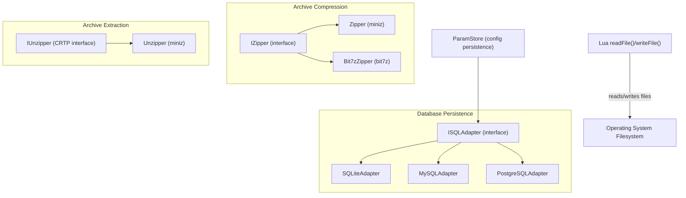

**Diagram sources**
- [IZipper.hpp:20-57](file://fileoperator/IZipper.hpp#L20-L57)
- [zipper.hpp:40-87](file://fileoperator/zipper.hpp#L40-L87)
- [bit7z_zipper.hpp:81-126](file://fileoperator/bit7z_zipper.hpp#L81-L126)
- [IUnzipper.hpp:166-198](file://fileoperator/IUnzipper.hpp#L166-L198)
- [unzipper.hpp:25-77](file://fileoperator/unzipper.hpp#L25-L77)
- [sql_adapter.hpp:36-129](file://fileoperator/sql_adapter.hpp#L36-L129)
- [sql_adapter.hpp:216-328](file://fileoperator/sql_adapter.hpp#L216-L328)
- [param_store.hpp:33-105](file://fileoperator/param_store.hpp#L33-L105)

**Section sources**
- [zipper.hpp:1-104](file://fileoperator/zipper.hpp#L1-L104)
- [bit7z_zipper.hpp:1-130](file://fileoperator/bit7z_zipper.hpp#L1-L130)
- [unzipper.hpp:1-80](file://fileoperator/unzipper.hpp#L1-L80)
- [IUnzipper.hpp:1-202](file://fileoperator/IUnzipper.hpp#L1-L202)
- [IZipper.hpp:1-67](file://fileoperator/IZipper.hpp#L1-L67)
- [sql_adapter.hpp:1-610](file://fileoperator/sql_adapter.hpp#L1-L610)
- [param_store.hpp:1-109](file://fileoperator/param_store.hpp#L1-L109)
- [lua_pipeline.cpp:258-292](file://LibHsBaSlicer/Extends/lua_pipeline.cpp#L258-L292)

## Core Components
- Text I/O for Lua scripts:
  - `readFile(path)` reads a file as text.
  - `writeFile(path, content)` writes text to a file.
- Archive compression:
  - `Zipper`: miniz-based ZIP creation with progress events and duplicate-name handling.
  - `Bit7zZipper`: multi-format compression (ZIP, SevenZip, XZ, BZIP2, GZIP, TAR, TarGz, TarXz, plus RAR/ISO/Z extraction-only formats), password support, and two-stage packaging for compressed tar.
- Archive extraction:
  - `Unzipper`: miniz-based extraction with in-memory cache or temp-file fallback for large entries; exposes `UnzipperStream` as an `std::istream`.
- Database adapters:
  - `ISQLAdapter`: unified CRUD API.
  - `SQLiteAdapter`, `MySQLAdapter`, `PostgreSQLAdapter`: thread-safe backends with prepared statements and typed binding.
- Configuration persistence:
  - `ParamStore`: validates, reflects, coerces, and upserts PipelineConfig structs into a single wide table per config type; supports batch transactions and migration hooks.

**Section sources**
- [lua_pipeline.cpp:258-292](file://LibHsBaSlicer/Extends/lua_pipeline.cpp#L258-L292)
- [zipper.hpp:20-101](file://fileoperator/zipper.hpp#L20-L101)
- [bit7z_zipper.hpp:48-126](file://fileoperator/bit7z_zipper.hpp#L48-L126)
- [unzipper.hpp:19-77](file://fileoperator/unzipper.hpp#L19-L77)
- [IUnzipper.hpp:24-158](file://fileoperator/IUnzipper.hpp#L24-L158)
- [sql_adapter.hpp:30-129](file://fileoperator/sql_adapter.hpp#L30-L129)
- [param_store.hpp:30-105](file://fileoperator/param_store.hpp#L30-L105)

## Architecture Overview
The persistence and packaging architecture connects high-level pipelines to low-level storage and I/O:

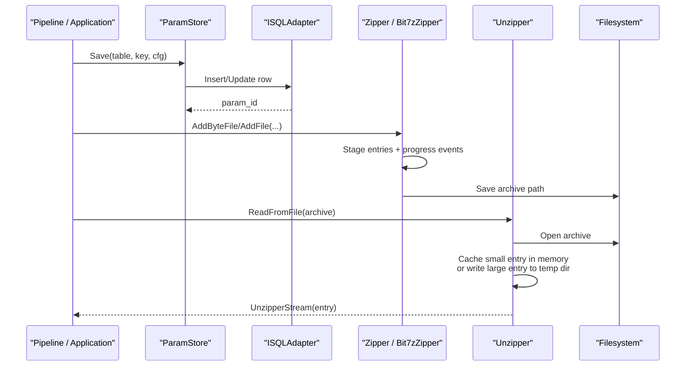

**Diagram sources**
- [param_store.cpp:177-239](file://fileoperator/param_store.cpp#L177-L239)
- [zipper.cpp:114-157](file://fileoperator/zipper.cpp#L114-L157)
- [bit7z_zipper.cpp:191-255](file://fileoperator/bit7z_zipper.cpp#L191-L255)
- [unzipper.cpp:49-126](file://fileoperator/unzipper.cpp#L49-L126)

## Detailed Component Analysis

### Text File I/O for Lua Scripts
Lua scripts can read and write plain text files through:
- `readFile(path)`: returns file contents or nil on failure.
- `writeFile(path, content)`: writes content and returns success status.

These functions bridge Lua to the operating system filesystem and are commonly used for logging, exporting reports, or passing small payloads between pipeline stages.

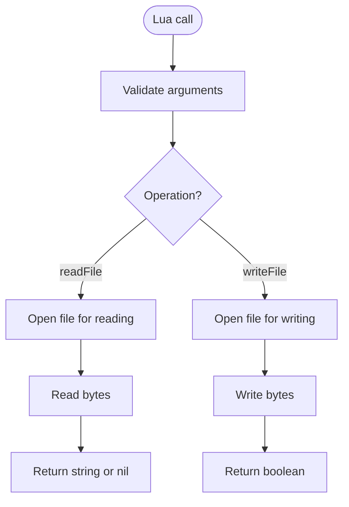

**Section sources**
- [lua_pipeline.cpp:258-292](file://LibHsBaSlicer/Extends/lua_pipeline.cpp#L258-L292)

### Zipper (Miniz-Based ZIP Compressor)
`Zipper` implements `IZipper` and uses miniz to create ZIP archives from staged in-memory buffers or disk files. It raises per-entry progress events and handles duplicate names either by throwing or renaming with a `_duplicate` suffix.

Key behaviors:
- Construction selects a miniz compression level; invalid levels throw.
- Staging methods enforce unique names unless ignore-duplicate variants are used.
- `Save(filePath)` finalizes the archive and throws on failure.
- Standalone helpers extract all files to disk or memory.

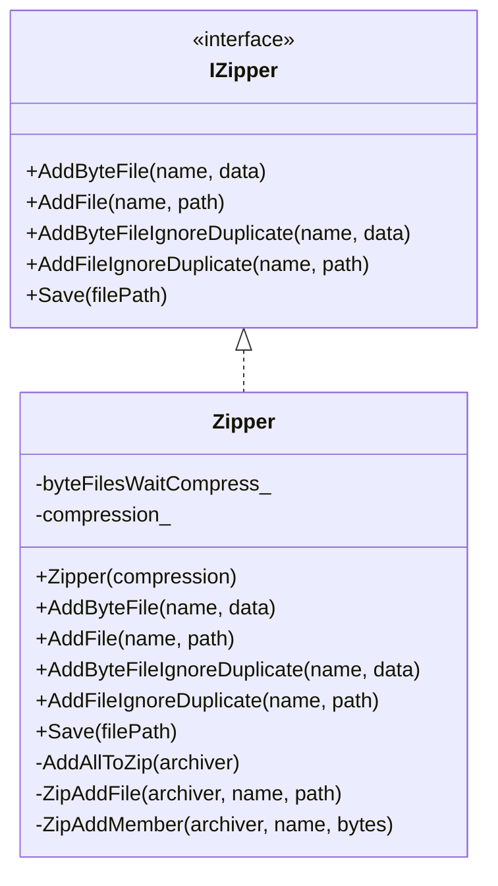

**Diagram sources**
- [IZipper.hpp:20-57](file://fileoperator/IZipper.hpp#L20-L57)
- [zipper.hpp:40-87](file://fileoperator/zipper.hpp#L40-L87)

**Section sources**
- [zipper.hpp:20-101](file://fileoperator/zipper.hpp#L20-L101)
- [zipper.cpp:21-129](file://fileoperator/zipper.cpp#L21-L129)
- [zipper.cpp:137-174](file://fileoperator/zipper.cpp#L137-L174)
- [zipper.cpp:182-267](file://fileoperator/zipper.cpp#L182-L267)

### Bit7zZipper (Multi-Format Compressor)
`Bit7zZipper` extends the same `IZipper` interface but targets multiple container formats via bit7z. It supports:
- Formats: ZIP, SevenZip, XZ, BZIP2, GZIP, TAR, TarGz, TarXz; RAR, ISO, Z are extraction-only.
- Password protection and overwrite mode.
- Two-stage packaging for `.tar.gz`/`.tar.xz`: items are first packed into an in-memory tar, then compressed.
- Progress events per entry.

Extraction helpers also handle compressed tar archives transparently by opening the inner tar reader when needed.

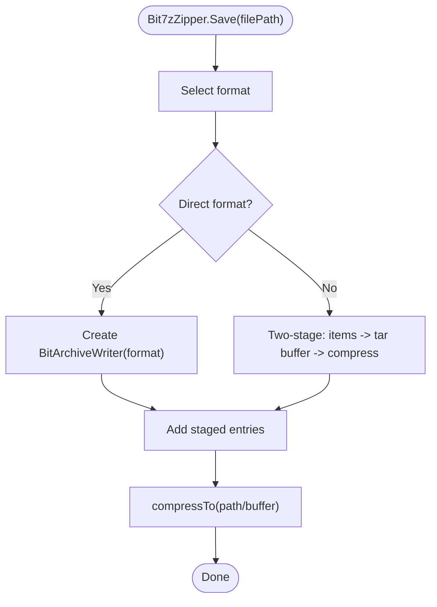

**Diagram sources**
- [bit7z_zipper.cpp:191-255](file://fileoperator/bit7z_zipper.cpp#L191-L255)
- [bit7z_zipper.cpp:286-300](file://fileoperator/bit7z_zipper.cpp#L286-L300)

**Section sources**
- [bit7z_zipper.hpp:48-126](file://fileoperator/bit7z_zipper.hpp#L48-L126)
- [bit7z_zipper.cpp:129-189](file://fileoperator/bit7z_zipper.cpp#L129-L189)
- [bit7z_zipper.cpp:191-255](file://fileoperator/bit7z_zipper.cpp#L191-L255)
- [bit7z_zipper.cpp:257-300](file://fileoperator/bit7z_zipper.cpp#L257-L300)

### Unzipper (Miniz-Based Extractor)
`Unzipper` implements `IUnzipper<Unzipper>` and provides:
- `ReadFromFile(path, reopen)`: opens the archive and clears caches.
- `GetStream(part_file)`: returns an `UnzipperStream` backed by either:
  - In-memory buffer for small entries (cached).
  - Temporary file for large entries (cached by path).
- Memory limit control via `SetMaxMemSize`.

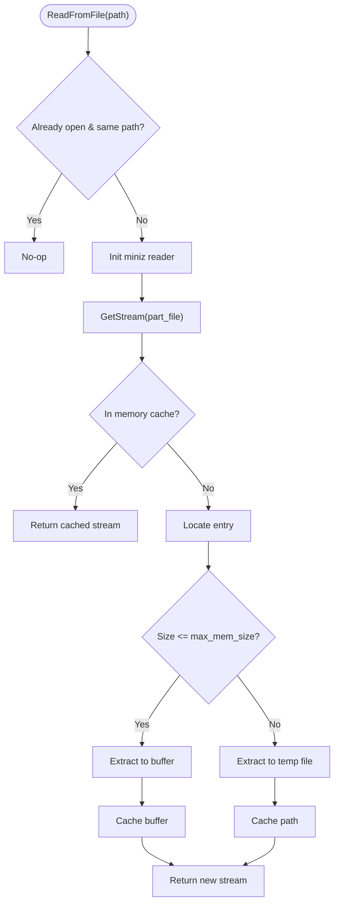

**Diagram sources**
- [unzipper.cpp:49-126](file://fileoperator/unzipper.cpp#L49-L126)
- [unzipper.cpp:135-209](file://fileoperator/unzipper.cpp#L135-L209)

**Section sources**
- [IUnzipper.hpp:24-158](file://fileoperator/IUnzipper.hpp#L24-L158)
- [IUnzipper.hpp:166-198](file://fileoperator/IUnzipper.hpp#L166-L198)
- [unzipper.hpp:19-77](file://fileoperator/unzipper.hpp#L19-L77)
- [unzipper.cpp:14-77](file://fileoperator/unzipper.cpp#L14-L77)
- [unzipper.cpp:79-126](file://fileoperator/unzipper.cpp#L79-L126)
- [unzipper.cpp:127-209](file://fileoperator/unzipper.cpp#L127-L209)

### SQL Adapters (SQLite, MySQL, PostgreSQL)
`ISQLAdapter` defines a unified interface for:
- Connection management (`Connect`).
- Query execution (`Execute`, `Query`).
- High-level CRUD (`Insert`, `Delete`, `Update`, `Select`).
- Schema management (`CreateTable`, `RemoveTable`).

Concrete implementations:
- `SQLiteAdapter`: file-based SQLite with prepared statements and typed binding.
- `MySQLAdapter`: networked MySQL client connection.
- `PostgreSQLAdapter`: networked PostgreSQL client connection.

All adapters expose event notifications and use a PIMPL pattern for internal state.

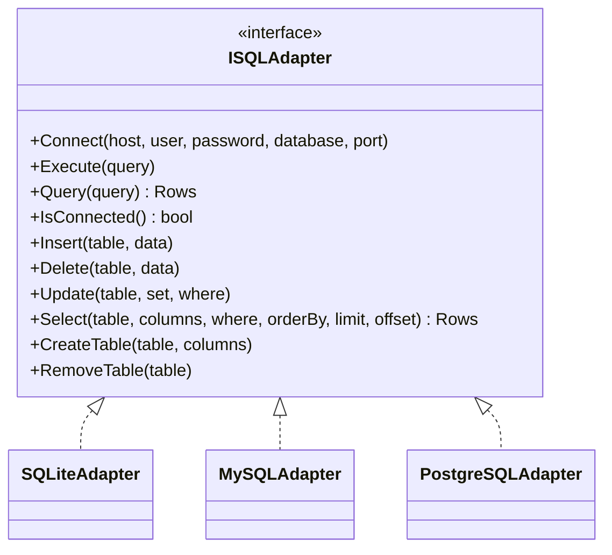

**Diagram sources**
- [sql_adapter.hpp:36-129](file://fileoperator/sql_adapter.hpp#L36-L129)
- [sql_adapter.hpp:216-328](file://fileoperator/sql_adapter.hpp#L216-L328)

**Section sources**
- [sql_adapter.hpp:30-129](file://fileoperator/sql_adapter.hpp#L30-L129)
- [sql_adapter.hpp:216-328](file://fileoperator/sql_adapter.hpp#L216-L328)
- [sql_adapter.cpp:42-142](file://fileoperator/sql_adapter.cpp#L42-L142)
- [sql_adapter.cpp:149-189](file://fileoperator/sql_adapter.cpp#L149-L189)
- [sql_adapter.cpp:191-278](file://fileoperator/sql_adapter.cpp#L191-L278)
- [sql_adapter.cpp:285-369](file://fileoperator/sql_adapter.cpp#L285-L369)
- [sql_adapter.cpp:371-489](file://fileoperator/sql_adapter.cpp#L371-L489)
- [sql_adapter.cpp:491-665](file://fileoperator/sql_adapter.cpp#L491-L665)
- [sql_adapter.cpp:667-731](file://fileoperator/sql_adapter.cpp#L667-L731)
- [sql_adapter.cpp:734-800](file://fileoperator/sql_adapter.cpp#L734-L800)

### ParamStore (Configuration Persistence)
`ParamStore` wraps an `ISQLAdapter` and persists registered PipelineConfig structs:
- `EnsureSchema()` / `EnsureTable(tag)`: creates tables if missing.
- `Save(table, key, cfg)`: validates, reflects fields, coerces types, and upserts rows.
- `SaveBatch(table, items)`: wraps multiple saves in a transaction.
- `Load(table, key, outCfg, arena)`: maps DB row back to struct fields.
- `List(table, whereJson)`: lists keys matching JSON conditions.
- `Update(table, key, partial, changedFields)`: updates only specified fields.
- `Delete(table, key)`: deletes by key.

It emits progress callbacks and records last errors without swallowing exceptions.

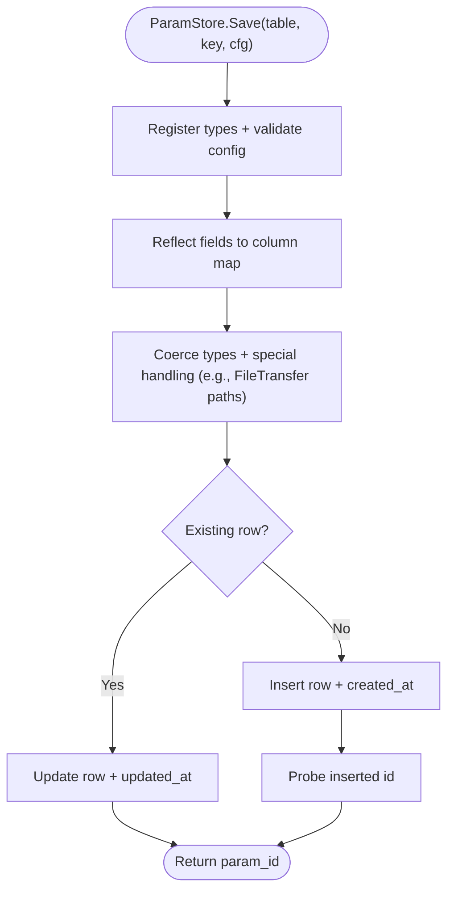

**Diagram sources**
- [param_store.cpp:177-239](file://fileoperator/param_store.cpp#L177-L239)

**Section sources**
- [param_store.hpp:30-105](file://fileoperator/param_store.hpp#L30-L105)
- [param_store.cpp:122-140](file://fileoperator/param_store.cpp#L122-L140)
- [param_store.cpp:142-175](file://fileoperator/param_store.cpp#L142-L175)
- [param_store.cpp:177-239](file://fileoperator/param_store.cpp#L177-L239)
- [param_store.cpp:242-287](file://fileoperator/param_store.cpp#L242-L287)
- [param_store.cpp:289-319](file://fileoperator/param_store.cpp#L289-L319)
- [param_store.cpp:321-358](file://fileoperator/param_store.cpp#L321-L358)
- [param_store.cpp:360-392](file://fileoperator/param_store.cpp#L360-L392)
- [param_store.cpp:394-413](file://fileoperator/param_store.cpp#L394-L413)

## Dependency Analysis
High-level dependencies among components:
- `Zipper` and `Bit7zZipper` implement `IZipper`.
- `Unzipper` implements `IUnzipper<Unzipper>`.
- `ParamStore` depends on `ISQLAdapter` and its concrete backends.
- Lua IO functions depend on the filesystem and are independent of archive/database layers.

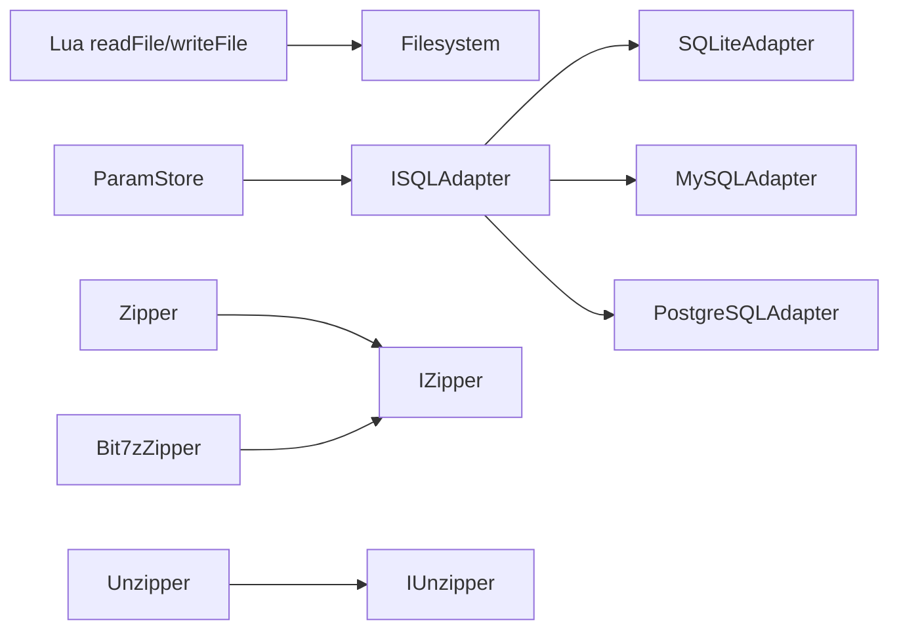

**Diagram sources**
- [IZipper.hpp:20-57](file://fileoperator/IZipper.hpp#L20-L57)
- [IUnzipper.hpp:166-198](file://fileoperator/IUnzipper.hpp#L166-L198)
- [sql_adapter.hpp:36-129](file://fileoperator/sql_adapter.hpp#L36-L129)
- [param_store.hpp:30-105](file://fileoperator/param_store.hpp#L30-L105)

**Section sources**
- [zipper.hpp:40-87](file://fileoperator/zipper.hpp#L40-L87)
- [bit7z_zipper.hpp:81-126](file://fileoperator/bit7z_zipper.hpp#L81-L126)
- [unzipper.hpp:25-77](file://fileoperator/unzipper.hpp#L25-L77)
- [sql_adapter.hpp:216-328](file://fileoperator/sql_adapter.hpp#L216-L328)
- [param_store.hpp:30-105](file://fileoperator/param_store.hpp#L30-L105)

## Performance Considerations
- Archive compression:
  - Prefer `Zipper` for simple ZIP workflows; it is lightweight and integrates well with miniz.
  - Use `Bit7zZipper` when you need multi-format output or compressed tar packaging; be aware of extra memory usage during two-stage tar packaging.
- Archive extraction:
  - Tune `Unzipper::SetMaxMemSize` to balance memory vs. disk I/O for large entries.
  - Reuse a single `Unzipper` instance across multiple entries to avoid repeated initialization overhead.
- Database operations:
  - All adapters use prepared statements and parameter binding to reduce parsing overhead and improve safety.
  - Batch operations should prefer `ParamStore::SaveBatch` to leverage transactions.
- Lua file I/O:
  - Keep payloads small; for large outputs, consider writing directly from C++ pipelines instead of going through Lua strings.

[No sources needed since this section provides general guidance]

## Troubleshooting Guide
Common issues and remedies:
- Duplicate archive entry names:
  - `Zipper` and `Bit7zZipper` throw on duplicates; use the `*IgnoreDuplicate` variants to auto-rename entries with a `_duplicate` suffix.
- Failed archive save/open:
  - Both compressors and extractors throw `IOError` on failures; check paths, permissions, and available disk space.
- Database not connected:
  - Adapters throw `SQLAdapterNotConnectedError` before executing queries; ensure `Connect(...)` succeeded.
- Invalid query or schema:
  - Adapters throw `SQLAdapterQueryError`; inspect generated SQL and column definitions.
- ParamStore validation/reflection errors:
  - Ensure the config type is registered and the table exists; call `EnsureSchema()` before saving.
  - For partial updates, pass only the changed field names to avoid unintended nulls.

**Section sources**
- [zipper.cpp:21-42](file://fileoperator/zipper.cpp#L21-L42)
- [zipper.cpp:50-73](file://fileoperator/zipper.cpp#L50-L73)
- [zipper.cpp:114-129](file://fileoperator/zipper.cpp#L114-L129)
- [bit7z_zipper.cpp:129-155](file://fileoperator/bit7z_zipper.cpp#L129-L155)
- [bit7z_zipper.cpp:191-255](file://fileoperator/bit7z_zipper.cpp#L191-L255)
- [unzipper.cpp:49-77](file://fileoperator/unzipper.cpp#L49-L77)
- [sql_adapter.cpp:70-83](file://fileoperator/sql_adapter.cpp#L70-L83)
- [sql_adapter.cpp:149-189](file://fileoperator/sql_adapter.cpp#L149-L189)
- [param_store.cpp:177-239](file://fileoperator/param_store.cpp#L177-L239)

## Conclusion
HsBaSlicer’s file I/O and persistence layer provides:
- Simple text file access for Lua scripts.
- Robust archive creation and extraction with progress reporting and memory-aware strategies.
- A unified SQL adapter interface with concrete backends for SQLite, MySQL, and PostgreSQL.
- A powerful configuration persistence system that turns structured configs into durable, queryable rows with batch transactions and schema management.

Use these building blocks to design efficient batch workflows, persist pipeline configurations, package outputs, and integrate with external systems through reliable database connections.

[No sources needed since this section summarizes without analyzing specific files]

## Appendices

### Example Workflows

#### Batch Processing Workflow
- Load or generate multiple PipelineConfig objects.
- Call `ParamStore::SaveBatch(table, items)` to persist them atomically.
- Package artifacts using `Zipper` or `Bit7zZipper`, adding generated files and metadata.
- Optionally store result references in the database via `ISQLAdapter`.

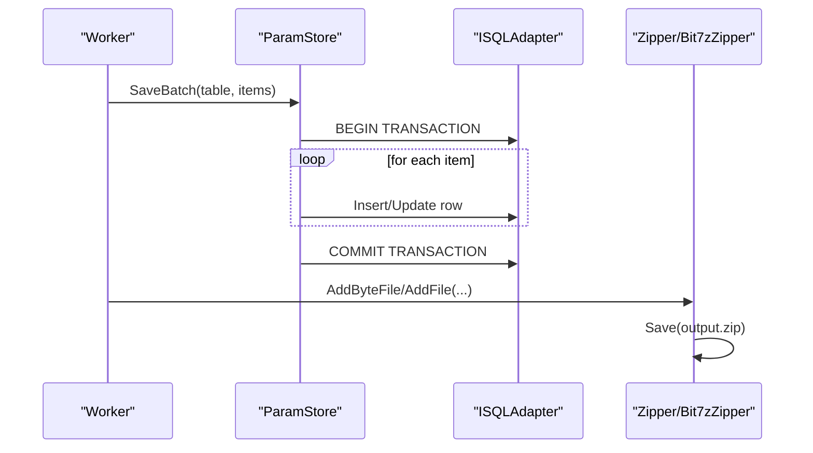

**Diagram sources**
- [param_store.cpp:242-287](file://fileoperator/param_store.cpp#L242-L287)
- [zipper.cpp:114-157](file://fileoperator/zipper.cpp#L114-L157)
- [bit7z_zipper.cpp:191-255](file://fileoperator/bit7z_zipper.cpp#L191-L255)

#### Configuration Management
- Initialize `ParamStore` with a chosen `ISQLAdapter`.
- Call `EnsureSchema()` once at startup.
- Use `Save`, `Load`, `Update`, `Delete`, and `List` to manage configurations.

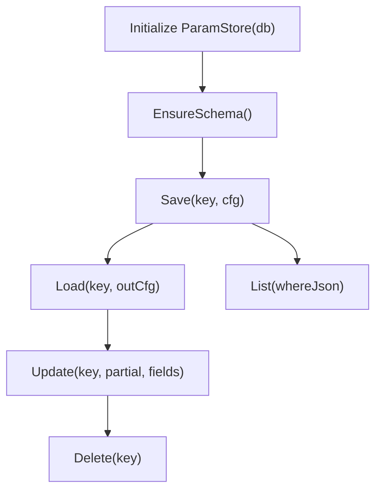

**Diagram sources**
- [param_store.cpp:163-175](file://fileoperator/param_store.cpp#L163-L175)
- [param_store.cpp:177-239](file://fileoperator/param_store.cpp#L177-L239)
- [param_store.cpp:289-319](file://fileoperator/param_store.cpp#L289-L319)
- [param_store.cpp:360-392](file://fileoperator/param_store.cpp#L360-L392)
- [param_store.cpp:394-413](file://fileoperator/param_store.cpp#L394-L413)
- [param_store.cpp:321-358](file://fileoperator/param_store.cpp#L321-L358)

#### Result Packaging
- After processing, stage outputs with `Zipper` or `Bit7zZipper`.
- Report progress via events.
- Store archive path and metadata in the database.

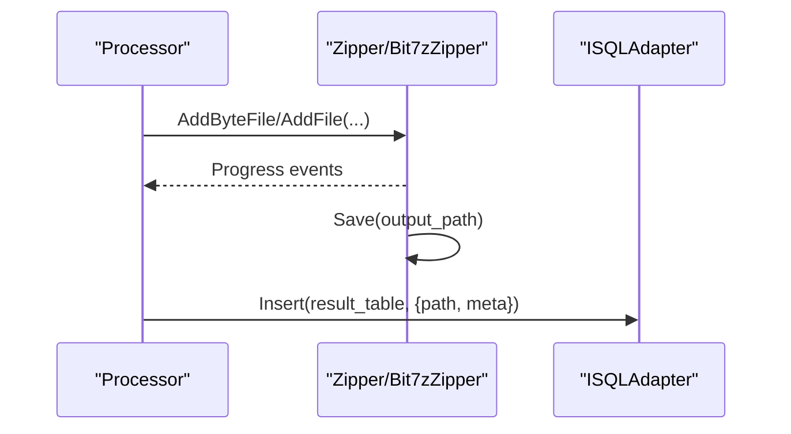

**Diagram sources**
- [zipper.cpp:137-157](file://fileoperator/zipper.cpp#L137-L157)
- [bit7z_zipper.cpp:257-284](file://fileoperator/bit7z_zipper.cpp#L257-L284)
- [sql_adapter.cpp:191-278](file://fileoperator/sql_adapter.cpp#L191-L278)

#### Integration with External Systems Through Database Connections
- Choose the appropriate adapter based on deployment:
  - SQLite for local/embedded scenarios.
  - MySQL/PostgreSQL for shared server environments.
- Connect once per process or connection pool.
- Use prepared statements via the adapter APIs to avoid injection risks.

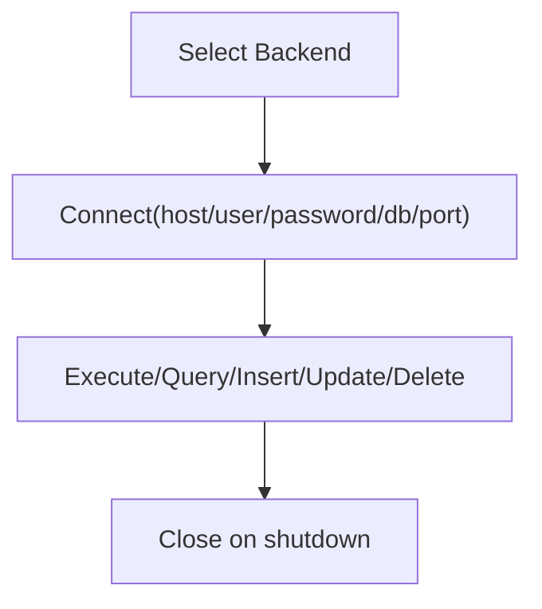

**Diagram sources**
- [sql_adapter.cpp:149-189](file://fileoperator/sql_adapter.cpp#L149-L189)
- [sql_adapter.cpp:734-800](file://fileoperator/sql_adapter.cpp#L734-L800)