# Fill Algorithms / 填充算法

<cite>
**Referenced Files in This Document**   
- [PolygonFill.hpp](file://2D/PolygonFill.hpp)
- [PolygonFill.cpp](file://2D/PolygonFill.cpp)
- [polygon_fill.hpp](file://LibHsBaSlicer/Fill/polygon_fill.hpp)
- [polygon_fill.cpp](file://LibHsBaSlicer/Fill/polygon_fill.cpp)
- [hsba_pipeline.d.lua](file://types/hsba_pipeline.d.lua)
</cite>

## Table of Contents
1. [Introduction](#introduction)
2. [Project Structure](#project-structure)
3. [Core Components](#core-components)
4. [Architecture Overview](#architecture-overview)
5. [Detailed Component Analysis](#detailed-component-analysis)
6. [Dependency Analysis](#dependency-analysis)
7. [Performance Considerations](#performance-considerations)
8. [Troubleshooting Guide](#troubleshooting-guide)
9. [Conclusion](#conclusion)
10. [Appendices](#appendices)

## Introduction
This document explains the polygon infill pattern generation system used by HsBaSlicer. It focuses on:
- The C++ fill algorithms exposed through `PolygonFill` and the LibHsBaSlicer wrapper.
- The Lua-side `PolygonFill` API registered for custom scripts.
- The `FillOptions` configuration type used by the pipeline-level `HsBa.fill()` entry point.
- Practical guidance for choosing spacing, mode, angle, border count, and advanced parameters.
- Custom infill development using Lua scripts.
- Performance tuning for large areas.

The implementation supports offset-based fills, parallel line fills, simple zigzag fills, advanced zigzag fills with improved corner handling, composite offset fills, hybrid fills, and Lua-driven custom fills.

## Project Structure
The fill system is split into two layers:
- A 2D geometry layer under `2D/` that implements the core algorithms and registers Lua functions.
- A LibHsBaSlicer wrapper under `LibHsBaSlicer/Fill/` that exposes a simpler public API.
- A Lua type definition file under `types/` that documents the pipeline-level `FillOptions` and `HsBa.fill()` interface.

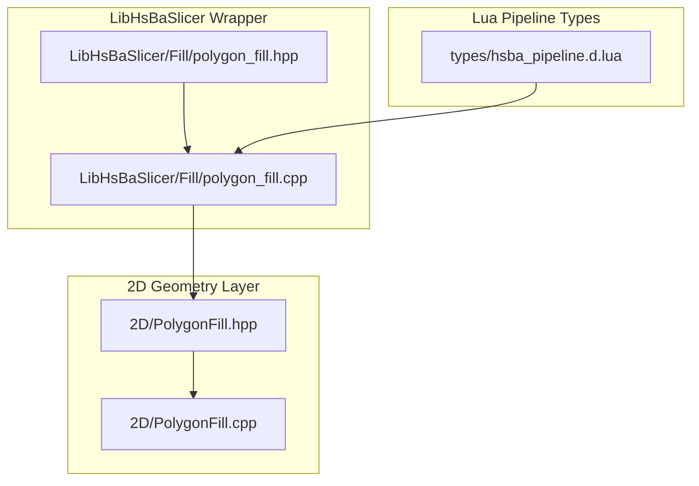

**Diagram sources**
- [PolygonFill.hpp:1-141](file://2D/PolygonFill.hpp#L1-L141)
- [PolygonFill.cpp:1-50](file://2D/PolygonFill.cpp#L1-L50)
- [polygon_fill.hpp:1-58](file://LibHsBaSlicer/Fill/polygon_fill.hpp#L1-L58)
- [polygon_fill.cpp:1-52](file://LibHsBaSlicer/Fill/polygon_fill.cpp#L1-L52)
- [hsba_pipeline.d.lua:198-203](file://types/hsba_pipeline.d.lua#L198-L203)

**Section sources**
- [PolygonFill.hpp:1-141](file://2D/PolygonFill.hpp#L1-L141)
- [polygon_fill.hpp:1-58](file://LibHsBaSlicer/Fill/polygon_fill.hpp#L1-L58)
- [hsba_pipeline.d.lua:198-203](file://types/hsba_pipeline.d.lua#L198-L203)

## Core Components
The core components are:
- `OffsetFill`: generates concentric inward offset polygons as fill paths.
- `LineFill`: generates independent straight-line segments along scan lines.
- `SimpleZigzagFill`: connects adjacent scan segments into a single zigzag polyline.
- `ZigzagFill`: advanced zigzag with connectivity analysis, bridge building, and corner handling.
- `CompositeOffsetFill`: combines base fill with outward and inward offset borders.
- `HybridFill`: applies offsets first, then fills only the final innermost region.
- `offsetOnly`: pure offset loop generator returning generated loops plus last inner/outer boundary polygons.
- `LuaCustomFill` / `LuaCustomFillString`: execute user-defined Lua fill logic.
- LibHsBaSlicer wrappers: `FillPolygon`, `FillWithBorder`, `LuaCustomFillByFile`.
- Pipeline-level `HsBa.fill` documented via `FillOptions`.

Key responsibilities:
- `PolygonFill.hpp` declares the public C++ API and `FillMode`.
- `PolygonFill.cpp` implements algorithms and Lua bindings.
- `polygon_fill.hpp/.cpp` provide a simplified LibHsBaSlicer API.
- `hsba_pipeline.d.lua` defines `FillOptions` and `HsBa.fill`.

**Section sources**
- [PolygonFill.hpp:20-136](file://2D/PolygonFill.hpp#L20-L136)
- [PolygonFill.cpp:231-502](file://2D/PolygonFill.cpp#L231-L502)
- [polygon_fill.hpp:17-53](file://LibHsBaSlicer/Fill/polygon_fill.hpp#L17-L53)
- [polygon_fill.cpp:13-49](file://LibHsBaSlicer/Fill/polygon_fill.cpp#L13-L49)
- [hsba_pipeline.d.lua:198-203](file://types/hsba_pipeline.d.lua#L198-L203)
- [hsba_pipeline.d.lua:398-402](file://types/hsba_pipeline.d.lua#L398-L402)

## Architecture Overview
The fill architecture has three main layers:

1. **Algorithm layer**: Implements geometric operations such as offsetting, intersection, point-in-polygon checks, and path construction.
2. **API layer**: Exposes stable C++ functions (`FillPolygon`, `FillWithBorder`) and Lua functions (`PolygonFill.offsetFill`, etc.).
3. **Pipeline integration layer**: Provides `HsBa.fill(polys, options)` for FDM/SLA pipelines and custom Lua scripts.

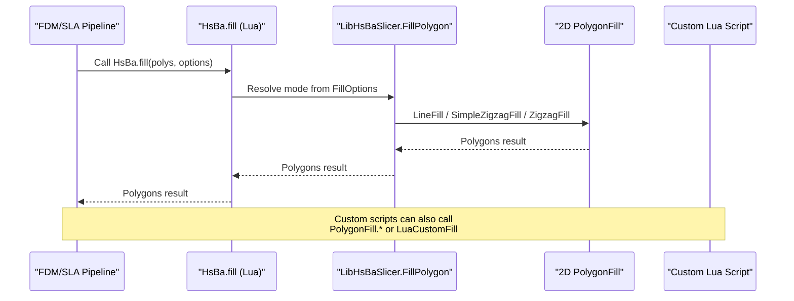

**Diagram sources**
- [hsba_pipeline.d.lua:398-402](file://types/hsba_pipeline.d.lua#L398-L402)
- [polygon_fill.cpp:13-25](file://LibHsBaSlicer/Fill/polygon_fill.cpp#L13-L25)
- [PolygonFill.cpp:544-564](file://2D/PolygonFill.cpp#L544-L564)
- [PolygonFill.cpp:568-800](file://2D/PolygonFill.cpp#L568-L800)
- [PolygonFill.cpp:803-1370](file://2D/PolygonFill.cpp#L803-L1370)

## Detailed Component Analysis

### Offset-Based Fill: `OffsetFill`
`OffsetFill` repeatedly applies negative offsets to generate concentric rings inside the input polygon. Each ring is closed and added to the result until no more valid offsets exist or a maximum iteration limit is reached.

Important characteristics:
- Input: one outer polygon with multiple holes.
- Output: list of closed offset polygons.
- Safety: stops when offset results become empty or after `MAX_FILL_ITERATIONS`.
- Join type affects corner behavior during offset computation.

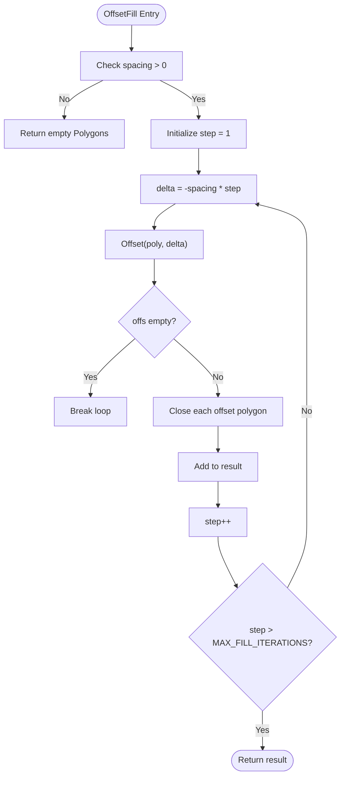

**Diagram sources**
- [PolygonFill.cpp:504-541](file://2D/PolygonFill.cpp#L504-L541)
- [PolygonFill.cpp:26-31](file://2D/PolygonFill.cpp#L26-L31)

**Section sources**
- [PolygonFill.cpp:504-541](file://2D/PolygonFill.cpp#L504-L541)
- [PolygonFill.cpp:26-31](file://2D/PolygonFill.cpp#L26-L31)

### Parallel Line Fill: `LineFill`
`LineFill` computes scan lines at a given angle and spacing, intersects them with the polygon, and returns independent line segments.

Key steps:
- Convert integer polygons to floating-point for robust geometry.
- Compute bounding box and projection direction based on angle.
- Generate rectangular strips along scan lines.
- Intersect strips with polygon to get segments.
- Sort segments by projected position and return as separate polylines.

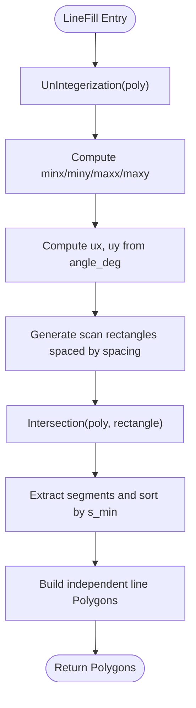

**Diagram sources**
- [PolygonFill.cpp:44-160](file://2D/PolygonFill.cpp#L44-L160)
- [PolygonFill.cpp:544-564](file://2D/PolygonFill.cpp#L544-L564)

**Section sources**
- [PolygonFill.cpp:44-160](file://2D/PolygonFill.cpp#L44-L160)
- [PolygonFill.cpp:544-564](file://2D/PolygonFill.cpp#L544-L564)

### Simple Zigzag Fill: `SimpleZigzagFill`
`SimpleZigzagFill` builds connected zigzag polylines by connecting centers of adjacent scan segments. It allows connectors only between the same row or adjacent rows and uses binary search to clamp segment endpoints to the polygon interior.

Highlights:
- Uses `LineFilling` to obtain scan segments.
- Filters out zero-length segments.
- Clamps segment endpoints to ensure they lie inside the polygon.
- Connects segments into polylines while avoiding non-adjacent row jumps.

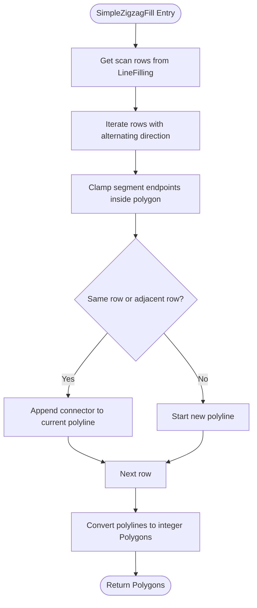

**Diagram sources**
- [PolygonFill.cpp:568-800](file://2D/PolygonFill.cpp#L568-L800)

**Section sources**
- [PolygonFill.cpp:568-800](file://2D/PolygonFill.cpp#L568-L800)

### Advanced Zigzag Fill: `ZigzagFill`
`ZigzagFill` improves corner handling and connectivity by:
- Sorting segments per row.
- Building a flattened segment list with interval information.
- Using union-find to compute connectivity islands across adjacent rows.
- Building bridges along the polygon boundary when direct connections fail.
- Falling back to midpoint-inside checks or emitting extra straight segments.

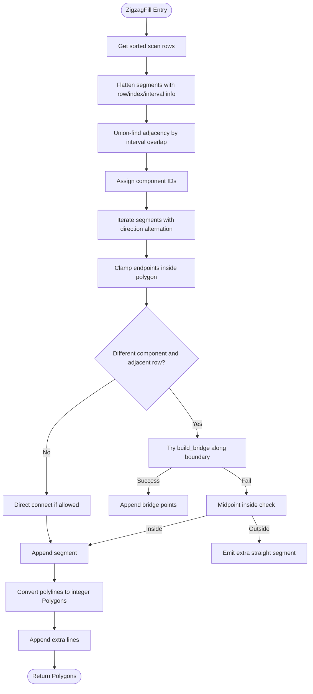

**Diagram sources**
- [PolygonFill.cpp:803-1370](file://2D/PolygonFill.cpp#L803-L1370)

**Section sources**
- [PolygonFill.cpp:803-1370](file://2D/PolygonFill.cpp#L803-L1370)

### Composite Offset Fill: `CompositeOffsetFill`
`CompositeOffsetFill` generates:
- Base fill for the original polygon.
- Outward offset borders filled with the selected mode.
- Inward offset borders filled with the selected mode.

It delegates internal filling to `LineFill`, `SimpleZigzagFill`, or `ZigzagFill` based on `FillMode`.

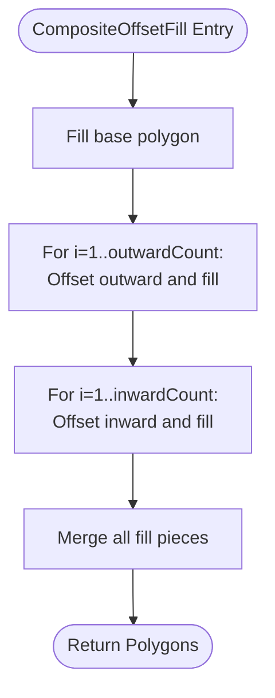

**Diagram sources**
- [PolygonFill.cpp:1372-1428](file://2D/PolygonFill.cpp#L1372-L1428)

**Section sources**
- [PolygonFill.cpp:1372-1428](file://2D/PolygonFill.cpp#L1372-L1428)

### Hybrid Fill: `HybridFill`
`HybridFill` first applies outward offsets and collects closed offset loops. Then it applies inward offsets until the area becomes too small, collecting intermediate offset loops. Finally, it fills only the last valid innermost offset region using the selected fill mode.

Behavioral notes:
- Outward loops are always closed and added.
- Inward loops are collected until polygon size or area drops below thresholds derived from `lineThickness`.
- Final innermost region is filled; tiny regions are skipped.

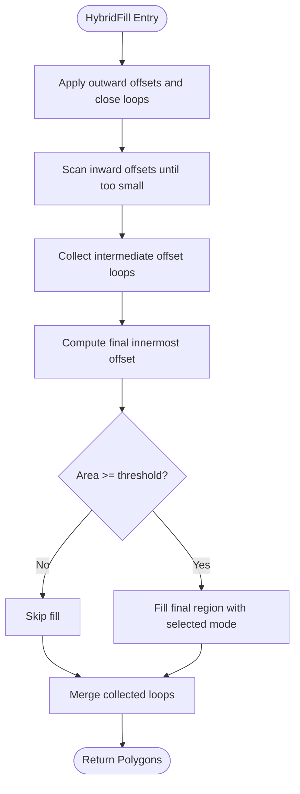

**Diagram sources**
- [PolygonFill.cpp:1430-1491](file://2D/PolygonFill.cpp#L1430-L1491)

**Section sources**
- [PolygonFill.cpp:1430-1491](file://2D/PolygonFill.cpp#L1430-L1491)

### Pure Offset Generator: `offsetOnly`
`offsetOnly` generates offset loops up to specified inner and outer counts and returns:
- Generated offset polygons.
- Last inner boundary polygons.
- Last outer boundary polygons.

This is useful when you need raw offset rings without internal fill.

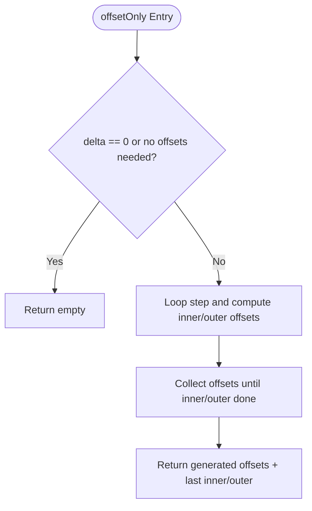

**Diagram sources**
- [PolygonFill.cpp:162-221](file://2D/PolygonFill.cpp#L162-L221)
- [PolygonFill.cpp:434-486](file://2D/PolygonFill.cpp#L434-L486)

**Section sources**
- [PolygonFill.cpp:162-221](file://2D/PolygonFill.cpp#L162-L221)
- [PolygonFill.cpp:434-486](file://2D/PolygonFill.cpp#L434-L486)

### Lua Custom Fill: `LuaCustomFill` and `LuaCustomFillString`
These functions allow users to define custom infill patterns in Lua. They:
- Create a Lua state.
- Register polygon operations and fill functions.
- Load either a script file or inline script code.
- Call a user-specified function with the polygon table.
- Parse the returned table of polylines/polygons.
- Convert floating-point coordinates back to integer polygons.

Error handling includes:
- Failed Lua state creation.
- Script load errors.
- Missing function name.
- Non-table return value.
- Lua runtime errors during function execution.

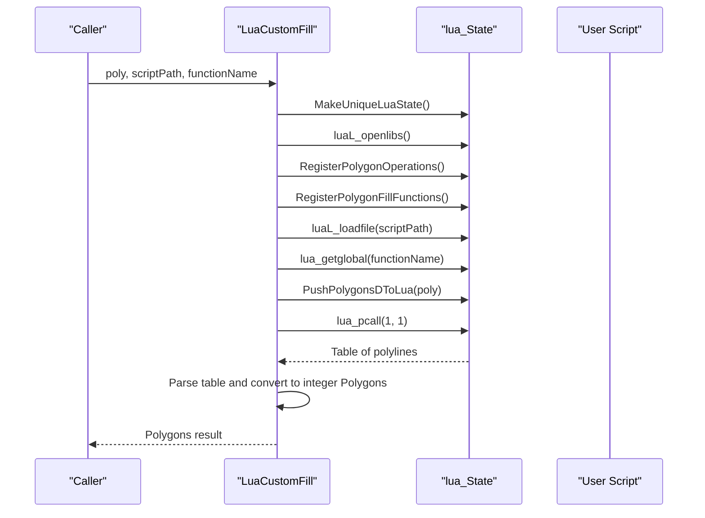

**Diagram sources**
- [PolygonFill.cpp:1494-1585](file://2D/PolygonFill.cpp#L1494-L1585)
- [PolygonFill.cpp:1587-1669](file://2D/PolygonFill.cpp#L1587-L1669)

**Section sources**
- [PolygonFill.cpp:1494-1585](file://2D/PolygonFill.cpp#L1494-L1585)
- [PolygonFill.cpp:1587-1669](file://2D/PolygonFill.cpp#L1587-L1669)

### LibHsBaSlicer Public API
The LibHsBaSlicer wrapper provides a simplified API:
- `FillPolygon`: selects algorithm based on `FillMode`.
- `FillWithBorder`: wraps `CompositeOffsetFill` with border count.
- `LuaCustomFillByFile`: composes external 2D functions and path optimization functions into the Lua environment.

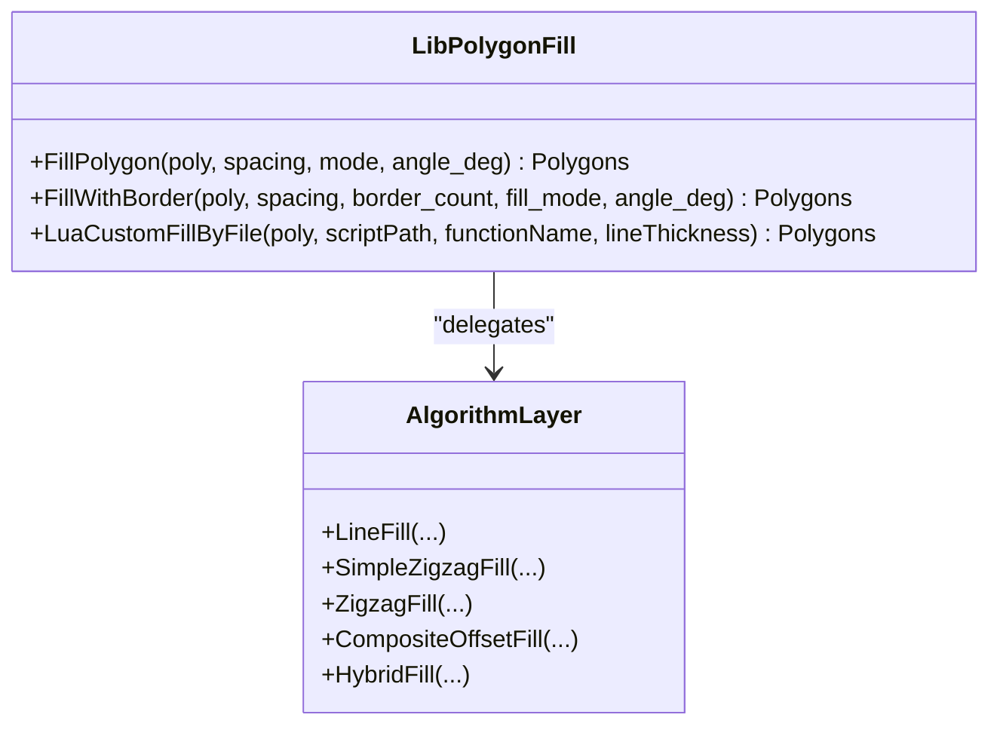

**Diagram sources**
- [polygon_fill.hpp:17-53](file://LibHsBaSlicer/Fill/polygon_fill.hpp#L17-L53)
- [polygon_fill.cpp:13-49](file://LibHsBaSlicer/Fill/polygon_fill.cpp#L13-L49)

**Section sources**
- [polygon_fill.hpp:17-53](file://LibHsBaSlicer/Fill/polygon_fill.hpp#L17-L53)
- [polygon_fill.cpp:13-49](file://LibHsBaSlicer/Fill/polygon_fill.cpp#L13-L49)

### FillOptions Configuration
`FillOptions` is defined in the Lua type definitions and controls the pipeline-level fill operation:

| Field | Type | Default | Description |
|-------|------|---------|-------------|
| `spacing` | number | 0.4 | Fill line spacing. |
| `mode` | string | "zigzag" | Fill mode selection: `"line"`, `"simpleZigzag"`, or `"zigzag"`. |
| `angle` | number | 45.0 | Fill angle in degrees. |
| `borderCount` | integer | 0 | Number of border offset loops. |

The pipeline-level `HsBa.fill(polys, options)` uses these fields to choose between built-in fill strategies.

**Section sources**
- [hsba_pipeline.d.lua:198-203](file://types/hsba_pipeline.d.lua#L198-L203)
- [hsba_pipeline.d.lua:398-402](file://types/hsba_pipeline.d.lua#L398-L402)

## Dependency Analysis
The fill system has clear dependency boundaries:

- `PolygonFill.cpp` depends on:
  - Clipper2Lib for boolean operations and offsetting.
  - Lua adapter utilities for converting between Lua tables and polygons.
  - Error helpers for throwing runtime exceptions.
- `polygon_fill.cpp` depends on:
  - `2D/PolygonFill.hpp` for core algorithms.
  - Lua registration for path optimization functions.
- `hsba_pipeline.d.lua` documents the Lua API but does not implement runtime behavior.

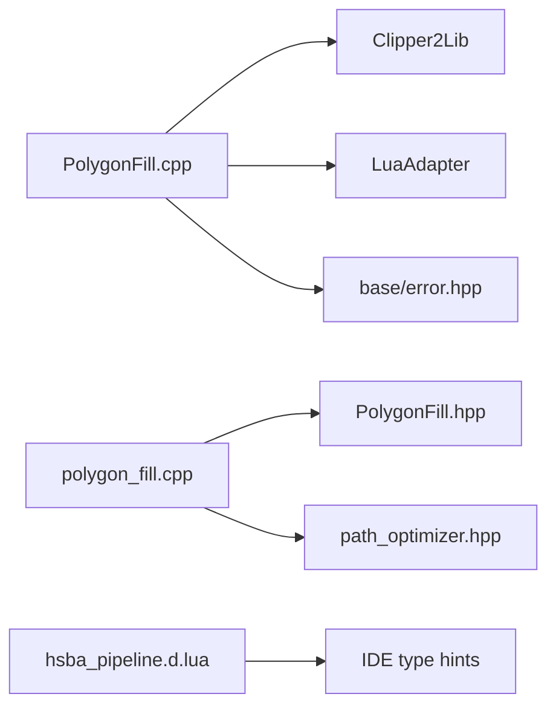

**Diagram sources**
- [PolygonFill.cpp:8-19](file://2D/PolygonFill.cpp#L8-L19)
- [polygon_fill.cpp:5-9](file://LibHsBaSlicer/Fill/polygon_fill.cpp#L5-L9)
- [hsba_pipeline.d.lua:1-8](file://types/hsba_pipeline.d.lua#L1-L8)

**Section sources**
- [PolygonFill.cpp:8-19](file://2D/PolygonFill.cpp#L8-L19)
- [polygon_fill.cpp:5-9](file://LibHsBaSlicer/Fill/polygon_fill.cpp#L5-L9)

## Performance Considerations
For large-area fills, consider the following techniques:

1. **Choose appropriate spacing**:
   - Larger spacing reduces the number of scan lines or offset rings.
   - Smaller spacing increases detail but may significantly increase computation time.

2. **Select efficient fill modes**:
   - `LineFill` produces independent segments and is generally faster.
   - `SimpleZigzagFill` adds connectivity logic but avoids complex bridge computation.
   - `ZigzagFill` performs connectivity analysis and bridge building; use it when corner quality matters.

3. **Limit border counts**:
   - High `borderCount` increases offset operations and fill calls.
   - Use `CompositeOffsetFill` or `HybridFill` judiciously for thick-walled parts.

4. **Use `offsetOnly` for pre-checks**:
   - If you only need offset rings, avoid calling full fill algorithms.

5. **Avoid excessive Lua overhead**:
   - For performance-critical paths, prefer built-in algorithms over custom Lua scripts.
   - If using Lua, keep scripts minimal and reuse computed geometry.

6. **Tune join types**:
   - Corner join types affect offset computation cost and output shape.
   - Square joins are typically simpler; round or miter joins may be more expensive.

[No sources needed since this section provides general guidance]

## Troubleshooting Guide
Common issues and resolutions:

- **Empty fill results**:
  - Check that `spacing > 0`.
  - Verify polygon validity (non-empty outer boundary).
  - Ensure angle and thickness values are reasonable.

- **Lua script errors**:
  - Confirm the script file exists and loads successfully.
  - Ensure the function name matches the exported symbol.
  - Validate that the script returns a table of polylines/polygons.

- **Unexpected gaps or disconnected paths**:
  - For zigzag fills, verify that adjacent rows have overlapping intervals.
  - Check whether bridge building fails due to boundary geometry.
  - Consider switching from `SimpleZigzagFill` to `ZigzagFill` for better corner handling.

- **Excessive memory usage**:
  - Reduce `outwardCount` and `inwardCount`.
  - Avoid overly fine spacing for large areas.
  - Prefer `LineFill` over zigzag variants when connectivity is not required.

**Section sources**
- [PolygonFill.cpp:504-541](file://2D/PolygonFill.cpp#L504-L541)
- [PolygonFill.cpp:1494-1585](file://2D/PolygonFill.cpp#L1494-L1585)

## Conclusion
The HsBaSlicer fill system provides a flexible set of polygon infill strategies ranging from simple offset rings to advanced zigzag patterns with corner-aware connectivity. The architecture cleanly separates algorithm implementation, public API exposure, and pipeline integration. Users can tune spacing, mode, angle, and border count through `FillOptions`, or extend behavior with Lua scripts. For production use, select fill modes based on required quality and performance, and apply border strategies carefully to balance strength and print time.

[No sources needed since this section summarizes without analyzing specific files]

## Appendices

### API Reference Summary

#### C++ API
- `OffsetFill(poly, spacing, join_type)`
- `LineFill(poly, spacing, angle_deg, lineThickness)`
- `SimpleZigzagFill(poly, spacing, angle_deg, lineThickness)`
- `ZigzagFill(poly, spacing, angle_deg, lineThickness)`
- `CompositeOffsetFill(poly, spacing, offsetStep, outwardCount, inwardCount, mode, angle_deg, lineThickness, join_type)`
- `HybridFill(poly, spacing, offsetStep, outwardCount, inwardCount, mode, angle_deg, lineThickness, join_type)`
- `LuaCustomFill(poly, scriptPath, functionName, lineThickness, lua_reg)`
- `LuaCustomFillString(poly, script, functionName, lineThickness, lua_reg)`
- `RegisterLuaPolygonFillFunctions(L)`

#### LibHsBaSlicer API
- `FillPolygon(poly, spacing, mode, angle_deg)`
- `FillWithBorder(poly, spacing, border_count, fill_mode, angle_deg)`
- `LuaCustomFillByFile(poly, scriptPath, functionName, lineThickness)`

#### Lua API
- `PolygonFill.offsetFill(polys, spacing, opts?)`
- `PolygonFill.lineFill(polys, spacing, angle, lineThickness)`
- `PolygonFill.simpleZigzagFill(polys, spacing, angle, lineThickness)`
- `PolygonFill.zigzagFill(polys, spacing, angle, lineThickness)`
- `PolygonFill.compositeOffsetFill(polys, spacing, offsetStep, outwardCount, inwardCount, mode, angle, lineThickness, opts?)`
- `PolygonFill.hybridFill(polys, spacing, offsetStep, outwardCount, inwardCount, mode, angle, lineThickness, opts?)`
- `PolygonFill.offsetOnly(polys, delta, inner, outer, opts?)`
- `HsBa.fill(polys, options)`

**Section sources**
- [PolygonFill.hpp:20-136](file://2D/PolygonFill.hpp#L20-L136)
- [polygon_fill.hpp:17-53](file://LibHsBaSlicer/Fill/polygon_fill.hpp#L17-L53)
- [hsba_pipeline.d.lua:54-62](file://types/hsba_pipeline.d.lua#L54-L62)
- [hsba_pipeline.d.lua:398-402](file://types/hsba_pipeline.d.lua#L398-L402)