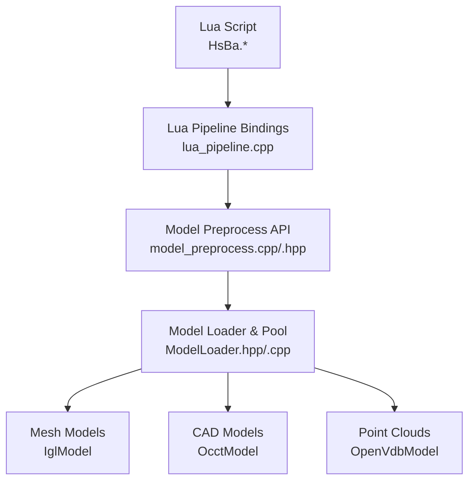
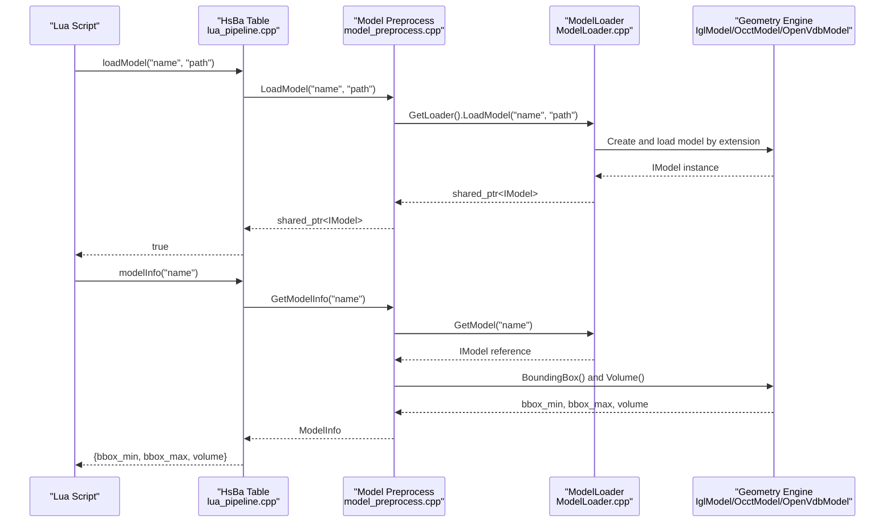
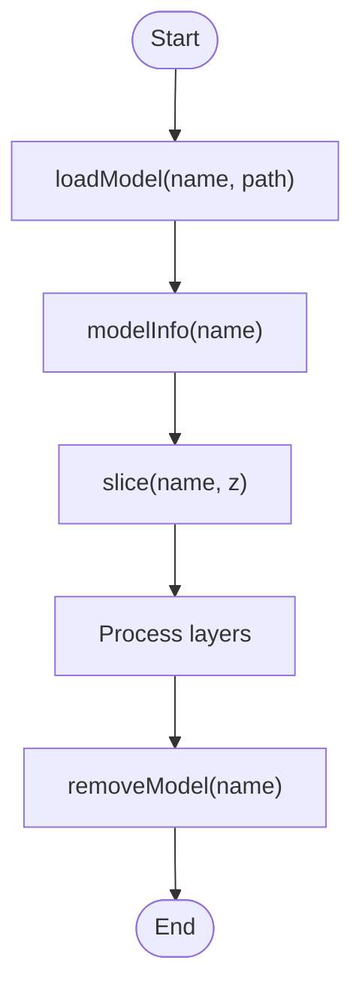
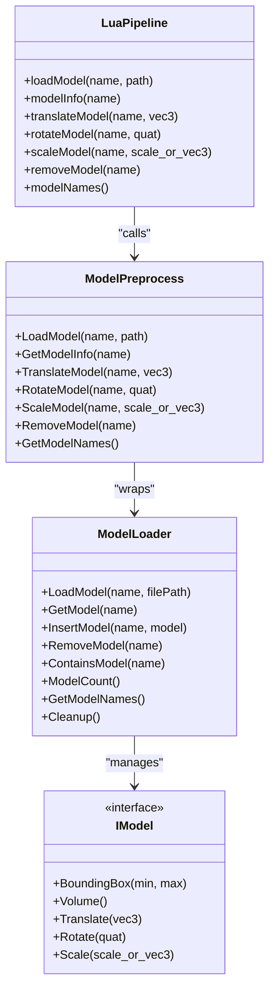

# Model Operations / 模型操作

<cite>
**Referenced Files in This Document**   
- [lua_pipeline.cpp](file://LibHsBaSlicer/Extends/lua_pipeline.cpp)
- [model_preprocess.cpp](file://LibHsBaSlicer/Preprocess/model_preprocess.cpp)
- [model_preprocess.hpp](file://LibHsBaSlicer/Preprocess/model_preprocess.hpp)
- [ModelLoader.hpp](file://preprocess/ModelLoader.hpp)
- [ModelLoader.cpp](file://preprocess/ModelLoader.cpp)
- [main.cpp](file://samples/Custom/main.cpp)
</cite>

## Table of Contents
1. [Introduction](#introduction)
2. [Project Structure](#project-structure)
3. [Core Components](#core-components)
4. [Architecture Overview](#architecture-overview)
5. [Detailed Component Analysis](#detailed-component-analysis)
6. [Dependency Analysis](#dependency-analysis)
7. [Performance Considerations](#performance-considerations)
8. [Troubleshooting Guide](#troubleshooting-guide)
9. [Conclusion](#conclusion)
10. [Appendices](#appendices)

## Introduction
This document explains the model manipulation API exposed to Lua scripts in the HsBaSlicer environment. It covers the complete model lifecycle: loading models into a named pool, querying metadata such as bounding box and volume, applying transformations using translation, quaternion-based rotation, and uniform or per-axis scaling, and removing models to free memory. It also documents the model naming system, coordinate conventions, error handling patterns, and best practices for working with large STL/OBJ files.

The Lua surface is implemented under the global `HsBa` table. The most relevant functions are:
- `loadModel(name, path)`
- `modelInfo(name)`
- `translateModel(name, {x,y,z})`
- `rotateModel(name, {x,y,z,w})`
- `scaleModel(name, s | {x,y,z})`
- `removeModel(name)`
- `modelNames()`

These functions are documented here from both the Lua scripting perspective and the underlying C++ implementation.

## Project Structure
The model operations span three layers:
- Lua layer: exposes `HsBa.loadModel`, `HsBa.modelInfo`, `HsBa.translateModel`, `HsBa.rotateModel`, `HsBa.scaleModel`, `HsBa.removeModel`, and `HsBa.modelNames`.
- Preprocessing layer: provides thread-safe wrappers around model loader operations and defines `ModelInfo`.
- Loader layer: implements format dispatching (STL/OBJ mesh, STEP/IGES BRep, point cloud), stores models in a named pool, and performs geometry queries and transformations.

**Diagram sources**
- [lua_pipeline.cpp:292-397](file://LibHsBaSlicer/Extends/lua_pipeline.cpp#L292-L397)
- [model_preprocess.cpp:55-156](file://LibHsBaSlicer/Preprocess/model_preprocess.cpp#L55-L156)
- [ModelLoader.hpp:23-89](file://preprocess/ModelLoader.hpp#L23-L89)
- [ModelLoader.cpp:45-130](file://preprocess/ModelLoader.cpp#L45-L130)

**Section sources**
- [lua_pipeline.cpp:292-397](file://LibHsBaSlicer/Extends/lua_pipeline.cpp#L292-L397)
- [model_preprocess.cpp:55-156](file://LibHsBaSlicer/Preprocess/model_preprocess.cpp#L55-L156)
- [ModelLoader.hpp:23-89](file://preprocess/ModelLoader.hpp#L23-L89)
- [ModelLoader.cpp:45-130](file://preprocess/ModelLoader.cpp#L45-L130)

## Core Components
This section summarizes the core model lifecycle functions available to Lua scripts and their C++ backing.

| Lua Function | Purpose | Parameters | Return Value | Notes |
|---|---|---|---|---|
| `loadModel(name, path)` | Load a 3D model file into the named model pool | `name`: unique string identifier; `path`: file path | Boolean true on success | If the name already exists, it returns the existing model instead of reloading |
| `modelInfo(name)` | Query model metadata | `name`: model identifier | Table with `bbox_min`, `bbox_max`, `volume` | Missing models raise an error |
| `translateModel(name, {x,y,z})` | Translate a model by a 3D vector | `name`; `{x,y,z}` table | None | Default translation is zero if fields are missing |
| `rotateModel(name, {x,y,z,w})` | Rotate a model using a quaternion | `name`; `{x,y,z,w}` table | None | Defaults to identity quaternion when fields are omitted |
| `scaleModel(name, s \| {x,y,z})` | Scale a model uniformly or per axis | `name`; scalar or `{x,y,z}` table | None | Uniform scale uses a single number; per-axis scale uses a table |
| `removeModel(name)` | Remove a model from the pool | `name` | None | Frees resources associated with the named model |
| `modelNames()` | List all model names currently in the pool | None | Array of strings | Useful for debugging and cleanup |

Key implementation details:
- Model loading supports mesh formats (STL, OBJ, PLY, OFF) via IGL and BRep formats (STEP, IGES, VRML, BREP) via OCCT when enabled.
- The model pool is a named object pool with a compile-time capacity.
- All exported model operations are wrapped in a guard that converts third-party exceptions into project-specific errors.

**Section sources**
- [lua_pipeline.cpp:292-397](file://LibHsBaSlicer/Extends/lua_pipeline.cpp#L292-L397)
- [model_preprocess.hpp:22-120](file://LibHsBaSlicer/Preprocess/model_preprocess.hpp#L22-L120)
- [ModelLoader.hpp:23-89](file://preprocess/ModelLoader.hpp#L23-L89)
- [ModelLoader.cpp:45-130](file://preprocess/ModelLoader.cpp#L45-L130)

## Architecture Overview
The model pipeline connects Lua scripts to C++ geometry engines through a layered architecture.

**Diagram sources**
- [lua_pipeline.cpp:292-340](file://LibHsBaSlicer/Extends/lua_pipeline.cpp#L292-L340)
- [model_preprocess.cpp:55-131](file://LibHsBaSlicer/Preprocess/model_preprocess.cpp#L55-L131)
- [ModelLoader.cpp:45-90](file://preprocess/ModelLoader.cpp#L45-L90)

## Detailed Component Analysis

### Model Loading: `loadModel(name, path)`
Lua function behavior:
- Validates arguments: expects a string name and a string path.
- Checks whether the model name already exists in the pool.
- If not present, loads the model from the file path.
- Returns boolean true on success; raises an error if loading fails.

C++ backing:
- `LoadModel` wraps the loader call in `GuardModel`, which catches foreign exceptions and converts them into project errors.
- `ModelLoader::LoadModel` determines the format by file extension and selects the appropriate engine:
  - Mesh formats: IGL (`IglModel`)
  - BRep formats: OCCT (`OcctModel`) when enabled
  - Point cloud formats: OpenVDB (`OpenVdbModel`) when enabled
- Stores the model in a named pool backed by `NamedObjectPool`.

Error handling:
- Duplicate name: throws invalid argument error at the loader level.
- Unsupported format: throws invalid argument error.
- File load failure: throws runtime error.

Best practices:
- Use stable, unique model names.
- Prefer reusing loaded models rather than reloading frequently.
- Check return values and handle errors in Lua scripts.

**Section sources**
- [lua_pipeline.cpp:292-308](file://LibHsBaSlicer/Extends/lua_pipeline.cpp#L292-L308)
- [model_preprocess.cpp:55-58](file://LibHsBaSlicer/Preprocess/model_preprocess.cpp#L55-L58)
- [ModelLoader.cpp:45-84](file://preprocess/ModelLoader.cpp#L45-L84)

### Model Metadata: `modelInfo(name)`
Lua function behavior:
- Requires the model to exist in the pool; otherwise raises an error.
- Returns a table containing:
  - `bbox_min`: `{x, y, z}`
  - `bbox_max`: `{x, y, z}`
  - `volume`: numeric value

C++ backing:
- `GetModelInfo` retrieves the model and calls its bounding box and volume methods.
- The result is returned as a `ModelInfo` struct with `bbox_min`, `bbox_max`, and `volume`.

Coordinate system:
- Coordinates are in millimeters.
- Bounding boxes represent the minimum and maximum corners of the model’s axis-aligned bounding box.

Practical usage:
- Use `bbox_min.z` and `bbox_max.z` to compute model height.
- Use `volume` for mass estimation or material calculations.

**Section sources**
- [lua_pipeline.cpp:310-340](file://LibHsBaSlicer/Extends/lua_pipeline.cpp#L310-L340)
- [model_preprocess.cpp:117-131](file://LibHsBaSlicer/Preprocess/model_preprocess.cpp#L117-L131)
- [model_preprocess.hpp:22-30](file://LibHsBaSlicer/Preprocess/model_preprocess.hpp#L22-L30)

### Translation: `translateModel(name, {x,y,z})`
Lua function behavior:
- Accepts a model name and a table representing a 3D translation vector.
- Uses default zero vector if fields are missing.
- Applies translation to the model in place.

C++ backing:
- `TranslateModel` retrieves the model and calls its `Translate` method.
- Wrapped in `GuardModel` for safe exception handling.

Use cases:
- Centering models relative to the build plate.
- Aligning multiple parts before slicing.

**Section sources**
- [lua_pipeline.cpp:342-350](file://LibHsBaSlicer/Extends/lua_pipeline.cpp#L342-L350)
- [model_preprocess.cpp:65-76](file://LibHsBaSlicer/Preprocess/model_preprocess.cpp#L65-L76)

### Rotation: `rotateModel(name, {x,y,z,w})`
Lua function behavior:
- Accepts a model name and a quaternion table `{x, y, z, w}`.
- Defaults to identity quaternion if fields are omitted.
- Applies rotation to the model in place.

Quaternion semantics:
- The rotation is represented as a unit quaternion.
- Non-normalized quaternions may produce incorrect rotations; ensure inputs are normalized.

C++ backing:
- `RotateModel` retrieves the model and calls its `Rotate` method.
- Wrapped in `GuardModel` for safe exception handling.

Best practices:
- Normalize quaternions before passing to `rotateModel`.
- Combine rotations carefully; order matters when composing multiple rotations.

**Section sources**
- [lua_pipeline.cpp:352-363](file://LibHsBaSlicer/Extends/lua_pipeline.cpp#L352-L363)
- [model_preprocess.cpp:78-89](file://LibHsBaSlicer/Preprocess/model_preprocess.cpp#L78-L89)

### Scaling: `scaleModel(name, s | {x,y,z})`
Lua function behavior:
- Supports two forms:
  - Uniform scaling: pass a scalar number.
  - Per-axis scaling: pass a table `{x, y, z}`.
- Defaults to identity scale if fields are omitted.
- Applies scaling to the model in place.

C++ backing:
- Two overloads exist: one for scalar scale and one for `Eigen::Vector3f` scale.
- Both retrieve the model and call its `Scale` method.
- Wrapped in `GuardModel` for safe exception handling.

Use cases:
- Resizing models to fit within printer bounds.
- Adjusting aspect ratios for specific manufacturing requirements.

**Section sources**
- [lua_pipeline.cpp:365-378](file://LibHsBaSlicer/Extends/lua_pipeline.cpp#L365-L378)
- [model_preprocess.cpp:91-115](file://LibHsBaSlicer/Preprocess/model_preprocess.cpp#L91-L115)

### Removal and Cleanup: `removeModel(name)` and `modelNames()`
Lua function behavior:
- `removeModel(name)` removes the named model from the pool.
- `modelNames()` returns an array of all current model names.

C++ backing:
- `RemoveModel` delegates to the loader’s removal method.
- `GetModelNames` returns the list of names from the named object pool.

Memory management:
- Removing unused models frees associated resources.
- The pool has a fixed capacity controlled by a compile-time macro.
- Additional cleanup can be performed via `CleanupModels` in the preprocessing layer.

Best practices:
- Call `removeModel` after processing to avoid memory leaks.
- Use `modelNames` to inspect the pool during debugging.

**Section sources**
- [lua_pipeline.cpp:380-397](file://LibHsBaSlicer/Extends/lua_pipeline.cpp#L380-L397)
- [model_preprocess.cpp:133-156](file://LibHsBaSlicer/Preprocess/model_preprocess.cpp#L133-L156)
- [ModelLoader.cpp:107-130](file://preprocess/ModelLoader.cpp#L107-L130)

### Model Naming System
- Model names are unique identifiers stored in a named object pool.
- Duplicate names are rejected during insertion.
- Names are used to retrieve, transform, query, and remove models.
- The pool capacity is compile-time configurable.

Implications:
- Choose meaningful, stable names for models.
- Avoid dynamic generation of names without uniqueness checks.
- Use `modelNames` to audit the pool state.

**Section sources**
- [ModelLoader.hpp:23-89](file://preprocess/ModelLoader.hpp#L23-L89)
- [ModelLoader.cpp:45-130](file://preprocess/ModelLoader.cpp#L45-L130)

### Coordinate Transformations and Quaternions
- Translation uses a 3D vector in millimeters.
- Rotation uses a quaternion `{x, y, z, w}`.
- Scaling supports uniform and per-axis modes.
- Transformations are applied in place to the model in the pool.

Recommendations:
- Keep units consistent (millimeters).
- Normalize quaternions before rotation.
- Apply transformations in a predictable order: translate, rotate, then scale.

**Section sources**
- [lua_pipeline.cpp:342-378](file://LibHsBaSlicer/Extends/lua_pipeline.cpp#L342-L378)
- [model_preprocess.cpp:65-115](file://LibHsBaSlicer/Preprocess/model_preprocess.cpp#L65-L115)

### Practical Examples
The sample custom pipeline demonstrates how to use the model API in practice:
- Load a model using `loadModel`.
- Query layer count and model info using `layerCount` and `modelInfo`.
- Slice the model and process layers.
- Remove the model using `removeModel`.

**Diagram sources**
- [main.cpp:274-297](file://samples/Custom/main.cpp#L274-L297)

**Section sources**
- [main.cpp:274-297](file://samples/Custom/main.cpp#L274-L297)

## Dependency Analysis
The model operations depend on several components:

**Diagram sources**
- [lua_pipeline.cpp:292-397](file://LibHsBaSlicer/Extends/lua_pipeline.cpp#L292-L397)
- [model_preprocess.cpp:55-156](file://LibHsBaSlicer/Preprocess/model_preprocess.cpp#L55-L156)
- [ModelLoader.hpp:30-92](file://preprocess/ModelLoader.hpp#L30-L92)

**Section sources**
- [lua_pipeline.cpp:292-397](file://LibHsBaSlicer/Extends/lua_pipeline.cpp#L292-L397)
- [model_preprocess.cpp:55-156](file://LibHsBaSlicer/Preprocess/model_preprocess.cpp#L55-L156)
- [ModelLoader.hpp:30-92](file://preprocess/ModelLoader.hpp#L30-L92)

## Performance Considerations
- Model loading time depends on file size and format. Mesh formats (STL/OBJ) are generally faster than BRep formats (STEP/IGES).
- Large models increase memory usage and transformation cost.
- Reuse models by name instead of reloading frequently.
- Remove unused models promptly to free memory.
- For very large models, consider downsampling or simplifying geometry before loading.
- Batch transformations where possible to reduce repeated lookups.

[No sources needed since this section provides general guidance]

## Troubleshooting Guide
Common issues and resolutions:
- Model not found: Ensure the model was loaded successfully and the name matches exactly.
- Duplicate name error: Choose a unique name or reuse the existing model.
- Unsupported format: Verify the file extension is supported by the configured engines.
- Quaternion normalization: Normalize quaternions before rotation to avoid unexpected results.
- Memory exhaustion: Remove unused models and monitor pool size.

Error handling patterns:
- Lua functions raise errors for invalid inputs or missing models.
- C++ layer converts third-party exceptions into project-specific errors.
- Always check return values and handle errors in Lua scripts.

**Section sources**
- [lua_pipeline.cpp:292-397](file://LibHsBaSlicer/Extends/lua_pipeline.cpp#L292-L397)
- [model_preprocess.cpp:37-52](file://LibHsBaSlicer/Preprocess/model_preprocess.cpp#L37-L52)
- [ModelLoader.cpp:45-84](file://preprocess/ModelLoader.cpp#L45-L84)

## Conclusion
The HsBaSlicer Lua model API provides a robust interface for loading, querying, transforming, and managing 3D models. By understanding the model lifecycle, coordinate conventions, and error handling patterns, users can effectively work with STL/OBJ files, apply transformations, query properties, and manage memory. Following the best practices outlined here ensures reliable performance and maintainable scripts.

[No sources needed since this section summarizes without analyzing specific files]

## Appendices

### API Reference Summary
- `loadModel(name, path)`: Load model into pool.
- `modelInfo(name)`: Query bounding box and volume.
- `translateModel(name, {x,y,z})`: Apply translation.
- `rotateModel(name, {x,y,z,w})`: Apply quaternion rotation.
- `scaleModel(name, s | {x,y,z})`: Apply uniform or per-axis scaling.
- `removeModel(name)`: Remove model from pool.
- `modelNames()`: List model names.

**Section sources**
- [lua_pipeline.cpp:292-397](file://LibHsBaSlicer/Extends/lua_pipeline.cpp#L292-L397)