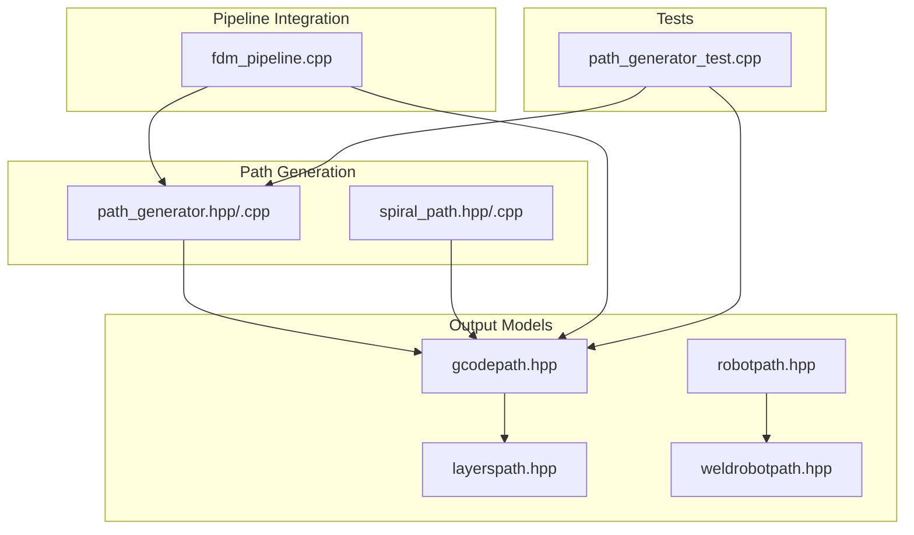
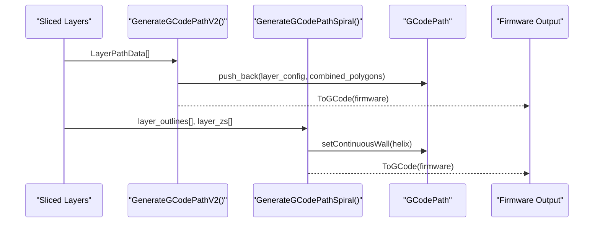
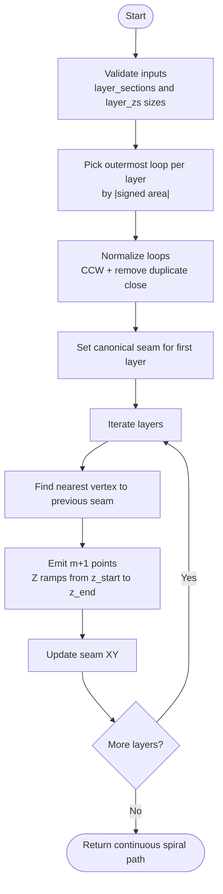
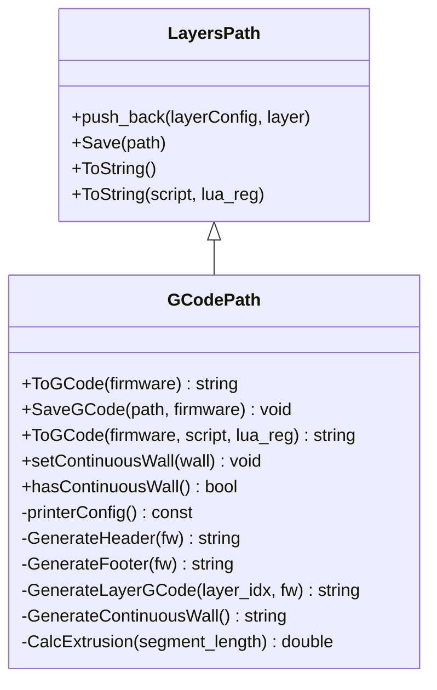
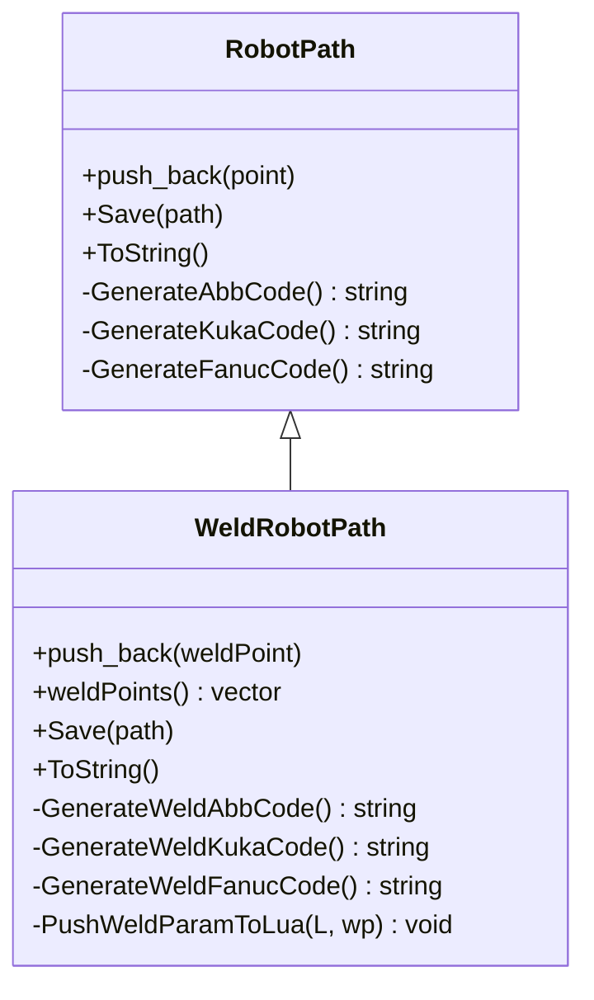
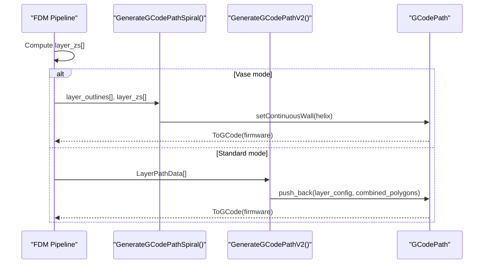
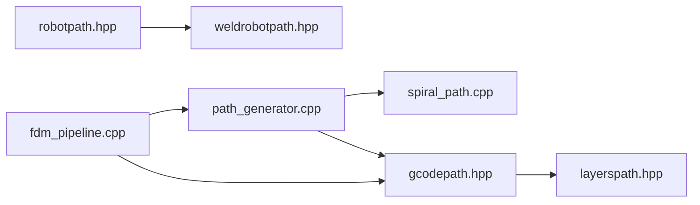

# Path Output Functions / 路径输出函数

<cite>
**Referenced Files in This Document**
- [path_generator.hpp](file://LibHsBaSlicer/Path/path_generator.hpp)
- [path_generator.cpp](file://LibHsBaSlicer/Path/path_generator.cpp)
- [spiral_path.hpp](file://LibHsBaSlicer/Path/spiral_path.hpp)
- [spiral_path.cpp](file://LibHsBaSlicer/Path/spiral_path.cpp)
- [gcodepath.hpp](file://paths/gcodepath.hpp)
- [layerspath.hpp](file://paths/layerspath.hpp)
- [robotpath.hpp](file://paths/robotpath.hpp)
- [weldrobotpath.hpp](file://paths/weldrobotpath.hpp)
- [fdm_pipeline.cpp](file://DllHsBaSlicer/fdm_pipeline.cpp)
- [path_generator_test.cpp](file://tests/PathsOut/path_generator_test.cpp)
</cite>

## Table of Contents
1. [Introduction](#introduction)
2. [Project Structure](#project-structure)
3. [Core Components](#core-components)
4. [Architecture Overview](#architecture-overview)
5. [Detailed Component Analysis](#detailed-component-analysis)
6. [Dependency Analysis](#dependency-analysis)
7. [Performance Considerations](#performance-considerations)
8. [Troubleshooting Guide](#troubleshooting-guide)
9. [Conclusion](#conclusion)
10. [Appendices](#appendices)

## Introduction
This document explains the path generation and output functions that convert sliced layers into machine-readable formats. It focuses on:
- Spiralize() for creating continuous vase-mode paths.
- toGcode() via GCodePath::ToGCode() for multi-firmware G-code (Marlin, RepRap, Klipper).
- Export pathways for different manufacturing processes, including FDM G-code and industrial robot programs for WAAM.
- The LayerPathInput structure combining outlines, fills, supports, and Z heights.
- GcodeOptions configuration covering layer height, line width, print speeds, extrusion settings, and material parameters.
It also provides examples of multi-firmware G-code generation, path optimization techniques, and integration with robot programming for WAAM.

## Project Structure
The path output functionality is implemented across a small set of focused modules:
- LibHsBaSlicer/Path: high-level path generators and spiralization algorithm.
- paths/: output data structures and firmware/robot code generators.
- DllHsBaSlicer: pipeline integration that wires sliced layers to path generators and firmware outputs.
- tests: unit tests demonstrating usage patterns.

**Diagram sources**
- [path_generator.hpp:1-96](file://LibHsBaSlicer/Path/path_generator.hpp#L1-L96)
- [path_generator.cpp:1-143](file://LibHsBaSlicer/Path/path_generator.cpp#L1-L143)
- [spiral_path.hpp:1-63](file://LibHsBaSlicer/Path/spiral_path.hpp#L1-L63)
- [spiral_path.cpp:1-167](file://LibHsBaSlicer/Path/spiral_path.cpp#L1-L167)
- [gcodepath.hpp:1-112](file://paths/gcodepath.hpp#L1-L112)
- [layerspath.hpp:1-64](file://paths/layerspath.hpp#L1-L64)
- [robotpath.hpp:1-108](file://paths/robotpath.hpp#L1-L108)
- [weldrobotpath.hpp:1-100](file://paths/weldrobotpath.hpp#L1-L100)
- [fdm_pipeline.cpp:392-425](file://DllHsBaSlicer/fdm_pipeline.cpp#L392-L425)
- [path_generator_test.cpp:72-121](file://tests/PathsOut/path_generator_test.cpp#L72-L121)

**Section sources**
- [path_generator.hpp:1-96](file://LibHsBaSlicer/Path/path_generator.hpp#L1-L96)
- [gcodepath.hpp:1-112](file://paths/gcodepath.hpp#L1-L112)
- [robotpath.hpp:1-108](file://paths/robotpath.hpp#L1-L108)
- [weldrobotpath.hpp:1-100](file://paths/weldrobotpath.hpp#L1-L100)
- [fdm_pipeline.cpp:392-425](file://DllHsBaSlicer/fdm_pipeline.cpp#L392-L425)

## Core Components
This section documents the key data structures and APIs used for path generation and output.

- FdmPathConfig: FDM path generation configuration including layer height, line width, print speed, travel speed, extrusion multiplier, and units.
- LayerPathData: Per-layer input combining outlines, fills, supports, and z_height.
- GCodePrinterConfig: Printer configuration for G-code generation including nozzle diameter, filament diameter, temperatures, retraction, speeds, layer height, line width, extrusion multiplier, relative extrusion mode, and retraction enable flag.
- GCodeFirmware: Target firmware type for G-code output (Marlin, RepRap, Klipper).
- GCodePath: Multi-firmware G-code path output class supporting ToGCode(firmware), SaveGCode(path, firmware), Lua post-processing, and continuous wall emission for vase mode.
- LayersPath: Base layer-based path storage with per-layer polygons and config strings.
- RobotPath and WeldRobotPath: Industrial robot program generators for ABB/KUKA/FANUC, extended with welding parameters for WAAM.

Key API surface:
- PolygonsToGPoints(): Converts PolygonsD to G-point sequences with travel and extrusion moves.
- GenerateGCodePath(): Builds a PointsPath from LayerPathData.
- GenerateGCodePathV2(): Builds a GCodePath with firmware-specific output support.
- GenerateGCodePathSpiral(): Creates a continuous helical outer-wall path for vase mode.
- SpiralizeOuterWall(): Core algorithm producing a continuous 3D polyline from per-layer contours.

**Section sources**
- [path_generator.hpp:20-91](file://LibHsBaSlicer/Path/path_generator.hpp#L20-L91)
- [gcodepath.hpp:24-107](file://paths/gcodepath.hpp#L24-L107)
- [layerspath.hpp:17-60](file://paths/layerspath.hpp#L17-L60)
- [robotpath.hpp:15-104](file://paths/robotpath.hpp#L15-L104)
- [weldrobotpath.hpp:16-96](file://paths/weldrobotpath.hpp#L16-L96)

## Architecture Overview
The architecture separates path generation from output formatting:
- Generators transform sliced layers into path objects.
- Output classes format those paths into firmware or robot code.
- Pipeline integration selects between standard per-layer G-code and spiralized vase mode based on configuration.

**Diagram sources**
- [path_generator.cpp:97-140](file://LibHsBaSlicer/Path/path_generator.cpp#L97-L140)
- [gcodepath.hpp:66-107](file://paths/gcodepath.hpp#L66-L107)

**Section sources**
- [path_generator.cpp:97-140](file://LibHsBaSlicer/Path/path_generator.cpp#L97-L140)
- [gcodepath.hpp:66-107](file://paths/gcodepath.hpp#L66-L107)

## Detailed Component Analysis

### LayerPathInput and FdmPathConfig
LayerPathInput combines per-layer geometry and build height:
- outlines: Outer boundary polygons.
- fills: Infill polygons.
- supports: Support polygons.
- z_height: Build height for the layer.

FdmPathConfig defines printing parameters:
- layer_height: Layer height in mm.
- line_width: Extrusion line width in mm.
- print_speed: Printing speed in mm/s.
- travel_speed: Travel speed in mm/s.
- extrusion_multiplier: Extrusion scaling factor.
- units: Units for generated points.

Usage:
- GenerateGCodePath() consumes LayerPathData[] and FdmPathConfig to produce a PointsPath.
- PolygonsToGPoints() converts PolygonsD to GPoint sequences using these parameters.

Complexity:
- PolygonsToGPoints() iterates over all polygon vertices once; O(N) where N is total vertex count.
- GenerateGCodePath() concatenates outline, fill, and support point lists; linear in total vertices.

Error handling:
- Empty polygons are skipped safely.
- Extrusion calculation uses segment length derived from consecutive vertices.

**Section sources**
- [path_generator.hpp:20-42](file://LibHsBaSlicer/Path/path_generator.hpp#L20-L42)
- [path_generator.cpp:14-61](file://LibHsBaSlicer/Path/path_generator.cpp#L14-L61)
- [path_generator.cpp:63-95](file://LibHsBaSlicer/Path/path_generator.cpp#L63-L95)

### Spiralize() and Continuous Vase Mode
SpiralizeOuterWall builds a continuous helical outer wall:
- Selects the outermost closed contour per layer by absolute signed area.
- Normalizes loops to CCW orientation and removes duplicate closing vertices.
- Aligns seams across layers by choosing the nearest vertex to the previous seam.
- Emits a continuous 3D polyline with Z ramped between layers.

Algorithm flow:

**Diagram sources**
- [spiral_path.cpp:18-85](file://LibHsBaSlicer/Path/spiral_path.cpp#L18-L85)
- [spiral_path.cpp:88-163](file://LibHsBaSlicer/Path/spiral_path.cpp#L88-L163)

Integration with GCodePath:
- GenerateGCodePathSpiral() calls SpiralizeOuterWall(), converts SpiralPoint to PathPoint3D, and sets the continuous wall on GCodePath.
- ToGCode() emits header, continuous wall, then footer; no per-layer polygons for vase mode.

Validation:
- If fewer than one valid contour exists, returns empty path.
- Last layer traversed flat at its own height.

**Section sources**
- [spiral_path.hpp:16-58](file://LibHsBaSlicer/Path/spiral_path.hpp#L16-L58)
- [spiral_path.cpp:88-163](file://LibHsBaSlicer/Path/spiral_path.cpp#L88-L163)
- [path_generator.cpp:120-140](file://LibHsBaSlicer/Path/path_generator.cpp#L120-L140)
- [gcodepath.hpp:87-96](file://paths/gcodepath.hpp#L87-L96)

### GCodePath and Multi-Firmware Output
GCodePath extends LayersPath and adds firmware-specific G-code generation:
- ToGCode(firmware): Generates G-code string for Marlin, RepRap, or Klipper.
- SaveGCode(path, firmware): Saves G-code to file.
- ToGCode(firmware, script, lua_reg): Applies Lua post-processing script.
- setContinuousWall()/hasContinuousWall(): Supports vase mode continuous wall emission.

Configuration:
- GCodePrinterConfig includes nozzle_diameter, filament_diameter, nozzle_temp, bed_temp, retract_length, retract_speed, print_speed, travel_speed, first_layer_speed, layer_height, line_width, extrusion_multiplier, relative_extrusion, enable_retraction.

Class relationships:

**Diagram sources**
- [layerspath.hpp:17-60](file://paths/layerspath.hpp#L17-L60)
- [gcodepath.hpp:66-107](file://paths/gcodepath.hpp#L66-L107)

Multi-firmware example:
- Tests assert ToGCode(GCodeFirmware::Marlin) produces non-empty output for both per-layer and spiral modes.

**Section sources**
- [gcodepath.hpp:24-107](file://paths/gcodepath.hpp#L24-L107)
- [path_generator_test.cpp:93-119](file://tests/PathsOut/path_generator_test.cpp#L93-L119)

### Robot Programming and WAAM Integration
RobotPath and WeldRobotPath provide brand-specific robot language generation:
- RLType: Unknown, Abb, Kuka, Fanuc.
- RLPointType: MoveJ, MoveL, MoveC, Program variants.
- WeldProcessType: MIG_MAG, TIG, Plasma, Laser.
- ArcEndType: Normal, CraterFill, SlowRetract.
- WeldParam: current, voltage, wireFeedSpeed, gasFlowRate, travelSpeed, arcStartCurrent, arcStartVoltage, craterFillCurrent, craterFillVoltage, process, arcEnd, weldSchedule.
- WeldRLPoint: Combines base RLPoint with WeldParam and isWelding flag.

WAAM workflow:
- Convert sliced layers to 3D paths (e.g., spiral wall or per-layer outlines).
- Populate RobotPath/WeldRobotPath with RLPoint/WeldRLPoint segments.
- Generate brand-specific code (ABB/KUKA/FANUC) including arc start/end commands and welding parameters.

**Diagram sources**
- [robotpath.hpp:15-104](file://paths/robotpath.hpp#L15-L104)
- [weldrobotpath.hpp:16-96](file://paths/weldrobotpath.hpp#L16-L96)

**Section sources**
- [robotpath.hpp:15-104](file://paths/robotpath.hpp#L15-L104)
- [weldrobotpath.hpp:16-96](file://paths/weldrobotpath.hpp#L16-L96)

### Pipeline Integration and Examples
The FDM pipeline demonstrates selection between spiral and per-layer modes:
- Computes layer Z heights.
- Calls GenerateGCodePathSpiral() when vase mode is enabled.
- Otherwise constructs LayerPathData[] and calls GenerateGCodePathV2().
- Emits firmware-specific G-code via ToGCode(cfg.firmware).

Example test cases:
- GenerateGCodePath builds PointsPath from LayerPathData.
- GenerateGCodePathV2 produces GCodePath without continuous wall.
- GenerateGCodePathSpiral produces GCodePath with continuous wall and non-empty Marlin output.

**Diagram sources**
- [fdm_pipeline.cpp:392-425](file://DllHsBaSlicer/fdm_pipeline.cpp#L392-L425)
- [path_generator.cpp:97-140](file://LibHsBaSlicer/Path/path_generator.cpp#L97-L140)

**Section sources**
- [fdm_pipeline.cpp:392-425](file://DllHsBaSlicer/fdm_pipeline.cpp#L392-L425)
- [path_generator_test.cpp:72-121](file://tests/PathsOut/path_generator_test.cpp#L72-L121)

## Dependency Analysis
High-level dependencies among path output components:
- path_generator depends on spiral_path for vase mode.
- gcodepath inherits from layerspath and implements firmware-specific output.
- robotpath and weldrobotpath are independent output models for industrial robots.
- fdm_pipeline orchestrates path generation and firmware output.

**Diagram sources**
- [path_generator.cpp:1-143](file://LibHsBaSlicer/Path/path_generator.cpp#L1-L143)
- [spiral_path.cpp:1-167](file://LibHsBaSlicer/Path/spiral_path.cpp#L1-L167)
- [gcodepath.hpp:1-112](file://paths/gcodepath.hpp#L1-L112)
- [layerspath.hpp:1-64](file://paths/layerspath.hpp#L1-L64)
- [robotpath.hpp:1-108](file://paths/robotpath.hpp#L1-L108)
- [weldrobotpath.hpp:1-100](file://paths/weldrobotpath.hpp#L1-L100)
- [fdm_pipeline.cpp:392-425](file://DllHsBaSlicer/fdm_pipeline.cpp#L392-L425)

**Section sources**
- [path_generator.cpp:1-143](file://LibHsBaSlicer/Path/path_generator.cpp#L1-L143)
- [gcodepath.hpp:1-112](file://paths/gcodepath.hpp#L1-L112)
- [robotpath.hpp:1-108](file://paths/robotpath.hpp#L1-L108)
- [weldrobotpath.hpp:1-100](file://paths/weldrobotpath.hpp#L1-L100)
- [fdm_pipeline.cpp:392-425](file://DllHsBaSlicer/fdm_pipeline.cpp#L392-L425)

## Performance Considerations
- PolygonsToGPoints() pre-reserves capacity proportional to polygon count to reduce reallocations.
- SpiralizeOuterWall() performs a single pass over normalized loops; seam alignment uses nearest-vertex search per layer, which is O(m) per layer where m is loop size.
- For large models, prefer GenerateGCodePathSpiral() for uniform-cross-section parts to avoid per-layer travel and retractions, improving throughput and surface quality.
- Use relative extrusion mode judiciously; it affects how extrusion values are interpreted by firmware and may impact numerical precision.

[No sources needed since this section provides general guidance]

## Troubleshooting Guide
Common issues and resolutions:
- Empty spiral path: Ensure at least one layer has a valid closed contour; otherwise SpiralizeOuterWall returns an empty result.
- Missing continuous wall: Verify setContinuousWall() was called before ToGCode(); hasContinuousWall() can be used to check.
- Firmware-specific output differences: Confirm GCodeFirmware enum matches target printer; Marlin, RepRap, and Klipper have distinct headers/footers.
- WAAM parameter errors: Validate WeldParam fields (current, voltage, wireFeedSpeed, gasFlowRate, travelSpeed) against equipment limits; ensure ArcEndType aligns with desired crater handling.

**Section sources**
- [spiral_path.cpp:88-163](file://LibHsBaSlicer/Path/spiral_path.cpp#L88-L163)
- [gcodepath.hpp:87-96](file://paths/gcodepath.hpp#L87-L96)
- [weldrobotpath.hpp:34-57](file://paths/weldrobotpath.hpp#L34-L57)

## Conclusion
The path output system cleanly separates geometry processing from firmware/robot code generation. SpiralizeOuterWall enables efficient vase-mode printing by producing a continuous helical wall, while GCodePath supports multi-firmware G-code output. RobotPath and WeldRobotPath extend the framework to industrial robot programming for WAAM. Together, these components provide a flexible, extensible foundation for converting sliced layers into machine-readable formats across diverse manufacturing processes.

[No sources needed since this section summarizes without analyzing specific files]

## Appendices

### Configuration Reference Tables

- FdmPathConfig fields:
  - layer_height: float, default 0.2f
  - line_width: float, default 0.4f
  - print_speed: float, default 50.0f
  - travel_speed: float, default 100.0f
  - extrusion_multiplier: float, default 1.0f
  - units: GCodeUnits

- GCodePrinterConfig fields:
  - nozzle_diameter: float, default 0.4f
  - filament_diameter: float, default 1.75f
  - nozzle_temp: float, default 200.0f
  - bed_temp: float, default 60.0f
  - retract_length: float, default 1.0f
  - retract_speed: float, default 40.0f
  - print_speed: float, default 50.0f
  - travel_speed: float, default 100.0f
  - first_layer_speed: float, default 20.0f
  - layer_height: float, default 0.2f
  - line_width: float, default 0.4f
  - extrusion_multiplier: float, default 1.0f
  - relative_extrusion: bool, default false
  - enable_retraction: bool, default true

- GCodeFirmware values:
  - Marlin
  - RepRap
  - Klipper

- RLType values:
  - Unknown
  - Abb
  - Kuka
  - Fanuc

- WeldProcessType values:
  - MIG_MAG
  - TIG
  - Plasma
  - Laser

- ArcEndType values:
  - Normal
  - CraterFill
  - SlowRetract

**Section sources**
- [path_generator.hpp:20-31](file://LibHsBaSlicer/Path/path_generator.hpp#L20-L31)
- [gcodepath.hpp:24-49](file://paths/gcodepath.hpp#L24-L49)
- [robotpath.hpp:15-42](file://paths/robotpath.hpp#L15-L42)
- [weldrobotpath.hpp:16-49](file://paths/weldrobotpath.hpp#L16-L49)