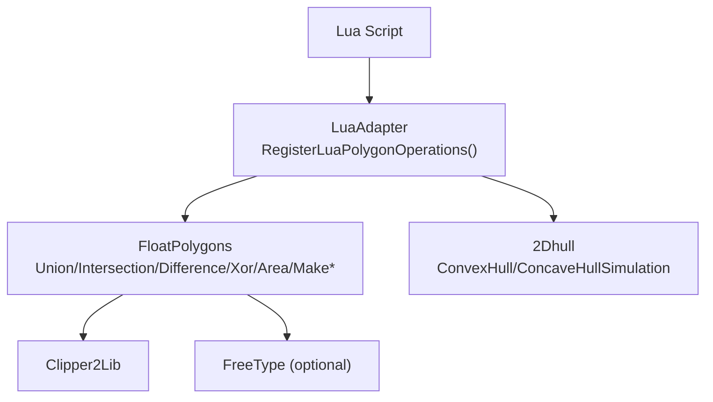
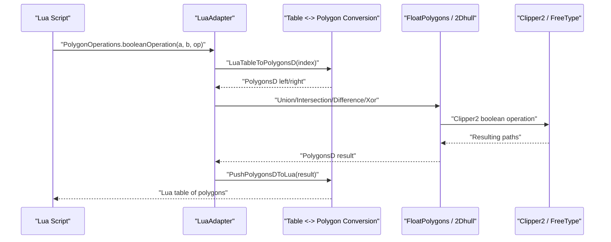
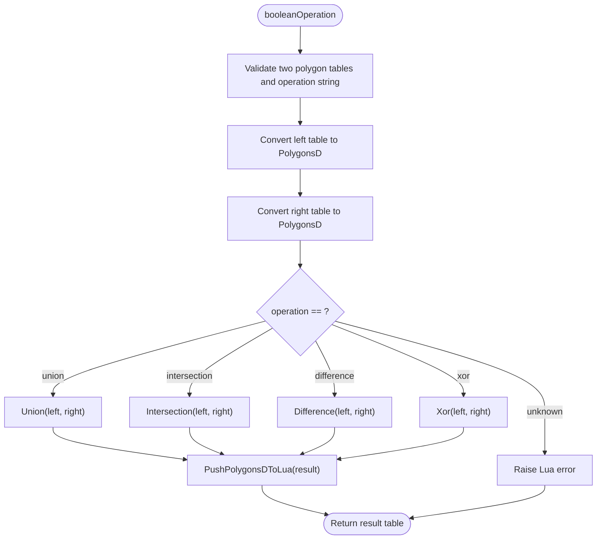
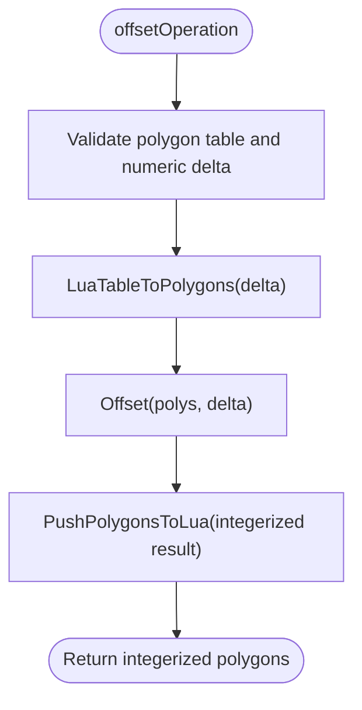
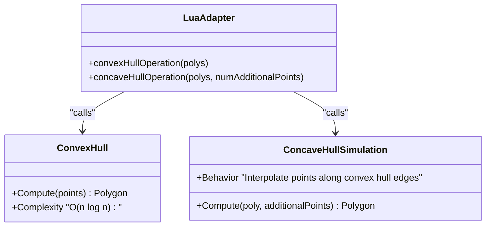
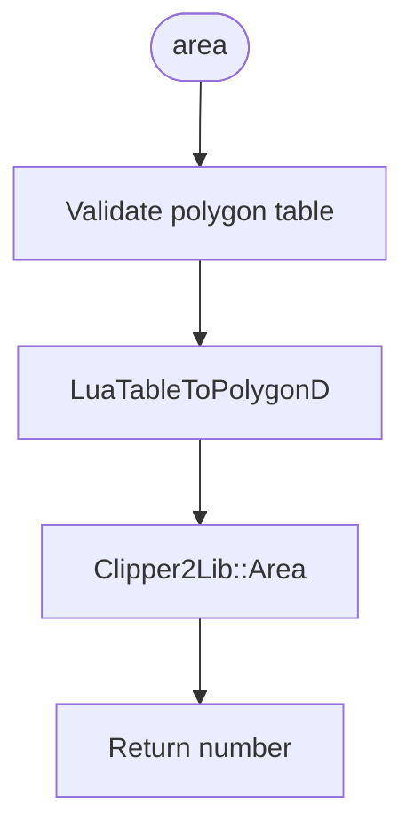
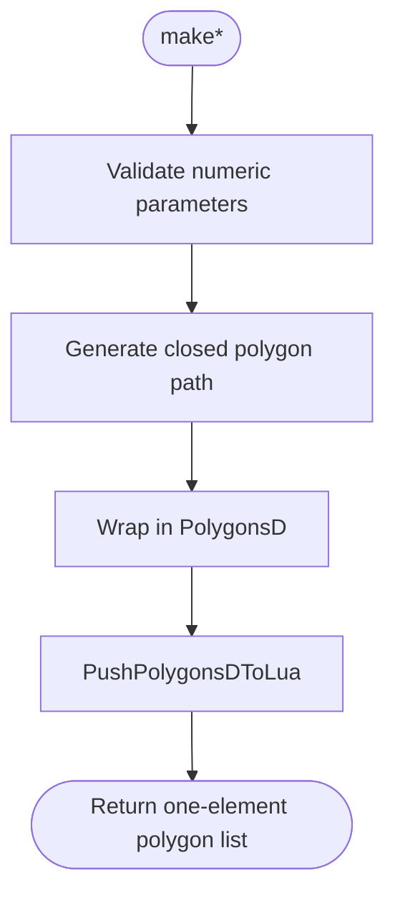
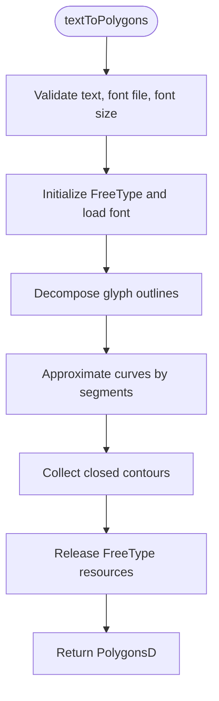
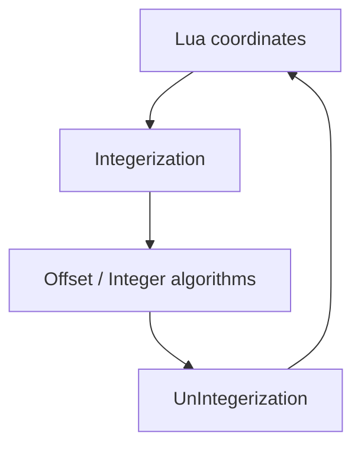
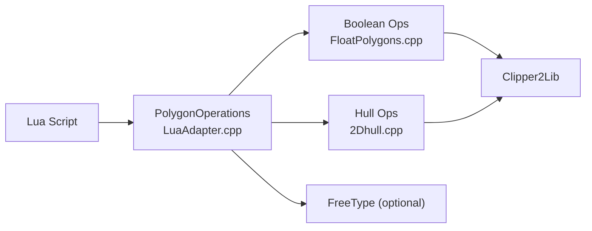

# Polygon Geometry / 多边形几何

<cite>
**Referenced Files in This Document**   
- [LuaAdapter.hpp](file://2D/LuaAdapter.hpp)
- [LuaAdapter.cpp](file://2D/LuaAdapter.cpp)
- [FloatPolygons.hpp](file://2D/FloatPolygons.hpp)
- [FloatPolygons.cpp](file://2D/FloatPolygons.cpp)
- [2Dhull.hpp](file://2D/2Dhull.hpp)
- [2Dhull.cpp](file://2D/2Dhull.cpp)
- [lua_polygon_operations_test.cpp](file://tests/PolygonFill/lua_polygon_operations_test.cpp)
- [hsba_pipeline.d.lua](file://types/hsba_pipeline.d.lua)
- [lua_pipeline_api.md](file://docs/en/lua_pipeline_api.md)
</cite>

## Table of Contents
1. [Introduction](#introduction)
2. [Project Structure](#project-structure)
3. [Core Components](#core-components)
4. [Architecture Overview](#architecture-overview)
5. [Detailed Component Analysis](#detailed-component-analysis)
6. [Dependency Analysis](#dependency-analysis)
7. [Performance Considerations](#performance-considerations)
8. [Troubleshooting Guide](#troubleshooting-guide)
9. [Conclusion](#conclusion)
10. [Appendices](#appendices)

## Introduction
This document describes the 2D polygon manipulation API exposed to Lua scripts through the `PolygonOperations` namespace. It covers geometric set operations, offsetting, hull computation, area calculation, primitive shape creation, text-to-polygon conversion, coordinate integerization, and practical workflows such as support structure generation and geometric preprocessing.

The Lua surface is implemented by a C++ adapter that converts between Lua tables and internal polygon types, then calls Clipper2-based geometry functions. The public Lua table is named `PolygonOperations`, and its methods are registered into the global Lua state.

## Project Structure
The relevant code lives under the `2D` module:

**Diagram sources**
- [LuaAdapter.cpp:487-491](file://2D/LuaAdapter.cpp#L487-L491)
- [FloatPolygons.cpp:34-66](file://2D/FloatPolygons.cpp#L34-L66)
- [2Dhull.cpp:81-115](file://2D/2Dhull.cpp#L81-L115)

**Section sources**
- [LuaAdapter.hpp:1-84](file://2D/LuaAdapter.hpp#L1-L84)
- [LuaAdapter.cpp:1-493](file://2D/LuaAdapter.cpp#L1-L493)
- [FloatPolygons.hpp:1-271](file://2D/FloatPolygons.hpp#L1-L271)
- [FloatPolygons.cpp:1-453](file://2D/FloatPolygons.cpp#L1-L453)
- [2Dhull.hpp:1-75](file://2D/2Dhull.hpp#L1-L75)
- [2Dhull.cpp:1-219](file://2D/2Dhull.cpp#L1-L219)

## Core Components
The Lua API is exposed as the `PolygonOperations` table. Its main responsibilities are:

| Area | Lua Function | Internal Implementation | Notes |
|---|---|---|---|
| Boolean operations | `booleanOperation(a, b, op)` | Dispatches to `Union`, `Intersection`, `Difference`, or `Xor` based on string | `op` must be one of `union`, `intersection`, `difference`, `xor` |
| Boolean operations | `union(a, b)` | Calls `Union(PolygonsD, PolygonsD)` | Direct convenience wrapper |
| Boolean operations | `intersection(a, b)` | Calls `Intersection(PolygonsD, PolygonsD)` | Direct convenience wrapper |
| Boolean operations | `difference(a, b)` | Calls `Difference(PolygonsD, PolygonsD)` | Left minus right |
| Boolean operations | `xor(a, b)` | Calls `Xor(PolygonsD, PolygonsD)` | Symmetric difference |
| Offset | `offsetOperation(polys, delta)` | Converts Lua polygons to integerized polygons, calls `Offset`, returns integerized result | Positive delta expands; negative delta shrinks |
| Hulls | `convexHullOperation(polys)` | Applies `ConvexHull` per input polygon | Returns double-precision polygons |
| Hulls | `concaveHullOperation(polys, numAdditionalPoints)` | Applies `ConcaveHullSimulation` per input polygon | Adds interpolated points along convex hull edges |
| Area | `area(polygon)` | Computes `Clipper2Lib::Area` for a single polygon | Returns signed area |
| Primitives | `makeRectangle(x, y, width, height)` | Calls `MakeRectangle` | Returns one-element `PolygonsD` |
| Primitives | `makeCircle(cx, cy, radius[, segments])` | Calls `MakeCircle` with default 64 segments | Returns one-element `PolygonsD` |
| Primitives | `makeEllipse(cx, cy, rx, ry[, segments[, rotation]])` | Calls `MakeEllipse` | Rotation is radians |
| Primitives | `makeRegularPolygon(cx, cy, radius, sides[, rotation])` | Calls `MakeRegularPolygon` | Sides less than three produce empty polygon |
| Text | `textToPolygons(text, font_file, font_size[, x[, y[, curve_segments]]])` | Uses FreeType outline decomposition | Requires `HSBA_HAVE_FREETYPE` at compile time |

**Section sources**
- [LuaAdapter.cpp:22-54](file://2D/LuaAdapter.cpp#L22-L54)
- [LuaAdapter.cpp:56-106](file://2D/LuaAdapter.cpp#L56-L106)
- [LuaAdapter.cpp:108-153](file://2D/LuaAdapter.cpp#L108-L153)
- [LuaAdapter.cpp:155-165](file://2D/LuaAdapter.cpp#L155-L165)
- [LuaAdapter.cpp:167-273](file://2D/LuaAdapter.cpp#L167-L273)
- [FloatPolygons.hpp:43-191](file://2D/FloatPolygons.hpp#L43-L191)
- [FloatPolygons.cpp:34-75](file://2D/FloatPolygons.cpp#L34-L75)
- [FloatPolygons.cpp:330-362](file://2D/FloatPolygons.cpp#L330-L362)
- [FloatPolygons.cpp:364-429](file://2D/FloatPolygons.cpp#L364-L429)
- [2Dhull.hpp:14-72](file://2D/2Dhull.hpp#L14-L72)
- [2Dhull.cpp:47-115](file://2D/2Dhull.cpp#L47-L115)
- [2Dhull.cpp:137-199](file://2D/2Dhull.cpp#L137-L199)

## Architecture Overview
At runtime, a Lua script calls `PolygonOperations.*`. The adapter validates arguments, converts Lua tables to internal polygon types, invokes geometry algorithms, and pushes results back to Lua.

**Diagram sources**
- [LuaAdapter.cpp:22-54](file://2D/LuaAdapter.cpp#L22-L54)
- [LuaAdapter.cpp:332-434](file://2D/LuaAdapter.cpp#L332-L434)
- [FloatPolygons.cpp:34-66](file://2D/FloatPolygons.cpp#L34-L66)

## Detailed Component Analysis

### Boolean Operations
The generic dispatcher accepts an operation name and routes to the corresponding Clipper2 function. Dedicated wrappers exist for readability.

**Diagram sources**
- [LuaAdapter.cpp:22-54](file://2D/LuaAdapter.cpp#L22-L54)
- [FloatPolygons.cpp:34-66](file://2D/FloatPolygons.cpp#L34-L66)

Key implementation details:
- Input validation rejects wrong argument counts or types.
- Unknown operation names raise a formatted Lua error.
- All four operations accept `PolygonsD` overloads, so they operate on sets of polygons.

**Section sources**
- [LuaAdapter.cpp:22-54](file://2D/LuaAdapter.cpp#L22-L54)
- [LuaAdapter.cpp:56-106](file://2D/LuaAdapter.cpp#L56-L106)
- [FloatPolygons.hpp:43-121](file://2D/FloatPolygons.hpp#L43-L121)
- [FloatPolygons.cpp:34-66](file://2D/FloatPolygons.cpp#L34-L66)

### Offset Operation
`offsetOperation` works on integerized polygons because the underlying offset algorithm uses integer coordinates.

Important behavior:
- The Lua API receives floating-point coordinates but converts them to integerized polygons before offsetting.
- Positive delta expands the polygon; negative delta shrinks it.
- The returned polygons are integerized; when used with other double-precision APIs, convert back via `UnIntegerization`.

**Diagram sources**
- [LuaAdapter.cpp:108-119](file://2D/LuaAdapter.cpp#L108-L119)
- [FloatPolygons.cpp:184-221](file://2D/FloatPolygons.cpp#L184-L221)

**Section sources**
- [LuaAdapter.cpp:108-119](file://2D/LuaAdapter.cpp#L108-L119)
- [FloatPolygons.hpp:195-221](file://2D/FloatPolygons.hpp#L195-L221)
- [FloatPolygons.cpp:184-221](file://2D/FloatPolygons.cpp#L184-L221)

### Hull Operations
Both convex and concave hull operations are available for single polygons and collections.

Implementation notes:
- Convex hull removes interior points and sorts vertices by polar angle around the lowest-leftmost point.
- Concave hull simulation interpolates additional points along each edge of the convex hull. For `numAdditionalPoints = k`, each edge contributes `k+1` interpolated points.
- Overloads exist for both integer and double-precision polygons.

**Diagram sources**
- [2Dhull.cpp:81-115](file://2D/2Dhull.cpp#L81-L115)
- [2Dhull.cpp:137-163](file://2D/2Dhull.cpp#L137-L163)
- [LuaAdapter.cpp:121-153](file://2D/LuaAdapter.cpp#L121-L153)

**Section sources**
- [2Dhull.hpp:14-72](file://2D/2Dhull.hpp#L14-L72)
- [2Dhull.cpp:47-115](file://2D/2Dhull.cpp#L47-L115)
- [2Dhull.cpp:137-199](file://2D/2Dhull.cpp#L137-L199)
- [LuaAdapter.cpp:121-153](file://2D/LuaAdapter.cpp#L121-L153)

### Area Calculation
The `area` function computes the signed area of a single polygon using Clipper2.

**Diagram sources**
- [LuaAdapter.cpp:155-165](file://2D/LuaAdapter.cpp#L155-L165)
- [FloatPolygons.cpp:68-75](file://2D/FloatPolygons.cpp#L68-L75)

**Section sources**
- [LuaAdapter.cpp:155-165](file://2D/LuaAdapter.cpp#L155-L165)
- [FloatPolygons.hpp:123-135](file://2D/FloatPolygons.hpp#L123-L135)
- [FloatPolygons.cpp:68-75](file://2D/FloatPolygons.cpp#L68-L75)

### Primitive Creation Functions
Primitive constructors return a one-element `PolygonsD`, making them compatible with downstream boolean and fill operations.

| Function | Parameters | Behavior |
|---|---|---|
| `makeRectangle(x, y, width, height)` | Bottom-left corner, width, height | Closed rectangle path |
| `makeCircle(cx, cy, radius[, segments])` | Center, radius, optional segment count | Approximates circle with ellipse generator |
| `makeEllipse(cx, cy, rx, ry[, segments[, rotation]])` | Center, radii, optional segments and rotation | Supports rotation in radians |
| `makeRegularPolygon(cx, cy, radius, sides[, rotation])` | Center, circumradius, side count, optional rotation | Empty polygon if sides < 3 |

**Diagram sources**
- [LuaAdapter.cpp:167-244](file://2D/LuaAdapter.cpp#L167-L244)
- [FloatPolygons.cpp:330-362](file://2D/FloatPolygons.cpp#L330-L362)

**Section sources**
- [LuaAdapter.cpp:167-244](file://2D/LuaAdapter.cpp#L167-L244)
- [FloatPolygons.hpp:137-178](file://2D/FloatPolygons.hpp#L137-L178)
- [FloatPolygons.cpp:330-362](file://2D/FloatPolygons.cpp#L330-L362)

### Text to Polygons
`textToPolygons` converts UTF-8 text into polygon outlines using FreeType.

Constraints:
- Requires compilation with `HSBA_HAVE_FREETYPE`.
- Missing FreeType raises a not-supported error.
- Font loading errors raise runtime errors.
- Curve approximation uses the provided `curve_segments` parameter.

**Diagram sources**
- [LuaAdapter.cpp:246-273](file://2D/LuaAdapter.cpp#L246-L273)
- [FloatPolygons.cpp:364-429](file://2D/FloatPolygons.cpp#L364-L429)

**Section sources**
- [LuaAdapter.cpp:246-273](file://2D/LuaAdapter.cpp#L246-L273)
- [FloatPolygons.hpp:180-191](file://2D/FloatPolygons.hpp#L180-L191)
- [FloatPolygons.cpp:364-429](file://2D/FloatPolygons.cpp#L364-L429)

### Coordinate Transformations
The system maintains two coordinate domains:

| Domain | Type | Purpose |
|---|---|---|
| Double precision | `Point2D`, `PolygonD`, `PolygonsD` | High-precision geometry, Lua API input/output |
| Integerized | `Point2`, `Polygon`, `Polygons` | Stable integer arithmetic for offset and some algorithms |

Conversion functions:
- `Integerization`: doubles multiplied by `integerization` factor.
- `UnIntegerization`: integers divided by `integerization` factor.
- Lua adapters use these conversions when pushing/parsing integerized polygons.

**Diagram sources**
- [FloatPolygons.cpp:184-221](file://2D/FloatPolygons.cpp#L184-L221)
- [LuaAdapter.cpp:358-382](file://2D/LuaAdapter.cpp#L358-L382)
- [LuaAdapter.cpp:437-485](file://2D/LuaAdapter.cpp#L437-L485)

**Section sources**
- [FloatPolygons.hpp:195-221](file://2D/FloatPolygons.hpp#L195-L221)
- [FloatPolygons.cpp:184-221](file://2D/FloatPolygons.cpp#L184-L221)
- [LuaAdapter.cpp:358-382](file://2D/LuaAdapter.cpp#L358-L382)
- [LuaAdapter.cpp:437-485](file://2D/LuaAdapter.cpp#L437-L485)

## Dependency Analysis
The following diagram shows how the Lua layer depends on geometry and hull modules.

**Diagram sources**
- [LuaAdapter.cpp:311-329](file://2D/LuaAdapter.cpp#L311-L329)
- [FloatPolygons.cpp:34-66](file://2D/FloatPolygons.cpp#L34-L66)
- [2Dhull.cpp:81-115](file://2D/2Dhull.cpp#L81-L115)
- [FloatPolygons.cpp:364-429](file://2D/FloatPolygons.cpp#L364-L429)

Coupling and cohesion observations:
- `LuaAdapter` is the only Lua-facing component; it has high cohesion around argument validation, type conversion, and registration.
- `FloatPolygons` encapsulates all Clipper2-based geometry primitives and boolean operations.
- `2Dhull` provides standalone hull algorithms independent of Clipper2 boolean logic.
- Optional FreeType integration is isolated behind `HSBA_HAVE_FREETYPE`.

**Section sources**
- [LuaAdapter.cpp:311-329](file://2D/LuaAdapter.cpp#L311-L329)
- [FloatPolygons.cpp:1-75](file://2D/FloatPolygons.cpp#L1-L75)
- [2Dhull.cpp:1-45](file://2D/2Dhull.cpp#L1-L45)

## Performance Considerations
- Boolean operations delegate to Clipper2; complexity depends on polygon vertex counts and intersection topology.
- Offset operations require integerization; large coordinate values can increase memory usage and computation time.
- Hull computation is O(n log n) due to sorting by polar angle.
- Concave hull simulation multiplies output size by approximately `numAdditionalPoints + 1` per convex hull edge.
- Text rendering depends on glyph count and curve approximation; higher `curve_segments` increases polygon vertex count.
- Prefer simplifying polygons with `MakeSimple` before expensive boolean operations when collinear or redundant vertices are expected.

[No sources needed since this section provides general guidance]

## Troubleshooting Guide
Common issues and their causes:

| Symptom | Likely Cause | Resolution |
|---|---|---|
| Lua error about expected polygon table | Wrong argument type or count | Ensure inputs are tables of `{x, y}` points |
| `booleanOperation` reports unknown operation | Invalid operation string | Use `union`, `intersection`, `difference`, or `xor` |
| `offsetOperation` produces unexpected scale | Confusing Lua floating-point units with integerized units | Remember positive delta expands; verify coordinate scaling |
| `textToPolygons` throws not-supported error | FreeType not compiled in | Rebuild with `HSBA_HAVE_FREETYPE` enabled |
| `textToPolygons` fails to load font | Invalid font path or unsupported format | Verify font file exists and is valid TTF/OTF |
| Hull result has more vertices than expected | Concave hull interpolation | Reduce `numAdditionalPoints` or inspect convex hull first |

Validation branches are exercised by unit tests, which assert argument failures via `pcall`.

**Section sources**
- [LuaAdapter.cpp:16-54](file://2D/LuaAdapter.cpp#L16-L54)
- [LuaAdapter.cpp:108-153](file://2D/LuaAdapter.cpp#L108-L153)
- [FloatPolygons.cpp:364-382](file://2D/FloatPolygons.cpp#L364-L382)
- [lua_polygon_operations_test.cpp:176-181](file://tests/PolygonFill/lua_polygon_operations_test.cpp#L176-L181)

## Conclusion
The `PolygonOperations` Lua API provides a complete toolkit for 2D polygon manipulation: boolean set operations, offsetting, hull computation, area measurement, primitive construction, and text rendering. Internally, it combines robust Clipper2 geometry with optional FreeType text support, while maintaining clear separation between double-precision and integerized coordinate spaces. Scripts should prefer double-precision APIs for modeling and convert to integerized coordinates only when required by offset or other integer-based algorithms.

[No sources needed since this section summarizes without analyzing specific files]

## Appendices

### API Reference Summary
The Lua API is documented in the project’s pipeline API documentation and typed definition file.

| Category | Lua Surface | Source |
|---|---|---|
| Boolean & construction | `PolygonOperations` table | [lua_pipeline_api.md:140-155](file://docs/en/lua_pipeline_api.md#L140-L155) |
| Type definitions | `PolygonOperations` fields | [hsba_pipeline.d.lua:47-51](file://types/hsba_pipeline.d.lua#L47-L51) |
| Tests | Argument validation and basic behavior | [lua_polygon_operations_test.cpp:138-191](file://tests/PolygonFill/lua_polygon_operations_test.cpp#L138-L191) |

**Section sources**
- [lua_pipeline_api.md:140-155](file://docs/en/lua_pipeline_api.md#L140-L155)
- [hsba_pipeline.d.lua:47-51](file://types/hsba_pipeline.d.lua#L47-L51)
- [lua_polygon_operations_test.cpp:138-191](file://tests/PolygonFill/lua_polygon_operations_test.cpp#L138-L191)