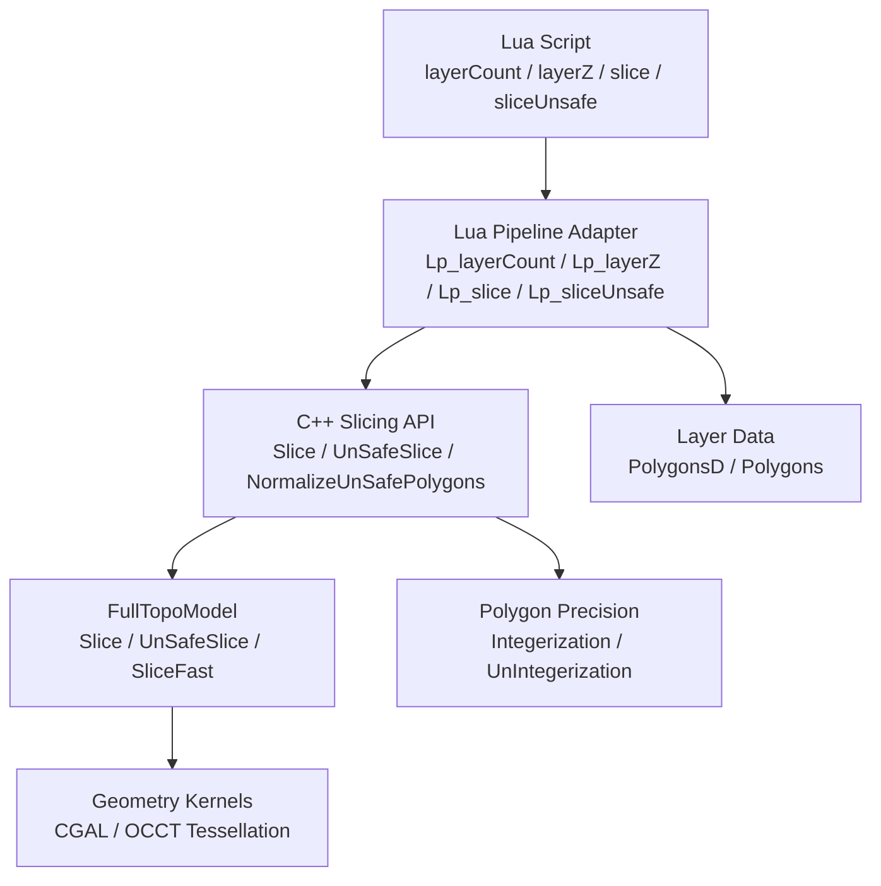
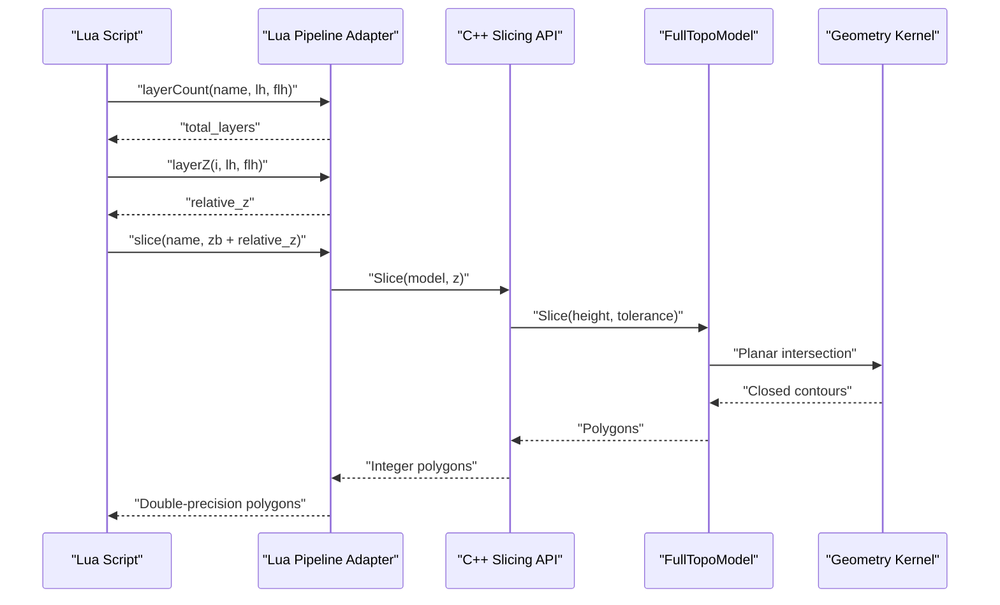
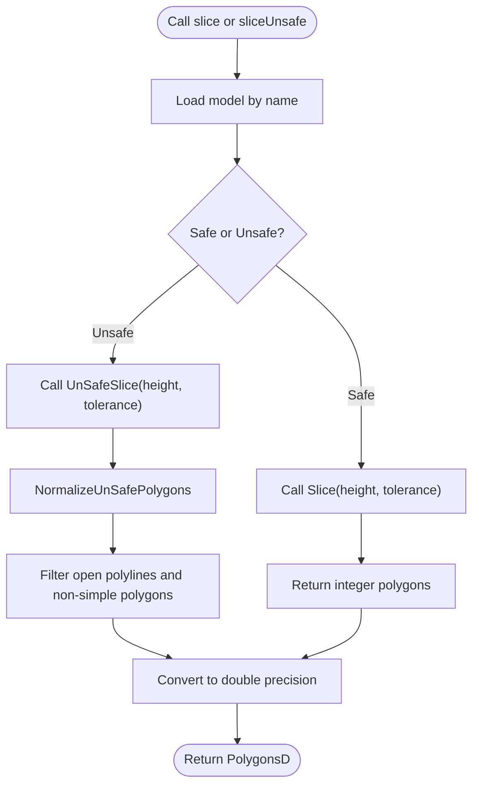
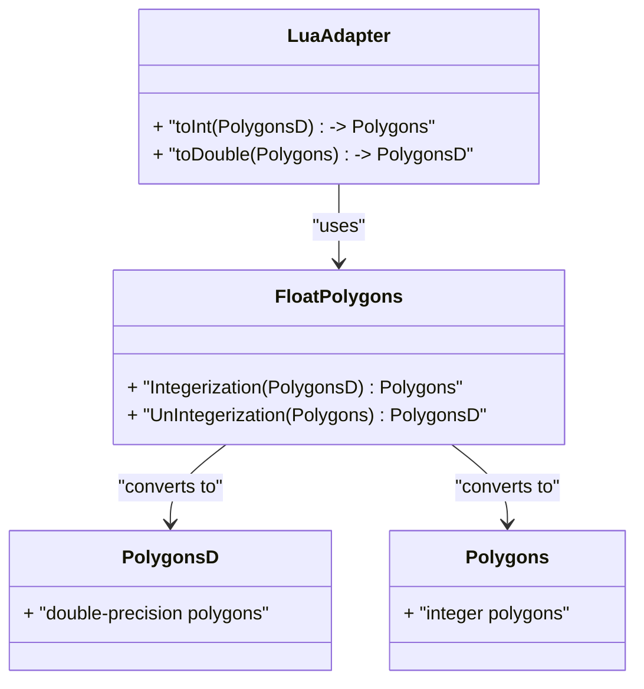
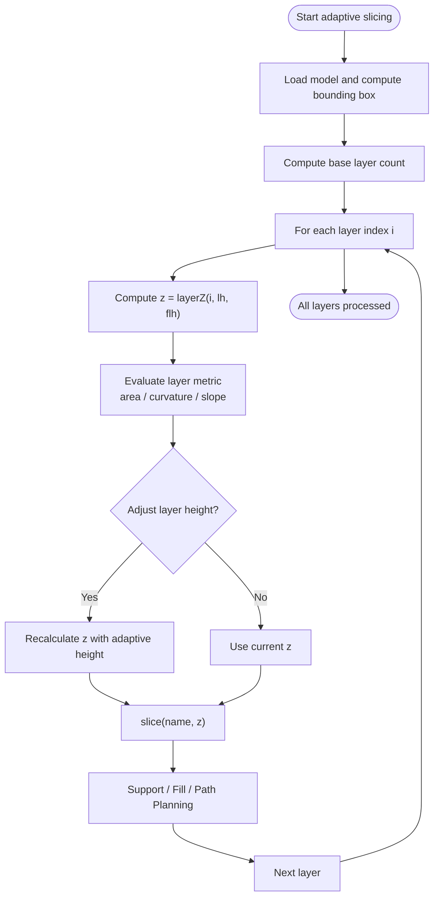
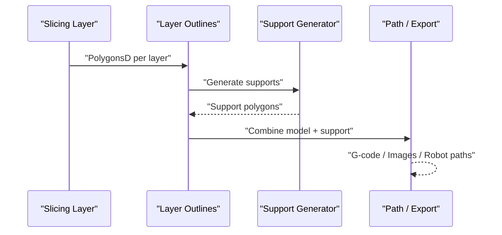
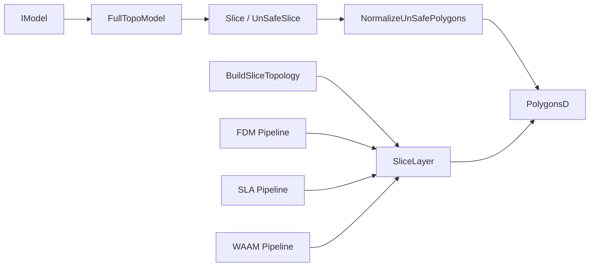
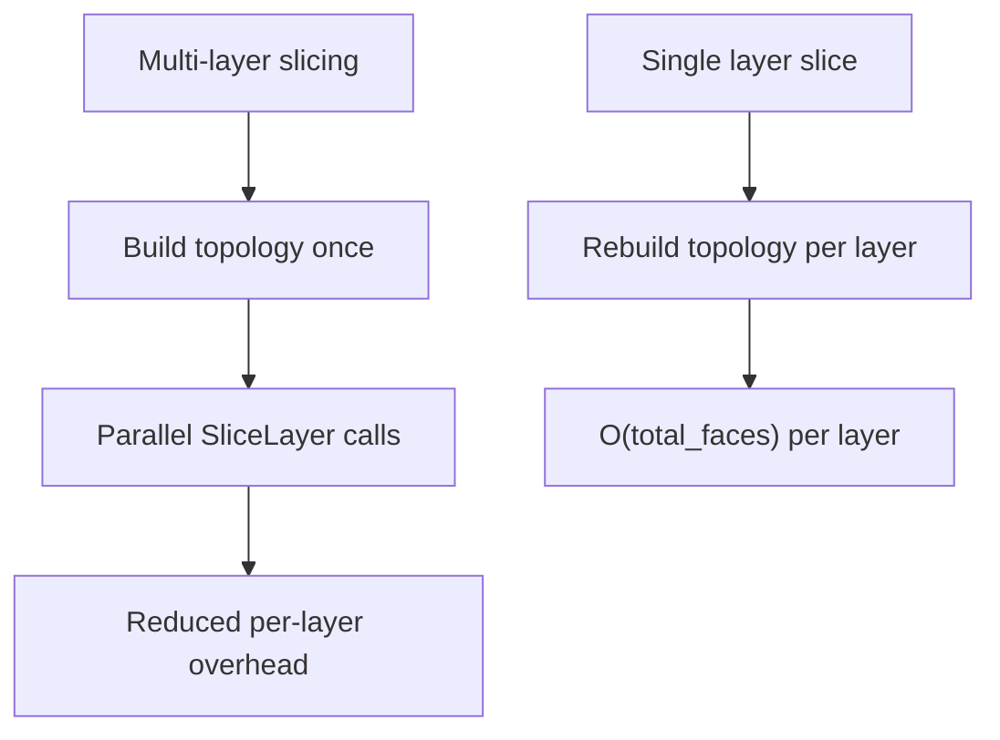

# Slicing Functions / 切片函数

<cite>
**Referenced Files in This Document**   
- [lua_pipeline.cpp](file://LibHsBaSlicer/Extends/lua_pipeline.cpp)
- [mesh_slice.hpp](file://LibHsBaSlicer/Slice/mesh_slice.hpp)
- [mesh_slice.cpp](file://LibHsBaSlicer/Slice/mesh_slice.cpp)
- [FullTopoModel.hpp](file://meshmodel/FullTopoModel.hpp)
- [FloatPolygons.hpp](file://2D/FloatPolygons.hpp)
- [FloatPolygons.cpp](file://2D/FloatPolygons.cpp)
- [fdm_pipeline.cpp](file://DllHsBaSlicer/fdm_pipeline.cpp)
- [sla_pipeline.cpp](file://DllHsBaSlicer/sla_pipeline.cpp)
- [waam_pipeline.cpp](file://DllHsBaSlicer/waam_pipeline.cpp)
- [main.cpp](file://samples/Custom/main.cpp)
</cite>

## Table of Contents
1. [Introduction](#introduction)
2. [Project Structure](#project-structure)
3. [Core Components](#core-components)
4. [Architecture Overview](#architecture-overview)
5. [Detailed Component Analysis](#detailed-component-analysis)
6. [Dependency Analysis](#dependency-analysis)
7. [Performance Considerations](#performance-considerations)
8. [Troubleshooting Guide](#troubleshooting-guide)
9. [Conclusion](#conclusion)
10. [Appendices](#appendices)

## Introduction
This document explains the slicing-related functions that convert a 3D model into 2D layers. It covers:

- `layerCount()`: calculates the total number of layers from model height and layer settings.
- `layerZ()`: computes the Z coordinate for a given layer index.
- `slice()` and `sliceUnsafe()`: safe and unsafe slicing APIs exposed to Lua, backed by C++ slicing entry points.
- Tolerance handling and the difference between safe and unsafe slicing modes.
- Coordinate precision conversion using `toInt()` and `toDouble()`.
- Adaptive slicing workflows, layer iteration patterns, and integration with support generation.

The goal is to help both new users and experienced developers understand how layers are computed, how to choose between safe and unsafe slicing, and how to integrate slicing into FDM, SLA, or wire-feed pipelines.

## Project Structure
The slicing functionality spans several layers:

| Layer | Responsibility | Key Files |
|---|---|---|
| Lua API surface | Exposes `layerCount`, `layerZ`, `slice`, `sliceUnsafe`, `toInt`, `toDouble` to scripts | [lua_pipeline.cpp](file://LibHsBaSlicer/Extends/lua_pipeline.cpp) |
| C++ slicing entry points | Wraps geometry kernels, normalizes results, builds reusable topology | [mesh_slice.hpp](file://LibHsBaSlicer/Slice/mesh_slice.hpp), [mesh_slice.cpp](file://LibHsBaSlicer/Slice/mesh_slice.cpp) |
| Topology-based mesh slicing | Provides safe, unsafe, fast, and Lua-driven slicing on a full topological mesh | [FullTopoModel.hpp](file://meshmodel/FullTopoModel.hpp) |
| Polygon precision utilities | Converts between integer and double polygon coordinates | [FloatPolygons.hpp](file://2D/FloatPolygons.hpp), [FloatPolygons.cpp](file://2D/FloatPolygons.cpp) |
| Pipeline integrations | Uses slicing for FDM, SLA, and WAAM processes | [fdm_pipeline.cpp](file://DllHsBaSlicer/fdm_pipeline.cpp), [sla_pipeline.cpp](file://DllHsBaSlicer/sla_pipeline.cpp), [waam_pipeline.cpp](file://DllHsBaSlicer/waam_pipeline.cpp) |
| Example workflow | Demonstrates layer iteration, area reporting, and output writing | [main.cpp](file://samples/Custom/main.cpp) |

**Diagram sources**
- [lua_pipeline.cpp:401-478](file://LibHsBaSlicer/Extends/lua_pipeline.cpp#L401-L478)
- [mesh_slice.hpp:22-103](file://LibHsBaSlicer/Slice/mesh_slice.hpp#L22-L103)
- [mesh_slice.cpp:46-115](file://LibHsBaSlicer/Slice/mesh_slice.cpp#L46-L115)
- [FullTopoModel.hpp:104-132](file://meshmodel/FullTopoModel.hpp#L104-L132)
- [FloatPolygons.hpp:206-221](file://2D/FloatPolygons.hpp#L206-L221)

**Section sources**
- [lua_pipeline.cpp:401-478](file://LibHsBaSlicer/Extends/lua_pipeline.cpp#L401-L478)
- [mesh_slice.hpp:22-103](file://LibHsBaSlicer/Slice/mesh_slice.hpp#L22-L103)
- [mesh_slice.cpp:46-115](file://LibHsBaSlicer/Slice/mesh_slice.cpp#L46-L115)
- [FullTopoModel.hpp:104-132](file://meshmodel/FullTopoModel.hpp#L104-L132)
- [FloatPolygons.hpp:206-221](file://2D/FloatPolygons.hpp#L206-L221)

## Core Components
This section documents the slicing-related functions requested in the documentation objective.

### `layerCount(name, layerHeight, firstLayerHeight)`
- Purpose: Compute the total number of layers based on the model bounding box height and layer configuration.
- Inputs:
  - `name`: Model name already loaded in the pipeline.
  - `layerHeight`: Regular layer thickness. Must be greater than zero.
  - `firstLayerHeight`: Height of the first layer.
- Behavior:
  - Validates that the model exists and that `layerHeight` is positive.
  - Reads the model bounding box and computes `model_height = bbox_max.z - bbox_min.z`.
  - If `model_height <= 0`, returns zero layers.
  - Otherwise, computes remaining height after the first layer and applies ceiling division to determine additional layers.
  - Returns at least one layer when the model has positive height.
- Error behavior: Throws a Lua error if the model is missing or `layerHeight` is invalid.

**Section sources**
- [lua_pipeline.cpp:401-422](file://LibHsBaSlicer/Extends/lua_pipeline.cpp#L401-L422)

### `layerZ(index, layerHeight, firstLayerHeight)`
- Purpose: Compute the Z coordinate for a specific layer index.
- Inputs:
  - `index`: Zero-based layer index.
  - `layerHeight`: Regular layer thickness.
  - `firstLayerHeight`: Height of the first layer.
- Behavior:
  - For index `0`, returns `firstLayerHeight`.
  - For other indices, returns `firstLayerHeight + index * layerHeight`.
- Use case: Convert a layer loop index into an absolute Z value before calling `slice()` or `sliceUnsafe()`.

**Section sources**
- [lua_pipeline.cpp:424-433](file://LibHsBaSlicer/Extends/lua_pipeline.cpp#L424-L433)

### `slice(name, z)` — Safe slicing
- Purpose: Slice a model at a given Z coordinate and return only closed contours.
- Inputs:
  - `name`: Loaded model name.
  - `z`: Absolute Z coordinate in world space.
- Behavior:
  - Retrieves the model by name.
  - Calls the C++ `Slice()` entry point.
  - Converts internal integer polygons to double-precision polygons before returning to Lua.
- Output: Double-precision polygons suitable for downstream processing such as filling, support generation, or path planning.
- Safety: Open contours are discarded; this mode is preferred when closed outlines are required.

**Section sources**
- [lua_pipeline.cpp:435-447](file://LibHsBaSlicer/Extends/lua_pipeline.cpp#L435-L447)
- [mesh_slice.hpp:22-33](file://LibHsBaSlicer/Slice/mesh_slice.hpp#L22-L33)
- [mesh_slice.cpp:46-54](file://LibHsBaSlicer/Slice/mesh_slice.cpp#L46-L54)

### `sliceUnsafe(name, z)` — Unsafe slicing
- Purpose: Slice a model at a given Z coordinate and include open contours, then normalize the result.
- Inputs:
  - `name`: Loaded model name.
  - `z`: Absolute Z coordinate in world space.
- Behavior:
  - Retrieves the model by name.
  - Calls the C++ `UnSafeSlice()` entry point.
  - Normalizes raw unsafe polygons by filtering out open polylines and non-simple polygons, then converts to double-precision polygons.
- Output: Cleaned double-precision polygons. Note that open contours may be dropped during normalization even though the underlying slice includes them.
- When to use: Useful when you need access to potentially open slice data internally, but downstream consumers still require clean closed polygons.

**Section sources**
- [lua_pipeline.cpp:449-461](file://LibHsBaSlicer/Extends/lua_pipeline.cpp#L449-L461)
- [mesh_slice.hpp:35-47](file://LibHsBaSlicer/Slice/mesh_slice.hpp#L35-L47)
- [mesh_slice.cpp:56-64](file://LibHsBaSlicer/Slice/mesh_slice.cpp#L56-L64)
- [mesh_slice.cpp:86-104](file://LibHsBaSlicer/Slice/mesh_slice.cpp#L86-L104)

### `toInt(polygons)` and `toDouble(intPolygons)`
- Purpose: Manage polygon coordinate precision between integer and double representations.
- Behavior:
  - `toInt()`: Converts double-precision polygons to integer polygons.
  - `toDouble()`: Converts integer polygons back to double-precision polygons.
- Why it matters:
  - Internal slicing often uses integer coordinates for performance and stability.
  - Downstream algorithms, visualization, and export formats often prefer double precision.
  - These conversions allow scripts to control precision at appropriate stages.

**Section sources**
- [lua_pipeline.cpp:465-478](file://LibHsBaSlicer/Extends/lua_pipeline.cpp#L465-L478)
- [FloatPolygons.hpp:206-221](file://2D/FloatPolygons.hpp#L206-L221)
- [FloatPolygons.cpp:213-221](file://2D/FloatPolygons.cpp#L213-L221)

## Architecture Overview
The slicing architecture separates concerns across three main layers:

1. **Lua API layer**: Provides user-friendly functions like `layerCount`, `layerZ`, `slice`, `sliceUnsafe`, `toInt`, and `toDouble`.
2. **C++ slicing API layer**: Wraps geometry operations, handles exceptions, normalizes results, and exposes reusable topology slicing.
3. **Topology and geometry layer**: Performs actual planar slicing on a full topological mesh built from the input model.

**Diagram sources**
- [lua_pipeline.cpp:401-447](file://LibHsBaSlicer/Extends/lua_pipeline.cpp#L401-L447)
- [mesh_slice.cpp:46-54](file://LibHsBaSlicer/Slice/mesh_slice.cpp#L46-L54)
- [FullTopoModel.hpp:104-114](file://meshmodel/FullTopoModel.hpp#L104-L114)

## Detailed Component Analysis

### Safe vs Unsafe Slicing
| Aspect | `slice()` | `sliceUnsafe()` |
|---|---|---|
| Return type | Closed-contour polygons | Potentially open contours, later normalized |
| Open contour handling | Discarded | Included internally, filtered during normalization |
| Typical use | Surface-forming processes requiring closed outlines | Processes where open contours may carry meaning, or when custom post-processing is needed |
| Performance | Similar core slicing cost; final output is cleaned | Same core slicing cost; normalization adds filtering and conversion |
| Recommended default | Yes, unless open contours are explicitly required | Only when you need access to open slice data |

**Diagram sources**
- [lua_pipeline.cpp:435-461](file://LibHsBaSlicer/Extends/lua_pipeline.cpp#L435-L461)
- [mesh_slice.cpp:86-104](file://LibHsBaSlicer/Slice/mesh_slice.cpp#L86-L104)

**Section sources**
- [mesh_slice.hpp:22-47](file://LibHsBaSlicer/Slice/mesh_slice.hpp#L22-L47)
- [mesh_slice.cpp:46-64](file://LibHsBaSlicer/Slice/mesh_slice.cpp#L46-L64)
- [mesh_slice.cpp:86-104](file://LibHsBaSlicer/Slice/mesh_slice.cpp#L86-L104)

### Tolerance Handling
- The slicing functions accept a `tolerance` parameter used for coordinate merging during geometry operations.
- Default tolerance is typically small (for example, around `0.001`) and is passed through from the public API to the topology slicing methods.
- Larger tolerances can improve robustness for noisy meshes but may merge nearby vertices too aggressively.
- Smaller tolerances preserve geometric detail but may be more sensitive to floating-point noise.

**Section sources**
- [mesh_slice.hpp:22-47](file://LibHsBaSlicer/Slice/mesh_slice.hpp#L22-L47)
- [FullTopoModel.hpp:104-114](file://meshmodel/FullTopoModel.hpp#L104-L114)

### Coordinate System Conversions
- `toInt()` converts `PolygonsD` to `Polygons`.
- `toDouble()` converts `Polygons` to `PolygonsD`.
- `UnIntegerization()` is used to convert integer polygons to double-precision polygons after slicing.
- `Integerization()` is used when converting double-precision polygons to integer polygons, often before geometric operations that benefit from integer arithmetic.

**Diagram sources**
- [lua_pipeline.cpp:465-478](file://LibHsBaSlicer/Extends/lua_pipeline.cpp#L465-L478)
- [FloatPolygons.hpp:206-221](file://2D/FloatPolygons.hpp#L206-L221)
- [FloatPolygons.cpp:213-221](file://2D/FloatPolygons.cpp#L213-L221)

**Section sources**
- [lua_pipeline.cpp:465-478](file://LibHsBaSlicer/Extends/lua_pipeline.cpp#L465-L478)
- [FloatPolygons.hpp:206-221](file://2D/FloatPolygons.hpp#L206-L221)
- [FloatPolygons.cpp:213-221](file://2D/FloatPolygons.cpp#L213-L221)

### Adaptive Slicing Workflows
Adaptive slicing means varying layer height based on geometry complexity, curvature, or process requirements. While the repository provides fixed `layerHeight` and `firstLayerHeight` helpers, adaptive workflows can be implemented by:

1. Computing `layerCount()` once with a base layer height.
2. Iterating over layers using `layerZ()`.
3. Evaluating per-layer metrics such as contour area, perimeter, or local curvature.
4. Adjusting the next layer’s effective height dynamically.
5. Using `slice()` or `sliceUnsafe()` at the computed Z values.
6. Feeding the resulting polygons into support generation or path planning.

[No sources needed since this diagram shows conceptual adaptive slicing workflow]

### Layer Iteration Patterns
A typical layer iteration pattern looks like this:

1. Load the model.
2. Choose `layerHeight` and `firstLayerHeight`.
3. Call `layerCount()` to get the total number of layers.
4. Read the model’s minimum Z offset.
5. Loop from `i = 0` to `n - 1`.
6. Compute `z = layerZ(i, layerHeight, firstLayerHeight)`.
7. Compute absolute slice height `zb + z`.
8. Call `slice()` or `sliceUnsafe()` to get polygons.
9. Process polygons for area, support, infill, or export.

This pattern is demonstrated in the sample inline Lua pipeline.

**Section sources**
- [main.cpp:274-297](file://samples/Custom/main.cpp#L274-L297)

### Integration with Support Generation Algorithms
After slicing, layers are commonly passed to support generation:

- FDM support generation consumes layer outlines and produces support structures.
- SLA support generation consumes layer outlines and produces support structures tailored to resin printing.
- Wire-feed processes such as WAAM also rely on sliced layer outlines for bead path planning.

**Diagram sources**
- [lua_pipeline.cpp:512-540](file://LibHsBaSlicer/Extends/lua_pipeline.cpp#L512-L540)
- [fdm_pipeline.cpp:252-285](file://DllHsBaSlicer/fdm_pipeline.cpp#L252-L285)
- [sla_pipeline.cpp:331-364](file://DllHsBaSlicer/sla_pipeline.cpp#L331-L364)
- [waam_pipeline.cpp:199-231](file://DllHsBaSlicer/waam_pipeline.cpp#L199-L231)

**Section sources**
- [lua_pipeline.cpp:512-540](file://LibHsBaSlicer/Extends/lua_pipeline.cpp#L512-L540)
- [fdm_pipeline.cpp:252-285](file://DllHsBaSlicer/fdm_pipeline.cpp#L252-L285)
- [sla_pipeline.cpp:331-364](file://DllHsBaSlicer/sla_pipeline.cpp#L331-L364)
- [waam_pipeline.cpp:199-231](file://DllHsBaSlicer/waam_pipeline.cpp#L199-L231)

## Dependency Analysis
The slicing subsystem depends on several components:

| Dependency | Role | Notes |
|---|---|---|
| `IModel` | Abstract model interface | Input model abstraction |
| `FullTopoModel` | Full topological mesh representation | Provides safe, unsafe, fast, and Lua-driven slicing |
| `Polygons` / `PolygonsD` | Integer and double polygon types | Used throughout slicing and post-processing |
| `NormalizeUnSafePolygons` | Cleans unsafe slice output | Filters open polylines and non-simple polygons |
| `BuildSliceTopology` / `SliceLayer` | Reusable topology slicing | Avoids rebuilding topology per layer |
| Pipeline modules | FDM / SLA / WAAM | Use slicing to generate layer outlines |

**Diagram sources**
- [mesh_slice.hpp:22-103](file://LibHsBaSlicer/Slice/mesh_slice.hpp#L22-L103)
- [mesh_slice.cpp:86-115](file://LibHsBaSlicer/Slice/mesh_slice.cpp#L86-L115)
- [fdm_pipeline.cpp:252-285](file://DllHsBaSlicer/fdm_pipeline.cpp#L252-L285)
- [sla_pipeline.cpp:331-364](file://DllHsBaSlicer/sla_pipeline.cpp#L331-L364)
- [waam_pipeline.cpp:199-231](file://DllHsBaSlicer/waam_pipeline.cpp#L199-L231)

**Section sources**
- [mesh_slice.hpp:22-103](file://LibHsBaSlicer/Slice/mesh_slice.hpp#L22-L103)
- [mesh_slice.cpp:86-115](file://LibHsBaSlicer/Slice/mesh_slice.cpp#L86-L115)
- [fdm_pipeline.cpp:252-285](file://DllHsBaSlicer/fdm_pipeline.cpp#L252-L285)
- [sla_pipeline.cpp:331-364](file://DllHsBaSlicer/sla_pipeline.cpp#L331-L364)
- [waam_pipeline.cpp:199-231](file://DllHsBaSlicer/waam_pipeline.cpp#L199-L231)

## Performance Considerations
- **Safe vs unsafe slicing**: Both call geometry kernels with similar core costs. The main difference is output cleaning: unsafe slicing normalizes results, which filters open polylines and non-simple polygons.
- **Topology rebuild cost**: Calling `UnSafeSlice(model, z)` rebuilds the full topology on every call, which is proportional to the total face count per layer.
- **Reusable topology optimization**: For multi-layer pipelines, build the topology once with `BuildSliceTopology()` and reuse it via `SliceLayer()`. This avoids repeated topology construction and enables parallel layer slicing because `SliceLayer()` only reads the shared topology.
- **Parallel slicing**: The FDM, SLA, and WAAM pipelines demonstrate parallel layer slicing using `ParallelForLayers`, computing Z heights and calling `SliceLayer()` concurrently.
- **Coordinate precision**: Converting between integer and double polygons incurs memory and computation overhead. Use `toInt()` and `toDouble()` strategically rather than repeatedly within tight loops.

**Diagram sources**
- [mesh_slice.hpp:79-103](file://LibHsBaSlicer/Slice/mesh_slice.hpp#L79-L103)
- [fdm_pipeline.cpp:264-278](file://DllHsBaSlicer/fdm_pipeline.cpp#L264-L278)
- [sla_pipeline.cpp:343-357](file://DllHsBaSlicer/sla_pipeline.cpp#L343-L357)
- [waam_pipeline.cpp:214-229](file://DllHsBaSlicer/waam_pipeline.cpp#L214-L229)

**Section sources**
- [mesh_slice.hpp:79-103](file://LibHsBaSlicer/Slice/mesh_slice.hpp#L79-L103)
- [mesh_slice.cpp:106-115](file://LibHsBaSlicer/Slice/mesh_slice.cpp#L106-L115)
- [fdm_pipeline.cpp:264-278](file://DllHsBaSlicer/fdm_pipeline.cpp#L264-L278)
- [sla_pipeline.cpp:343-357](file://DllHsBaSlicer/sla_pipeline.cpp#L343-L357)
- [waam_pipeline.cpp:214-229](file://DllHsBaSlicer/waam_pipeline.cpp#L214-L229)

## Troubleshooting Guide
Common issues and their likely causes:

| Symptom | Likely Cause | Resolution |
|---|---|---|
| `layerCount` reports zero layers | Model has zero or negative height | Check model bounding box and ensure the model is properly loaded |
| `layerCount` throws invalid model or layer height | Missing model name or non-positive `layerHeight` | Validate inputs before calling |
| `slice` or `sliceUnsafe` fails | Model not loaded or geometry kernel failure | Ensure model is loaded; inspect tolerance and mesh quality |
| Slicing is slow for many layers | Rebuilding topology per layer | Use `BuildSliceTopology()` and `SliceLayer()` |
| Unexpected open contours appear | Using unsafe slicing without proper normalization | Use `slice()` for closed contours, or apply normalization carefully |
| Coordinates look rounded or imprecise | Mixing integer and double polygons incorrectly | Use `toInt()` and `toDouble()` at appropriate boundaries |
| Support generation receives empty layers | Sliced polygons were filtered out or model has no valid intersections | Verify Z range, layer height, and model validity |

**Section sources**
- [lua_pipeline.cpp:401-461](file://LibHsBaSlicer/Extends/lua_pipeline.cpp#L401-L461)
- [mesh_slice.cpp:17-44](file://LibHsBaSlicer/Slice/mesh_slice.cpp#L17-L44)
- [mesh_slice.cpp:86-104](file://LibHsBaSlicer/Slice/mesh_slice.cpp#L86-L104)

## Conclusion
The slicing system provides a clear separation between Lua scripting, C++ slicing APIs, and geometry kernels. For most users:

- Use `layerCount()` and `layerZ()` to plan layer iteration.
- Prefer `slice()` when closed contours are required.
- Use `sliceUnsafe()` when you need access to potentially open slice data and will handle normalization yourself.
- Use `toInt()` and `toDouble()` to manage polygon precision at the right stages.
- For multi-layer performance, build the topology once and slice layers with `SliceLayer()`.
- Integrate slicing with support generation and path planning to produce complete manufacturing outputs.

[No sources needed since this section summarizes without analyzing specific files]

## Appendices

### API Summary Table
| Function | Input | Output | Notes |
|---|---|---|---|
| `layerCount(name, layerHeight, firstLayerHeight)` | Model name, layer height, first layer height | Integer layer count | Validates model and layer height |
| `layerZ(index, layerHeight, firstLayerHeight)` | Zero-based index, layer height, first layer height | Double Z coordinate | First layer uses `firstLayerHeight` |
| `slice(name, z)` | Model name, absolute Z | Double-precision polygons | Closed contours only |
| `sliceUnsafe(name, z)` | Model name, absolute Z | Double-precision polygons | Includes open contours internally, normalized for output |
| `toInt(polygons)` | Double-precision polygons | Integer polygons | Reduces precision |
| `toDouble(intPolygons)` | Integer polygons | Double-precision polygons | Restores precision |

**Section sources**
- [lua_pipeline.cpp:401-478](file://LibHsBaSlicer/Extends/lua_pipeline.cpp#L401-L478)