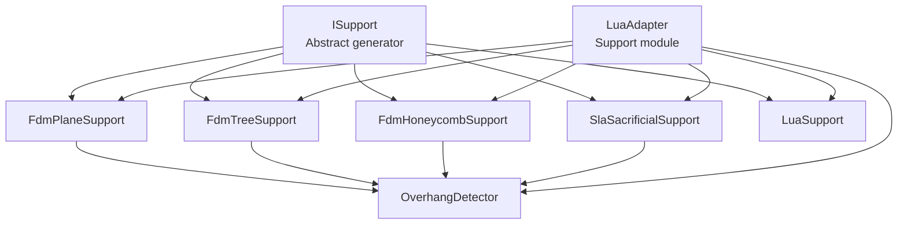
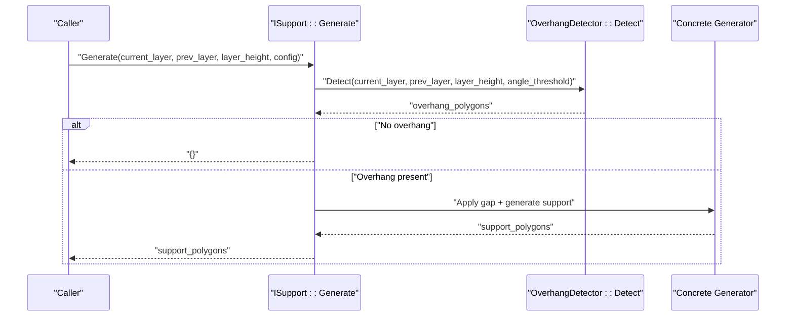
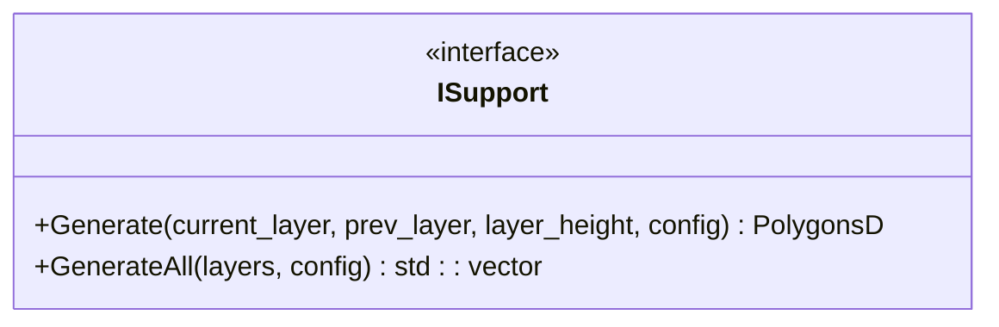
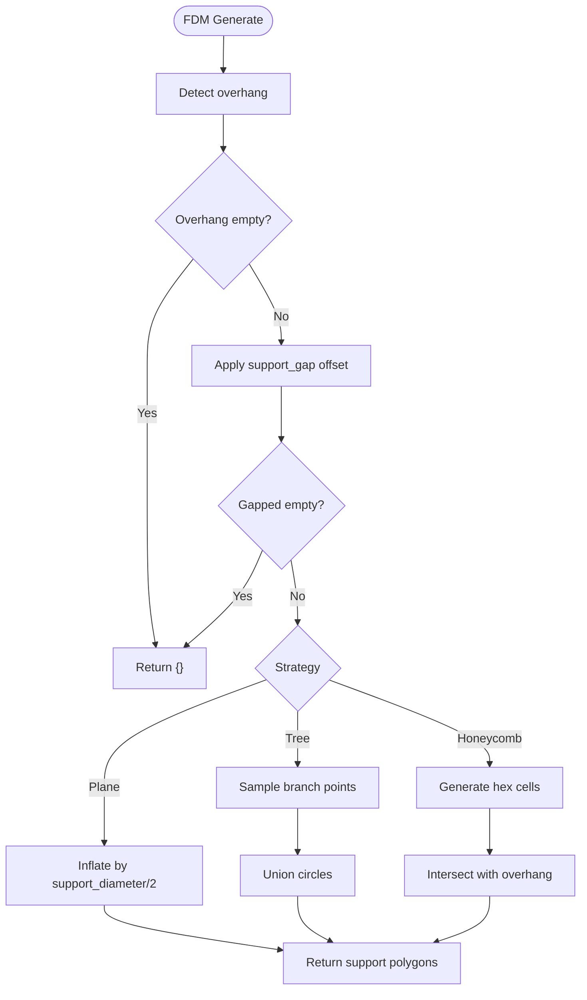
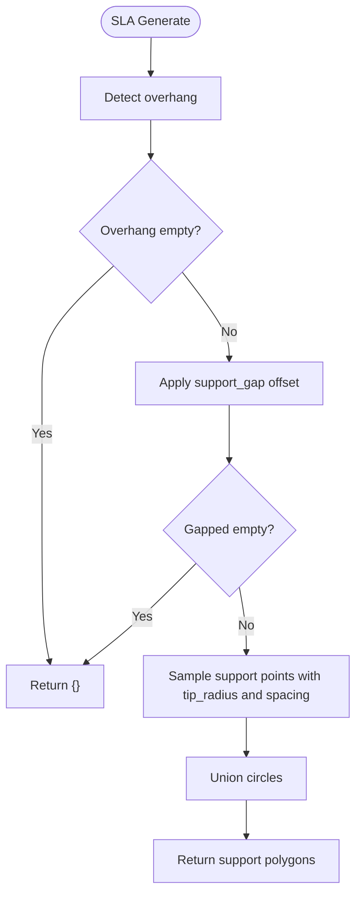
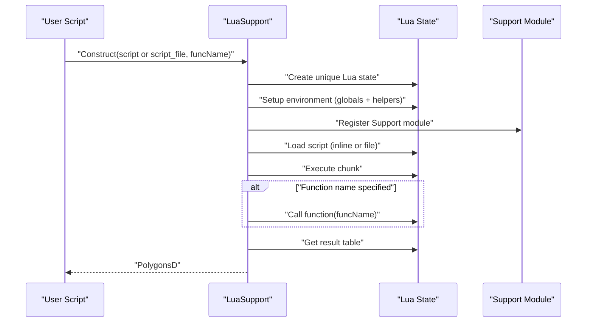
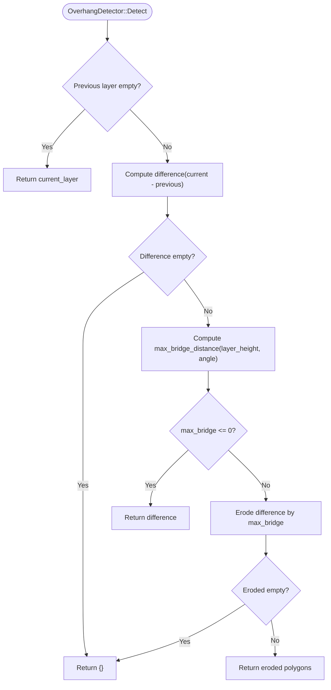
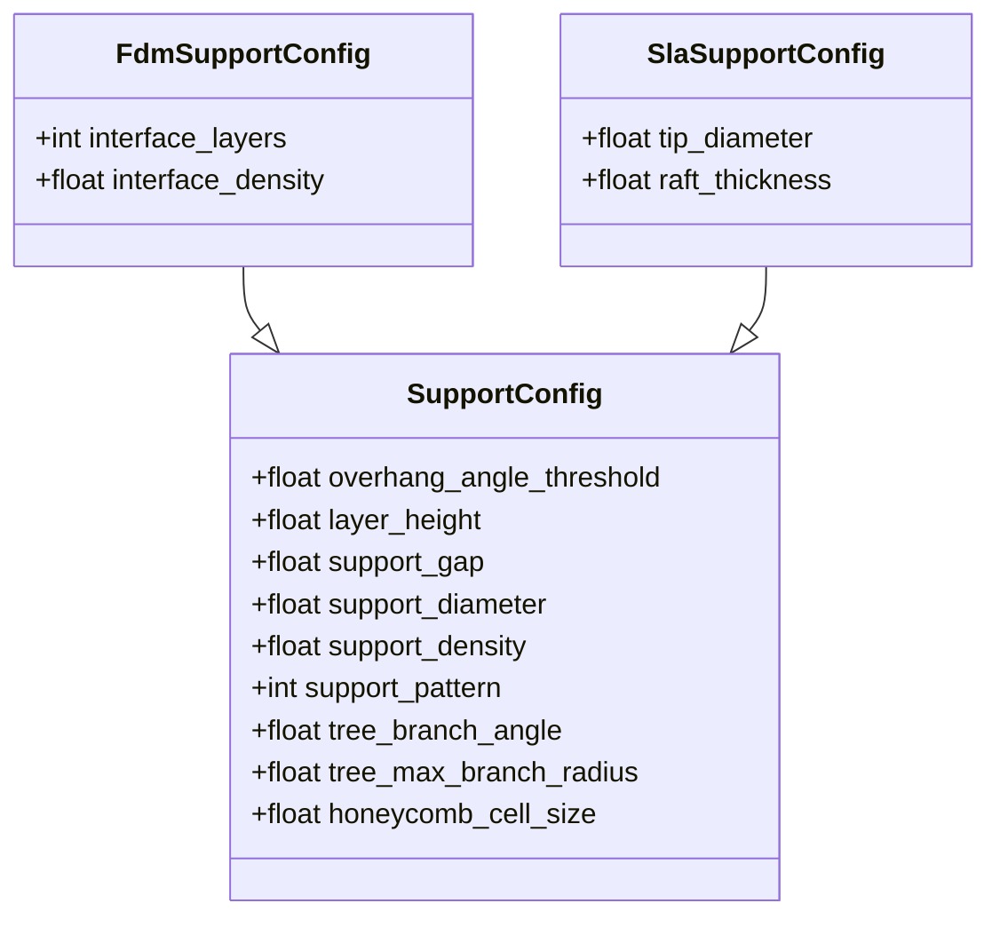
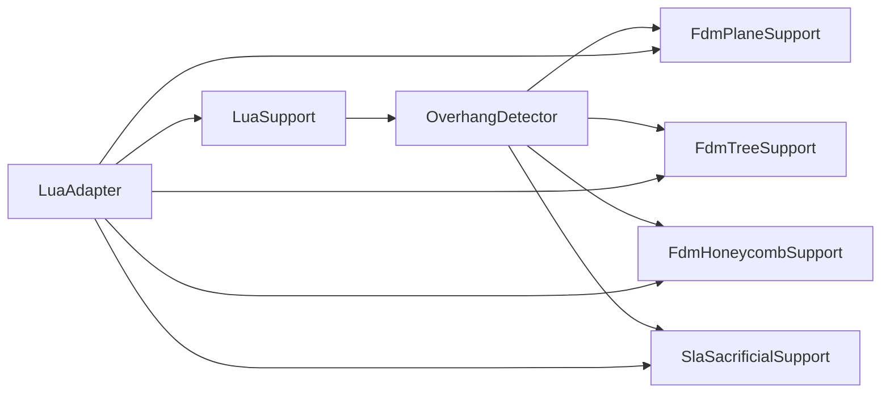

# Support Generation / 支撑生成

<cite>
**Referenced Files in This Document**   
- [ISupport.hpp](file://support/ISupport.hpp)
- [ISupport.cpp](file://support/ISupport.cpp)
- [FdmSupport.hpp](file://support/FdmSupport.hpp)
- [FdmSupport.cpp](file://support/FdmSupport.cpp)
- [SlaSupport.hpp](file://support/SlaSupport.hpp)
- [SlaSupport.cpp](file://support/SlaSupport.cpp)
- [LuaSupport.hpp](file://support/LuaSupport.hpp)
- [LuaSupport.cpp](file://support/LuaSupport.cpp)
- [OverhangDetector.hpp](file://support/OverhangDetector.hpp)
- [OverhangDetector.cpp](file://support/OverhangDetector.cpp)
- [SupportConfig.hpp](file://support/SupportConfig.hpp)
- [LuaAdapter.hpp](file://support/LuaAdapter.hpp)
- [LuaAdapter.cpp](file://support/LuaAdapter.cpp)
</cite>

## Table of Contents
1. [Introduction](#introduction)
2. [Project Structure](#project-structure)
3. [Core Components](#core-components)
4. [Architecture Overview](#architecture-overview)
5. [Detailed Component Analysis](#detailed-component-analysis)
6. [Dependency Analysis](#dependency-analysis)
7. [Performance Considerations](#performance-considerations)
8. [Troubleshooting Guide](#troubleshooting-guide)
9. [Conclusion](#conclusion)
10. [Appendices](#appendices)

## Introduction
This document explains the support generation system used by HsBaSlicer to create per-layer support structures for FDM and SLA workflows. It focuses on:
- The `ISupport` interface and its concrete generators: plane, tree, honeycomb, SLA sacrificial, and Lua-based custom algorithms.
- The `generate()` method that produces support polygons from current and previous layer contours.
- The `detect_overhang()` function that identifies regions requiring support based on overhang angle and layer height.
- The `SupportConfig` structure and process-specific configuration variants.
- Examples for developing custom support algorithms using `new_lua()` and `new_lua_file()`, and integrating with FDM and SLA pipelines.

## Project Structure
The support generation logic is implemented under the `support` directory. The key files are:
- Abstract interface and default iteration: `ISupport.*`
- FDM strategies: `FdmSupport.*`
- SLA strategy: `SlaSupport.*`
- Lua-based custom algorithm: `LuaSupport.*`
- Overhang detection: `OverhangDetector.*`
- Configuration structs: `SupportConfig.hpp`
- Lua bindings exposing constructors and helpers: `LuaAdapter.*`

**Diagram sources**
- [ISupport.hpp:22-44](file://support/ISupport.hpp#L22-L44)
- [FdmSupport.hpp:19-63](file://support/FdmSupport.hpp#L19-L63)
- [SlaSupport.hpp:20-42](file://support/SlaSupport.hpp#L20-L42)
- [LuaSupport.hpp:40-81](file://support/LuaSupport.hpp#L40-L81)
- [OverhangDetector.hpp:20-50](file://support/OverhangDetector.hpp#L20-L50)
- [LuaAdapter.hpp:13-30](file://support/LuaAdapter.hpp#L13-L30)

**Section sources**
- [ISupport.hpp:1-49](file://support/ISupport.hpp#L1-L49)
- [FdmSupport.hpp:1-67](file://support/FdmSupport.hpp#L1-L67)
- [SlaSupport.hpp:1-46](file://support/SlaSupport.hpp#L1-L46)
- [LuaSupport.hpp:1-85](file://support/LuaSupport.hpp#L1-L85)
- [OverhangDetector.hpp:1-54](file://support/OverhangDetector.hpp#L1-L54)
- [SupportConfig.hpp:1-47](file://support/SupportConfig.hpp#L1-L47)
- [LuaAdapter.hpp:1-34](file://support/LuaAdapter.hpp#L1-L34)

## Core Components
- `ISupport`: Defines the common interface for all support generators. It exposes:
  - `Generate(current_layer, prev_layer, layer_height, config)`: returns support polygons for a single layer.
  - `GenerateAll(layers, config)`: iterates layers and calls `Generate` for each.
- Concrete generators:
  - `FdmPlaneSupport`: column supports inflated from overhang regions.
  - `FdmTreeSupport`: branching tree-like supports sampled within overhang regions.
  - `FdmHoneycombSupport`: lightweight hexagonal honeycomb fills over overhang regions.
  - `SlaSacrificialSupport`: thin sacrificial columns optimized for resin printing.
  - `LuaSupport`: user-defined algorithm via inline or file-based Lua scripts.
- `OverhangDetector`: computes overhanging regions between adjacent layers using geometry difference and angle-based bridge filtering.
- `SupportConfig`: shared configuration fields including overhang angle threshold, gap, diameter, density, pattern selection, and process-specific options.

**Section sources**
- [ISupport.hpp:22-44](file://support/ISupport.hpp#L22-L44)
- [ISupport.cpp:9-21](file://support/ISupport.cpp#L9-L21)
- [FdmSupport.hpp:19-63](file://support/FdmSupport.hpp#L19-L63)
- [SlaSupport.hpp:20-42](file://support/SlaSupport.hpp#L20-L42)
- [LuaSupport.hpp:40-81](file://support/LuaSupport.hpp#L40-L81)
- [OverhangDetector.hpp:20-50](file://support/OverhangDetector.hpp#L20-L50)
- [SupportConfig.hpp:14-43](file://support/SupportConfig.hpp#L14-L43)

## Architecture Overview
The support generation pipeline follows a consistent flow:
1. Detect overhang regions between current and previous layers.
2. Apply a model-support gap to separate supports from the model.
3. Generate support cross-sections according to the selected strategy (plane, tree, honeycomb, SLA, or Lua).
4. Return polygons representing support at the current layer.

**Diagram sources**
- [ISupport.hpp:35-36](file://support/ISupport.hpp#L35-L36)
- [OverhangDetector.cpp:41-80](file://support/OverhangDetector.cpp#L41-L80)
- [FdmSupport.cpp:48-76](file://support/FdmSupport.cpp#L48-L76)
- [SlaSupport.cpp:81-123](file://support/SlaSupport.cpp#L81-L123)

## Detailed Component Analysis

### ISupport Interface and Default Iteration
- Purpose: Provide a uniform API for all support generators.
- Key methods:
  - `Generate(...)`: pure virtual; must be implemented by each strategy.
  - `GenerateAll(...)`: default implementation iterates layers, passing previous layer data and using `config.layer_height`.

**Diagram sources**
- [ISupport.hpp:22-44](file://support/ISupport.hpp#L22-L44)
- [ISupport.cpp:9-21](file://support/ISupport.cpp#L9-L21)

**Section sources**
- [ISupport.hpp:22-44](file://support/ISupport.hpp#L22-L44)
- [ISupport.cpp:9-21](file://support/ISupport.cpp#L9-L21)

### FDM Support Strategies
- `FdmPlaneSupport`:
  - Detects overhang, applies gap, inflates by half of `support_diameter` to form cylindrical columns.
- `FdmTreeSupport`:
  - Samples branch points inside the gapped overhang region and creates circular tips; unions overlapping circles.
- `FdmHoneycombSupport`:
  - Generates flat-top hexagons across the bounding box, intersects unioned cells with the overhang region.

**Diagram sources**
- [FdmSupport.cpp:48-76](file://support/FdmSupport.cpp#L48-L76)
- [FdmSupport.cpp:145-168](file://support/FdmSupport.cpp#L145-L168)
- [FdmSupport.cpp:244-267](file://support/FdmSupport.cpp#L244-L267)

**Section sources**
- [FdmSupport.hpp:19-63](file://support/FdmSupport.hpp#L19-L63)
- [FdmSupport.cpp:48-76](file://support/FdmSupport.cpp#L48-L76)
- [FdmSupport.cpp:81-143](file://support/FdmSupport.cpp#L81-L143)
- [FdmSupport.cpp:173-242](file://support/FdmSupport.cpp#L173-L242)
- [FdmSupport.cpp:244-267](file://support/FdmSupport.cpp#L244-L267)

### SLA Sacrificial Support
- Purpose: Thin sacrificial supports suitable for resin printing.
- Behavior:
  - Detects overhang, applies gap, samples support points spaced by `support_diameter * 2`, uses small tip radius from `tip_diameter`, and unions circles.
- Static overload accepts either `SupportConfig` or `SlaSupportConfig`; when given base config, it converts to SLA config with defaults.

**Diagram sources**
- [SlaSupport.cpp:81-123](file://support/SlaSupport.cpp#L81-L123)
- [SlaSupport.cpp:126-133](file://support/SlaSupport.cpp#L126-L133)

**Section sources**
- [SlaSupport.hpp:20-42](file://support/SlaSupport.hpp#L20-L42)
- [SlaSupport.cpp:38-79](file://support/SlaSupport.cpp#L38-L79)
- [SlaSupport.cpp:81-123](file://support/SlaSupport.cpp#L81-L123)
- [SlaSupport.cpp:126-133](file://support/SlaSupport.cpp#L126-L133)

### Lua-Based Custom Support Algorithm
- Purpose: Allow users to replace built-in algorithms with custom Lua scripts.
- Constructors:
  - `LuaSupport(script)`: inline script with default function name `generate_support`.
  - `LuaSupport(script, funcName)`: inline script with custom function name.
  - `LuaSupport(script_file, funcName)`: load script from file path.
- Execution:
  - Creates a new Lua state, registers polygon helpers and the `Support` module, pushes globals (`current_layer`, `prev_layer`, `layer_height`, `config`).
  - Optionally executes an external registration callback vector to add more functions.
  - Loads and runs the script chunk; if a function name is provided, calls it expecting one return value.
  - Converts returned table to `PolygonsD`.
- Error handling: throws runtime errors for Lua state creation, load, runtime, and function call failures.

**Diagram sources**
- [LuaSupport.cpp:93-106](file://support/LuaSupport.cpp#L93-L106)
- [LuaSupport.cpp:113-178](file://support/LuaSupport.cpp#L113-L178)
- [LuaAdapter.cpp:265-276](file://support/LuaAdapter.cpp#L265-L276)

**Section sources**
- [LuaSupport.hpp:40-81](file://support/LuaSupport.hpp#L40-L81)
- [LuaSupport.cpp:19-90](file://support/LuaSupport.cpp#L19-L90)
- [LuaSupport.cpp:93-178](file://support/LuaSupport.cpp#L93-L178)

### Overhang Detection
- Purpose: Identify unsupported regions between adjacent layers based on geometry difference and angle threshold.
- Logic:
  - If no previous layer exists, entire current layer is considered overhang.
  - Compute difference between current and previous layers.
  - Calculate maximum bridge distance from layer height and angle threshold.
  - Erode the difference by the bridge distance to filter small overhangs.
  - Return eroded polygons or empty set.

**Diagram sources**
- [OverhangDetector.cpp:23-39](file://support/OverhangDetector.cpp#L23-L39)
- [OverhangDetector.cpp:41-80](file://support/OverhangDetector.cpp#L41-L80)

**Section sources**
- [OverhangDetector.hpp:20-50](file://support/OverhangDetector.hpp#L20-L50)
- [OverhangDetector.cpp:23-39](file://support/OverhangDetector.cpp#L23-L39)
- [OverhangDetector.cpp:41-80](file://support/OverhangDetector.cpp#L41-L80)

### Support Configuration
- `SupportConfig`:
  - `overhang_angle_threshold`: degrees; controls overhang sensitivity.
  - `layer_height`: mm; used by detectors and generators.
  - `support_gap`: mm; separation between model and support.
  - `support_diameter`: mm; base diameter for supports.
  - `support_density`: ratio [0,1]; fill density indicator.
  - `support_pattern`: integer selector (0=Plane, 1=Tree, 2=Honeycomb).
  - `tree_branch_angle`: degrees; tree branch angle parameter.
  - `tree_max_branch_radius`: mm; maximum branch radius.
  - `honeycomb_cell_size`: mm; hex cell size.
- `FdmSupportConfig`: extends base with interface layer count and density.
- `SlaSupportConfig`: extends base with tip diameter and raft thickness.

**Diagram sources**
- [SupportConfig.hpp:14-43](file://support/SupportConfig.hpp#L14-L43)

**Section sources**
- [SupportConfig.hpp:14-43](file://support/SupportConfig.hpp#L14-L43)

## Dependency Analysis
- Generators depend on `OverhangDetector` to compute overhang regions.
- `LuaAdapter` exposes constructors and helpers to Lua scripts, binding C++ classes to Lua userdata.
- `LuaSupport` integrates with the `Support` module and polygon helper functions registered by `2D/LuaAdapter`.

**Diagram sources**
- [FdmSupport.cpp:48-76](file://support/FdmSupport.cpp#L48-L76)
- [SlaSupport.cpp:81-123](file://support/SlaSupport.cpp#L81-L123)
- [LuaAdapter.cpp:253-276](file://support/LuaAdapter.cpp#L253-L276)
- [LuaSupport.cpp:67-90](file://support/LuaSupport.cpp#L67-L90)

**Section sources**
- [FdmSupport.cpp:48-76](file://support/FdmSupport.cpp#L48-L76)
- [SlaSupport.cpp:81-123](file://support/SlaSupport.cpp#L81-L123)
- [LuaAdapter.cpp:253-276](file://support/LuaAdapter.cpp#L253-L276)
- [LuaSupport.cpp:67-90](file://support/LuaSupport.cpp#L67-L90)

## Performance Considerations
- Overhang detection uses geometric difference and erosion; large models may benefit from reducing `overhang_angle_threshold` to limit unnecessary support areas.
- Tree and honeycomb strategies involve grid sampling and polygon operations; tuning `support_diameter`, `honeycomb_cell_size`, and `spacing` can reduce computational cost.
- SLA sacrificial supports sample points with spacing proportional to `support_diameter`; increasing spacing reduces point count but may weaken support coverage.
- Lua-based algorithms should avoid excessive polygon operations in tight loops; leverage registered helpers and precompute where possible.

[No sources needed since this section provides general guidance]

## Troubleshooting Guide
- Lua script errors:
  - Load/runtime/function call errors throw runtime exceptions; inspect error messages from Lua stack traces.
  - Ensure the script returns a table of polygons or defines the expected function name.
- Invalid support object:
  - Passing invalid userdata to `Support.generate` raises an error; verify object construction via `new_plane`, `new_tree`, etc.
- Configuration mismatches:
  - Missing or incorrect fields in the config table may lead to unexpected behavior; use `default_config()` to initialize defaults.
- Overhang detection issues:
  - Very low angle thresholds produce large overhang areas; adjust `overhang_angle_threshold` appropriately.
  - Excessive gap values may eliminate support entirely; ensure `support_gap` is reasonable relative to model features.

**Section sources**
- [LuaSupport.cpp:113-178](file://support/LuaSupport.cpp#L113-L178)
- [LuaAdapter.cpp:174-213](file://support/LuaAdapter.cpp#L174-L213)
- [LuaAdapter.cpp:215-241](file://support/LuaAdapter.cpp#L215-L241)
- [OverhangDetector.cpp:41-80](file://support/OverhangDetector.cpp#L41-L80)

## Conclusion
The support generation system provides a flexible, extensible framework for creating per-layer supports across FDM and SLA workflows. By combining robust overhang detection with multiple built-in strategies and a Lua scripting interface, it enables both standard usage and advanced customization. Proper configuration and understanding of the underlying algorithms help optimize performance and quality for different printing processes.

[No sources needed since this section summarizes without analyzing specific files]

## Appendices

### Lua API Reference for Support Module
- Global table `Support` exposes:
  - `Support.new_plane()`: creates FDM plane support.
  - `Support.new_tree()`: creates FDM tree support.
  - `Support.new_honeycomb()`: creates FDM honeycomb support.
  - `Support.new_sla()`: creates SLA sacrificial support.
  - `Support.new_lua(script[, funcName])`: creates Lua-based support from inline script.
  - `Support.new_lua_file(path, funcName)`: creates Lua-based support from file.
  - `Support.generate(support_obj, current_layer, prev_layer, layer_height, config_table)`: returns polygons.
  - `Support.detect_overhang(current_layer, prev_layer, layer_height, angle_deg)`: returns overhang polygons.
  - `Support.default_config()`: returns default configuration table.

**Section sources**
- [LuaAdapter.hpp:13-30](file://support/LuaAdapter.hpp#L13-L30)
- [LuaAdapter.cpp:110-172](file://support/LuaAdapter.cpp#L110-L172)
- [LuaAdapter.cpp:174-241](file://support/LuaAdapter.cpp#L174-L241)
- [LuaAdapter.cpp:253-276](file://support/LuaAdapter.cpp#L253-L276)