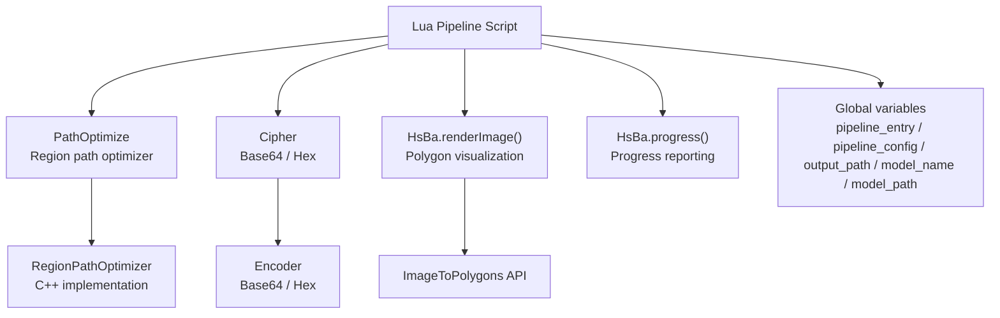
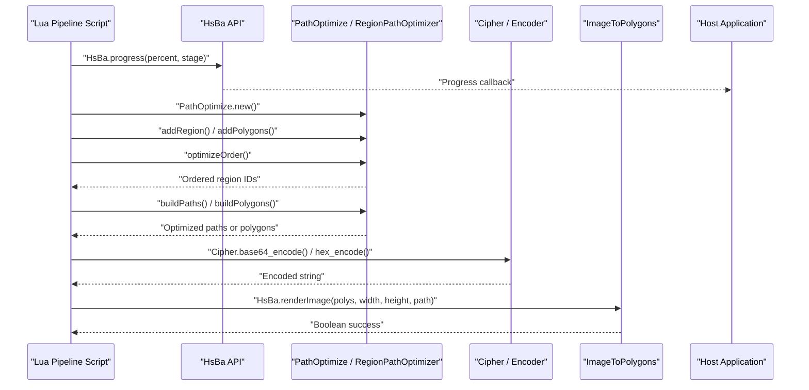
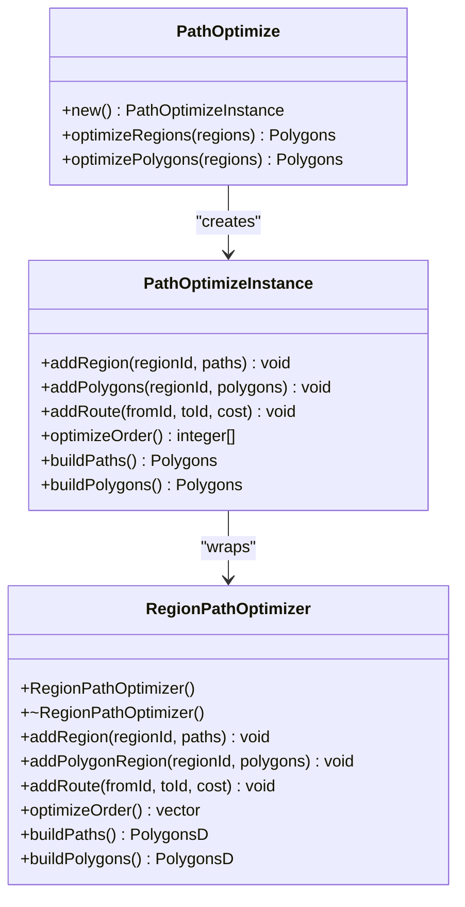
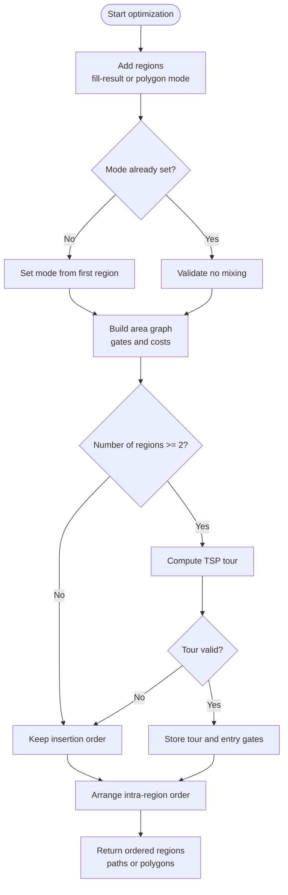
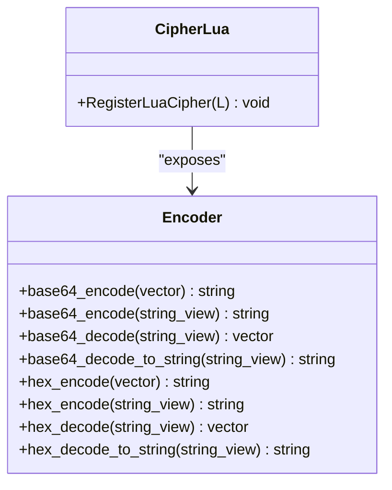
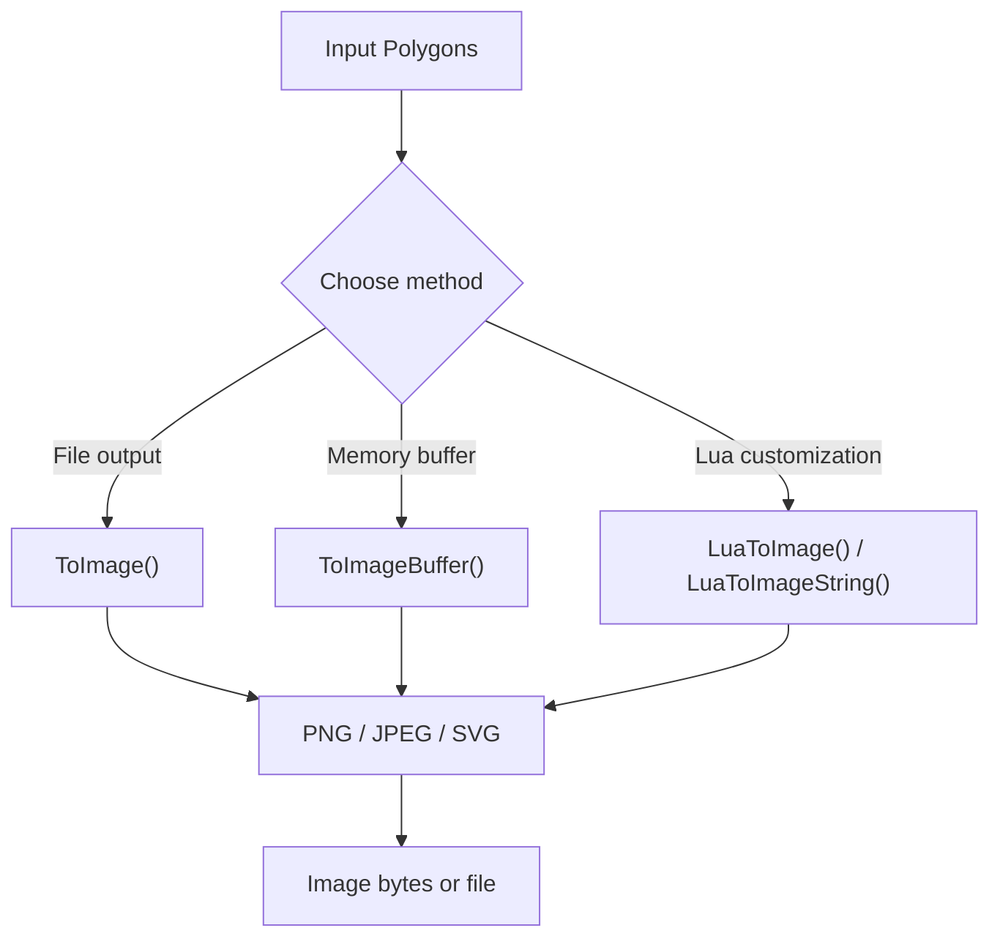
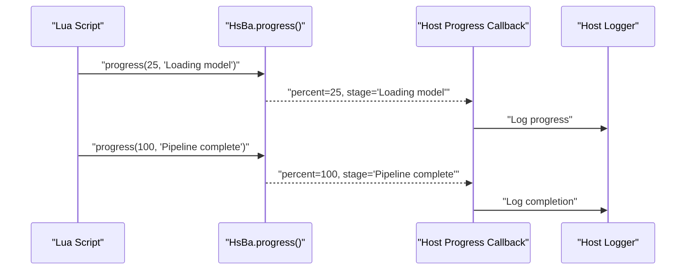
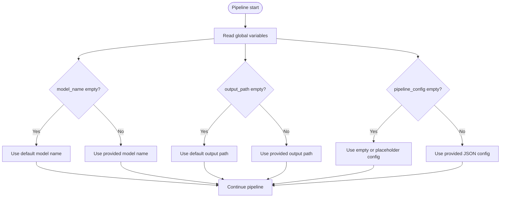
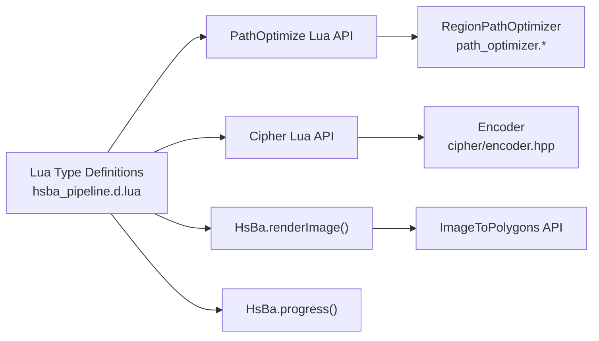

# Utility Tools / 工具函数

<cite>
**Referenced Files in This Document**   
- [path_optimizer.hpp](file://LibHsBaSlicer/Path/path_optimizer.hpp)
- [path_optimizer.cpp](file://LibHsBaSlicer/Path/path_optimizer.cpp)
- [encoder.hpp](file://cipher/encoder.hpp)
- [LuaAdapter.hpp](file://cipher/LuaAdapter.hpp)
- [ImageToPolygons.hpp](file://2D/ImageToPolygons.hpp)
- [hsba_pipeline.d.lua](file://types/hsba_pipeline.d.lua)
- [my_fdm_pipeline.lua](file://samples/Custom/scripts/my_fdm_pipeline.lua)
- [my_lom_pipeline.lua](file://samples/Custom/scripts/my_lom_pipeline.lua)
- [my_sla_pipeline.lua](file://samples/Custom/scripts/my_sla_pipeline.lua)
- [main.cpp](file://samples/Custom/main.cpp)
</cite>

## Table of Contents
1. [Introduction](#introduction)
2. [Project Structure](#project-structure)
3. [Core Components](#core-components)
4. [Architecture Overview](#architecture-overview)
5. [Detailed Component Analysis](#detailed-component-analysis)
6. [Dependency Analysis](#dependency-analysis)
7. [Performance Considerations](#performance-considerations)
8. [Troubleshooting Guide](#troubleshooting-guide)
9. [Conclusion](#conclusion)
10. [Appendices](#appendices)

## Introduction
This document explains the Lua scripting utilities exposed by HsBaSlicer that are most useful for workflow monitoring, data serialization, debugging visualization, and integration with external tools:

- Path order optimization through `PathOptimize`, which reduces travel distance between independent polygon or fill regions.
- Data encoding and decoding through the `Cipher` module, including Base64 and hexadecimal operations.
- Polygon-to-image rendering through `HsBa.renderImage()` and related image conversion helpers.
- Progress reporting through `HsBa.progress()`.
- Global context variables such as `pipeline_entry`, `pipeline_config`, `output_path`, `model_name`, and `model_path`.

These utilities allow a Lua pipeline script to optimize path output, serialize configuration or intermediate results, generate debug images, report progress to the host application, and read/write files.

## Project Structure
The utility surface is split across several modules:

| Area | Responsibility | Key Files |
|---|---|---|
| Path optimization | Region-based path ordering and intra-region arrangement | [path_optimizer.hpp](file://LibHsBaSlicer/Path/path_optimizer.hpp), [path_optimizer.cpp](file://LibHsBaSlicer/Path/path_optimizer.cpp) |
| Cipher utilities | Base64 and hex encoding/decoding | [encoder.hpp](file://cipher/encoder.hpp), [LuaAdapter.hpp](file://cipher/LuaAdapter.hpp) |
| Image generation | Polygon rasterization and Lua-driven image export | [ImageToPolygons.hpp](file://2D/ImageToPolygons.hpp) |
| Lua API types | Type hints and global variable declarations | [hsba_pipeline.d.lua](file://types/hsba_pipeline.d.lua) |
| Sample pipelines | Real usage of global variables and pipeline callbacks | [my_fdm_pipeline.lua](file://samples/Custom/scripts/my_fdm_pipeline.lua), [my_lom_pipeline.lua](file://samples/Custom/scripts/my_lom_pipeline.lua), [my_sla_pipeline.lua](file://samples/Custom/scripts/my_sla_pipeline.lua), [main.cpp](file://samples/Custom/main.cpp) |

**Diagram sources**
- [path_optimizer.hpp:23-115](file://LibHsBaSlicer/Path/path_optimizer.hpp#L23-L115)
- [encoder.hpp:14-52](file://cipher/encoder.hpp#L14-L52)
- [ImageToPolygons.hpp:42-99](file://2D/ImageToPolygons.hpp#L42-L99)
- [hsba_pipeline.d.lua:64-77](file://types/hsba_pipeline.d.lua#L64-L77)
- [hsba_pipeline.d.lua:127-133](file://types/hsba_pipeline.d.lua#L127-L133)
- [hsba_pipeline.d.lua:296-307](file://types/hsba_pipeline.d.lua#L296-L307)
- [hsba_pipeline.d.lua:457-463](file://types/hsba_pipeline.d.lua#L457-L463)
- [hsba_pipeline.d.lua:469-487](file://types/hsba_pipeline.d.lua#L469-L487)

**Section sources**
- [path_optimizer.hpp:23-115](file://LibHsBaSlicer/Path/path_optimizer.hpp#L23-L115)
- [encoder.hpp:14-52](file://cipher/encoder.hpp#L14-L52)
- [ImageToPolygons.hpp:42-99](file://2D/ImageToPolygons.hpp#L42-L99)
- [hsba_pipeline.d.lua:64-77](file://types/hsba_pipeline.d.lua#L64-L77)
- [hsba_pipeline.d.lua:127-133](file://types/hsba_pipeline.d.lua#L127-L133)
- [hsba_pipeline.d.lua:296-307](file://types/hsba_pipeline.d.lua#L296-L307)
- [hsba_pipeline.d.lua:457-463](file://types/hsba_pipeline.d.lua#L457-L463)
- [hsba_pipeline.d.lua:469-487](file://types/hsba_pipeline.d.lua#L469-L487)

## Core Components
This section summarizes the four main tool families used from Lua scripts.

### PathOptimize: Path Order Optimization
`PathOptimize` provides region-based path optimization that reduces air-move travel between independent regions. It supports two modes:

| Mode | When it runs | Input | Output |
|---|---|---|---|
| Polygon mode | Before filling | Polygons (contours) | Polygons in optimized order |
| Fill-result mode | After filling | Fill paths (multi-point polylines supported) | Complete fill paths in optimized order |

Key Lua-facing capabilities include:

| Capability | Description |
|---|---|
| `PathOptimize.new()` | Create an optimizer instance |
| `addRegion(regionId, paths)` | Add fill-result mode region |
| `addPolygons(regionId, polygons)` | Add polygon mode region |
| `addRoute(fromId, toId, cost)` | Override inter-region travel cost |
| `optimizeOrder()` | Solve region visit order |
| `buildPaths()` | Return complete fill paths |
| `buildPolygons()` | Return ordered polygons |
| `PathOptimize.optimizeRegions(regions)` | One-shot fill-result optimization |
| `PathOptimize.optimizePolygons(regions)` | One-shot polygon-mode optimization |

The underlying C++ class is `RegionPathOptimizer`. It models each region as a graph vertex and uses area-graph routing plus TSP-style ordering to minimize total travel distance. Intra-region path or polygon order is arranged greedily to reduce jumps.

**Section sources**
- [path_optimizer.hpp:23-115](file://LibHsBaSlicer/Path/path_optimizer.hpp#L23-L115)
- [path_optimizer.cpp:476-708](file://LibHsBaSlicer/Path/path_optimizer.cpp#L476-L708)

### Cipher: Base64 and Hex Encoding
The `Cipher` module exposes stateless encoding helpers to Lua scripts. The C++ implementation is centered on `Encoder`, while the Lua binding registration is declared in the cipher Lua adapter.

Available operations include:

| Operation | Purpose |
|---|---|
| `base64_encode(data)` | Encode bytes or string to Base64 |
| `base64_decode(data)` | Decode Base64 to bytes or string |
| `hex_encode(data)` | Encode bytes or string to hexadecimal |
| `hex_decode(data)` | Decode hexadecimal to bytes or string |

Important notes:

- Base64 increases data size by approximately 33%.
- Hex encoding doubles data size because each byte becomes two characters.
- These functions perform representation conversion; they do not provide cryptographic security.
- Invalid input can cause decode failures.

**Section sources**
- [encoder.hpp:14-52](file://cipher/encoder.hpp#L14-L52)
- [LuaAdapter.hpp:11-14](file://cipher/LuaAdapter.hpp#L11-L14)
- [hsba_pipeline.d.lua:127-133](file://types/hsba_pipeline.d.lua#L127-L133)

### renderImage(): Visualizing Polygon Data
`HsBa.renderImage(polys, width, height, path)` renders polygon data to an image file. It is primarily useful for debugging slicing, support, fill, or path stages.

Related image utilities include:

| Function | Purpose |
|---|---|
| `FromImage(path, threshold, pixelSize)` | Convert an image to polygons using thresholding |
| `FromImageMulti(path, thresholds, pixelSize)` | Convert an image to multiple polygon sets |
| `ToImage(polys, width, height, pixelSize, outPath, foreground, background)` | Write polygons to an image file |
| `ToImageBuffer(polys, width, height, pixelSize, ext, outBuffer, foreground, background)` | Encode polygons into memory without writing a temporary file |
| `LuaToImage(poly, scriptPath, outPath, functionName, lua_reg)` | Use a Lua script to customize image generation |
| `LuaToImageString(poly, script, outPath, functionName, lua_reg)` | Use inline Lua code to customize image generation |

Supported output formats include PNG, JPEG/JPG, and SVG depending on the extension passed to the buffer API or selected by the output path.

**Section sources**
- [hsba_pipeline.d.lua:457-463](file://types/hsba_pipeline.d.lua#L457-L463)
- [ImageToPolygons.hpp:23-99](file://2D/ImageToPolygons.hpp#L23-L99)

### HsBa.progress(): Workflow Monitoring
`HsBa.progress(percent, stage)` reports progress from a Lua pipeline script to the host application. The host can then display percentage completion, current stage name, elapsed time, layer count, and final output path.

In the sample custom pipeline, the C++ side receives progress through a callback and logs it. The Lua script calls `HsBa.progress()` during long-running steps such as model loading, slicing, support generation, filling, or exporting.

**Section sources**
- [hsba_pipeline.d.lua:296-299](file://types/hsba_pipeline.d.lua#L296-L299)
- [main.cpp:69-78](file://samples/Custom/main.cpp#L69-L78)

### Global Variables: Context Information
The Custom pipeline environment injects global variables that describe the current run:

| Variable | Type | Meaning |
|---|---|---|
| `pipeline_entry` | string | Entry function name, default `"run_pipeline"` unless overridden by C++ |
| `pipeline_config` | string | JSON configuration string passed from C++ |
| `output_path` | string | Default output path set by C++ |
| `model_name` | string | Model name passed from C++ |
| `model_path` | string | Model file path passed from C++ |

Sample pipelines use these variables to choose defaults when values are empty, and to embed configuration into exported artifacts.

**Section sources**
- [hsba_pipeline.d.lua:469-487](file://types/hsba_pipeline.d.lua#L469-L487)
- [my_fdm_pipeline.lua:10-13](file://samples/Custom/scripts/my_fdm_pipeline.lua#L10-L13)
- [my_fdm_pipeline.lua:54-57](file://samples/Custom/scripts/my_fdm_pipeline.lua#L54-L57)
- [my_fdm_pipeline.lua:163](file://samples/Custom/scripts/my_fdm_pipeline.lua#L163)
- [my_lom_pipeline.lua:8](file://samples/Custom/scripts/my_lom_pipeline.lua#L8)
- [my_lom_pipeline.lua:21-24](file://samples/Custom/scripts/my_lom_pipeline.lua#L21-L24)
- [my_sla_pipeline.lua:12-15](file://samples/Custom/scripts/my_sla_pipeline.lua#L12-L15)
- [my_sla_pipeline.lua:29-32](file://samples/Custom/scripts/my_sla_pipeline.lua#L29-L32)

## Architecture Overview
The Lua-side utilities connect to C++ implementations through registered bindings.

**Diagram sources**
- [hsba_pipeline.d.lua:296-299](file://types/hsba_pipeline.d.lua#L296-L299)
- [hsba_pipeline.d.lua:457-463](file://types/hsba_pipeline.d.lua#L457-L463)
- [path_optimizer.hpp:102-115](file://LibHsBaSlicer/Path/path_optimizer.hpp#L102-L115)
- [encoder.hpp:14-52](file://cipher/encoder.hpp#L14-L52)
- [ImageToPolygons.hpp:42-99](file://2D/ImageToPolygons.hpp#L42-L99)

## Detailed Component Analysis

### PathOptimize Class Analysis
`PathOptimize` is the Lua-facing entry point to `RegionPathOptimizer`. The C++ implementation builds an area graph where each region is a vertex and candidate gates are entry/exit points. Inter-region costs are based on straight-line gate distances, and manual routes can override auto-computed costs.

**Diagram sources**
- [path_optimizer.hpp:44-115](file://LibHsBaSlicer/Path/path_optimizer.hpp#L44-L115)
- [hsba_pipeline.d.lua:64-77](file://types/hsba_pipeline.d.lua#L64-L77)

#### Optimization Flow

**Diagram sources**
- [path_optimizer.cpp:129-235](file://LibHsBaSlicer/Path/path_optimizer.cpp#L129-L235)
- [path_optimizer.cpp:252-312](file://LibHsBaSlicer/Path/path_optimizer.cpp#L252-L312)
- [path_optimizer.cpp:315-438](file://LibHsBaSlicer/Path/path_optimizer.cpp#L315-L438)

**Section sources**
- [path_optimizer.hpp:23-115](file://LibHsBaSlicer/Path/path_optimizer.hpp#L23-L115)
- [path_optimizer.cpp:45-438](file://LibHsBaSlicer/Path/path_optimizer.cpp#L45-L438)
- [path_optimizer.cpp:476-708](file://LibHsBaSlicer/Path/path_optimizer.cpp#L476-L708)

### Cipher Module Analysis
The `Cipher` module exposes `Encoder` methods to Lua. The type definition declares the Lua-facing interface, while the C++ header defines the actual static methods.

**Diagram sources**
- [encoder.hpp:14-52](file://cipher/encoder.hpp#L14-L52)
- [LuaAdapter.hpp:11-14](file://cipher/LuaAdapter.hpp#L11-L14)

**Section sources**
- [encoder.hpp:14-52](file://cipher/encoder.hpp#L14-L52)
- [LuaAdapter.hpp:11-14](file://cipher/LuaAdapter.hpp#L11-L14)
- [hsba_pipeline.d.lua:127-133](file://types/hsba_pipeline.d.lua#L127-L133)

### Image Generation Analysis
`HsBa.renderImage()` is a convenience wrapper around the image conversion API. For more control, scripts can use `ToImage`, `ToImageBuffer`, or Lua-driven image generation.

**Diagram sources**
- [ImageToPolygons.hpp:42-99](file://2D/ImageToPolygons.hpp#L42-L99)
- [hsba_pipeline.d.lua:457-463](file://types/hsba_pipeline.d.lua#L457-L463)

**Section sources**
- [ImageToPolygons.hpp:23-99](file://2D/ImageToPolygons.hpp#L23-L99)
- [hsba_pipeline.d.lua:457-463](file://types/hsba_pipeline.d.lua#L457-L463)

### Progress Reporting Analysis
Progress reporting connects Lua scripts to the host application through a callback mechanism.

**Diagram sources**
- [hsba_pipeline.d.lua:296-299](file://types/hsba_pipeline.d.lua#L296-L299)
- [main.cpp:69-78](file://samples/Custom/main.cpp#L69-L78)

**Section sources**
- [hsba_pipeline.d.lua:296-299](file://types/hsba_pipeline.d.lua#L296-L299)
- [main.cpp:69-78](file://samples/Custom/main.cpp#L69-L78)

### Global Variables Usage Analysis
Sample pipelines demonstrate how `pipeline_entry`, `pipeline_config`, `output_path`, `model_name`, and `model_path` are used to provide defaults and embed configuration.

**Diagram sources**
- [my_fdm_pipeline.lua:54-57](file://samples/Custom/scripts/my_fdm_pipeline.lua#L54-L57)
- [my_fdm_pipeline.lua:163](file://samples/Custom/scripts/my_fdm_pipeline.lua#L163)
- [my_lom_pipeline.lua:21-24](file://samples/Custom/scripts/my_lom_pipeline.lua#L21-L24)
- [my_sla_pipeline.lua:29-32](file://samples/Custom/scripts/my_sla_pipeline.lua#L29-L32)
- [hsba_pipeline.d.lua:469-487](file://types/hsba_pipeline.d.lua#L469-L487)

**Section sources**
- [my_fdm_pipeline.lua:10-13](file://samples/Custom/scripts/my_fdm_pipeline.lua#L10-L13)
- [my_fdm_pipeline.lua:54-57](file://samples/Custom/scripts/my_fdm_pipeline.lua#L54-L57)
- [my_fdm_pipeline.lua:163](file://samples/Custom/scripts/my_fdm_pipeline.lua#L163)
- [my_lom_pipeline.lua:8](file://samples/Custom/scripts/my_lom_pipeline.lua#L8)
- [my_lom_pipeline.lua:21-24](file://samples/Custom/scripts/my_lom_pipeline.lua#L21-L24)
- [my_sla_pipeline.lua:12-15](file://samples/Custom/scripts/my_sla_pipeline.lua#L12-L15)
- [my_sla_pipeline.lua:29-32](file://samples/Custom/scripts/my_sla_pipeline.lua#L29-L32)
- [hsba_pipeline.d.lua:469-487](file://types/hsba_pipeline.d.lua#L469-L487)

## Dependency Analysis
The Lua utilities depend on C++ libraries and are exposed through Lua bindings.

**Diagram sources**
- [hsba_pipeline.d.lua:64-77](file://types/hsba_pipeline.d.lua#L64-L77)
- [hsba_pipeline.d.lua:127-133](file://types/hsba_pipeline.d.lua#L127-L133)
- [hsba_pipeline.d.lua:296-299](file://types/hsba_pipeline.d.lua#L296-L299)
- [hsba_pipeline.d.lua:457-463](file://types/hsba_pipeline.d.lua#L457-L463)
- [path_optimizer.hpp:102-115](file://LibHsBaSlicer/Path/path_optimizer.hpp#L102-L115)
- [encoder.hpp:14-52](file://cipher/encoder.hpp#L14-L52)
- [ImageToPolygons.hpp:42-99](file://2D/ImageToPolygons.hpp#L42-L99)

**Section sources**
- [hsba_pipeline.d.lua:64-77](file://types/hsba_pipeline.d.lua#L64-L77)
- [hsba_pipeline.d.lua:127-133](file://types/hsba_pipeline.d.lua#L127-L133)
- [hsba_pipeline.d.lua:296-299](file://types/hsba_pipeline.d.lua#L296-L299)
- [hsba_pipeline.d.lua:457-463](file://types/hsba_pipeline.d.lua#L457-L463)
- [path_optimizer.hpp:102-115](file://LibHsBaSlicer/Path/path_optimizer.hpp#L102-L115)
- [encoder.hpp:14-52](file://cipher/encoder.hpp#L14-L52)
- [ImageToPolygons.hpp:42-99](file://2D/ImageToPolygons.hpp#L42-L99)

## Performance Considerations
- Path optimization should be used when there are multiple independent regions. For one or two regions, the overhead may outweigh benefits.
- Mixing polygon mode and fill-result mode in the same optimizer is invalid and will raise an error.
- Manual route costs can improve realism when known travel constraints exist, but excessive manual overrides may distort the optimization result.
- Base64 encoding increases payload size; use it for transport-safe serialization rather than compression.
- Hex encoding doubles size; prefer it only when human-readable or protocol-limited text representations are required.
- Rendering large polygon sets to images can be expensive; prefer `ToImageBuffer` when avoiding disk I/O, and choose appropriate image dimensions.
- Progress reporting should be called at meaningful milestones rather than every inner loop iteration to avoid excessive callback overhead.

[No sources needed since this section provides general guidance]

## Troubleshooting Guide
Common issues and resolutions:

| Problem | Likely Cause | Resolution |
|---|---|---|
| Optimizer throws about mixing modes | Added both `addRegion` and `addPolygonRegion` in one instance | Use one mode per optimizer instance |
| Duplicate region ID error | Same `regionId` added twice | Ensure unique region identifiers |
| `buildPaths()` fails in polygon mode | Called after adding polygon regions | Use `buildPolygons()` for polygon mode |
| `buildPolygons()` fails in fill-result mode | Called after adding path regions | Use `buildPaths()` for fill-result mode |
| Cipher decode fails | Invalid Base64 or hex input | Validate encoded strings before decoding |
| `renderImage()` returns false | Invalid polygon bounds, unsupported format, or write failure | Check polygon data, image size, and output path |
| Progress not visible | Host callback not registered or Lua script does not call `HsBa.progress()` | Verify host callback setup and script progress calls |
| Global variables are empty | C++ did not pass model or output context | Check C++ pipeline configuration and sample usage |

**Section sources**
- [path_optimizer.cpp:68-127](file://LibHsBaSlicer/Path/path_optimizer.cpp#L68-L127)
- [path_optimizer.cpp:187-235](file://LibHsBaSlicer/Path/path_optimizer.cpp#L187-L235)
- [encoder.hpp:14-52](file://cipher/encoder.hpp#L14-L52)
- [ImageToPolygons.hpp:42-99](file://2D/ImageToPolygons.hpp#L42-L99)
- [hsba_pipeline.d.lua:296-299](file://types/hsba_pipeline.d.lua#L296-L299)
- [hsba_pipeline.d.lua:469-487](file://types/hsba_pipeline.d.lua#L469-L487)

## Conclusion
The HsBaSlicer Lua scripting environment provides practical utilities for real-world pipeline development:

- Use `PathOptimize` to reduce travel distance between independent regions, choosing polygon mode before filling or fill-result mode after filling.
- Use `Cipher` for safe, transport-friendly serialization of configuration or intermediate data, keeping in mind that Base64 and hex are not encryption.
- Use `HsBa.renderImage()` and related image APIs to visualize polygon data for debugging and external inspection.
- Use `HsBa.progress()` to integrate with host UIs and logging systems.
- Use global variables like `pipeline_entry`, `pipeline_config`, `output_path`, `model_name`, and `model_path` to adapt pipeline behavior to the execution context.

Together, these tools make Lua scripts robust, observable, and integrable with external visualization and serialization workflows.

[No sources needed since this section summarizes without analyzing specific files]

## Appendices

### Example Workflows

#### Workflow Monitoring with Progress Reporting
A typical monitoring workflow:

1. Call `HsBa.progress(0, "Start")`.
2. Load model and call `HsBa.progress(20, "Model loaded")`.
3. Slice layers and call `HsBa.progress(40, "Slicing")`.
4. Generate support and call `HsBa.progress(60, "Support generation")`.
5. Generate fill and call `HsBa.progress(80, "Filling")`.
6. Export output and call `HsBa.progress(100, "Pipeline complete")`.

**Section sources**
- [hsba_pipeline.d.lua:296-299](file://types/hsba_pipeline.d.lua#L296-L299)
- [main.cpp:69-78](file://samples/Custom/main.cpp#L69-L78)

#### Data Serialization with Cipher
A typical serialization workflow:

1. Prepare configuration table or JSON string.
2. Encode with `Cipher.base64_encode()` or `Cipher.hex_encode()`.
3. Store encoded string in file, database, or zip package.
4. Decode with `Cipher.base64_decode()` or `Cipher.hex_decode()` when reading back.

**Section sources**
- [hsba_pipeline.d.lua:127-133](file://types/hsba_pipeline.d.lua#L127-L133)
- [encoder.hpp:14-52](file://cipher/encoder.hpp#L14-L52)

#### Image Generation for Debugging
A typical debugging workflow:

1. Collect polygons from slice, support, fill, or path stages.
2. Call `HsBa.renderImage(polys, width, height, path)`.
3. Open generated PNG, JPEG, or SVG in an external viewer.
4. Compare expected geometry with rendered output.

**Section sources**
- [hsba_pipeline.d.lua:457-463](file://types/hsba_pipeline.d.lua#L457-L463)
- [ImageToPolygons.hpp:42-99](file://2D/ImageToPolygons.hpp#L42-L99)

#### Integration with External Visualization Tools
Recommended approach:

- Use `ToImageBuffer` to obtain encoded image bytes.
- Send bytes to an external visualization service or save them alongside other artifacts.
- Use `Cipher.base64_encode()` if the transport requires text-safe payloads.
- Include `pipeline_config` in exported metadata so downstream tools can reproduce the run.

**Section sources**
- [ImageToPolygons.hpp:56-73](file://2D/ImageToPolygons.hpp#L56-L73)
- [hsba_pipeline.d.lua:127-133](file://types/hsba_pipeline.d.lua#L127-L133)
- [hsba_pipeline.d.lua:469-487](file://types/hsba_pipeline.d.lua#L469-L487)