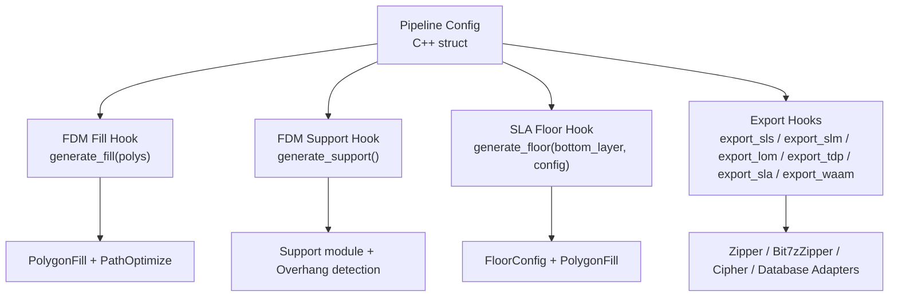
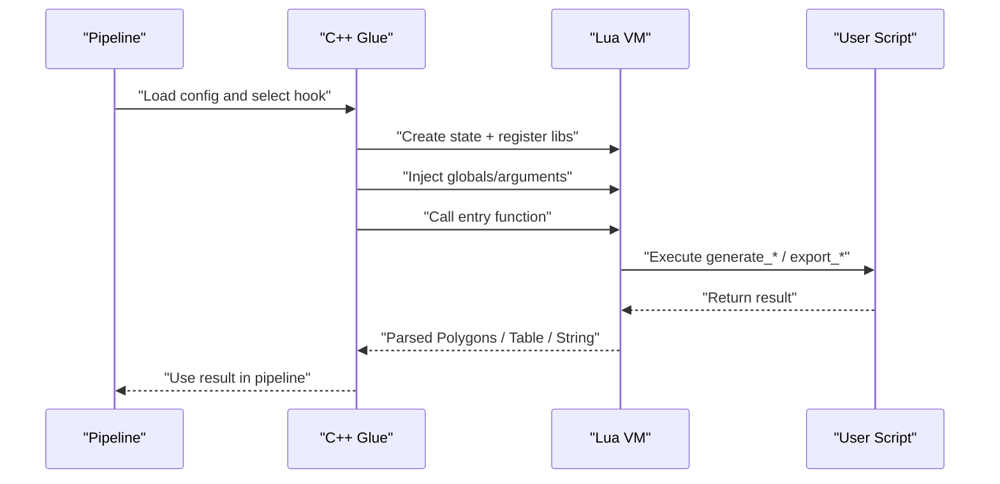
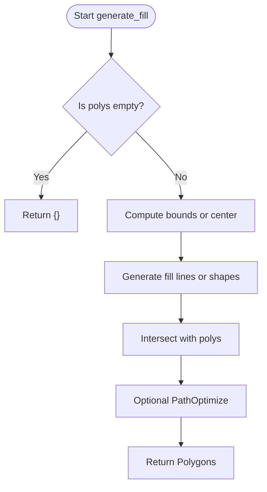
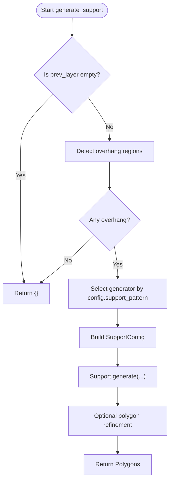
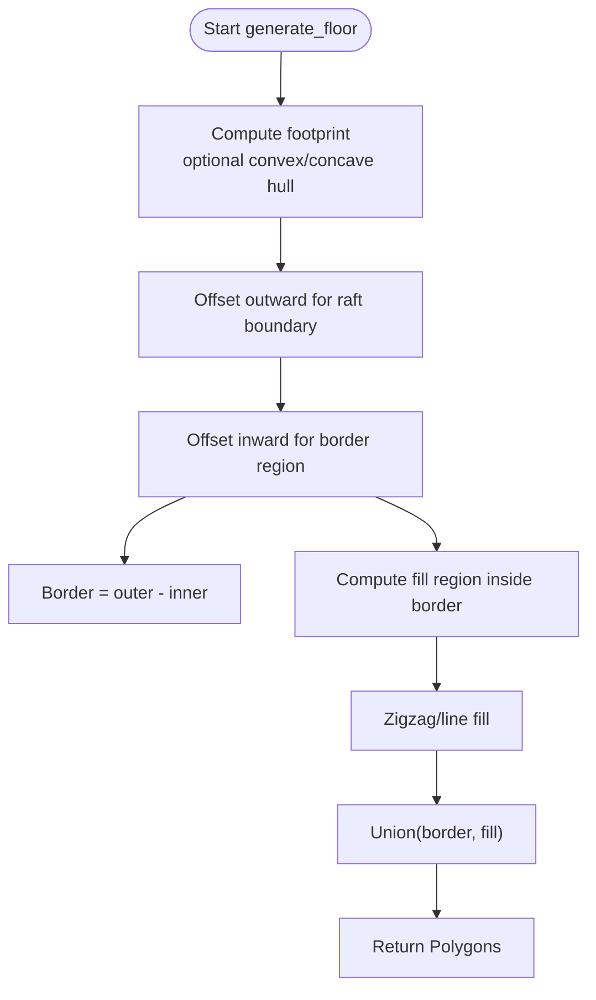
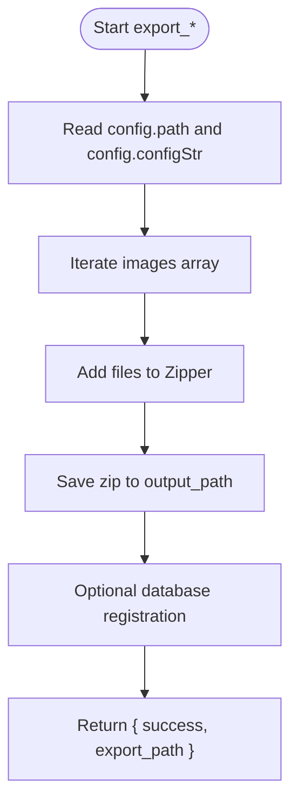
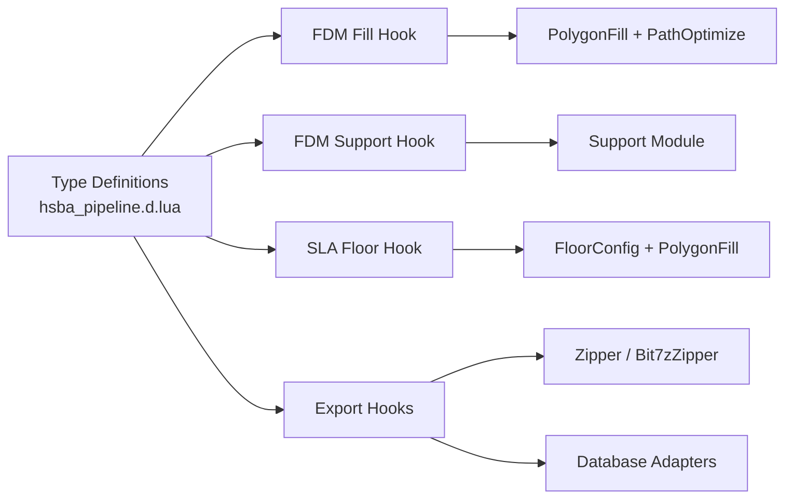

# Built-in Stage Hooks

<cite>
**Referenced Files in This Document**
- [hsba_pipeline.d.lua](file://types/hsba_pipeline.d.lua)
- [polygon_fill.cpp](file://LibHsBaSlicer/Fill/polygon_fill.cpp)
- [fdm_support.hpp](file://LibHsBaSlicer/support/fdm_support.hpp)
- [fdm_support.cpp](file://LibHsBaSlicer/support/fdm_support.cpp)
- [LuaSupport.cpp](file://support/LuaSupport.cpp)
- [sla_floor.hpp](file://LibHsBaSlicer/Floor/sla_floor.hpp)
- [sla_floor.cpp](file://LibHsBaSlicer/Floor/sla_floor.cpp)
- [waam_export.hpp](file://LibHsBaSlicer/Path/waam_export.hpp)
- [pipeline_types.h](file://pipelinetypes/pipeline_types.h)
- [my_infill.lua](file://samples/FDM/scripts/my_infill.lua)
- [my_support.lua](file://samples/FDM/scripts/my_support.lua)
- [my_sla_floor.lua](file://samples/SLA/scripts/my_sla_floor.lua)
- [my_sla_support.lua](file://samples/SLA/scripts/my_sla_support.lua)
- [my_sls_export.lua](file://samples/SLS/scripts/my_sls_export.lua)
- [my_slm_export.lua](file://samples/SLM/scripts/my_slm_export.lua)
- [my_lom_export.lua](file://samples/LOM/scripts/my_lom_export.lua)
- [my_tdp_export.lua](file://samples/TDP/scripts/my_tdp_export.lua)
- [my_waam_path.lua](file://samples/WAAM/scripts/my_waam_path.lua)
</cite>

## Table of Contents
1. [Introduction](#introduction)
2. [Project Structure](#project-structure)
3. [Core Components](#core-components)
4. [Architecture Overview](#architecture-overview)
5. [Detailed Component Analysis](#detailed-component-analysis)
6. [Dependency Analysis](#dependency-analysis)
7. [Performance Considerations](#performance-considerations)
8. [Troubleshooting Guide](#troubleshooting-guide)
9. [Conclusion](#conclusion)

## Introduction
This document explains the built-in stage hooks that HsBaSlicer exposes for customization. It focuses on:
- FDM fill hook `generate_fill`
- FDM support hook `generate_support`
- SLA floor hook `generate_floor`
- Export hooks for SLS, SLM, LOM, TDP, SLA, and WAAM

For each hook, it describes the expected input and output types, available context variables, integration with HsBa utility libraries, and complete working example references from the repository samples.

## Project Structure
The built-in stage hooks are defined through Lua type annotations and implemented by C++ glue code that loads user scripts, injects context, calls the entry function, and converts results back to C++ data structures.

**Diagram sources**
- [pipeline_types.h:108-127](file://pipelinetypes/pipeline_types.h#L108-L127)
- [pipeline_types.h:275-297](file://pipelinetypes/pipeline_types.h#L275-L297)
- [hsba_pipeline.d.lua:490-538](file://types/hsba_pipeline.d.lua#L490-L538)
- [hsba_pipeline.d.lua:541-623](file://types/hsba_pipeline.d.lua#L541-L623)

**Section sources**
- [pipeline_types.h:108-127](file://pipelinetypes/pipeline_types.h#L108-L127)
- [pipeline_types.h:275-297](file://pipelinetypes/pipeline_types.h#L275-L297)
- [hsba_pipeline.d.lua:490-623](file://types/hsba_pipeline.d.lua#L490-L623)

## Core Components
HsBaSlicer provides four major built-in hook categories:

| Hook | Technology | Entry Function | Input Context | Output Expectation |
|---|---|---|---|---|
| FDM Fill | FDM | `generate_fill(polys)` | `polys`: Polygons (current layer after wall-perimeter subtraction) | Polygons (fill paths) |
| FDM Support | FDM / SLA | `generate_support()` | `current_layer`, `prev_layer`, `layer_height`, `config` | Polygons (support cross-section) |
| SLA Floor | SLA | `generate_floor(bottom_layer, config)` | `bottom_layer`: Polygons; `config`: FloorConfig | Polygons (raft/bottom) |
| Export | SLS / SLM / LOM / TDP / SLA / WAAM | `export_sls()` / `export_slm()` / `export_lom()` / `export_tdp()` / `export_sla()` / `export_waam()` | `config`, `images`, `output_path`, plus WAAM-specific globals | Table `{ success, export_path }` or string (WAAM) |

Key configuration and type definitions:
- FDM pipeline uses `infill_lua_script` and `infill_lua_func` to invoke a custom fill script.
- FDM support can be replaced by a Lua script via `support_lua_script` and `support_lua_func`.
- SLA floor supports a custom Lua function `generate_floor` with `SlaFloorConfig`.
- Export pipelines use `export_lua_script` and `export_lua_func`, with per-technology conventions.

**Section sources**
- [pipeline_types.h:108-127](file://pipelinetypes/pipeline_types.h#L108-L127)
- [pipeline_types.h:275-297](file://pipelinetypes/pipeline_types.h#L275-L297)
- [hsba_pipeline.d.lua:198-227](file://types/hsba_pipeline.d.lua#L198-L227)
- [hsba_pipeline.d.lua:490-623](file://types/hsba_pipeline.d.lua#L490-L623)

## Architecture Overview
The lifecycle of each built-in hook is similar:
1. The pipeline reads its configuration (C++ struct).
2. The glue code creates a Lua state and registers stage-specific libraries.
3. The glue code injects stage-specific globals or arguments.
4. The glue code calls the user-defined entry function.
5. The glue code parses the return value into C++ types.

**Diagram sources**
- [LuaSupport.cpp:67-90](file://support/LuaSupport.cpp#L67-L90)
- [LuaSupport.cpp:113-177](file://support/LuaSupport.cpp#L113-L177)
- [sla_floor.cpp:148-228](file://LibHsBaSlicer/Floor/sla_floor.cpp#L148-L228)
- [polygon_fill.cpp:35-49](file://LibHsBaSlicer/Fill/polygon_fill.cpp#L35-L49)

## Detailed Component Analysis

### FDM Fill Hook: `generate_fill`
Purpose:
- Replace the built-in infill algorithm with a user-defined pattern.
- Operate on polygons already excluding wall-perimeter regions.

Input:
- `polys`: Polygons representing the current layer’s interior after walls have been subtracted.

Output:
- Polygons representing the generated fill paths.

Available utilities:
- `PolygonOperations` for boolean operations, offsets, hulls, primitives, area.
- `PolygonFill` for offset, line, zigzag, composite, hybrid fills.
- `PathOptimize` for path ordering optimization.

Typical usage patterns:
- Compute bounding box or center of the layer.
- Generate parallel lines or geometric shapes.
- Intersect generated geometry with the layer polygon.
- Optionally optimize regions before path output.

Working example reference:
- [my_infill.lua](file://samples/FDM/scripts/my_infill.lua)

**Diagram sources**
- [my_infill.lua:20-87](file://samples/FDM/scripts/my_infill.lua#L20-L87)
- [hsba_pipeline.d.lua:515-525](file://types/hsba_pipeline.d.lua#L515-L525)

**Section sources**
- [hsba_pipeline.d.lua:515-525](file://types/hsba_pipeline.d.lua#L515-L525)
- [polygon_fill.cpp:35-49](file://LibHsBaSlicer/Fill/polygon_fill.cpp#L35-L49)
- [my_infill.lua:1-89](file://samples/FDM/scripts/my_infill.lua#L1-L89)

### FDM Support Hook: `generate_support`
Purpose:
- Replace the built-in support generation with a user-defined algorithm.
- Access current and previous layers, layer height, and support configuration.

Context globals:
- `current_layer`: Polygons for the current layer.
- `prev_layer`: Polygons for the previous layer (empty for first layer).
- `layer_height`: Layer height in millimeters.
- `config`: Support configuration table including overhang angle, gap, diameter, density, pattern, tree parameters, honeycomb cell size.

Output:
- Polygons representing support cross-sections for the current layer.

Available utilities:
- `PolygonOperations` for geometry manipulation.
- `Support` module for plane/tree/honeycomb/SLA generators and overhang detection.

Working example reference:
- [my_support.lua](file://samples/FDM/scripts/my_support.lua)

**Diagram sources**
- [my_support.lua:32-79](file://samples/FDM/scripts/my_support.lua#L32-L79)
- [LuaSupport.cpp:67-90](file://support/LuaSupport.cpp#L67-L90)

**Section sources**
- [hsba_pipeline.d.lua:490-513](file://types/hsba_pipeline.d.lua#L490-L513)
- [fdm_support.hpp:19-67](file://LibHsBaSlicer/support/fdm_support.hpp#L19-L67)
- [fdm_support.cpp:14-31](file://LibHsBaSlicer/support/fdm_support.cpp#L14-L31)
- [LuaSupport.cpp:67-90](file://support/LuaSupport.cpp#L67-L90)
- [my_support.lua:1-83](file://samples/FDM/scripts/my_support.lua#L1-L83)

### SLA Floor Hook: `generate_floor`
Purpose:
- Replace the built-in raft/bottom layer generation with a user-defined algorithm.

Input:
- `bottom_layer`: Polygons representing the bottom layer contours.
- `config`: FloorConfig with fields such as `raft_offset`, `border_width`, `fill_spacing`, `fill_angle_deg`, `border_count`, `use_convex_hull`, `concave_hull_points`.

Output:
- Polygons representing the floor/raft structure.

Available utilities:
- `PolygonOperations` for boolean operations, offsets, hulls, area.
- `PolygonFill` for zigzag, line, and offset fills.

Working example reference:
- [my_sla_floor.lua](file://samples/SLA/scripts/my_sla_floor.lua)

**Diagram sources**
- [my_sla_floor.lua:35-62](file://samples/SLA/scripts/my_sla_floor.lua#L35-L62)
- [sla_floor.hpp:21-33](file://LibHsBaSlicer/Floor/sla_floor.hpp#L21-L33)

**Section sources**
- [hsba_pipeline.d.lua:527-538](file://types/hsba_pipeline.d.lua#L527-L538)
- [sla_floor.hpp:21-33](file://LibHsBaSlicer/Floor/sla_floor.hpp#L21-L33)
- [sla_floor.cpp:148-228](file://LibHsBaSlicer/Floor/sla_floor.cpp#L148-L228)
- [my_sla_floor.lua:1-64](file://samples/SLA/scripts/my_sla_floor.lua#L1-L64)

### Export Hooks: `export_sls`, `export_slm`, `export_lom`, `export_tdp`, `export_sla`, `export_waam`
Common environment for SLS/SLM/LOM/TDP/SLA export:
- `config`: Table with `path` and `configStr` (JSON content).
- `images`: Array of tables with `path` and `data` (per-layer polygon JSON).
- `output_path`: Output file path provided by C++.
- Libraries: `Zipper`, optional `Bit7zZipper`, `Cipher`, database adapters (`SQLiteAdapter`, `MySQLAdapter`, `PostgreSQLAdapter`), `ParamStore`.

Return value convention:
- Return a table `{ success = true/false, export_path = "..." }`.
- Do not return a string; doing so may overwrite the zip file.

WAAM robot path hook:
- Environment globals: `header`, `startProgramFunc`, `endProgramFunc`, `points`.
- Return value: a string containing the full robot program text.

Working examples:
- SLS: [my_sls_export.lua](file://samples/SLS/scripts/my_sls_export.lua)
- SLM: [my_slm_export.lua](file://samples/SLM/scripts/my_slm_export.lua)
- LOM: [my_lom_export.lua](file://samples/LOM/scripts/my_lom_export.lua)
- TDP: [my_tdp_export.lua](file://samples/TDP/scripts/my_tdp_export.lua)
- SLA: Uses the same export environment as SLS; see [hsba_pipeline.d.lua:582-591](file://types/hsba_pipeline.d.lua#L582-L591)
- WAAM: [my_waam_path.lua](file://samples/WAAM/scripts/my_waam_path.lua)

**Diagram sources**
- [my_sls_export.lua:23-76](file://samples/SLS/scripts/my_sls_export.lua#L23-L76)
- [hsba_pipeline.d.lua:541-591](file://types/hsba_pipeline.d.lua#L541-L591)

**Section sources**
- [hsba_pipeline.d.lua:541-623](file://types/hsba_pipeline.d.lua#L541-L623)
- [my_sls_export.lua:1-80](file://samples/SLS/scripts/my_sls_export.lua#L1-L80)
- [my_slm_export.lua:1-34](file://samples/SLM/scripts/my_slm_export.lua#L1-L34)
- [my_lom_export.lua:1-35](file://samples/LOM/scripts/my_lom_export.lua#L1-L35)
- [my_tdp_export.lua:1-63](file://samples/TDP/scripts/my_tdp_export.lua#L1-L63)
- [my_waam_path.lua:1-46](file://samples/WAAM/scripts/my_waam_path.lua#L1-L46)

## Dependency Analysis
The built-in hooks depend on shared Lua libraries and C++ glue modules:

**Diagram sources**
- [hsba_pipeline.d.lua:52-77](file://types/hsba_pipeline.d.lua#L52-L77)
- [hsba_pipeline.d.lua:107-187](file://types/hsba_pipeline.d.lua#L107-L187)
- [hsba_pipeline.d.lua:490-623](file://types/hsba_pipeline.d.lua#L490-L623)

**Section sources**
- [hsba_pipeline.d.lua:52-77](file://types/hsba_pipeline.d.lua#L52-L77)
- [hsba_pipeline.d.lua:107-187](file://types/hsba_pipeline.d.lua#L107-L187)
- [hsba_pipeline.d.lua:490-623](file://types/hsba_pipeline.d.lua#L490-L623)

## Performance Considerations
- FDM fill scripts should avoid excessive nested loops over large polygon vertex sets; prefer using `PolygonOperations` and `PolygonFill` where possible.
- Support generation scripts should short-circuit early when no overhang exists to reduce unnecessary computation.
- Export scripts should batch file writes and avoid repeated heavy operations inside tight loops.
- For SLA package export, rendering is parallelized across layers; ensure custom Lua export functions do not perform blocking I/O inside per-layer callbacks.

[No sources needed since this section provides general guidance]

## Troubleshooting Guide
Common issues and resolutions:

- Returning wrong type from export hook:
  - Symptom: Zip file overwritten or empty.
  - Cause: Returning a string instead of a table.
  - Resolution: Return `{ success = true/false, export_path = "..." }`.

- Missing Lua function name:
  - Symptom: Runtime error indicating function not found.
  - Cause: Entry function name mismatch or missing definition.
  - Resolution: Ensure the script defines the expected function (`generate_fill`, `generate_support`, `generate_floor`, `export_*`).

- Invalid polygon format:
  - Symptom: Errors parsing Lua table to polygons.
  - Cause: Incorrect point structure or empty polygons.
  - Resolution: Use `{ x, y }` points and ensure non-empty polygons.

- Configuration field missing:
  - Symptom: Default values used unexpectedly.
  - Cause: Not reading optional fields from `config`.
  - Resolution: Provide defaults in Lua when fields are absent.

**Section sources**
- [hsba_pipeline.d.lua:541-591](file://types/hsba_pipeline.d.lua#L541-L591)
- [LuaSupport.cpp:113-177](file://support/LuaSupport.cpp#L113-L177)
- [sla_floor.cpp:148-228](file://LibHsBaSlicer/Floor/sla_floor.cpp#L148-L228)

## Conclusion
HsBaSlicer’s built-in stage hooks provide powerful extension points for FDM fill, FDM support, SLA floor, and technology-specific exports. By understanding the expected inputs, outputs, and available utilities, developers can implement robust custom behaviors while integrating seamlessly with the pipeline. The sample scripts demonstrate typical usage patterns and best practices for reliable integration.

[No sources needed since this section summarizes without analyzing specific files]