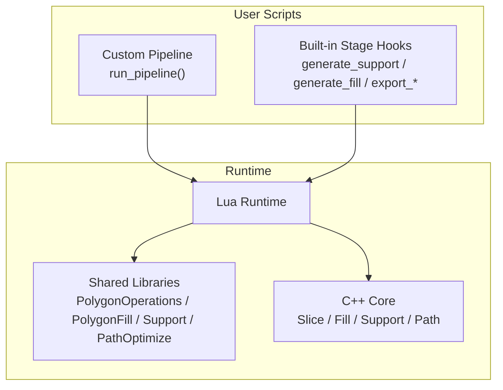
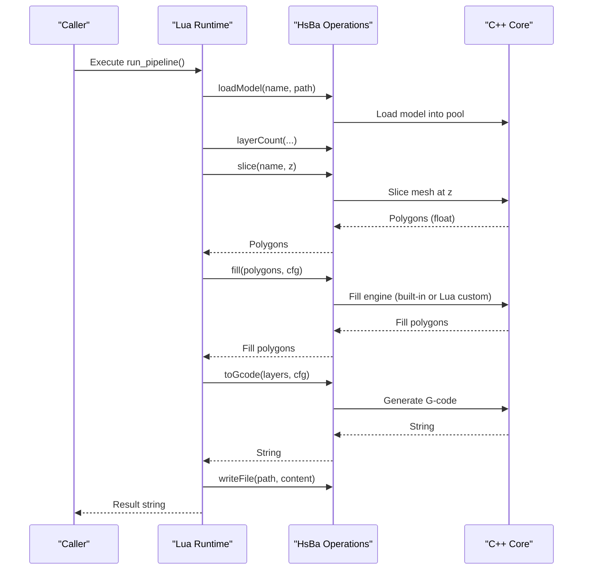
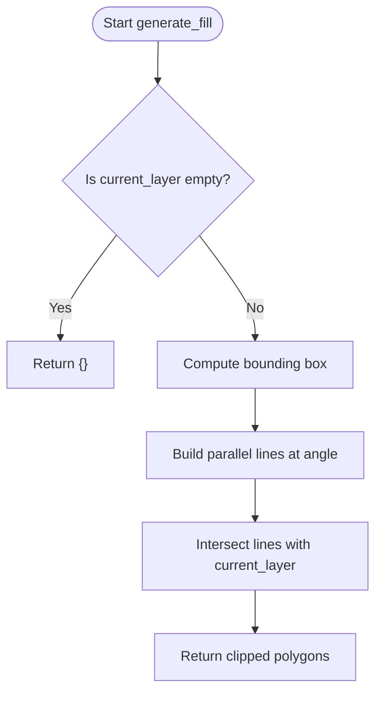
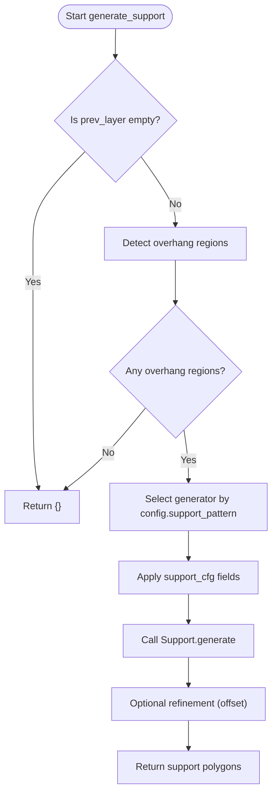
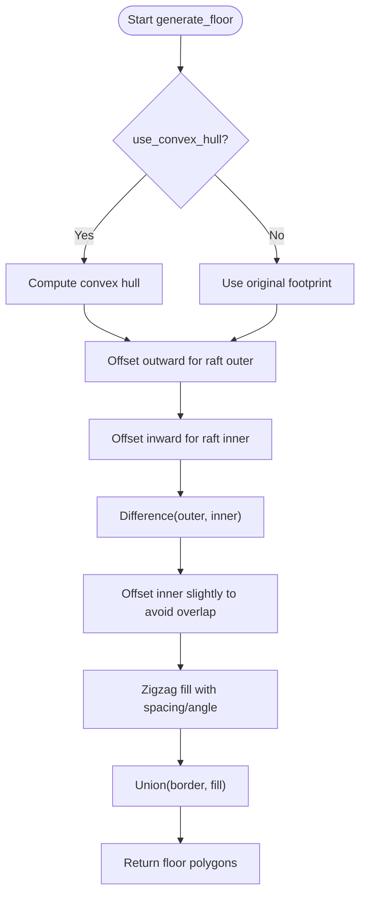
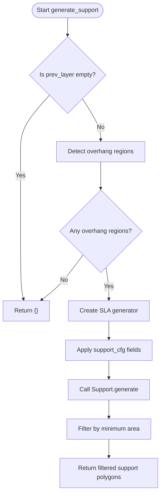
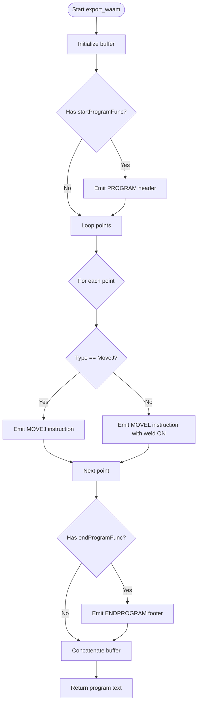
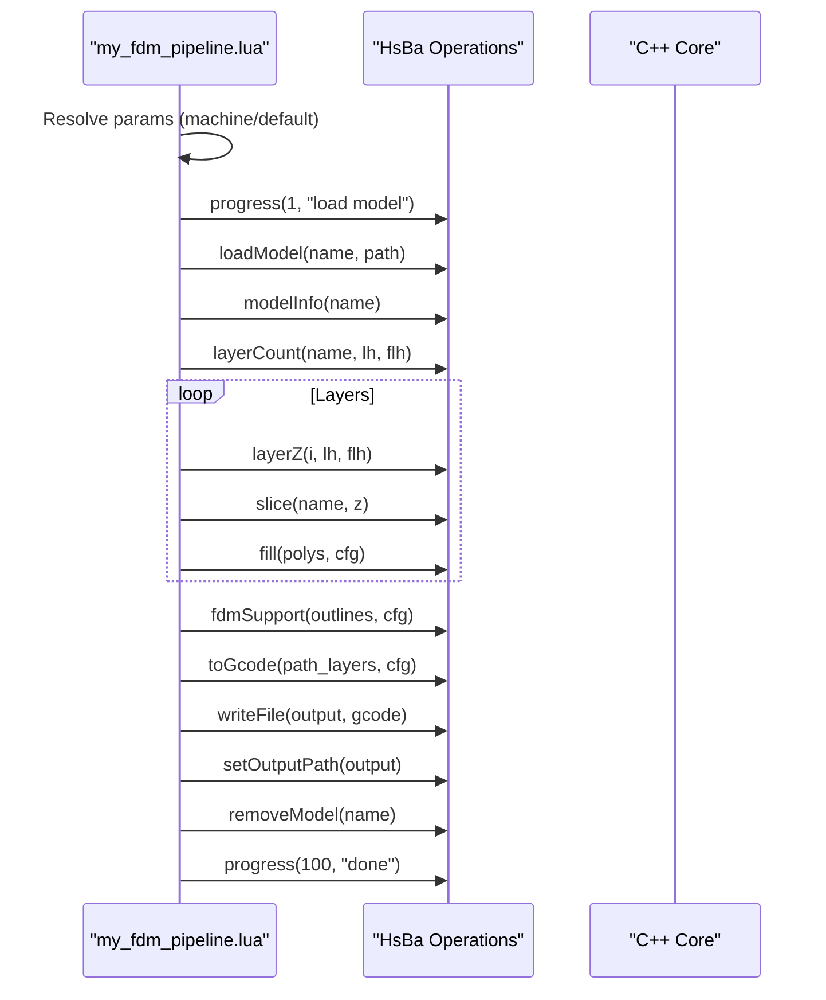
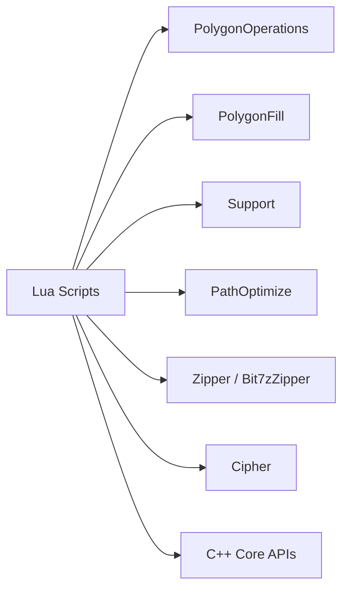

# Custom Algorithm Development Guide

<cite>
**Referenced Files in This Document**
- [README.md](file://README.md)
- [lua_pipeline_api.md](file://docs/en/lua_pipeline_api.md)
- [my_fdm_pipeline.lua](file://samples/Custom/scripts/my_fdm_pipeline.lua)
- [my_infill.lua](file://samples/FDM/scripts/my_infill.lua)
- [my_support.lua](file://samples/FDM/scripts/my_support.lua)
- [my_sla_floor.lua](file://samples/SLA/scripts/my_sla_floor.lua)
- [my_sla_support.lua](file://samples/SLA/scripts/my_sla_support.lua)
- [my_waam_path.lua](file://samples/WAAM/scripts/my_waam_path.lua)
- [polygon_fill.hpp](file://LibHsBaSlicer/Fill/polygon_fill.hpp)
- [fdm_support.hpp](file://LibHsBaSlicer/Support/fdm_support.hpp)
- [LuaSupport.hpp](file://support/LuaSupport.hpp)
- [LuaAdapter.hpp](file://2D/LuaAdapter.hpp)
- [pipeline_types.h](file://pipelinetypes/pipeline_types.h)
- [hsba_slicer.cppm](file://ModuleHsBaSlicer/hsba_slicer.cppm)
</cite>

## Table of Contents
1. [Introduction](#introduction)
2. [Project Structure](#project-structure)
3. [Core Components](#core-components)
4. [Architecture Overview](#architecture-overview)
5. [Detailed Component Analysis](#detailed-component-analysis)
6. [Dependency Analysis](#dependency-analysis)
7. [Performance Considerations](#performance-considerations)
8. [Troubleshooting Guide](#troubleshooting-guide)
9. [Conclusion](#conclusion)
10. [Appendices](#appendices)

## Introduction
This guide explains how to write custom algorithms in Lua for HsBaSlicer, including bespoke slicing algorithms, support structure generators, fill patterns, and export handlers. It covers the two runtime environments (custom pipeline vs built-in stage hooks), interface contracts, parameter handling, callback mechanisms, and step-by-step recipes for FDM infill, SLA supports, and specialized path generation. It also documents best practices for robustness, progress reporting, error handling, and performance optimization.

## Project Structure
HsBaSlicer exposes a modular C++ core with Lua extension points:
- Custom pipelines are fully scripted via an operation table (`HsBa`) and context globals.
- Built-in pipelines allow replacing specific stages (support, fill, floor, export) with user scripts.
- Shared libraries provide geometry operations, fill algorithms, support generators, path optimization, compression, encoding, and database access inside Lua.

[No sources needed since this diagram shows conceptual workflow, not actual code structure]

**Section sources**
- [README.md:21-38](file://README.md#L21-L38)
- [lua_pipeline_api.md:19-28](file://docs/en/lua_pipeline_api.md#L19-L28)

## Core Components
- Custom-pipeline environment: The script defines `run_pipeline()` and uses the global `HsBa` operation table plus context globals such as `model_name`, `model_path`, `output_path`, and `pipeline_config`.
- Built-in stage hooks: Replace only one algorithm per stage; each stage injects its own globals and expects a specific entry function.
- Shared libraries: Available in both environments, including polygon operations, fill algorithms, support generators, path optimization, compression, encoding, and database adapters.

Key responsibilities:
- Geometry data types: Points, polygons, layers are represented as Lua tables with fixed field names.
- Control and I/O: Progress reporting, file read/write, model lifecycle management.
- Slicing and path generation: Slice meshes, compute fills, generate G-code or robot programs.

**Section sources**
- [lua_pipeline_api.md:32-45](file://docs/en/lua_pipeline_api.md#L32-L45)
- [lua_pipeline_api.md:48-133](file://docs/en/lua_pipeline_api.md#L48-L133)
- [lua_pipeline_api.md:136-212](file://docs/en/lua_pipeline_api.md#L136-L212)

## Architecture Overview
The system supports two modes:
- Fully scripted custom pipeline: The script orchestrates loading, slicing, support, fill, path generation, and output.
- Built-in pipeline with Lua overrides: The C++ pipeline controls stage order; user scripts replace specific stages.

**Diagram sources**
- [my_fdm_pipeline.lua:52-171](file://samples/Custom/scripts/my_fdm_pipeline.lua#L52-L171)
- [lua_pipeline_api.md:48-133](file://docs/en/lua_pipeline_api.md#L48-L133)

## Detailed Component Analysis

### Custom FDM Infill Pattern (Lua)
Purpose: Provide a custom fill pattern by implementing `generate_fill(current_layer)` and integrating it into the pipeline.

Interface contract:
- Entry function: `generate_fill(current_layer)`
- Input: `current_layer` is an array of polygons (already excluding perimeter regions).
- Output: Array of polygons representing the fill paths.
- Environment: No injected globals; use defaults within the script. Shared libraries available include `PolygonOperations` and `PolygonFill`.

Implementation notes:
- Compute bounding box and scan lines at a given angle.
- Create thin rectangles for each line and intersect with the current layer to clip to valid areas.
- Return the resulting polygons.

**Diagram sources**
- [my_infill.lua:20-88](file://samples/FDM/scripts/my_infill.lua#L20-L88)

**Section sources**
- [my_infill.lua:1-89](file://samples/FDM/scripts/my_infill.lua#L1-L89)
- [lua_pipeline_api.md:234-239](file://docs/en/lua_pipeline_api.md#L234-L239)

### Custom FDM Support Generator (Lua)
Purpose: Replace the built-in FDM support algorithm with a Lua script that detects overhangs and generates supports using built-in generators.

Interface contract:
- Entry function: `generate_support()`
- Globals: `current_layer`, `prev_layer`, `layer_height`, `config`.
- Output: Array of polygons per layer (same format as `current_layer`).

Implementation notes:
- Skip first layer if no previous layer exists.
- Use `Support.detect_overhang` to find overhang regions.
- Select generator based on `config.support_pattern` (plane/tree/honeycomb).
- Configure support parameters and call `Support.generate`.
- Optionally refine results (e.g., offset to reduce contact area).

**Diagram sources**
- [my_support.lua:32-80](file://samples/FDM/scripts/my_support.lua#L32-L80)

**Section sources**
- [my_support.lua:1-83](file://samples/FDM/scripts/my_support.lua#L1-L83)
- [lua_pipeline_api.md:219-232](file://docs/en/lua_pipeline_api.md#L219-L232)

### Custom SLA Floor Generation (Lua)
Purpose: Customize the SLA bottom floor/raft generation logic.

Interface contract:
- Entry function: `generate_floor(bottom_layer, config)`
- Input: `bottom_layer` (polygons), `config` (table with raft_offset, border_width, fill_spacing, fill_angle_deg, border_count, use_convex_hull, concave_hull_points).
- Output: Array of polygons representing the floor.

Implementation notes:
- Optionally compute convex hull of the footprint.
- Offset outward/inward to create raft borders.
- Generate internal fill using `PolygonFill.zigzagFill` or other fill functions.
- Union border and fill to produce final floor.

**Diagram sources**
- [my_sla_floor.lua:35-62](file://samples/SLA/scripts/my_sla_floor.lua#L35-L62)

**Section sources**
- [my_sla_floor.lua:1-64](file://samples/SLA/scripts/my_sla_floor.lua#L1-L64)
- [lua_pipeline_api.md:241-245](file://docs/en/lua_pipeline_api.md#L241-L245)

### Custom SLA Support Generator (Lua)
Purpose: Replace SLA support generation with a Lua script using built-in SLA support generator.

Interface contract:
- Entry function: `generate_support()`
- Globals: `current_layer`, `prev_layer`, `layer_height`, `config`.
- Output: Array of polygons per layer.

Implementation notes:
- Skip first layer if no previous layer.
- Detect overhang regions.
- Use `Support.new_sla()` and configure support parameters.
- Optionally filter small-area supports.

**Diagram sources**
- [my_sla_support.lua:34-72](file://samples/SLA/scripts/my_sla_support.lua#L34-L72)

**Section sources**
- [my_sla_support.lua:1-76](file://samples/SLA/scripts/my_sla_support.lua#L1-L76)
- [lua_pipeline_api.md:219-232](file://docs/en/lua_pipeline_api.md#L219-L232)

### Specialized Path Generation (WAAM Export Script)
Purpose: Generate a custom robot program text for WAAM processes.

Interface contract:
- Entry function: `export_waam()`
- Globals: `header`, `startProgramFunc`, `endProgramFunc`, `points` (array of point records with `end`, `middle`, `velocity`, `type`).
- Output: String containing the complete robot program text.

Implementation notes:
- Iterate through points and emit robot instructions based on type.
- Include header/footer if provided.
- Concatenate buffer and return the full program text.

**Diagram sources**
- [my_waam_path.lua:17-42](file://samples/WAAM/scripts/my_waam_path.lua#L17-L42)

**Section sources**
- [my_waam_path.lua:1-46](file://samples/WAAM/scripts/my_waam_path.lua#L1-L46)
- [lua_pipeline_api.md:246-259](file://docs/en/lua_pipeline_api.md#L246-L259)

### Custom Full Pipeline (FDM)
Purpose: Orchestrate the entire slicing process from model loading to G-code writing.

Interface contract:
- Entry function: `run_pipeline()`
- Context globals: `model_name`, `model_path`, `output_path`, `pipeline_config`, optional `machine`.
- Operation table: `HsBa` provides model management, slicing, filling, support, path generation, and file I/O.

Implementation notes:
- Determine machine parameters from injected `machine` table or defaults.
- Load model, compute layer count, iterate layers to slice and fill.
- Optionally generate supports.
- Assemble path layers and generate G-code.
- Write output file and report progress.

**Diagram sources**
- [my_fdm_pipeline.lua:52-171](file://samples/Custom/scripts/my_fdm_pipeline.lua#L52-L171)

**Section sources**
- [my_fdm_pipeline.lua:1-172](file://samples/Custom/scripts/my_fdm_pipeline.lua#L1-L172)
- [lua_pipeline_api.md:48-133](file://docs/en/lua_pipeline_api.md#L48-L133)

## Dependency Analysis
The Lua extension points depend on shared libraries and C++ core components:
- `PolygonOperations` and `PolygonFill` provide geometry and fill capabilities.
- `Support` provides generator factories and helpers.
- `PathOptimize` enables path ordering improvements.
- File and packaging utilities (`Zipper`, `Bit7zZipper`, `Cipher`) are used in export stages.

[No sources needed since this diagram shows conceptual dependencies, not direct code mappings]

**Section sources**
- [lua_pipeline_api.md:136-212](file://docs/en/lua_pipeline_api.md#L136-L212)

## Performance Considerations
- Prefer built-in fill algorithms when possible; use Lua custom fills only for specialized patterns.
- Minimize repeated computations (e.g., precompute bounding boxes and angles).
- Batch operations where feasible (e.g., process multiple layers before heavy computation).
- Use integerization internally for boolean/fill operations; convert back to float only when necessary.
- Avoid excessive object creation in tight loops; reuse buffers and tables.
- Report progress periodically to keep UI responsive and enable cancellation.

[No sources needed since this section provides general guidance]

## Troubleshooting Guide
Common issues and resolutions:
- Wrong return type in export scripts: Ensure export functions return `{ success = true/false, export_path = "..." }`.
- Missing globals in built-in stage hooks: Verify the correct entry function and globals for each stage.
- File I/O errors: Handle nil returns from `readFile` and catch errors from `writeFile`.
- Progress not updating: Call `HsBa.progress(percent, stage)` regularly during long-running tasks.
- Model lifecycle: Always call `removeModel(name)` after processing to free resources.

**Section sources**
- [lua_pipeline_api.md:246-260](file://docs/en/lua_pipeline_api.md#L246-L260)
- [my_fdm_pipeline.lua:153-171](file://samples/Custom/scripts/my_fdm_pipeline.lua#L153-L171)

## Conclusion
HsBaSlicer’s Lua extension framework allows flexible customization across slicing stages. By adhering to the documented interfaces, leveraging shared libraries, and following best practices for error handling, progress reporting, and performance, developers can implement robust custom algorithms for FDM infill, SLA supports, and specialized path generation.

[No sources needed since this section summarizes without analyzing specific files]

## Appendices

### API Reference Summary
- Custom pipeline environment: `HsBa` operation table and context globals.
- Built-in stage hooks: Stage-specific globals and entry functions.
- Shared libraries: Geometry, fill, support, path optimization, compression, encoding, database adapters.

**Section sources**
- [lua_pipeline_api.md:19-28](file://docs/en/lua_pipeline_api.md#L19-L28)
- [lua_pipeline_api.md:48-133](file://docs/en/lua_pipeline_api.md#L48-L133)
- [lua_pipeline_api.md:136-212](file://docs/en/lua_pipeline_api.md#L136-L212)

### Code-Level Interfaces and Types
- Polygon fill API wrappers and Lua custom fill integration.
- Support generation API and Lua-based custom support generator.
- Pipeline configuration and result structures for C ABI.
- Module-level integration of fill strategies and path generation.

**Section sources**
- [polygon_fill.hpp:17-53](file://LibHsBaSlicer/Fill/polygon_fill.hpp#L17-L53)
- [fdm_support.hpp:39-67](file://LibHsBaSlicer/Support/fdm_support.hpp#L39-L67)
- [LuaSupport.hpp:21-80](file://support/LuaSupport.hpp#L21-L80)
- [pipeline_types.h:108-140](file://pipelinetypes/pipeline_types.h#L108-L140)
- [hsba_slicer.cppm:667-696](file://ModuleHsBaSlicer/hsba_slicer.cppm#L667-L696)