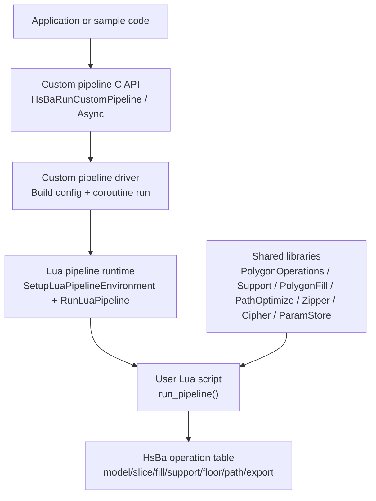
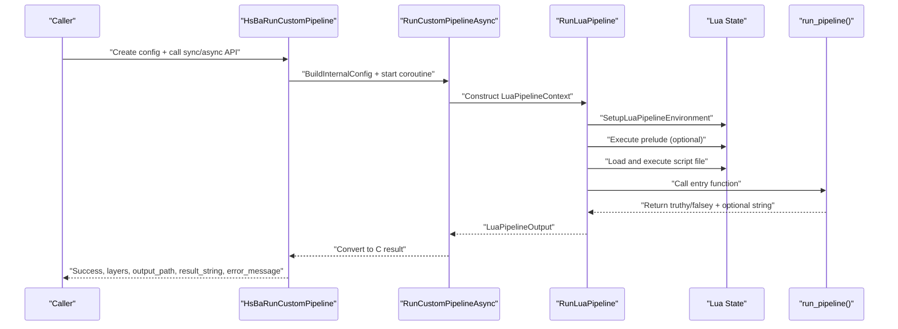
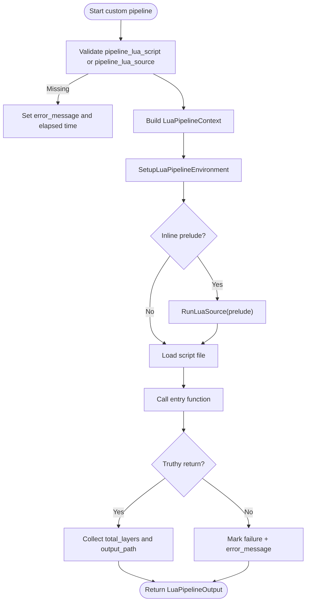
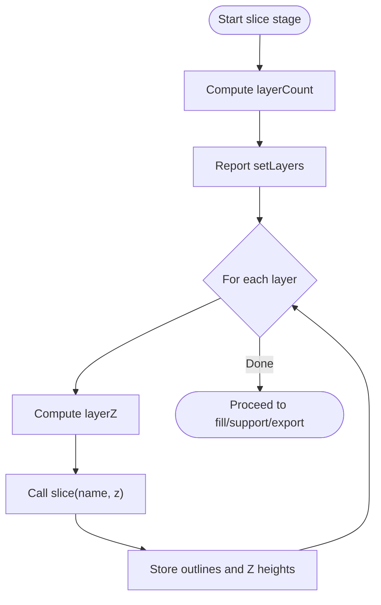
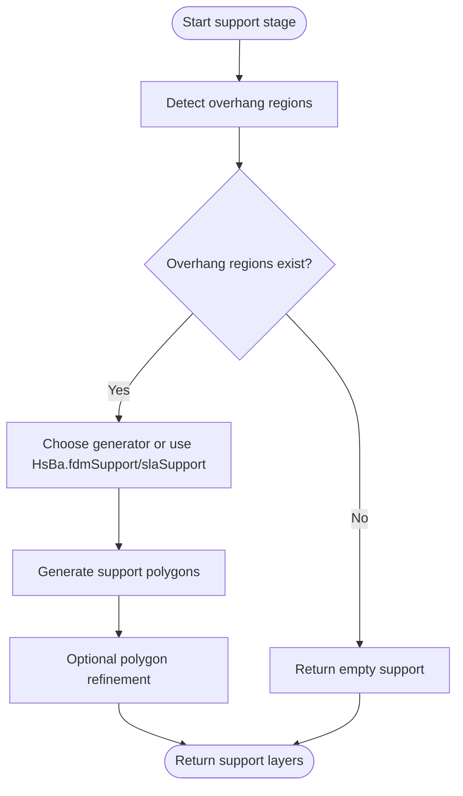
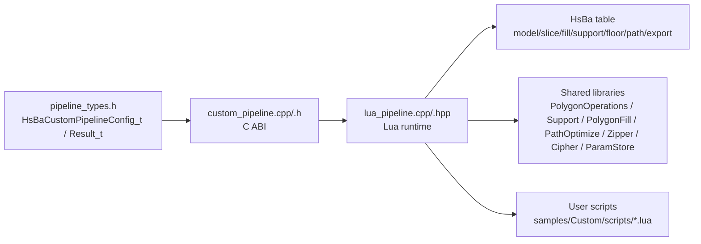

# Custom Pipeline Development

<cite>
**Referenced Files in This Document**   
- [lua_pipeline_api.md](file://docs/en/lua_pipeline_api.md)
- [pipeline_types.h](file://pipelinetypes/pipeline_types.h)
- [custom_pipeline.cpp](file://DllHsBaSlicer/custom_pipeline.cpp)
- [custom_pipeline.h](file://DllHsBaSlicer/custom_pipeline.h)
- [lua_pipeline.hpp](file://LibHsBaSlicer/Extends/lua_pipeline.hpp)
- [lua_pipeline.cpp](file://LibHsBaSlicer/Extends/lua_pipeline.cpp)
- [my_fdm_pipeline.lua](file://samples/Custom/scripts/my_fdm_pipeline.lua)
- [my_sla_pipeline.lua](file://samples/Custom/scripts/my_sla_pipeline.lua)
- [my_sls_pipeline.lua](file://samples/Custom/scripts/my_sls_pipeline.lua)
- [my_lom_pipeline.lua](file://samples/Custom/scripts/my_lom_pipeline.lua)
- [my_tdp_pipeline.lua](file://samples/Custom/scripts/my_tdp_pipeline.lua)
- [my_waam_pipeline.lua](file://samples/Custom/scripts/my_waam_pipeline.lua)
- [my_infill.lua](file://samples/FDM/scripts/my_infill.lua)
- [my_support.lua](file://samples/FDM/scripts/my_support.lua)
- [my_sla_floor.lua](file://samples/SLA/scripts/my_sla_floor.lua)
- [my_sla_support.lua](file://samples/SLA/scripts/my_sla_support.lua)
</cite>

## Table of Contents
1. [Introduction](#introduction)
2. [Project Structure](#project-structure)
3. [Core Components](#core-components)
4. [Architecture Overview](#architecture-overview)
5. [Detailed Component Analysis](#detailed-component-analysis)
6. [Dependency Analysis](#dependency-analysis)
7. [Performance Considerations](#performance-considerations)
8. [Troubleshooting Guide](#troubleshooting-guide)
9. [Conclusion](#conclusion)
10. [Appendices](#appendices)

## Introduction
This document explains how to create custom slicing pipelines in HsBaSlicer using Lua scripting. It covers the complete workflow from pipeline entry points through stage implementation, parameter passing via `pipeline_config`, output management through `output_path`, and all available pipeline stages: Preprocess, Slice, Fill, Support, Floor, and Export. It also provides concrete examples for FDM, SLA, SLS, LOM, TDP, and WAAM pipelines, guidance on error handling, progress reporting with `HsBa.progress()`, and best practices for organizing reusable pipelines.

The custom pipeline is distinct from built-in stage hooks: a custom pipeline defines the entire stage order in Lua, while built-in stage hooks only replace one algorithm inside a fixed C++ pipeline.

## Project Structure
Custom pipeline development spans three main areas:

- **C ABI and driver**: The DllHsBaSlicer layer exposes synchronous and asynchronous APIs that construct a Lua environment and call the user’s entry function.
- **Lua runtime and API**: LibHsBaSlicer builds the `HsBa` operation table, injects context globals, and wires model loading, slicing, support, fill, floor, path generation, packaging, and export helpers.
- **User scripts**: Samples under `samples/Custom/scripts/` demonstrate full custom pipelines; samples under `samples/FDM/scripts/` and `samples/SLA/scripts/` show built-in stage hook conventions.

**Diagram sources**
- [custom_pipeline.cpp:117-163](file://DllHsBaSlicer/custom_pipeline.cpp#L117-L163)
- [lua_pipeline.hpp:19-83](file://LibHsBaSlicer/Extends/lua_pipeline.hpp#L19-L83)
- [lua_pipeline.cpp:903-1043](file://LibHsBaSlicer/Extends/lua_pipeline.cpp#L903-L1043)

**Section sources**
- [custom_pipeline.h:17-62](file://DllHsBaSlicer/custom_pipeline.h#L17-L62)
- [lua_pipeline.hpp:19-83](file://LibHsBaSlicer/Extends/lua_pipeline.hpp#L19-L83)
- [lua_pipeline_api.md:19-28](file://docs/en/lua_pipeline_api.md#L19-L28)

## Core Components
The core components for custom pipeline development are:

| Component | Responsibility | Key file(s) |
|---|---|---|
| Custom pipeline configuration | Defines script source, entry function, JSON config, model metadata, and default output path | [pipeline_types.h:676-704](file://pipelinetypes/pipeline_types.h#L676-L704) |
| Custom pipeline C API | Provides default config creation, synchronous/asynchronous execution, and result cleanup | [custom_pipeline.h:17-62](file://DllHsBaSlicer/custom_pipeline.h#L17-L62), [custom_pipeline.cpp:171-212](file://DllHsBaSlicer/custom_pipeline.cpp#L171-L212) |
| Lua pipeline runtime | Creates Lua state, installs shared libraries, injects globals, executes prelude/script, calls entry function | [lua_pipeline.hpp:19-83](file://LibHsBaSlicer/Extends/lua_pipeline.hpp#L19-L83), [lua_pipeline.cpp:903-1043](file://LibHsBaSlicer/Extends/lua_pipeline.cpp#L903-L1043) |
| HsBa operation table | Exposes model, slice, fill, support, floor, path, packaging, and IO functions to Lua scripts | [lua_pipeline.cpp:224-860](file://LibHsBaSlicer/Extends/lua_pipeline.cpp#L224-L860) |
| User pipeline scripts | Implement `run_pipeline()` and optionally use packaging/export helpers | [my_fdm_pipeline.lua](file://samples/Custom/scripts/my_fdm_pipeline.lua), [my_sla_pipeline.lua](file://samples/Custom/scripts/my_sla_pipeline.lua), [my_sls_pipeline.lua](file://samples/Custom/scripts/my_sls_pipeline.lua), [my_lom_pipeline.lua](file://samples/Custom/scripts/my_lom_pipeline.lua), [my_tdp_pipeline.lua](file://samples/Custom/scripts/my_tdp_pipeline.lua), [my_waam_pipeline.lua](file://samples/Custom/scripts/my_waam_pipeline.lua) |

**Section sources**
- [pipeline_types.h:676-732](file://pipelinetypes/pipeline_types.h#L676-L732)
- [custom_pipeline.cpp:86-163](file://DllHsBaSlicer/custom_pipeline.cpp#L86-L163)
- [lua_pipeline.cpp:830-886](file://LibHsBaSlicer/Extends/lua_pipeline.cpp#L830-L886)

## Architecture Overview
The custom pipeline architecture separates orchestration from implementation:

- The caller sets up `HsBaCustomPipelineConfig_t`.
- The C API converts it into an internal configuration and starts a coroutine-based async run.
- The Lua runtime creates a fresh Lua state, registers shared libraries, installs the `HsBa` table, injects context globals, runs optional inline prelude, loads the script file, and calls the entry function.
- The Lua script controls the workflow by calling `HsBa` operations and reporting progress and outputs.

**Diagram sources**
- [custom_pipeline.cpp:117-163](file://DllHsBaSlicer/custom_pipeline.cpp#L117-L163)
- [lua_pipeline.cpp:960-1043](file://LibHsBaSlicer/Extends/lua_pipeline.cpp#L960-L1043)

**Section sources**
- [custom_pipeline.cpp:117-163](file://DllHsBaSlicer/custom_pipeline.cpp#L117-L163)
- [lua_pipeline.cpp:960-1043](file://LibHsBaSlicer/Extends/lua_pipeline.cpp#L960-L1043)

## Detailed Component Analysis

### Custom Pipeline Entry Point and Control Flow
The entry point is a Lua function whose name defaults to `run_pipeline` but can be overridden via `entry_func` in the configuration. The C++ side validates that either `pipeline_lua_script` or `pipeline_lua_source` is provided, then constructs a `LuaPipelineContext` and calls `RunLuaPipeline`.

Key behaviors:
- If both script source and script file are empty, the driver returns an error message.
- The entry function may return a non-empty string for success, `true` for success without payload, or `false`/`nil`/error for failure.
- Progress callbacks from Lua are forwarded to the C callback.
- `setLayers` and `setOutputPath` update registry values that are later copied into the result.

**Diagram sources**
- [custom_pipeline.cpp:127-163](file://DllHsBaSlicer/custom_pipeline.cpp#L127-L163)
- [lua_pipeline.cpp:960-1043](file://LibHsBaSlicer/Extends/lua_pipeline.cpp#L960-L1043)

**Section sources**
- [custom_pipeline.cpp:117-163](file://DllHsBaSlicer/custom_pipeline.cpp#L117-L163)
- [lua_pipeline.cpp:960-1043](file://LibHsBaSlicer/Extends/lua_pipeline.cpp#L960-L1043)

### Parameter Passing via pipeline_config JSON
The configuration object passed to the custom pipeline has these fields:

| Field | Type | Meaning |
|---|---|---|
| `pipeline_lua_script` | string | Path to the Lua script file |
| `pipeline_lua_source` | string | Inline Lua executed before the script file |
| `entry_func` | string | Name of the Lua entry function; defaults to `run_pipeline` |
| `config_json` | string | Free-form JSON exposed to Lua as `pipeline_config` |
| `model_name` | string | Optional model name exposed as `model_name` |
| `model_path` | string | Optional model file path exposed as `model_path` |
| `output_path` | string | Default output path exposed as `output_path` |

Inside Lua, these become global variables:

| Global | Type | Source |
|---|---|---|
| `pipeline_config` | string | `config_json` |
| `output_path` | string | `output_path` |
| `model_name` | string | `model_name` |
| `model_path` | string | `model_path` |
| `pipeline_entry` | string | `entry_func` |

**Section sources**
- [pipeline_types.h:676-704](file://pipelinetypes/pipeline_types.h#L676-L704)
- [lua_pipeline.cpp:874-886](file://LibHsBaSlicer/Extends/lua_pipeline.cpp#L874-L886)
- [lua_pipeline_api.md:55-65](file://docs/en/lua_pipeline_api.md#L55-L65)

### Output Management through output_path
The script can change the final output path by calling `HsBa.setOutputPath(path)`. The value is stored in the registry and later copied into `LuaPipelineOutput.output_path`, which becomes `result.output_path` in the C result.

Recommended pattern:
- Use `output_path` as the default destination.
- Update it after writing files if the actual output differs.
- Always report progress before and after expensive steps.

**Section sources**
- [lua_pipeline.cpp:250-256](file://LibHsBaSlicer/Extends/lua_pipeline.cpp#L250-L256)
- [lua_pipeline.cpp:1020-1028](file://LibHsBaSlicer/Extends/lua_pipeline.cpp#L1020-L1028)
- [lua_pipeline_api.md:67-75](file://docs/en/lua_pipeline_api.md#L67-L75)

### Preprocess Stage: loadModel, modelInfo, transformModel
Preprocessing in a custom pipeline is entirely scripted. The typical sequence is:

1. Resolve model name and path from `model_name`/`model_path` or `pipeline_config`.
2. Call `HsBa.loadModel(name, path)`.
3. Call `HsBa.modelInfo(name)` to read bounding box and volume.
4. Optionally translate, rotate, or scale the model.
5. Remove the model when finished.

Available operations:

| Operation | Purpose |
|---|---|
| `HsBa.loadModel(name, path)` | Load or reuse a named model |
| `HsBa.modelInfo(name)` | Read bounding box and volume |
| `HsBa.translateModel(name, {x,y,z})` | Translate model |
| `HsBa.rotateModel(name, {x,y,z,w})` | Rotate model by quaternion |
| `HsBa.scaleModel(name, scalar_or_vector)` | Scale model uniformly or per axis |
| `HsBa.removeModel(name)` | Remove model from pool |
| `HsBa.modelNames()` | List models in pool |

**Section sources**
- [lua_pipeline.cpp:290-397](file://LibHsBaSlicer/Extends/lua_pipeline.cpp#L290-L397)
- [lua_pipeline_api.md:77-88](file://docs/en/lua_pipeline_api.md#L77-L88)

### Slice Stage: layerCount, layerZ, slice
The slice stage computes layer count, Z positions, and cross-section polygons.

Recommended flow:
- Compute layer count with `HsBa.layerCount(name, layerHeight, firstLayerHeight)`.
- Report total layers with `HsBa.setLayers(n)`.
- For each layer index, compute Z with `HsBa.layerZ(index, layerHeight, firstLayerHeight)`.
- Slice at absolute Z with `HsBa.slice(name, z)`.
- Use `HsBa.sliceUnsafe(name, z)` only when normalized unsafe slices are acceptable.

**Diagram sources**
- [lua_pipeline.cpp:399-461](file://LibHsBaSlicer/Extends/lua_pipeline.cpp#L399-L461)
- [lua_pipeline_api.md:89-96](file://docs/en/lua_pipeline_api.md#L89-L96)

**Section sources**
- [lua_pipeline.cpp:401-461](file://LibHsBaSlicer/Extends/lua_pipeline.cpp#L401-L461)
- [lua_pipeline_api.md:89-96](file://docs/en/lua_pipeline_api.md#L89-L96)

### Fill Stage: generate_fill and HsBa.fill
There are two ways to implement filling:

1. **Built-in stage hook**: Define `generate_fill(current_layer)` in a separate script loaded by a built-in pipeline.
2. **Custom pipeline**: Call `HsBa.fill(polygons, cfg)` directly inside `run_pipeline()`.

Built-in hook contract:
- Function name: `generate_fill`.
- Input: current-layer polygons already excluding wall/perimeter regions.
- No globals injected; use script-level defaults.
- Available libraries: `PolygonOperations`, `PolygonFill`, `PathOptimize`.

Custom pipeline contract:
- Call `HsBa.fill(polygons, cfg)` where `cfg` supports `spacing`, `mode`, `angle`, and `borderCount`.
- When `borderCount > 0`, borders and fill are combined.

**Section sources**
- [lua_pipeline.cpp:480-508](file://LibHsBaSlicer/Extends/lua_pipeline.cpp#L480-L508)
- [lua_pipeline_api.md:98-105](file://docs/en/lua_pipeline_api.md#L98-L105)
- [lua_pipeline_api.md:234-239](file://docs/en/lua_pipeline_api.md#L234-L239)
- [my_infill.lua:1-89](file://samples/FDM/scripts/my_infill.lua#L1-L89)

### Support Stage: generate_support and HsBa.fdmSupport / HsBa.slaSupport
Support can be implemented as a built-in stage hook or inside a custom pipeline.

Built-in hook contract:
- Function name: `generate_support`.
- Globals: `current_layer`, `prev_layer`, `layer_height`, `config`.
- Returns support cross-section polygons.
- Can use `Support.detect_overhang`, generator constructors, and `Support.generate`.

Custom pipeline contract:
- Use `HsBa.fdmSupport(layers, cfg)` or `HsBa.slaSupport(layers, cfg)`.
- Common `cfg` fields include overhang angle, layer height, gap, diameter, density, pattern, tree parameters, and honeycomb cell size.

**Diagram sources**
- [lua_pipeline.cpp:510-541](file://LibHsBaSlicer/Extends/lua_pipeline.cpp#L510-L541)
- [my_support.lua:32-79](file://samples/FDM/scripts/my_support.lua#L32-L79)
- [my_sla_support.lua:34-72](file://samples/SLA/scripts/my_sla_support.lua#L34-L72)

**Section sources**
- [lua_pipeline.cpp:510-541](file://LibHsBaSlicer/Extends/lua_pipeline.cpp#L510-L541)
- [lua_pipeline_api.md:106-116](file://docs/en/lua_pipeline_api.md#L106-L116)
- [lua_pipeline_api.md:219-232](file://docs/en/lua_pipeline_api.md#L219-L232)
- [my_support.lua:1-83](file://samples/FDM/scripts/my_support.lua#L1-L83)
- [my_sla_support.lua:1-76](file://samples/SLA/scripts/my_sla_support.lua#L1-L76)

### Floor Stage: generate_floor and HsBa.floor
Floor generation is primarily relevant for SLA-style processes.

Built-in hook contract:
- Function name: `generate_floor`.
- Input: bottom-layer polygons and floor configuration.
- Uses `PolygonOperations` and `PolygonFill`.

Custom pipeline contract:
- Call `HsBa.floor(bottomPolygons, cfg)`.
- Supported `cfg` fields include raft offset, border width, fill spacing, fill angle, border count, convex hull usage, and concave hull points.

**Section sources**
- [lua_pipeline.cpp:543-556](file://LibHsBaSlicer/Extends/lua_pipeline.cpp#L543-L556)
- [lua_pipeline_api.md:106-116](file://docs/en/lua_pipeline_api.md#L106-L116)
- [lua_pipeline_api.md:241-244](file://docs/en/lua_pipeline_api.md#L241-L244)
- [my_sla_floor.lua:1-64](file://samples/SLA/scripts/my_sla_floor.lua#L1-L64)

### Export Functions and Packaging
Export behavior depends on the process. Custom pipelines commonly use packaging helpers:

| Helper | Purpose | Required fields |
|---|---|---|
| `HsBa.saveSlsPackage(tbl)` | Package SLS export | `outlines`, `zHeights`, `config`, `output`, `script`; optional `func` |
| `HsBa.saveWaamPackage(tbl)` | Package WAAM robot program | `outlines`, `zHeights`, optional `weld`, `robotType`, `beadWidth`, `config`, `output`, optional `script`, optional `func` |
| `HsBa.saveSlaPackage(tbl)` | Package SLA images | `outlines`, optional `supports`, optional `floor`, `config`, `output`, optional image dimensions and extension |
| `HsBa.renderImage(polygons, width, height, path)` | Render polygons to image | `polygons`, `width`, `height`, `path` |

Export-stage built-in hooks inject `config`, `images`, and `output_path`, and agree on function names such as `export_sls` or `export_waam`. They must return `{ success = true/false, export_path = "..." }`.

**Section sources**
- [lua_pipeline.cpp:693-828](file://LibHsBaSlicer/Extends/lua_pipeline.cpp#L693-L828)
- [lua_pipeline_api.md:125-132](file://docs/en/lua_pipeline_api.md#L125-L132)
- [lua_pipeline_api.md:246-260](file://docs/en/lua_pipeline_api.md#L246-L260)

### Concrete Custom Pipeline Examples

#### FDM Custom Pipeline
An FDM custom pipeline typically:
- Loads the model.
- Computes layers.
- Slices outlines.
- Generates fills.
- Builds G-code layer data.
- Writes G-code and reports output path.

Reference example:
- [my_fdm_pipeline.lua](file://samples/Custom/scripts/my_fdm_pipeline.lua)

Key APIs used:
- `HsBa.loadModel`, `HsBa.modelInfo`, `HsBa.layerCount`, `HsBa.layerZ`, `HsBa.slice`.
- `HsBa.fill`.
- `HsBa.toGcode`.
- `HsBa.writeFile`, `HsBa.setOutputPath`.

**Section sources**
- [my_fdm_pipeline.lua](file://samples/Custom/scripts/my_fdm_pipeline.lua)
- [lua_pipeline_api.md:118-124](file://docs/en/lua_pipeline_api.md#L118-L124)
- [lua_pipeline_api.md:283-329](file://docs/en/lua_pipeline_api.md#L283-L329)

#### SLA Custom Pipeline
An SLA custom pipeline typically:
- Loads the model.
- Computes layers.
- Slices outlines.
- Generates supports.
- Generates floor/raft.
- Packages SLA images.

Reference example:
- [my_sla_pipeline.lua](file://samples/Custom/scripts/my_sla_pipeline.lua)

Key APIs used:
- `HsBa.slaSupport`.
- `HsBa.floor`.
- `HsBa.saveSlaPackage`.

**Section sources**
- [my_sla_pipeline.lua](file://samples/Custom/scripts/my_sla_pipeline.lua)
- [lua_pipeline_api.md:106-116](file://docs/en/lua_pipeline_api.md#L106-L116)
- [lua_pipeline_api.md:125-132](file://docs/en/lua_pipeline_api.md#L125-L132)

#### SLS Custom Pipeline
SLS uses powder bed support and delegates output format to a Lua export script. A custom pipeline typically:
- Loads the model.
- Computes layers.
- Slices outlines.
- Calls `HsBa.saveSlsPackage` with outlines, Z heights, configuration JSON, output zip, and export script.

Reference example:
- [my_sls_pipeline.lua](file://samples/Custom/scripts/my_sls_pipeline.lua)
- [my_sls_export.lua](file://samples/Custom/scripts/my_sls_export.lua)

**Section sources**
- [my_sls_pipeline.lua](file://samples/Custom/scripts/my_sls_pipeline.lua)
- [my_sls_export.lua](file://samples/Custom/scripts/my_sls_export.lua)
- [lua_pipeline_api.md:125-132](file://docs/en/lua_pipeline_api.md#L125-L132)

#### LOM Custom Pipeline
LOM laminated manufacturing uses sheet bonding and cutting. A custom pipeline typically:
- Loads the model.
- Computes layers.
- Slices outlines.
- Packages or exports according to the LOM export script.

Reference example:
- [my_lom_pipeline.lua](file://samples/Custom/scripts/my_lom_pipeline.lua)

**Section sources**
- [my_lom_pipeline.lua](file://samples/Custom/scripts/my_lom_pipeline.lua)

#### TDP Custom Pipeline
TDP binder jetting combines powder bed deposition with binder curing. A custom pipeline typically:
- Loads the model.
- Computes layers.
- Slices outlines.
- Packages or exports according to the TDP export script.

Reference example:
- [my_tdp_pipeline.lua](file://samples/Custom/scripts/my_tdp_pipeline.lua)

**Section sources**
- [my_tdp_pipeline.lua](file://samples/Custom/scripts/my_tdp_pipeline.lua)

#### WAAM Custom Pipeline
WAAM generates robot language programs rather than layer ZIPs. A custom pipeline typically:
- Loads the model.
- Computes layers.
- Slices outlines.
- Calls `HsBa.saveWaamPackage` with outlines, Z heights, welding parameters, robot type, bead width, configuration JSON, and output path.

Reference example:
- [my_waam_pipeline.lua](file://samples/Custom/scripts/my_waam_pipeline.lua)

**Section sources**
- [my_waam_pipeline.lua](file://samples/Custom/scripts/my_waam_pipeline.lua)
- [lua_pipeline_api.md:125-132](file://docs/en/lua_pipeline_api.md#L125-L132)

## Dependency Analysis
The custom pipeline depends on several layers:

**Diagram sources**
- [pipeline_types.h:676-732](file://pipelinetypes/pipeline_types.h#L676-L732)
- [custom_pipeline.cpp:117-163](file://DllHsBaSlicer/custom_pipeline.cpp#L117-L163)
- [lua_pipeline.cpp:903-1043](file://LibHsBaSlicer/Extends/lua_pipeline.cpp#L903-L1043)

**Section sources**
- [pipeline_types.h:676-732](file://pipelinetypes/pipeline_types.h#L676-L732)
- [custom_pipeline.cpp:117-163](file://DllHsBaSlicer/custom_pipeline.cpp#L117-L163)
- [lua_pipeline.cpp:903-1043](file://LibHsBaSlicer/Extends/lua_pipeline.cpp#L903-L1043)

## Performance Considerations
- Prefer computing layer counts once and reusing them.
- Avoid repeated model loading; reuse named models via `HsBa.loadModel`.
- Use integerized polygons for boolean and fill operations, then convert back to floating-point polygons when needed.
- Batch writes and packaging operations instead of writing many small files.
- Report progress incrementally so callers can cancel or throttle long-running pipelines.
- Keep custom fill and support algorithms efficient; large polygon sets can dominate runtime.

[No sources needed since this section provides general guidance]

## Troubleshooting Guide
Common issues and resolutions:

| Symptom | Likely cause | Resolution |
|---|---|---|
| Custom pipeline fails immediately | Missing `pipeline_lua_script` and `pipeline_lua_source` | Provide at least one script source. |
| Entry function not found | Wrong `entry_func` or missing function in script | Ensure the script defines the configured entry function. |
| Model load fails | Invalid model name or path | Check `model_name`/`model_path` and file accessibility. |
| Slice returns no polygons | Invalid layer height or model bounds | Verify positive layer height and valid model geometry. |
| G-code generation fails | Missing or malformed layer data | Ensure each layer has outlines, fills, supports, and `zHeight`. |
| Export package is empty or wrong | Export script returns wrong structure | Return `{ success = true/false, export_path = "..." }`. |
| Progress never updates | Script does not call `HsBa.progress` | Call `HsBa.progress(percent, stage)` at major steps. |
| Output path not reported | Script does not call `HsBa.setOutputPath` | Call `HsBa.setOutputPath(actual_output_path)` after writing. |

Error handling rules:
- Lua errors during script execution are captured and returned as `error_message`.
- Failure is indicated by a falsy return from the entry function or by a caught runtime error.
- File write failures raise Lua errors; wrap risky operations in error checks when possible.

**Section sources**
- [custom_pipeline.cpp:127-133](file://DllHsBaSlicer/custom_pipeline.cpp#L127-L133)
- [lua_pipeline.cpp:995-1043](file://LibHsBaSlicer/Extends/lua_pipeline.cpp#L995-L1043)
- [lua_pipeline_api.md:256-260](file://docs/en/lua_pipeline_api.md#L256-L260)

## Conclusion
Custom pipelines in HsBaSlicer give you full control over the slicing workflow through Lua. You define the entry function, pass parameters via `pipeline_config`, manage outputs through `output_path`, and use the `HsBa` operation table for preprocessing, slicing, filling, support, floor, path generation, and export packaging. Built-in stage hooks remain useful for replacing specific algorithms without rewriting the whole pipeline. Following the patterns shown here will help you build robust, reusable, and process-specific pipelines for FDM, SLA, SLS, LOM, TDP, and WAAM.

[No sources needed since this section summarizes without analyzing specific files]

## Appendices

### Best Practices for Pipeline Organization and Reusability
- Separate machine parameters from model parameters by putting machine settings in `pipeline_lua_source` and model paths in `pipeline_lua_script`.
- Parse `pipeline_config` once and cache derived values.
- Use consistent naming for models and outputs.
- Wrap expensive loops with progress updates.
- Centralize common logic in helper modules loaded by multiple pipelines.
- Validate inputs early and fail fast with clear error messages.
- Test each stage independently before combining them into a full pipeline.

[No sources needed since this section provides general guidance]