# Complete Pipeline Examples / 完整流水线示例

<cite>
**Referenced Files in This Document**
- [pipeline_types.h](file://pipelinetypes/pipeline_types.h)
- [samples/FDM/main.cpp](file://samples/FDM/main.cpp)
- [samples/SLA/main.cpp](file://samples/SLA/main.cpp)
- [samples/SLS/main.cpp](file://samples/SLS/main.cpp)
- [samples/SLM/main.cpp](file://samples/SLM/main.cpp)
- [samples/LOM/main.cpp](file://samples/LOM/main.cpp)
- [samples/TDP/main.cpp](file://samples/TDP/main.cpp)
- [samples/WAAM/main.cpp](file://samples/WAAM/main.cpp)
- [samples/Custom/main.cpp](file://samples/Custom/main.cpp)
- [samples/FDM/scripts/my_infill.lua](file://samples/FDM/scripts/my_infill.lua)
- [samples/FDM/scripts/my_support.lua](file://samples/FDM/scripts/my_support.lua)
- [samples/SLA/scripts/my_sla_floor.lua](file://samples/SLA/scripts/my_sla_floor.lua)
- [samples/SLA/scripts/my_sla_support.lua](file://samples/SLA/scripts/my_sla_support.lua)
- [samples/SLS/scripts/my_sls_export.lua](file://samples/SLS/scripts/my_sls_export.lua)
- [samples/SLM/scripts/my_slm_export.lua](file://samples/SLM/scripts/my_slm_export.lua)
- [samples/TDP/scripts/my_tdp_export.lua](file://samples/TDP/scripts/my_tdp_export.lua)
- [samples/WAAM/scripts/my_waam_path.lua](file://samples/WAAM/scripts/my_waam_path.lua)
</cite>

## Table of Contents
1. [Introduction](#introduction)
2. [Project Structure](#project-structure)
3. [Core Components](#core-components)
4. [Architecture Overview](#architecture-overview)
5. [Detailed Component Analysis](#detailed-component-analysis)
6. [Dependency Analysis](#dependency-analysis)
7. [Performance Considerations](#performance-considerations)
8. [Troubleshooting Guide](#troubleshooting-guide)
9. [Conclusion](#conclusion)
10. [Appendices](#appendices)

## Introduction
This document explains the complete pipeline examples for seven manufacturing processes: FDM, SLA, SLS, SLM, LOM, TDP (3DP binder jetting), and WAAM. It also covers the fully Lua-driven Custom pipeline that can reproduce any of these workflows.

For each process, this guide documents:
- The example entry point and how it configures the pipeline.
- Process-specific configuration fields and output format.
- Specialized algorithms such as support generation, floor/raft generation, spiral/vase mode, and robot-code generation.
- Common patterns across pipelines: default configs, sync/async execution, progress callbacks, Lua customization, and result memory management.
- Platform considerations, hardware parameters, and performance tuning strategies.

The goal is to help both new users and experienced integrators understand how to select, configure, and extend each pipeline safely and efficiently.

## Project Structure
The repository provides one sample application per process under `samples/<Process>/main.cpp`. Each sample demonstrates:
- Basic usage with default configuration.
- Custom process parameters.
- Lua-based customization where applicable.
- Synchronous and asynchronous execution.
- Result handling and memory cleanup.

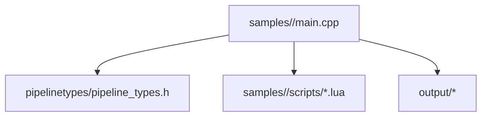

**Diagram sources**
- [samples/FDM/main.cpp:1-337](file://samples/FDM/main.cpp#L1-L337)
- [samples/SLA/main.cpp:1-259](file://samples/SLA/main.cpp#L1-L259)
- [samples/SLS/main.cpp:1-209](file://samples/SLS/main.cpp#L1-L209)
- [samples/SLM/main.cpp:1-196](file://samples/SLM/main.cpp#L1-L196)
- [samples/LOM/main.cpp:1-194](file://samples/LOM/main.cpp#L1-L194)
- [samples/TDP/main.cpp:1-225](file://samples/TDP/main.cpp#L1-L225)
- [samples/WAAM/main.cpp:1-237](file://samples/WAAM/main.cpp#L1-L237)
- [pipeline_types.h:1-1049](file://pipelinetypes/pipeline_types.h#L1-L1049)

**Section sources**
- [samples/FDM/main.cpp:1-337](file://samples/FDM/main.cpp#L1-L337)
- [samples/SLA/main.cpp:1-259](file://samples/SLA/main.cpp#L1-L259)
- [samples/SLS/main.cpp:1-209](file://samples/SLS/main.cpp#L1-L209)
- [samples/SLM/main.cpp:1-196](file://samples/SLM/main.cpp#L1-L196)
- [samples/LOM/main.cpp:1-194](file://samples/LOM/main.cpp#L1-L194)
- [samples/TDP/main.cpp:1-225](file://samples/TDP/main.cpp#L1-L225)
- [samples/WAAM/main.cpp:1-237](file://samples/WAAM/main.cpp#L1-L237)
- [pipeline_types.h:1-1049](file://pipelinetypes/pipeline_types.h#L1-L1049)

## Core Components
All pipelines share a consistent API pattern defined in the C-compatible type header:
- Default configuration initializers.
- Sync run functions returning a typed result struct.
- Async run functions with progress and completion callbacks.
- Typed result structs with success flags, layer counts, output paths or content, error messages, and elapsed time.

Key shared concepts:
- Model inputs are provided via model name and path.
- Layer height and first-layer height are common slicing parameters.
- Many processes expose Lua hooks for customization.
- Output formats vary by process: G-code for FDM, zip packages for SLA/SLS/SLM/LOM/TDP, and robot program text for WAAM.

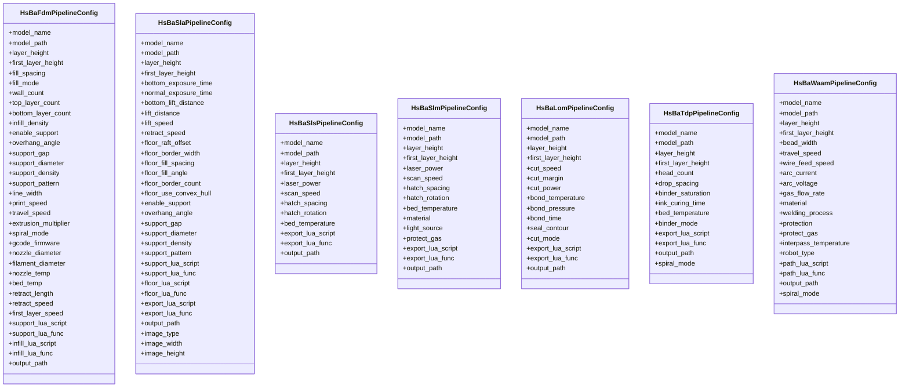

**Diagram sources**
- [pipeline_types.h:56-113](file://pipelinetypes/pipeline_types.h#L56-L113)
- [pipeline_types.h:170-218](file://pipelinetypes/pipeline_types.h#L170-L218)
- [pipeline_types.h:259-283](file://pipelinetypes/pipeline_types.h#L259-L283)
- [pipeline_types.h:359-376](file://pipelinetypes/pipeline_types.h#L359-L376)
- [pipeline_types.h:419-436](file://pipelinetypes/pipeline_types.h#L419-L436)
- [pipeline_types.h:480-496](file://pipelinetypes/pipeline_types.h#L480-L496)
- [pipeline_types.h:578-600](file://pipelinetypes/pipeline_types.h#L578-L600)

**Section sources**
- [pipeline_types.h:1-1049](file://pipelinetypes/pipeline_types.h#L1-L1049)

## Architecture Overview
Each process pipeline follows a similar high-level flow:
1. Load model from file path.
2. Slice into layers using configured layer heights.
3. Apply process-specific steps:
   - FDM: wall/perimeter, infill, support, G-code path generation.
   - SLA: floor/raft, support, layer image export.
   - SLS/SLM/LOM/TDP: slice and pass data to Lua export script.
   - WAAM: generate robot motion points and write robot program.
4. Produce output:
   - FDM: G-code string or file.
   - SLA: zip package containing config and layer images.
   - SLS/SLM/LOM/TDP: zip package controlled by Lua export script.
   - WAAM: robot language program text.

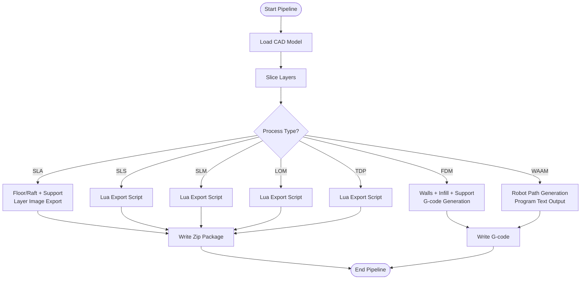

**Diagram sources**
- [samples/FDM/main.cpp:53-96](file://samples/FDM/main.cpp#L53-L96)
- [samples/SLA/main.cpp:52-84](file://samples/SLA/main.cpp#L52-L84)
- [samples/SLS/main.cpp:56-92](file://samples/SLS/main.cpp#L56-L92)
- [samples/SLM/main.cpp:56-84](file://samples/SLM/main.cpp#L56-L84)
- [samples/LOM/main.cpp:55-82](file://samples/LOM/main.cpp#L55-L82)
- [samples/TDP/main.cpp:55-82](file://samples/TDP/main.cpp#L55-L82)
- [samples/WAAM/main.cpp:54-81](file://samples/WAAM/main.cpp#L54-L81)

## Detailed Component Analysis

### FDM Pipeline
FDM is the most parameter-rich process in the samples. It supports:
- Fill modes and angles.
- Wall count and top/bottom solid layers.
- Support detection and multiple support patterns.
- G-code firmware targets and extruder settings.
- Spiral/vase mode for continuous outer-wall deposition.
- Lua scripts for custom support and infill.

Common workflow in the sample:
- Create default config.
- Set model name and path.
- Configure slicing, fill, support, and path parameters.
- Run synchronously or asynchronously.
- Write G-code to file and free result memory.

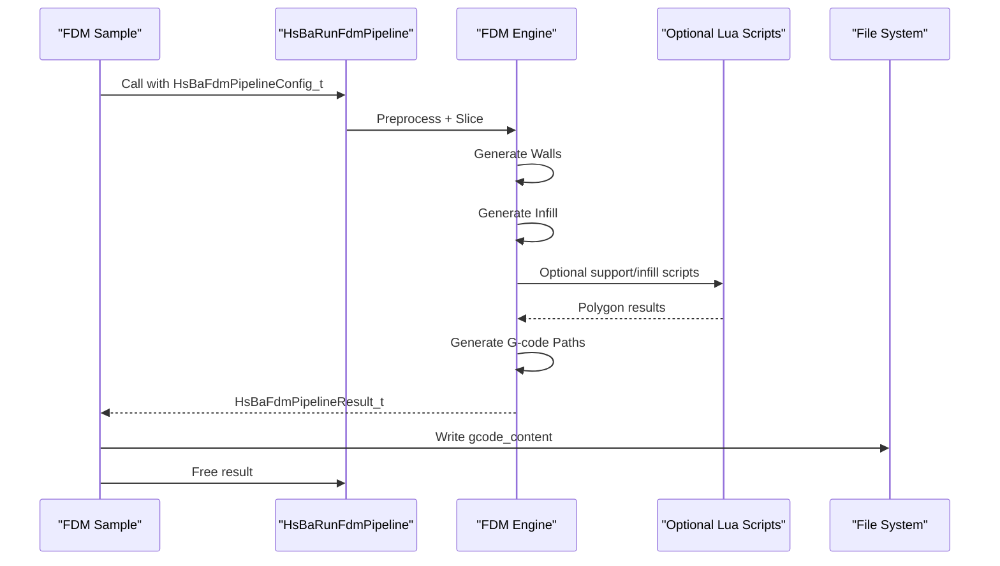

**Diagram sources**
- [samples/FDM/main.cpp:53-96](file://samples/FDM/main.cpp#L53-L96)
- [samples/FDM/main.cpp:101-165](file://samples/FDM/main.cpp#L101-L165)
- [samples/FDM/main.cpp:170-220](file://samples/FDM/main.cpp#L170-L220)
- [samples/FDM/main.cpp:274-318](file://samples/FDM/main.cpp#L274-L318)

Specialized algorithms and optimizations:
- Support detection uses overhang angle thresholds; built-in generators include plane, tree, and honeycomb patterns.
- Infill can be replaced by a Lua script that computes parallel lines and intersects them with the current layer polygon.
- Spiral mode merges the outer wall into a single rising path and skips per-layer infill/support.

Configuration highlights:
- Fill spacing, mode, angle, wall count, top/bottom layer counts, infill density.
- Support enable flag, overhang angle, gap, diameter, density, pattern, interface layers/density.
- Line width, print speed, travel speed, extrusion multiplier, spiral mode.
- Firmware target, nozzle/filament diameters, temperatures, retraction settings.

Platform and hardware notes:
- Supports Windows/Linux/macOS/Android/iOS.
- Hardware parameters map directly to printer capabilities: nozzle size, filament diameter, temperature limits, and speed constraints.

Performance tuning strategies:
- Reduce wall count or infill density for faster slicing.
- Use tree support for large overhangs with less material.
- Enable spiral mode only when appropriate for vase-like parts.
- Tune print/travel speeds based on machine dynamics.

**Section sources**
- [samples/FDM/main.cpp:53-96](file://samples/FDM/main.cpp#L53-L96)
- [samples/FDM/main.cpp:101-165](file://samples/FDM/main.cpp#L101-L165)
- [samples/FDM/main.cpp:170-220](file://samples/FDM/main.cpp#L170-L220)
- [samples/FDM/main.cpp:274-318](file://samples/FDM/main.cpp#L274-L318)
- [samples/FDM/scripts/my_infill.lua:1-89](file://samples/FDM/scripts/my_infill.lua#L1-L89)
- [samples/FDM/scripts/my_support.lua:1-83](file://samples/FDM/scripts/my_support.lua#L1-L83)
- [pipeline_types.h:26-127](file://pipelinetypes/pipeline_types.h#L26-L127)

### SLA Pipeline
SLA focuses on resin vat printing with exposure and lift/retract parameters, plus floor/raft generation and layer image export.

Common workflow:
- Create default SLA config.
- Set model and output zip path.
- Configure layer height, exposure times, lift distances/speeds.
- Configure floor raft offset, border width/count, fill spacing/angle, convex hull option.
- Configure support pattern and optional Lua floor/support/export scripts.
- Run synchronously or asynchronously.

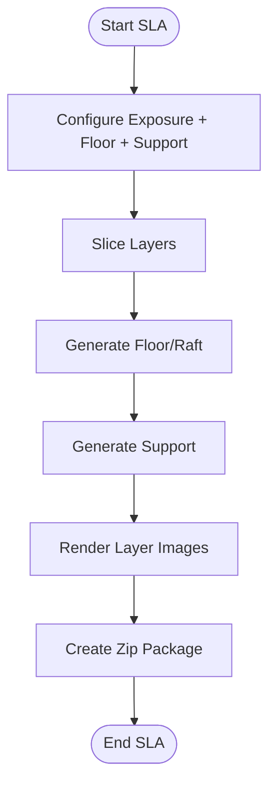

**Diagram sources**
- [samples/SLA/main.cpp:52-84](file://samples/SLA/main.cpp#L52-L84)
- [samples/SLA/main.cpp:89-144](file://samples/SLA/main.cpp#L89-L144)
- [samples/SLA/main.cpp:149-191](file://samples/SLA/main.cpp#L149-L191)

Specialized algorithms and optimizations:
- Floor generation can use convex hull footprint and zigzag/parallel fills.
- Support generation detects overhangs and uses SLA sacrificial or cone patterns.
- Export produces a zip containing config JSON and layer images (PNG/JPEG/SVG).

Configuration highlights:
- Layer height, first-layer height.
- Bottom/normal exposure time, bottom lift distance, normal lift distance, lift/retract speeds.
- Floor raft offset, border width, fill spacing/angle, border count, convex hull.
- Support enable flag, overhang angle, gap, diameter, density, pattern.
- Lua hooks for floor, support, and export.

Platform and hardware notes:
- Output is a zip package suitable for SLA printers.
- Image resolution and format can be tuned for printer software compatibility.

Performance tuning strategies:
- Increase layer height for faster processing at lower detail.
- Adjust exposure/lift parameters to balance build speed and reliability.
- Use convex hull floor for larger footprints to reduce complexity.

**Section sources**
- [samples/SLA/main.cpp:52-84](file://samples/SLA/main.cpp#L52-L84)
- [samples/SLA/main.cpp:89-144](file://samples/SLA/main.cpp#L89-L144)
- [samples/SLA/main.cpp:149-191](file://samples/SLA/main.cpp#L149-L191)
- [samples/SLA/scripts/my_sla_floor.lua:1-64](file://samples/SLA/scripts/my_sla_floor.lua#L1-L64)
- [samples/SLA/scripts/my_sla_support.lua:1-76](file://samples/SLA/scripts/my_sla_support.lua#L1-L76)
- [pipeline_types.h:149-245](file://pipelinetypes/pipeline_types.h#L149-L245)

### SLS Pipeline
SLS is a powder-bed laser sintering process. It does not require floor/raft or support structures because the powder bed provides support and thermal stability. Output format is entirely controlled by the Lua export script.

Common workflow:
- Create default SLS config.
- Set model and Lua export script/function.
- Configure layer height, laser power, scan speed, hatch spacing/rotation, bed temperature.
- Run synchronously or asynchronously.

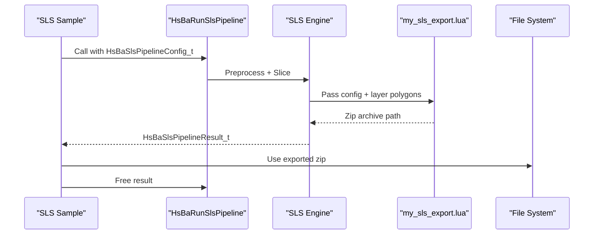

**Diagram sources**
- [samples/SLS/main.cpp:56-92](file://samples/SLS/main.cpp#L56-L92)
- [samples/SLS/main.cpp:97-140](file://samples/SLS/main.cpp#L97-L140)
- [samples/SLS/scripts/my_sls_export.lua:1-80](file://samples/SLS/scripts/my_sls_export.lua#L1-L80)

Specialized algorithms and optimizations:
- No floor/raft or support generation.
- Laser scanning strategy is represented by hatch spacing and rotation.
- Lua export script archives config and layer polygons into a zip and optionally registers database records.

Configuration highlights:
- Layer height, first-layer height.
- Laser power, scan speed, hatch spacing, hatch rotation, bed temperature.
- Required Lua export script and function.

Platform and hardware notes:
- Output is a zip package consumed by downstream SLS tooling.
- Bed temperature and laser parameters must match material properties.

Performance tuning strategies:
- Increase hatch spacing for faster scans at lower density.
- Tune bed temperature to stabilize powder behavior.

**Section sources**
- [samples/SLS/main.cpp:56-92](file://samples/SLS/main.cpp#L56-L92)
- [samples/SLS/main.cpp:97-140](file://samples/SLS/main.cpp#L97-L140)
- [samples/SLS/scripts/my_sls_export.lua:1-80](file://samples/SLS/scripts/my_sls_export.lua#L1-L80)
- [pipeline_types.h:249-310](file://pipelinetypes/pipeline_types.h#L249-L310)

### SLM Pipeline
SLM mirrors the SLS flow but adds metal-specific parameters: material, energy source, and shielding gas. Output format is still controlled by the Lua export script.

Common workflow:
- Create default SLM config.
- Set model and Lua export script/function.
- Configure layer height, laser power, scan speed, hatch spacing/rotation, bed temperature.
- Set material, light source, and protect gas.
- Run synchronously or asynchronously.

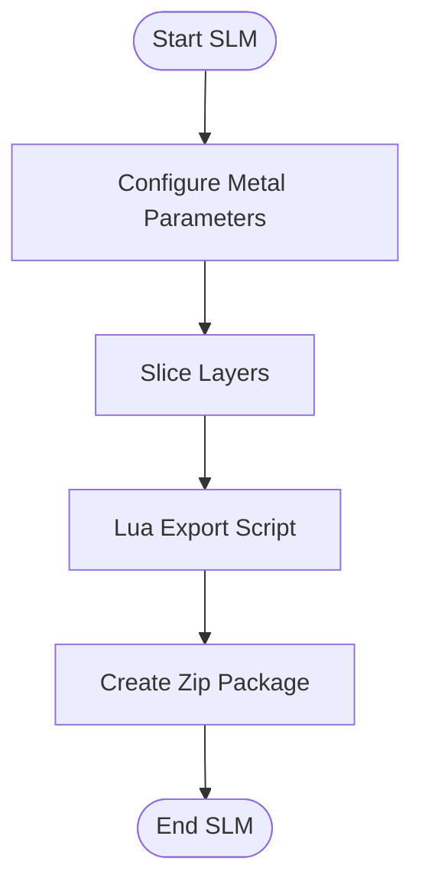

**Diagram sources**
- [samples/SLM/main.cpp:56-84](file://samples/SLM/main.cpp#L56-L84)
- [samples/SLM/main.cpp:89-132](file://samples/SLM/main.cpp#L89-L132)
- [samples/SLM/scripts/my_slm_export.lua:1-63](file://samples/SLM/scripts/my_slm_export.lua#L1-L63)

Specialized algorithms and optimizations:
- No floor/raft or support structures.
- Metal powder material and energy source affect melting behavior.
- Shielding gas selection prevents oxidation during melting.

Configuration highlights:
- Layer height, first-layer height.
- Laser power, scan speed, hatch spacing, hatch rotation, bed temperature.
- Material enum, light source enum, protect gas enum.
- Required Lua export script and function.

Platform and hardware notes:
- Output is a zip package consumed by SLM machines or post-processing systems.
- Material/gas combinations must match machine safety and metallurgical requirements.

Performance tuning strategies:
- Optimize hatch spacing and rotation for part density and anisotropy.
- Adjust bed temperature to reduce residual stress.

**Section sources**
- [samples/SLM/main.cpp:56-84](file://samples/SLM/main.cpp#L56-L84)
- [samples/SLM/main.cpp:89-132](file://samples/SLM/main.cpp#L89-L132)
- [samples/SLM/scripts/my_slm_export.lua:1-63](file://samples/SLM/scripts/my_slm_export.lua#L1-L63)
- [pipeline_types.h:313-401](file://pipelinetypes/pipeline_types.h#L313-L401)

### LOM Pipeline
LOM is a sheet-bonding process where each layer corresponds to a physical sheet thickness. Contours are cut then bonded. Cut and bond parameters are passed to the Lua export script.

Common workflow:
- Create default LOM config.
- Set model and Lua export script/function.
- Configure layer height, cut speed/margin/power, bonding temperature/pressure/time, seal contour, cut mode.
- Run synchronously or asynchronously.

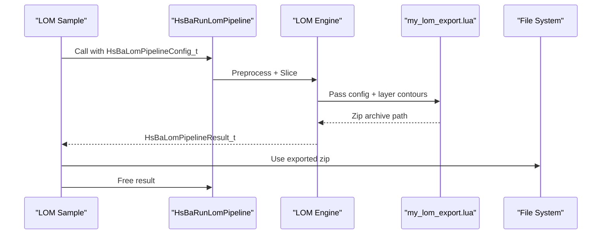

**Diagram sources**
- [samples/LOM/main.cpp:55-82](file://samples/LOM/main.cpp#L55-L82)
- [samples/LOM/main.cpp:87-130](file://samples/LOM/main.cpp#L87-L130)

Specialized algorithms and optimizations:
- Sheet cutting modes include contour and halftone cutting.
- Bonding parameters control adhesion quality between sheets.
- Seal contour can improve edge integrity.

Configuration highlights:
- Layer height, first-layer height.
- Cut speed, cut margin, cut power, bond temperature/pressure/time.
- Seal contour flag, cut mode enum.
- Required Lua export script and function.

Platform and hardware notes:
- Output is a zip package consumed by LAM/LAM-style equipment or CAM systems.
- Cut margin and power must account for kerf and material thickness.

Performance tuning strategies:
- Increase cut speed for throughput while maintaining edge quality.
- Tune bond pressure/time for stronger interlayer adhesion.

**Section sources**
- [samples/LOM/main.cpp:55-82](file://samples/LOM/main.cpp#L55-L82)
- [samples/LOM/main.cpp:87-130](file://samples/LOM/main.cpp#L87-L130)
- [pipeline_types.h:404-461](file://pipelinetypes/pipeline_types.h#L404-L461)

### TDP (3DP Binder Jetting) Pipeline
TDP jets liquid binder onto a powder bed layer by layer. Head count, drop spacing, binder saturation, curing time, and bed temperature are key parameters. Output is controlled by the Lua export script.

Common workflow:
- Create default TDP config.
- Set model and Lua export script/function.
- Configure layer height, head count, drop spacing, binder saturation, curing time, bed temperature, binder mode.
- Optionally enable spiral mode to expose a continuous rising outer-wall path.
- Run synchronously or asynchronously.

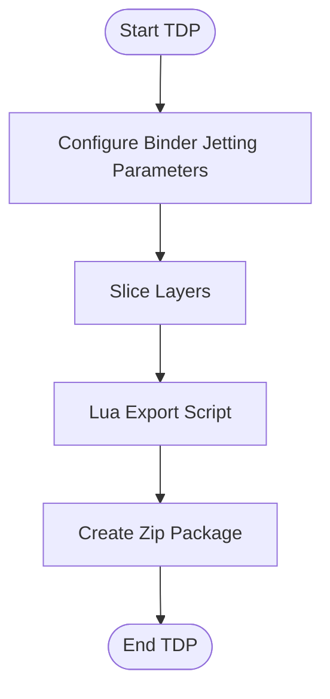

**Diagram sources**
- [samples/TDP/main.cpp:55-82](file://samples/TDP/main.cpp#L55-L82)
- [samples/TDP/main.cpp:87-125](file://samples/TDP/main.cpp#L87-L125)
- [samples/TDP/main.cpp:175-205](file://samples/TDP/main.cpp#L175-L205)
- [samples/TDP/scripts/my_tdp_export.lua:1-63](file://samples/TDP/scripts/my_tdp_export.lua#L1-L63)

Specialized algorithms and optimizations:
- Multi-head printhead configuration affects deposition rate and color capability.
- Binder saturation controls porosity and strength.
- Spiral mode exposes a continuous rising path for specialized post-processing.

Configuration highlights:
- Layer height, first-layer height.
- Head count, drop spacing, binder saturation, ink curing time, bed temperature.
- Binder mode enum.
- Required Lua export script and function.
- Spiral mode flag.

Platform and hardware notes:
- Output is a zip package consumed by binder jetting systems.
- Head count and drop spacing must match printer hardware.

Performance tuning strategies:
- Increase head count for higher throughput.
- Adjust binder saturation to balance strength and curing time.

**Section sources**
- [samples/TDP/main.cpp:55-82](file://samples/TDP/main.cpp#L55-L82)
- [samples/TDP/main.cpp:87-125](file://samples/TDP/main.cpp#L87-L125)
- [samples/TDP/main.cpp:175-205](file://samples/TDP/main.cpp#L175-L205)
- [samples/TDP/scripts/my_tdp_export.lua:1-63](file://samples/TDP/scripts/my_tdp_export.lua#L1-L63)
- [pipeline_types.h:464-521](file://pipelinetypes/pipeline_types.h#L464-L521)

### WAAM Pipeline
WAAM is a robot-based wire arc additive manufacturing process. Its output is a robot language program rather than a zip package. Built-in code generators exist for ABB, KUKA, and FANUC; a custom Lua path script can replace the generator.

Common workflow:
- Create default WAAM config.
- Set model and robot type.
- Configure layer height, bead width, travel speed, welding parameters, protection method, shielding gas, interpass temperature.
- Optionally provide a custom Lua path script.
- Run synchronously or asynchronously.
- Spiral mode merges outer walls into one continuous rising bead.

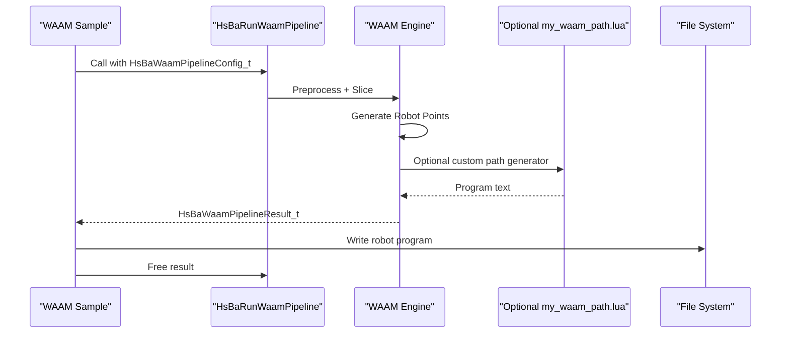

**Diagram sources**
- [samples/WAAM/main.cpp:54-81](file://samples/WAAM/main.cpp#L54-L81)
- [samples/WAAM/main.cpp:86-131](file://samples/WAAM/main.cpp#L86-L131)
- [samples/WAAM/main.cpp:183-217](file://samples/WAAM/main.cpp#L183-L217)
- [samples/WAAM/scripts/my_waam_path.lua:1-46](file://samples/WAAM/scripts/my_waam_path.lua#L1-L46)

Specialized algorithms and optimizations:
- Robot controller selection determines code syntax and kinematic assumptions.
- Custom Lua path generator allows brand-specific or proprietary robot programs.
- Spiral mode reduces arc restarts and travel moves by creating a continuous Z-rising weld bead.

Configuration highlights:
- Layer height, first-layer height, bead width, travel speed.
- Wire feed speed, arc current, arc voltage, gas flow rate.
- Material, welding process, protection method, protect gas, interpass temperature.
- Robot type enum.
- Optional path Lua script and function.
- Spiral mode flag.

Platform and hardware notes:
- Output is robot program text compatible with ABB/KUKA/FANUC or custom controllers.
- Welding parameters must match wire material and joint geometry.

Performance tuning strategies:
- Increase travel speed within weld pool stability limits.
- Tune arc current/voltage for penetration and deposition rate.
- Use spiral mode to minimize interruptions for long perimeters.

**Section sources**
- [samples/WAAM/main.cpp:54-81](file://samples/WAAM/main.cpp#L54-L81)
- [samples/WAAM/main.cpp:86-131](file://samples/WAAM/main.cpp#L86-L131)
- [samples/WAAM/main.cpp:183-217](file://samples/WAAM/main.cpp#L183-L217)
- [samples/WAAM/scripts/my_waam_path.lua:1-46](file://samples/WAAM/scripts/my_waam_path.lua#L1-L46)
- [pipeline_types.h:524-625](file://pipelinetypes/pipeline_types.h#L524-L625)

### Custom Lua Pipeline
The Custom pipeline lets you define the entire workflow in Lua. The C++ side provides a Lua environment with pipeline operators: model loading, slicing, filling, support generation, floor generation, G-code output, SLA/SLS packaging, and more.

Common workflows demonstrated:
- Fully Lua-defined FDM pipeline.
- Fully Lua-defined SLS pipeline.
- Fully Lua-defined SLM/LOM/TDP/WAAM pipelines.
- Inline Lua source without script files.
- Asynchronous execution.
- Protobuf wire serialization for cross-language calls.

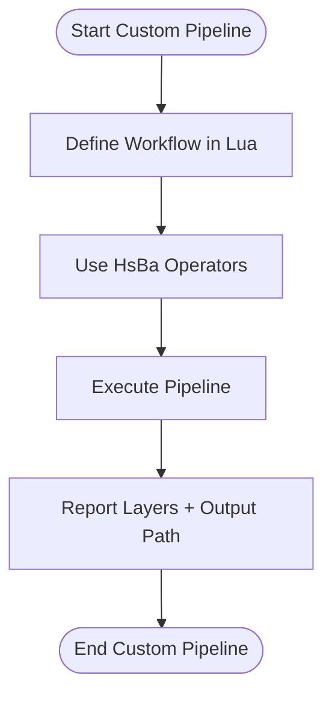

**Diagram sources**
- [samples/Custom/main.cpp:98-132](file://samples/Custom/main.cpp#L98-L132)
- [samples/Custom/main.cpp:140-165](file://samples/Custom/main.cpp#L140-L165)
- [samples/Custom/main.cpp:174-265](file://samples/Custom/main.cpp#L174-L265)
- [samples/Custom/main.cpp:270-314](file://samples/Custom/main.cpp#L270-L314)
- [samples/Custom/main.cpp:331-354](file://samples/Custom/main.cpp#L331-L354)
- [samples/Custom/main.cpp:516-589](file://samples/Custom/main.cpp#L516-L589)

Specialized algorithms and optimizations:
- Entire stage order and logic are defined by Lua; C++ only exposes building blocks.
- Machine parameters can be injected via inline Lua source before the script runs.
- Arbitrary JSON configuration is passed to Lua as `pipeline_config`.

Configuration highlights:
- Pipeline Lua script path or inline source.
- Entry function name.
- Optional model name/path and output path.
- Optional config JSON string.

Platform and hardware notes:
- Suitable for prototyping new processes or integrating non-standard workflows.
- Can be called via synchronous, asynchronous, or Protobuf wire interfaces.

Performance tuning strategies:
- Keep Lua logic efficient; avoid unnecessary polygon operations.
- Use built-in operators for heavy geometric computations.
- Batch file I/O and compression in Lua export scripts.

**Section sources**
- [samples/Custom/main.cpp:98-132](file://samples/Custom/main.cpp#L98-L132)
- [samples/Custom/main.cpp:140-165](file://samples/Custom/main.cpp#L140-L165)
- [samples/Custom/main.cpp:174-265](file://samples/Custom/main.cpp#L174-L265)
- [samples/Custom/main.cpp:270-314](file://samples/Custom/main.cpp#L270-L314)
- [samples/Custom/main.cpp:331-354](file://samples/Custom/main.cpp#L331-L354)
- [samples/Custom/main.cpp:516-589](file://samples/Custom/main.cpp#L516-L589)

## Dependency Analysis
Across all pipelines, dependencies follow a clear separation:
- Sample applications depend on process-specific headers and call pipeline APIs.
- Configuration types are defined centrally in the pipeline types header.
- Lua scripts depend on registered libraries such as PolygonOperations, Support, PolygonFill, Zipper, Cipher, SQLiteAdapter, etc.
- Output formats vary: G-code for FDM, zip packages for SLA/SLS/SLM/LOM/TDP, robot program text for WAAM.

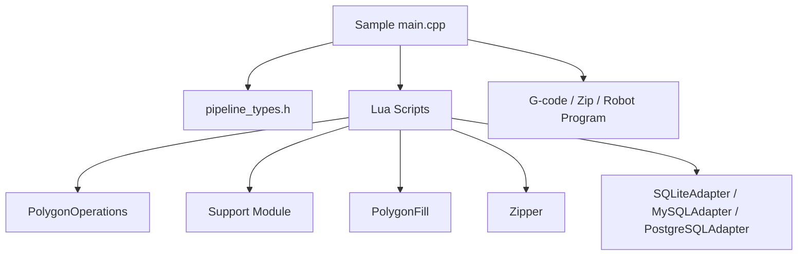

**Diagram sources**
- [samples/FDM/main.cpp:1-337](file://samples/FDM/main.cpp#L1-L337)
- [samples/SLA/main.cpp:1-259](file://samples/SLA/main.cpp#L1-L259)
- [samples/SLS/main.cpp:1-209](file://samples/SLS/main.cpp#L1-L209)
- [samples/SLM/main.cpp:1-196](file://samples/SLM/main.cpp#L1-L196)
- [samples/LOM/main.cpp:1-194](file://samples/LOM/main.cpp#L1-L194)
- [samples/TDP/main.cpp:1-225](file://samples/TDP/main.cpp#L1-L225)
- [samples/WAAM/main.cpp:1-237](file://samples/WAAM/main.cpp#L1-L237)
- [samples/SLS/scripts/my_sls_export.lua:1-80](file://samples/SLS/scripts/my_sls_export.lua#L1-L80)

**Section sources**
- [pipeline_types.h:1-1049](file://pipelinetypes/pipeline_types.h#L1-L1049)
- [samples/SLS/scripts/my_sls_export.lua:1-80](file://samples/SLS/scripts/my_sls_export.lua#L1-L80)

## Performance Considerations
General guidance applicable across pipelines:
- Prefer synchronous execution for simple scripts and asynchronous execution for UI responsiveness or batch processing.
- Use default configurations as baselines and adjust parameters incrementally.
- For FDM, reduce infill density and wall count to speed up slicing; use tree support for complex overhangs.
- For SLA, tune exposure and lift parameters to balance build speed and layer adhesion.
- For SLS/SLM, optimize hatch spacing and rotation for density and anisotropy; adjust bed temperature for material stability.
- For LOM, increase cut speed while maintaining edge quality; tune bond pressure/time for adhesion.
- For TDP, increase head count for throughput; adjust binder saturation for strength and curing time.
- For WAAM, increase travel speed within weld pool stability; tune arc current/voltage for penetration; use spiral mode to reduce interruptions.

Memory and resource management:
- Always free pipeline results after use.
- Avoid excessive polygon operations in Lua; prefer built-in operators.
- Batch file I/O and compression in export scripts.

Platform considerations:
- All samples target Windows/Linux/macOS/Android/iOS.
- Hardware parameters must match machine capabilities and safety constraints.

[No sources needed since this section provides general guidance]

## Troubleshooting Guide
Common issues and resolutions:
- Memory leaks: Ensure result structs are freed after use.
- Missing Lua scripts: Verify script paths and function names in configuration.
- Invalid output paths: Check directory permissions and existence.
- Incorrect process parameters: Validate against machine specifications.
- Database registration failures: Non-fatal warnings in export scripts; check SQLite/MySQL/PostgreSQL availability.

Error handling patterns:
- Results include success flags and error messages.
- Progress callbacks report stages and percentages.
- Lua export scripts should handle errors gracefully and return expected structures.

**Section sources**
- [samples/FDM/main.cpp:69-95](file://samples/FDM/main.cpp#L69-L95)
- [samples/SLA/main.cpp:69-83](file://samples/SLA/main.cpp#L69-L83)
- [samples/SLS/main.cpp:77-91](file://samples/SLS/main.cpp#L77-L91)
- [samples/SLM/main.cpp:72-83](file://samples/SLM/main.cpp#L72-L83)
- [samples/LOM/main.cpp:70-81](file://samples/LOM/main.cpp#L70-L81)
- [samples/TDP/main.cpp:70-81](file://samples/TDP/main.cpp#L70-L81)
- [samples/WAAM/main.cpp:69-80](file://samples/WAAM/main.cpp#L69-L80)
- [samples/SLS/scripts/my_sls_export.lua:50-71](file://samples/SLS/scripts/my_sls_export.lua#L50-L71)

## Conclusion
The HsBaSlicer pipeline examples provide a comprehensive toolkit for implementing manufacturing workflows across FDM, SLA, SLS, SLM, LOM, TDP, and WAAM. They demonstrate:
- Consistent API patterns for configuration, execution, and result handling.
- Process-specific algorithms and optimizations.
- Extensibility through Lua scripts for support, infill, floor, export, and robot-code generation.
- Flexibility via the Custom pipeline for fully user-defined workflows.

By following the documented configuration fields, algorithm selection criteria, and performance tuning strategies, integrators can build robust, efficient, and platform-appropriate manufacturing pipelines.

[No sources needed since this section summarizes without analyzing specific files]

## Appendices

### Appendix A: Process-Specific Configuration Summary
- FDM: Fill modes, wall/top/bottom layers, support patterns, G-code firmware, spiral mode.
- SLA: Exposure/lift parameters, floor/raft options, support patterns, image format.
- SLS: Laser power, scan speed, hatch spacing/rotation, bed temperature.
- SLM: Metal material, light source, shielding gas, plus SLS-like parameters.
- LOM: Cut speed/margin/power, bond temperature/pressure/time, cut mode.
- TDP: Head count, drop spacing, binder saturation, curing time, binder mode, spiral mode.
- WAAM: Bead width, travel speed, welding parameters, protection method, robot type, spiral mode.

**Section sources**
- [pipeline_types.h:56-113](file://pipelinetypes/pipeline_types.h#L56-L113)
- [pipeline_types.h:170-218](file://pipelinetypes/pipeline_types.h#L170-L218)
- [pipeline_types.h:259-283](file://pipelinetypes/pipeline_types.h#L259-L283)
- [pipeline_types.h:359-376](file://pipelinetypes/pipeline_types.h#L359-L376)
- [pipeline_types.h:419-436](file://pipelinetypes/pipeline_types.h#L419-L436)
- [pipeline_types.h:480-496](file://pipelinetypes/pipeline_types.h#L480-L496)
- [pipeline_types.h:578-600](file://pipelinetypes/pipeline_types.h#L578-L600)

### Appendix B: Output Format Variations
- FDM: G-code string/file.
- SLA: Zip package with config and layer images.
- SLS/SLM/LOM/TDP: Zip package controlled by Lua export script.
- WAAM: Robot program text.

**Section sources**
- [samples/FDM/main.cpp:72-80](file://samples/FDM/main.cpp#L72-L80)
- [samples/SLA/main.cpp:63-73](file://samples/SLA/main.cpp#L63-L73)
- [samples/SLS/main.cpp:67-81](file://samples/SLS/main.cpp#L67-L81)
- [samples/SLM/main.cpp:65-75](file://samples/SLM/main.cpp#L65-L75)
- [samples/LOM/main.cpp:64-73](file://samples/LOM/main.cpp#L64-L73)
- [samples/TDP/main.cpp:64-73](file://samples/TDP/main.cpp#L64-L73)
- [samples/WAAM/main.cpp:63-72](file://samples/WAAM/main.cpp#L63-L72)