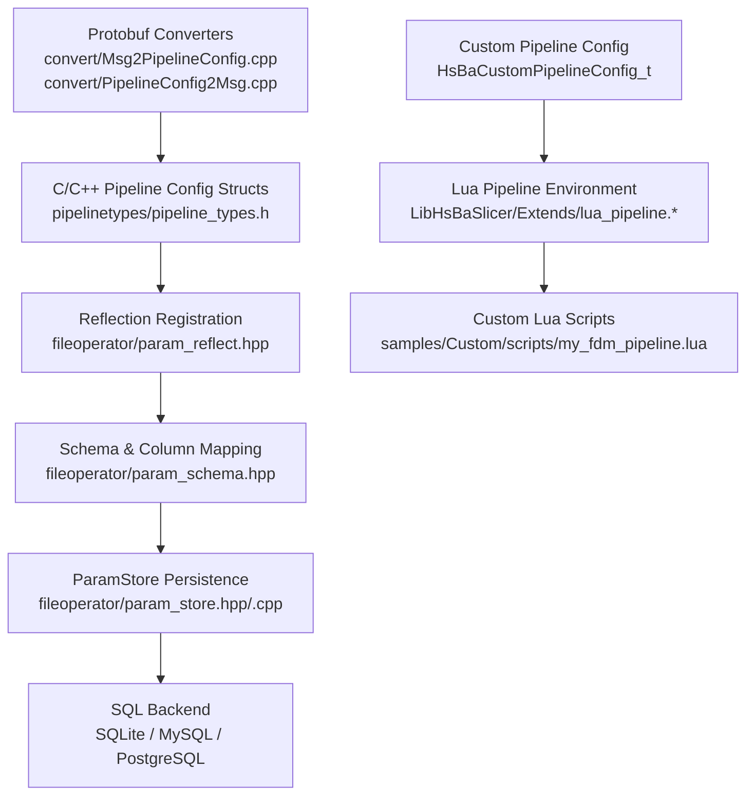
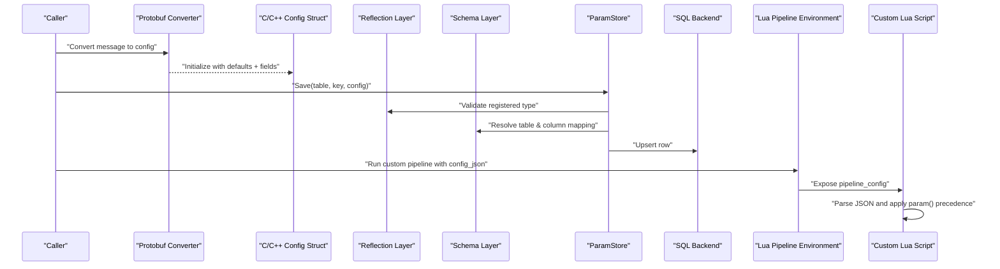
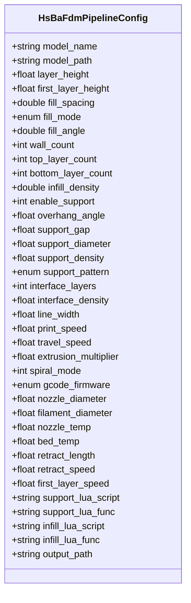
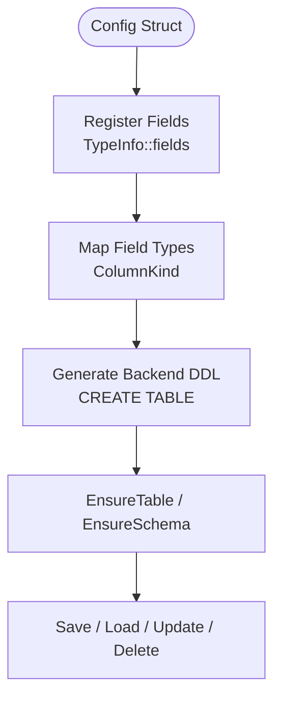
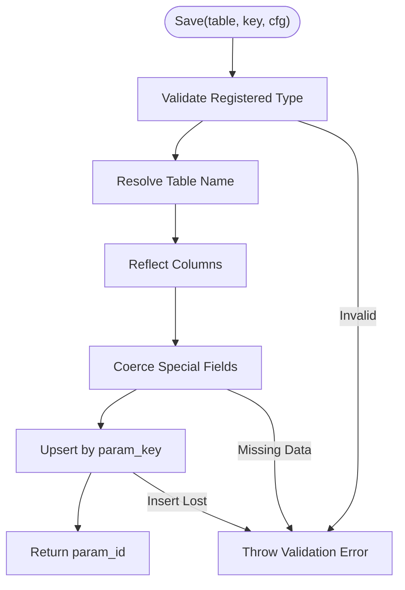
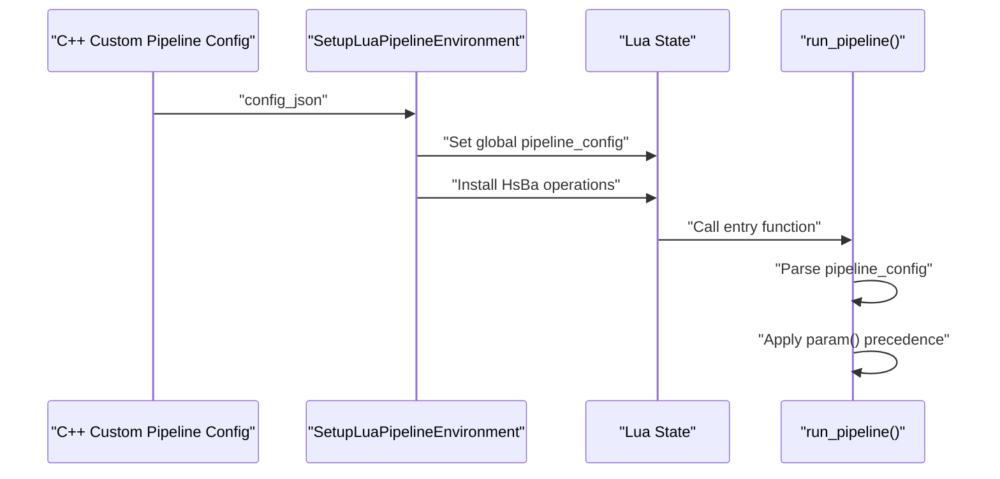
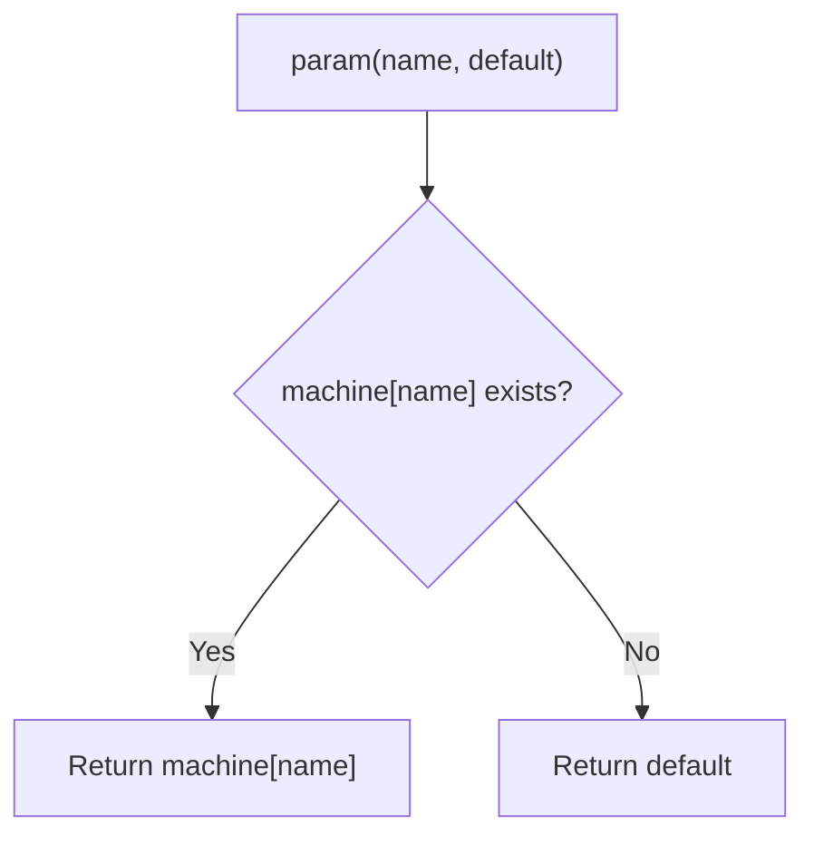
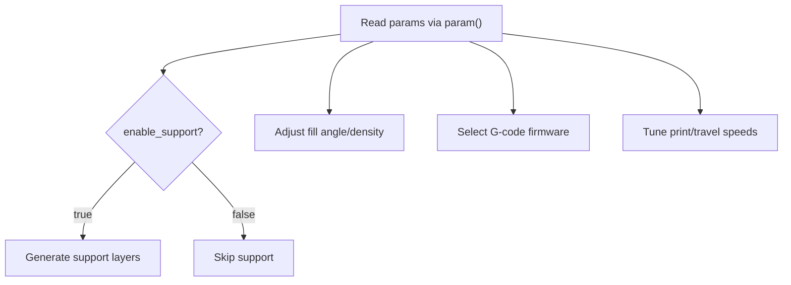
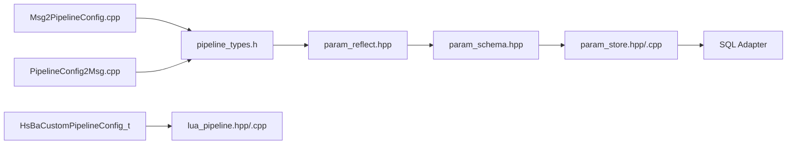

# Configuration Management / 配置管理

<cite>
**Referenced Files in This Document**   
- [pipeline_types.h](file://pipelinetypes/pipeline_types.h)
- [param_reflect.hpp](file://fileoperator\param_reflect.hpp)
- [param_schema.hpp](file://fileoperator\param_schema.hpp)
- [param_store.hpp](file://fileoperator\param_store.hpp)
- [param_store.cpp](file://fileoperator\param_store.cpp)
- [lua_pipeline.hpp](file://LibHsBaSlicer\Extends\lua_pipeline.hpp)
- [lua_pipeline.cpp](file://LibHsBaSlicer\Extends\lua_pipeline.cpp)
- [my_fdm_pipeline.lua](file://samples\Custom\scripts\my_fdm_pipeline.lua)
- [Msg2PipelineConfig.cpp](file://convert\Msg2PipelineConfig.cpp)
- [PipelineConfig2Msg.cpp](file://convert\PipelineConfig2Msg.cpp)
- [param_store_pipeline.h](file://DllHsBaSlicer\param_store_pipeline.h)
- [README.md](file://docs\en\DllHsBaSlicer\README.md)
</cite>

## Table of Contents
1. [Introduction](#introduction)
2. [Project Structure](#project-structure)
3. [Core Components](#core-components)
4. [Architecture Overview](#architecture-overview)
5. [Detailed Component Analysis](#detailed-component-analysis)
6. [Dependency Analysis](#dependency-analysis)
7. [Performance Considerations](#performance-considerations)
8. [Troubleshooting Guide](#troubleshooting-guide)
9. [Conclusion](#conclusion)
10. [Appendices](#appendices)

## Introduction
This document explains configuration management for custom pipelines in the project. It covers how pipeline configuration is represented, parsed, validated, persisted, and consumed by Lua-driven workflows. The focus is on:

- Parsing and validating `pipeline_config` JSON strings.
- Handling parameter precedence between C++ injected parameters and script defaults.
- Implementing dynamic behavior adjustment based on runtime configuration.
- Using the `param()` helper pattern to access machine-specific parameters.
- Applying configuration validation strategies and schema enforcement.
- Supporting complex configuration structures, conditional logic, and inheritance patterns.
- Addressing configuration file formats, environment variable integration, and migration strategies for pipeline versioning.

The system supports both strongly typed C/C++ pipeline configurations and flexible JSON-based configuration passed into fully Lua-driven custom pipelines.

## Project Structure
Configuration-related code spans several layers:

- Type definitions for all pipeline configurations are declared as C-compatible structs.
- Reflection metadata maps those structs to database columns.
- A persistence layer validates, coerces, and stores configurations.
- A Lua execution environment exposes a raw JSON string to scripts.
- Sample Lua scripts demonstrate the `param()` helper pattern.
- Protobuf converters bridge external messages to C/C++ configs.

**Diagram sources**
- [pipeline_types.h:56-113](file://pipelinetypes/pipeline_types.h#L56-L113)
- [param_reflect.hpp:55-105](file://fileoperator\param_reflect.hpp#L55-L105)
- [param_schema.hpp:58-92](file://fileoperator\param_schema.hpp#L58-L92)
- [param_store.hpp:33-93](file://fileoperator\param_store.hpp#L33-L93)
- [param_store.cpp:177-239](file://fileoperator\param_store.cpp#L177-L239)
- [lua_pipeline.hpp:29-39](file://LibHsBaSlicer\Extends\lua_pipeline.hpp#L29-L39)
- [lua_pipeline.cpp:874-886](file://LibHsBaSlicer\Extends\lua_pipeline.cpp#L874-L886)
- [my_fdm_pipeline.lua:24-30](file://samples\Custom\scripts\my_fdm_pipeline.lua#L24-L30)
- [Msg2PipelineConfig.cpp:210-224](file://convert\Msg2PipelineConfig.cpp#L210-L224)

**Section sources**
- [pipeline_types.h:56-113](file://pipelinetypes/pipeline_types.h#L56-L113)
- [param_reflect.hpp:55-105](file://fileoperator\param_reflect.hpp#L55-L105)
- [param_schema.hpp:58-92](file://fileoperator\param_schema.hpp#L58-L92)
- [param_store.hpp:33-93](file://fileoperator\param_store.hpp#L33-L93)
- [param_store.cpp:177-239](file://fileoperator\param_store.cpp#L177-L239)
- [lua_pipeline.hpp:29-39](file://LibHsBaSlicer\Extends\lua_pipeline.hpp#L29-L39)
- [lua_pipeline.cpp:874-886](file://LibHsBaSlicer\Extends\lua_pipeline.cpp#L874-L886)
- [my_fdm_pipeline.lua:24-30](file://samples\Custom\scripts\my_fdm_pipeline.lua#L24-L30)
- [Msg2PipelineConfig.cpp:210-224](file://convert\Msg2PipelineConfig.cpp#L210-L224)

## Core Components
The configuration system has five core components:

1. **Pipeline Config Structs**: Strongly typed C/C++ structures define fields such as model name, model path, layer height, support settings, output path, and Lua hooks.
2. **Reflection Layer**: Each config struct registers its field names and types so they can be traversed generically.
3. **Schema Layer**: Field types are mapped to SQL column kinds and dialect-specific DDL.
4. **Persistence Layer**: ParamStore validates, reflects, coerces, and upserts configurations with progress callbacks and migration hooks.
5. **Lua Custom Pipeline Environment**: Exposes `pipeline_config` as a raw JSON string and provides helpers for reading machine-specific parameters.

Key responsibilities:

- Define default values through inline initializer functions.
- Provide reflection metadata for persistence.
- Generate backend-aware table schemas.
- Enforce type registration before saving or loading.
- Inject free-form JSON into Lua scripts for dynamic behavior.

**Section sources**
- [pipeline_types.h:738-783](file://pipelinetypes/pipeline_types.h#L738-L783)
- [param_reflect.hpp:55-105](file://fileoperator\param_reflect.hpp#L55-L105)
- [param_schema.hpp:58-92](file://fileoperator\param_schema.hpp#L58-L92)
- [param_store.hpp:33-93](file://fileoperator\param_store.hpp#L33-L93)
- [lua_pipeline.hpp:29-39](file://LibHsBaSlicer\Extends\lua_pipeline.hpp#L29-L39)

## Architecture Overview
The configuration architecture separates concerns across definition, reflection, schema generation, persistence, and runtime consumption.

**Diagram sources**
- [Msg2PipelineConfig.cpp:210-224](file://convert\Msg2PipelineConfig.cpp#L210-L224)
- [param_store.cpp:177-239](file://fileoperator\param_store.cpp#L177-L239)
- [lua_pipeline.cpp:874-886](file://LibHsBaSlicer\Extends\lua_pipeline.cpp#L874-L886)
- [my_fdm_pipeline.lua:24-30](file://samples\Custom\scripts\my_fdm_pipeline.lua#L24-L30)

## Detailed Component Analysis

### Pipeline Config Structs and Defaults
The C/C++ configuration structs define the canonical shape of pipeline parameters. They include:

- Model identification fields.
- Process-specific numeric and enum parameters.
- Optional Lua script/function selectors.
- Output path configuration.
- Inline default initializers that ensure safe zero-initialization.

For example, FDM configuration includes layer height, fill spacing, support settings, G-code firmware selection, nozzle and filament dimensions, temperatures, retraction settings, and optional Lua hooks.

**Diagram sources**
- [pipeline_types.h:56-113](file://pipelinetypes/pipeline_types.h#L56-L113)

**Section sources**
- [pipeline_types.h:56-113](file://pipelinetypes/pipeline_types.h#L56-L113)
- [pipeline_types.h:738-783](file://pipelinetypes/pipeline_types.h#L738-L783)

### Reflection and Schema Enforcement
Reflection maps each config struct to a list of field names and their underlying types. The schema layer then converts those types into SQL column kinds:

- Double-like fields map to floating-point columns.
- Integer-like and enum fields map to integer columns.
- Text-like fields map to text columns.

Each generated table also includes metadata columns such as primary key, business key, schema version, and timestamps.

**Diagram sources**
- [param_reflect.hpp:55-105](file://fileoperator\param_reflect.hpp#L55-L105)
- [param_schema.hpp:58-92](file://fileoperator\param_schema.hpp#L58-L92)
- [param_store.cpp:142-175](file://fileoperator\param_store.cpp#L142-L175)

**Section sources**
- [param_reflect.hpp:55-105](file://fileoperator\param_reflect.hpp#L55-L105)
- [param_schema.hpp:58-92](file://fileoperator\param_schema.hpp#L58-L92)
- [param_store.cpp:142-175](file://fileoperator\param_store.cpp#L142-L175)

### ParamStore Save Pipeline
ParamStore implements a staged save pipeline:

1. Validate that the config type is registered.
2. Resolve the target table.
3. Reflect fields into column-value pairs.
4. Coerce special cases such as file transfer arrays into JSON text.
5. Upsert by business key.
6. Return the persisted row identifier.

Errors are wrapped, recorded, and rethrown so callers can handle them consistently.

**Diagram sources**
- [param_store.cpp:177-239](file://fileoperator\param_store.cpp#L177-L239)

**Section sources**
- [param_store.cpp:177-239](file://fileoperator\param_store.cpp#L177-L239)

### Lua Custom Pipeline and `pipeline_config`
The custom pipeline environment exposes:

- `pipeline_config`: a raw JSON string from `HsBaCustomPipelineConfig_t::config_json`.
- `model_name`, `model_path`, `output_path`, and `pipeline_entry`.
- A global `HsBa` table providing slicing, support, fill, path generation, packaging, and file operations.

Scripts receive this JSON unchanged; parsing and validation are the responsibility of the Lua script.

**Diagram sources**
- [lua_pipeline.hpp:29-39](file://LibHsBaSlicer\Extends\lua_pipeline.hpp#L29-L39)
- [lua_pipeline.cpp:874-886](file://LibHsBaSlicer\Extends\lua_pipeline.cpp#L874-L886)
- [lua_pipeline.cpp:903-958](file://LibHsBaSlicer\Extends\lua_pipeline.cpp#L903-L958)
- [lua_pipeline.cpp:960-1043](file://LibHsBaSlicer\Extends\lua_pipeline.cpp#L960-L1043)

**Section sources**
- [lua_pipeline.hpp:29-39](file://LibHsBaSlicer\Extends\lua_pipeline.hpp#L29-L39)
- [lua_pipeline.cpp:874-886](file://LibHsBaSlicer\Extends\lua_pipeline.cpp#L874-L886)
- [lua_pipeline.cpp:903-958](file://LibHsBaSlicer\Extends\lua_pipeline.cpp#L903-L958)
- [lua_pipeline.cpp:960-1043](file://LibHsBaSlicer\Extends\lua_pipeline.cpp#L960-L1043)

### Parameter Precedence Pattern: `param(name, default)`
The sample FDM custom pipeline defines a `param()` helper that implements clear precedence:

1. If a `machine` table exists and contains the requested key, use that value.
2. Otherwise, return the provided default.

This allows C++ to inject machine-specific parameters while keeping script defaults portable.

**Diagram sources**
- [my_fdm_pipeline.lua:24-30](file://samples\Custom\scripts\my_fdm_pipeline.lua#L24-L30)

**Section sources**
- [my_fdm_pipeline.lua:24-30](file://samples\Custom\scripts\my_fdm_pipeline.lua#L24-L30)

### Conditional Logic Based on Parameters
The same `param()` pattern enables conditional workflow behavior. For example:

- Enable or disable support generation.
- Adjust fill angle per layer.
- Select firmware target.
- Choose print speed, travel speed, nozzle temperature, and bed temperature.

This makes the Lua script dynamically adaptive without changing C++ control flow.

**Diagram sources**
- [my_fdm_pipeline.lua:59-60](file://samples\Custom\scripts\my_fdm_pipeline.lua#L59-L60)
- [my_fdm_pipeline.lua:82-98](file://samples\Custom\scripts\my_fdm_pipeline.lua#L82-L98)
- [my_fdm_pipeline.lua:109-124](file://samples\Custom\scripts\my_fdm_pipeline.lua#L109-L124)
- [my_fdm_pipeline.lua:140-151](file://samples\Custom\scripts\my_fdm_pipeline.lua#L140-L151)

**Section sources**
- [my_fdm_pipeline.lua:59-60](file://samples\Custom\scripts\my_fdm_pipeline.lua#L59-L60)
- [my_fdm_pipeline.lua:82-98](file://samples\Custom\scripts\my_fdm_pipeline.lua#L82-L98)
- [my_fdm_pipeline.lua:109-124](file://samples\Custom\scripts\my_fdm_pipeline.lua#L109-L124)
- [my_fdm_pipeline.lua:140-151](file://samples\Custom\scripts\my_fdm_pipeline.lua#L140-L151)

### Complex Configuration Structures
Complex configuration appears in two forms:

1. **Strongly typed C/C++ structs**: Used by built-in pipelines and persisted through ParamStore.
2. **Free-form JSON string**: Passed into Lua as `pipeline_config` for fully customizable workflows.

For strongly typed configs, the reflection layer ensures every field is known at compile time. For JSON configs, the Lua script must parse and validate the structure itself.

Examples include:

- FDM fill mode, support pattern, and G-code firmware enums.
- SLA image format and exposure parameters.
- SLM material, light source, and shielding gas.
- WAAM welding process, robot controller type, and protection method.
- File transfer host, port, pool size, and file path array.

**Section sources**
- [pipeline_types.h:170-218](file://pipelinetypes/pipeline_types.h#L170-L218)
- [pipeline_types.h:259-283](file://pipelinetypes/pipeline_types.h#L259-L283)
- [pipeline_types.h:359-376](file://pipelinetypes/pipeline_types.h#L359-L376)
- [pipeline_types.h:578-600](file://pipelinetypes/pipeline_types.h#L578-L600)
- [pipeline_types.h:636-647](file://pipelinetypes/pipeline_types.h#L636-L647)
- [pipeline_types.h:689-704](file://pipelinetypes/pipeline_types.h#L689-L704)

### Configuration Inheritance Patterns
Although there is no explicit inheritance mechanism in the codebase, practical inheritance can be implemented using:

- Base templates stored in the parameter store under a shared key.
- Runtime overrides loaded by the application or injected via C++.
- Lua-level merging where machine-specific parameters override template defaults.
- `param()` precedence ensuring injected machine parameters always win.

Recommended pattern:

1. Load a base configuration template.
2. Apply user or environment overrides.
3. Inject machine-specific parameters into the Lua `machine` table.
4. Let scripts resolve final values through `param()`.

**Section sources**
- [param_store.hpp:51-79](file://fileoperator\param_store.hpp#L51-L79)
- [param_store.cpp:177-239](file://fileoperator\param_store.cpp#L177-L239)
- [my_fdm_pipeline.lua:24-30](file://samples\Custom\scripts\my_fdm_pipeline.lua#L24-L30)

### Configuration File Formats and Environment Integration
Supported configuration formats:

- **C/C++ structs**: Canonical representation for built-in pipelines.
- **JSON string**: Free-form payload for custom Lua pipelines.
- **Protobuf messages**: External serialization format converted to C/C++ configs.

Environment variable integration is not directly implemented in the shown configuration code. However, it can be layered on top:

- Read environment variables in C++ before constructing `LuaPipelineContext`.
- Populate `config_json` with merged environment values.
- Inject machine-specific values into the Lua environment if needed.
- Use `param()` in scripts to prioritize injected values.

**Section sources**
- [lua_pipeline.hpp:29-39](file://LibHsBaSlicer\Extends\lua_pipeline.hpp#L29-L39)
- [Msg2PipelineConfig.cpp:210-224](file://convert\Msg2PipelineConfig.cpp#L210-L224)
- [PipelineConfig2Msg.cpp:52-77](file://convert\PipelineConfig2Msg.cpp#L52-L77)

### Configuration Migration Strategies
ParamStore includes migration hooks and schema versioning:

- A constant schema version is used during persistence.
- Migration hooks can be installed to transform existing data.
- Tables include `schema_version`, `created_at`, and `updated_at`.
- Backends are detected automatically when not explicitly provided.

Migration strategy recommendations:

1. Increment schema version when adding required fields.
2. Use migration hooks to backfill missing values.
3. Keep old rows readable during transition.
4. Validate new fields before enabling them in production.

**Section sources**
- [param_store.hpp:39-43](file://fileoperator\param_store.hpp#L39-L43)
- [param_store.cpp:20-26](file://fileoperator\param_store.cpp#L20-L26)
- [param_store.cpp:142-175](file://fileoperator\param_store.cpp#L142-L175)

## Dependency Analysis
The configuration system has clear dependency boundaries:

- Config structs depend only on basic types and enums.
- Reflection depends on config struct definitions.
- Schema depends on reflection and SQL adapter abstraction.
- ParamStore depends on reflection, schema, and SQL adapter.
- Lua pipeline environment depends on config JSON and exposed operations.
- Protobuf converters depend on config structs.

**Diagram sources**
- [pipeline_types.h:56-113](file://pipelinetypes/pipeline_types.h#L56-L113)
- [param_reflect.hpp:55-105](file://fileoperator\param_reflect.hpp#L55-L105)
- [param_schema.hpp:58-92](file://fileoperator\param_schema.hpp#L58-L92)
- [param_store.hpp:33-93](file://fileoperator\param_store.hpp#L33-L93)
- [lua_pipeline.hpp:29-39](file://LibHsBaSlicer\Extends\lua_pipeline.hpp#L29-L39)
- [Msg2PipelineConfig.cpp:210-224](file://convert\Msg2PipelineConfig.cpp#L210-L224)
- [PipelineConfig2Msg.cpp:52-77](file://convert\PipelineConfig2Msg.cpp#L52-L77)

**Section sources**
- [pipeline_types.h:56-113](file://pipelinetypes/pipeline_types.h#L56-L113)
- [param_reflect.hpp:55-105](file://fileoperator\param_reflect.hpp#L55-L105)
- [param_schema.hpp:58-92](file://fileoperator\param_schema.hpp#L58-L92)
- [param_store.hpp:33-93](file://fileoperator\param_store.hpp#L33-L93)
- [lua_pipeline.hpp:29-39](file://LibHsBaSlicer\Extends\lua_pipeline.hpp#L29-L39)
- [Msg2PipelineConfig.cpp:210-224](file://convert\Msg2PipelineConfig.cpp#L210-L224)
- [PipelineConfig2Msg.cpp:52-77](file://convert\PipelineConfig2Msg.cpp#L52-L77)

## Performance Considerations
- Reflection and coercion happen on every save; batch APIs wrap multiple saves in a transaction.
- Table existence checks avoid unnecessary DDL execution.
- JSON conversion for file transfer arrays adds overhead but keeps array data queryable.
- Lua pipeline creation initializes many libraries; reuse contexts where possible.
- Avoid large JSON payloads in `pipeline_config` unless necessary.

[No sources needed since this section provides general guidance]

## Troubleshooting Guide
Common issues and handling strategies:

- **Unregistered config type**: ParamStore throws when saving an unknown type. Ensure reflection registration is active.
- **Invalid JSON in where clauses**: ParamStore List expects a JSON object for filtering.
- **Backend unavailable**: Some backends may be disabled at compile time; calls return success=false with error messages.
- **Lua entry function missing**: The custom pipeline reports an error if the configured entry function is not found.
- **String ownership**: Loaded config string fields are allocated by the library and must be freed according to the API contract.

**Section sources**
- [param_store.cpp:182-188](file://fileoperator\param_store.cpp#L182-L188)
- [param_store.cpp:335-344](file://fileoperator\param_store.cpp#L335-L344)
- [README.md:409-430](file://docs\en\DllHsBaSlicer\README.md#L409-L430)
- [lua_pipeline.cpp:998-1010](file://LibHsBaSlicer\Extends\lua_pipeline.cpp#L998-L1010)

## Conclusion
Configuration management in this project combines strong typing, reflection-driven persistence, and flexible Lua-driven customization. Built-in pipelines rely on well-defined C/C++ structs, while custom pipelines accept free-form JSON and implement their own validation and precedence rules. The `param()` helper pattern provides a clean way to prioritize machine-specific parameters over script defaults. Schema versioning and migration hooks support long-term configuration evolution.

[No sources needed since this section summarizes without analyzing specific files]

## Appendices

### API Surface for Parameter Store Persistence
The parameter store exposes both C ABI and library APIs for saving and loading pipeline configurations.

| Operation | Description | Key Contract |
|---|---|---|
| Save | Upsert a pipeline config struct under a business key | Returns persisted row id |
| Load | Load a pipeline config by key into a caller-provided struct | String fields may be heap-allocated |
| Batch Save | Save multiple configs in one transaction | Rolls back on failure |
| List | Query keys by JSON filter | Filter must be a JSON object |
| Update | Partial update of selected fields | Requires changed field list |
| Delete | Remove a row by key | Returns hit status |

**Section sources**
- [param_store_pipeline.h:17-50](file://DllHsBaSlicer\param_store_pipeline.h#L17-L50)
- [param_store.hpp:51-79](file://fileoperator\param_store.hpp#L51-L79)
- [README.md:409-430](file://docs\en\DllHsBaSlicer\README.md#L409-L430)