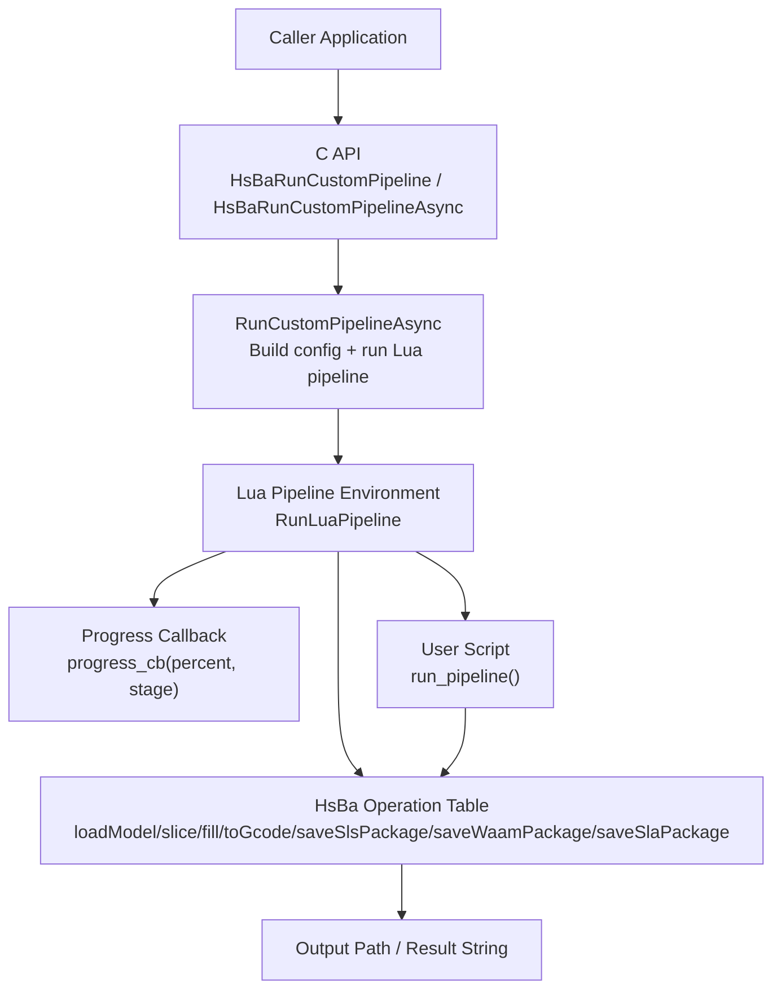
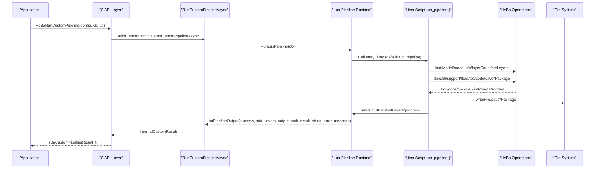
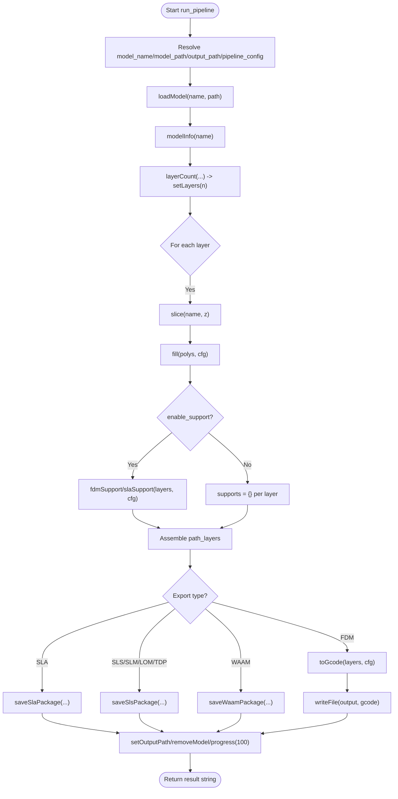
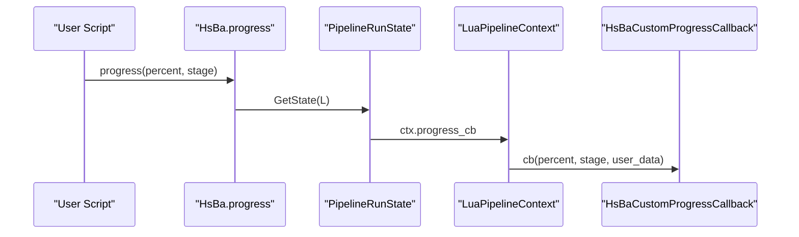
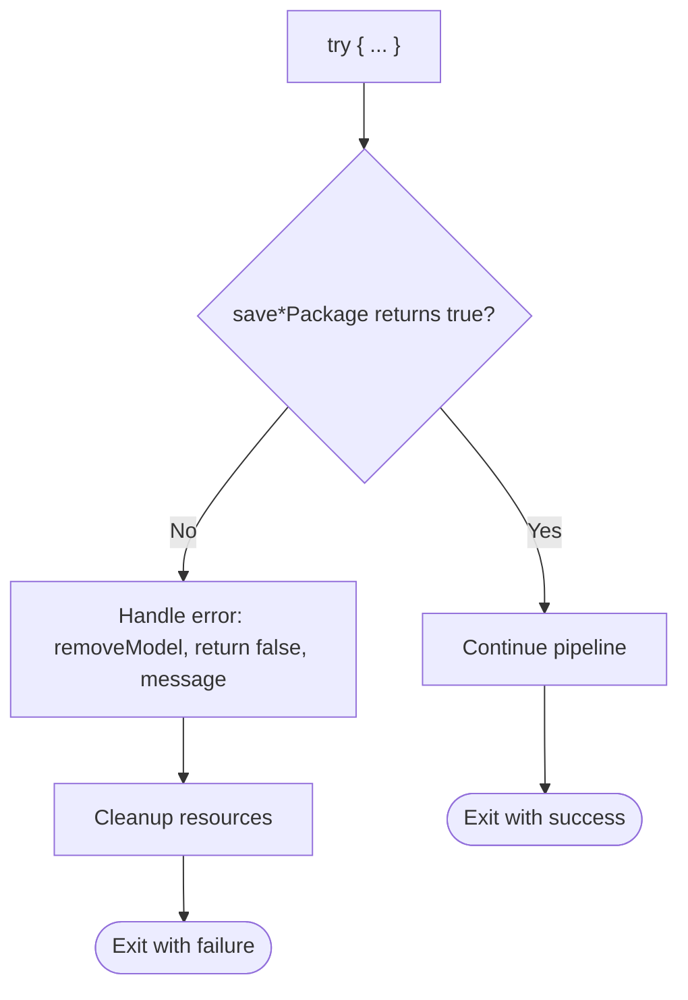
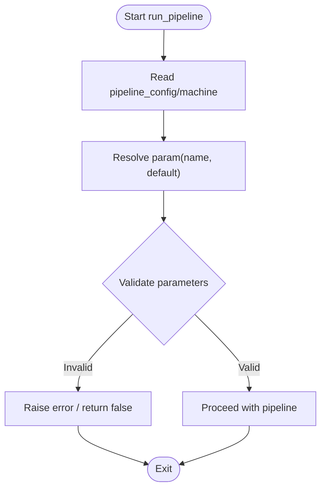
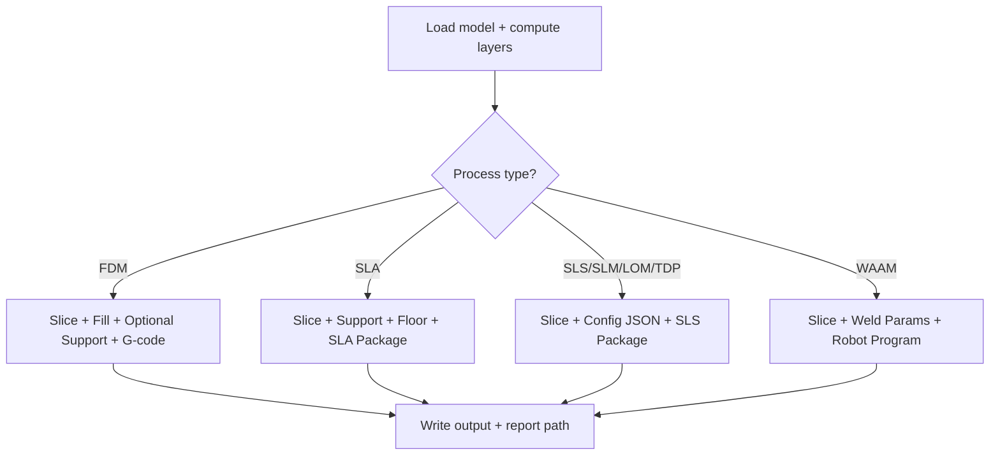
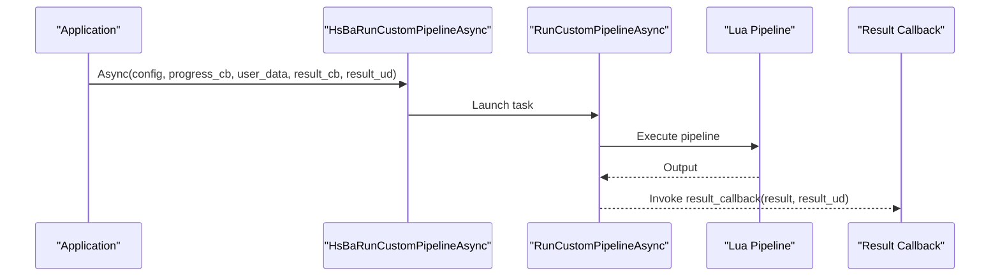
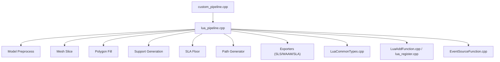

# Custom Pipeline Development / 自定义流水线开发

<cite>
**Referenced Files in This Document**   
- [lua_pipeline.cpp](file://LibHsBaSlicer/Extends/lua_pipeline.cpp)
- [custom_pipeline.cpp](file://DllHsBaSlicer/custom_pipeline.cpp)
- [lua_register.cpp](file://DllHsBaSlicer/lua_register.cpp)
- [LuaAddFunction.cpp](file://LibHsBaSlicer/Extends/LuaAddFunction.cpp)
- [EventSourceFunction.cpp](file://LibHsBaSlicer/Extends/EventSourceFunction.cpp)
- [LuaCommonTypes.cpp](file://LibHsBaSlicer/Extends/LuaCommonTypes.cpp)
- [hsba_pipeline.d.lua](file://types/hsba_pipeline.d.lua)
- [lua_pipeline_api.md](file://docs/en/lua_pipeline_api.md)
- [my_fdm_pipeline.lua](file://samples/Custom/scripts/my_fdm_pipeline.lua)
- [my_sla_pipeline.lua](file://samples/Custom/scripts/my_sla_pipeline.lua)
- [my_slm_pipeline.lua](file://samples/Custom/scripts/my_slm_pipeline.lua)
- [my_sls_pipeline.lua](file://samples/Custom/scripts/my_sls_pipeline.lua)
- [my_tdp_pipeline.lua](file://samples/Custom/scripts/my_tdp_pipeline.lua)
- [my_waam_pipeline.lua](file://samples/Custom/scripts/my_waam_pipeline.lua)
- [my_lom_pipeline.lua](file://samples/Custom/scripts/my_lom_pipeline.lua)
</cite>

## Table of Contents
1. [Introduction](#introduction)
2. [Project Structure](#project-structure)
3. [Core Components](#core-components)
4. [Architecture Overview](#architecture-overview)
5. [Detailed Component Analysis](#detailed-component-analysis)
6. [Dependency Analysis](#dependency-analysis)
7. [Performance Considerations](#performance-considerations)
8. [Troubleshooting Guide](#troubleshooting-guide)
9. [Conclusion](#conclusion)
10. [Appendices](#appendices)

## Introduction
This document explains how to develop custom pipelines with HsBaSlicer’s Lua scripting system. It covers the required `run_pipeline` entry function, script organization patterns, event handling through `HsBa.progress()`, error handling strategies, logging practices, and the complete pipeline execution flow from model loading to final output. It also documents configuration management via `pipeline_config`, parameter validation, conditional logic, branching workflows, parallel processing options, and provides comprehensive examples for FDM, SLA, SLM, SLS, LOM, TDP, and WAAM processes. Finally, it includes debugging techniques, testing strategies, performance optimization tips, and common pitfalls.

## Project Structure
The custom pipeline capability is implemented across three layers:
- C++ API layer: exposes a stable C ABI for running custom pipelines and forwarding progress callbacks.
- Lua runtime layer: builds the Lua environment, registers the `HsBa` operation table, and executes user scripts.
- User scripts: fully Lua-driven process pipelines under `samples/Custom/scripts/`.

**Diagram sources**
- [custom_pipeline.cpp:117-163](file://DllHsBaSlicer/custom_pipeline.cpp#L117-L163)
- [lua_pipeline.cpp:228-256](file://LibHsBaSlicer/Extends/lua_pipeline.cpp#L228-L256)

**Section sources**
- [custom_pipeline.cpp:117-163](file://DllHsBaSlicer/custom_pipeline.cpp#L117-L163)
- [lua_pipeline.cpp:228-256](file://LibHsBaSlicer/Extends/lua_pipeline.cpp#L228-L256)

## Core Components
- Custom pipeline C ABI:
  - `HsBaCreateDefaultCustomConfig`, `HsBaRunCustomPipeline`, `HsBaRunCustomPipelineAsync`, `HsBaFreeCustomPipelineResult`.
  - Accepts script file or inline source, entry function name, JSON config, model metadata, default output path, and progress callback.
- Lua pipeline runtime:
  - Builds `LuaPipelineContext`, injects globals (`pipeline_config`, `model_name`, `model_path`, `output_path`, `pipeline_entry`), and executes the user-defined entry function.
  - Exposes the `HsBa` operation table for model management, slicing, fill, support, floor, G-code generation, packaging, and export.
- Shared libraries and types:
  - Geometry conversions, polygon operations, fill algorithms, support generators, path optimizers, compression, database adapters, and parameter persistence are available in both custom pipeline and built-in stage environments.

Key responsibilities:
- C++ side: lifecycle, coroutine-based async execution, progress forwarding, result marshalling.
- Lua side: orchestration of steps, conditional logic, branching, and output generation.

**Section sources**
- [custom_pipeline.cpp:23-44](file://DllHsBaSlicer/custom_pipeline.cpp#L23-L44)
- [custom_pipeline.cpp:117-163](file://DllHsBaSlicer/custom_pipeline.cpp#L117-L163)
- [lua_pipeline.cpp:228-256](file://LibHsBaSlicer/Extends/lua_pipeline.cpp#L228-L256)
- [hsba_pipeline.d.lua:290-455](file://types/hsba_pipeline.d.lua#L290-L455)

## Architecture Overview
The end-to-end flow for a custom pipeline is:

**Diagram sources**
- [custom_pipeline.cpp:117-163](file://DllHsBaSlicer/custom_pipeline.cpp#L117-L163)
- [lua_pipeline.cpp:228-256](file://LibHsBaSlicer/Extends/lua_pipeline.cpp#L228-L256)
- [lua_pipeline.cpp:401-460](file://LibHsBaSlicer/Extends/lua_pipeline.cpp#L401-L460)
- [lua_pipeline.cpp:480-508](file://LibHsBaSlicer/Extends/lua_pipeline.cpp#L480-L508)
- [lua_pipeline.cpp:512-556](file://LibHsBaSlicer/Extends/lua_pipeline.cpp#L512-L556)
- [lua_pipeline.cpp:622-691](file://LibHsBaSlicer/Extends/lua_pipeline.cpp#L622-L691)
- [lua_pipeline.cpp:697-727](file://LibHsBaSlicer/Extends/lua_pipeline.cpp#L697-L727)
- [lua_pipeline.cpp:735-787](file://LibHsBaSlicer/Extends/lua_pipeline.cpp#L735-L787)
- [lua_pipeline.cpp:789-800](file://LibHsBaSlicer/Extends/lua_pipeline.cpp#L789-L800)

## Detailed Component Analysis

### Custom Pipeline Entry Function and Execution Flow
- Entry function:
  - Default name is `run_pipeline`; can be overridden by `pipeline_entry`.
  - Return semantics: non-empty string → success with result text; `true` → success without text; `false`/`nil` or Lua error → failure.
- Execution:
  - C++ constructs `InternalCustomConfig`, initializes `LuaPipelineContext`, sets up progress callback, and calls `RunLuaPipeline`.
  - The Lua runtime injects context globals and executes the entry function.

**Diagram sources**
- [my_fdm_pipeline.lua:52-171](file://samples/Custom/scripts/my_fdm_pipeline.lua#L52-L171)
- [my_sla_pipeline.lua:27-104](file://samples/Custom/scripts/my_sla_pipeline.lua#L27-L104)
- [my_slm_pipeline.lua:22-93](file://samples/Custom/scripts/my_slm_pipeline.lua#L22-L93)
- [my_sls_pipeline.lua:30-101](file://samples/Custom/scripts/my_sls_pipeline.lua#L30-L101)
- [my_tdp_pipeline.lua:20-90](file://samples/Custom/scripts/my_tdp_pipeline.lua#L20-L90)
- [my_waam_pipeline.lua:22-93](file://samples/Custom/scripts/my_waam_pipeline.lua#L22-L93)
- [my_lom_pipeline.lua:19-91](file://samples/Custom/scripts/my_lom_pipeline.lua#L19-L91)

**Section sources**
- [custom_pipeline.cpp:117-163](file://DllHsBaSlicer/custom_pipeline.cpp#L117-L163)
- [hsba_pipeline.d.lua:469-487](file://types/hsba_pipeline.d.lua#L469-L487)
- [lua_pipeline_api.md:48-66](file://docs/en/lua_pipeline_api.md#L48-L66)

### Event Handling and Progress Reporting
- `HsBa.progress(percent, stage)` forwards to the C++ progress callback registered in `LuaPipelineContext`.
- The callback invokes the caller-provided `HsBaCustomProgressCallback` with percent and stage string.
- Scripts should call `progress` at major milestones: model load, slicing loop checkpoints, support/fill/export phases, and completion.

**Diagram sources**
- [lua_pipeline.cpp:228-239](file://LibHsBaSlicer/Extends/lua_pipeline.cpp#L228-L239)
- [custom_pipeline.cpp:143-149](file://DllHsBaSlicer/custom_pipeline.cpp#L143-L149)

**Section sources**
- [lua_pipeline.cpp:228-239](file://LibHsBaSlicer/Extends/lua_pipeline.cpp#L228-L239)
- [custom_pipeline.cpp:143-149](file://DllHsBaSlicer/custom_pipeline.cpp#L143-L149)

### Error Handling Strategies
- Lua errors:
  - Many `HsBa` functions raise Lua errors on invalid inputs or failures (e.g., missing model, failed file write).
  - Scripts should wrap critical sections with `pcall` to catch errors and return `false`/error messages.
- Return value checks:
  - Packaging functions like `saveSlsPackage`, `saveWaamPackage`, `saveSlaPackage` return boolean success; scripts must check and handle failures.
- C++ result mapping:
  - `RunCustomPipelineAsync` maps Lua output to `InternalCustomResult`, including `success`, `total_layers`, `output_path`, `result_string`, `error_message`, and elapsed time.

**Diagram sources**
- [lua_pipeline.cpp:275-288](file://LibHsBaSlicer/Extends/lua_pipeline.cpp#L275-L288)
- [lua_pipeline.cpp:697-727](file://LibHsBaSlicer/Extends/lua_pipeline.cpp#L697-L727)
- [lua_pipeline.cpp:735-787](file://LibHsBaSlicer/Extends/lua_pipeline.cpp#L735-L787)
- [lua_pipeline.cpp:789-800](file://LibHsBaSlicer/Extends/lua_pipeline.cpp#L789-L800)
- [custom_pipeline.cpp:151-163](file://DllHsBaSlicer/custom_pipeline.cpp#L151-L163)

**Section sources**
- [lua_pipeline.cpp:275-288](file://LibHsBaSlicer/Extends/lua_pipeline.cpp#L275-L288)
- [lua_pipeline.cpp:697-727](file://LibHsBaSlicer/Extends/lua_pipeline.cpp#L697-L727)
- [lua_pipeline.cpp:735-787](file://LibHsBaSlicer/Extends/lua_pipeline.cpp#L735-L787)
- [lua_pipeline.cpp:789-800](file://LibHsBaSlicer/Extends/lua_pipeline.cpp#L789-L800)
- [custom_pipeline.cpp:151-163](file://DllHsBaSlicer/custom_pipeline.cpp#L151-L163)

### Logging Capabilities
- Built-in logging facilities exist in the repository but are not exposed directly through the `HsBa` operation table.
- Recommended practice:
  - Use `print` for lightweight debug logs during development.
  - For production, log to external files using `HsBa.writeFile` or use application-level logging around the C API calls.
  - Avoid heavy logging inside tight loops to prevent I/O bottlenecks.

[No sources needed since this section provides general guidance]

### Configuration Management and Parameter Validation
- Context globals:
  - `pipeline_config`: JSON string passed from C++, used verbatim in outputs or parsed by scripts.
  - `machine`: optional prelude-defined table injected before the main script.
  - `model_name`, `model_path`, `output_path`, `pipeline_entry`.
- Parameter resolution pattern:
  - Prefer values from `machine` if present; otherwise fall back to defaults.
- Validation:
  - Validate numeric ranges (e.g., layer height > 0), required fields (e.g., output path), and enum-like strings (e.g., firmware).
  - Fail fast with clear error messages when validation fails.

**Diagram sources**
- [my_fdm_pipeline.lua:24-30](file://samples/Custom/scripts/my_fdm_pipeline.lua#L24-L30)
- [my_sla_pipeline.lua:20-25](file://samples/Custom/scripts/my_sla_pipeline.lua#L20-L25)
- [my_slm_pipeline.lua:15-20](file://samples/Custom/scripts/my_slm_pipeline.lua#L15-L20)
- [my_sls_pipeline.lua:22-28](file://samples/Custom/scripts/my_sls_pipeline.lua#L22-L28)
- [my_tdp_pipeline.lua:13-18](file://samples/Custom/scripts/my_tdp_pipeline.lua#L13-L18)
- [my_waam_pipeline.lua:15-20](file://samples/Custom/scripts/my_waam_pipeline.lua#L15-L20)
- [my_lom_pipeline.lua:12-17](file://samples/Custom/scripts/my_lom_pipeline.lua#L12-L17)

**Section sources**
- [hsba_pipeline.d.lua:469-487](file://types/hsba_pipeline.d.lua#L469-L487)
- [lua_pipeline_api.md:55-66](file://docs/en/lua_pipeline_api.md#L55-L66)

### Conditional Logic and Branching Workflows
- Examples:
  - FDM: conditionally enable support generation based on a parameter.
  - SLA: generate floor/raft only when needed; pack images and config into zip.
  - SLS/SLM/LOM/TDP: assemble process-specific config JSON and delegate packaging to export scripts.
  - WAAM: generate robot program with welding parameters and robot type.

**Diagram sources**
- [my_fdm_pipeline.lua:105-151](file://samples/Custom/scripts/my_fdm_pipeline.lua#L105-L151)
- [my_sla_pipeline.lua:54-91](file://samples/Custom/scripts/my_sla_pipeline.lua#L54-L91)
- [my_slm_pipeline.lua:55-81](file://samples/Custom/scripts/my_slm_pipeline.lua#L55-L81)
- [my_sls_pipeline.lua:64-89](file://samples/Custom/scripts/my_sls_pipeline.lua#L64-L89)
- [my_tdp_pipeline.lua:53-78](file://samples/Custom/scripts/my_tdp_pipeline.lua#L53-L78)
- [my_waam_pipeline.lua:56-81](file://samples/Custom/scripts/my_waam_pipeline.lua#L56-L81)
- [my_lom_pipeline.lua:52-79](file://samples/Custom/scripts/my_lom_pipeline.lua#L52-L79)

**Section sources**
- [my_fdm_pipeline.lua:105-151](file://samples/Custom/scripts/my_fdm_pipeline.lua#L105-L151)
- [my_sla_pipeline.lua:54-91](file://samples/Custom/scripts/my_sla_pipeline.lua#L54-L91)
- [my_slm_pipeline.lua:55-81](file://samples/Custom/scripts/my_slm_pipeline.lua#L55-L81)
- [my_sls_pipeline.lua:64-89](file://samples/Custom/scripts/my_sls_pipeline.lua#L64-L89)
- [my_tdp_pipeline.lua:53-78](file://samples/Custom/scripts/my_tdp_pipeline.lua#L53-L78)
- [my_waam_pipeline.lua:56-81](file://samples/Custom/scripts/my_waam_pipeline.lua#L56-L81)
- [my_lom_pipeline.lua:52-79](file://samples/Custom/scripts/my_lom_pipeline.lua#L52-L79)

### Parallel Processing Options
- The C API supports asynchronous execution:
  - `HsBaRunCustomPipelineAsync` runs the pipeline asynchronously and invokes a result callback upon completion.
- Within Lua scripts:
  - No explicit parallelism primitives are exposed; scripts should avoid blocking operations in tight loops and rely on C++-side concurrency where possible.
- Recommendations:
  - Batch expensive operations (e.g., image rendering, large file writes) outside hot loops.
  - Use asynchronous C API calls to run multiple pipelines concurrently at the application level.

**Diagram sources**
- [custom_pipeline.cpp:185-201](file://DllHsBaSlicer/custom_pipeline.cpp#L185-L201)

**Section sources**
- [custom_pipeline.cpp:185-201](file://DllHsBaSlicer/custom_pipeline.cpp#L185-L201)

### Modular Design Approaches
- Prelude scripts:
  - Use `pipeline_lua_source` to define shared helpers (e.g., `param(name, default)`) before loading the main script.
- Stage separation:
  - Keep model preprocessing, slicing, support/fill, and export logic in separate functions within the script for readability and testability.
- Reusable exports:
  - For powder-bed processes (SLS/SLM/LOM/TDP), reuse a single export script via `saveSlsPackage(script="scripts/my_sls_export.lua", func="export_sls")`.

**Section sources**
- [lua_pipeline_api.md:55-66](file://docs/en/lua_pipeline_api.md#L55-L66)
- [my_sls_pipeline.lua:80-89](file://samples/Custom/scripts/my_sls_pipeline.lua#L80-L89)
- [my_slm_pipeline.lua:72-81](file://samples/Custom/scripts/my_slm_pipeline.lua#L72-L81)
- [my_tdp_pipeline.lua:69-78](file://samples/Custom/scripts/my_tdp_pipeline.lua#L69-L78)
- [my_lom_pipeline.lua:70-79](file://samples/Custom/scripts/my_lom_pipeline.lua#L70-L79)

### Comprehensive Examples by Manufacturing Process

#### FDM (Fused Deposition Modeling)
- Steps:
  - Load model, compute layers, slice per layer, fill with configurable angle/spacing/borders, optionally generate supports, assemble path layers, generate G-code, write file, report output path.
- Key APIs:
  - `HsBa.loadModel`, `HsBa.modelInfo`, `HsBa.layerCount`, `HsBa.layerZ`, `HsBa.slice`, `HsBa.fill`, `HsBa.fdmSupport`, `HsBa.toGcode`, `HsBa.writeFile`, `HsBa.setProgress`, `HsBa.setOutputPath`.

**Section sources**
- [my_fdm_pipeline.lua:52-171](file://samples/Custom/scripts/my_fdm_pipeline.lua#L52-L171)
- [lua_pipeline.cpp:480-508](file://LibHsBaSlicer/Extends/lua_pipeline.cpp#L480-L508)
- [lua_pipeline.cpp:512-525](file://LibHsBaSlicer/Extends/lua_pipeline.cpp#L512-L525)
- [lua_pipeline.cpp:622-691](file://LibHsBaSlicer/Extends/lua_pipeline.cpp#L622-L691)

#### SLA (Stereolithography)
- Steps:
  - Load model, compute layers, slice per layer, generate SLA supports, generate floor/raft, render and package images/config into zip.
- Key APIs:
  - `HsBa.slaSupport`, `HsBa.floor`, `HsBa.saveSlaPackage`.

**Section sources**
- [my_sla_pipeline.lua:27-104](file://samples/Custom/scripts/my_sla_pipeline.lua#L27-L104)
- [lua_pipeline.cpp:528-540](file://LibHsBaSlicer/Extends/lua_pipeline.cpp#L528-L540)
- [lua_pipeline.cpp:543-556](file://LibHsBaSlicer/Extends/lua_pipeline.cpp#L543-L556)
- [lua_pipeline.cpp:789-800](file://LibHsBaSlicer/Extends/lua_pipeline.cpp#L789-L800)

#### SLM (Selective Laser Melting)
- Steps:
  - Load model, compute layers, slice per layer, assemble metal process config JSON, package via SLS-style zip with export script.
- Key APIs:
  - `HsBa.saveSlsPackage`.

**Section sources**
- [my_slm_pipeline.lua:22-93](file://samples/Custom/scripts/my_slm_pipeline.lua#L22-L93)
- [lua_pipeline.cpp:697-727](file://LibHsBaSlicer/Extends/lua_pipeline.cpp#L697-L727)

#### SLS (Selective Laser Sintering)
- Steps:
  - Load model, compute layers, slice per layer, assemble laser/scan/bed config JSON, package via SLS-style zip with export script.
- Key APIs:
  - `HsBa.saveSlsPackage`.

**Section sources**
- [my_sls_pipeline.lua:30-101](file://samples/Custom/scripts/my_sls_pipeline.lua#L30-L101)
- [lua_pipeline.cpp:697-727](file://LibHsBaSlicer/Extends/lua_pipeline.cpp#L697-L727)

#### LOM (Laminated Object Manufacturing)
- Steps:
  - Load model, compute layers, slice per layer, assemble cutting/bonding config JSON, package via SLS-style zip with export script.
- Key APIs:
  - `HsBa.saveSlsPackage`.

**Section sources**
- [my_lom_pipeline.lua:19-91](file://samples/Custom/scripts/my_lom_pipeline.lua#L19-L91)
- [lua_pipeline.cpp:697-727](file://LibHsBaSlicer/Extends/lua_pipeline.cpp#L697-L727)

#### TDP/3DP (Thermoplastic Deposition / Binder Jetting)
- Steps:
  - Load model, compute layers, slice per layer, assemble binder/curing/bed config JSON, package via SLS-style zip with export script.
- Key APIs:
  - `HsBa.saveSlsPackage`.

**Section sources**
- [my_tdp_pipeline.lua:20-90](file://samples/Custom/scripts/my_tdp_pipeline.lua#L20-L90)
- [lua_pipeline.cpp:697-727](file://LibHsBaSlicer/Extends/lua_pipeline.cpp#L697-L727)

#### WAAM (Wire Arc Additive Manufacturing)
- Steps:
  - Load model, compute layers, slice per layer, assemble welding parameters and robot type, generate robot program via `saveWaamPackage`.
- Key APIs:
  - `HsBa.saveWaamPackage`.

**Section sources**
- [my_waam_pipeline.lua:22-93](file://samples/Custom/scripts/my_waam_pipeline.lua#L22-L93)
- [lua_pipeline.cpp:735-787](file://LibHsBaSlicer/Extends/lua_pipeline.cpp#L735-L787)

## Dependency Analysis
The custom pipeline depends on several subsystems:

**Diagram sources**
- [custom_pipeline.cpp:117-163](file://DllHsBaSlicer/custom_pipeline.cpp#L117-L163)
- [lua_pipeline.cpp:17-39](file://LibHsBaSlicer/Extends/lua_pipeline.cpp#L17-L39)
- [LuaCommonTypes.cpp:469-531](file://LibHsBaSlicer/Extends/LuaCommonTypes.cpp#L469-L531)
- [LuaAddFunction.cpp:21-49](file://LibHsBaSlicer/Extends/LuaAddFunction.cpp#L21-L49)
- [lua_register.cpp:11-41](file://DllHsBaSlicer/lua_register.cpp#L11-L41)
- [EventSourceFunction.cpp:17-32](file://LibHsBaSlicer/Extends/EventSourceFunction.cpp#L17-L32)

**Section sources**
- [lua_pipeline.cpp:17-39](file://LibHsBaSlicer/Extends/lua_pipeline.cpp#L17-L39)
- [LuaCommonTypes.cpp:469-531](file://LibHsBaSlicer/Extends/LuaCommonTypes.cpp#L469-L531)
- [LuaAddFunction.cpp:21-49](file://LibHsBaSlicer/Extends/LuaAddFunction.cpp#L21-L49)
- [lua_register.cpp:11-41](file://DllHsBaSlicer/lua_register.cpp#L11-L41)
- [EventSourceFunction.cpp:17-32](file://LibHsBaSlicer/Extends/EventSourceFunction.cpp#L17-L32)

## Performance Considerations
- Minimize I/O in tight loops:
  - Batch file writes and avoid frequent `writeFile` calls inside slicing loops.
- Efficient slicing and filling:
  - Use integerized polygons for boolean/fill operations; convert back to float only when necessary.
- Avoid unnecessary model transformations:
  - Apply translate/rotate/scale once after loading, not per layer.
- Leverage asynchronous execution:
  - Run multiple pipelines concurrently using `HsBaRunCustomPipelineAsync`.
- Optimize support and fill parameters:
  - Tune spacing, density, and angles to balance quality and speed.

[No sources needed since this section provides general guidance]

## Troubleshooting Guide
Common issues and resolutions:
- Model not found:
  - Ensure `loadModel` succeeded before calling `modelInfo` or `slice`.
- Invalid layer height:
  - Validate `layerHeight > 0`; `layerCount` will return zero or error if invalid.
- File write failures:
  - Check permissions and paths; `writeFile` raises Lua errors on failure.
- Packaging failures:
  - Verify required fields (`output`, `script`) for `saveSlsPackage`; check `func` names match export scripts.
- Progress not updating:
  - Confirm progress callback is registered and `HsBa.progress` is called at key stages.

**Section sources**
- [lua_pipeline.cpp:293-308](file://LibHsBaSlicer/Extends/lua_pipeline.cpp#L293-L308)
- [lua_pipeline.cpp:401-422](file://LibHsBaSlicer/Extends/lua_pipeline.cpp#L401-L422)
- [lua_pipeline.cpp:275-288](file://LibHsBaSlicer/Extends/lua_pipeline.cpp#L275-L288)
- [lua_pipeline.cpp:697-727](file://LibHsBaSlicer/Extends/lua_pipeline.cpp#L697-L727)
- [lua_pipeline.cpp:228-239](file://LibHsBaSlicer/Extends/lua_pipeline.cpp#L228-L239)

## Conclusion
HsBaSlicer’s custom pipeline system enables full control over manufacturing workflows through Lua scripts. By leveraging the `HsBa` operation table, context globals, and packaging/export APIs, developers can implement robust, modular, and efficient pipelines for diverse processes such as FDM, SLA, SLM, SLS, LOM, TDP, and WAAM. Proper error handling, configuration validation, and performance tuning ensure reliable and scalable results.

[No sources needed since this section summarizes without analyzing specific files]

## Appendices

### API Reference Summary
- Custom pipeline environment:
  - Entry function: `run_pipeline` (overridable via `pipeline_entry`).
  - Context globals: `pipeline_config`, `model_name`, `model_path`, `output_path`.
- Control and IO:
  - `HsBa.progress`, `HsBa.setLayers`, `HsBa.setOutputPath`, `HsBa.readFile`, `HsBa.writeFile`.
- Model management:
  - `HsBa.loadModel`, `HsBa.modelInfo`, `HsBa.translateModel`, `HsBa.rotateModel`, `HsBa.scaleModel`, `HsBa.removeModel`, `HsBa.modelNames`.
- Slicing:
  - `HsBa.layerCount`, `HsBa.layerZ`, `HsBa.slice`, `HsBa.sliceUnsafe`.
- Fill and support:
  - `HsBa.fill`, `HsBa.fdmSupport`, `HsBa.slaSupport`, `HsBa.floor`.
- Path and G-code:
  - `HsBa.spiralize`, `HsBa.toGcode`.
- Packaging and export:
  - `HsBa.saveSlsPackage`, `HsBa.saveWaamPackage`, `HsBa.saveSlaPackage`, `HsBa.renderImage`.

**Section sources**
- [hsba_pipeline.d.lua:290-455](file://types/hsba_pipeline.d.lua#L290-L455)
- [lua_pipeline_api.md:67-132](file://docs/en/lua_pipeline_api.md#L67-L132)