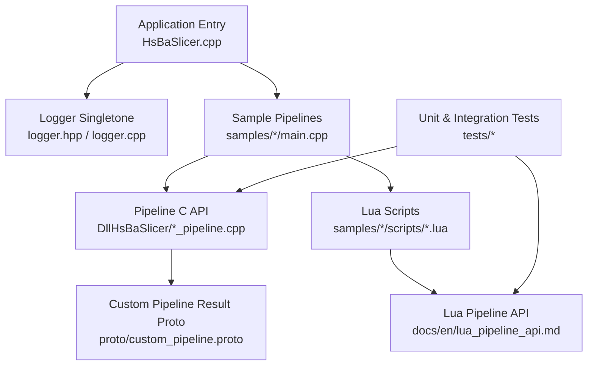
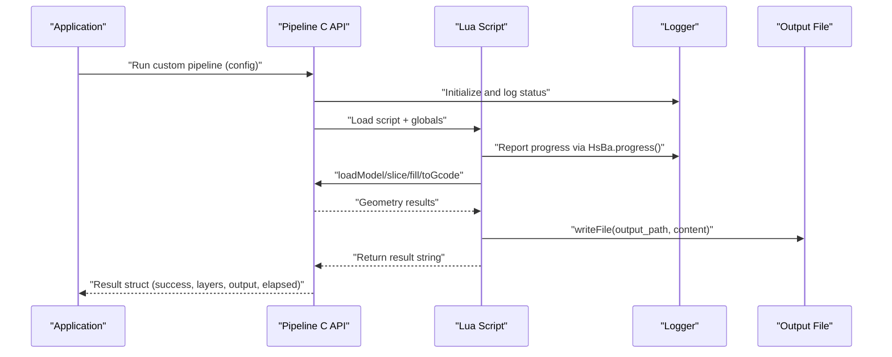
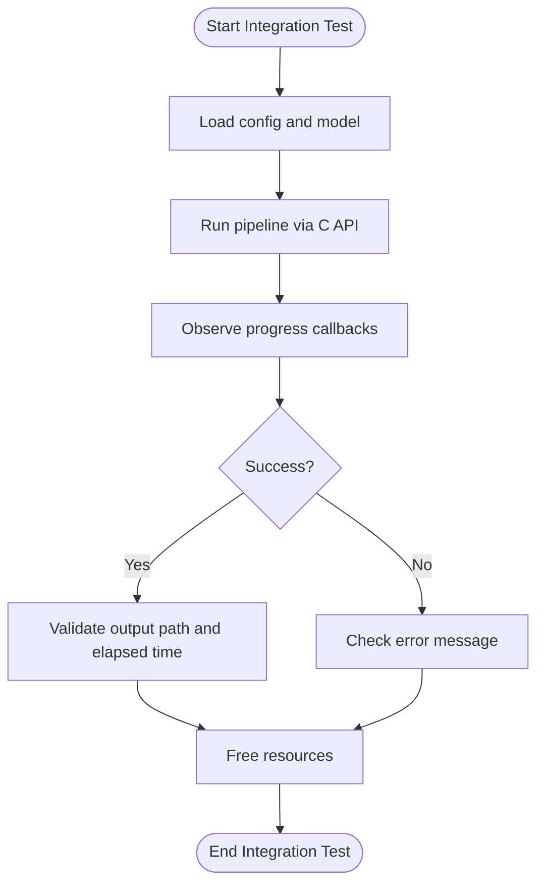
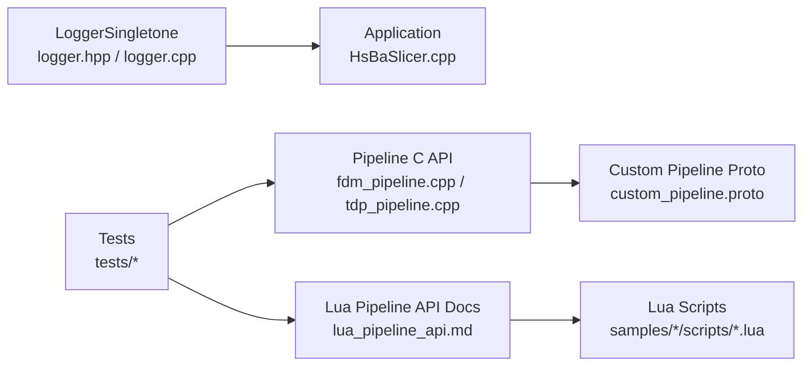

# Debugging & Testing Strategies / 调试与测试策略

<cite>
**Referenced Files in This Document**
- [README.md](file://README.md)
- [logger.hpp](file://logger/logger.hpp)
- [logger.cpp](file://logger/logger.cpp)
- [lua_pipeline_api.md](file://docs/en/lua_pipeline_api.md)
- [my_fdm_pipeline.lua](file://samples/Custom/scripts/my_fdm_pipeline.lua)
- [my_infill.lua](file://samples/FDM/scripts/my_infil.lua)
- [HsBaSlicer.cpp](file://HsBaSlicer/HsBaSlicer.cpp)
- [custom_pipeline.proto](file://proto/custom_pipeline.proto)
- [fdm_pipeline.cpp](file://DllHsBaSlicer/fdm_pipeline.cpp)
- [tdp_pipeline.cpp](file://DllHsBaSlicer/tdp_pipeline.cpp)
- [main.cpp](file://samples/Custom/main.cpp)
- [main.cpp](file://samples/FDM/main.cpp)
- [CMakeLists.txt](file://tests/CMakeLists.txt)
- [lua_polygon_operations_test.cpp](file://tests/PolygonFill/lua_polygon_operations_test.cpp)
- [support_test.cpp](file://tests/Support/support_test.cpp)
- [path_generator_test.cpp](file://tests/PathsOut/path_generator_test.cpp)
- [memory_pool.hpp](file://base/memory_pool.hpp)
</cite>

## Table of Contents
1. [Introduction](#introduction)
2. [Project Structure](#project-structure)
3. [Core Components](#core-components)
4. [Architecture Overview](#architecture-overview)
5. [Detailed Component Analysis](#detailed-component-analysis)
6. [Dependency Analysis](#dependency-analysis)
7. [Performance Considerations](#performance-considerations)
8. [Troubleshooting Guide](#troubleshooting-guide)
9. [Conclusion](#conclusion)
10. [Appendices](#appendices)

## Introduction
This document explains how to debug and test custom pipeline scripts in HsBaSlicer. It focuses on:
- Practical debugging techniques for Lua-driven pipelines, including print usage, log file analysis, and interactive testing.
- Testing strategies for pipeline components, unit testing patterns for custom algorithms, and integration testing across C++ and Lua layers.
- Performance profiling methods, memory leak detection, and bottleneck identification.
- Examples of test cases, mock data creation, and automated testing using the repository’s existing Boost-based tests and CTest configuration.

The guidance is grounded in the repository’s logging system, Lua pipeline API documentation, sample scripts, and test suite.

## Project Structure
HsBaSlicer provides both a C++ slicing core and a flexible Lua scripting layer. Custom pipelines can be fully driven by Lua or can replace specific built-in stages such as support, fill, floor, or export. The project also includes:
- A cross-platform logger with leveled output and optional file logging.
- Sample Lua scripts demonstrating full custom pipelines and per-stage hooks.
- A comprehensive test suite under `tests/` that exercises geometry operations, support generation, path generation, and more.

**Diagram sources**
- [HsBaSlicer.cpp:280-304](file://HsBaSlicer/HsBaSlicer.cpp#L280-L304)
- [logger.hpp:35-122](file://logger/logger.hpp#L35-L122)
- [logger.cpp:136-222](file://logger/logger.cpp#L136-L222)
- [custom_pipeline.proto:23-30](file://proto/custom_pipeline.proto#L23-L30)
- [lua_pipeline_api.md:19-28](file://docs/en/lua_pipeline_api.md#L19-L28)

**Section sources**
- [README.md:21-39](file://README.md#L21-L39)
- [lua_pipeline_api.md:19-28](file://docs/en/lua_pipeline_api.md#L19-L28)

## Core Components
For debugging and testing custom pipelines, the most relevant components are:
- Logging subsystem: thread-safe singleton logger with leveled output and optional file logging.
- Lua pipeline API: the operation table and environment available inside scripts.
- Sample scripts: end-to-end examples of custom FDM, SLS, SLA, LOM, SLM, TDP, and WAAM pipelines.
- Test suite: Boost-based unit tests and CTest registration for geometry, support, and path generation.

Key responsibilities:
- Logger: centralizes log levels, source location, console/file output, and platform-specific backends.
- Lua API: exposes model management, slicing, fill, support, G-code generation, packaging, and utilities.
- Samples: demonstrate progress reporting, parameter injection, and result handling.
- Tests: validate Lua bindings, support generators, and path generation logic.

**Section sources**
- [logger.hpp:35-122](file://logger/logger.hpp#L35-L122)
- [lua_pipeline_api.md:48-133](file://docs/en/lua_pipeline_api.md#L48-L133)
- [my_fdm_pipeline.lua:52-171](file://samples/Custom/scripts/my_fdm_pipeline.lua#L52-L171)
- [CMakeLists.txt:623-676](file://tests/CMakeLists.txt#L623-L676)

## Architecture Overview
The custom pipeline execution flow connects application entry points, C++ pipeline APIs, Lua scripts, and the logging subsystem. Results are reported through structured fields, including success, layer count, output path, elapsed time, and error messages.

**Diagram sources**
- [HsBaSlicer.cpp:280-304](file://HsBaSlicer/HsBaSlicer.cpp#L280-L304)
- [logger.hpp:35-122](file://logger/logger.hpp#L35-L122)
- [lua_pipeline_api.md:48-133](file://docs/en/lua_pipeline_api.md#L48-L133)
- [custom_pipeline.proto:23-30](file://proto/custom_pipeline.proto#L23-L30)

## Detailed Component Analysis

### Debugging Techniques for Custom Pipelines
- Print statements in Lua:
  - Use `print(...)` in scripts to emit diagnostic text during development.
  - Example usage appears in multiple sample scripts for model info and export warnings.
- Log file analysis:
  - The logger reads `logcfg.ini`, supports configurable log level and file path, and writes to console/file depending on build and configuration.
  - In desktop builds, Boost.Log is used; on Android/iOS, kernel/system logs are used.
- Interactive debugging approaches:
  - Run sample applications from `samples/*/main.cpp` to exercise pipelines interactively.
  - Inspect progress callbacks and result structures returned by C API calls.

Recommended workflow:
1. Add targeted `print(...)` calls in your Lua script around critical steps (model load, slice, fill, support, G-code generation).
2. Enable file logging via `logcfg.ini` and inspect timestamps, severity, and source locations.
3. Use sample main programs to run your script with controlled inputs and observe progress and outputs.

**Section sources**
- [my_fdm_pipeline.lua:65-171](file://samples/Custom/scripts/my_fdm_pipeline.lua#L65-L171)
- [logger.cpp:136-222](file://logger/logger.cpp#L136-L222)
- [HsBaSlicer.cpp:280-304](file://HsBaSlicer/HsBaSlicer.cpp#L280-L304)

### Testing Strategies for Pipeline Components
- Unit testing patterns:
  - Geometry operations and Lua bindings are tested in `tests/PolygonFill/lua_polygon_operations_test.cpp`.
  - Support generators and Lua support bindings are covered in `tests/Support/support_test.cpp`.
  - Path generation and G-code conversion are validated in `tests/PathsOut/path_generator_test.cpp`.
- Integration testing:
  - End-to-end samples in `samples/Custom/main.cpp` and `samples/FDM/main.cpp` demonstrate running pipelines with real models and parameters.
  - CTest entries in `tests/CMakeLists.txt` register test targets and optionally run them after build.

Patterns observed:
- Create small Lua states, register required libraries, execute scripts, and assert outcomes.
- Validate both successful paths and error branches using `pcall` and assertions.
- Generate temporary files for dumps and verify their contents.

**Section sources**
- [lua_polygon_operations_test.cpp:1-192](file://tests/PolygonFill/lua_polygon_operations_test.cpp#L1-L192)
- [support_test.cpp:1-471](file://tests/Support/support_test.cpp#L1-L471)
- [path_generator_test.cpp:1-122](file://tests/PathsOut/path_generator_test.cpp#L1-L122)
- [main.cpp](file://samples/Custom/main.cpp)
- [main.cpp](file://samples/FDM/main.cpp)
- [CMakeLists.txt:623-676](file://tests/CMakeLists.txt#L623-L676)

### Custom Algorithm Unit Testing Patterns
When writing custom algorithms exposed to Lua:
- Isolate algorithm logic into pure functions where possible.
- Provide Lua wrappers that accept polygon tables and return polygon tables.
- Write tests that:
  - Construct minimal polygon inputs.
  - Call the Lua wrapper.
  - Assert area, topology, or structural properties of the output.

Example pattern references:
- Boolean/hull/area/factory tests in `lua_polygon_operations_test.cpp`.
- Support generator tests in `support_test.cpp` covering plane/tree/honeycomb/SLA modes and Lua bindings.

**Section sources**
- [lua_polygon_operations_test.cpp:122-192](file://tests/PolygonFill/lua_polygon_operations_test.cpp#L122-L192)
- [support_test.cpp:227-471](file://tests/Support/support_test.cpp#L227-L471)

### Integration Testing Approaches
Integration tests should cover:
- Full pipeline runs from model load to output write.
- Progress callback invocation and result structure validation.
- Cross-layer interactions between C++ pipeline APIs and Lua scripts.

References:
- Custom pipeline proto defines result fields including success, total_layers, output_path, result_string, error_message, and elapsed_seconds.
- Sample main programs construct configs, call pipeline APIs, handle progress, and free results.

**Diagram sources**
- [custom_pipeline.proto:23-30](file://proto/custom_pipeline.proto#L23-L30)
- [main.cpp](file://samples/Custom/main.cpp)
- [main.cpp](file://samples/FDM/main.cpp)

**Section sources**
- [custom_pipeline.proto:23-30](file://proto/custom_pipeline.proto#L23-L30)
- [main.cpp](file://samples/Custom/main.cpp)
- [main.cpp](file://samples/FDM/main.cpp)

### Mock Data Creation and Test Inputs
Common mock data patterns:
- Square polygons for simple overhang and support tests.
- Small rectangles/circles for boolean and hull operations.
- Temporary files for Lua script loading and dump verification.

Examples:
- `support_test.cpp` constructs square polygons and validates support generation.
- `lua_polygon_operations_test.cpp` creates rectangles, circles, and regular polygons, then asserts areas and boolean results.

**Section sources**
- [support_test.cpp:20-34](file://tests/Support/support_test.cpp#L20-L34)
- [lua_polygon_operations_test.cpp:30-43](file://tests/PolygonFill/lua_polygon_operations_test.cpp#L30-L43)

### Automated Testing Framework Usage
- The test suite uses Boost.Test with included headers.
- CMake registers each test target and enables CTest.
- Optional post-build commands run tests automatically when configured.

Practical steps:
- Build with CMake and enable testing.
- Run individual tests by name using CTest.
- Inspect test output for Lua errors and assertion failures.

**Section sources**
- [CMakeLists.txt:623-676](file://tests/CMakeLists.txt#L623-L676)

## Dependency Analysis
The following diagram shows key dependencies among logging, pipeline APIs, Lua scripts, and tests.

**Diagram sources**
- [logger.hpp:35-122](file://logger/logger.hpp#L35-L122)
- [logger.cpp:136-222](file://logger/logger.cpp#L136-L222)
- [fdm_pipeline.cpp:184-221](file://DllHsBaSlicer/fdm_pipeline.cpp#L184-L221)
- [tdp_pipeline.cpp:302-341](file://DllHsBaSlicer/tdp_pipeline.cpp#L302-L341)
- [custom_pipeline.proto:23-30](file://proto/custom_pipeline.proto#L23-L30)
- [lua_pipeline_api.md:48-133](file://docs/en/lua_pipeline_api.md#L48-L133)

**Section sources**
- [fdm_pipeline.cpp:184-221](file://DllHsBaSlicer/fdm_pipeline.cpp#L184-L221)
- [tdp_pipeline.cpp:302-341](file://DllHsBaSlicer/tdp_pipeline.cpp#L302-L341)
- [custom_pipeline.proto:23-30](file://proto/custom_pipeline.proto#L23-L30)

## Performance Considerations
- Profiling and timing:
  - Pipeline results include `elapsed_seconds`; use this field to measure end-to-end performance.
  - For deeper profiling, integrate platform profilers (e.g., Visual Studio profiler, perf, Instruments) around pipeline calls.
- Memory management:
  - The codebase includes memory pool utilities (`MemoryPool`) designed for frequent allocations of same-size objects.
  - Use pools for hot-path data structures to reduce fragmentation and allocation overhead.
- Bottleneck identification:
  - Profile Lua-heavy stages (slice/fill/support) and C++ geometry operations separately.
  - Use log levels to throttle verbose output during performance runs.

Recommendations:
- Wrap pipeline runs with timers and record `elapsed_seconds`.
- Prefer memory pools for large intermediate polygon sets if you extend the pipeline.
- Reduce I/O in tight loops; batch writes and avoid excessive file operations inside per-layer iterations.

**Section sources**
- [custom_pipeline.proto:23-30](file://proto/custom_pipeline.proto#L23-L30)
- [memory_pool.hpp:149-311](file://base/memory_pool.hpp#L149-L311)

## Troubleshooting Guide
Common issues and resolutions:
- Lua script errors:
  - Use `print(...)` to isolate failing steps.
  - Validate polygon types and coordinate units; remember integerization semantics for certain operations.
- Missing or invalid configuration:
  - Ensure `logcfg.ini` exists and contains valid keys; otherwise defaults apply.
  - Verify pipeline config fields match expected types and enums.
- Output not written:
  - Confirm `output_path` is set and writable.
  - Check file permissions and disk space.
- Asynchronous pipeline completion:
  - Ensure callbacks are invoked and result structures are freed.

Logging tips:
- Use `_log_info`, `_log_warning`, `_log_error` literals for concise logging with source location.
- On desktop, Boost.Log writes to console/file; on Android/iOS, kernel/system logs are used.

**Section sources**
- [logger.hpp:123-192](file://logger/logger.hpp#L123-L192)
- [logger.cpp:242-343](file://logger/logger.cpp#L242-L343)
- [lua_pipeline_api.md:67-133](file://docs/en/lua_pipeline_api.md#L67-L133)

## Conclusion
Debugging and testing custom pipelines in HsBaSlicer combines practical Lua diagnostics, robust C++ logging, and a mature test suite. By leveraging print statements, log files, sample scripts, and the existing Boost-based tests, developers can reliably validate both algorithmic correctness and end-to-end pipeline behavior. Performance tuning should focus on timing measurements, memory pooling, and targeted profiling of geometry-heavy stages.

## Appendices

### Quick Reference: Lua Pipeline API for Debugging
- Control & IO: `HsBa.progress`, `HsBa.setLayers`, `HsBa.setOutputPath`, `HsBa.readFile`, `HsBa.writeFile`.
- Model management: `HsBa.loadModel`, `HsBa.modelInfo`, `HsBa.removeModel`.
- Slicing & fill: `HsBa.layerCount`, `HsBa.layerZ`, `HsBa.slice`, `HsBa.fill`.
- Support & floor: `HsBa.fdmSupport`, `HsBa.slaSupport`, `HsBa.floor`.
- Path & G-code: `HsBa.spiralize`, `HsBa.toGcode`.
- Packaging: `HsBa.saveSlsPackage`, `HsBa.saveWaamPackage`, `HsBa.saveSlaPackage`.

**Section sources**
- [lua_pipeline_api.md:67-133](file://docs/en/lua_pipeline_api.md#L67-L133)