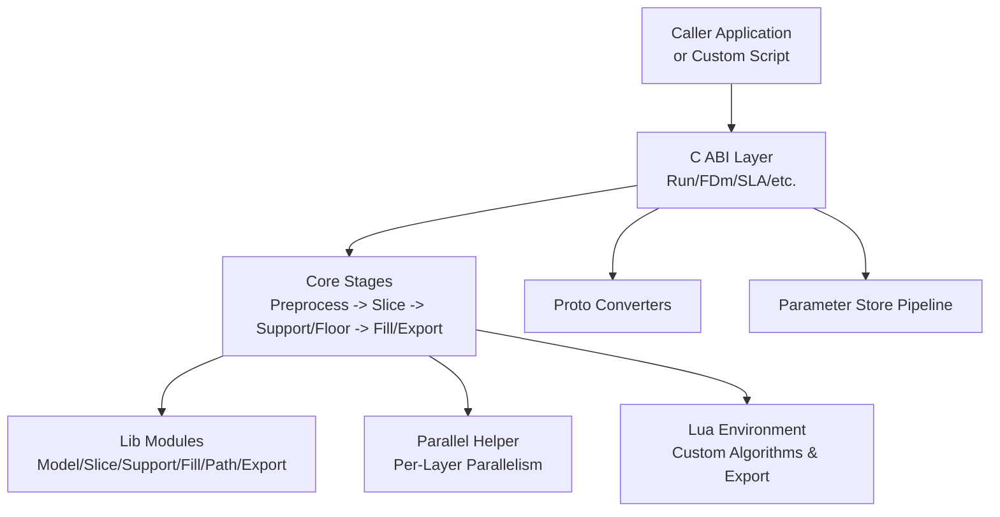
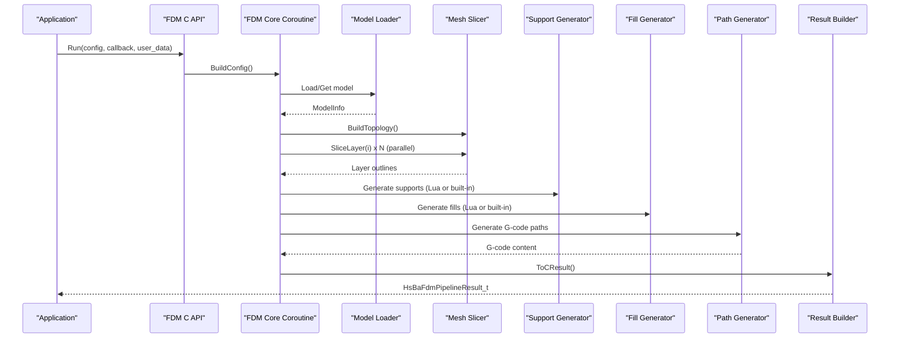
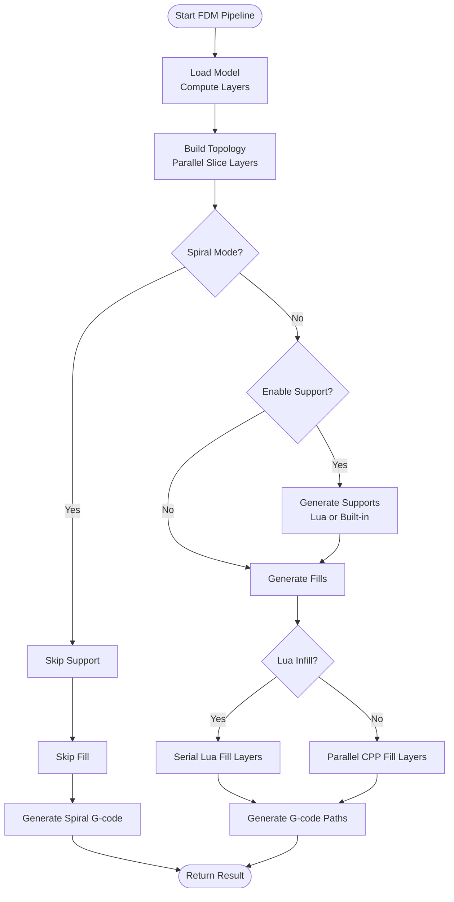
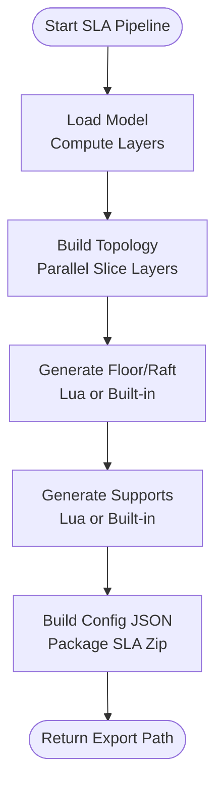
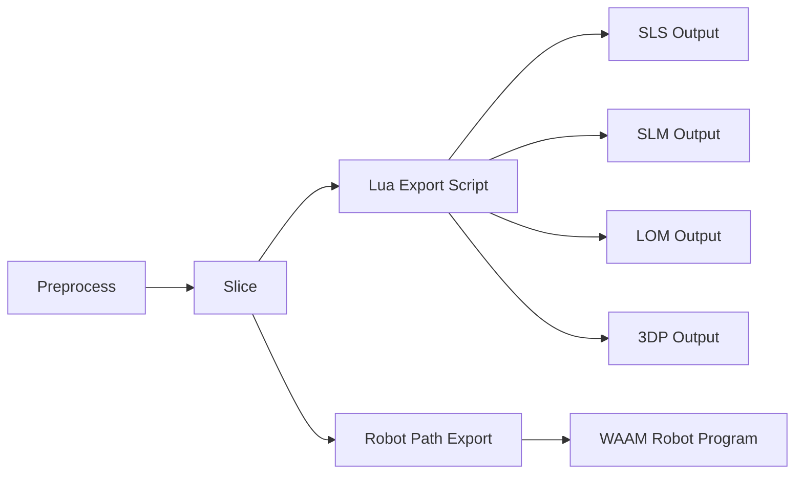
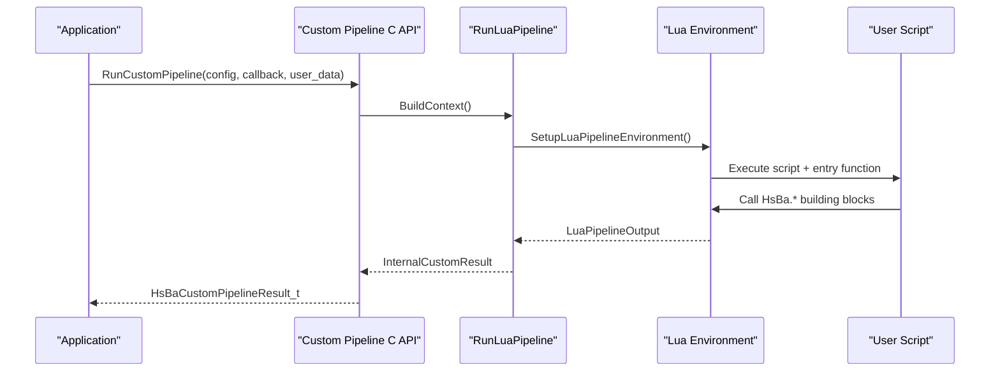
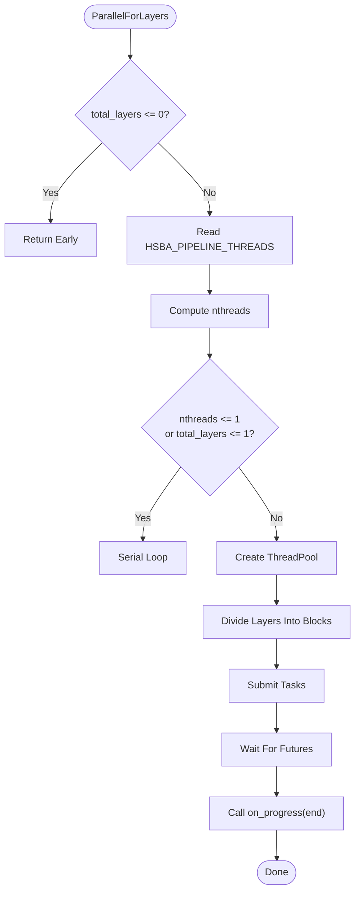
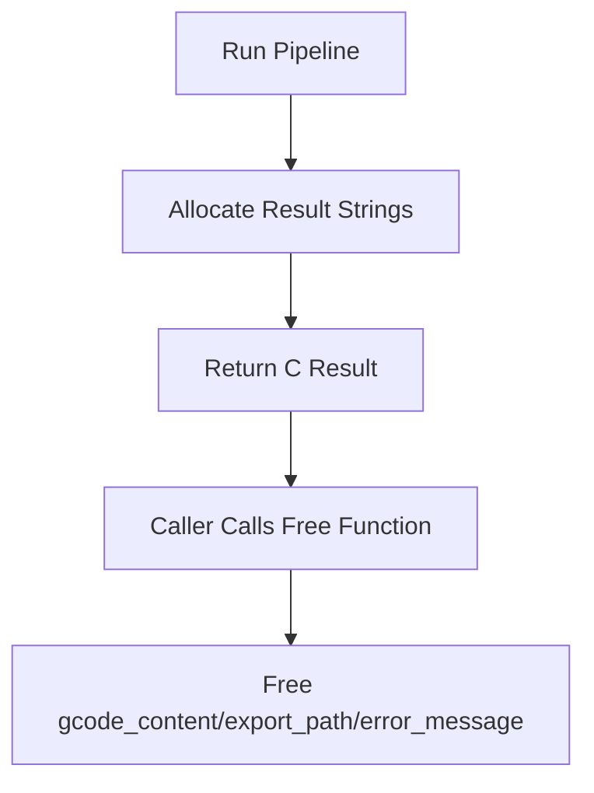
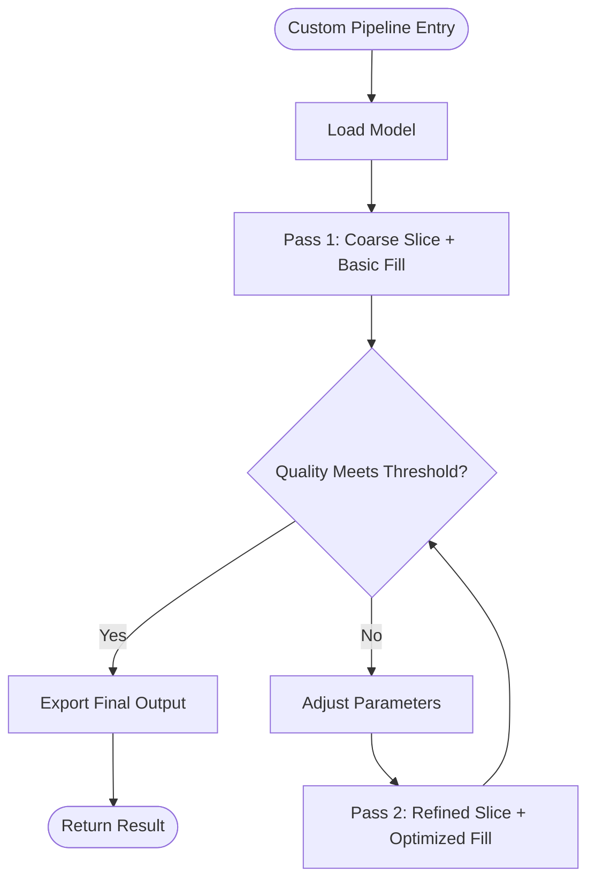
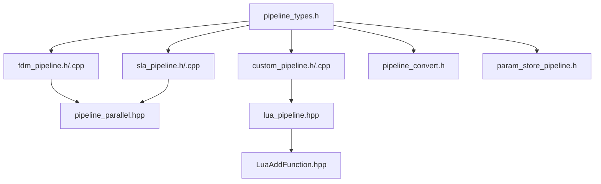

# Pipeline Execution Flow / 流水线执行流程

<cite>
**Referenced Files in This Document**
- [pipeline_types.h](file://pipelinetypes/pipeline_types.h)
- [fdm_pipeline.h](file://DllHsBaSlicer/fdm_pipeline.h)
- [fdm_pipeline.cpp](file://DllHsBaSlicer/fdm_pipeline.cpp)
- [sla_pipeline.h](file://DllHsBaSlicer/sla_pipeline.h)
- [sla_pipeline.cpp](file://DllHsBaSlicer/sla_pipeline.cpp)
- [sls_pipeline.h](file://DllHsBaSlicer/sls_pipeline.h)
- [slm_pipeline.h](file://DllHsBaSlicer/slm_pipeline.h)
- [lom_pipeline.h](file://DllHsBaSlicer/lom_pipeline.h)
- [tdp_pipeline.h](file://DllHsBaSlicer/tdp_pipeline.h)
- [waam_pipeline.h](file://DllHsBaSlicer/waam_pipeline.h)
- [custom_pipeline.h](file://DllHsBaSlicer/custom_pipeline.h)
- [custom_pipeline.cpp](file://DllHsBaSlicer/custom_pipeline.cpp)
- [lua_pipeline.hpp](file://LibHsBaSlicer/Extends/lua_pipeline.hpp)
- [LuaAddFunction.hpp](file://LibHsBaSlicer/Extends/LuaAddFunction.hpp)
- [pipeline_convert.h](file://DllHsBaSlicer/pipeline_convert.h)
- [param_store_pipeline.h](file://DllHsBaSlicer/param_store_pipeline.h)
- [pipeline_parallel.hpp](file://DllHsBaSlicer/pipeline_parallel.hpp)
</cite>

## Table of Contents
1. [Introduction](#introduction)
2. [Project Structure](#project-structure)
3. [Core Components](#core-components)
4. [Architecture Overview](#architecture-overview)
5. [Detailed Component Analysis](#detailed-component-analysis)
6. [Dependency Analysis](#dependency-analysis)
7. [Performance Considerations](#performance-considerations)
8. [Troubleshooting Guide](#troubleshooting-guide)
9. [Conclusion](#conclusion)
10. [Appendices](#appendices)

## Introduction
This document explains the complete pipeline execution flow for HsBaSlicer custom scripts and built-in pipelines. It covers how a user or application configures a pipeline, how the C++ layer loads models, slices geometry, generates supports and fills, exports results, and returns progress and errors. It also documents:

- Sequential processing stages from model loading through final output.
- Conditional branching such as spiral/vase mode, support enable/disable, and Lua vs built-in algorithms.
- Parallel processing options for independent layers.
- Workflow optimization strategies including per-layer parallelization, block-based progress reporting, and environment-controlled thread counts.
- Relationships between pipeline types: FDM, SLA, SLS, SLM, LOM, 3DP/WAAM, File Transfer, and fully Custom Lua pipelines.
- Memory management during long-running pipelines, resource cleanup procedures, and error recovery mechanisms.
- Examples of complex workflows with multiple decision points, conditional stage execution, iterative refinement patterns, and multi-pass operations.

The goal is to make both new users and advanced extension developers able to understand, extend, and optimize pipeline execution safely.

## Project Structure
At a high level, the pipeline system consists of:

- Public C ABI headers that define configuration structs, result structs, progress/result callbacks, and run/free functions.
- C++ implementations that execute staged workflows using coroutines, optional Lua customization, and shared slicing/fill/support/path libraries.
- A fully Lua-driven custom pipeline API that lets scripts control the entire workflow while reusing core building blocks.
- Conversion helpers for protobuf serialization and parameter persistence helpers for saving/loading pipeline configurations.
- A header-only parallel helper for distributing independent layer work across threads.

**Diagram sources**
- [fdm_pipeline.h:23-35](file://DllHsBaSlicer/fdm_pipeline.h#L23-L35)
- [sla_pipeline.h:23-34](file://DllHsBaSlicer/sla_pipeline.h#L23-L34)
- [custom_pipeline.h:23-55](file://DllHsBaSlicer/custom_pipeline.h#L23-L55)
- [lua_pipeline.hpp:19-83](file://LibHsBaSlicer/Extends/lua_pipeline.hpp#L19-L83)
- [pipeline_parallel.hpp:22-42](file://DllHsBaSlicer/pipeline_parallel.hpp#L22-L42)
- [pipeline_convert.h:24-31](file://DllHsBaSlicer/pipeline_convert.h#L24-L31)
- [param_store_pipeline.h:17-32](file://DllHsBaSlicer/param_store_pipeline.h#L17-L32)

**Section sources**
- [fdm_pipeline.h:1-68](file://DllHsBaSlicer/fdm_pipeline.h#L1-L68)
- [sla_pipeline.h:1-63](file://DllHsBaSlicer/sla_pipeline.h#L1-L63)
- [custom_pipeline.h:1-69](file://DllHsBaSlicer/custom_pipeline.h#L1-L69)
- [lua_pipeline.hpp:1-88](file://LibHsBaSlicer/Extends/lua_pipeline.hpp#L1-L88)
- [pipeline_parallel.hpp:1-122](file://DllHsBaSlicer/pipeline_parallel.hpp#L1-L122)
- [pipeline_convert.h:1-397](file://DllHsBaSlicer/pipeline_convert.h#L1-L397)
- [param_store_pipeline.h:1-76](file://DllHsBaSlicer/param_store_pipeline.h#L1-L76)

## Core Components
The core components are the pipeline families and their shared infrastructure:

- **FDM Pipeline**: Preprocess → Slice → Support → Fill → Path Generation (G-code). Supports spiral/vase mode, Lua support/infill customization, and firmware-specific G-code generation.
- **SLA Pipeline**: Preprocess → Slice → Floor/Raft → Support → Export (layer images + metadata zip). Supports Lua floor/support/export customization and PNG/JPEG/SVG image formats.
- **SLS/SLM/LOM/3DP Pipelines**: Preprocess → Slice → Export via Lua script. These modes hand sliced outlines and process parameters to a Lua export function; they do not produce G-code directly.
- **WAAM Pipeline**: Preprocess → Slice → Robot path export. Output is robot language code rather than a layer zip.
- **File Transfer Pipeline**: Sends files to a remote service using a connection pool.
- **Custom Lua Pipeline**: Fully Lua-driven workflow where the script controls stage order and content while reusing exposed building blocks.
- **Shared Infrastructure**:
  - Configuration and result structs defined in the public type header.
  - Coroutine-based async execution with synchronous wrappers.
  - Per-layer parallel execution helper.
  - Lua registration framework for 2D/3D/File functions and event callbacks.
  - Proto conversion utilities and parameter store persistence.

**Section sources**
- [pipeline_types.h:19-127](file://pipelinetypes/pipeline_types.h#L19-L127)
- [pipeline_types.h:142-245](file://pipelinetypes/pipeline_types.h#L142-L245)
- [pipeline_types.h:247-310](file://pipelinetypes/pipeline_types.h#L247-L310)
- [pipeline_types.h:312-401](file://pipelinetypes/pipeline_types.h#L312-L401)
- [pipeline_types.h:403-461](file://pipelinetypes/pipeline_types.h#L403-L461)
- [pipeline_types.h:463-521](file://pipelinetypes/pipeline_types.h#L463-L521)
- [pipeline_types.h:523-625](file://pipelinetypes/pipeline_types.h#L523-L625)
- [pipeline_types.h:627-732](file://pipelinetypes/pipeline_types.h#L627-L732)

## Architecture Overview
The architecture separates three concerns:

1. **Public API surface**: Stable C ABI for configuration, execution, and memory cleanup.
2. **Pipeline orchestration**: Coroutines manage sequential stages, conditionals, and progress reporting.
3. **Stage implementation**: Reusable modules for model preprocessing, mesh slicing, support generation, polygon fill, path generation, and export packaging.

**Diagram sources**
- [fdm_pipeline.h:23-35](file://DllHsBaSlicer/fdm_pipeline.h#L23-L35)
- [fdm_pipeline.cpp:219-447](file://DllHsBaSlicer/fdm_pipeline.cpp#L219-L447)

**Section sources**
- [fdm_pipeline.cpp:219-447](file://DllHsBaSlicer/fdm_pipeline.cpp#L219-L447)
- [pipeline_parallel.hpp:22-42](file://DllHsBaSlicer/pipeline_parallel.hpp#L22-L42)

## Detailed Component Analysis

### FDM Pipeline Execution Flow
The FDM pipeline implements a fixed five-stage workflow with strong conditional branching:

1. **Preprocess**: Load or retrieve the model and compute bounding box information.
2. **Slice**: Build slice topology once, then slice each layer independently.
3. **Support**: Optionally generate supports; disabled in spiral mode or when disabled by configuration.
4. **Infill**: Generate fills; skipped in spiral mode; may use Lua or built-in algorithm.
5. **Path Generation**: Produce G-code either as a continuous spiral wall or as standard per-layer paths.

**Diagram sources**
- [fdm_pipeline.cpp:219-447](file://DllHsBaSlicer/fdm_pipeline.cpp#L219-L447)

Key behaviors:

- **Conditional branching**:
  - Spiral mode disables support and infill and uses a continuous rising wall path generator.
  - Support can be disabled explicitly or implicitly by spiral mode.
  - Infill can be Lua-driven (serial) or built-in (parallel).
- **Parallel processing**:
  - Slicing uses per-layer parallelism.
  - Built-in fill uses per-layer parallelism.
  - Lua fill remains serial due to interpreter state constraints.
- **Progress reporting**:
  - Progress updates occur at stage boundaries and after parallel blocks.
- **Error handling**:
  - Errors are captured into the result structure and elapsed time is recorded.

**Section sources**
- [fdm_pipeline.cpp:219-447](file://DllHsBaSlicer/fdm_pipeline.cpp#L219-L447)
- [fdm_pipeline.h:23-35](file://DllHsBaSlicer/fdm_pipeline.h#L23-L35)

### SLA Pipeline Execution Flow
The SLA pipeline follows a different sequence because it produces layer images and an export package rather than G-code:

1. **Preprocess**: Load or retrieve the model and compute layer count.
2. **Slice**: Build topology and slice layers in parallel.
3. **Floor/Raft**: Generate floor polygons, optionally via Lua.
4. **Support**: Generate supports, optionally via Lua.
5. **Export**: Package layer images, supports, floor data, and exposure settings into a zip; Lua export can override default packaging.

**Diagram sources**
- [sla_pipeline.cpp:299-483](file://DllHsBaSlicer/sla_pipeline.cpp#L299-L483)

Important details:

- **Image format selection**: PNG, JPEG, or SVG affects file extensions and metadata.
- **Lua customization**: Floor, support, and export stages can be replaced by Lua functions.
- **Configuration JSON**: The pipeline builds a JSON describing slice, exposure, lift, floor, support, image, and layer entries.
- **Memory ownership**: Export path and error message are allocated by the pipeline and must be freed by the caller.

**Section sources**
- [sla_pipeline.cpp:299-483](file://DllHsBaSlicer/sla_pipeline.cpp#L299-L483)
- [sla_pipeline.h:23-34](file://DllHsBaSlicer/sla_pipeline.h#L23-L34)

### SLS, SLM, LOM, 3DP, and WAAM Pipelines
These pipelines share a common pattern: preprocess, slice, and delegate export to a Lua script. Their differences lie in domain parameters and output semantics.

- **SLS**: Powder bed laser sintering; requires an export Lua script; no floor/raft or support structures.
- **SLM**: Metal powder-bed melting; mirrors SLS flow but includes metal material, energy source, and shielding gas parameters passed to the export script.
- **LOM**: Laminated object manufacturing; slices per sheet thickness and hands contour outlines plus cut/bond parameters to Lua.
- **3DP**: Binder jetting; slices per layer and hands binder-jet outlines and head/curing parameters to Lua.
- **WAAM**: Wire arc additive manufacturing; outputs robot language programs instead of layer zips; supports optional custom robot path Lua.

**Diagram sources**
- [sls_pipeline.h:23-33](file://DllHsBaSlicer/sls_pipeline.h#L23-L33)
- [slm_pipeline.h:23-36](file://DllHsBaSlicer/slm_pipeline.h#L23-L36)
- [lom_pipeline.h:23-36](file://DllHsBaSlicer/lom_pipeline.h#L23-L36)
- [tdp_pipeline.h:23-36](file://DllHsBaSlicer/tdp_pipeline.h#L23-L36)
- [waam_pipeline.h:23-37](file://DllHsBaSlicer/waam_pipeline.h#L23-L37)

**Section sources**
- [sls_pipeline.h:1-63](file://DllHsBaSlicer/sls_pipeline.h#L1-L63)
- [slm_pipeline.h:1-63](file://DllHsBaSlicer/slm_pipeline.h#L1-L63)
- [lom_pipeline.h:1-63](file://DllHsBaSlicer/lom_pipeline.h#L1-L63)
- [tdp_pipeline.h:1-63](file://DllHsBaSlicer/tdp_pipeline.h#L1-L63)
- [waam_pipeline.h:1-64](file://DllHsBaSlicer/waam_pipeline.h#L1-L64)

### Custom Lua Pipeline Execution Flow
The custom pipeline is the most flexible option. Instead of a fixed C++ stage order, the Lua entry function decides which building blocks to call and in what order. The C++ side:

- Validates that a script or inline source is provided.
- Creates a Lua pipeline context with script, entry function name, config JSON, model info, output path, and progress callback.
- Runs the Lua pipeline and converts its output into a C-compatible result.

**Diagram sources**
- [custom_pipeline.cpp:117-163](file://DllHsBaSlicer/custom_pipeline.cpp#L117-L163)
- [lua_pipeline.hpp:19-83](file://LibHsBaSlicer/Extends/lua_pipeline.hpp#L19-L83)

Key capabilities:

- **Full workflow control**: The script can choose to load models, slice, generate supports, generate fills, export packages, or perform arbitrary computation.
- **Exposed building blocks**: The global `HsBa` table provides model loading, slicing, support, fill, floor, path output, and packaging functions.
- **Progress reporting**: The script can report progress through the provided callback.
- **Memory safety**: The C++ wrapper owns temporary strings and transfers ownership to the caller via free functions.

**Section sources**
- [custom_pipeline.cpp:117-163](file://DllHsBaSlicer/custom_pipeline.cpp#L117-L163)
- [custom_pipeline.h:23-55](file://DllHsBaSlicer/custom_pipeline.h#L23-L55)
- [lua_pipeline.hpp:19-83](file://LibHsBaSlicer/Extends/lua_pipeline.hpp#L19-L83)

### Parallel Processing and Optimization Strategies
The pipeline system optimizes hot paths by recognizing that many stages operate on independent layers:

- **Per-layer parallelism**: Slicing and built-in fill are distributed across a thread pool.
- **Block-based progress**: Work is grouped into blocks so progress callbacks fire on the calling thread after each block completes.
- **Thread count control**: An environment variable can force serial execution or limit worker threads for benchmarking or constrained platforms.
- **Serial fallback**: If only one thread or one layer exists, the helper falls back to a plain loop.

**Diagram sources**
- [pipeline_parallel.hpp:41-117](file://DllHsBaSlicer/pipeline_parallel.hpp#L41-L117)

Optimization recommendations:

- Use built-in fill when possible to benefit from parallelism.
- Avoid sharing Lua interpreter state across threads; keep Lua-driven stages serial.
- Tune `HSBA_PIPELINE_THREADS` for performance validation or constrained environments.
- Prefer block-sized work units to reduce callback overhead.

**Section sources**
- [pipeline_parallel.hpp:22-117](file://DllHsBaSlicer/pipeline_parallel.hpp#L22-L117)
- [fdm_pipeline.cpp:312-383](file://DllHsBaSlicer/fdm_pipeline.cpp#L312-L383)

### Memory Management and Resource Cleanup
Memory management follows clear ownership rules:

- **C ABI results**: String fields such as G-code content, export paths, and error messages are allocated by the pipeline and must be freed by the caller using the corresponding free function.
- **Internal string ownership**: Internal wrappers copy C strings into RAII-owned buffers and release them when converting to C results.
- **Async completion**: Async APIs transfer ownership of result strings to the result callback.
- **Config cleanup**: Converted configs expose free functions for malloc-allocated string fields.
- **Loaded configs**: Parameter store loaded configs require explicit freeing before reuse or discard.

**Diagram sources**
- [fdm_pipeline.cpp:199-211](file://DllHsBaSlicer/fdm_pipeline.cpp#L199-L211)
- [fdm_pipeline.cpp:488-496](file://DllHsBaSlicer/fdm_pipeline.cpp#L488-L496)
- [sla_pipeline.cpp:284-296](file://DllHsBaSlicer/sla_pipeline.cpp#L284-L296)
- [sla_pipeline.cpp:523-531](file://DllHsBaSlicer/sla_pipeline.cpp#L523-L531)
- [pipeline_convert.h:342-390](file://DllHsBaSlicer/pipeline_convert.h#L342-L390)
- [param_store_pipeline.h:52-60](file://DllHsBaSlicer/param_store_pipeline.h#L52-L60)

**Section sources**
- [fdm_pipeline.cpp:199-211](file://DllHsBaSlicer/fdm_pipeline.cpp#L199-L211)
- [fdm_pipeline.cpp:488-496](file://DllHsBaSlicer/fdm_pipeline.cpp#L488-L496)
- [sla_pipeline.cpp:284-296](file://DllHsBaSlicer/sla_pipeline.cpp#L284-L296)
- [sla_pipeline.cpp:523-531](file://DllHsBaSlicer/sla_pipeline.cpp#L523-L531)
- [pipeline_convert.h:342-390](file://DllHsBaSlicer/pipeline_convert.h#L342-L390)
- [param_store_pipeline.h:52-60](file://DllHsBaSlicer/param_store_pipeline.h#L52-L60)

### Error Handling and Recovery
Error handling is consistent across pipelines:

- **Runtime exceptions**: Caught and converted into structured error messages in the result.
- **Validation failures**: Invalid model height or missing script/source leads to early return with failure status.
- **Lua errors**: Custom pipeline captures Lua errors into the result’s error message.
- **Progress continuity**: Even on failure, elapsed time is recorded.

Recommended recovery strategies:

- Inspect `success`, `error_message`, and `elapsed_seconds`.
- Retry failed steps if the error is transient (for example, file I/O or network issues in custom scripts).
- Validate configuration before running long pipelines.
- Use async execution to avoid blocking UI or main threads while preserving progress feedback.

**Section sources**
- [fdm_pipeline.cpp:437-446](file://DllHsBaSlicer/fdm_pipeline.cpp#L437-L446)
- [sla_pipeline.cpp:473-482](file://DllHsBaSlicer/sla_pipeline.cpp#L473-L482)
- [custom_pipeline.cpp:127-133](file://DllHsBaSlicer/custom_pipeline.cpp#L127-L133)

### Complex Workflow Patterns
The following patterns demonstrate advanced usage:

- **Multiple decision points**: Spiral mode disables support and infill; support can be enabled/disabled; Lua vs built-in algorithms change execution strategy.
- **Conditional stage execution**: Floor generation, support generation, and export packaging can be replaced by Lua functions.
- **Iterative refinement**: A custom Lua pipeline can slice, evaluate quality metrics, adjust parameters, and reslice until convergence.
- **Multi-pass operations**: A custom script can generate multiple passes, such as coarse support followed by fine support, or multiple fill strategies compared before export.

Example conceptual workflow:

[No sources needed since this diagram shows conceptual workflow, not actual code structure]

## Dependency Analysis
The pipeline system has clear dependency boundaries:

- **C ABI depends on**:
  - Public type definitions.
  - Core stage implementations.
  - Lua environment setup.
  - Parallel helper.
  - Conversion and parameter store utilities.
- **Core stages depend on**:
  - Model preprocessing.
  - Mesh slicing.
  - Support generation.
  - Polygon fill.
  - Path generation.
  - Export packaging.
- **Lua environment depends on**:
  - Common type registration.
  - 2D/3D/File function registration.
  - Event callback registration.

**Diagram sources**
- [pipeline_types.h:19-732](file://pipelinetypes/pipeline_types.h#L19-L732)
- [fdm_pipeline.h:1-68](file://DllHsBaSlicer/fdm_pipeline.h#L1-L68)
- [sla_pipeline.h:1-63](file://DllHsBaSlicer/sla_pipeline.h#L1-L63)
- [custom_pipeline.h:1-69](file://DllHsBaSlicer/custom_pipeline.h#L1-L69)
- [pipeline_convert.h:1-397](file://DllHsBaSlicer/pipeline_convert.h#L1-L397)
- [param_store_pipeline.h:1-76](file://DllHsBaSlicer/param_store_pipeline.h#L1-L76)
- [pipeline_parallel.hpp:1-122](file://DllHsBaSlicer/pipeline_parallel.hpp#L1-L122)
- [lua_pipeline.hpp:1-88](file://LibHsBaSlicer/Extends/lua_pipeline.hpp#L1-L88)
- [LuaAddFunction.hpp:1-78](file://LibHsBaSlicer/Extends/LuaAddFunction.hpp#L1-L78)

**Section sources**
- [pipeline_types.h:19-732](file://pipelinetypes/pipeline_types.h#L19-L732)
- [fdm_pipeline.h:1-68](file://DllHsBaSlicer/fdm_pipeline.h#L1-L68)
- [sla_pipeline.h:1-63](file://DllHsBaSlicer/sla_pipeline.h#L1-L63)
- [custom_pipeline.h:1-69](file://DllHsBaSlicer/custom_pipeline.h#L1-L69)
- [pipeline_convert.h:1-397](file://DllHsBaSlicer/pipeline_convert.h#L1-L397)
- [param_store_pipeline.h:1-76](file://DllHsBaSlicer/param_store_pipeline.h#L1-L76)
- [pipeline_parallel.hpp:1-122](file://DllHsBaSlicer/pipeline_parallel.hpp#L1-L122)
- [lua_pipeline.hpp:1-88](file://LibHsBaSlicer/Extends/lua_pipeline.hpp#L1-L88)
- [LuaAddFunction.hpp:1-78](file://LibHsBaSlicer/Extends/LuaAddFunction.hpp#L1-L78)

## Performance Considerations
To optimize pipeline execution:

- **Use parallel-friendly stages**: Built-in slicing and fill benefit from per-layer parallelism.
- **Avoid cross-thread Lua state**: Keep Lua-driven stages serial.
- **Control thread count**: Use the environment variable mechanism to compare serial vs parallel performance or constrain resources.
- **Minimize I/O in hot loops**: Batch file operations where possible.
- **Reuse models**: Prefer retrieving cached models when available.
- **Choose appropriate export strategy**: For SLA, select image formats that balance quality and size; for WAAM, ensure robot path generation is tuned for the target controller.

[No sources needed since this section provides general guidance]

## Troubleshooting Guide
Common issues and resolutions:

- **Invalid model height**: Occurs when model bounding box yields zero or negative height. Validate input geometry and layer parameters.
- **Failed to load model**: Check model path and availability; verify model loader integration.
- **Failed to read Lua script**: Ensure script path is correct and readable; validate script syntax.
- **Export failure**: Verify output path permissions and disk space; check Lua export function behavior.
- **Memory leaks**: Always call the corresponding free function for pipeline results and loaded configs.
- **Slow performance**: Confirm whether Lua stages are forcing serial execution; consider built-in algorithms or tuning thread count.

**Section sources**
- [fdm_pipeline.cpp:239-255](file://DllHsBaSlicer/fdm_pipeline.cpp#L239-L255)
- [sla_pipeline.cpp:318-334](file://DllHsBaSlicer/sla_pipeline.cpp#L318-L334)
- [sla_pipeline.cpp:400-415](file://DllHsBaSlicer/sla_pipeline.cpp#L400-L415)
- [custom_pipeline.cpp:127-133](file://DllHsBaSlicer/custom_pipeline.cpp#L127-L133)
- [fdm_pipeline.cpp:488-496](file://DllHsBaSlicer/fdm_pipeline.cpp#L488-L496)
- [sla_pipeline.cpp:523-531](file://DllHsBaSlicer/sla_pipeline.cpp#L523-L531)

## Conclusion
HsBaSlicer’s pipeline execution flow combines stable C ABIs, coroutine-based orchestration, reusable stage libraries, and flexible Lua scripting. Built-in pipelines provide predictable sequences for FDM and SLA, while SLS, SLM, LOM, 3DP, and WAAM delegate export logic to Lua. The custom pipeline offers full workflow control, enabling complex conditional branching, iterative refinement, and multi-pass operations. Parallel execution targets independent layers, while memory ownership and error handling remain explicit and safe. By understanding these patterns, users can build efficient, extensible, and robust custom scripts tailored to specific manufacturing processes.

[No sources needed since this section summarizes without analyzing specific files]

## Appendices

### Pipeline Type Summary Table
| Pipeline | Primary Stages | Output | Lua Customization | Notes |
|---|---|---|---|---|
| FDM | Preprocess → Slice → Support → Fill → Path Generation | G-code content | Support, infill | Spiral mode skips support and infill |
| SLA | Preprocess → Slice → Floor → Support → Export | Zip with layer images | Floor, support, export | Supports PNG/JPEG/SVG |
| SLS | Preprocess → Slice → Export | Lua-defined output | Required export script | No floor/raft or support |
| SLM | Preprocess → Slice → Export | Lua-defined output | Required export script | Includes metal parameters |
| LOM | Preprocess → Slice → Export | Lua-defined output | Required export script | Sheet-based cutting/bonding |
| 3DP | Preprocess → Slice → Export | Lua-defined output | Required export script | Binder jetting parameters |
| WAAM | Preprocess → Slice → Robot path export | Robot program | Optional path Lua | Not a layer zip |
| Custom | User-defined | User-defined | Full control | Uses exposed HsBa building blocks |

**Section sources**
- [pipeline_types.h:19-127](file://pipelinetypes/pipeline_types.h#L19-L127)
- [pipeline_types.h:142-245](file://pipelinetypes/pipeline_types.h#L142-L245)
- [pipeline_types.h:247-310](file://pipelinetypes/pipeline_types.h#L247-L310)
- [pipeline_types.h:312-401](file://pipelinetypes/pipeline_types.h#L312-L401)
- [pipeline_types.h:403-461](file://pipelinetypes/pipeline_types.h#L403-L461)
- [pipeline_types.h:463-521](file://pipelinetypes/pipeline_types.h#L463-L521)
- [pipeline_types.h:523-625](file://pipelinetypes/pipeline_types.h#L523-L625)
- [pipeline_types.h:627-732](file://pipelinetypes/pipeline_types.h#L627-L732)