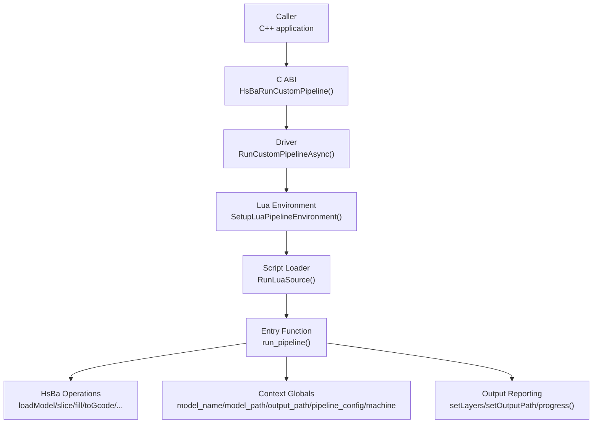
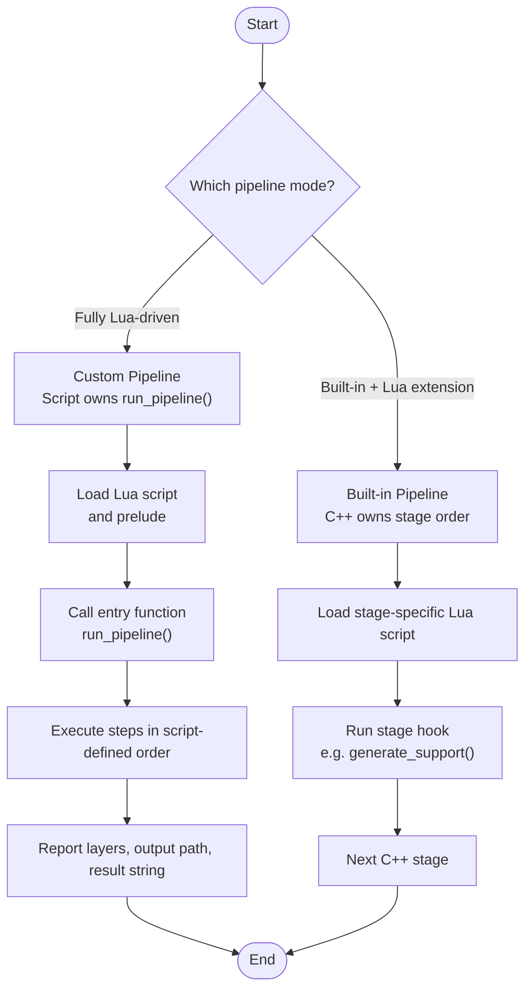
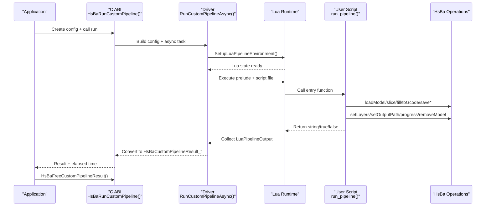
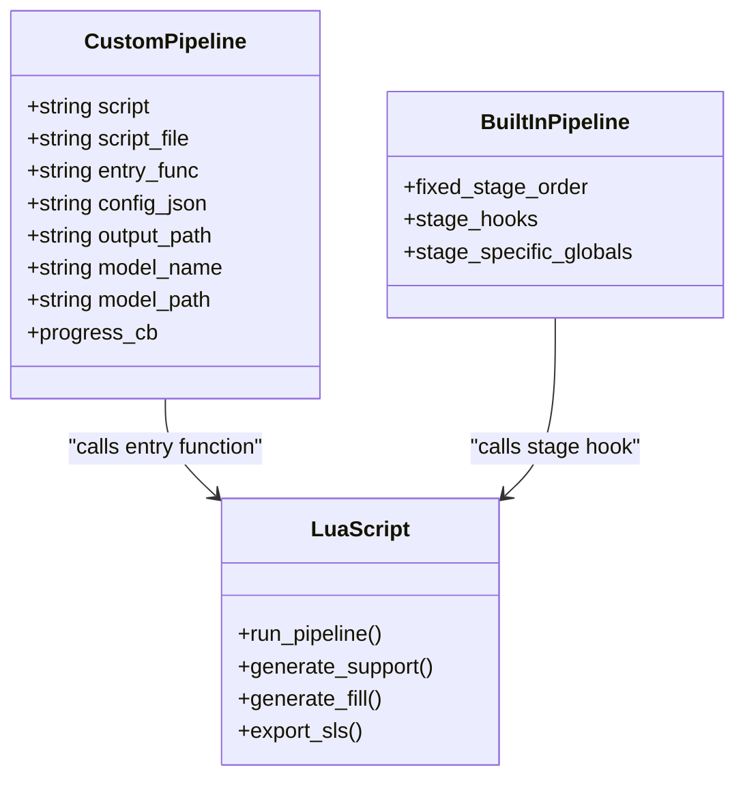
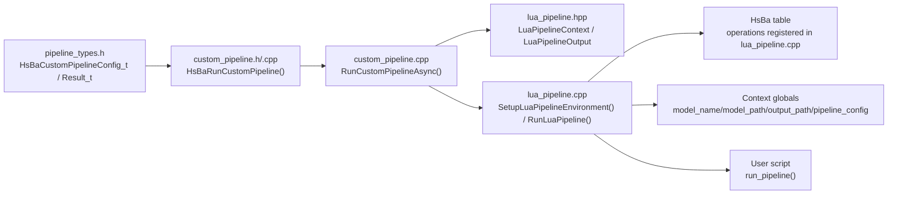

# Script Structure & Entry Points / 脚本结构与入口点

<cite>
**Referenced Files in This Document**   
- [custom_pipeline.h](file://DllHsBaSlicer/custom_pipeline.h)
- [custom_pipeline.cpp](file://DllHsBaSlicer/custom_pipeline.cpp)
- [lua_pipeline.hpp](file://LibHsBaSlicer/Extends/lua_pipeline.hpp)
- [lua_pipeline.cpp](file://LibHsBaSlicer/Extends/lua_pipeline.cpp)
- [pipeline_types.h](file://pipelinetypes/pipeline_types.h)
- [lua_pipeline_api.md](file://docs/en/lua_pipeline_api.md)
- [my_fdm_pipeline.lua](file://samples/Custom/scripts/my_fdm_pipeline.lua)
- [my_sla_pipeline.lua](file://samples/Custom/scripts/my_sla_pipeline.lua)
- [my_lom_pipeline.lua](file://samples/Custom/scripts/my_lom_pipeline.lua)
</cite>

## Table of Contents
1. [Introduction](#introduction)
2. [Project Structure](#project-structure)
3. [Core Components](#core-components)
4. [Architecture Overview](#architecture-overview)
5. [Detailed Component Analysis](#detailed-component-analysis)
6. [Dependency Analysis](#dependency-analysis)
7. [Performance Considerations](#performance-considerations)
8. [Troubleshooting Guide](#troubleshooting-guide)
9. [Conclusion](#conclusion)
10. [Appendices](#appendices)

## Introduction
This document explains the fundamental structure of custom pipeline scripts in HsBaSlicer. It focuses on:

- The required `run_pipeline()` function as the main entry point for fully Lua-driven pipelines.
- Global variables injected by C++: `model_name`, `model_path`, `output_path`, `pipeline_config`, and the optional `machine` table.
- The complete lifecycle from script loading through execution to cleanup.
- The difference between fully Lua-driven pipelines and C++ pipelines with Lua extensions.
- Parameter handling using a local `param(name, default)` helper.
- Proper resource management: model removal, progress reporting, output path reporting, and result string handling.
- Naming conventions, file organization strategies, and modular design patterns for complex pipelines.

The goal is to make both new and experienced users able to write correct, maintainable custom pipeline scripts while understanding how C++ and Lua cooperate behind the scenes.

## Project Structure
Custom pipeline scripts live alongside the C++ runtime that loads them. The relevant parts are:

| Area | Responsibility |
|------|----------------|
| `DllHsBaSlicer/custom_pipeline.*` | C ABI for creating configuration, running the Lua pipeline synchronously or asynchronously, and freeing results. |
| `LibHsBaSlicer/Extends/lua_pipeline.*` | Creates the Lua environment, registers the `HsBa` operation table, injects context globals, executes the script, and calls the entry function. |
| `pipelinetypes/pipeline_types.h` | Defines the C-compatible configuration and result structures used by the C ABI. |
| `samples/Custom/scripts/*.lua` | Example fully Lua-driven pipelines (FDM, SLA, LOM, etc.). |
| `docs/en/lua_pipeline_api.md` | User-facing API reference describing available Lua functions and global variables. |



**Diagram sources**
- [custom_pipeline.cpp:118-163](file://DllHsBaSlicer/custom_pipeline.cpp#L118-L163)
- [lua_pipeline.cpp:903-1043](file://LibHsBaSlicer/Extends/lua_pipeline.cpp#L903-L1043)

**Section sources**
- [custom_pipeline.h:17-62](file://DllHsBaSlicer/custom_pipeline.h#L17-L62)
- [custom_pipeline.cpp:171-213](file://DllHsBaSlicer/custom_pipeline.cpp#L171-L213)
- [lua_pipeline.hpp:19-83](file://LibHsBaSlicer/Extends/lua_pipeline.hpp#L19-L83)
- [lua_pipeline.cpp:830-886](file://LibHsBaSlicer/Extends/lua_pipeline.cpp#L830-L886)
- [pipeline_types.h:698-726](file://pipelinetypes/pipeline_types.h#L698-L726)

## Core Components
The core components form a layered boundary between C++ and Lua:

| Component | Role | Key Fields / Functions |
|-----------|------|------------------------|
| `HsBaCustomPipelineConfig_t` | C-side configuration passed into the custom pipeline | `pipeline_lua_script`, `pipeline_lua_source`, `entry_func`, `config_json`, `model_name`, `model_path`, `output_path` |
| `HsBaCustomPipelineResult_t` | C-side result returned after execution | `success`, `total_layers`, `output_path`, `result_string`, `error_message`, `elapsed_seconds` |
| `LuaPipelineContext` | C++ representation of the Lua pipeline run | `script`, `script_file`, `entry_func`, `config_json`, `output_path`, `model_name`, `model_path`, `progress_cb` |
| `LuaPipelineOutput` | Internal Lua pipeline output collected by C++ | `success`, `total_layers`, `output_path`, `result_string`, `error_message` |
| `HsBa` table | Lua-side operation table exposed to scripts | `progress`, `loadModel`, `slice`, `fill`, `toGcode`, `saveSlsPackage`, `saveSlaPackage`, `removeModel`, etc. |
| Context globals | Variables visible inside the script | `model_name`, `model_path`, `output_path`, `pipeline_config`, `pipeline_entry`, optional `machine` |

### Required Entry Point
Every fully Lua-driven custom pipeline must define an entry function. By default this is `run_pipeline`. The C++ driver looks up this function by name and calls it with no arguments.

- Returning a non-empty string means success; the string becomes `result_string`.
- Returning `true` also means success but without a result string.
- Returning `false`, `nil`, or raising a Lua error means failure; the error message is captured in `error_message`.

### Global Variables
The C++ side injects these globals into the Lua environment before executing the script:

| Global | Type | Meaning |
|--------|------|---------|
| `model_name` | string | Model name provided by C++; may be empty. |
| `model_path` | string | Model file path provided by C++; may be empty. |
| `output_path` | string | Default output path provided by C++; may be empty. |
| `pipeline_config` | string | Free-form JSON config string passed from C++; may be empty. |
| `pipeline_entry` | string | Name of the entry function to call; defaults to `run_pipeline`. |
| `machine` | table or nil | Optional machine parameter table injected via the inline prelude script. |

**Section sources**
- [pipeline_types.h:698-726](file://pipelinetypes/pipeline_types.h#L698-L726)
- [lua_pipeline.hpp:29-51](file://LibHsBaSlicer/Extends/lua_pipeline.hpp#L29-L51)
- [lua_pipeline.cpp:874-886](file://LibHsBaSlicer/Extends/lua_pipeline.cpp#L874-L886)
- [lua_pipeline_api.md:55-66](file://docs/en/lua_pipeline_api.md#L55-L66)

## Architecture Overview
There are two fundamentally different ways Lua participates in HsBaSlicer:

| Mode | Control Flow | When to Use |
|------|--------------|-------------|
| **Fully Lua-driven custom pipeline** | The script defines `run_pipeline()` and decides the entire workflow: load model, slice, generate support, fill, generate paths, write files, package outputs. | You need full control over stage order, conditional logic, or cross-process orchestration. |
| **C++ pipeline with Lua extensions** | The stage order is fixed in C++. Lua scripts replace only specific stages such as support generation, fill generation, floor generation, or export packaging. | You want to reuse the built-in pipeline but customize one algorithm or export format. |



**Diagram sources**
- [lua_pipeline_api.md:19-28](file://docs/en/lua_pipeline_api.md#L19-L28)
- [lua_pipeline.cpp:960-1043](file://LibHsBaSlicer/Extends/lua_pipeline.cpp#L960-L1043)

**Section sources**
- [lua_pipeline_api.md:19-28](file://docs/en/lua_pipeline_api.md#L19-L28)
- [lua_pipeline.cpp:960-1043](file://LibHsBaSlicer/Extends/lua_pipeline.cpp#L960-L1043)

## Detailed Component Analysis

### Lifecycle of a Fully Lua-Driven Custom Pipeline
The lifecycle begins when C++ constructs a custom pipeline configuration and ends when the result is freed.



**Diagram sources**
- [custom_pipeline.cpp:118-183](file://DllHsBaSlicer/custom_pipeline.cpp#L118-L183)
- [custom_pipeline.cpp:203-213](file://DllHsBaSlicer/custom_pipeline.cpp#L203-L213)
- [lua_pipeline.cpp:903-1043](file://LibHsBaSlicer/Extends/lua_pipeline.cpp#L903-L1043)

#### Step-by-step breakdown
1. **Configuration creation**: The caller fills `HsBaCustomPipelineConfig_t`, typically setting `pipeline_lua_script`, `pipeline_lua_source`, `entry_func`, `config_json`, `model_name`, `model_path`, and `output_path`.
2. **Execution**: The driver builds an internal configuration, creates a `LuaPipelineContext`, installs common types, sets up the Lua environment, executes any inline prelude, then loads the main script file.
3. **Entry function call**: The driver retrieves `ctx.entry_func`, which defaults to `run_pipeline`, and calls it.
4. **Script execution**: The script uses `HsBa` operations and context globals to perform its workflow.
5. **Output collection**: The driver reads `total_layers` and `output_path` from the registry, captures the return value, and converts it to `LuaPipelineOutput`.
6. **Result conversion**: The internal result is converted to `HsBaCustomPipelineResult_t`, including heap-allocated strings.
7. **Cleanup**: The caller must free the result using `HsBaFreeCustomPipelineResult`.

**Section sources**
- [custom_pipeline.cpp:86-115](file://DllHsBaSlicer/custom_pipeline.cpp#L86-L115)
- [custom_pipeline.cpp:118-183](file://DllHsBaSlicer/custom_pipeline.cpp#L118-L183)
- [custom_pipeline.cpp:203-213](file://DllHsBaSlicer/custom_pipeline.cpp#L203-L213)
- [lua_pipeline.cpp:960-1043](file://LibHsBaSlicer/Extends/lua_pipeline.cpp#L960-L1043)

### Minimal Script Structure
A minimal custom pipeline should follow this pattern:

1. Define `run_pipeline()`.
2. Resolve inputs from `model_name`, `model_path`, and `output_path`, falling back to safe defaults.
3. Load the model with `HsBa.loadModel()`.
4. Compute layer count and report it with `HsBa.setLayers()`.
5. Slice, process, and generate output.
6. Write the output with `HsBa.writeFile()` or a packaging function.
7. Report the final output path with `HsBa.setOutputPath()`.
8. Remove the model with `HsBa.removeModel()`.
9. Report completion with `HsBa.progress(100, ...)`.
10. Return a success string or `true`; return `false` or raise an error on failure.

Example references:
- FDM example: [my_fdm_pipeline.lua:52-171](file://samples/Custom/scripts/my_fdm_pipeline.lua#L52-L171)
- SLA example: [my_sla_pipeline.lua:27-104](file://samples/Custom/scripts/my_sla_pipeline.lua#L27-L104)
- LOM example: [my_lom_pipeline.lua:19-91](file://samples/Custom/scripts/my_lom_pipeline.lua#L19-L91)

**Section sources**
- [my_fdm_pipeline.lua:52-171](file://samples/Custom/scripts/my_fdm_pipeline.lua#L52-L171)
- [my_sla_pipeline.lua:27-104](file://samples/Custom/scripts/my_sla_pipeline.lua#L27-L104)
- [my_lom_pipeline.lua:19-91](file://samples/Custom/scripts/my_lom_pipeline.lua#L19-L91)

### Parameter Handling with the `param()` Helper
The sample scripts use a local helper:

```lua
local function param(name, default)
    if type(machine) == "table" and machine[name] ~= nil then
        return machine[name]
    end
    return default
end
```

This helper implements a clear precedence rule:

1. If `machine` exists and contains the requested key, use that value.
2. Otherwise, use the default value supplied by the script.

This pattern allows C++ to inject machine-specific parameters through `pipeline_lua_source` while keeping sensible defaults in the script itself.

Common usage patterns include:
- Layer height and first-layer height.
- Fill spacing, wall count, or angle.
- Support density and overhang angle.
- G-code firmware, nozzle diameter, filament diameter, temperatures.
- Export image width, height, and extension.

**Section sources**
- [my_fdm_pipeline.lua:24-30](file://samples/Custom/scripts/my_fdm_pipeline.lua#L24-L30)
- [my_sla_pipeline.lua:20-25](file://samples/Custom/scripts/my_sla_pipeline.lua#L20-L25)
- [my_lom_pipeline.lua:12-17](file://samples/Custom/scripts/my_lom_pipeline.lua#L12-L17)

### Resource Management
Proper resource management is essential because models are pooled and the Lua environment can hold references to geometry data.

Recommended rules:

| Action | When | Why |
|--------|------|-----|
| `HsBa.loadModel(name, path)` | At the beginning of processing | Loads or reuses a named model in the pool. |
| `HsBa.modelInfo(name)` | After loading | Reads bounding box, volume, and other metadata. |
| `HsBa.setLayers(n)` | After computing total layers | Reports layer count to C++. |
| `HsBa.setProgress(percent, stage)` | During long-running loops | Gives progress feedback to the caller. |
| `HsBa.setOutputPath(path)` | After writing output | Reports the actual output path to C++. |
| `HsBa.removeModel(name)` | After all processing is done | Releases the model from the pool. |
| Return a success string or `true` | On success | Tells C++ the pipeline succeeded. |
| Return `false` or raise an error | On failure | Captures error information in `error_message`. |

Important notes:
- Always remove models you loaded.
- Do not assume `model_name`, `model_path`, or `output_path` are non-empty; validate and fall back safely.
- Use `pipeline_config` as a raw JSON string; parse it in Lua if needed.
- Use `machine` only if C++ has injected it; check `type(machine) == "table"` before reading keys.

**Section sources**
- [lua_pipeline.cpp:293-385](file://LibHsBaSlicer/Extends/lua_pipeline.cpp#L293-L385)
- [lua_pipeline.cpp:830-860](file://LibHsBaSlicer/Extends/lua_pipeline.cpp#L830-L860)
- [lua_pipeline_api.md:67-88](file://docs/en/lua_pipeline_api.md#L67-L88)

### Progress Reporting
Progress is reported through `HsBa.progress(percent[, stage])`. The C++ side wraps this callback and forwards it to the configured progress callback.

Best practices:
- Start at a low percentage during model loading.
- Update progress inside loops over layers.
- Use meaningful stage names such as “Slice”, “Support”, “Fill”, “Generate Path”, “Write File”.
- Finish at 100% with a completion stage.

**Section sources**
- [lua_pipeline.cpp:228-239](file://LibHsBaSlicer/Extends/lua_pipeline.cpp#L228-L239)
- [custom_pipeline.cpp:143-149](file://DllHsBaSlicer/custom_pipeline.cpp#L143-L149)
- [my_fdm_pipeline.lua:65-102](file://samples/Custom/scripts/my_fdm_pipeline.lua#L65-L102)

### Script Naming Conventions
The repository examples use descriptive, process-oriented names:

| Example | Meaning |
|---------|---------|
| `my_fdm_pipeline.lua` | Fully Lua-driven FDM slicing pipeline. |
| `my_sla_pipeline.lua` | Fully Lua-driven SLA packaging pipeline. |
| `my_lom_pipeline.lua` | Fully Lua-driven LOM packaging pipeline. |
| `my_sls_export.lua` | Export script used by SLS-style packaging. |
| `my_waam_path.lua` | WAAM path-related script. |

Guidelines:
- Use lowercase with underscores.
- Include the process name when relevant: FDM, SLA, SLS, LOM, SLM, TDP, WAAM.
- Distinguish pipeline scripts from stage scripts:
  - Pipeline scripts define `run_pipeline()`.
  - Stage scripts define stage-specific entry functions such as `generate_support()`, `generate_fill()`, or `export_sls()`.

**Section sources**
- [lua_pipeline_api.md:283-331](file://docs/en/lua_pipeline_api.md#L283-L331)
- [my_fdm_pipeline.lua:1-22](file://samples/Custom/scripts/my_fdm_pipeline.lua#L1-L22)
- [my_sla_pipeline.lua:1-18](file://samples/Custom/scripts/my_sla_pipeline.lua#L1-L18)
- [my_lom_pipeline.lua:1-10](file://samples/Custom/scripts/my_lom_pipeline.lua#L1-L10)

### File Organization Strategies
For small pipelines, a single `.lua` file is sufficient. For complex pipelines, consider splitting responsibilities:

| File Pattern | Purpose |
|--------------|---------|
| `my_process_pipeline.lua` | Main entry point defining `run_pipeline()`. |
| `my_process_params.lua` | Parameter parsing, validation, and defaults. |
| `my_process_io.lua` | Input/output helpers, file reading/writing, packaging. |
| `my_process_geometry.lua` | Geometry transformations, polygon operations, coordinate conversions. |
| `my_process_export.lua` | Export formatting, G-code generation, zip packaging. |

You can organize these either as:
- Multiple files loaded by the main script.
- One main script plus a prelude defined in `pipeline_lua_source`.
- A mix where shared helpers are loaded once and reused across multiple pipeline scripts.

Modular design tips:
- Keep `run_pipeline()` focused on orchestration.
- Put reusable logic in local helper functions.
- Avoid global mutable state unless necessary.
- Centralize parameter resolution so defaults and overrides are easy to change.
- Keep error messages descriptive so they appear clearly in `error_message`.

**Section sources**
- [lua_pipeline.cpp:976-993](file://LibHsBaSlicer/Extends/lua_pipeline.cpp#L976-L993)
- [my_fdm_pipeline.lua:24-50](file://samples/Custom/scripts/my_fdm_pipeline.lua#L24-L50)

### Differences Between Fully Lua-Driven Pipelines and C++ Pipelines with Lua Extensions
| Aspect | Fully Lua-Driven Pipeline | C++ Pipeline with Lua Extension |
|--------|---------------------------|---------------------------------|
| Who controls stage order? | The Lua script. | C++ code. |
| Entry function | `run_pipeline()` by default. | Stage-specific functions like `generate_support()`, `generate_fill()`, `export_sls()`. |
| Available API surface | Full `HsBa` operation table plus shared libraries. | Limited to what the stage injects; usually shared libraries only. |
| Context globals | `model_name`, `model_path`, `output_path`, `pipeline_config`, `pipeline_entry`, optional `machine`. | Varies by stage; often only stage-specific globals. |
| Best for | Custom workflows, conditional logic, multi-stage orchestration. | Replacing one algorithm inside a known pipeline. |



**Diagram sources**
- [lua_pipeline.hpp:29-51](file://LibHsBaSlicer/Extends/lua_pipeline.hpp#L29-L51)
- [lua_pipeline_api.md:19-28](file://docs/en/lua_pipeline_api.md#L19-L28)
- [lua_pipeline_api.md:215-258](file://docs/en/lua_pipeline_api.md#L215-L258)

**Section sources**
- [lua_pipeline_api.md:19-28](file://docs/en/lua_pipeline_api.md#L19-L28)
- [lua_pipeline_api.md:215-258](file://docs/en/lua_pipeline_api.md#L215-L258)

## Dependency Analysis
The dependency chain for a custom pipeline runs from the C ABI through the driver, into the Lua environment, and finally into the user script.



**Diagram sources**
- [pipeline_types.h:698-726](file://pipelinetypes/pipeline_types.h#L698-L726)
- [custom_pipeline.cpp:118-183](file://DllHsBaSlicer/custom_pipeline.cpp#L118-L183)
- [lua_pipeline.hpp:29-83](file://LibHsBaSlicer/Extends/lua_pipeline.hpp#L29-L83)
- [lua_pipeline.cpp:903-1043](file://LibHsBaSlicer/Extends/lua_pipeline.cpp#L903-L1043)

**Section sources**
- [pipeline_types.h:698-726](file://pipelinetypes/pipeline_types.h#L698-L726)
- [custom_pipeline.cpp:118-183](file://DllHsBaSlicer/custom_pipeline.cpp#L118-L183)
- [lua_pipeline.hpp:29-83](file://LibHsBaSlicer/Extends/lua_pipeline.hpp#L29-L83)
- [lua_pipeline.cpp:903-1043](file://LibHsBaSlicer/Extends/lua_pipeline.cpp#L903-L1043)

## Performance Considerations
- Prefer integer polygons for boolean and fill operations, and convert back to floating-point polygons only when needed.
- Avoid unnecessary model copies; reuse models by name when appropriate.
- Report progress frequently during long loops to keep UI responsiveness.
- Minimize large intermediate data structures in Lua; process layers incrementally when possible.
- Use packaging APIs (`saveSlsPackage`, `saveSlaPackage`, `saveWaamPackage`) instead of manually assembling archives when supported.
- Be careful with memory ownership: C++ allocates result strings, and the caller must free them via `HsBaFreeCustomPipelineResult`.

[No sources needed since this section provides general guidance]

## Troubleshooting Guide
Common issues and their likely causes:

| Symptom | Likely Cause | Resolution |
|---------|--------------|------------|
| Lua entry function not found | The script does not define `run_pipeline()` or changed `pipeline_entry`. | Ensure the script defines `run_pipeline()` or configure `entry_func` correctly. |
| Empty or missing output path | Script did not call `HsBa.setOutputPath()`. | Call `HsBa.setOutputPath()` after writing the final output. |
| Zero layer count | Script did not call `HsBa.setLayers()`. | Compute layer count and call `HsBa.setLayers(total_layers)`. |
| Model not found errors | Wrong model name or model not loaded. | Call `HsBa.loadModel(name, path)` before slicing. |
| Memory leak in C++ consumer | Result not freed. | Call `HsBaFreeCustomPipelineResult(result)` after use. |
| Failure with no useful message | Script returned `false` without details. | Return a descriptive string or raise a Lua error with context. |
| Incorrect parameter values | `machine` table missing or wrong keys. | Check `type(machine) == "table"` and verify keys. |

Key error-handling locations:
- Missing script file: handled during script loading.
- Missing entry function: handled when looking up `ctx.entry_func`.
- Lua runtime errors: captured and wrapped into `error_message`.
- Result cleanup: explicitly managed by `HsBaFreeCustomPipelineResult`.

**Section sources**
- [lua_pipeline.cpp:984-1010](file://LibHsBaSlicer/Extends/lua_pipeline.cpp#L984-L1010)
- [lua_pipeline.cpp:1036-1043](file://LibHsBaSlicer/Extends/lua_pipeline.cpp#L1036-L1043)
- [custom_pipeline.cpp:203-213](file://DllHsBaSlicer/custom_pipeline.cpp#L203-L213)

## Conclusion
Custom pipeline scripts in HsBaSlicer give you full control over the slicing and packaging workflow. The required contract is simple:

- Define `run_pipeline()`.
- Read `model_name`, `model_path`, `output_path`, and `pipeline_config`.
- Optionally read `machine` for machine-specific parameters.
- Use `HsBa` operations to load models, slice, generate support and fill, produce paths, and write outputs.
- Report progress, layer count, and output path.
- Clean up models and return a success value.

When you need more than one stage customization, prefer built-in pipelines with Lua extensions. When you need full workflow control, use fully Lua-driven custom pipelines. In both cases, follow the naming conventions, organize scripts modularly, and handle resources carefully.

[No sources needed since this section summarizes without analyzing specific files]

## Appendices

### Appendix A: C ABI Summary
| Function | Purpose |
|----------|---------|
| `HsBaCreateDefaultCustomConfig()` | Create a default custom pipeline configuration. |
| `HsBaRunCustomPipeline()` | Run a fully Lua-driven pipeline synchronously. |
| `HsBaRunCustomPipelineAsync()` | Run asynchronously with a result callback. |
| `HsBaFreeCustomPipelineResult()` | Free memory allocated in the result struct. |

**Section sources**
- [custom_pipeline.h:17-62](file://DllHsBaSlicer/custom_pipeline.h#L17-L62)
- [custom_pipeline.cpp:171-213](file://DllHsBaSlicer/custom_pipeline.cpp#L171-L213)

### Appendix B: Recommended Script Checklist
- [ ] Script defines `run_pipeline()`.
- [ ] Inputs from `model_name`, `model_path`, `output_path` are validated.
- [ ] Parameters use a `param(name, default)` helper.
- [ ] Model is loaded before slicing.
- [ ] Total layers are computed and reported.
- [ ] Progress is updated during long operations.
- [ ] Output is written and `output_path` is reported.
- [ ] Model is removed after processing.
- [ ] Success returns a string or `true`; failure returns `false` or raises an error.
- [ ] C++ consumer frees the result with `HsBaFreeCustomPipelineResult`.

**Section sources**
- [my_fdm_pipeline.lua:52-171](file://samples/Custom/scripts/my_fdm_pipeline.lua#L52-L171)
- [my_sla_pipeline.lua:27-104](file://samples/Custom/scripts/my_sla_pipeline.lua#L27-L104)
- [my_lom_pipeline.lua:19-91](file://samples/Custom/scripts/my_lom_pipeline.lua#L19-L91)
- [custom_pipeline.cpp:203-213](file://DllHsBaSlicer/custom_pipeline.cpp#L203-L213)