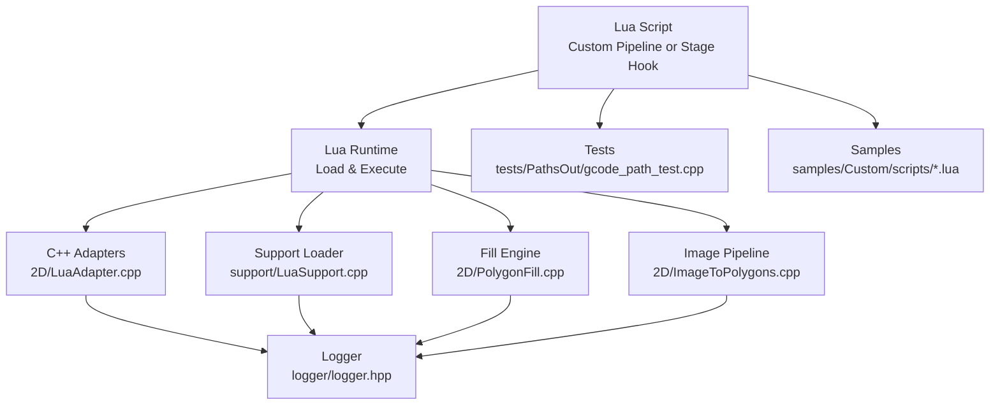
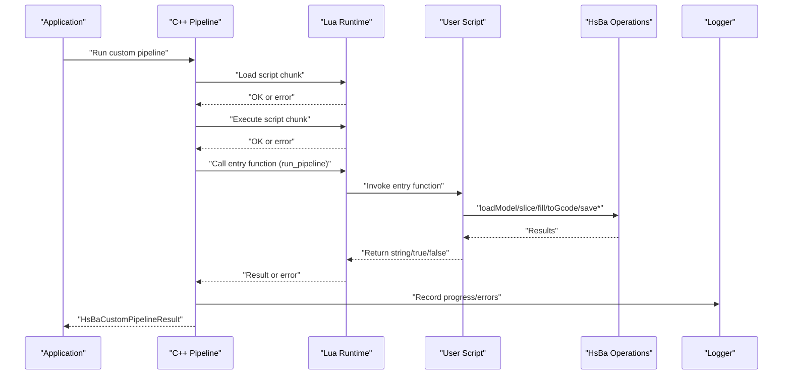
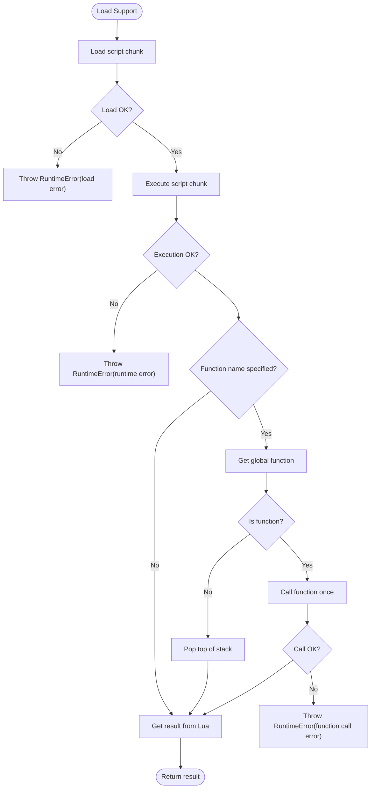
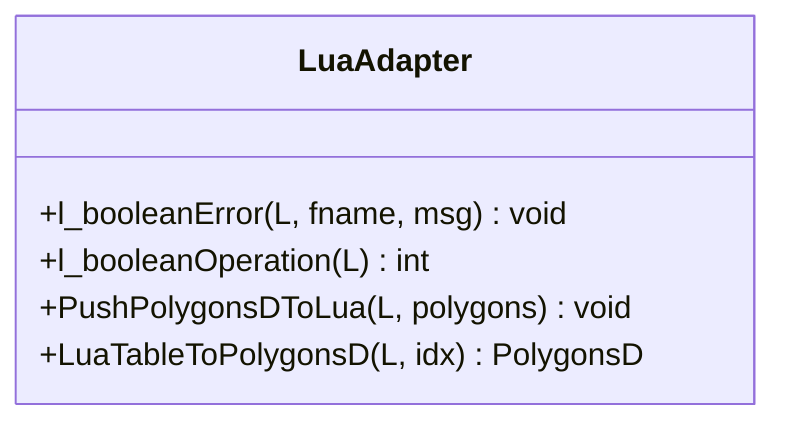
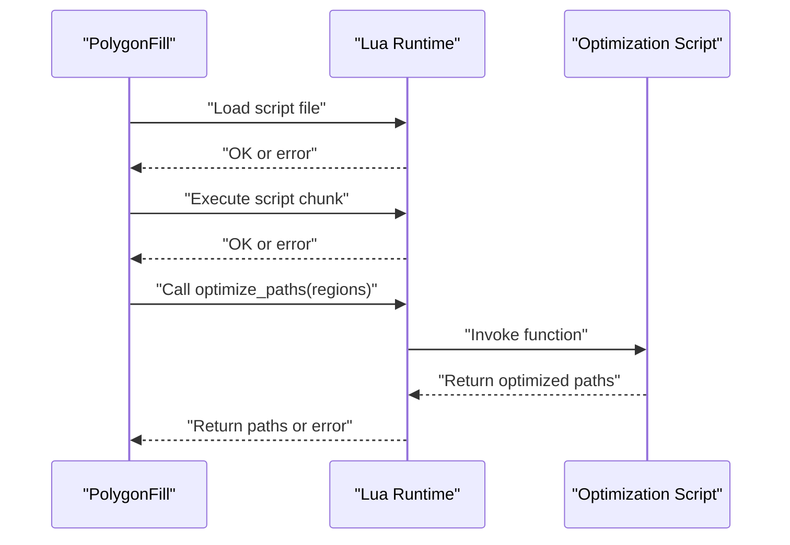
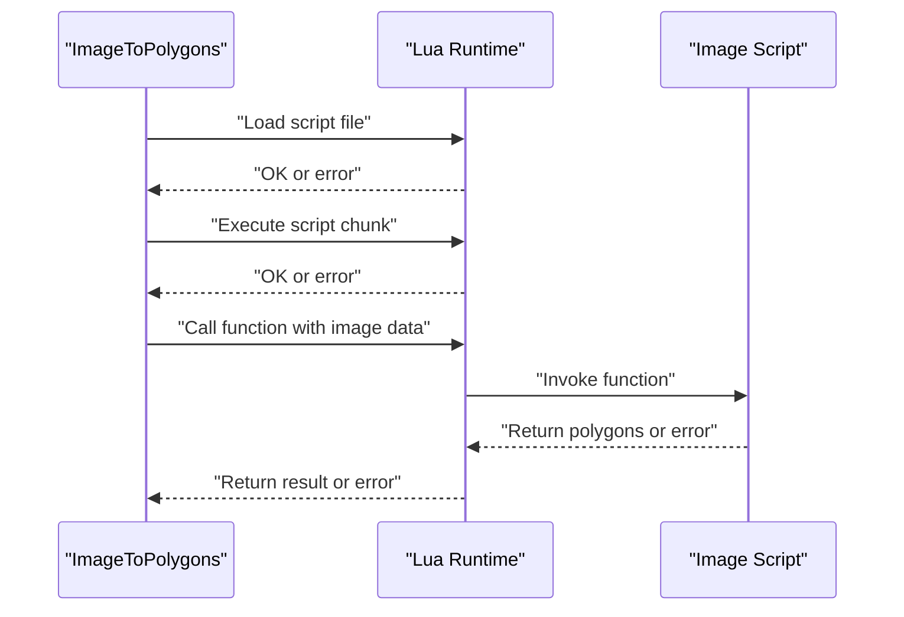
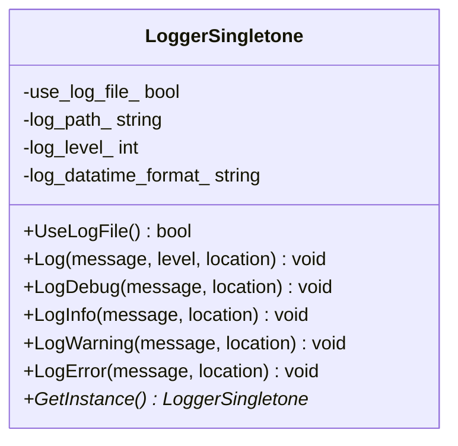
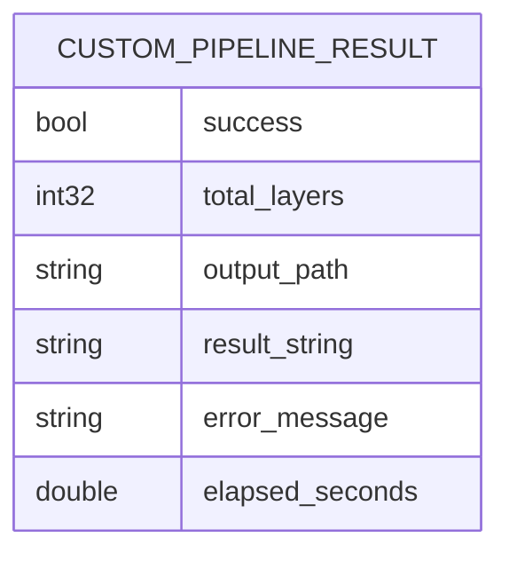
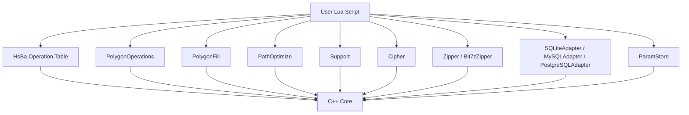

# Debugging and Troubleshooting Lua Scripts

<cite>
**Referenced Files in This Document**
- [README.md](file://README.md)
- [lua_pipeline_api.md](file://docs/en/lua_pipeline_api.md)
- [custom_pipeline.proto](file://proto/custom_pipeline.proto)
- [pipeline_types.h](file://pipelinetypes/pipeline_types.h)
- [LuaSupport.cpp](file://support/LuaSupport.cpp)
- [LuaAdapter.cpp](file://2D/LuaAdapter.cpp)
- [PolygonFill.cpp](file://2D/PolygonFill.cpp)
- [ImageToPolygons.cpp](file://2D/ImageToPolygons.cpp)
- [logger.hpp](file://logger/logger.hpp)
- [test_lua_adapter.lua](file://fileoperator/test_lua_adapter.lua)
- [gcode_path_test.cpp](file://tests/PathsOut/gcode_path_test.cpp)
- [my_waam_pipeline.lua](file://samples/Custom/scripts/my_waam_pipeline.lua)
</cite>

## Table of Contents
1. [Introduction](#introduction)
2. [Project Structure](#project-structure)
3. [Core Components](#core-components)
4. [Architecture Overview](#architecture-overview)
5. [Detailed Component Analysis](#detailed-component-analysis)
6. [Dependency Analysis](#dependency-analysis)
7. [Performance Considerations](#performance-considerations)
8. [Troubleshooting Guide](#troubleshooting-guide)
9. [Conclusion](#conclusion)
10. [Appendices](#appendices)

## Introduction
This document provides comprehensive debugging and troubleshooting guidance for Lua scripts used within HsBaSlicer. It covers:
- Practical debugging techniques using print statements, log file analysis, and integration with external debuggers
- Common error patterns, their causes, and resolution strategies
- Performance profiling methods, memory leak detection, and optimization techniques
- Troubleshooting integration issues, memory management problems, and pipeline execution failures
- Testing frameworks and unit testing approaches for Lua scripts, including mock objects and test data management
- Diagnostic tools and utilities for script development and maintenance

HsBaSlicer exposes two primary Lua environments:
- Custom Pipeline environment where the script controls the full stage order via a global operation table
- Built-in stage hooks where user scripts replace specific stages (support, fill, floor, export) while C++ controls the overall pipeline

The repository includes sample scripts and tests that demonstrate typical usage and expected behaviors.

**Section sources**
- [README.md:21-39](file://README.md#L21-L39)
- [lua_pipeline_api.md:19-28](file://docs/en/lua_pipeline_api.md#L19-L28)

## Project Structure
For Lua scripting and debugging, focus on these areas:
- Documentation describing the Lua API and environments
- Sample scripts demonstrating custom pipelines and built-in stage hooks
- Core adapters and support code that load, execute, and report errors from Lua
- Logger infrastructure for capturing runtime diagnostics
- Tests validating Lua behavior and post-processing

**Diagram sources**
- [lua_pipeline_api.md:19-28](file://docs/en/lua_pipeline_api.md#L19-L28)
- [LuaAdapter.cpp:16-43](file://2D/LuaAdapter.cpp#L16-L43)
- [LuaSupport.cpp:130-174](file://support/LuaSupport.cpp#L130-L174)
- [PolygonFill.cpp:1303-1319](file://2D/PolygonFill.cpp#L1303-L1319)
- [ImageToPolygons.cpp:428-512](file://2D/ImageToPolygons.cpp#L428-L512)
- [logger.hpp:35-122](file://logger/logger.hpp#L35-L122)
- [gcode_path_test.cpp:192-217](file://tests/PathsOut/gcode_path_test.cpp#L192-L217)
- [my_waam_pipeline.lua:1-33](file://samples/Custom/scripts/my_waam_pipeline.lua#L1-L33)

**Section sources**
- [lua_pipeline_api.md:19-28](file://docs/en/lua_pipeline_api.md#L19-L28)
- [my_waam_pipeline.lua:1-33](file://samples/Custom/scripts/my_waam_pipeline.lua#L1-L33)
- [logger.hpp:35-122](file://logger/logger.hpp#L35-L122)

## Core Components
Key components involved in running and debugging Lua scripts:
- Custom Pipeline API and shared libraries documented in the Lua API reference
- Support loader that loads and executes Lua chunks and functions, reporting errors to C++
- 2D Lua adapter providing polygon operations and error formatting
- Fill engine integrating Lua scripts for path optimization and fill generation
- Image pipeline loading and executing Lua scripts for image-to-polygons workflows
- Logger singleton for thread-safe logging across platforms

Practical implications for debugging:
- Use print statements in Lua scripts; they surface during load/execute phases
- Inspect C++ error messages thrown by Lua loaders/executors
- Leverage logger output for C++ side diagnostics around Lua integration points
- Validate both calling conventions (object method vs static class method) using provided test scripts

**Section sources**
- [lua_pipeline_api.md:48-133](file://docs/en/lua_pipeline_api.md#L48-L133)
- [LuaSupport.cpp:130-174](file://support/LuaSupport.cpp#L130-L174)
- [LuaAdapter.cpp:16-43](file://2D/LuaAdapter.cpp#L16-L43)
- [PolygonFill.cpp:1303-1319](file://2D/PolygonFill.cpp#L1303-L1319)
- [ImageToPolygons.cpp:428-512](file://2D/ImageToPolygons.cpp#L428-L512)
- [logger.hpp:35-122](file://logger/logger.hpp#L35-L122)

## Architecture Overview
The end-to-end flow for a custom pipeline script involves:
- C++ constructs configuration and context globals
- Lua script defines an entry function (default run_pipeline)
- C++ loads and executes the script chunk, then calls the entry function
- The script uses the HsBa operation table and shared libraries to perform slicing, support, fill, path generation, and packaging
- Results are returned to C++, which records success flags, layer counts, output paths, error messages, and elapsed time

**Diagram sources**
- [lua_pipeline_api.md:48-133](file://docs/en/lua_pipeline_api.md#L48-L133)
- [custom_pipeline.proto:23-30](file://proto/custom_pipeline.proto#L23-L30)
- [pipeline_types.h:698-726](file://pipelinetypes/pipeline_types.h#L698-L726)
- [LuaSupport.cpp:130-174](file://support/LuaSupport.cpp#L130-L174)
- [logger.hpp:35-122](file://logger/logger.hpp#L35-L122)

**Section sources**
- [lua_pipeline_api.md:48-133](file://docs/en/lua_pipeline_api.md#L48-L133)
- [custom_pipeline.proto:23-30](file://proto/custom_pipeline.proto#L23-L30)
- [pipeline_types.h:698-726](file://pipelinetypes/pipeline_types.h#L698-L726)

## Detailed Component Analysis

### Lua Support Loader
The Lua support loader is responsible for loading script content, executing it, and optionally invoking a named function. It captures Lua errors and converts them into C++ exceptions with descriptive messages.

**Diagram sources**
- [LuaSupport.cpp:130-174](file://support/LuaSupport.cpp#L130-L174)

**Section sources**
- [LuaSupport.cpp:130-174](file://support/LuaSupport.cpp#L130-L174)

### 2D Lua Adapter
The 2D Lua adapter provides polygon boolean operations and helper utilities. It formats error messages for invalid arguments and unknown operations, aiding in diagnosing misuse of geometry APIs.

**Diagram sources**
- [LuaAdapter.cpp:16-43](file://2D/LuaAdapter.cpp#L16-L43)

**Section sources**
- [LuaAdapter.cpp:16-43](file://2D/LuaAdapter.cpp#L16-L43)

### Polygon Fill Integration
The fill engine integrates Lua scripts for pre-optimization and fill generation. It loads Lua files, executes them, and handles errors when scripts fail to load or execute.

**Diagram sources**
- [PolygonFill.cpp:1303-1319](file://2D/PolygonFill.cpp#L1303-L1319)

**Section sources**
- [PolygonFill.cpp:1303-1319](file://2D/PolygonFill.cpp#L1303-L1319)

### Image Pipeline Lua Integration
The image pipeline loads and executes Lua scripts for image-to-polygons conversion. It reports errors from both loading and execution phases.

**Diagram sources**
- [ImageToPolygons.cpp:428-512](file://2D/ImageToPolygons.cpp#L428-L512)

**Section sources**
- [ImageToPolygons.cpp:428-512](file://2D/ImageToPolygons.cpp#L428-L512)

### Logger Infrastructure
The logger provides thread-safe, cross-platform logging with leveled output and fluent literals. It supports checking whether file logging is enabled and offers multiple logging levels.

**Diagram sources**
- [logger.hpp:35-122](file://logger/logger.hpp#L35-L122)

**Section sources**
- [logger.hpp:35-122](file://logger/logger.hpp#L35-L122)

### Custom Pipeline Result Contract
The custom pipeline result contract defines fields for success, total layers, output path, result string, error message, and elapsed seconds. These fields are mirrored in protobuf definitions and C-compatible structs.

**Diagram sources**
- [custom_pipeline.proto:23-30](file://proto/custom_pipeline.proto#L23-L30)
- [pipeline_types.h:698-726](file://pipelinetypes/pipeline_types.h#L698-L726)

**Section sources**
- [custom_pipeline.proto:23-30](file://proto/custom_pipeline.proto#L23-L30)
- [pipeline_types.h:698-726](file://pipelinetypes/pipeline_types.h#L698-L726)

## Dependency Analysis
Lua scripts depend on:
- Shared libraries (PolygonOperations, PolygonFill, PathOptimize, Support, Cipher, Zipper, database adapters, ParamStore)
- Environment-specific globals (HsBa operation table, context variables)
- C++ adapters that enforce type safety and provide error reporting

**Diagram sources**
- [lua_pipeline_api.md:136-213](file://docs/en/lua_pipeline_api.md#L136-L213)

**Section sources**
- [lua_pipeline_api.md:136-213](file://docs/en/lua_pipeline_api.md#L136-L213)

## Performance Considerations
Guidelines for profiling and optimizing Lua scripts in HsBaSlicer:
- Prefer integer precision for boolean and fill operations; convert between float and integer polygons using HsBa.toInt/HsBa.toDouble
- Use PathOptimize.optimizeRegions/optimizePolygons to reduce traversal overhead and improve path continuity
- Batch model operations and avoid repeated loadModel/removeModel cycles; reuse models where possible
- Minimize large intermediate polygon sets; process per-layer data incrementally
- Avoid excessive file I/O inside tight loops; write outputs at stage boundaries
- Profile critical sections by measuring elapsed time and correlating with progress callbacks

Memory management tips:
- Remove models after use via HsBa.removeModel to free resources
- Be cautious with large byte arrays passed to Zipper.AddByteFile; prefer AddFile for disk-backed entries
- Monitor memory growth when generating many layers or complex fills; consider downsampling or simplifying polygons before processing

Integration performance:
- Keep Lua scripts focused on algorithmic logic; offload heavy computation to C++ where available
- Use efficient data structures (tables of points/polygons) and avoid unnecessary conversions

[No sources needed since this section provides general guidance]

## Troubleshooting Guide

### Common Error Patterns and Resolutions
- Syntax or load errors in Lua scripts:
  - Cause: Malformed Lua syntax or missing dependencies
  - Resolution: Validate script syntax locally; ensure required libraries are registered in the current environment
  - Evidence: Load errors are reported by Lua loaders and converted to C++ exceptions
  - Section sources
    - [LuaSupport.cpp:130-174](file://support/LuaSupport.cpp#L130-L174)
    - [PolygonFill.cpp:1303-1319](file://2D/PolygonFill.cpp#L1303-L1319)
    - [ImageToPolygons.cpp:428-512](file://2D/ImageToPolygons.cpp#L428-L512)

- Invalid argument types or unknown operations:
  - Cause: Passing incorrect types to Lua-bound functions or using unsupported operation names
  - Resolution: Verify parameter types and supported operation strings; consult API documentation
  - Evidence: Adapter functions raise formatted errors for invalid inputs
  - Section sources
    - [LuaAdapter.cpp:16-43](file://2D/LuaAdapter.cpp#L16-L43)

- Export script return value mismatches:
  - Cause: Returning unexpected types or structures from export functions
  - Resolution: Return the agreed structure with success flag and export path; maintain consistent casing for object methods
  - Evidence: Documentation warns about wrong return types causing empty or overwritten outputs
  - Section sources
    - [lua_pipeline_api.md:246-260](file://docs/en/lua_pipeline_api.md#L246-L260)

- Calling convention confusion:
  - Cause: Mixing object method syntax (obj:Method) with static class syntax (Class.Method)
  - Resolution: Use the correct calling convention for each bound object; verify availability via type checks
  - Evidence: Test script demonstrates both conventions and conditional availability
  - Section sources
    - [test_lua_adapter.lua:1-66](file://fileoperator/test_lua_adapter.lua#L1-L66)

### Integration Issues
- Missing optional adapters:
  - Cause: Optional features not compiled (e.g., MySQL, PostgreSQL, Bit7z)
  - Resolution: Check compile-time macros and conditionally handle unavailable adapters
  - Evidence: Test script prints availability status based on macros
  - Section sources
    - [test_lua_adapter.lua:33-64](file://fileoperator/test_lua_adapter.lua#L33-L64)

- Context globals not set:
  - Cause: Running scripts outside the expected environment (e.g., built-in stage hook vs custom pipeline)
  - Resolution: Ensure scripts are loaded in the correct environment; use environment-appropriate globals
  - Evidence: API documentation distinguishes environments and injected globals
  - Section sources
    - [lua_pipeline_api.md:19-28](file://docs/en/lua_pipeline_api.md#L19-L28)

### Memory Management Problems
- Model leaks:
  - Cause: Not removing models after processing
  - Resolution: Call HsBa.removeModel when done; reuse models where appropriate
  - Evidence: Custom pipeline examples include removeModel calls
  - Section sources
    - [lua_pipeline_api.md:77-88](file://docs/en/lua_pipeline_api.md#L77-L88)

- Large temporary data:
  - Cause: Generating excessive intermediate polygons or byte buffers
  - Resolution: Process incrementally; prefer disk-backed files for large archives
  - Evidence: Zipper APIs support AddFile and AddByteFile; choose appropriately
  - Section sources
    - [lua_pipeline_api.md:183-192](file://docs/en/lua_pipeline_api.md#L183-L192)

### Pipeline Execution Failures
- Entry function not found or returns wrong type:
  - Cause: Incorrect function name or return value
  - Resolution: Define the agreed entry function; return string/true for success, false/nil for failure
  - Evidence: API documentation specifies entry function behavior and return semantics
  - Section sources
    - [lua_pipeline_api.md:48-54](file://docs/en/lua_pipeline_api.md#L48-L54)

- Progress and output reporting inconsistencies:
  - Cause: Not setting total layers or output path
  - Resolution: Use HsBa.setLayers and HsBa.setOutputPath to mirror state to C++
  - Evidence: API documentation lists control and file IO operations
  - Section sources
    - [lua_pipeline_api.md:67-76](file://docs/en/lua_pipeline_api.md#L67-L76)

### Post-processing and G-code Variants
- Empty scripts short-circuit to base output:
  - Cause: No customization applied
  - Resolution: Provide meaningful post-processing logic if needed
  - Evidence: Tests validate empty script behavior
  - Section sources
    - [gcode_path_test.cpp:192-217](file://tests/PathsOut/gcode_path_test.cpp#L192-L217)

- Firmware and printer config globals:
  - Cause: Misunderstanding available globals in post-processing
  - Resolution: Access firmware and printer_config as documented; ensure correct firmware selection
  - Evidence: Tests assert global values and formatting
  - Section sources
    - [gcode_path_test.cpp:192-217](file://tests/PathsOut/gcode_path_test.cpp#L192-L217)

## Conclusion
Effective debugging of Lua scripts in HsBaSlicer requires understanding both the Lua API and the C++ integration points. Use print statements for quick checks, inspect C++ error messages for loader/executor failures, and leverage the logger for deeper diagnostics. Follow best practices for memory management, performance optimization, and correct usage of shared libraries. When encountering integration issues, validate environment setup, calling conventions, and return contracts. The provided samples and tests serve as reliable references for expected behavior and common pitfalls.

[No sources needed since this section summarizes without analyzing specific files]

## Appendices

### Quick Reference: Debugging Techniques
- Print statements:
  - Use print in Lua scripts to trace execution flow and variable states
  - Combine with conditional checks to limit output during normal runs
- Log file analysis:
  - Enable file logging via logger configuration; review logs around Lua load/execute boundaries
  - Correlate timestamps with progress callbacks to pinpoint slow stages
- External debugger integration:
  - Attach a native debugger to the host application to step through C++ adapters
  - Inspect Lua stack traces from error messages to locate failing lines in scripts

### Testing Frameworks and Unit Testing Approaches
- Use existing tests as templates:
  - Validate Lua post-processing variants and global visibility
  - Confirm both calling conventions for bound objects
- Mock objects:
  - Replace expensive operations (e.g., file I/O, network access) with stubs in tests
  - Assert expected interactions and return values
- Test data management:
  - Prepare minimal polygon datasets and fixture files
  - Parameterize tests across different configurations and firmware targets

### Diagnostic Tools and Utilities
- Logger utilities:
  - Use leveled logging to separate debug, info, warning, and error messages
  - Check UseLogFile to determine output destination
- API validation:
  - Run test_lua_adapter.lua to verify availability of optional adapters and calling conventions
  - Cross-check against lua_pipeline_api.md for environment-specific capabilities

**Section sources**
- [logger.hpp:35-122](file://logger/logger.hpp#L35-L122)
- [test_lua_adapter.lua:1-66](file://fileoperator/test_lua_adapter.lua#L1-L66)
- [lua_pipeline_api.md:19-28](file://docs/en/lua_pipeline_api.md#L19-L28)