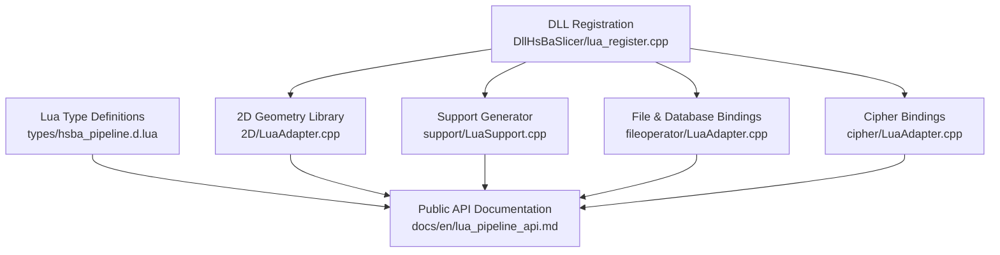
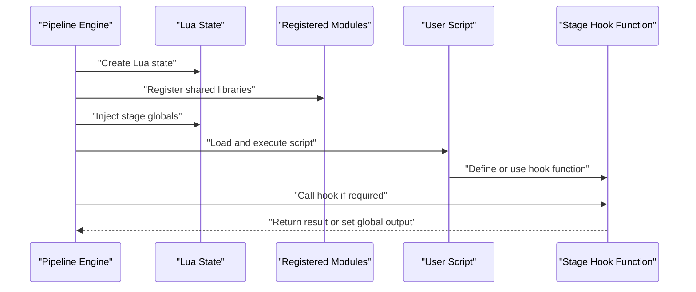
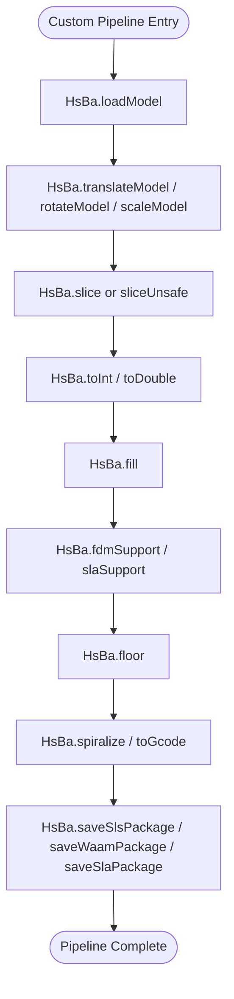
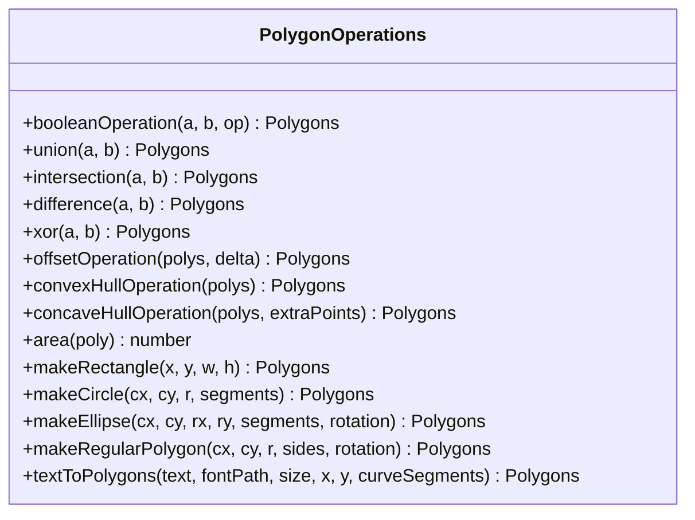
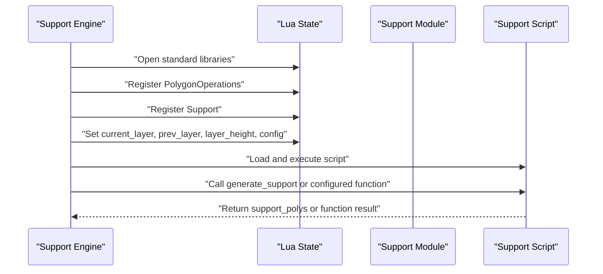
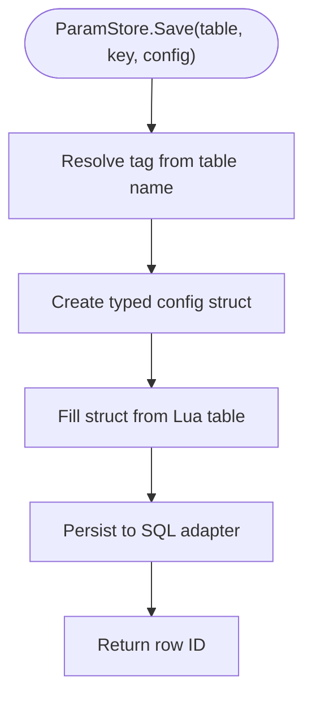
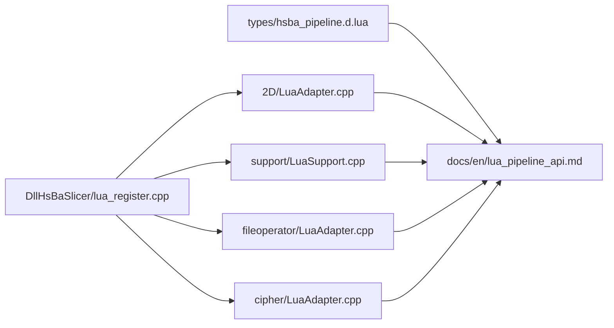

# Lua API Reference

<cite>
**Referenced Files in This Document**
- [hsba_pipeline.d.lua](file://types/hsba_pipeline.d.lua)
- [lua_register.cpp](file://DllHsBaSlicer/lua_register.cpp)
- [LuaAdapter.cpp](file://2D/LuaAdapter.cpp)
- [LuaSupport.cpp](file://support/LuaSupport.cpp)
- [LuaAdapter.cpp](file://fileoperator/LuaAdapter.cpp)
- [LuaAdapter.cpp](file://cipher/LuaAdapter.cpp)
- [lua_pipeline_api.md](file://docs/en/lua_pipeline_api.md)
- [README.md](file://docs/en/DllHsBaSlicer/README.md)
</cite>

## Table of Contents
1. [Introduction](#introduction)
2. [Project Structure](#project-structure)
3. [Core Components](#core-components)
4. [Architecture Overview](#architecture-overview)
5. [Detailed Component Analysis](#detailed-component-analysis)
6. [Dependency Analysis](#dependency-analysis)
7. [Performance Considerations](#performance-considerations)
8. [Troubleshooting Guide](#troubleshooting-guide)
9. [Conclusion](#conclusion)
10. [Appendices](#appendices)

## Introduction
This document is the comprehensive Lua API reference for HsBaSlicer. It documents every Lua-accessible object and function exposed to pipeline scripts, including:

- The `HsBa` global operations table used by Custom pipelines.
- Shared utility libraries available in all pipeline stages: `PolygonOperations`, `PolygonFill`, `PathOptimize`, `Support`, `Zipper`, `Bit7zZipper`, `Cipher`, `SQLiteAdapter`, `MySQLAdapter`, `PostgreSQLAdapter`, and `ParamStore`.
- Built-in stage environments such as FDM support/fill, SLA floor/export, SLS/SLM/LOM/TDP export, and WAAM robot path generation.

The API surface is defined primarily through:

- A Lua type definition file that describes signatures, parameters, return types, and built-in stage globals.
- C++ Lua bindings that register functions into the Lua state.
- Documentation describing how the script environment is injected and how entry functions are invoked.

All coordinates in the `HsBa` operations table are expressed in millimeters unless otherwise documented. Polygon data is represented as arrays of point tables with numeric `x` and `y` fields.

## Project Structure
The Lua API is implemented across several modules:

| Area | Responsibility | Key Files |
|---|---|---|
| Type definitions | IDE hints, function signatures, built-in stage globals | `types/hsba_pipeline.d.lua` |
| 2D geometry library | Boolean operations, hulls, area, shape generators | `2D/LuaAdapter.cpp` |
| Support generator | Lua-based custom support generation | `support/LuaSupport.cpp`, `support/LuaAdapter.cpp` |
| File/database utilities | Zipper, Bit7zZipper, SQL adapters, ParamStore | `fileoperator/LuaAdapter.cpp` |
| Cipher utilities | Base64/hex encoding and decoding | `cipher/LuaAdapter.cpp` |
| Pipeline registration | External function/event callback registration | `DllHsBaSlicer/lua_register.cpp` |
| Public documentation | Script environment, `HsBa` operation summary | `docs/en/lua_pipeline_api.md`, `docs/en/DllHsBaSlicer/README.md` |

**Diagram sources**
- [hsba_pipeline.d.lua:1-663](file://types/hsba_pipeline.d.lua#L1-L663)
- [lua_register.cpp:1-43](file://DllHsBaSlicer/lua_register.cpp#L1-L43)
- [LuaAdapter.cpp:487-491](file://2D/LuaAdapter.cpp#L487-L491)
- [LuaSupport.cpp:1-180](file://support/LuaSupport.cpp#L1-L180)
- [LuaAdapter.cpp:1109-1351](file://fileoperator/LuaAdapter.cpp#L1109-L1351)
- [LuaAdapter.cpp:92-96](file://cipher/LuaAdapter.cpp#L92-L96)
- [lua_pipeline_api.md:89-217](file://docs/en/lua_pipeline_api.md#L89-L217)

**Section sources**
- [hsba_pipeline.d.lua:1-663](file://types/hsba_pipeline.d.lua#L1-L663)
- [lua_register.cpp:1-43](file://DllHsBaSlicer/lua_register.cpp#L1-L43)
- [lua_pipeline_api.md:89-217](file://docs/en/lua_pipeline_api.md#L89-L217)
- [README.md:483-501](file://docs/en/DllHsBaSlicer/README.md#L483-L501)

## Core Components
The Lua API can be grouped into six major areas:

1. **Shared geometric and fill primitives**: `PolygonOperations`, `PolygonFill`, `PathOptimize`.
2. **Process helpers**: `Support`, `HsBa.fill`, `HsBa.fdmSupport`, `HsBa.slaSupport`, `HsBa.floor`.
3. **Model and slicing operations**: `HsBa.loadModel`, `modelInfo`, `translateModel`, `rotateModel`, `scaleModel`, `layerCount`, `layerZ`, `slice`, `sliceUnsafe`, `toInt`, `toDouble`.
4. **Path and output operations**: `HsBa.spiralize`, `HsBa.toGcode`, `HsBa.saveSlsPackage`, `HsBa.saveWaamPackage`, `HsBa.saveSlaPackage`, `HsBa.renderImage`.
5. **Packaging and persistence**: `Zipper`, `Bit7zZipper`, `Cipher`, `SQLiteAdapter`, `MySQLAdapter`, `PostgreSQLAdapter`, `ParamStore`.
6. **Built-in stage environments**: FDM support/fill, SLA floor/export, SLS/SLM/LOM/TDP export, WAAM robot path, and Custom pipeline entry.

The authoritative signature surface is declared in the Lua type definition file. The C++ binding files implement the runtime behavior.

**Section sources**
- [hsba_pipeline.d.lua:35-187](file://types/hsba_pipeline.d.lua#L35-L187)
- [hsba_pipeline.d.lua:290-463](file://types/hsba_pipeline.d.lua#L290-L463)
- [lua_pipeline_api.md:140-217](file://docs/en/lua_pipeline_api.md#L140-L217)

## Architecture Overview
At runtime, a pipeline script runs inside a Lua state created by HsBaSlicer. During setup:

1. The C++ pipeline layer creates or configures a Lua state.
2. Standard Lua libraries are opened.
3. Shared modules are registered: `PolygonOperations`, `Support`, `Zipper`, `Bit7zZipper`, `Cipher`, `SQLiteAdapter`, `MySQLAdapter`, `PostgreSQLAdapter`, and others.
4. Stage-specific globals such as `current_layer`, `prev_layer`, `layer_height`, `config`, `output_path`, `pipeline_config`, and entry functions are injected.
5. The user script is loaded and executed.
6. For stage hooks, the engine may call a named function such as `generate_support`, `generate_fill`, `generate_floor`, `export_sls`, `export_waam`, or `run_pipeline`.

**Diagram sources**
- [LuaSupport.cpp:67-90](file://support/LuaSupport.cpp#L67-L90)
- [LuaSupport.cpp:113-177](file://support/LuaSupport.cpp#L113-L177)
- [hsba_pipeline.d.lua:465-623](file://types/hsba_pipeline.d.lua#L465-L623)

**Section sources**
- [LuaSupport.cpp:67-177](file://support/LuaSupport.cpp#L67-L177)
- [hsba_pipeline.d.lua:465-623](file://types/hsba_pipeline.d.lua#L465-L623)

## Detailed Component Analysis

### HsBa Global Operations Table
`HsBa` is the main operations table available in Custom pipeline environments. It provides model management, slicing, coordinate conversion, fill, support, floor, path, and export functionality.

#### Model Management
| Method | Parameters | Returns | Description |
|---|---|---|---|
| `loadModel(name, path)` | `name: string`, `path: string` | `boolean` | Loads a 3D model into the model pool under the given name. |
| `modelInfo(name)` | `name: string` | `ModelInfo` | Returns bounding box minimum, maximum, and volume. |
| `translateModel(name, offset)` | `name: string`, `offset: Point3D` | None | Translates the model by a 3D offset. |
| `rotateModel(name, quaternion)` | `name: string`, `quaternion: Quaternion` | None | Rotates the model using a quaternion. |
| `scaleModel(name, scale)` | `name: string`, `scale: number or Point3D` | None | Scales the model uniformly or per axis. |
| `removeModel(name)` | `name: string` | None | Removes a model from the pool. |
| `modelNames()` | None | `string[]` | Lists all model names currently in the pool. |

`ModelInfo` contains:

| Field | Type | Description |
|---|---|---|
| `bbox_min` | `{ x, y, z }` | Minimum bounding box corner. |
| `bbox_max` | `{ x, y, z }` | Maximum bounding box corner. |
| `volume` | `number` | Model volume. |

#### Slicing Operations
| Method | Parameters | Returns | Description |
|---|---|---|---|
| `layerCount(name, layerHeight, firstLayerHeight)` | `name: string`, `layerHeight: number`, `firstLayerHeight: number` | `integer` | Computes total layer count based on model height and layer heights. |
| `layerZ(index, layerHeight, firstLayerHeight)` | `index: integer`, `layerHeight: number`, `firstLayerHeight: number` | `number` | Returns the Z height of a 0-based layer index. |
| `slice(name, z)` | `name: string`, `z: number` | `Polygons` | Performs safe slicing at height `z`, returning closed contours. |
| `sliceUnsafe(name, z)` | `name: string`, `z: number` | `Polygons` | Performs normalized unsafe slicing; open contours may be dropped. |

#### Coordinate Conversion
| Method | Parameters | Returns | Description |
|---|---|---|---|
| `toInt(polys)` | `polys: Polygons` | `Polygons` | Converts floating-point polygons to integer polygons. |
| `toDouble(polys)` | `polys: Polygons` | `Polygons` | Converts integer polygons to floating-point polygons. |

#### Fill Operations
| Method | Parameters | Returns | Description |
|---|---|---|---|
| `fill(polys, options?)` | `polys: Polygons`, `options?: FillOptions` | `Polygons` | Generates fill paths. Default spacing is `0.4`; default mode is `"zigzag"`; default angle is `45.0`; default border count is `0`. When `borderCount > 0`, perimeters and fill are generated. |

`FillOptions`:

| Field | Type | Default | Description |
|---|---|---|---|
| `spacing` | `number?` | `0.4` | Fill spacing. |
| `mode` | `string?` | `"zigzag"` | Fill mode: `"line"`, `"zigzag"`, or `"simpleZigzag"`. |
| `angle` | `number?` | `45.0` | Fill angle in degrees. |
| `borderCount` | `integer?` | `0` | Number of perimeter borders. |

#### Support Generation
| Method | Parameters | Returns | Description |
|---|---|---|---|
| `fdmSupport(layers, config?)` | `layers: LayerList`, `config?: SupportOptions` | `LayerList` | Generates per-layer FDM support. |
| `slaSupport(layers, config?)` | `layers: LayerList`, `config?: SupportOptions` | `LayerList` | Generates per-layer SLA support. |

`SupportOptions` includes common fields such as overhang angle, layer height, support gap, support diameter, support density, support pattern, tree branch angle, tree max branch radius, honeycomb cell size, interface layers, interface density, tip diameter, and raft thickness.

#### Floor Generation
| Method | Parameters | Returns | Description |
|---|---|---|---|
| `floor(bottomPolygons, config?)` | `bottomPolygons: Polygons`, `config?: FloorConfig` | `Polygons` | Generates an SLA bottom floor or raft. |

`FloorConfig` includes raft offset, border width, fill spacing, fill angle in degrees, border count, convex hull usage, and concave hull points.

#### Path Operations
| Method | Parameters | Returns | Description |
|---|---|---|---|
| `spiralize(sections, options?)` | `sections: LayerList`, `options?: SpiralizeOptions` | `Point3D[]` | Creates a continuous spiral path suitable for FDM vase mode. |
| `toGcode(layers, config)` | `layers: LayerPathInput[]`, `config: GcodeOptions` | `string` | Generates G-code text from layered path input. |

`LayerPathInput` supports outlines, fills, supports, and Z height per layer. `GcodeOptions` includes layer height, line width, print speed, travel speed, extrusion multiplier, firmware, nozzle diameter, filament diameter, temperatures, retraction length, and retraction speed.

#### Export Functions
| Method | Parameters | Returns | Description |
|---|---|---|---|
| `saveSlsPackage(input)` | `input: SlsPackageInput` | `boolean` | Packages SLS/SLM/LOM/TDP output as zip plus optional Lua export script. |
| `saveWaamPackage(input)` | `input: WaamPackageInput` | `boolean, string?` | Packages WAAM robot path output; may return generated program text. |
| `saveSlaPackage(input)` | `input: SlaPackageInput` | `boolean` | Packages SLA output including layer images, floor, supports, and configuration. |
| `renderImage(polys, width, height, path)` | `polys: Polygons`, `width: integer`, `height: integer`, `path: string` | `boolean` | Renders polygon outlines to an image file. |

`SlsPackageInput` includes layer outlines, Z heights, JSON config, output zip path, Lua script path, and export function name.  
`WaamPackageInput` includes layer outlines, Z heights, weld parameters, robot type, bead width, config, output path, custom script, and export function name.  
`SlaPackageInput` includes layer outlines, supports, floor, config, output zip path, image dimensions, and image extension.

**Diagram sources**
- [hsba_pipeline.d.lua:322-463](file://types/hsba_pipeline.d.lua#L322-L463)
- [lua_pipeline_api.md:89-112](file://docs/en/lua_pipeline_api.md#L89-L112)

**Section sources**
- [hsba_pipeline.d.lua:193-463](file://types/hsba_pipeline.d.lua#L193-L463)
- [lua_pipeline_api.md:89-112](file://docs/en/lua_pipeline_api.md#L89-L112)
- [README.md:486-501](file://docs/en/DllHsBaSlicer/README.md#L486-L501)

### PolygonOperations
`PolygonOperations` provides 2D boolean operations, offsets, hulls, area calculation, and shape generators. All polygon inputs and outputs are arrays of point tables.

| Function | Signature | Return | Description |
|---|---|---|---|
| `booleanOperation(a, b, op)` | `(Polygons, Polygons, string) → Polygons` | `Polygons` | Generic boolean operation where `op` is `"union"`, `"intersection"`, `"difference"`, or `"xor"`. |
| `union(a, b)` | `(Polygons, Polygons) → Polygons` | `Polygons` | Union of two polygon sets. |
| `intersection(a, b)` | `(Polygons, Polygons) → Polygons` | `Polygons` | Intersection of two polygon sets. |
| `difference(a, b)` | `(Polygons, Polygons) → Polygons` | `Polygons` | Difference of two polygon sets. |
| `xor(a, b)` | `(Polygons, Polygons) → Polygons` | `Polygons` | Exclusive-or of two polygon sets. |
| `offsetOperation(polys, delta)` | `(Polygons, number) → Polygons` | `Polygons` | Inward/outward offset; positive delta expands. |
| `convexHullOperation(polys)` | `(Polygons) → Polygons` | `Polygons` | Convex hull for each polygon. |
| `concaveHullOperation(polys, extraPoints)` | `(Polygons, integer) → Polygons` | `Polygons` | Concave hull simulation with additional points. |
| `area(poly)` | `(Polygon) → number` | `number` | Computes polygon area. |
| `makeRectangle(x, y, w, h)` | `(number, number, number, number) → Polygons` | `Polygons` | Creates a rectangle polygon. |
| `makeCircle(cx, cy, r, segments?)` | `(number, number, number, integer?) → Polygons` | `Polygons` | Creates a circle polygon. |
| `makeEllipse(cx, cy, rx, ry, segments?, rotation?)` | `(number, number, number, number, integer?, number?) → Polygons` | `Polygons` | Creates an ellipse polygon. |
| `makeRegularPolygon(cx, cy, r, sides, rotation?)` | `(number, number, number, integer, number?) → Polygons` | `Polygons` | Creates a regular polygon. |
| `textToPolygons(text, fontPath, size, x?, y?, curveSegments?)` | `(string, string, number, number?, number?, integer?) → Polygons` | `Polygons` | Converts text to polygon outlines. |

Implementation notes:

- `booleanOperation` validates argument count and types, converts Lua tables to internal polygon types, dispatches by operation string, and pushes results back to Lua.
- Shape generators accept optional parameters with defaults when more arguments are provided.
- Debug dump functions `dumpPolygon` and `dumpPolygons` are conditionally compiled only when `HSBA_POLYGON_DUMP` is enabled.

**Diagram sources**
- [LuaAdapter.cpp:22-273](file://2D/LuaAdapter.cpp#L22-L273)
- [LuaAdapter.cpp:311-329](file://2D/LuaAdapter.cpp#L311-L329)
- [LuaAdapter.cpp:487-491](file://2D/LuaAdapter.cpp#L487-L491)
- [hsba_pipeline.d.lua:35-51](file://types/hsba_pipeline.d.lua#L35-L51)

**Section sources**
- [LuaAdapter.cpp:22-329](file://2D/LuaAdapter.cpp#L22-L329)
- [LuaAdapter.cpp:487-491](file://2D/LuaAdapter.cpp#L487-L491)
- [hsba_pipeline.d.lua:35-51](file://types/hsba_pipeline.d.lua#L35-L51)
- [lua_pipeline_api.md:140-155](file://docs/en/lua_pipeline_api.md#L140-L155)

### PolygonFill
`PolygonFill` provides fill algorithms that convert polygon boundaries into path-like polygons.

| Function | Signature | Return | Description |
|---|---|---|---|
| `offsetFill(polys, spacing)` | `(Polygons, number) → Polygons` | `Polygons` | Offset-based fill. |
| `lineFill(polys, spacing, angle, lineThickness)` | `(Polygons, number, number, number) → Polygons` | `Polygons` | Line-based fill. |
| `simpleZigzagFill(polys, spacing, angle, lineThickness)` | `(Polygons, number, number, number) → Polygons` | `Polygons` | Simple zigzag fill. |
| `zigzagFill(polys, spacing, angle, lineThickness)` | `(Polygons, number, number, number) → Polygons` | `Polygons` | Zigzag fill. |
| `compositeOffsetFill(polys, spacing, offsetStep, outwardCount, inwardCount, mode, angle, lineThickness, opts?)` | `(Polygons, number, number, integer, integer, string, number, number, table?) → Polygons` | `Polygons` | Composite offset fill with multiple passes. |
| `hybridFill(polys, spacing, offsetStep, outwardCount, inwardCount, mode, angle, lineThickness, opts?)` | `(Polygons, number, number, integer, integer, string, number, number, table?) → Polygons` | `Polygons` | Hybrid fill combining strategies. |
| `offsetOnly(polys, spacing)` | `(Polygons, number) → Polygons` | `Polygons` | Offset-only fill. |

These functions accept integer polygon sets plus spacing, angle, and thickness parameters, and return fill-path polygons.

**Section sources**
- [hsba_pipeline.d.lua:53-62](file://types/hsba_pipeline.d.lua#L53-L62)
- [lua_pipeline_api.md:157-182](file://docs/en/lua_pipeline_api.md#L157-L182)

### PathOptimize
`PathOptimize` provides path ordering optimization to reduce empty travel moves.

| Member | Signature | Return | Description |
|---|---|---|---|
| `new()` | `() → PathOptimizeInstance` | Instance | Creates a new optimizer instance. |
| `optimizeRegions(regions)` | `(Polygons[]) → Polygons` | `Polygons` | Optimizes region order and returns combined paths. |
| `optimizePolygons(regions)` | `(Polygons[]) → Polygons` | `Polygons` | Optimizes polygon region order. |
| `addRegion(self, regionId, paths)` | `(self, integer, Polygons) → void` | None | Adds a named region with polygon paths. |
| `addPolygons(self, regionId, polygons)` | `(self, integer, Polygons) → void` | None | Adds polygons to a region. |
| `addRoute(self, fromId, toId, cost)` | `(self, integer, integer, number) → void` | None | Adds a route between regions with a cost. |
| `optimizeOrder(self)` | `(self) → integer[]` | `integer[]` | Returns optimized region IDs. |
| `buildPaths(self)` | `(self) → Polygons` | `Polygons` | Builds optimized paths. |
| `buildPolygons(self)` | `(self) → Polygons` | `Polygons` | Builds optimized polygons. |

**Section sources**
- [hsba_pipeline.d.lua:64-77](file://types/hsba_pipeline.d.lua#L64-L77)

### Support
The `Support` module allows Lua scripts to generate custom support structures. It exposes factory methods for plane, tree, honeycomb, SLA, and Lua-based support objects, plus helper functions for overhang detection and default configuration.

| Member | Signature | Return | Description |
|---|---|---|---|
| `new_plane()` | `() → SupportObject` | Object | Creates a plane support object. |
| `new_tree()` | `() → SupportObject` | Object | Creates a tree support object. |
| `new_honeycomb()` | `() → SupportObject` | Object | Creates a honeycomb support object. |
| `new_sla()` | `() → SupportObject` | Object | Creates an SLA support object. |
| `new_lua(script, funcName?)` | `(string, string?) → SupportObject` | Object | Creates a Lua-script-based support generator. |
| `new_lua_file(path, funcName?)` | `(string, string?) → SupportObject` | Object | Creates a Lua-file-based support generator. |
| `generate(obj, current, prev, height, cfg)` | `(SupportObject, Polygons, Polygons, number, SupportConfig) → Polygons` | `Polygons` | Runs support generation for a layer. |
| `detect_overhang(current, prev, height, angle)` | `(Polygons, Polygons, number, number) → Polygons` | `Polygons` | Detects overhang regions. |
| `default_config()` | `() → SupportConfig` | `SupportConfig` | Returns default support configuration. |

`SupportConfig` fields include overhang angle threshold, layer height, support gap, support diameter, support density, support pattern, tree branch angle, tree max branch radius, and honeycomb cell size.

The Lua-based support generator:

1. Creates a fresh Lua state.
2. Registers `PolygonOperations` and `Support`.
3. Injects `current_layer`, `prev_layer`, `layer_height`, and `config`.
4. Optionally registers external 2D/3D functions.
5. Loads inline or file-based Lua source.
6. Executes the chunk.
7. Calls a named function if provided.
8. Reads the result from the function return value or the global `support_polys`.

**Diagram sources**
- [LuaSupport.cpp:67-90](file://support/LuaSupport.cpp#L67-L90)
- [LuaSupport.cpp:113-177](file://support/LuaSupport.cpp#L113-L177)
- [hsba_pipeline.d.lua:79-105](file://types/hsba_pipeline.d.lua#L79-L105)

**Section sources**
- [hsba_pipeline.d.lua:79-105](file://types/hsba_pipeline.d.lua#L79-L105)
- [LuaSupport.cpp:67-177](file://support/LuaSupport.cpp#L67-L177)

### Zipper
`Zipper` provides basic ZIP archive creation.

| Member | Signature | Return | Description |
|---|---|---|---|
| `new()` | `() → ZipperInstance` | Instance | Creates a ZIP package object. |
| `AddFile(self, name, filePath)` | `(self, string, string) → boolean` | `boolean` | Adds a file from disk. |
| `AddByteFile(self, name, data)` | `(self, string, string) → boolean` | `boolean` | Adds in-memory byte content. |
| `Save(self, path)` | `(self, string) → boolean` | `boolean` | Writes the archive to disk. |

Errors are converted to Lua errors via `RuntimeError`.

**Section sources**
- [hsba_pipeline.d.lua:107-115](file://types/hsba_pipeline.d.lua#L107-L115)
- [LuaAdapter.cpp:52-144](file://fileoperator/LuaAdapter.cpp#L52-L144)
- [LuaAdapter.cpp:1109-1145](file://fileoperator/LuaAdapter.cpp#L1109-L1145)
- [lua_pipeline_api.md:183-191](file://docs/en/lua_pipeline_api.md#L183-L191)

### Bit7zZipper
`Bit7zZipper` provides compression backed by bit7z when compiled with `HSBA_USE_BIT7Z`.

| Member | Signature | Return | Description |
|---|---|---|---|
| `new(format, dll_path?)` | `(string, string?) → Bit7zZipperInstance` | Instance | Creates a bit7z zipper with format and optional DLL path. |
| `AddFile(self, name, filePath)` | `(self, string, string) → boolean` | `boolean` | Adds a file from disk. |
| `AddByteFile(self, name, data)` | `(self, string, string) → boolean` | `boolean` | Adds in-memory byte content. |
| `Save(self, path)` | `(self, string) → boolean` | `boolean` | Writes the archive to disk. |

Supported formats include `Zip`, `SevenZip`, `XZ`, `BZIP2`, `GZIP`, `TAR`, `TarGz`, and `TarXz`. `TarGz` and `TarXz` produce `.tar.gz` and `.tar.xz` archives directly in one `Save` call.

**Section sources**
- [hsba_pipeline.d.lua:117-125](file://types/hsba_pipeline.d.lua#L117-L125)
- [LuaAdapter.cpp:142-302](file://fileoperator/LuaAdapter.cpp#L142-L302)
- [LuaAdapter.cpp:1147-1184](file://fileoperator/LuaAdapter.cpp#L1147-L1184)
- [lua_pipeline_api.md:183-191](file://docs/en/lua_pipeline_api.md#L183-L191)

### Cipher
`Cipher` provides base64 and hex encoding/decoding.

| Function | Signature | Return | Description |
|---|---|---|---|
| `base64_encode(data)` | `(string) → string` | `string` | Encodes binary/text data to base64. |
| `base64_decode(data)` | `(string) → string` | `string` | Decodes base64 to binary/text. |
| `hex_encode(data)` | `(string) → string` | `string` | Encodes data to hexadecimal. |
| `hex_decode(data)` | `(string) → string` | `string` | Decodes hexadecimal to binary/text. |

Exceptions from the underlying encoder are converted to Lua errors.

**Section sources**
- [hsba_pipeline.d.lua:127-133](file://types/hsba_pipeline.d.lua#L127-L133)
- [LuaAdapter.cpp:13-96](file://cipher/LuaAdapter.cpp#L13-L96)

### SQLiteAdapter
`SQLiteAdapter` provides database access to SQLite.

| Member | Signature | Return | Description |
|---|---|---|---|
| `new()` | `() → SQLiteAdapterInstance` | Instance | Creates a new adapter instance. |
| `Connect(self, path)` | `(self, string) → boolean` | `boolean` | Connects to a SQLite database file or DSN. |
| `Execute(self, sql)` | `(self, string) → boolean` | `boolean` | Executes non-query SQL. |
| `Query(self, sql)` | `(self, string) → table[]` | `table[]` | Returns rows as arrays of key-value tables. |
| `Insert(self, table, data)` | `(self, string, table) → integer` | `integer` | Inserts a row from a Lua table. |
| `Update(self, table, data, where)` | `(self, string, table, string) → integer` | `integer` | Updates rows matching a where clause. |
| `Delete(self, table, where)` | `(self, string, string) → integer` | `integer` | Deletes rows matching a where clause. |
| `CreateTable(self, sql)` | `(self, string) → boolean` | `boolean` | Creates a table. |

`Query` returns an array of tables where each table maps column names to values. Supported Lua-to-database conversions include integers, strings, booleans, and binary vectors.

**Section sources**
- [hsba_pipeline.d.lua:135-147](file://types/hsba_pipeline.d.lua#L135-L147)
- [LuaAdapter.cpp:304-565](file://fileoperator/LuaAdapter.cpp#L304-L565)
- [LuaAdapter.cpp:1187-1239](file://fileoperator/LuaAdapter.cpp#L1187-L1239)
- [lua_pipeline_api.md:193-207](file://docs/en/lua_pipeline_api.md#L193-L207)

### MySQLAdapter
`MySQLAdapter` provides database access to MySQL when compiled with `HSBA_USE_MYSQL`.

| Member | Signature | Return | Description |
|---|---|---|---|
| `new()` | `() → MySQLAdapterInstance` | Instance | Creates a new adapter instance. |
| `Connect(self, host, user, pass, db, port?)` | `(string, string, string, string, integer?) → boolean` | `boolean` | Connects to a MySQL server. |
| `Execute(self, sql)` | `(self, string) → boolean` | `boolean` | Executes non-query SQL. |
| `Query(self, sql)` | `(self, string) → table[]` | `table[]` | Returns rows as arrays of key-value tables. |
| `Insert(self, table, data)` | `(self, string, table) → integer` | `integer` | Inserts a row from a Lua table. |
| `Update(self, table, data, where)` | `(self, string, table, string) → integer` | `integer` | Updates rows matching a where clause. |
| `Delete(self, table, where)` | `(self, string, string) → integer` | `integer` | Deletes rows matching a where clause. |
| `CreateTable(self, sql)` | `(self, string) → boolean` | `boolean` | Creates a table. |

The default port is taken from the adapter implementation.

**Section sources**
- [hsba_pipeline.d.lua:149-161](file://types/hsba_pipeline.d.lua#L149-L161)
- [LuaAdapter.cpp:567-835](file://fileoperator/LuaAdapter.cpp#L567-L835)
- [LuaAdapter.cpp:1241-1295](file://fileoperator/LuaAdapter.cpp#L1241-L1295)

### PostgreSQLAdapter
`PostgreSQLAdapter` provides database access to PostgreSQL when compiled with `HSBA_USE_PGSQL`.

| Member | Signature | Return | Description |
|---|---|---|---|
| `new()` | `() → PostgreSQLAdapterInstance` | Instance | Creates a new adapter instance. |
| `Connect(self, host, user, pass, db, port?)` | `(string, string, string, string, integer?) → boolean` | `boolean` | Connects to a PostgreSQL server. |
| `Execute(self, sql)` | `(self, string) → boolean` | `boolean` | Executes non-query SQL. |
| `Query(self, sql)` | `(self, string) → table[]` | `table[]` | Returns rows as arrays of key-value tables. |
| `Insert(self, table, data)` | `(self, string, table) → integer` | `integer` | Inserts a row from a Lua table. |
| `Update(self, table, data, where)` | `(self, string, table, string) → integer` | `integer` | Updates rows matching a where clause. |
| `Delete(self, table, where)` | `(self, string, string) → integer` | `integer` | Deletes rows matching a where clause. |
| `CreateTable(self, sql)` | `(self, string) → boolean` | `boolean` | Creates a table. |

The default port is taken from the adapter implementation.

**Section sources**
- [hsba_pipeline.d.lua:163-175](file://types/hsba_pipeline.d.lua#L163-L175)
- [LuaAdapter.cpp:836-1105](file://fileoperator/LuaAdapter.cpp#L836-L1105)
- [LuaAdapter.cpp:1297-1351](file://fileoperator/LuaAdapter.cpp#L1297-L1351)

### ParamStore
`ParamStore` provides reflection-based persistence for pipeline configuration objects. It wraps a SQL adapter and maps Lua tables to strongly typed pipeline configuration structs.

| Member | Signature | Return | Description |
|---|---|---|---|
| `new(adapter)` | `(SQLiteAdapterInstance or MySQLAdapterInstance or PostgreSQLAdapterInstance) → ParamStoreInstance` | Instance | Creates a parameter store bound to a SQL adapter. |
| `EnsureSchema(self)` | `(self) → boolean` | `boolean` | Ensures required schema exists. |
| `Save(self, table, key, config)` | `(self, string, string, table) → integer` | `integer` | Saves a configuration row and returns its ID. |
| `Load(self, table, key)` | `(self, string, string) → boolean, table|string` | `boolean, table or string` | Returns success flag and either a config table or error string. |
| `List(self, table, where?)` | `(self, string, string?) → string[]` | `string[]` | Lists stored keys. |
| `Update(self, table, key, config)` | `(self, string, string, table) → integer` | `integer` | Updates an existing configuration. |
| `Delete(self, table, key)` | `(self, string, string) → boolean` | `boolean` | Deletes a configuration row. |

Key behaviors:

- The `table` argument accepts short labels like `"fdm"` or full table names like `"hsba_param_fdm"`.
- On success, `Save`, `Load`, `List`, `Update`, and `Delete` return status values consistent with their Lua wrapper contracts.
- `Load` returns `(true, configTable)` on success and `(false, "not found")` when missing.
- Configuration tables are mapped to known pipeline config types: FDM, SLA, SLS, SLM, LOM, TDP, WAAM, Custom, and FileTransfer.
- Lua values are converted to reflected struct fields using double, int64, and text kinds.

**Diagram sources**
- [LuaAdapter.cpp:1353-1546](file://fileoperator/LuaAdapter.cpp#L1353-L1546)
- [hsba_pipeline.d.lua:177-187](file://types/hsba_pipeline.d.lua#L177-L187)

**Section sources**
- [hsba_pipeline.d.lua:177-187](file://types/hsba_pipeline.d.lua#L177-L187)
- [LuaAdapter.cpp:1353-1546](file://fileoperator/LuaAdapter.cpp#L1353-L1546)
- [lua_pipeline_api.md:209-211](file://docs/en/lua_pipeline_api.md#L209-L211)

### Built-in Stage Environments
HsBaSlicer injects different globals and entry functions depending on the pipeline stage.

| Stage | Entry Function | Key Globals | Available Libraries |
|---|---|---|---|
| FDM Support | `generate_support()` | `current_layer`, `prev_layer`, `layer_height`, `config` | `PolygonOperations`, `Support`, `PathOptimize` |
| FDM Fill | `generate_fill(polys)` | `config` | `PolygonOperations`, `PolygonFill`, `PathOptimize` |
| SLA Floor | `generate_floor(bottomLayer, floorCfg)` | `config` | `PolygonOperations`, `PolygonFill` |
| SLS/SLM/LOM/TDP Export | `export_sls()` / `export_slm()` / `export_lom()` / `export_tdp()` | `config`, `images`, `funcName`, `output_path` | `Zipper`, `Bit7zZipper`, `Cipher`, `SQLiteAdapter`, `MySQLAdapter`, `PostgreSQLAdapter` |
| SLA Export | `export_sla()` | `config`, `images`, `output_path` | Same as SLS export environment |
| WAAM RobotPath | `export_waam()` | `header`, `startProgramFunc`, `endProgramFunc`, `points` | Depends on script logic |
| Custom Pipeline | `run_pipeline()` | `pipeline_entry`, `pipeline_config`, `output_path`, `model_name`, `model_path` | `HsBa`, pooled libraries |

Export stage images are represented as:

| Field | Type | Description |
|---|---|---|
| `path` | `string` | Image path such as `"layers/0.json"`. |
| `data` | `string` | Polygon JSON data. |

WAAM points are represented as:

| Field | Type | Description |
|---|---|---|
| `end` | `Point3D` | End position. |
| `middle` | `Point3D` | Middle position. |
| `velocity` | `number` | Travel velocity. |
| `type` | `string` | Move type such as `"MoveJ"` or `"MoveL"`. |

**Section sources**
- [hsba_pipeline.d.lua:465-623](file://types/hsba_pipeline.d.lua#L465-L623)

## Dependency Analysis
The Lua API has clear separation between type definitions, runtime bindings, and public documentation.

**Diagram sources**
- [hsba_pipeline.d.lua:1-663](file://types/hsba_pipeline.d.lua#L1-L663)
- [lua_register.cpp:1-43](file://DllHsBaSlicer/lua_register.cpp#L1-L43)
- [LuaAdapter.cpp:487-491](file://2D/LuaAdapter.cpp#L487-L491)
- [LuaSupport.cpp:1-180](file://support/LuaSupport.cpp#L1-L180)
- [LuaAdapter.cpp:1109-1351](file://fileoperator/LuaAdapter.cpp#L1109-L1351)
- [LuaAdapter.cpp:92-96](file://cipher/LuaAdapter.cpp#L92-L96)
- [lua_pipeline_api.md:89-217](file://docs/en/lua_pipeline_api.md#L89-L217)

**Section sources**
- [lua_register.cpp:1-43](file://DllHsBaSlicer/lua_register.cpp#L1-L43)
- [lua_pipeline_api.md:89-217](file://docs/en/lua_pipeline_api.md#L89-L217)

## Performance Considerations
- Polygon boolean operations and hull computations operate on Lua tables representing polygon arrays. Large models should avoid unnecessary repeated conversions between float and integer polygons.
- `sliceUnsafe` may drop open contours; prefer `slice` when topological correctness matters.
- Fill algorithms can be expensive for dense patterns; tune `spacing`, `borderCount`, and fill mode appropriately.
- Support generation may invoke Lua scripts; keep custom support scripts efficient and avoid excessive polygon operations per layer.
- Database adapters return Lua tables for query results; large queries should be filtered with `where` clauses or limited result sets.
- Packaging operations write to disk; batch file additions before calling `Save`.

[No sources needed since this section provides general guidance]

## Troubleshooting Guide
Common issues and their likely causes:

| Symptom | Likely Cause | Resolution |
|---|---|---|
| `booleanOperation` throws a type error | Wrong argument count or unsupported operation string | Pass exactly two polygon tables and one of `"union"`, `"intersection"`, `"difference"`, `"xor"`. |
| `concaveHullOperation` throws a type error | Missing or invalid additional points argument | Provide a polygon table and an integer number of additional points. |
| `Bit7zZipper.new` fails | Unsupported format or missing bit7z build | Use one of the supported formats and ensure `HSBA_USE_BIT7Z` is enabled. |
| `MySQLAdapter` or `PostgreSQLAdapter` unavailable | Optional database feature not compiled | Compile with `HSBA_USE_MYSQL` or `HSBA_USE_PGSQL`. |
| `ParamStore.Load` returns false and `"not found"` | No matching key exists | Check the table name resolution and key. |
| Support script returns no output | Hook function did not return or set `support_polys` | Ensure the script returns a polygon table or sets the global `support_polys`. |
| Export script returns a string instead of expected table | Export contract mismatch | Follow the stage-specific return contract; do not return raw strings where a table is expected. |

**Section sources**
- [LuaAdapter.cpp:22-54](file://2D/LuaAdapter.cpp#L22-L54)
- [LuaAdapter.cpp:137-153](file://2D/LuaAdapter.cpp#L137-L153)
- [LuaAdapter.cpp:142-203](file://fileoperator/LuaAdapter.cpp#L142-L203)
- [LuaAdapter.cpp:1548-1586](file://fileoperator/LuaAdapter.cpp#L1548-L1586)
- [LuaSupport.cpp:51-65](file://support/LuaSupport.cpp#L51-L65)
- [hsba_pipeline.d.lua:545-546](file://types/hsba_pipeline.d.lua#L545-L546)

## Conclusion
HsBaSlicer’s Lua API provides a structured, extensible scripting surface for 3D model processing, slicing, support generation, filling, path generation, and export packaging. The `HsBa` operations table covers the core slicing workflow, while shared libraries provide reusable geometry, fill, compression, encryption, database, and persistence capabilities. Built-in stage environments allow users to override default algorithms with Lua scripts while keeping a stable contract for data exchange.

For accurate signatures and IDE support, refer to `types/hsba_pipeline.d.lua`. For runtime behavior, consult the corresponding C++ binding files. For high-level usage, consult the public documentation in `docs/en/lua_pipeline_api.md` and `docs/en/DllHsBaSlicer/README.md`.

[No sources needed since this section summarizes without analyzing specific files]

## Appendices

### Appendix A: Data Model Summary

```mermaid
erDiagram
POINT_2D {
number x
number y
}
POLYGON {
POINT_2D[] points
}
POLYGONS {
POLYGON[] polygons
}
LAYER_LIST {
POLYGONS[] layers
}
MODEL_INFO {
POINT_2D bbox_min
POINT_2D bbox_max
number volume
}
SUPPORT_CONFIG {
number overhang_angle_threshold
number layer_height
number support_gap
number support_diameter
number support_density
integer support_pattern
number tree_branch_angle
number tree_max_branch_radius
number honeycomb_cell_size
}
FILL_OPTIONS {
number spacing
string mode
number angle
integer borderCount
}
FLOOR_CONFIG {
number raft_offset
number border_width
number fill_spacing
number fill_angle_deg
integer border_count
boolean use_convex_hull
integer concave_hull_points
}
GCODE_OPTIONS {
number layerHeight
number lineWidth
number printSpeed
number travelSpeed
number extrusionMultiplier
string firmware
number nozzleDiameter
number filamentDiameter
number nozzleTemp
number bedTemp
number retractLength
number retractSpeed
}
SPIRALIZE_OPTIONS {
number layerHeight
number startZ
number[] zHeights
}
SLSPACKAGE_INPUT {
LAYER_LIST outlines
number[] zHeights
string config
string output
string script
string func
}
WAAMPACKAGE_INPUT {
LAYER_LIST outlines
number[] zHeights
table weld
integer robotType
number beadWidth
string config
string output
string script
string func
}
SLAPACKAGE_INPUT {
LAYER_LIST outlines
LAYER_LIST supports
POLYGONS floor
string config
string output
integer imageWidth
integer imageHeight
string imageExtension
}
```

**Diagram sources**
- [hsba_pipeline.d.lua:24-29](file://types/hsba_pipeline.d.lua#L24-L29)
- [hsba_pipeline.d.lua:193-289](file://types/hsba_pipeline.d.lua#L193-L289)

### Appendix B: Recommended Usage Patterns
- Prefer `slice` over `sliceUnsafe` when closed contours are required.
- Use `HsBa.fill` for quick fill generation; use `PolygonFill` functions for algorithm-level control.
- Use `Support.default_config()` as a starting point for custom support configurations.
- Use `Zipper` for simple ZIP packaging and `Bit7zZipper` when advanced compression formats are needed.
- Use `ParamStore` with a short label like `"fdm"` or a full table name like `"hsba_param_fdm"` for predictable schema mapping.
- Keep export scripts focused on assembling output artifacts; avoid returning raw strings where the engine expects structured results.

[No sources needed since this section provides general guidance]