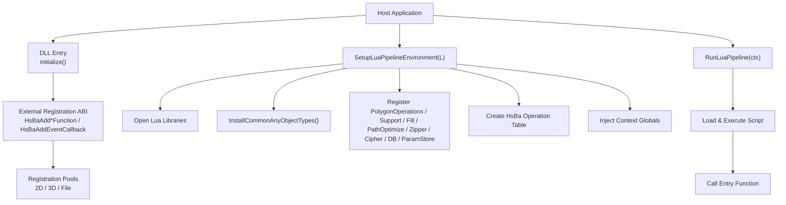
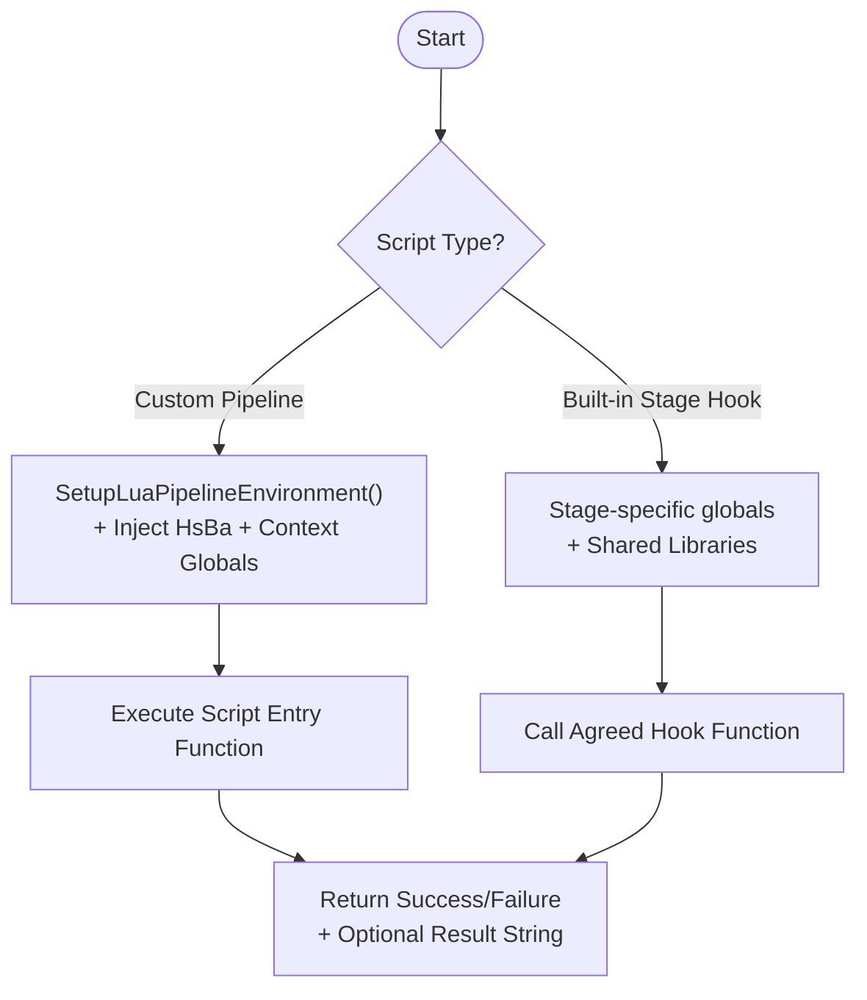
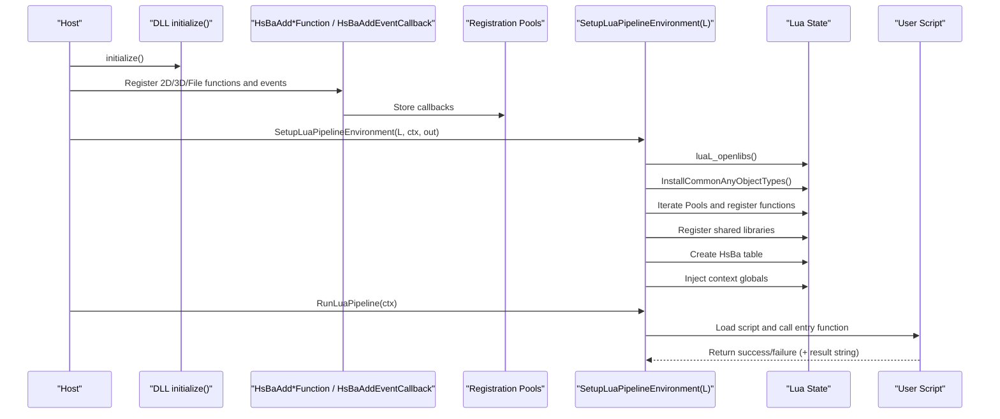
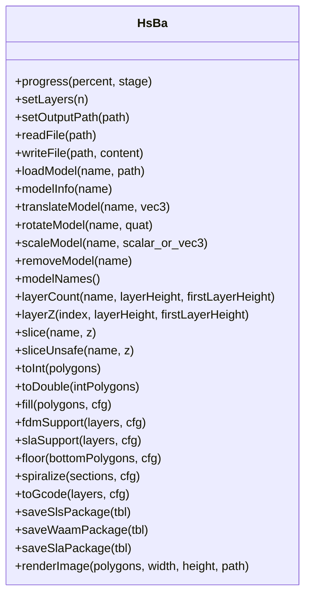
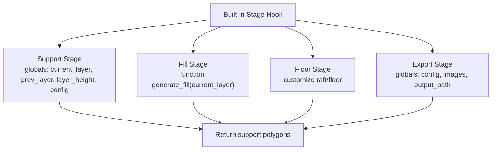
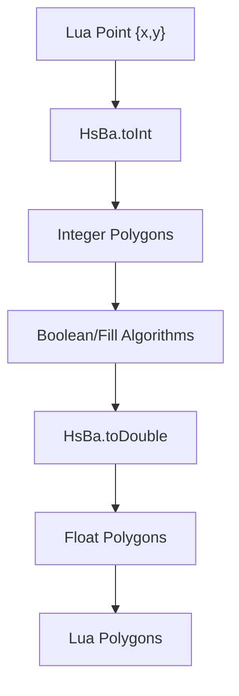
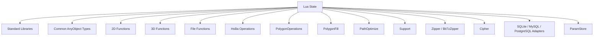

# Lua Environment Setup and API Reference

<cite>
**Referenced Files in This Document**   
- [lua_pipeline.cpp](file://LibHsBaSlicer/Extends/lua_pipeline.cpp)
- [lua_pipeline.hpp](file://LibHsBaSlicer/Extends/lua_pipeline.hpp)
- [lua_pipeline_api.md](file://docs/en/lua_pipeline_api.md)
- [LuaCommonTypes.hpp](file://LibHsBaSlicer/Extends/LuaCommonTypes.hpp)
- [LuaAddFunction.hpp](file://LibHsBaSlicer/Extends/LuaAddFunction.hpp)
- [lua_register.h](file://DllHsBaSlicer/lua_register.h)
- [initialize.h](file://DllHsBaSlicer/initialize.h)
- [initialize.cpp](file://DllHsBaSlicer/initialize.cpp)
- [LuaAnyObject.hpp](file://utils/LuaAnyObject.hpp)
- [LuaAdapter.hpp (2D)](file://2D/LuaAdapter.hpp)
- [LuaSupport.hpp](file://support/LuaSupport.hpp)
- [LuaAdapter.hpp (FileOperator)](file://fileoperator/LuaAdapter.hpp)
</cite>

## Table of Contents
1. [Introduction](#introduction)
2. [Project Structure](#project-structure)
3. [Core Components](#core-components)
4. [Architecture Overview](#architecture-overview)
5. [Detailed Component Analysis](#detailed-component-analysis)
6. [Dependency Analysis](#dependency-analysis)
7. [Performance Considerations](#performance-considerations)
8. [Troubleshooting Guide](#troubleshooting-guide)
9. [Conclusion](#conclusion)
10. [Appendices](#appendices)

## Introduction
This document explains how the Lua environment is created, initialized, and used inside HsBaSlicer. It covers:
- The two Lua runtime environments: fully custom pipelines and built-in stage hooks.
- The script registration lifecycle, including DLL initialization, function registration, and pipeline execution.
- How to configure the Lua interpreter within the slicing pipeline.
- The complete `HsBa` operation table and shared libraries available to scripts.
- Data type conversions between C++ and Lua, memory management considerations, and performance implications.
- Error handling, logging integration, and debugging techniques for Lua scripts.

The authoritative user-facing API reference is maintained alongside the implementation; this document summarizes it with code-level traceability.

## Project Structure
The Lua integration spans several modules:
- Custom pipeline driver and `HsBa` operations: `LibHsBaSlicer/Extends/lua_pipeline.*`.
- Shared library registration and common types: `LibHsBaSlicer/Extends/LuaAddFunction.hpp`, `LibHsBaSlicer/Extends/LuaCommonTypes.hpp`.
- 2D geometry adapters: `2D/LuaAdapter.hpp`.
- Support generator adapter: `support/LuaSupport.hpp`.
- File operator adapters (zipper, database, ParamStore): `fileoperator/LuaAdapter.hpp`.
- DLL entry points and external registration ABI: `DllHsBaSlicer/lua_register.h`, `DllHsBaSlicer/initialize.{h,cpp}`.
- Generic AnyObject bridge: `utils/LuaAnyObject.hpp`.
- User documentation: `docs/en/lua_pipeline_api.md`.

**Diagram sources**
- [initialize.h:14-19](file://DllHsBaSlicer/initialize.h#L14-L19)
- [lua_register.h:21-31](file://DllHsBaSlicer/lua_register.h#L21-L31)
- [lua_pipeline.cpp:857-894](file://LibHsBaSlicer/Extends/lua_pipeline.cpp#L857-L894)
- [lua_pipeline.cpp:821-841](file://LibHsBaSlicer/Extends/lua_pipeline.cpp#L821-L841)
- [lua_pipeline.hpp:59-83](file://LibHsBaSlicer/Extends/lua_pipeline.hpp#L59-L83)

**Section sources**
- [lua_pipeline.cpp:857-894](file://LibHsBaSlicer/Extends/lua_pipeline.cpp#L857-L894)
- [lua_pipeline.hpp:59-83](file://LibHsBaSlicer/Extends/lua_pipeline.hpp#L59-L83)
- [lua_register.h:21-31](file://DllHsBaSlicer/lua_register.h#L21-L31)
- [initialize.h:14-19](file://DllHsBaSlicer/initialize.h#L14-L19)

## Core Components
- Custom pipeline driver: creates a fresh Lua state, opens standard libraries, installs common types, registers stage-specific libraries, binds the `HsBa` operation table, injects context globals, and executes the user script entry function.
- Shared registration pools: allow external modules to register 2D, 3D, and File functions into every pipeline stage that consumes those pools.
- Common types: reflect Eigen vectors/matrices/quaternions and Clipper2 polygon types into `AnyObject`, exposing Lua constructors and cast methods.
- Geometry adapters: convert between Lua tables and integer/double polygons.
- Support adapter: allows replacing support generation with a Lua script.
- File operator adapters: expose zipper, database adapters, and parameter persistence to Lua.

Key responsibilities:
- Lifecycle: DLL initialization → external registration → per-run environment setup → script execution.
- API surface: `HsBa` table plus shared libraries (`PolygonOperations`, `Support`, `PolygonFill`, `PathOptimize`, `Cipher`, `Zipper`, `Bit7zZipper`, database adapters, `ParamStore`).
- Data model: uniform Lua-table representation for points, polygons, layers, and 3D path points.

**Section sources**
- [lua_pipeline.cpp:857-894](file://LibHsBaSlicer/Extends/lua_pipeline.cpp#L857-L894)
- [LuaAddFunction.hpp:21-74](file://LibHsBaSlicer/Extends/LuaAddFunction.hpp#L21-L74)
- [LuaCommonTypes.hpp:20-45](file://LibHsBaSlicer/Extends/LuaCommonTypes.hpp#L20-L45)
- [LuaAdapter.hpp (2D):16-81](file://2D/LuaAdapter.hpp#L16-L81)
- [LuaSupport.hpp:21-39](file://support/LuaSupport.hpp#L21-L39)
- [LuaAdapter.hpp (FileOperator):21-72](file://fileoperator/LuaAdapter.hpp#L21-L72)

## Architecture Overview
The system supports two scripting modes:

| Mode | Purpose | Trigger | API Surface |
|------|---------|---------|-------------|
| Custom Pipeline | Script controls full stage order | C++ calls `run_pipeline` or configured entry | Global `HsBa` table + context globals |
| Built-in Stage Hook | Replace one algorithm inside a fixed pipeline | Built-in pipeline loads script at specific stage | Stage-specific globals + shared libraries |

Both environments share many libraries; only the `HsBa` table and context globals are exclusive to the custom pipeline.

**Diagram sources**
- [lua_pipeline_api.md:19-28](file://docs/en/lua_pipeline_api.md#L19-L28)
- [lua_pipeline.cpp:821-841](file://LibHsBaSlicer/Extends/lua_pipeline.cpp#L821-L841)
- [lua_pipeline.hpp:72-83](file://LibHsBaSlicer/Extends/lua_pipeline.hpp#L72-L83)

**Section sources**
- [lua_pipeline_api.md:19-28](file://docs/en/lua_pipeline_api.md#L19-L28)
- [lua_pipeline.cpp:821-841](file://LibHsBaSlicer/Extends/lua_pipeline.cpp#L821-L841)

## Detailed Component Analysis

### Lua Environment Initialization and Script Registration Lifecycle
The lifecycle consists of:
1. DLL initialization: `initialize()` is the documented entry point for one-time setup.
2. External registration: host applications call `HsBaAdd2DFunction`, `HsBaAdd3DFunction`, `HsBaAddFileFunction`, and `HsBaAddEventCallback` to populate registration pools.
3. Per-run environment setup: `SetupLuaPipelineEnvironment` opens Lua libraries, installs common types, iterates registration pools, registers shared libraries, creates the `HsBa` table, and injects context globals.
4. Script execution: `RunLuaPipeline` loads and executes the script, then calls the entry function.

**Diagram sources**
- [initialize.h:14-19](file://DllHsBaSlicer/initialize.h#L14-L19)
- [lua_register.h:21-31](file://DllHsBaSlicer/lua_register.h#L21-L31)
- [lua_pipeline.cpp:857-894](file://LibHsBaSlicer/Extends/lua_pipeline.cpp#L857-L894)
- [lua_pipeline.hpp:72-83](file://LibHsBaSlicer/Extends/lua_pipeline.hpp#L72-L83)

**Section sources**
- [initialize.h:14-19](file://DllHsBaSlicer/initialize.h#L14-L19)
- [lua_register.h:21-31](file://DllHsBaSlicer/lua_register.h#L21-L31)
- [lua_pipeline.cpp:857-894](file://LibHsBaSlicer/Extends/lua_pipeline.cpp#L857-L894)
- [lua_pipeline.hpp:72-83](file://LibHsBaSlicer/Extends/lua_pipeline.hpp#L72-L83)

### HsBa Operation Table
The `HsBa` table exposes control, file I/O, model management, slicing, coordinate conversion, fill, support, floor, path/G-code generation, packaging, and image rendering.

Highlights:
- Control: `progress(percent[, stage])`, `setLayers(n)`, `setOutputPath(path)`.
- File I/O: `readFile(path)` returns string or nil; `writeFile(path, content)` raises on failure.
- Model management: `loadModel`, `modelInfo`, `translateModel`, `rotateModel`, `scaleModel`, `removeModel`, `modelNames`.
- Slicing: `layerCount`, `layerZ`, `slice`, `sliceUnsafe`.
- Conversion: `toInt`, `toDouble`.
- Fill: `fill(polygons[, cfg])`.
- Support and floor: `fdmSupport`, `slaSupport`, `floor`.
- Path and G-code: `spiralize`, `toGcode`.
- Packaging and export: `saveSlsPackage`, `saveWaamPackage`, `saveSlaPackage`, `renderImage`.

**Diagram sources**
- [lua_pipeline.cpp:212-268](file://LibHsBaSlicer/Extends/lua_pipeline.cpp#L212-L268)
- [lua_pipeline.cpp:272-371](file://LibHsBaSlicer/Extends/lua_pipeline.cpp#L272-L371)
- [lua_pipeline.cpp:375-446](file://LibHsBaSlicer/Extends/lua_pipeline.cpp#L375-L446)
- [lua_pipeline.cpp:450-518](file://LibHsBaSlicer/Extends/lua_pipeline.cpp#L450-L518)
- [lua_pipeline.cpp:547-653](file://LibHsBaSlicer/Extends/lua_pipeline.cpp#L547-L653)
- [lua_pipeline.cpp:660-783](file://LibHsBaSlicer/Extends/lua_pipeline.cpp#L660-L783)

**Section sources**
- [lua_pipeline.cpp:212-783](file://LibHsBaSlicer/Extends/lua_pipeline.cpp#L212-L783)
- [lua_pipeline_api.md:67-133](file://docs/en/lua_pipeline_api.md#L67-L133)

### Shared Libraries
Shared libraries are available in both environments:
- `PolygonOperations`: boolean operations, offset, hulls, primitives, text-to-polygons.
- `PolygonFill`: multiple fill algorithms.
- `PathOptimize`: region/polygon optimization.
- `Support`: plane/tree/honeycomb/sla generators and overhang detection.
- `Cipher`: base64/hex encoding.
- `Zipper` / `Bit7zZipper`: compression and packaging.
- Database adapters: SQLite, MySQL, PostgreSQL.
- `ParamStore`: reflection-based parameter persistence.

Availability matrix:
- Custom pipeline: all shared libraries plus `HsBa`.
- Built-in stage hooks: subset depending on stage (support/fill/floor/export).

**Section sources**
- [lua_pipeline_api.md:136-213](file://docs/en/lua_pipeline_api.md#L136-L213)
- [lua_pipeline_api.md:264-280](file://docs/en/lua_pipeline_api.md#L264-L280)

### Built-in Pipeline Stage Hooks
- Support stage: globals include `current_layer`, `prev_layer`, `layer_height`, `config`; entry function is `generate_support()`.
- Fill stage: entry function is `generate_fill(current_layer)`.
- Floor stage: customize SLA bottom floor/raft generation.
- Export stage: globals include `config`, `images`, `output_path`; entry functions vary by process (e.g., `export_sls`, `export_waam`).

**Diagram sources**
- [lua_pipeline_api.md:215-259](file://docs/en/lua_pipeline_api.md#L215-L259)

**Section sources**
- [lua_pipeline_api.md:215-259](file://docs/en/lua_pipeline_api.md#L215-L259)

### Data Type Conversions Between C++ and Lua
Geometry data model:
- Point: `{ x = number, y = number }`.
- Polygon: array of points forming a closed contour.
- Polygons: array of polygons; holes are separate polygons.
- Layers: array of polygon sets per layer.
- 3D point: `{ x, y, z }` used by spiral path output.

Integerization note:
- Boolean/fill operations run at integer precision internally.
- `HsBa.toInt` converts float polygons to integer polygons.
- `HsBa.toDouble` converts integer polygons back to float polygons.
- `PolygonOperations` and `PolygonFill` accept and return integerized data; `HsBa.slice` and `HsBa.fill` return floating-point polygon tables.

AnyObject and common types:
- `Utils::AnyObject` provides reflective metadata and Lua bindings for native types.
- Common types include Eigen vectors/matrices/quaternions and Clipper2 polygon containers.
- Lua adapters expose `new_<Type>` and `cast_<Type>` functions under an `AnyObject` table.

**Diagram sources**
- [lua_pipeline_api.md:32-45](file://docs/en/lua_pipeline_api.md#L32-L45)
- [lua_pipeline.cpp:433-446](file://LibHsBaSlicer/Extends/lua_pipeline.cpp#L433-L446)

**Section sources**
- [lua_pipeline_api.md:32-45](file://docs/en/lua_pipeline_api.md#L32-L45)
- [LuaCommonTypes.hpp:20-45](file://LibHsBaSlicer/Extends/LuaCommonTypes.hpp#L20-L45)
- [LuaAnyObject.hpp:11-17](file://utils/LuaAnyObject.hpp#L11-L17)

### Memory Management and Performance Implications
- Integerization reduces computational cost for geometric operations but requires explicit conversion when interfacing with APIs expecting float polygons.
- Large polygon arrays and layers should be minimized; prefer vectorized operations where possible.
- Avoid excessive Lua table allocations in tight loops; reuse tables and minimize object churn.
- Use `PathOptimize.optimizeRegions` or `optimizePolygons` to reduce travel distance and improve performance.
- Compression and packaging operations can be expensive; batch outputs and avoid redundant writes.

[No sources needed since this section provides general guidance]

### Error Handling, Logging Integration, and Debugging Techniques
Error handling:
- Many `HsBa` operations raise Lua errors via `luaL_error` on invalid inputs or failures.
- Script execution uses `luaL_dostring` and wraps errors in `RuntimeError` with contextual messages.
- Export packaging functions may return booleans or additional error strings on failure.

Logging integration:
- Progress reporting through `HsBa.progress(percent[, stage])` integrates with the pipeline’s progress callback.
- For deeper diagnostics, inspect the error message returned by `RunLuaPipeline` and validate input tables against the documented shapes.

Debugging tips:
- Validate polygon formats before calling algorithms.
- Use small test models and minimal scripts to isolate issues.
- Check availability of optional features (MySQL/PostgreSQL/Bit7z) based on compile flags.
- Ensure correct casing for method names exposed by C++ bindings.

**Section sources**
- [lua_pipeline.cpp:843-853](file://LibHsBaSlicer/Extends/lua_pipeline.cpp#L843-L853)
- [lua_pipeline.cpp:257-268](file://LibHsBaSlicer/Extends/lua_pipeline.cpp#L257-L268)
- [lua_pipeline.cpp:660-783](file://LibHsBaSlicer/Extends/lua_pipeline.cpp#L660-L783)
- [lua_pipeline_api.md:256-260](file://docs/en/lua_pipeline_api.md#L256-L260)

## Dependency Analysis
The Lua environment depends on:
- Standard Lua libraries opened during setup.
- Common types installed once per process via `InstallCommonAnyObjectTypes`.
- External registration pools populated by host application via the C ABI.
- Module-specific adapters for 2D geometry, support generation, path optimization, file I/O, compression, databases, and parameter persistence.

**Diagram sources**
- [lua_pipeline.cpp:857-894](file://LibHsBaSlicer/Extends/lua_pipeline.cpp#L857-L894)
- [LuaAddFunction.hpp:21-74](file://LibHsBaSlicer/Extends/LuaAddFunction.hpp#L21-L74)
- [LuaCommonTypes.hpp:148-183](file://LibHsBaSlicer/Extends/LuaCommonTypes.hpp#L148-L183)

**Section sources**
- [lua_pipeline.cpp:857-894](file://LibHsBaSlicer/Extends/lua_pipeline.cpp#L857-L894)
- [LuaAddFunction.hpp:21-74](file://LibHsBaSlicer/Extends/LuaAddFunction.hpp#L21-L74)
- [LuaCommonTypes.hpp:148-183](file://LibHsBaSlicer/Extends/LuaCommonTypes.hpp#L148-L183)

## Performance Considerations
- Prefer integer polygon operations for speed; convert back to float only when necessary.
- Batch operations to reduce Lua/C++ boundary crossings.
- Use optimized path ordering to minimize travel time.
- Avoid unnecessary file I/O and compression; write once per output.
- Be mindful of large layer lists; process incrementally if possible.

[No sources needed since this section provides general guidance]

## Troubleshooting Guide
Common issues and resolutions:
- Missing model: ensure `loadModel` succeeded and use `modelNames` to verify pool contents.
- Invalid polygon format: validate point fields and polygon arrays before calling algorithms.
- Export packaging failures: confirm required fields like `output` and `script` are present; check return values and optional error strings.
- Optional features unavailable: verify compile-time macros for MySQL/PostgreSQL/Bit7z.
- Progress not updating: ensure `HsBa.progress` is called with valid percentage and stage name.

**Section sources**
- [lua_pipeline.cpp:272-371](file://LibHsBaSlicer/Extends/lua_pipeline.cpp#L272-L371)
- [lua_pipeline.cpp:660-783](file://LibHsBaSlicer/Extends/lua_pipeline.cpp#L660-L783)
- [lua_pipeline_api.md:256-280](file://docs/en/lua_pipeline_api.md#L256-L280)

## Conclusion
HsBaSlicer provides a robust Lua scripting environment with two modes: fully customizable pipelines and targeted stage hooks. The `HsBa` operation table and shared libraries offer comprehensive mesh operations, geometry utilities, file I/O, and pipeline control. Proper configuration involves initializing the DLL, registering external functions, setting up the Lua environment, and executing scripts with validated data. Careful attention to data types, memory usage, and error handling ensures reliable and performant scripting workflows.

[No sources needed since this section summarizes without analyzing specific files]

## Appendices

### Basic Lua Script Setup Example
A minimal custom pipeline script typically:
- Determines model name/path and output path from context globals.
- Loads the model and computes layer count.
- Iterates layers to slice and fill.
- Generates G-code and writes the output.
- Reports progress and cleans up models.

For a complete runnable example, see the repository’s sample scripts referenced in the API documentation.

**Section sources**
- [lua_pipeline_api.md:283-332](file://docs/en/lua_pipeline_api.md#L283-L332)

### Function Registration Patterns
To extend the Lua environment:
- Implement a registration callback matching `LuaRegFunc`.
- Register it using `Add2DFunctions`, `Add3DFunctions`, or `AddFileFunctions`.
- For event-driven extensions, use `AddEventCallback` with a named event.
- From the DLL side, expose the C ABI functions `HsBaAdd2DFunction`, `HsBaAdd3DFunction`, `HsBaAddFileFunction`, and `HsBaAddEventCallback`.

**Section sources**
- [LuaAddFunction.hpp:21-74](file://LibHsBaSlicer/Extends/LuaAddFunction.hpp#L21-L74)
- [lua_register.h:21-31](file://DllHsBaSlicer/lua_register.h#L21-L31)