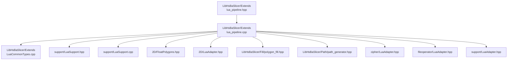
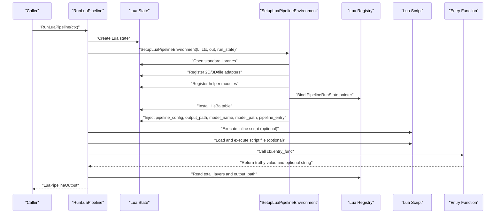
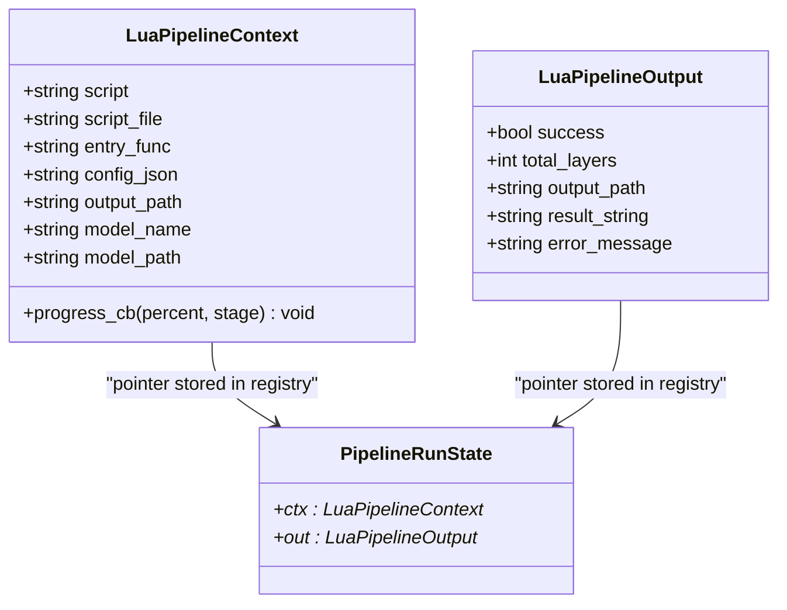
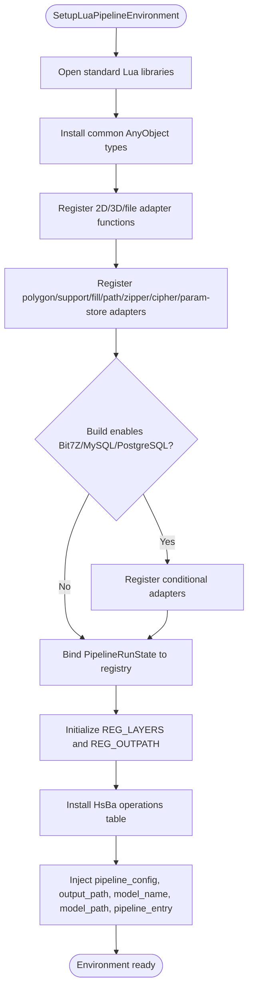
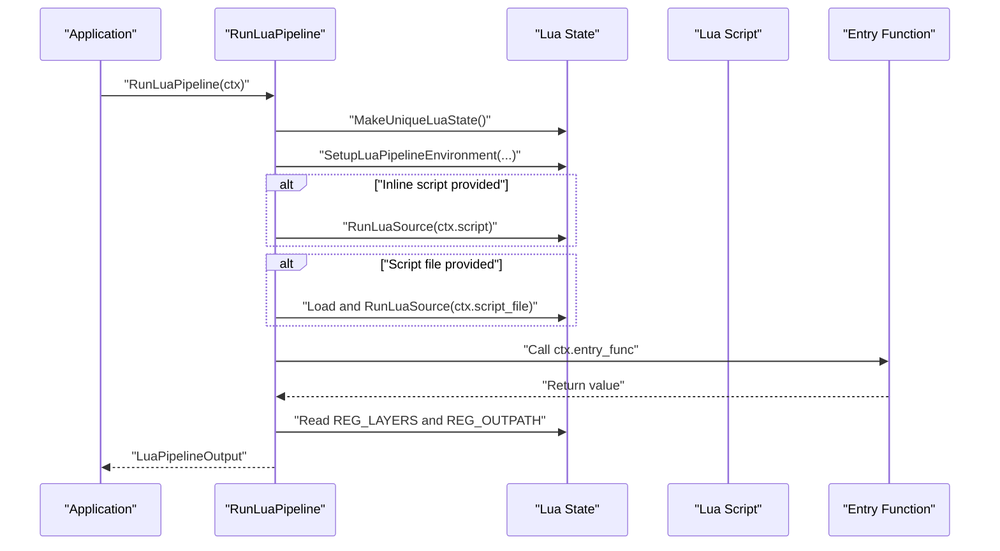
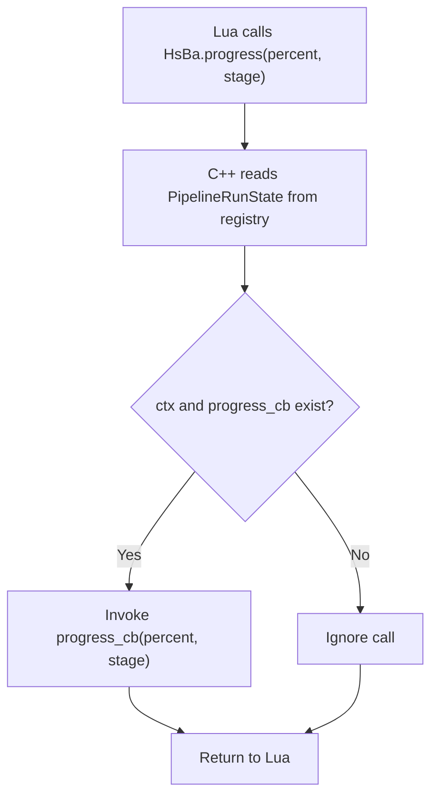
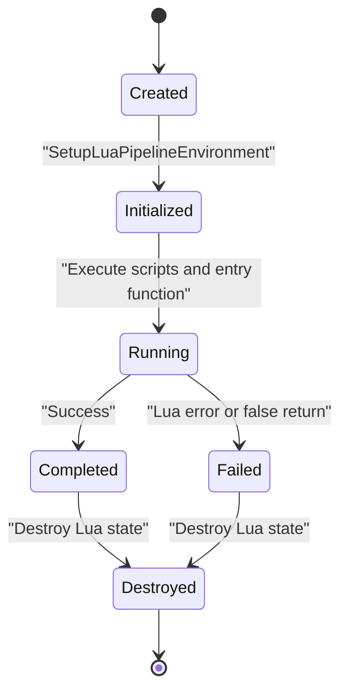
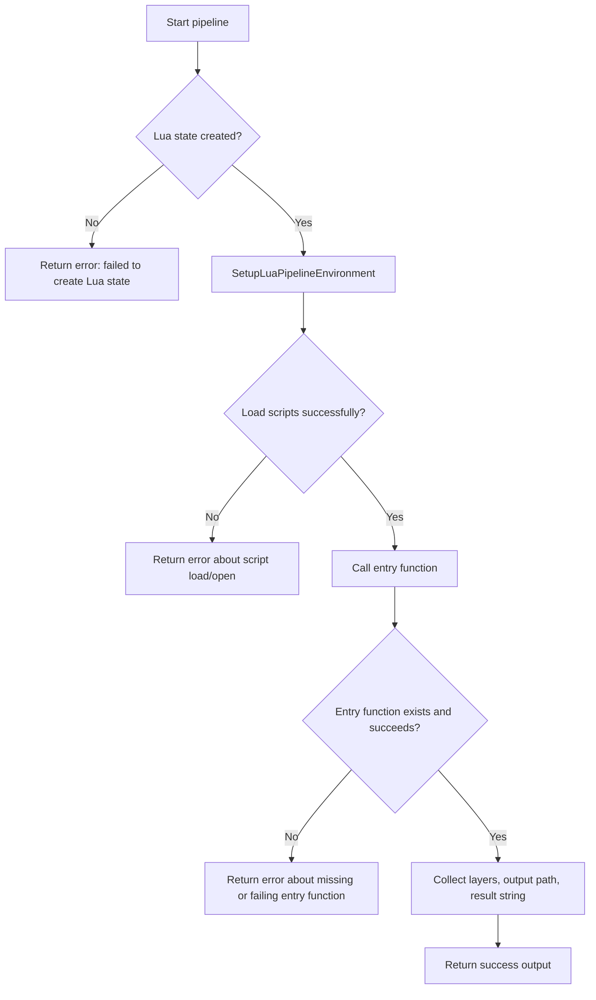
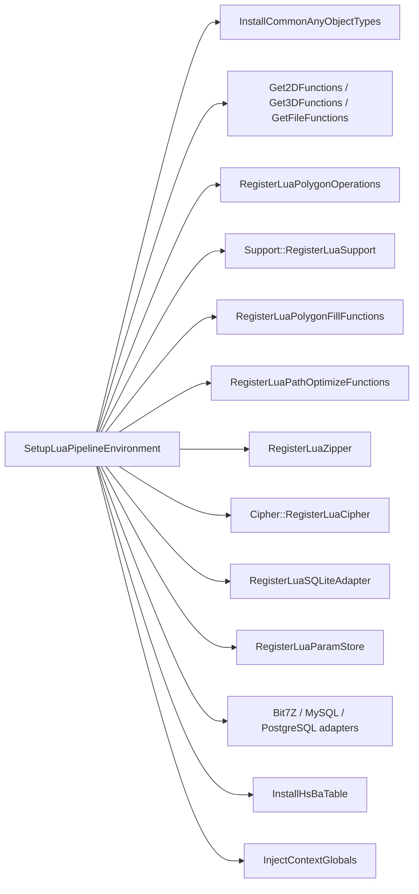

# Lua Environment Setup

<cite>
**Referenced Files in This Document**   
- [lua_pipeline.hpp](file://LibHsBaSlicer/Extends/lua_pipeline.hpp)
- [lua_pipeline.cpp](file://LibHsBaSlicer/Extends/lua_pipeline.cpp)
- [LuaCommonTypes.cpp](file://LibHsBaSlicer/Extends/LuaCommonTypes.cpp)
- [LuaSupport.hpp](file://support/LuaSupport.hpp)
- [LuaSupport.cpp](file://support/LuaSupport.cpp)
</cite>

## Table of Contents
1. [Introduction](#introduction)
2. [Project Structure](#project-structure)
3. [Core Components](#core-components)
4. [Architecture Overview](#architecture-overview)
5. [Detailed Component Analysis](#detailed-component-analysis)
6. [Dependency Analysis](#dependency-analysis)
7. [Performance Considerations](#performance-considerations)
8. [Troubleshooting Guide](#troubleshooting-guide)
9. [Conclusion](#conclusion)
10. [Appendices](#appendices)

## Introduction
This document explains how HsBaSlicer creates and initializes a complete Lua execution context for fully Lua-driven custom pipelines. It focuses on:

- `SetupLuaPipelineEnvironment`: the function that opens standard libraries, registers C++ pipeline operations under the global `HsBa` table, injects configuration globals, and binds per-run state into the Lua registry.
- `LuaPipelineContext`: the C++ structure that describes what script to run, which entry function to call, what JSON configuration to expose, and how progress callbacks are delivered.
- Memory ownership and lifecycle: how `run_state`, the Lua state, and the context interact.
- Practical usage patterns: programmatic initialization, parameter configuration, and safe lifecycle handling.
- Thread safety, error handling, and debugging techniques.

The goal is to make it possible to embed or reuse the Lua pipeline environment safely, even when you do not use the high-level `RunLuaPipeline` convenience function.

## Project Structure
The Lua environment setup lives primarily in the LibHsBaSlicer extension layer, with supporting registration helpers in common types and support modules.

**Diagram sources**
- [lua_pipeline.hpp:1-88](file://LibHsBaSlicer/Extends/lua_pipeline.hpp#L1-L88)
- [lua_pipeline.cpp:1-40](file://LibHsBaSlicer/Extends/lua_pipeline.cpp#L1-L40)
- [LuaCommonTypes.cpp:465-533](file://LibHsBaSlicer/Extends/LuaCommonTypes.cpp#L465-L533)
- [LuaSupport.hpp:1-85](file://support/LuaSupport.hpp#L1-L85)
- [LuaSupport.cpp:1-180](file://support/LuaSupport.cpp#L1-L180)

**Section sources**
- [lua_pipeline.hpp:1-88](file://LibHsBaSlicer/Extends/lua_pipeline.hpp#L1-L88)
- [lua_pipeline.cpp:1-40](file://LibHsBaSlicer/Extends/lua_pipeline.cpp#L1-L40)

## Core Components
The core API surface for Lua environment setup consists of two public data structures and two public functions:

| Symbol | Location | Purpose |
|---|---|---|
| `LuaPipelineContext` | [lua_pipeline.hpp:29-39](file://LibHsBaSlicer/Extends/lua_pipeline.hpp#L29-L39) | Describes the Lua script source, script file, entry function name, JSON configuration, model metadata, output path, and progress callback. |
| `LuaPipelineOutput` | [lua_pipeline.hpp:44-51](file://LibHsBaSlicer/Extends/lua_pipeline.hpp#L44-L51) | Captures success status, total layers, output path, result string, and error message from a Lua pipeline run. |
| `SetupLuaPipelineEnvironment` | [lua_pipeline.hpp:69-70](file://LibHsBaSlicer/Extends/lua_pipeline.hpp#L69-L70), [lua_pipeline.cpp:903-958](file://LibHsBaSlicer/Extends/lua_pipeline.cpp#L903-L958) | Initializes a fresh Lua state with standard libraries, registered C++ operations, registry-bound run state, and injected globals. |
| `RunLuaPipeline` | [lua_pipeline.hpp:83](file://LibHsBaSlicer/Extends/lua_pipeline.hpp#L83), [lua_pipeline.cpp:960-1043](file://LibHsBaSlicer/Extends/lua_pipeline.cpp#L960-L1043) | Convenience driver that creates a Lua state, sets up the environment, executes prelude and script file, calls the entry function, and collects results. |

Key responsibilities:

- **Standard library loading**: `luaL_openlibs(L)` loads Lua’s built-in libraries.
- **Object type registration**: `InstallCommonAnyObjectTypes()` ensures the common `AnyObject` type system is available before consuming pooled adapters.
- **Pool-based adapter registration**: 2D, 3D, and file adapter registrations are applied through `Get2DFunctions()`, `Get3DFunctions()`, and `GetFileFunctions()`.
- **Stage-independent helpers**: polygon operations, support generation, polygon fill, path optimization, zipper, cipher, SQLite adapter, and parameter store are registered.
- **Conditional adapters**: Bit7Z, MySQL, and PostgreSQL adapters are registered only when enabled by build macros.
- **Global `HsBa` table**: created via `InstallHsBaTable(L)` and populated with slicing, modeling, filling, support, packaging, and export operations.
- **Context globals**: `pipeline_config`, `output_path`, `model_name`, `model_path`, and `pipeline_entry` are exposed as Lua globals.

**Section sources**
- [lua_pipeline.hpp:29-83](file://LibHsBaSlicer/Extends/lua_pipeline.hpp#L29-L83)
- [lua_pipeline.cpp:903-958](file://LibHsBaSlicer/Extends/lua_pipeline.cpp#L903-L958)
- [LuaCommonTypes.cpp:514-531](file://LibHsBaSlicer/Extends/LuaCommonTypes.cpp#L514-L531)

## Architecture Overview
At runtime, the Lua environment is a layered construction:

1. A fresh Lua state is created.
2. Standard Lua libraries are opened.
3. Common object types are installed once across the process.
4. Pool-based 2D/3D/file adapters are registered.
5. Stage-independent helper modules are registered.
6. Conditional adapters are registered based on build flags.
7. Per-run state is stored in the Lua registry.
8. The `HsBa` operations table is installed.
9. Context globals are injected.
10. Scripts are executed and the entry function is called.

**Diagram sources**
- [lua_pipeline.cpp:960-1043](file://LibHsBaSlicer/Extends/lua_pipeline.cpp#L960-L1043)
- [lua_pipeline.cpp:903-958](file://LibHsBaSlicer/Extends/lua_pipeline.cpp#L903-L958)

## Detailed Component Analysis

### LuaPipelineContext
`LuaPipelineContext` is the primary input contract for a fully Lua-driven pipeline.

| Field | Type | Meaning |
|---|---|---|
| `script` | `std::string` | Inline Lua source executed first as a prelude; may be empty. |
| `script_file` | `std::string` | Path to the Lua script file; may be empty. |
| `entry_func` | `std::string` | Name of the Lua function to call after loading scripts; default is `"run_pipeline"`. |
| `config_json` | `std::string` | Free-form JSON string exposed to Lua as `pipeline_config`. |
| `output_path` | `std::string` | Default output path exposed to Lua as `output_path`. |
| `model_name` | `std::string` | Model name exposed to Lua as `model_name`. |
| `model_path` | `std::string` | Model file path exposed to Lua as `model_path`. |
| `progress_cb` | `std::function<void(int, std::string_view)>` | Progress reporting hook invoked by `HsBa.progress(percent, stage)`. |

Important lifecycle rule: the header documents that `ctx` must outlive the Lua state because `SetupLuaPipelineEnvironment` stores pointers to it in the registry.

**Diagram sources**
- [lua_pipeline.hpp:29-51](file://LibHsBaSlicer/Extends/lua_pipeline.hpp#L29-L51)
- [lua_pipeline.cpp:50-54](file://LibHsBaSlicer/Extends/lua_pipeline.cpp#L50-L54)

**Section sources**
- [lua_pipeline.hpp:29-51](file://LibHsBaSlicer/Extends/lua_pipeline.hpp#L29-L51)

### SetupLuaPipelineEnvironment
`SetupLuaPipelineEnvironment` is the central initialization routine. Its behavior can be understood as a staged pipeline:

1. Open standard Lua libraries.
2. Ensure common `AnyObject` types are installed once per process.
3. Register pool-based 2D, 3D, and file adapter functions.
4. Register stage-independent helpers: polygon operations, support, polygon fill, path optimization, zipper, cipher, SQLite adapter, parameter store.
5. Conditionally register Bit7Z, MySQL, and PostgreSQL adapters.
6. Create or reuse a `PipelineRunState` and bind it to the Lua registry.
7. Initialize registry slots for layer count and output path.
8. Install the `HsBa` operations table.
9. Inject context globals.

**Diagram sources**
- [lua_pipeline.cpp:903-958](file://LibHsBaSlicer/Extends/lua_pipeline.cpp#L903-L958)
- [LuaCommonTypes.cpp:514-531](file://LibHsBaSlicer/Extends/LuaCommonTypes.cpp#L514-L531)

#### Standard Library Loading
The function calls `luaL_openlibs(L)`, which provides Lua’s standard libraries such as math, string, table, and coroutine utilities. This is the foundation for any Lua code executed later.

**Section sources**
- [lua_pipeline.cpp:903-906](file://LibHsBaSlicer/Extends/lua_pipeline.cpp#L903-L906)

#### Common Object Types and Pool Registration
Before consuming pooled adapters, the environment calls `InstallCommonAnyObjectTypes()`. This function uses a process-wide one-time guard to register pipeline configuration reflection and add a per-state idempotent registration function to the 2D/3D/file function pools.

Per-state idempotency is important because multiple pipeline stages may share a single Lua state; without it, repeated registration could rebuild shared tables unnecessarily.

**Section sources**
- [lua_pipeline.cpp:908-922](file://LibHsBaSlicer/Extends/lua_pipeline.cpp#L908-L922)
- [LuaCommonTypes.cpp:469-531](file://LibHsBaSlicer/Extends/LuaCommonTypes.cpp#L469-L531)

#### HsBa Operations Table
The `HsBa` table exposes operations used by Lua scripts:

| Category | Example Operations |
|---|---|
| Progress and output control | `progress`, `setLayers`, `setOutputPath` |
| File access | `readFile`, `writeFile` |
| Model management | `loadModel`, `modelInfo`, `translateModel`, `rotateModel`, `scaleModel`, `removeModel`, `modelNames` |
| Slicing and coordinates | `layerCount`, `layerZ`, `slice`, `sliceUnsafe`, `toInt`, `toDouble` |
| Geometry processing | `fill`, `fdmSupport`, `slaSupport`, `floor` |
| Path and export | `toGcode`, `spiralize`, `saveSlsPackage`, `saveWaamPackage`, `saveSlaPackage`, `renderImage` |

These operations are defined in an operation table and installed as the global `HsBa` table.

**Section sources**
- [lua_pipeline.cpp:830-872](file://LibHsBaSlicer/Extends/lua_pipeline.cpp#L830-L872)

#### Context Globals
`InjectContextGlobals` sets five Lua globals:

| Global | Source Field | Description |
|---|---|---|
| `pipeline_config` | `ctx.config_json` | JSON configuration string passed to the script. |
| `output_path` | `ctx.output_path` | Default output path. |
| `model_name` | `ctx.model_name` | Model name. |
| `model_path` | `ctx.model_path` | Model file path. |
| `pipeline_entry` | `ctx.entry_func` | Name of the entry function. |

**Section sources**
- [lua_pipeline.cpp:874-886](file://LibHsBaSlicer/Extends/lua_pipeline.cpp#L874-L886)

#### Run State and Registry Binding
Internally, `PipelineRunState` holds pointers to `LuaPipelineContext` and `LuaPipelineOutput`. These pointers are stored in absolute registry indices:

| Registry Key | Stored Value | Purpose |
|---|---|---|
| `REG_CTX` | `PipelineRunState*` | Access to context and output during Lua execution. |
| `REG_LAYERS` | integer | Total layer count set by the script via `HsBa.setLayers`. |
| `REG_OUTPATH` | string | Output path set by the script via `HsBa.setOutputPath`. |

If no caller-provided `run_state` is supplied, a static fallback state is used. This makes standalone single-threaded embedding convenient but requires care in multi-threaded scenarios.

**Section sources**
- [lua_pipeline.cpp:50-62](file://LibHsBaSlicer/Extends/lua_pipeline.cpp#L50-L62)
- [lua_pipeline.cpp:943-954](file://LibHsBaSlicer/Extends/lua_pipeline.cpp#L943-L954)

### RunLuaPipeline
`RunLuaPipeline` is the high-level driver. It:

1. Creates a Lua state.
2. Calls `SetupLuaPipelineEnvironment`.
3. Executes the inline script as a prelude if present.
4. Opens and executes the script file if present.
5. Looks up and calls the entry function.
6. Reads the return value and optional result string.
7. Reads `total_layers` and `output_path` from the registry.
8. Returns a `LuaPipelineOutput`.

**Diagram sources**
- [lua_pipeline.cpp:960-1043](file://LibHsBaSlicer/Extends/lua_pipeline.cpp#L960-L1043)

**Section sources**
- [lua_pipeline.cpp:960-1043](file://LibHsBaSlicer/Extends/lua_pipeline.cpp#L960-L1043)

### Progress Callback Mechanism
Scripts can report progress through `HsBa.progress(percent, stage)`. Internally:

- The C++ side retrieves the current `PipelineRunState` from the registry.
- If the context exists and has a non-null `progress_cb`, it invokes `progress_cb(percent, stage)`.
- If no callback is configured, the call is effectively a no-op.

**Diagram sources**
- [lua_pipeline.cpp:228-239](file://LibHsBaSlicer/Extends/lua_pipeline.cpp#L228-L239)
- [lua_pipeline.cpp:64-70](file://LibHsBaSlicer/Extends/lua_pipeline.cpp#L64-L70)

**Section sources**
- [lua_pipeline.cpp:228-239](file://LibHsBaSlicer/Extends/lua_pipeline.cpp#L228-L239)

### Memory Management and Lifecycle
The lifecycle rules are strict because C++ pointers cross the Lua boundary:

| Resource | Owner | Lifetime Rule |
|---|---|---|
| Lua state | Usually created by `MakeUniqueLuaState()` or managed by the caller | Must remain valid while the Lua environment is active. |
| `LuaPipelineContext` | Caller | Must outlive the Lua state because `PipelineRunState.ctx` points into it. |
| `LuaPipelineOutput` | Caller | Must outlive the Lua state because `PipelineRunState.out` points into it. |
| `run_state` | Caller when provided | Must outlive the Lua state. When null, a static fallback is used. |
| Registry values | Lua registry | Valid for the lifetime of the Lua state; cleared when the state is destroyed. |

Recommended ownership pattern:

- For `RunLuaPipeline`: the function owns the Lua state and a local `PipelineRunState`; both are destroyed at function exit.
- For direct `SetupLuaPipelineEnvironment` usage: allocate a `PipelineRunState` on the heap or stack with a lifetime longer than the Lua state, pass its address, and ensure the Lua state is destroyed before the context or output objects.

**Diagram sources**
- [lua_pipeline.cpp:943-958](file://LibHsBaSlicer/Extends/lua_pipeline.cpp#L943-L958)
- [lua_pipeline.cpp:960-1043](file://LibHsBaSlicer/Extends/lua_pipeline.cpp#L960-L1043)

**Section sources**
- [lua_pipeline.cpp:943-958](file://LibHsBaSlicer/Extends/lua_pipeline.cpp#L943-L958)
- [lua_pipeline.cpp:960-1043](file://LibHsBaSlicer/Extends/lua_pipeline.cpp#L960-L1043)

### Error Handling During Initialization
Initialization errors are handled at several levels:

| Failure Point | Behavior |
|---|---|
| Lua state creation fails | `RunLuaPipeline` returns a failure `LuaPipelineOutput` with an error message. |
| Script file cannot be opened | `RunLuaPipeline` returns a failure output with a descriptive error message. |
| Inline or file script load/executes with error | Errors are wrapped into `RuntimeError` and caught by `RunLuaPipeline`, which converts them into `error_message`. |
| Entry function missing | `RunLuaPipeline` reports that the entry function was not found. |
| Entry function returns false or nil | `RunLuaPipeline` marks failure and optionally sets an error message. |
| `HsBa` operations fail | Many operations raise Lua errors through `luaL_error`, which propagate to the caller. |

**Diagram sources**
- [lua_pipeline.cpp:960-1043](file://LibHsBaSlicer/Extends/lua_pipeline.cpp#L960-L1043)
- [lua_pipeline.cpp:888-899](file://LibHsBaSlicer/Extends/lua_pipeline.cpp#L888-L899)

**Section sources**
- [lua_pipeline.cpp:960-1043](file://LibHsBaSlicer/Extends/lua_pipeline.cpp#L960-L1043)

### Thread Safety Considerations
Thread safety depends on how the Lua state and run state are managed:

- Each Lua state is independent.
- The registry slots `REG_CTX`, `REG_LAYERS`, and `REG_OUTPATH` are per-Lua-state storage.
- If `run_state` is null, `SetupLuaPipelineEnvironment` uses a static fallback `PipelineRunState`. This fallback is process-wide and therefore **not thread-safe**.
- For concurrent or multi-threaded usage, always provide a distinct `run_state` per Lua state and ensure each Lua state is isolated per thread.

Best practices:

- One Lua state per thread.
- Never share a Lua state across threads.
- Always pass a caller-owned `run_state` when running pipelines concurrently.
- Keep `LuaPipelineContext` and `LuaPipelineOutput` alive for the entire duration of the Lua state.

**Section sources**
- [lua_pipeline.cpp:943-954](file://LibHsBaSlicer/Extends/lua_pipeline.cpp#L943-L954)

### Practical Examples

#### Programmatic Initialization Pattern
When you want full control over the Lua state lifecycle:

1. Create a Lua state using your preferred wrapper around `luaL_newstate` or `MakeUniqueLuaState`.
2. Prepare a `LuaPipelineContext` with script, script file, entry function, configuration JSON, model metadata, output path, and progress callback.
3. Allocate a `PipelineRunState` whose lifetime covers the Lua state.
4. Call `SetupLuaPipelineEnvironment`.
5. Execute inline script and script file as needed.
6. Call the entry function.
7. Read registry values for layers and output path.
8. Destroy the Lua state after cleanup.

This pattern is useful when embedding HsBaSlicer into an application that already manages Lua states.

#### Configuring Pipeline Parameters
Use `LuaPipelineContext.config_json` to pass free-form JSON to the script. Inside Lua, this is available as `pipeline_config`. You can also configure:

- `output_path` for default output location.
- `model_name` and `model_path` for model identification.
- `entry_func` for the Lua function name.
- `progress_cb` for real-time progress updates.

#### Handling Lua State Lifecycle
Always follow these rules:

- Do not destroy the Lua state while any Lua function still holds references to C++ objects.
- Do not destroy `LuaPipelineContext` while the Lua state is still active.
- Do not destroy `LuaPipelineOutput` while the Lua state is still active.
- Avoid sharing a Lua state across threads.
- Provide a unique `run_state` for each Lua state when running pipelines concurrently.

**Section sources**
- [lua_pipeline.hpp:29-83](file://LibHsBaSlicer/Extends/lua_pipeline.hpp#L29-L83)
- [lua_pipeline.cpp:903-1043](file://LibHsBaSlicer/Extends/lua_pipeline.cpp#L903-L1043)

## Dependency Analysis
The Lua environment setup depends on several subsystems:

**Diagram sources**
- [lua_pipeline.cpp:903-958](file://LibHsBaSlicer/Extends/lua_pipeline.cpp#L903-L958)

**Section sources**
- [lua_pipeline.cpp:903-958](file://LibHsBaSlicer/Extends/lua_pipeline.cpp#L903-L958)

## Performance Considerations
- **One-time type registration**: `InstallCommonAnyObjectTypes` uses a process-wide one-time guard, avoiding repeated expensive registration work.
- **Per-state idempotency**: The common `AnyObject` registration checks a per-Lua-state registry flag so that multiple pool consumers on the same Lua state do not rebuild the global table repeatedly.
- **Registry-backed state**: Using absolute registry indices avoids per-function upvalues and keeps the `HsBa` operation table lightweight.
- **Script execution order**: Inline script runs before the script file, allowing prelude-style parameter preparation without duplicating logic.
- **Optional adapters**: Conditional compilation reduces initialization overhead when Bit7Z, MySQL, or PostgreSQL support is disabled.

[No sources needed since this section provides general guidance]

## Troubleshooting Guide

### Common Initialization Problems

| Symptom | Likely Cause | Resolution |
|---|---|---|
| Lua state creation fails | Lua runtime unavailable or memory allocation failure | Check environment setup and resource limits; inspect `error_message` in `LuaPipelineOutput`. |
| Script file cannot be read | Invalid path or missing permissions | Verify `script_file` path and file existence before calling `RunLuaPipeline`. |
| Entry function not found | `entry_func` does not exist in loaded script | Ensure the Lua script defines the expected function name. |
| Progress callback never fires | `progress_cb` is null or not set | Assign a valid callback to `LuaPipelineContext.progress_cb`. |
| Layers or output path not captured | Script did not call `HsBa.setLayers` or `HsBa.setOutputPath` | Have the script call these functions during execution. |
| Concurrent pipeline crashes | Static fallback `run_state` shared across threads | Provide a separate `run_state` per Lua state and isolate Lua states per thread. |

### Debugging Techniques

1. **Inspect `LuaPipelineOutput.error_message`**: This field captures most initialization, script loading, and entry function errors.
2. **Enable progress logging**: Set `progress_cb` to log percentage and stage information.
3. **Validate `pipeline_config`**: Print or log the JSON string inside the Lua script to confirm configuration delivery.
4. **Check registry values**: If debugging from C++, inspect `REG_LAYERS` and `REG_OUTPATH` after script execution.
5. **Separate inline and file scripts**: Start with an empty `script_file` and a small inline `script` to isolate syntax or runtime errors.
6. **Avoid static fallback in tests**: Always pass a dedicated `run_state` in unit tests or multi-threaded scenarios.

**Section sources**
- [lua_pipeline.cpp:960-1043](file://LibHsBaSlicer/Extends/lua_pipeline.cpp#L960-L1043)
- [lua_pipeline.cpp:228-239](file://LibHsBaSlicer/Extends/lua_pipeline.cpp#L228-L239)

## Conclusion
HsBaSlicer’s Lua environment setup is a carefully layered process that combines standard Lua initialization, pool-based adapter registration, conditional module loading, registry-bound per-run state, and a unified `HsBa` operations table. The key to safe usage is understanding ownership:

- The caller owns `LuaPipelineContext`, `LuaPipelineOutput`, and optionally `run_state`.
- The Lua state owns registry entries for the duration of its lifetime.
- The static fallback `run_state` is convenient but not thread-safe.
- `RunLuaPipeline` is a convenient driver, but direct use of `SetupLuaPipelineEnvironment` gives full control for advanced embedding scenarios.

When integrating HsBaSlicer, prefer explicit lifecycle management, per-thread Lua states, and structured error handling to avoid subtle concurrency and ownership bugs.

[No sources needed since this section summarizes without analyzing specific files]

## Appendices

### Lua Environment Setup Checklist

- [ ] Create or obtain a fresh Lua state.
- [ ] Prepare `LuaPipelineContext` with script, script file, entry function, configuration JSON, model metadata, output path, and progress callback.
- [ ] Allocate a `run_state` with lifetime covering the Lua state.
- [ ] Call `SetupLuaPipelineEnvironment`.
- [ ] Execute inline script and script file as required.
- [ ] Call the entry function.
- [ ] Read `total_layers`, `output_path`, and `result_string`.
- [ ] Destroy the Lua state after all Lua references are released.
- [ ] In multi-threaded environments, ensure one Lua state per thread and unique `run_state` per state.

**Section sources**
- [lua_pipeline.hpp:29-83](file://LibHsBaSlicer/Extends/lua_pipeline.hpp#L29-L83)
- [lua_pipeline.cpp:903-1043](file://LibHsBaSlicer/Extends/lua_pipeline.cpp#L903-L1043)