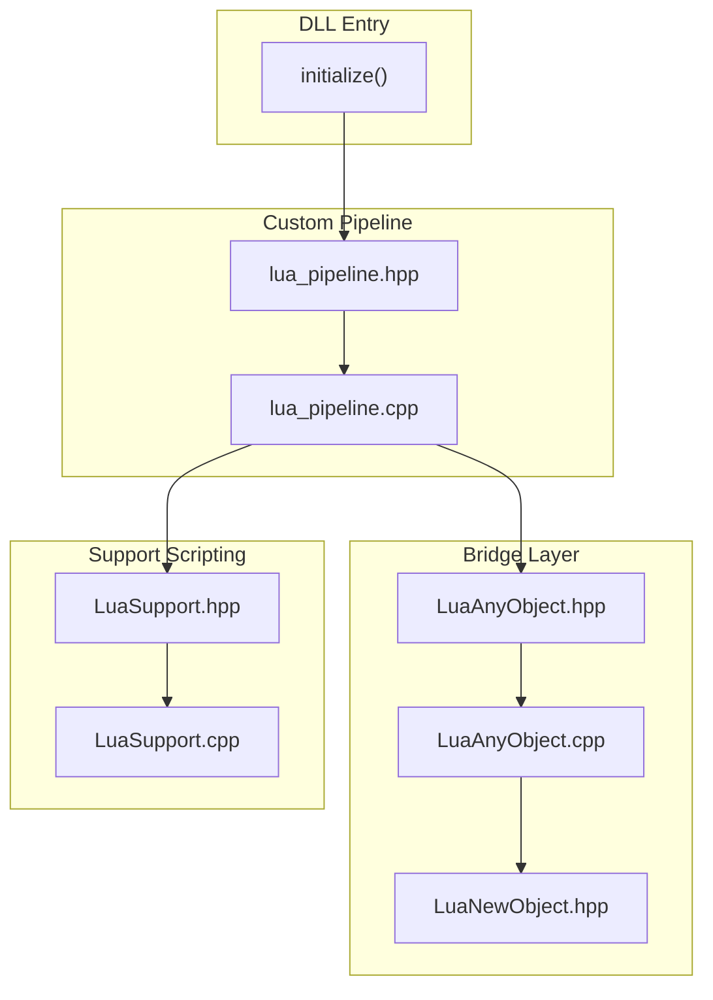
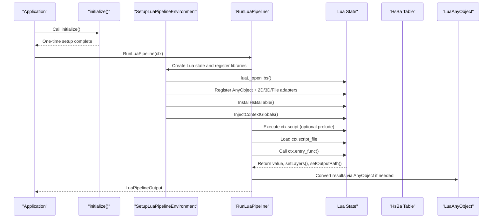
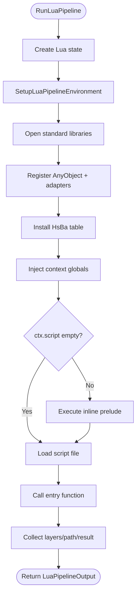
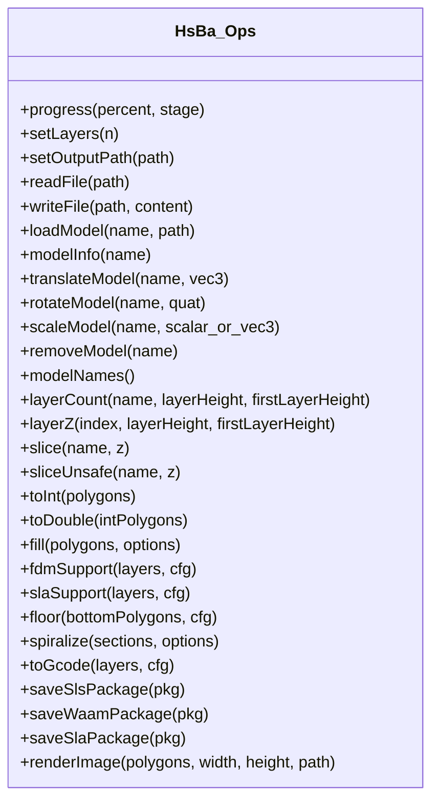
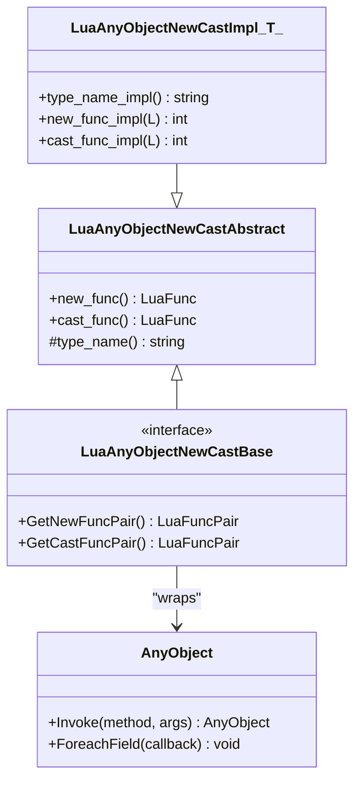
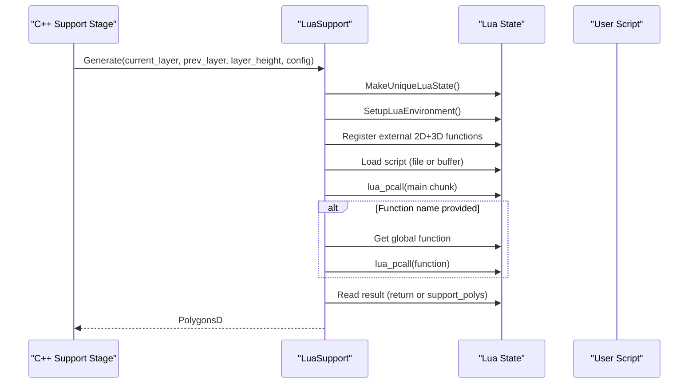
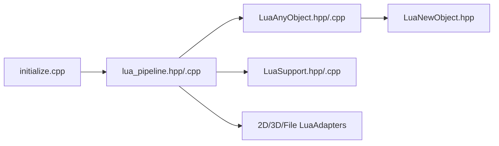

# Lua Environment Setup

<cite>
**Referenced Files in This Document**
- [lua_pipeline.hpp](file://LibHsBaSlicer/Extends/lua_pipeline.hpp)
- [lua_pipeline.cpp](file://LibHsBaSlicer/Extends/lua_pipeline.cpp)
- [LuaAnyObject.hpp](file://utils/LuaAnyObject.hpp)
- [LuaAnyObject.cpp](file://utils/LuaAnyObject.cpp)
- [LuaNewObject.hpp](file://utils/LuaNewObject.hpp)
- [LuaSupport.hpp](file://support/LuaSupport.hpp)
- [LuaSupport.cpp](file://support/LuaSupport.cpp)
- [initialize.h](file://DllHsBaSlicer/initialize.h)
- [initialize.cpp](file://DllHsBaSlicer/initialize.cpp)
</cite>

## Table of Contents
1. [Introduction](#introduction)
2. [Project Structure](#project-structure)
3. [Core Components](#core-components)
4. [Architecture Overview](#architecture-overview)
5. [Detailed Component Analysis](#detailed-component-analysis)
6. [Dependency Analysis](#dependency-analysis)
7. [Performance Considerations](#performance-considerations)
8. [Troubleshooting Guide](#troubleshooting-guide)
9. [Conclusion](#conclusion)

## Introduction
This document explains how HsBaSlicer initializes and configures its Lua scripting environment, integrates it with the C++ core, and exposes a rich pipeline API to Lua scripts. It focuses on:

- The fully Lua-driven custom pipeline entry points and execution context.
- The global `HsBa` table that provides model, slicing, fill, support, path, packaging, and file operations.
- The `LuaAnyObject` bridge that enables safe data exchange between Lua values and C++ variant objects.
- Global variable injection, library registration, and script lifecycle management.
- Type bridging rules, error handling, performance considerations, and debugging techniques.

## Project Structure
The Lua integration spans several modules:

- `LibHsBaSlicer/Extends`: Custom pipeline environment, context/output types, and the `HsBa` operation table.
- `utils`: Generic Lua object lifetime helpers and the `AnyObject` bridge.
- `support`: A separate Lua-based support generator used by the FDM/SLA support stages.
- `DllHsBaSlicer`: DLL initialization entry point for one-time setup.

**Diagram sources**
- [initialize.h:11-19](file://DllHsBaSlicer/initialize.h#L11-L19)
- [lua_pipeline.hpp:19-83](file://LibHsBaSlicer/Extends/lua_pipeline.hpp#L19-L83)
- [lua_pipeline.cpp:866-958](file://LibHsBaSlicer/Extends/lua_pipeline.cpp#L866-L958)
- [LuaAnyObject.hpp:19-521](file://utils/LuaAnyObject.hpp#L19-L521)
- [LuaAnyObject.cpp:11-178](file://utils/LuaAnyObject.cpp#L11-L178)
- [LuaNewObject.hpp:81-115](file://utils/LuaNewObject.hpp#L81-L115)
- [LuaSupport.hpp:19-81](file://support/LuaSupport.hpp#L19-L81)
- [LuaSupport.cpp:19-178](file://support/LuaSupport.cpp#L19-L178)

**Section sources**
- [initialize.h:11-19](file://DllHsBaSlicer/initialize.h#L11-L19)
- [initialize.cpp:7-9](file://DllHsBaSlicer/initialize.cpp#L7-L9)
- [lua_pipeline.hpp:19-83](file://LibHsBaSlicer/Extends/lua_pipeline.hpp#L19-L83)
- [lua_pipeline.cpp:866-958](file://LibHsBaSlicer/Extends/lua_pipeline.cpp#L866-L958)

## Core Components
- **LuaPipelineContext**: Describes the script source (inline or file), entry function name, configuration JSON, output path, model metadata, and progress callback.
- **LuaPipelineOutput**: Captures success status, total layers, output path, result string, and error message from a Lua pipeline run.
- **HsBa table**: A global Lua table exposing all pipeline operations such as model loading, transformation, slicing, filling, support generation, G-code export, packaging, and image rendering.
- **LuaAnyObject bridge**: Provides a metatable and cast/new functions to wrap native values into `Utils::AnyObject`, invoke methods dynamically, iterate fields, and manage memory safely.
- **LuaSupport**: A dedicated Lua-based support generator that replaces built-in algorithms with user scripts.

Key responsibilities:
- Environment construction and library registration.
- Context injection and registry-backed state sharing.
- Safe type conversion and error propagation.
- Lifecycle management for Lua states and userdata.

**Section sources**
- [lua_pipeline.hpp:19-83](file://LibHsBaSlicer/Extends/lua_pipeline.hpp#L19-L83)
- [lua_pipeline.cpp:228-860](file://LibHsBaSlicer/Extends/lua_pipeline.cpp#L228-L860)
- [LuaAnyObject.hpp:19-521](file://utils/LuaAnyObject.hpp#L19-L521)
- [LuaAnyObject.cpp:11-178](file://utils/LuaAnyObject.cpp#L11-L178)
- [LuaSupport.hpp:19-81](file://support/LuaSupport.hpp#L19-L81)
- [LuaSupport.cpp:19-178](file://support/LuaSupport.cpp#L19-L178)

## Architecture Overview
The Lua integration follows a layered architecture:

- **Entry layer**: `initialize()` is the DLL entry point for one-time setup.
- **Pipeline layer**: `SetupLuaPipelineEnvironment` builds a fresh Lua state, opens standard libraries, registers common types and module adapters, installs the `HsBa` table, and injects context globals.
- **Execution layer**: `RunLuaPipeline` executes an optional inline prelude, loads a script file, calls the entry function, and collects outputs.
- **Bridge layer**: `LuaAnyObject` wraps native values into `AnyObject`, exposes dynamic invocation and field iteration, and manages garbage collection via Lua userdata.
- **Support layer**: `LuaSupport` creates isolated Lua states per call, sets up polygon helpers and support APIs, and runs user scripts to generate support polygons.

**Diagram sources**
- [initialize.cpp:7-9](file://DllHsBaSlicer/initialize.cpp#L7-L9)
- [lua_pipeline.cpp:903-958](file://LibHsBaSlicer/Extends/lua_pipeline.cpp#L903-L958)
- [lua_pipeline.cpp:960-1043](file://LibHsBaSlicer/Extends/lua_pipeline.cpp#L960-L1043)
- [LuaAnyObject.cpp:130-178](file://utils/LuaAnyObject.cpp#L130-L178)

## Detailed Component Analysis

### Custom Pipeline Environment and Execution
The custom pipeline delegates the entire workflow to Lua. C++ constructs a sandboxed environment and exposes building blocks through `HsBa`.

- **Context and Output**:
  - `LuaPipelineContext` holds script source, file path, entry function, configuration JSON, output path, model metadata, and progress callback.
  - `LuaPipelineOutput` captures success, total layers, output path, result string, and error message.

- **Environment Construction**:
  - Opens standard libraries.
  - Installs common `AnyObject` types and 2D/3D/file adapter registrations.
  - Registers polygon operations, support generators, fill functions, path optimization, zipper, cipher, SQLite, parameter store, and optional MySQL/PostgreSQL/bit7z adapters.
  - Binds internal run state to the Lua registry so `HsBa` functions can access context and output.
  - Installs the `HsBa` table and injects globals like `pipeline_config`, `output_path`, `model_name`, `model_path`, and `pipeline_entry`.

- **Script Loading and Execution**:
  - Executes optional inline script first as a prelude.
  - Loads and executes the script file.
  - Calls the entry function; truthy return indicates success, string return is captured as `result_string`.
  - Reads `total_layers` and `output_path` from registry keys written by `setLayers` and `setOutputPath`.

**Diagram sources**
- [lua_pipeline.cpp:960-1043](file://LibHsBaSlicer/Extends/lua_pipeline.cpp#L960-L1043)
- [lua_pipeline.cpp:903-958](file://LibHsBaSlicer/Extends/lua_pipeline.cpp#L903-L958)

**Section sources**
- [lua_pipeline.hpp:19-83](file://LibHsBaSlicer/Extends/lua_pipeline.hpp#L19-L83)
- [lua_pipeline.cpp:228-860](file://LibHsBaSlicer/Extends/lua_pipeline.cpp#L228-L860)
- [lua_pipeline.cpp:866-958](file://LibHsBaSlicer/Extends/lua_pipeline.cpp#L866-L958)
- [lua_pipeline.cpp:960-1043](file://LibHsBaSlicer/Extends/lua_pipeline.cpp#L960-L1043)

### HsBa Table Operations
The `HsBa` table exposes operations grouped by responsibility:

- **Progress and output control**:
  - `progress(percent[, stage])`: Reports progress via the context callback.
  - `setLayers(n)` / `setOutputPath(path)`: Writes registry values read by the runner.

- **Model management**:
  - `loadModel(name, path)`, `removeModel(name)`, `modelNames()`.
  - `modelInfo(name)`: Returns bounding box, volume, and layer height metadata.
  - `translateModel(name, {x,y,z})`, `rotateModel(name, {x,y,z,w})`, `scaleModel(name, s | {x,y,z})`.

- **Slicing and coordinate conversion**:
  - `layerCount(name, layerHeight, firstLayerHeight)`, `layerZ(index0based, layerHeight, firstLayerHeight)`.
  - `slice(name, z)` (safe closed contours), `sliceUnsafe(name, z)` (normalized).
  - `toInt(polygons)`, `toDouble(intPolygons)`.

- **Fill and support**:
  - `fill(polygons[, {spacing, mode, angle, borderCount}])`.
  - `fdmSupport(layers, cfg)`, `slaSupport(layers, cfg)`.

- **Floor and path**:
  - `floor(bottomPolygons, cfg)`.
  - `spiralize(sections[, {layerHeight, startZ, zHeights}])`.
  - `toGcode(layers, cfg)`.

- **Packaging and export**:
  - `saveSlsPackage(...)`, `saveWaamPackage(...)`, `saveSlaPackage(...)`.
  - `renderImage(polygons, width, height, path)`.

These operations are registered as a C array of `luaL_Reg` and installed under the global `HsBa` table.

**Diagram sources**
- [lua_pipeline.cpp:228-860](file://LibHsBaSlicer/Extends/lua_pipeline.cpp#L228-L860)

**Section sources**
- [lua_pipeline.cpp:228-860](file://LibHsBaSlicer/Extends/lua_pipeline.cpp#L228-L860)

### LuaAnyObject Bridge
`LuaAnyObject` bridges C++ variant containers (`Utils::AnyObject`) with Lua values:

- **Metatable and lifecycle**:
  - Creates a metatable named `AnyObject` with `__gc` to destroy wrapped objects.
  - Exposes instance methods `invoke(method, ...)` and `foreach_field(callback)`.

- **Type adapters**:
  - Provides CRTP-based new/cast pairs for basic types: `int`, `long`, `long long`, `size_t`, `float`, `double`, `bool`, `string`, `cstring`.
  - Each adapter validates input types and throws Lua errors on invalid conversions.

- **Global API**:
  - Registers a global `AnyObject` table with `new`, `invoke`, `foreach_field`, plus `new_<type>` and `cast_<type>` helpers.

- **Dynamic invocation**:
  - Collects arguments from Lua stack, converts primitives into `AnyObject`, invokes method names, and returns either another `AnyObject` pointer or nil.

**Diagram sources**
- [LuaAnyObject.hpp:32-112](file://utils/LuaAnyObject.hpp#L32-L112)
- [LuaAnyObject.cpp:11-127](file://utils/LuaAnyObject.cpp#L11-L127)

**Section sources**
- [LuaAnyObject.hpp:19-521](file://utils/LuaAnyObject.hpp#L19-L521)
- [LuaAnyObject.cpp:11-178](file://utils/LuaAnyObject.cpp#L11-L178)

### Lua Support Generator
`LuaSupport` allows replacing built-in support generation with a Lua script:

- **Constructors**:
  - Inline script with default function name `generate_support`.
  - Inline script with custom function name.
  - Script file with custom function name.

- **Environment setup**:
  - Opens standard libraries.
  - Registers polygon operations and support module functions.
  - Pushes `current_layer`, `prev_layer`, `layer_height`, and `config` as globals.

- **Execution flow**:
  - Loads script from file or buffer.
  - Executes main chunk; optionally calls the specified function.
  - Reads result from return value or global `support_polys`.

**Diagram sources**
- [LuaSupport.cpp:19-178](file://support/LuaSupport.cpp#L19-L178)

**Section sources**
- [LuaSupport.hpp:19-81](file://support/LuaSupport.hpp#L19-L81)
- [LuaSupport.cpp:19-178](file://support/LuaSupport.cpp#L19-L178)

### DLL Initialization
The DLL exposes a C entry point `initialize()` intended for one-time runtime setup and registration. In the current codebase, the implementation body is minimal, but the header documents its purpose clearly.

**Section sources**
- [initialize.h:11-19](file://DllHsBaSlicer/initialize.h#L11-L19)
- [initialize.cpp:7-9](file://DllHsBaSlicer/initialize.cpp#L7-L9)

## Dependency Analysis
The following diagram shows key dependencies among Lua integration components:

**Diagram sources**
- [initialize.cpp:7-9](file://DllHsBaSlicer/initialize.cpp#L7-L9)
- [lua_pipeline.cpp:903-958](file://LibHsBaSlicer/Extends/lua_pipeline.cpp#L903-L958)
- [LuaAnyObject.cpp:130-178](file://utils/LuaAnyObject.cpp#L130-L178)
- [LuaNewObject.hpp:81-115](file://utils/LuaNewObject.hpp#L81-L115)
- [LuaSupport.cpp:113-178](file://support/LuaSupport.cpp#L113-L178)

**Section sources**
- [lua_pipeline.cpp:903-958](file://LibHsBaSlicer/Extends/lua_pipeline.cpp#L903-L958)
- [LuaAnyObject.cpp:130-178](file://utils/LuaAnyObject.cpp#L130-L178)
- [LuaNewObject.hpp:81-115](file://utils/LuaNewObject.hpp#L81-L115)
- [LuaSupport.cpp:113-178](file://support/LuaSupport.cpp#L113-L178)

## Performance Considerations
- **Avoid excessive cross-boundary conversions**: Prefer passing large polygon arrays as tables once per operation rather than converting element-by-element.
- **Reuse Lua states when possible**: For batch processing, reuse a single Lua state instead of creating many short-lived states.
- **Minimize string allocations**: Use binary reads/writes and avoid unnecessary string copies in `HsBa.readFile`/`writeFile`.
- **Use typed adapters carefully**: Each `AnyObject` conversion incurs overhead; prefer direct typed functions where available.
- **Profile heavy loops**: If scripts perform many small operations, consider batching them in C++ and exposing higher-level APIs.

[No sources needed since this section provides general guidance]

## Troubleshooting Guide
Common issues and remedies:

- **Lua state creation fails**:
  - Check memory availability and ensure `MakeUniqueLuaState()` succeeds.
  - Verify no prior Lua state corruption exists.

- **Script load errors**:
  - Inspect `error_message` in `LuaPipelineOutput`.
  - Validate script syntax using a standalone Lua interpreter.

- **Runtime errors in scripts**:
  - Review `lua_pcall` error messages and check argument types passed to `HsBa` functions.
  - Ensure required globals (`pipeline_config`, `output_path`, etc.) are present.

- **Invalid AnyObject conversions**:
  - Confirm that the Lua value matches the expected type before casting.
  - Use `cast_<type>` functions and handle exceptions gracefully.

- **Missing entry function**:
  - Verify `entry_func` exists in the loaded script.
  - Check that the script defines the function at global scope.

- **File I/O failures**:
  - Ensure paths are valid and accessible.
  - Handle `nil` returns from `HsBa.readFile` and write errors from `HsBa.writeFile`.

**Section sources**
- [lua_pipeline.cpp:960-1043](file://LibHsBaSlicer/Extends/lua_pipeline.cpp#L960-L1043)
- [LuaSupport.cpp:130-178](file://support/LuaSupport.cpp#L130-L178)
- [LuaAnyObject.cpp:11-127](file://utils/LuaAnyObject.cpp#L11-L127)

## Conclusion
HsBaSlicer’s Lua environment is designed around a clear separation of concerns:

- The custom pipeline constructs a rich, sandboxed Lua environment and exposes a comprehensive `HsBa` API.
- The `LuaAnyObject` bridge provides safe, typed interop between Lua and C++ variant objects.
- The support generator offers flexible replacement of built-in algorithms with user scripts.
- Error handling, memory management, and lifecycle control are centralized to ensure stability and debuggability.

For advanced usage, extend the environment by registering additional libraries, define custom `AnyObject` adapters, and leverage the progress callback for real-time feedback during long-running pipelines.

[No sources needed since this section summarizes without analyzing specific files]