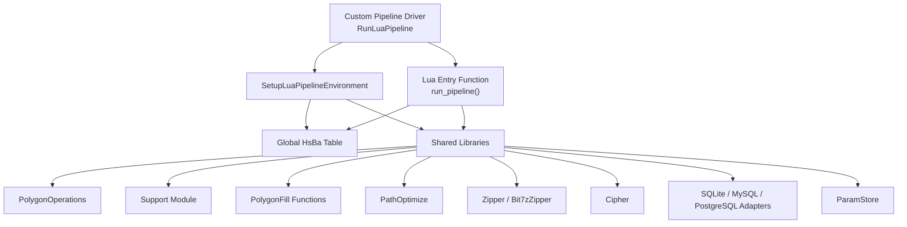
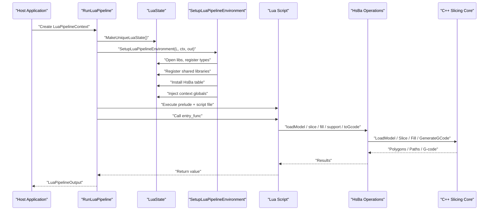
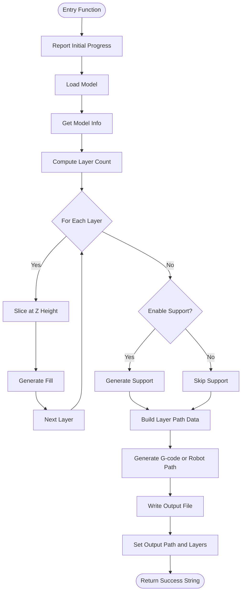
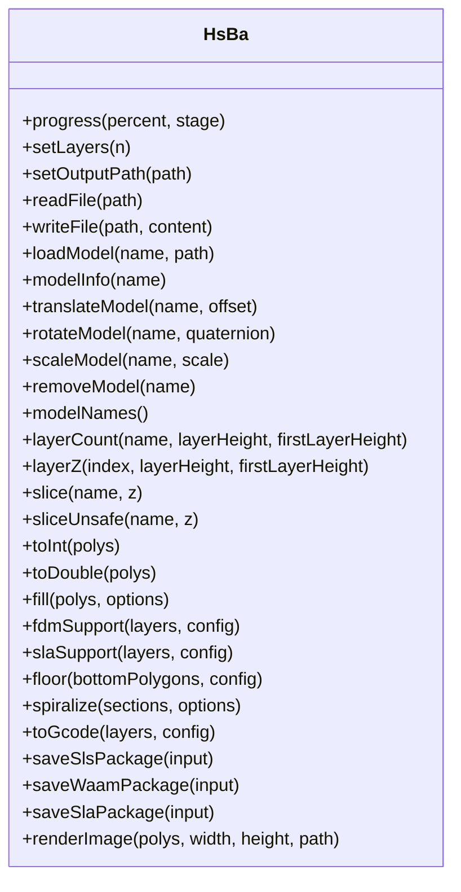
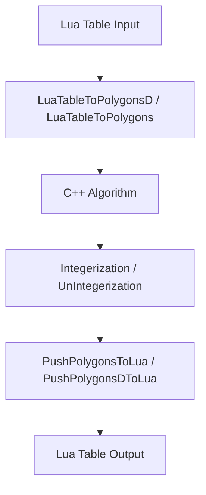
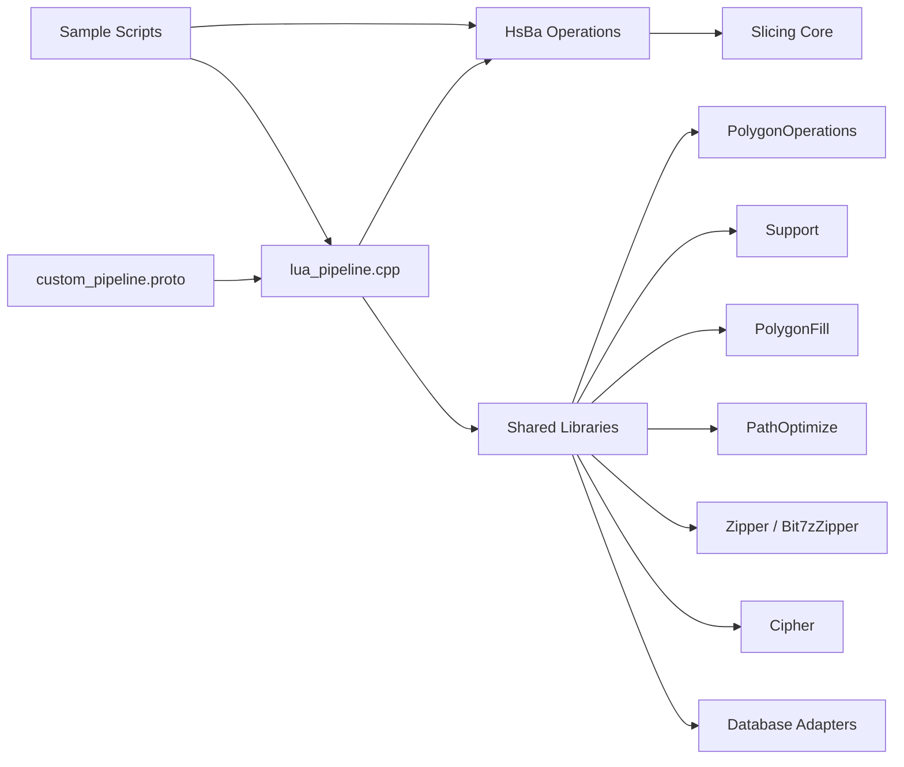

# Lua Scripting System

<cite>
**Referenced Files in This Document**   
- [lua_pipeline.hpp](file://LibHsBaSlicer/Extends/lua_pipeline.hpp)
- [lua_pipeline.cpp](file://LibHsBaSlicer/Extends/lua_pipeline.cpp)
- [LuaAddFunction.hpp](file://LibHsBaSlicer/Extends/LuaAddFunction.hpp)
- [LuaSupport.hpp](file://support/LuaSupport.hpp)
- [LuaSupport.cpp](file://support/LuaSupport.cpp)
- [LuaAdapter.hpp](file://2D/LuaAdapter.hpp)
- [LuaAdapter.cpp](file://2D/LuaAdapter.cpp)
- [lua_pipeline_api.md](file://docs/en/lua_pipeline_api.md)
- [hsba_pipeline.d.lua](file://types/hsba_pipeline.d.lua)
- [custom_pipeline.proto](file://proto/custom_pipeline.proto)
- [my_fdm_pipeline.lua](file://samples/Custom/scripts/my_fdm_pipeline.lua)
- [my_sla_pipeline.lua](file://samples/Custom/scripts/my_sla_pipeline.lua)
- [my_support.lua](file://samples/FDM/scripts/my_support.lua)
- [my_infill.lua](file://samples/FDM/scripts/my_infill.lua)
</cite>

## Table of Contents
1. [Introduction](#introduction)
2. [Project Structure](#project-structure)
3. [Core Components](#core-components)
4. [Architecture Overview](#architecture-overview)
5. [Detailed Component Analysis](#detailed-component-analysis)
6. [Dependency Analysis](#dependency-analysis)
7. [Performance Considerations](#performance-considerations)
8. [Troubleshooting Guide](#troubleshooting-guide)
9. [Conclusion](#conclusion)
10. [Appendices](#appendices)

## Introduction
This document explains HsBaSlicer’s Lua scripting system that enables runtime customization and extension of slicing pipelines. It covers the two Lua environments (fully custom pipeline vs built-in stage hooks), environment initialization, global variables, the `HsBa` operation table, shared libraries, type binding between C++ and Lua, memory and performance considerations, debugging/testing strategies, and practical examples for FDM, SLA, support, fill, path output, packaging, and database/file operations.

The goal is to help both new and experienced users author robust Lua scripts inside HsBaSlicer while understanding how the C++ core exposes slicing capabilities through a stable Lua API.

## Project Structure
The Lua scripting system spans several modules:

- Custom pipeline driver and environment setup: `LibHsBaSlicer/Extends/lua_pipeline.*`
- External function/event registration framework: `LibHsBaSlicer/Extends/LuaAddFunction.hpp`
- Support-stage Lua script execution: `support/LuaSupport.*`
- Polygon data conversion and `PolygonOperations`: `2D/LuaAdapter.*`
- Public Lua API documentation: `docs/en/lua_pipeline_api.md`
- IDE type definitions: `types/hsba_pipeline.d.lua`
- Protocol definition for fully Lua-driven custom pipelines: `proto/custom_pipeline.proto`
- Example scripts: `samples/Custom/scripts/*`, `samples/FDM/scripts/*`, `samples/SLA/scripts/*`

**Diagram sources**
- [lua_pipeline.cpp:903-958](file://LibHsBaSlicer/Extends/lua_pipeline.cpp#L903-L958)
- [lua_pipeline.cpp:830-872](file://LibHsBaSlicer/Extends/lua_pipeline.cpp#L830-L872)
- [lua_pipeline_api.md:136-213](file://docs/en/lua_pipeline_api.md#L136-L213)

**Section sources**
- [lua_pipeline.hpp:19-83](file://LibHsBaSlicer/Extends/lua_pipeline.hpp#L19-L83)
- [lua_pipeline.cpp:903-1046](file://LibHsBaSlicer/Extends/lua_pipeline.cpp#L903-L1046)
- [lua_pipeline_api.md:1-16](file://docs/en/lua_pipeline_api.md#L1-L16)

## Core Components
HsBaSlicer provides two distinct Lua scripting contexts:

| Context | Purpose | Trigger | Main API Surface |
|---|---|---|---|
| **Custom Pipeline** | The script decides the full workflow order: load model, slice, support, fill, floor, path generation, packaging, file I/O. | C++ calls the entry function defined by `pipeline_entry`, default `run_pipeline`. | Global `HsBa` table + context globals (`pipeline_config`, `model_name`, `model_path`, `output_path`). |
| **Built-in Stage Hook** | Replace only one algorithm inside a fixed C++ pipeline: support, fill, floor, or export. | Built-in pipeline loads a user script at the appropriate stage and calls the agreed function. | Stage-specific globals plus shared libraries; no `HsBa` table. |

Both environments share common geometry types and shared libraries such as `PolygonOperations`, `Support`, `PolygonFill`, `PathOptimize`, `Cipher`, `Zipper`, database adapters, and `ParamStore`.

Key responsibilities:

- `LuaPipelineContext` carries script source, script file, entry function name, JSON config, model metadata, output path, and progress callback.
- `LuaPipelineOutput` collects success flag, total layers, output path, result string, and error message.
- `SetupLuaPipelineEnvironment` opens Lua standard libraries, installs common types, registers external functions, installs shared libraries, binds run state, creates `HsBa`, and injects context globals.
- `RunLuaPipeline` creates a Lua state, sets up the environment, executes prelude and script file, calls the entry function, and maps Lua results into `LuaPipelineOutput`.

**Section sources**
- [lua_pipeline.hpp:19-83](file://LibHsBaSlicer/Extends/lua_pipeline.hpp#L19-L83)
- [lua_pipeline.cpp:903-1046](file://LibHsBaSlicer/Extends/lua_pipeline.cpp#L903-L1046)
- [lua_pipeline_api.md:19-28](file://docs/en/lua_pipeline_api.md#L19-L28)

## Architecture Overview
The custom pipeline architecture separates orchestration from implementation:

- C++ owns lifecycle, safety, performance-critical geometry algorithms, and persistence.
- Lua owns process logic, parameter decisions, conditional stages, and presentation/export choices.
- Type binding converts Lua tables representing points, polygons, layers, and configuration objects into C++ structures.

**Diagram sources**
- [lua_pipeline.cpp:960-1046](file://LibHsBaSlicer/Extends/lua_pipeline.cpp#L960-L1046)
- [lua_pipeline.cpp:903-958](file://LibHsBaSlicer/Extends/lua_pipeline.cpp#L903-L958)
- [lua_pipeline.cpp:830-872](file://LibHsBaSlicer/Extends/lua_pipeline.cpp#L830-L872)

## Detailed Component Analysis

### Custom Pipeline Environment and Control Flow
The custom pipeline is driven by a Lua entry function. By default it is `run_pipeline`, but it can be overridden via `pipeline_entry`. The script may return:

- A non-empty string: success with result text.
- `true`: success without result text.
- `false`, `nil`, or an uncaught Lua error: failure.

Control and file IO exposed by `HsBa`:

| Call | Returns | Meaning |
|---|---|---|
| `HsBa.progress(percent[, stage])` | — | Report progress percentage and optional stage name. |
| `HsBa.setLayers(n)` | — | Report total layer count. |
| `HsBa.setOutputPath(path)` | — | Report actual output path. |
| `HsBa.readFile(path)` | string or nil | Read binary file content; returns nil on failure. |
| `HsBa.writeFile(path, content)` | boolean | Overwrite file in binary mode; raises Lua error if open fails. |

Model management:

| Call | Returns | Meaning |
|---|---|---|
| `HsBa.loadModel(name, path)` | boolean | Load model into pool; reuse existing same-name model; raises error on failure. |
| `HsBa.modelInfo(name)` | table | Bounding box and volume info. |
| `HsBa.translateModel(name, {x,y,z})` | — | Translate model. |
| `HsBa.rotateModel(name, {x,y,z,w})` | — | Rotate model by quaternion. |
| `HsBa.scaleModel(name, s or {x,y,z})` | — | Scale uniformly or per axis. |
| `HsBa.removeModel(name)` | — | Remove model from pool. |
| `HsBa.modelNames()` | array | List model names in pool. |

Slicing and coordinate conversion:

| Call | Returns | Meaning |
|---|---|---|
| `HsBa.layerCount(name, layerHeight, firstLayerHeight)` | integer | Compute total layers. |
| `HsBa.layerZ(index0based, layerHeight, firstLayerHeight)` | number | Z height for 0-based index. |
| `HsBa.slice(name, z)` | polygons | Safe slice returning closed contours. |
| `HsBa.sliceUnsafe(name, z)` | polygons | Normalized unsafe slice; may drop open contours. |
| `HsBa.toInt(polygons)` | polygons | Float polygons to integer polygons. |
| `HsBa.toDouble(intPolygons)` | polygons | Integer polygons to float polygons. |

Fill, support, floor, path, and packaging are also exposed under `HsBa`; see the next sections.

**Diagram sources**
- [my_fdm_pipeline.lua:52-171](file://samples/Custom/scripts/my_fdm_pipeline.lua#L52-L171)
- [lua_pipeline.cpp:228-288](file://LibHsBaSlicer/Extends/lua_pipeline.cpp#L228-L288)
- [lua_pipeline.cpp:290-397](file://LibHsBaSlicer/Extends/lua_pipeline.cpp#L290-L397)
- [lua_pipeline.cpp:401-461](file://LibHsBaSlicer/Extends/lua_pipeline.cpp#L401-L461)

**Section sources**
- [lua_pipeline.cpp:228-288](file://LibHsBaSlicer/Extends/lua_pipeline.cpp#L228-L288)
- [lua_pipeline.cpp:290-397](file://LibHsBaSlicer/Extends/lua_pipeline.cpp#L290-L397)
- [lua_pipeline.cpp:401-461](file://LibHsBaSlicer/Extends/lua_pipeline.cpp#L401-L461)
- [lua_pipeline_api.md:48-66](file://docs/en/lua_pipeline_api.md#L48-L66)

### Built-in Functions: Model, Slicing, Fill, Support, Floor, Path, Packaging
The `HsBa` table exposes the complete slicing toolkit used by custom pipelines.

#### Model Operations
- Loading reuses models by name.
- Transformation supports translation, rotation via quaternion, uniform scaling, and per-axis scaling.
- Model info includes bounding box minimum/maximum and volume.

#### Slicing Operations
- `layerCount` computes layers from model height, regular layer height, and first-layer height.
- `layerZ` computes Z heights for 0-based indices.
- `slice` returns safe closed contours.
- `sliceUnsafe` returns normalized unsafe slices.

#### Coordinate Conversion
- Boolean and fill operations internally use integer precision.
- `toInt` and `toDouble` convert between floating-point and integer polygon representations.

#### Fill
- `HsBa.fill` accepts polygons and optional configuration including spacing, mode, angle, and border count.
- When `borderCount > 0`, it generates perimeters plus fill.

#### Support and Floor
- `fdmSupport` and `slaSupport` generate per-layer support based on configuration fields such as overhang angle, layer height, gap, diameter, density, pattern, tree parameters, and honeycomb cell size.
- `floor` generates SLA bottom floor or raft with raft offset, border width, fill spacing, fill angle, border count, convex hull options, and concave hull point count.

#### Path and G-code
- `spiralize` turns per-layer closed contours into a continuous 3D spiral path suitable for extrusion processes like FDM, WAAM, or 3DP.
- `toGcode` generates G-code from layered outlines, fills, supports, and Z heights with printer and firmware settings.

#### Packaging and Export
- `saveSlsPackage` packages SLS-style exports with outlines, Z heights, JSON config, output zip, export script, and export function name.
- `saveWaamPackage` packages WAAM robot program output with welding parameters, robot type, bead width, and optional custom generator script.
- `saveSlaPackage` packages SLA images with outlines, supports, floor, image dimensions, extension, and JSON config.
- `renderImage` renders polygons to an image file.

**Diagram sources**
- [lua_pipeline.cpp:830-872](file://LibHsBaSlicer/Extends/lua_pipeline.cpp#L830-L872)
- [lua_pipeline.cpp:480-691](file://LibHsBaSlicer/Extends/lua_pipeline.cpp#L480-L691)
- [lua_pipeline.cpp:693-828](file://LibHsBaSlicer/Extends/lua_pipeline.cpp#L693-L828)

**Section sources**
- [lua_pipeline.cpp:480-691](file://LibHsBaSlicer/Extends/lua_pipeline.cpp#L480-L691)
- [lua_pipeline.cpp:693-828](file://LibHsBaSlicer/Extends/lua_pipeline.cpp#L693-L828)
- [lua_pipeline_api.md:77-133](file://docs/en/lua_pipeline_api.md#L77-L133)

### Shared Libraries Available in Every Environment
Shared libraries are available in both custom pipeline and built-in stage scripts.

| Library | Purpose | Key Capabilities |
|---|---|---|
| `PolygonOperations` | 2D boolean and construction | union, intersection, difference, xor, offset, convex/concave hull, area, rectangle/circle/ellipse/regular polygon creation, text-to-polygons. |
| `PolygonFill` | Fill algorithms | offset fill, line fill, zigzag variants, composite/hybrid fill, offset-only. |
| `PathOptimize` | Path ordering optimization | region/polygon optimization, route cost, reordered paths. |
| `Support` | Support generators | plane/tree/honeycomb/SLA generators, overhang detection, default config, Lua-based custom generator. |
| `Cipher` | Encoding | base64 and hex encode/decode. |
| `Zipper` / `Bit7zZipper` | Compression | archive creation, adding files and byte content, saving archives. |
| Database adapters | Persistence | SQLite, MySQL, PostgreSQL adapters with connect, execute, query, insert, update, delete, create table. |
| `ParamStore` | Parameter persistence | reflection-based storage with schema, save/load/list/update/delete. |

Important availability notes:

- MySQL adapter requires `HSBA_USE_MYSQL`.
- PostgreSQL adapter requires `HSBA_USE_PGSQL`.
- `Bit7zZipper` requires `HSBA_USE_BIT7Z`.

**Section sources**
- [lua_pipeline_api.md:136-213](file://docs/en/lua_pipeline_api.md#L136-L213)
- [lua_pipeline.cpp:924-941](file://LibHsBaSlicer/Extends/lua_pipeline.cpp#L924-L941)

### Built-in Pipeline Stage Hooks
Built-in pipelines allow replacing specific algorithms without changing the overall stage order.

#### Support Stage
Globals injected:

| Global | Type | Meaning |
|---|---|---|
| `current_layer` | polygons | Current-layer polygons. |
| `prev_layer` | polygons | Previous-layer polygons; empty on first layer. |
| `layer_height` | number | Layer height in mm. |
| `config` | table | Support configuration. |

Agreed entry function: `generate_support()`, returning support cross-section polygons. Result can also be returned via the global `support_polys`.

Available libraries: `PolygonOperations`, `Support`, plus external 2D/3D functions registered by C++.

#### Fill Stage
Agreed entry function: `generate_fill(current_layer)`, receiving current-layer polygons after perimeter subtraction. No globals are injected; use defaults inside the script. The script should define the function but not self-invoke at the end.

Available libraries: `PolygonOperations`, `PolygonFill`, `PathOptimize`.

#### Floor Stage (SLA)
Used to customize SLA bottom floor or raft generation.

Available libraries: `PolygonOperations`, `PolygonFill`.

#### Export Stage
Export scripts run at packaging stage with globals:

| Global | Type | Meaning |
|---|---|---|
| `config` | table | `{ path="config.json", configStr="<JSON>" }`. |
| `images` | array | `{ path="layers/N.json", data="<polygon JSON>" }`. |
| `output_path` | string | Output file path. |

Agreed entry functions vary by process: `export_sls`, `export_waam`, etc. Return value should be a table with `success` and `export_path`, except WAAM which returns robot program text.

Common pitfall: returning a wrong value type from an export script can overwrite or write an empty zip file. Always return the expected structure and keep object method names consistent with C++ bindings.

**Section sources**
- [lua_pipeline_api.md:215-261](file://docs/en/lua_pipeline_api.md#L215-L261)
- [LuaSupport.hpp:21-39](file://support/LuaSupport.hpp#L21-L39)
- [LuaSupport.cpp:67-90](file://support/LuaSupport.cpp#L67-L90)

### Type Binding System: C++ Objects to Lua Variables
HsBaSlicer uses Lua tables as the universal representation for geometry:

| Type | Lua Representation | Notes |
|---|---|---|
| Point | `{ x = number, y = number }` | Fields fixed as `x` and `y`; units in mm; double precision. |
| Polygon | Array of points | Ordered closed contour. |
| Polygons | Array of polygons | One layer; holes exist as separate polygons. |
| Layers | Array of polygon arrays | Per-layer collection. |
| 3D point | `{ x = number, y = number, z = number }` | Used by spiral path output. |

Conversion helpers:

- `PushPolygonDToLua`, `PushPolygonsDToLua`, `PushPolygonToLua`, `PushPolygonsToLua` push C++ polygons onto the Lua stack.
- `LuaTableToPolygonD`, `LuaTableToPolygonsD`, `LuaTableToPolygon`, `LuaTableToPolygons` read Lua tables into C++ polygons.
- Integerization converts between floating-point and integer polygon representations for stability in boolean/fill operations.

Memory and lifetime considerations:

- Geometry data is copied across the C++/Lua boundary using table serialization.
- Large layers and many polygons increase allocation and GC pressure.
- Scripts should avoid retaining large intermediate polygon tables longer than necessary.
- Use `HsBa.removeModel` after processing to release model resources.

**Diagram sources**
- [LuaAdapter.cpp:332-491](file://2D/LuaAdapter.cpp#L332-L491)
- [lua_pipeline.cpp:185-222](file://LibHsBaSlicer/Extends/lua_pipeline.cpp#L185-L222)
- [lua_pipeline.cpp:463-478](file://LibHsBaSlicer/Extends/lua_pipeline.cpp#L463-L478)

**Section sources**
- [LuaAdapter.hpp:16-81](file://2D/LuaAdapter.hpp#L16-L81)
- [LuaAdapter.cpp:332-491](file://2D/LuaAdapter.cpp#L332-L491)
- [lua_pipeline_api.md:32-45](file://docs/en/lua_pipeline_api.md#L32-L45)

### Event Handling, Progress Reporting, and Error Handling
Progress reporting:

- `HsBa.progress(percent, stage)` forwards percentage and stage name to the C++ progress callback stored in `LuaPipelineContext.progress_cb`.
- Scripts should call progress at meaningful boundaries: model loading, slicing loops, support generation, path generation, and file writing.

Error handling:

- `RunLuaSource` wraps Lua errors with chunk names and throws `RuntimeError`.
- `RunLuaPipeline` catches `RuntimeError`, sets `success = false`, and populates `error_message`.
- Missing entry function produces a clear error message.
- File write failures raise Lua errors with the failing path.
- Export scripts must return the expected structure; otherwise packaging may fail silently or produce invalid output.

Event callbacks:

- The registration framework supports registering Lua event callbacks under named events such as zipper or database events.
- This allows external extensions to intercept or observe operations during compression, database access, or other pipeline stages.

**Section sources**
- [lua_pipeline.cpp:228-238](file://LibHsBaSlicer/Extends/lua_pipeline.cpp#L228-L238)
- [lua_pipeline.cpp:888-899](file://LibHsBaSlicer/Extends/lua_pipeline.cpp#L888-L899)
- [lua_pipeline.cpp:995-1040](file://LibHsBaSlicer/Extends/lua_pipeline.cpp#L995-L1040)
- [LuaAddFunction.hpp:60-74](file://LibHsBaSlicer/Extends/LuaAddFunction.hpp#L60-L74)

### Custom Pipeline Development Process
Recommended script structure:

1. Define helper functions for machine parameters and geometry utilities.
2. Resolve input model name/path and output path from context globals or defaults.
3. Report initial progress.
4. Load model and compute layer count; report total layers.
5. Iterate layers: slice, compute Z height, generate fill, optionally rotate fill angle or apply strategy.
6. Optionally generate support based on configuration.
7. Assemble layer path data with outlines, fills, supports, and Z heights.
8. Generate G-code or robot path.
9. Write output file and set output path.
10. Remove model from pool and report final progress.
11. Return a success string.

Example patterns:

- FDM custom pipeline: full control over load, slice, fill, support, G-code generation, and file output.
- SLA custom pipeline: load, slice, SLA support, floor/raft, render and package images into zip.
- Built-in support script: detect overhangs, choose generator, generate support, optionally refine polygons.
- Built-in fill script: define `generate_fill` and return fill polygons without side effects.

**Section sources**
- [my_fdm_pipeline.lua:24-171](file://samples/Custom/scripts/my_fdm_pipeline.lua#L24-L171)
- [my_sla_pipeline.lua:20-104](file://samples/Custom/scripts/my_sla_pipeline.lua#L20-L104)
- [my_support.lua:30-82](file://samples/FDM/scripts/my_support.lua#L30-L82)
- [my_infill.lua:18-88](file://samples/FDM/scripts/my_infill.lua#L18-L88)

### Practical Examples

#### Complete FDM Custom Pipeline
The FDM example demonstrates:

- Reading machine parameters from a preinjected `machine` table or fallback defaults.
- Computing XY extent of layers.
- Loading model, computing layers, slicing, rotating fill angle every few layers.
- Conditional support generation.
- Building path layers and generating G-code.
- Writing header and G-code to file.
- Returning a human-readable result.

**Section sources**
- [my_fdm_pipeline.lua:24-171](file://samples/Custom/scripts/my_fdm_pipeline.lua#L24-L171)

#### Complete SLA Custom Pipeline
The SLA example demonstrates:

- Loading model and computing layers.
- Slicing with model bottom as Z origin.
- Generating SLA support with tip diameter and raft thickness.
- Generating floor/raft with convex hull option.
- Rendering and packaging layers, supports, floor, and config into zip.
- Cleaning up model and reporting output path.

**Section sources**
- [my_sla_pipeline.lua:20-104](file://samples/Custom/scripts/my_sla_pipeline.lua#L20-L104)

#### Custom Support Algorithm
The FDM support example demonstrates:

- Skipping first layer.
- Detecting overhang regions.
- Selecting generator by pattern: plane, tree, honeycomb.
- Using default config and overriding key fields.
- Calling `Support.generate`.
- Optionally refining support contact area with offset.

**Section sources**
- [my_support.lua:30-82](file://samples/FDM/scripts/my_support.lua#L30-L82)

#### Custom Fill Algorithm
The FDM fill example demonstrates:

- Defining `generate_fill(current_layer)`.
- Computing bounding box and scan range.
- Generating parallel lines at a given angle.
- Creating thin rectangular polygons as fill lines.
- Intersecting fill lines with current layer to clip to valid regions.

**Section sources**
- [my_infill.lua:18-88](file://samples/FDM/scripts/my_infill.lua#L18-L88)

## Dependency Analysis
The Lua scripting system depends on multiple layers:

- Protocol layer defines the minimal configuration for fully Lua-driven pipelines.
- Driver layer constructs Lua state, environment, and runs scripts.
- Operation layer binds `HsBa` methods to C++ slicing core.
- Shared library layer provides reusable tools for geometry, support, fill, path optimization, compression, encoding, database access, and parameter persistence.
- Sample layer provides reference scripts for different manufacturing processes.

**Diagram sources**
- [custom_pipeline.proto:1-25](file://proto/custom_pipeline.proto#L1-L25)
- [lua_pipeline.cpp:903-1046](file://LibHsBaSlicer/Extends/lua_pipeline.cpp#L903-L1046)
- [lua_pipeline_api.md:136-213](file://docs/en/lua_pipeline_api.md#L136-L213)

**Section sources**
- [custom_pipeline.proto:1-25](file://proto/custom_pipeline.proto#L1-L25)
- [lua_pipeline.cpp:903-1046](file://LibHsBaSlicer/Extends/lua_pipeline.cpp#L903-L1046)

## Performance Considerations
- Prefer integer polygon operations for boolean and fill steps; use `HsBa.toInt` before heavy geometry work and `HsBa.toDouble` when returning floating-point results.
- Avoid keeping large polygon arrays in Lua globals longer than needed; prefer local variables and explicit cleanup.
- Call `HsBa.removeModel` after processing to free model resources.
- Batch progress updates rather than calling progress on every tiny step.
- For very large models, consider reducing fill density, increasing spacing, or limiting support density to reduce computation and memory usage.
- Use `PathOptimize` to reduce travel distance and improve toolpath efficiency.
- Be cautious with image rendering and zip packaging for high-resolution layers; adjust image width/height and extension appropriately.

[No sources needed since this section provides general guidance]

## Troubleshooting Guide
Common issues and resolutions:

| Symptom | Likely Cause | Resolution |
|---|---|---|
| Lua entry function not found | Wrong `pipeline_entry` or missing function in script. | Ensure the script defines the function named by `pipeline_entry`, default `run_pipeline`. |
| Script raises Lua error | Syntax error, missing global, or invalid argument. | Check error message from `LuaPipelineOutput.error_message`; validate arguments passed to `HsBa` functions. |
| File write fails | Path not writable or permission denied. | Verify output path and permissions; handle `writeFile` return value. |
| Export zip is empty or overwritten | Export script returned wrong type. | Return `{ success = true/false, export_path = "..." }` for SLS/SLM/LOM/TDP; return string for WAAM. |
| Support or fill produces unexpected shapes | Incorrect polygon format or precision loss. | Use `HsBa.toInt`/`HsBa.toDouble` correctly; verify polygon orientation and closure. |
| Too much memory usage | Retaining large polygon tables or models. | Release models with `removeModel`; avoid global retention of intermediate layers. |

Debugging techniques:

- Print intermediate values using Lua `print` where acceptable.
- Use `HsBa.renderImage` to visualize polygons before packaging.
- Inspect `LuaPipelineOutput.success`, `total_layers`, `output_path`, `result_string`, and `error_message`.
- Validate JSON config strings passed via `pipeline_config`.
- Test small models first, then scale up.

Testing strategies:

- Create minimal scripts that exercise one `HsBa` operation at a time.
- Use sample scripts as templates and gradually add complexity.
- Add unit-like checks inside scripts for expected layer counts and output paths.
- Keep export scripts deterministic and idempotent.

**Section sources**
- [lua_pipeline.cpp:995-1040](file://LibHsBaSlicer/Extends/lua_pipeline.cpp#L995-L1040)
- [lua_pipeline_api.md:246-261](file://docs/en/lua_pipeline_api.md#L246-L261)

## Conclusion
HsBaSlicer’s Lua scripting system provides a powerful separation between process orchestration and core slicing algorithms. The custom pipeline gives full control over workflow order and parameters, while built-in stage hooks allow targeted algorithm replacement. The `HsBa` table and shared libraries expose model management, slicing, fill, support, floor, path generation, packaging, compression, encoding, database access, and parameter persistence. With careful type binding, memory management, progress reporting, and error handling, developers can build robust, extensible manufacturing pipelines for FDM, SLA, SLS, SLM, LOM, TDP, and WAAM processes.

[No sources needed since this section summarizes without analyzing specific files]

## Appendices

### Lua API Reference Summary
The public Lua API is documented in `docs/en/lua_pipeline_api.md` and typed in `types/hsba_pipeline.d.lua`. Key categories include:

- Common geometry types: point, polygon, polygons, layers, 3D point.
- Custom pipeline environment: `HsBa` table and context globals.
- Shared libraries: `PolygonOperations`, `PolygonFill`, `PathOptimize`, `Support`, `Cipher`, `Zipper`, `Bit7zZipper`, database adapters, `ParamStore`.
- Built-in stage hooks: support, fill, floor, export.
- Full example: minimal runnable custom pipeline.

**Section sources**
- [lua_pipeline_api.md:1-332](file://docs/en/lua_pipeline_api.md#L1-L332)
- [hsba_pipeline.d.lua:1-663](file://types/hsba_pipeline.d.lua#L1-L663)