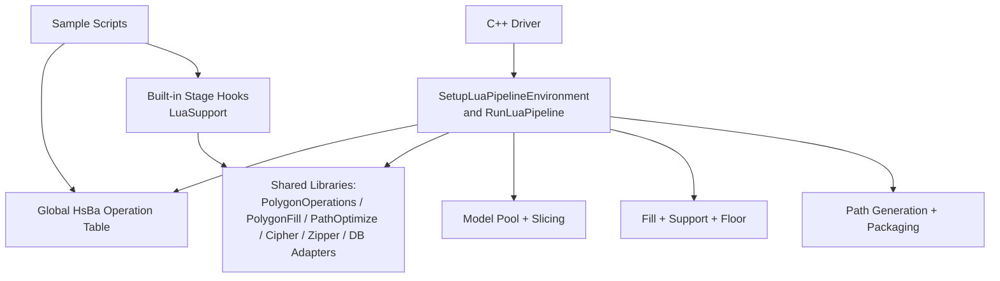
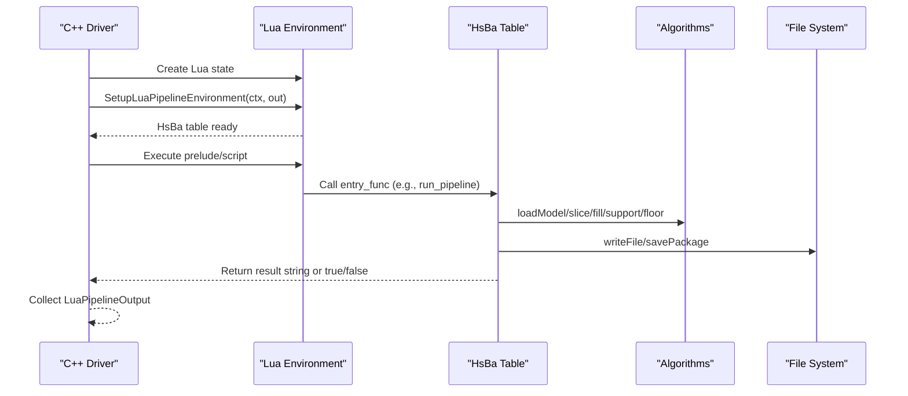
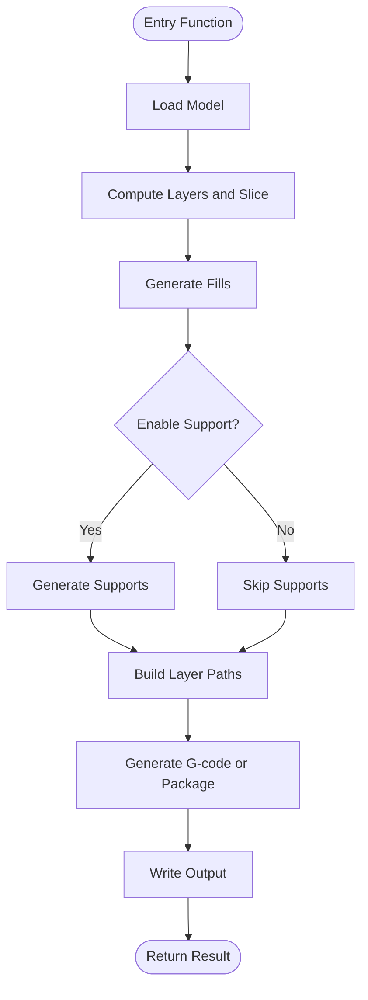
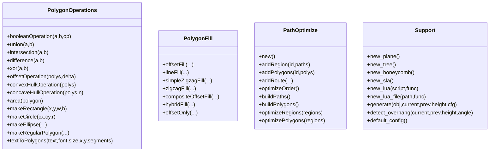
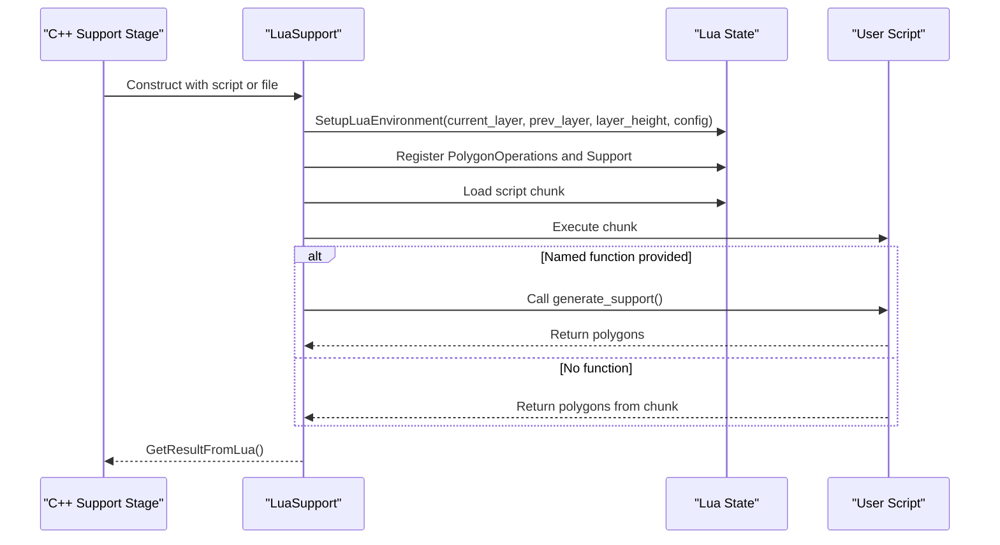
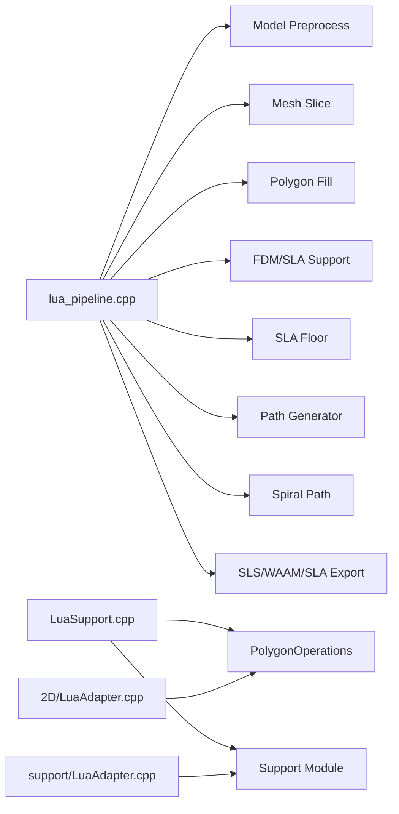

# Lua Scripting System

<cite>
**Referenced Files in This Document**   
- [lua_pipeline.hpp](file://LibHsBaSlicer/Extends/lua_pipeline.hpp)
- [lua_pipeline.cpp](file://LibHsBaSlicer/Extends/lua_pipeline.cpp)
- [LuaSupport.hpp](file://support/LuaSupport.hpp)
- [LuaSupport.cpp](file://support/LuaSupport.cpp)
- [LuaAdapter.cpp](file://2D/LuaAdapter.cpp)
- [LuaAdapter.cpp](file://support/LuaAdapter.cpp)
- [my_fdm_pipeline.lua](file://samples/Custom/scripts/my_fdm_pipeline.lua)
- [my_sla_pipeline.lua](file://samples/Custom/scripts/my_sla_pipeline.lua)
- [my_infill.lua](file://samples/FDM/scripts/my_infill.lua)
- [my_support.lua](file://samples/FDM/scripts/my_support.lua)
- [my_sla_floor.lua](file://samples/SLA/scripts/my_sla_floor.lua)
- [my_sla_support.lua](file://samples/SLA/scripts/my_sla_support.lua)
- [lua_pipeline_api.md](file://docs/en/lua_pipeline_api.md)
</cite>

## Table of Contents
1. [Introduction](#introduction)
2. [Project Structure](#project-structure)
3. [Core Components](#core-components)
4. [Architecture Overview](#architecture-overview)
5. [Detailed Component Analysis](#detailed-component-analysis)
6. [Dependency Analysis](#dependency-analysis)
7. [Performance Considerations](#performance-considerations)
8. [Troubleshooting Guide](#troubleshooting-guide)
9. [Conclusion](#conclusion)
10. [Appendices](#appendices)

## Introduction
This document explains HsBaSlicer’s Lua scripting system: how C++ embeds Lua, what environments are available to scripts, which libraries and functions are exposed, and how to build custom pipelines or replace built-in stages. It also covers algorithm extension patterns for fill and support generation, export customization, debugging strategies, performance considerations, and best practices.

The system supports two main usage modes:
- Fully Lua-driven custom pipeline: the script controls model loading, slicing, support, fill, path generation, packaging, and file output through a global `HsBa` operation table.
- Built-in stage hooks: user scripts replace only one stage (for example FDM support, SLA floor, or an export step) while C++ keeps the overall pipeline order fixed.

## Project Structure
The Lua integration spans several modules:
- Custom pipeline environment and entry points live in the LibHsBaSlicer extends layer.
- Support-stage Lua execution is implemented under the support module.
- 2D polygon operations and geometry conversion are provided by the 2D adapter.
- Sample scripts demonstrate both full custom pipelines and per-stage replacements.

**Diagram sources**
- [lua_pipeline.cpp:46-70](file://LibHsBaSlicer/Extends/lua_pipeline.cpp#L46-L70)
- [lua_pipeline.cpp:228-288](file://LibHsBaSlicer/Extends/lua_pipeline.cpp#L228-L288)
- [lua_pipeline.cpp:480-556](file://LibHsBaSlicer/Extends/lua_pipeline.cpp#L480-L556)
- [lua_pipeline.cpp:693-800](file://LibHsBaSlicer/Extends/lua_pipeline.cpp#L693-L800)
- [LuaSupport.cpp:67-90](file://support/LuaSupport.cpp#L67-L90)
- [LuaAdapter.cpp:487-491](file://2D/LuaAdapter.cpp#L487-L491)

**Section sources**
- [lua_pipeline.hpp:19-51](file://LibHsBaSlicer/Extends/lua_pipeline.hpp#L19-L51)
- [lua_pipeline.cpp:46-70](file://LibHsBaSlicer/Extends/lua_pipeline.cpp#L46-L70)
- [LuaSupport.cpp:1-180](file://support/LuaSupport.cpp#L1-L180)
- [LuaAdapter.cpp:1-493](file://2D/LuaAdapter.cpp#L1-L493)

## Core Components
The core components are:
- Custom pipeline context and output types.
- Environment setup that registers shared libraries and the `HsBa` table.
- The `HsBa` API surface for model management, slicing, coordinate conversion, fill, support, floor, spiralization, G-code generation, and packaging.
- Built-in stage hook runtime for support/fill/floor/export replacement.
- Geometry adapters between Lua tables and C++ polygon types.

Key responsibilities:
- `LuaPipelineContext` carries script source, script file, entry function name, configuration JSON, default output path, model name/path, and a progress callback.
- `LuaPipelineOutput` collects success status, total layers, output path, result string, and error message.
- `RunLuaPipeline` creates a Lua state, sets up the environment, executes prelude and script file, then calls the entry function.
- `SetupLuaPipelineEnvironment` opens standard libraries, installs common types, registers 2D/3D/file helpers, and exposes the `HsBa` table.

**Section sources**
- [lua_pipeline.hpp:19-83](file://LibHsBaSlicer/Extends/lua_pipeline.hpp#L19-L83)
- [lua_pipeline.cpp:950-994](file://LibHsBaSlicer/Extends/lua_pipeline.cpp#L950-L994)

## Architecture Overview
The architecture separates concerns into three layers:
- C++ driver layer: constructs contexts, runs Lua, and interprets results.
- Lua environment layer: provides the `HsBa` table and shared libraries.
- Algorithm layer: implements slicing, filling, support, floor, path generation, and export packaging.

**Diagram sources**
- [lua_pipeline.cpp:950-994](file://LibHsBaSlicer/Extends/lua_pipeline.cpp#L950-L994)
- [lua_pipeline.cpp:228-288](file://LibHsBaSlicer/Extends/lua_pipeline.cpp#L228-L288)
- [lua_pipeline.cpp:480-556](file://LibHsBaSlicer/Extends/lua_pipeline.cpp#L480-L556)
- [lua_pipeline.cpp:693-800](file://LibHsBaSlicer/Extends/lua_pipeline.cpp#L693-L800)

## Detailed Component Analysis

### Custom Pipeline Environment and Entry Point
The custom pipeline is the only environment that owns the global `HsBa` table. A script must define an entry function; its default name is `run_pipeline`, but it can be overridden via the injected `pipeline_entry` global. Returning a non-empty string signals success with a result string; returning `true` signals success without text; returning `false`/`nil` or raising a Lua error signals failure.

Important capabilities exposed by `HsBa`:
- Progress reporting and output metadata: `progress`, `setLayers`, `setOutputPath`.
- File IO: `readFile`, `writeFile`.
- Model management: `loadModel`, `modelInfo`, `translateModel`, `rotateModel`, `scaleModel`, `removeModel`, `modelNames`.
- Slicing: `layerCount`, `layerZ`, `slice`, `sliceUnsafe`.
- Coordinate conversion and fill: `toInt`, `toDouble`, `fill`.
- Support and floor: `fdmSupport`, `slaSupport`, `floor`.
- Path and G-code: `spiralize`, `toGcode`.
- Packaging and export: `saveSlsPackage`, `saveWaamPackage`, `saveSlaPackage`, `renderImage`.

**Diagram sources**
- [lua_pipeline.cpp:228-288](file://LibHsBaSlicer/Extends/lua_pipeline.cpp#L228-L288)
- [lua_pipeline.cpp:290-397](file://LibHsBaSlicer/Extends/lua_pipeline.cpp#L290-L397)
- [lua_pipeline.cpp:399-461](file://LibHsBaSlicer/Extends/lua_pipeline.cpp#L399-L461)
- [lua_pipeline.cpp:480-556](file://LibHsBaSlicer/Extends/lua_pipeline.cpp#L480-L556)
- [lua_pipeline.cpp:558-691](file://LibHsBaSlicer/Extends/lua_pipeline.cpp#L558-L691)
- [lua_pipeline.cpp:693-800](file://LibHsBaSlicer/Extends/lua_pipeline.cpp#L693-L800)

**Section sources**
- [lua_pipeline.hpp:19-51](file://LibHsBaSlicer/Extends/lua_pipeline.hpp#L19-L51)
- [lua_pipeline.cpp:228-800](file://LibHsBaSlicer/Extends/lua_pipeline.cpp#L228-L800)
- [lua_pipeline_api.md:19-65](file://docs/en/lua_pipeline_api.md#L19-L65)

### Shared Libraries and Data Types
All environments share a uniform Lua-table representation for geometry:
- Point: `{ x = number, y = number }`
- Polygon: array of points forming a closed contour
- Polygons: array of polygons
- Layers: array of polygon sets
- 3D point: `{ x, y, z }` used by spiralized paths

Shared libraries include:
- `PolygonOperations`: boolean operations, offset, hulls, area, shape constructors, text-to-polygons.
- `PolygonFill`: offset fill, line fill, zigzag variants, composite/hybrid fills.
- `PathOptimize`: region/polygon optimization and ordering.
- `Support`: generator factories, overhang detection, default config.
- `Cipher`: base64/hex encoding.
- `Zipper`/`Bit7zZipper`: compression and packaging.
- Database adapters: SQLite, MySQL, PostgreSQL.
- `ParamStore`: reflection-based parameter persistence.

**Diagram sources**
- [LuaAdapter.cpp:311-329](file://2D/LuaAdapter.cpp#L311-L329)
- [LuaAdapter.cpp:487-491](file://2D/LuaAdapter.cpp#L487-L491)
- [support/LuaAdapter.cpp:253-262](file://support/LuaAdapter.cpp#L253-L262)
- [lua_pipeline_api.md:136-213](file://docs/en/lua_pipeline_api.md#L136-L213)

**Section sources**
- [lua_pipeline_api.md:32-45](file://docs/en/lua_pipeline_api.md#L32-L45)
- [lua_pipeline_api.md:136-213](file://docs/en/lua_pipeline_api.md#L136-L213)
- [LuaAdapter.cpp:1-493](file://2D/LuaAdapter.cpp#L1-L493)
- [support/LuaAdapter.cpp:1-278](file://support/LuaAdapter.cpp#L1-L278)

### Built-in Stage Hook Runtime
Built-in stage hooks allow replacing specific algorithms without changing the C++ pipeline order. The support stage uses `LuaSupport`, which:
- Creates a Lua state.
- Registers polygon operations and the `Support` module.
- Injects globals: `current_layer`, `prev_layer`, `layer_height`, `config`.
- Loads either inline script or script file.
- Optionally calls a named function (default `generate_support`).
- Reads return value or global `support_polys` as the support polygon set.

**Diagram sources**
- [LuaSupport.cpp:67-90](file://support/LuaSupport.cpp#L67-L90)
- [LuaSupport.cpp:113-178](file://support/LuaSupport.cpp#L113-L178)
- [LuaSupport.hpp:21-40](file://support/LuaSupport.hpp#L21-L40)

**Section sources**
- [LuaSupport.cpp:1-180](file://support/LuaSupport.cpp#L1-L180)
- [LuaSupport.hpp:1-85](file://support/LuaSupport.hpp#L1-L85)

### Custom Fill Pattern Development
The fill stage expects a function `generate_fill(current_layer)` that receives current-layer polygons (with perimeter regions already subtracted) and returns fill polygons. The stage injects no globals; use defaults inside the script. Available libraries include `PolygonOperations`, `PolygonFill`, and `PathOptimize`.

Example pattern:
- Compute bounding box and scan lines at a given angle.
- Generate thin rectangles representing lines.
- Intersect generated lines with the current layer to clip them to valid regions.

**Section sources**
- [lua_pipeline_api.md:234-239](file://docs/en/lua_pipeline_api.md#L234-L239)
- [my_infill.lua:1-89](file://samples/FDM/scripts/my_infill.lua#L1-L89)

### Custom Support Pattern Development
The support stage expects `generate_support()` returning support cross-section polygons. Globals include `current_layer`, `prev_layer`, `layer_height`, and `config`. You can use `Support.detect_overhang` to find overhang regions, choose a generator (`plane`, `tree`, `honeycomb`, `sla`), and call `Support.generate`.

Example pattern:
- Skip first layer if no previous layer exists.
- Detect overhang regions using configured angle threshold.
- Select generator based on `config.support_pattern`.
- Build a support config from defaults and override fields like gap, diameter, density.
- Optionally refine results with polygon operations.

**Section sources**
- [lua_pipeline_api.md:219-232](file://docs/en/lua_pipeline_api.md#L219-L232)
- [my_support.lua:1-83](file://samples/FDM/scripts/my_support.lua#L1-L83)
- [my_sla_support.lua:1-76](file://samples/SLA/scripts/my_sla_support.lua#L1-L76)

### SLA Floor and Raft Customization
The SLA floor stage expects `generate_floor(bottom_layer, config)` returning raft/floor polygons. Configuration includes raft offset, border width, fill spacing, fill angle, border count, convex hull option, and concave hull points.

Example pattern:
- Use convex hull of bottom layer when configured.
- Offset outward to create raft outer boundary.
- Offset inward to create inner boundary.
- Subtract inner from outer to get border ring.
- Fill inner area with zigzag or line fill.
- Union border and fill.

**Section sources**
- [lua_pipeline_api.md:241-245](file://docs/en/lua_pipeline_api.md#L241-L245)
- [my_sla_floor.lua:1-64](file://samples/SLA/scripts/my_sla_floor.lua#L1-L64)

### Export Format Customization
Export scripts run during packaging and receive:
- `config`: table with `path` and `configStr`.
- `images`: array of `{ path, data }`.
- `output_path`: target output file path.

Agreed entry functions vary by process:
- SLS: `export_sls()`
- WAAM: `export_waam()`
- Others follow per-process conventions.

Return value should be a table `{ success = true/false, export_path = "..." }`. Available libraries include `Zipper`, `Cipher`, `Bit7zZipper`, database adapters, and `ParamStore`.

Common pitfall: returning wrong value type can overwrite zip files or produce empty outputs. Always return the expected structure and keep method names consistent with C++ bindings.

**Section sources**
- [lua_pipeline_api.md:246-260](file://docs/en/lua_pipeline_api.md#L246-L260)

### Complete Custom Pipeline Examples
Two representative examples show how to orchestrate the full workflow in Lua:
- FDM custom pipeline: loads model, computes layers, slices, fills, optionally generates supports, builds path layers, generates G-code, writes output, reports progress, and returns a result string.
- SLA custom pipeline: loads model, slices, generates SLA supports, generates floor/raft, packages images and config into a zip, and returns a result string.

These samples demonstrate:
- Using `machine` table injected by C++ prelude for parameters.
- Iterating layers and rotating fill angles.
- Conditional support generation.
- Packaging via `HsBa.saveSlaPackage`.

**Section sources**
- [my_fdm_pipeline.lua:1-172](file://samples/Custom/scripts/my_fdm_pipeline.lua#L1-L172)
- [my_sla_pipeline.lua:1-105](file://samples/Custom/scripts/my_sla_pipeline.lua#L1-L105)

## Dependency Analysis
The Lua integration has clear dependency boundaries:
- `lua_pipeline.cpp` depends on model preprocessing, mesh slicing, fill, support, floor, path generation, spiralization, and export utilities.
- `LuaSupport.cpp` depends on polygon operations and the support module registration.
- `2D/LuaAdapter.cpp` provides polygon construction, boolean operations, and Lua/C++ geometry conversions.
- `support/LuaAdapter.cpp` binds support generators and overhang detection to Lua.

**Diagram sources**
- [lua_pipeline.cpp:17-39](file://LibHsBaSlicer/Extends/lua_pipeline.cpp#L17-L39)
- [LuaSupport.cpp:10-13](file://support/LuaSupport.cpp#L10-L13)
- [LuaAdapter.cpp:1-11](file://2D/LuaAdapter.cpp#L1-L11)
- [support/LuaAdapter.cpp:11-16](file://support/LuaAdapter.cpp#L11-L16)

**Section sources**
- [lua_pipeline.cpp:17-39](file://LibHsBaSlicer/Extends/lua_pipeline.cpp#L17-L39)
- [LuaSupport.cpp:10-13](file://support/LuaSupport.cpp#L10-L13)
- [LuaAdapter.cpp:1-11](file://2D/LuaAdapter.cpp#L1-L11)
- [support/LuaAdapter.cpp:11-16](file://support/LuaAdapter.cpp#L11-L16)

## Performance Considerations
- Prefer integer precision for boolean and fill operations where possible; convert to float only when necessary using `HsBa.toInt`/`HsBa.toDouble`.
- Avoid excessive intermediate polygon creation; reuse computed structures within loops.
- Batch operations: compute layer counts and Z heights once, then iterate efficiently.
- Limit heavy operations like convex/concave hulls to necessary layers.
- Use `HsBa.progress` to report incremental progress and avoid blocking UI updates.
- For large models, consider skipping unnecessary steps (e.g., disabling supports when not needed).
- When generating G-code, pass only required printer parameters to reduce overhead.

[No sources needed since this section provides general guidance]

## Troubleshooting Guide
Common issues and solutions:
- Lua state creation fails: check memory and initialization; ensure `MakeUniqueLuaState` succeeds before proceeding.
- Script file cannot be opened: verify path and permissions; handle errors early.
- Missing model in pool: ensure `loadModel` succeeded and use correct model name.
- Invalid layer height or model dimensions: validate inputs to `layerCount` and `layerZ`.
- Unsupported operation name in `booleanOperation`: use only union/intersection/difference/xor.
- Export script returns wrong type: always return `{ success=..., export_path=... }`.
- Method name casing mismatch: match C++ binding names exactly (e.g., object methods).

Error handling patterns:
- C++ wrappers raise Lua errors for invalid arguments or missing resources.
- `LuaSupport` wraps Lua load/runtime/function-call errors into exceptions with messages.
- `RunLuaPipeline` captures Lua errors into `error_message`.

**Section sources**
- [lua_pipeline.cpp:258-288](file://LibHsBaSlicer/Extends/lua_pipeline.cpp#L258-L288)
- [lua_pipeline.cpp:290-397](file://LibHsBaSlicer/Extends/lua_pipeline.cpp#L290-L397)
- [lua_pipeline.cpp:401-461](file://LibHsBaSlicer/Extends/lua_pipeline.cpp#L401-L461)
- [LuaSupport.cpp:130-178](file://support/LuaSupport.cpp#L130-L178)
- [lua_pipeline_api.md:260-260](file://docs/en/lua_pipeline_api.md#L260-L260)

## Conclusion
HsBaSlicer’s Lua scripting system provides a powerful extension mechanism. Users can write fully Lua-driven pipelines or replace specific built-in stages with custom algorithms. The `HsBa` operation table offers comprehensive control over model management, slicing, fill, support, floor, path generation, and packaging. Shared libraries expose robust 2D geometry, support generation, path optimization, encoding, compression, and database access. By following the documented conventions and examples, developers can extend workflows safely and efficiently.

[No sources needed since this section summarizes without analyzing specific files]

## Appendices

### API Availability Matrix
| API | Custom Pipeline | Built-in Stage Scripts |
|-----|:---------------:|:----------------------:|
| `HsBa` operation table | ✅ (full) | ❌ |
| Context globals (`pipeline_config`, etc.) | ✅ | ❌ |
| `PolygonOperations` | ✅ | ✅ (support/fill/floor/export, per stage) |
| `Support` | ✅ | ✅ (support stage) |
| `PolygonFill` | ✅ | ✅ (fill/floor stage) |
| `PathOptimize` | ✅ | ✅ (fill stage) |
| `Cipher` | ✅ | ✅ (export stage) |
| `Zipper` / `Bit7zZipper` | ✅ | ✅ (export stage) |
| `SQLiteAdapter` / `MySQLAdapter` / `PostgreSQLAdapter` | ✅ | ✅ (export stage) |
| `ParamStore` | ✅ | ✅ (export stage) |

Note: `MySQLAdapter`, `PostgreSQLAdapter`, and `Bit7zZipper` are registered only when corresponding compile macros are enabled.

**Section sources**
- [lua_pipeline_api.md:264-280](file://docs/en/lua_pipeline_api.md#L264-L280)