# Lua Scripting System

<cite>
**Referenced Files in This Document**
- [lua_pipeline.hpp](file://LibHsBaSlicer/Extends/lua_pipeline.hpp)
- [lua_pipeline.cpp](file://LibHsBaSlicer/Extends/lua_pipeline.cpp)
- [LuaAddFunction.hpp](file://LibHsBaSlicer/Extends/LuaAddFunction.hpp)
- [LuaCommonTypes.hpp](file://LibHsBaSlicer/Extends/LuaCommonTypes.hpp)
- [LuaAdapter.hpp](file://2D/LuaAdapter.hpp)
- [LuaAdapter.cpp](file://2D/LuaAdapter.cpp)
- [my_fdm_pipeline.lua](file://samples/Custom/scripts/my_fdm_pipeline.lua)
- [my_sla_pipeline.lua](file://samples/Custom/scripts/my_sla_pipeline.lua)
- [my_infill.lua](file://samples/FDM/scripts/my_infill.lua)
- [my_support.lua](file://samples/FDM/scripts/my_support.lua)
- [custom_pipeline.proto](file://proto/custom_pipeline.proto)
</cite>

## Table of Contents
1. [Introduction](#introduction)
2. [Project Structure](#project-structure)
3. [Core Components](#core-components)
4. [Architecture Overview](#architecture-overview)
5. [Detailed Component Analysis](#detailed-component-analysis)
6. [Dependency Analysis](#dependency-analysis)
7. [Performance Considerations](#performance-considerations)
8. [Troubleshooting Guide](#troubleshooting-guide)
9. [Conclusion](#conclusion)
10. [Appendices](#appendices)

## Introduction
This document explains HsBaSlicer’s Lua scripting system: how the Lua environment is created, how scripts are registered and executed, what built-in functions are available, and how to build custom slicing algorithms, support structures, export handlers, and fully Lua-driven pipelines. It also covers data type conversions between C++ and Lua, error handling strategies, performance considerations, debugging techniques, and best practices.

The system supports two main usage patterns:
- Fully Lua-driven custom pipeline: a single Lua entry function orchestrates model loading, slicing, support, fill, path generation, packaging, and file output.
- Stage-level customization: existing C++ pipelines (FDM, SLA, SLS, etc.) expose registration points for 2D, 3D, and File-stage Lua functions, plus event callbacks.

## Project Structure
The Lua scripting system spans several modules:
- `LibHsBaSlicer/Extends`: pipeline context, environment setup, and the global `HsBa` operations table.
- `2D`: polygon conversion helpers and the `PolygonOperations` library.
- `samples/Custom/scripts`: complete Lua-driven FDM and SLA pipeline examples.
- `samples/FDM/scripts`: stage-level custom fill and support examples.
- `proto/custom_pipeline.proto`: protobuf configuration for the fully Lua-driven pipeline.

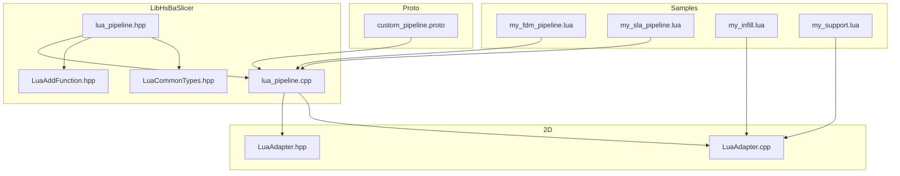

**Diagram sources**
- [lua_pipeline.hpp:1-88](file://LibHsBaSlicer/Extends/lua_pipeline.hpp#L1-L88)
- [lua_pipeline.cpp:819-894](file://LibHsBaSlicer/Extends/lua_pipeline.cpp#L819-L894)
- [LuaAddFunction.hpp:1-78](file://LibHsBaSlicer/Extends/LuaAddFunction.hpp#L1-L78)
- [LuaCommonTypes.hpp:1-187](file://LibHsBaSlicer/Extends/LuaCommonTypes.hpp#L1-L187)
- [LuaAdapter.hpp:1-84](file://2D/LuaAdapter.hpp#L1-L84)
- [LuaAdapter.cpp:251-419](file://2D/LuaAdapter.cpp#L251-L419)
- [my_fdm_pipeline.lua:1-172](file://samples/Custom/scripts/my_fdm_pipeline.lua#L1-L172)
- [my_sla_pipeline.lua:1-105](file://samples/Custom/scripts/my_sla_pipeline.lua#L1-L105)
- [my_infill.lua:1-89](file://samples/FDM/scripts/my_infill.lua#L1-L89)
- [my_support.lua:1-83](file://samples/FDM/scripts/my_support.lua#L1-L83)
- [custom_pipeline.proto:1-25](file://proto/custom_pipeline.proto#L1-L25)

**Section sources**
- [lua_pipeline.hpp:1-88](file://LibHsBaSlicer/Extends/lua_pipeline.hpp#L1-L88)
- [lua_pipeline.cpp:819-894](file://LibHsBaSlicer/Extends/lua_pipeline.cpp#L819-L894)
- [LuaAddFunction.hpp:1-78](file://LibHsBaSlicer/Extends/LuaAddFunction.hpp#L1-L78)
- [LuaCommonTypes.hpp:1-187](file://LibHsBaSlicer/Extends/LuaCommonTypes.hpp#L1-L187)
- [LuaAdapter.hpp:1-84](file://2D/LuaAdapter.hpp#L1-L84)
- [LuaAdapter.cpp:251-419](file://2D/LuaAdapter.cpp#L251-L419)
- [my_fdm_pipeline.lua:1-172](file://samples/Custom/scripts/my_fdm_pipeline.lua#L1-L172)
- [my_sla_pipeline.lua:1-105](file://samples/Custom/scripts/my_sla_pipeline.lua#L1-L105)
- [my_infill.lua:1-89](file://samples/FDM/scripts/my_infill.lua#L1-L89)
- [my_support.lua:1-83](file://samples/FDM/scripts/my_support.lua#L1-L83)
- [custom_pipeline.proto:1-25](file://proto/custom_pipeline.proto#L1-L25)

## Core Components
- `LuaPipelineContext`: describes the Lua script source or file, entry function name, JSON config, default output path, model name/path, and progress callback.
- `LuaPipelineOutput`: captures success flag, total layers, output path, result string, and error message from a Lua run.
- Environment setup: opens standard libraries, installs common types, registers 2D/3D/File Lua functions, polygon operations, support, fill, path optimization, zipper, cipher, database adapters, and creates the global `HsBa` table.
- Global `HsBa` API: model management, slicing, coordinate conversion, fill, support, floor, spiralization, G-code generation, packaging/export, image rendering, and file I/O.
- Registration hooks: `Add2DFunctions`, `Add3DFunctions`, `AddFileFunctions`, and event callback registration for extensibility.
- Common types: reflection and Lua adapters for Eigen vectors/matrices/quaternions and Clipper2 polygons/points.

**Section sources**
- [lua_pipeline.hpp:19-83](file://LibHsBaSlicer/Extends/lua_pipeline.hpp#L19-L83)
- [lua_pipeline.cpp:819-894](file://LibHsBaSlicer/Extends/lua_pipeline.cpp#L819-L894)
- [LuaAddFunction.hpp:21-74](file://LibHsBaSlicer/Extends/LuaAddFunction.hpp#L21-L74)
- [LuaCommonTypes.hpp:20-45](file://LibHsBaSlicer/Extends/LuaCommonTypes.hpp#L20-L45)
- [LuaCommonTypes.hpp:148-183](file://LibHsBaSlicer/Extends/LuaCommonTypes.hpp#L148-L183)

## Architecture Overview
The fully Lua-driven pipeline follows this flow:
1. C++ constructs `LuaPipelineContext`.
2. `SetupLuaPipelineEnvironment` initializes Lua, installs libraries, and binds the `HsBa` table.
3. The Lua script defines `run_pipeline()` (or another entry).
4. `RunLuaPipeline` executes the script and calls the entry function.
5. The script uses `HsBa.*` to orchestrate slicing, support, fill, path generation, packaging, and file writing.
6. Output is captured into `LuaPipelineOutput`.

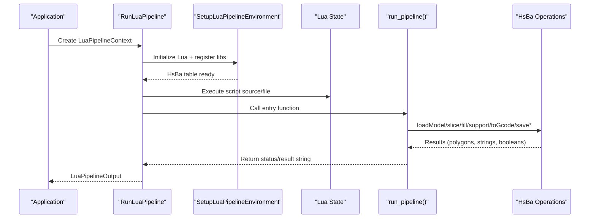

**Diagram sources**
- [lua_pipeline.hpp:53-83](file://LibHsBaSlicer/Extends/lua_pipeline.hpp#L53-L83)
- [lua_pipeline.cpp:857-894](file://LibHsBaSlicer/Extends/lua_pipeline.cpp#L857-L894)

## Detailed Component Analysis

### Lua Environment Setup and Lifecycle
- Environment initialization:
  - Opens standard Lua libraries.
  - Installs common AnyObject types via `InstallCommonAnyObjectTypes`.
  - Consumes external registration pools (`Get2DFunctions`, `Get3DFunctions`, `GetFileFunctions`).
  - Registers core libraries: polygon operations, support, fill, path optimization, zipper, cipher, SQLite/MySQL/PostgreSQL adapters, parameter store.
  - Binds `HsBa` table and injects globals: `pipeline_config`, `output_path`, `model_name`, `model_path`, `pipeline_entry`.
- Run lifecycle:
  - Executes inline script first, then optional script file.
  - Calls entry function (default `run_pipeline`).
  - Captures errors and returns structured output.

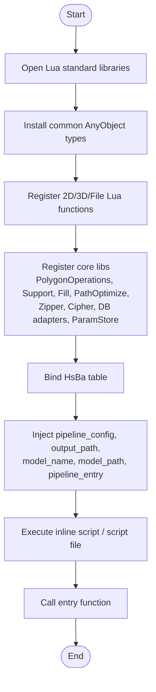

**Diagram sources**
- [lua_pipeline.cpp:857-894](file://LibHsBaSlicer/Extends/lua_pipeline.cpp#L857-L894)

**Section sources**
- [lua_pipeline.cpp:819-894](file://LibHsBaSlicer/Extends/lua_pipeline.cpp#L819-L894)
- [LuaAddFunction.hpp:21-74](file://LibHsBaSlicer/Extends/LuaAddFunction.hpp#L21-L74)
- [LuaCommonTypes.hpp:148-183](file://LibHsBaSlicer/Extends/LuaCommonTypes.hpp#L148-L183)

### Global HsBa API Surface
The `HsBa` table exposes these operations:
- Progress and state:
  - `progress(percent[, stage])`
  - `setLayers(n)`
  - `setOutputPath(path)`
- File I/O:
  - `readFile(path)`
  - `writeFile(path, content)`
- Model management:
  - `loadModel(name, path)`
  - `modelInfo(name)`
  - `translateModel(name, {x,y,z})`
  - `rotateModel(name, {x,y,z,w})`
  - `scaleModel(name, s | {x,y,z})`
  - `removeModel(name)`
  - `modelNames()`
- Slicing and coordinates:
  - `layerCount(name, layerHeight, firstLayerHeight)`
  - `layerZ(index0based, layerHeight, firstLayerHeight)`
  - `slice(name, z)`
  - `sliceUnsafe(name, z)`
  - `toInt(polygons)`
  - `toDouble(intPolygons)`
- Fill:
  - `fill(polygons[, {spacing, mode, angle, borderCount}])`
- Support:
  - `fdmSupport(layers, cfg)`
  - `slaSupport(layers, cfg)`
- Floor:
  - `floor(bottomPolygons, cfg)`
- Path and packaging:
  - `spiralize(sections[, {layerHeight, startZ, zHeights}])`
  - `toGcode(layers, cfg)`
  - `saveSlsPackage({outlines, zHeights, config, output, script, func})`
  - `saveWaamPackage({outlines, zHeights, weld, robotType, beadWidth, config, output, script, func})`
  - `saveSlaPackage({outlines, supports, floor, config, output, imageWidth, imageHeight, imageExtension})`
  - `renderImage(polygons, width, height, path)`

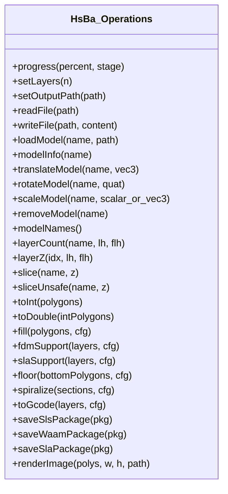

**Diagram sources**
- [lua_pipeline.cpp:212-783](file://LibHsBaSlicer/Extends/lua_pipeline.cpp#L212-L783)

**Section sources**
- [lua_pipeline.cpp:212-783](file://LibHsBaSlicer/Extends/lua_pipeline.cpp#L212-L783)

### Data Type Conversions Between C++ and Lua
- Polygon tables:
  - Double-precision polygons: sequence of `{x,y}` point tables; used by slicing and most APIs.
  - Integer polygons: internal representation; converted via `toInt`/`toDouble`.
- Layer lists:
  - Array of polygon arrays per layer; read/written through helper functions.
- Config tables:
  - Numeric fields with defaults; vector/matrix fields parsed from nested tables.
- Common types:
  - Eigen vectors/matrices/quaternions and Clipper2 points/polygons exposed via AnyObject reflection and Lua adapters.

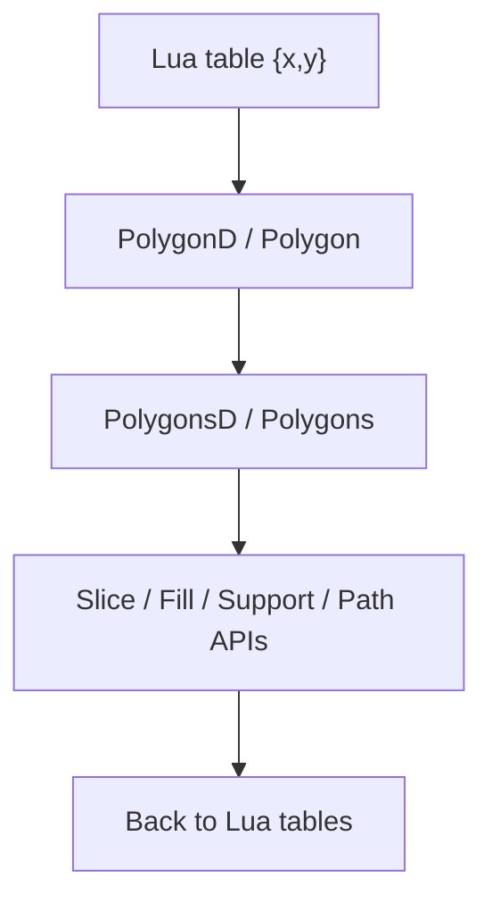

**Diagram sources**
- [LuaAdapter.cpp:272-419](file://2D/LuaAdapter.cpp#L272-L419)
- [LuaCommonTypes.hpp:110-140](file://LibHsBaSlicer/Extends/LuaCommonTypes.hpp#L110-L140)

**Section sources**
- [LuaAdapter.cpp:272-419](file://2D/LuaAdapter.cpp#L272-L419)
- [LuaCommonTypes.hpp:110-140](file://LibHsBaSlicer/Extends/LuaCommonTypes.hpp#L110-L140)

### Custom Algorithm Development Patterns

#### Custom Fill Algorithm
- Entry function: `generate_fill(current_layer)` receives current-layer polygons and returns fill polygons.
- Available tools: `PolygonOperations` (union, intersection, difference, xor, offset, hulls, area, shape generators).
- Typical pattern: compute bounding box, generate parallel lines at an angle, intersect with current layer.

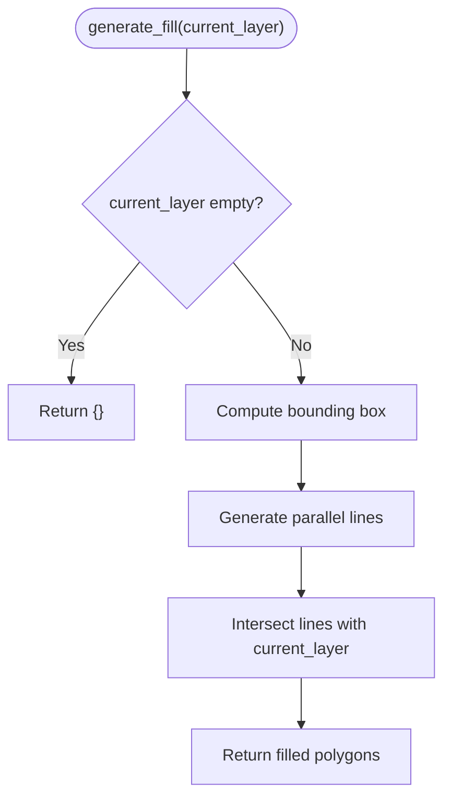

**Diagram sources**
- [my_infill.lua:20-87](file://samples/FDM/scripts/my_infill.lua#L20-L87)
- [LuaAdapter.cpp:251-269](file://2D/LuaAdapter.cpp#L251-L269)

**Section sources**
- [my_infill.lua:1-89](file://samples/FDM/scripts/my_infill.lua#L1-L89)
- [LuaAdapter.cpp:251-269](file://2D/LuaAdapter.cpp#L251-L269)

#### Custom Support Algorithm
- Entry function: `generate_support()` receives `current_layer`, `prev_layer`, `layer_height`, and `config`.
- Uses `Support` module to detect overhangs and generate plane/tree/honeycomb/SLA supports.
- Can refine results using `PolygonOperations.offsetOperation`.

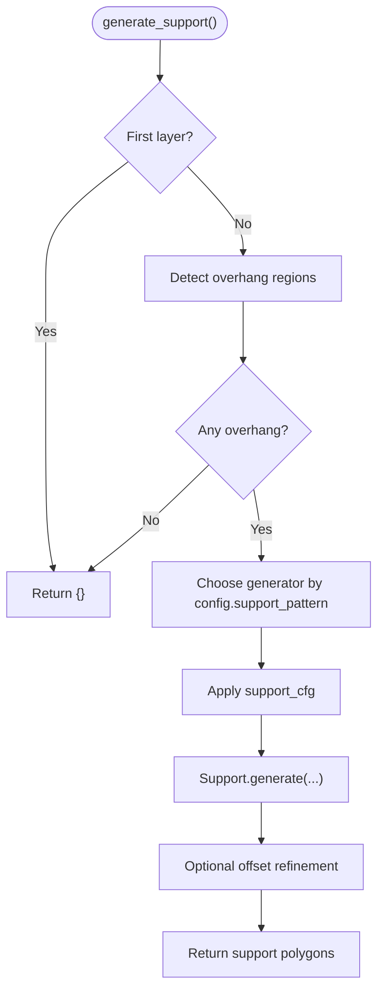

**Diagram sources**
- [my_support.lua:32-79](file://samples/FDM/scripts/my_support.lua#L32-L79)

**Section sources**
- [my_support.lua:1-83](file://samples/FDM/scripts/my_support.lua#L1-L83)

### Full Lua-Driven Pipeline Creation

#### FDM Pipeline Example
- Orchestrates: load model, compute layers, slice per layer, fill with rotating angles, optionally generate supports, assemble path layers, generate G-code, write file, set output path, remove model, report progress.
- Demonstrates reading machine parameters from injected `machine` table and using `pipeline_config`.

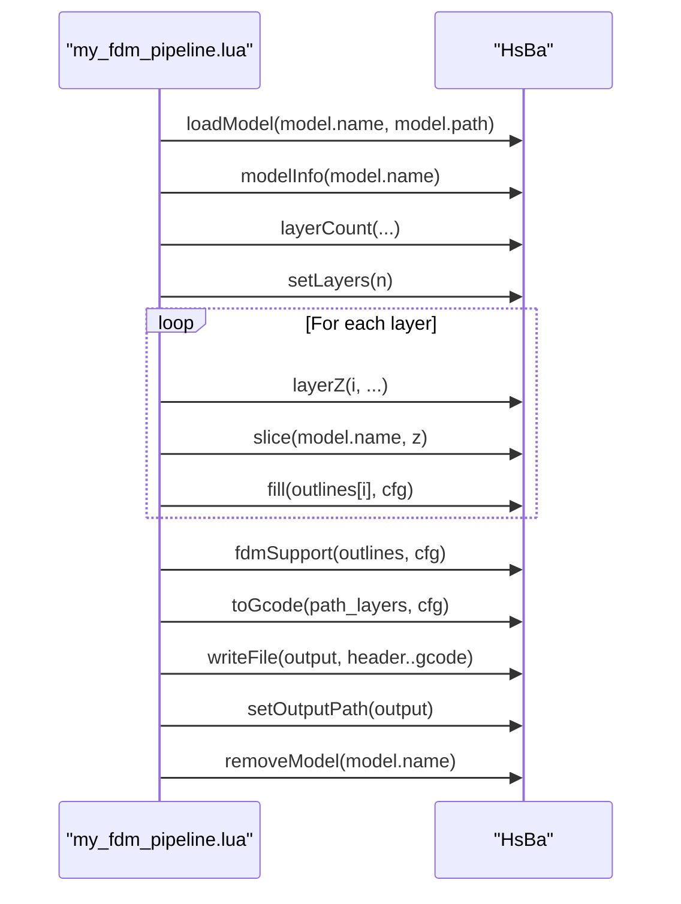

**Diagram sources**
- [my_fdm_pipeline.lua:52-170](file://samples/Custom/scripts/my_fdm_pipeline.lua#L52-L170)
- [lua_pipeline.cpp:272-654](file://LibHsBaSlicer/Extends/lua_pipeline.cpp#L272-L654)

**Section sources**
- [my_fdm_pipeline.lua:1-172](file://samples/Custom/scripts/my_fdm_pipeline.lua#L1-L172)
- [lua_pipeline.cpp:272-654](file://LibHsBaSlicer/Extends/lua_pipeline.cpp#L272-L654)

#### SLA Pipeline Example
- Orchestrates: load model, slice, generate SLA supports, generate floor/raft, render and package images with config JSON.

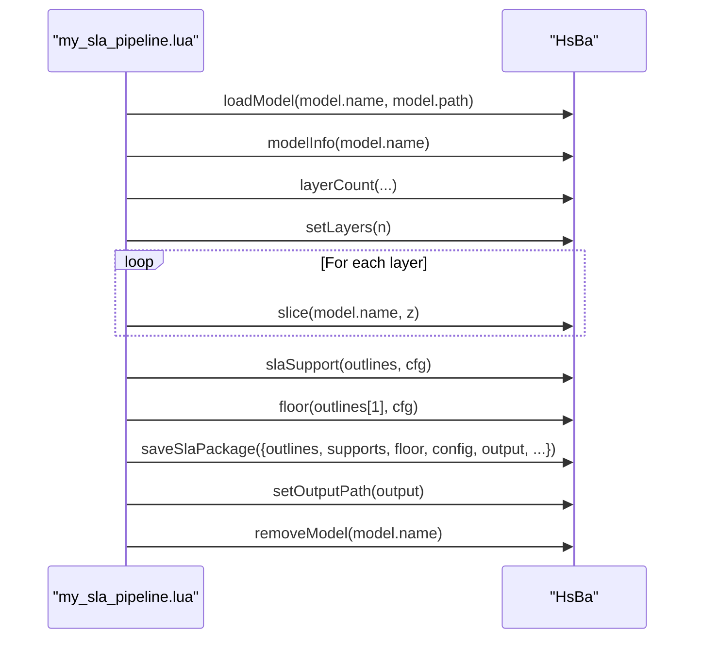

**Diagram sources**
- [my_sla_pipeline.lua:27-103](file://samples/Custom/scripts/my_sla_pipeline.lua#L27-L103)
- [lua_pipeline.cpp:492-518](file://LibHsBaSlicer/Extends/lua_pipeline.cpp#L492-L518)
- [lua_pipeline.cpp:746-771](file://LibHsBaSlicer/Extends/lua_pipeline.cpp#L746-L771)

**Section sources**
- [my_sla_pipeline.lua:1-105](file://samples/Custom/scripts/my_sla_pipeline.lua#L1-L105)
- [lua_pipeline.cpp:492-518](file://LibHsBaSlicer/Extends/lua_pipeline.cpp#L492-L518)
- [lua_pipeline.cpp:746-771](file://LibHsBaSlicer/Extends/lua_pipeline.cpp#L746-L771)

### Event Handling Mechanisms and Callback Patterns
- External Lua functions can be registered for pipeline stages:
  - `Add2DFunctions(func)`: 2D stage functions.
  - `Add3DFunctions(func)`: 3D stage functions.
  - `AddFileFunctions(func)`: File stage functions.
- Event callbacks:
  - `AddEventCallback(event_name, func)` registers named events (e.g., zipper or DB events).
  - `GetEventCallbacks(event_name)` retrieves callbacks for an event.

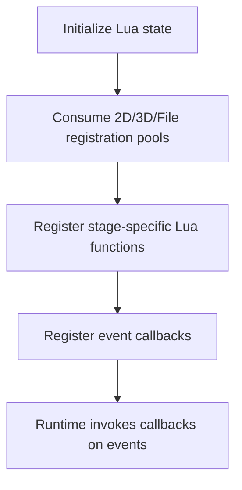

**Diagram sources**
- [LuaAddFunction.hpp:21-74](file://LibHsBaSlicer/Extends/LuaAddFunction.hpp#L21-L74)
- [lua_pipeline.cpp:857-894](file://LibHsBaSlicer/Extends/lua_pipeline.cpp#L857-L894)

**Section sources**
- [LuaAddFunction.hpp:21-74](file://LibHsBaSlicer/Extends/LuaAddFunction.hpp#L21-L74)
- [lua_pipeline.cpp:857-894](file://LibHsBaSlicer/Extends/lua_pipeline.cpp#L857-L894)

## Dependency Analysis
The Lua scripting system composes multiple subsystems:
- Core pipeline driver depends on `lua_pipeline.cpp` for environment setup and operation bindings.
- Polygon operations depend on `2D/LuaAdapter.cpp` for conversion and boolean operations.
- Support and fill rely on LibHsBaSlicer modules (support, fill, path generation).
- Packaging/export depends on SLS/WAAM/SLA exporters.
- Configuration flows through protobuf messages for the fully Lua-driven pipeline.

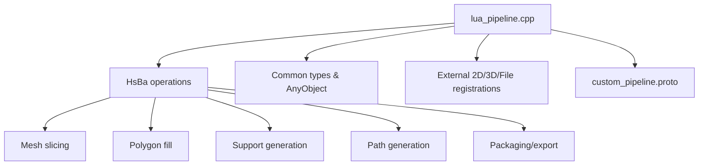

**Diagram sources**
- [lua_pipeline.cpp:1-39](file://LibHsBaSlicer/Extends/lua_pipeline.cpp#L1-L39)
- [lua_pipeline.cpp:819-894](file://LibHsBaSlicer/Extends/lua_pipeline.cpp#L819-L894)
- [custom_pipeline.proto:1-25](file://proto/custom_pipeline.proto#L1-L25)

**Section sources**
- [lua_pipeline.cpp:1-39](file://LibHsBaSlicer/Extends/lua_pipeline.cpp#L1-L39)
- [lua_pipeline.cpp:819-894](file://LibHsBaSlicer/Extends/lua_pipeline.cpp#L819-L894)
- [custom_pipeline.proto:1-25](file://proto/custom_pipeline.proto#L1-L25)

## Performance Considerations
- Prefer integer polygon operations where possible; use `toInt`/`toDouble` judiciously to avoid unnecessary conversions.
- Batch layer processing: accumulate outlines/fills/supports and process in loops, updating progress periodically to keep UI responsive.
- Avoid excessive Lua-to-C++ conversions inside tight loops; minimize table allocations when possible.
- Use `HsBa.progress` to report incremental progress for long-running tasks.
- Reuse models and remove them after use to free resources.
- For large datasets, consider generating paths and exporting incrementally if supported by your workflow.

[No sources needed since this section provides general guidance]

## Troubleshooting Guide
- Lua errors:
  - Errors during script execution are wrapped into `RuntimeError` and surfaced in `LuaPipelineOutput.error_message`.
  - Check chunk names (inline vs file) to locate problematic code.
- Model not found:
  - Ensure `loadModel` succeeded before calling `modelInfo`, `slice`, etc.
- Invalid parameters:
  - Validate numeric inputs (layer heights, line widths, speeds) and enum-like strings (firmware, fill modes).
- File I/O failures:
  - Verify paths exist and are writable; handle nil returns from `readFile`.
- Packaging/export failures:
  - Required fields like `output` must be present; check returned booleans and second error values where applicable.

**Section sources**
- [lua_pipeline.cpp:843-853](file://LibHsBaSlicer/Extends/lua_pipeline.cpp#L843-L853)
- [lua_pipeline.cpp:240-268](file://LibHsBaSlicer/Extends/lua_pipeline.cpp#L240-L268)
- [lua_pipeline.cpp:660-771](file://LibHsBaSlicer/Extends/lua_pipeline.cpp#L660-L771)

## Conclusion
HsBaSlicer’s Lua scripting system provides a powerful, flexible interface for building bespoke slicing workflows. The fully Lua-driven pipeline lets you orchestrate every stage, while stage-level registration hooks allow targeted customization. With robust polygon operations, support and fill utilities, path generation, and packaging/export capabilities, developers can implement complex algorithms efficiently. Proper error handling, careful data conversions, and thoughtful performance practices ensure reliable and high-performing scripts.

[No sources needed since this section summarizes without analyzing specific files]

## Appendices

### Lua-Driven Pipeline Configuration (Protobuf)
- Fields:
  - `custom_pipe_config_pipeline_lua_script`: path to the Lua script file.
  - `custom_pipe_config_pipeline_lua_source`: inline Lua source executed before the script file.
  - `custom_pipe_config_entry_func`: Lua entry function name (default `run_pipeline`).
  - `custom_pipe_config_config_json`: free-form JSON exposed as `pipeline_config`.
  - `custom_pipe_config_model_name`: model name exposed as `model_name`.
  - `custom_pipe_config_model_path`: model file path exposed as `model_path`.
  - `custom_pipe_config_output_path`: default output path exposed as `output_path`.

**Section sources**
- [custom_pipeline.proto:1-25](file://proto/custom_pipeline.proto#L1-L25)