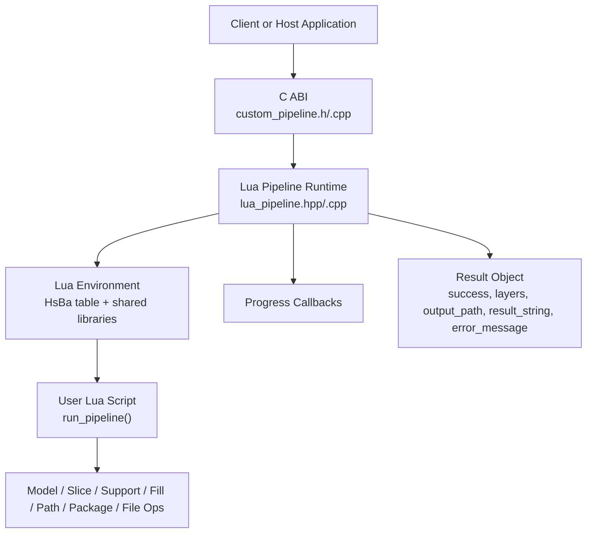
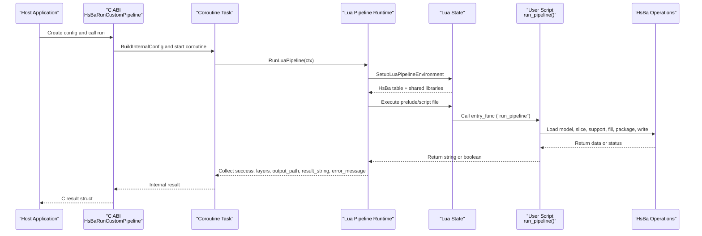
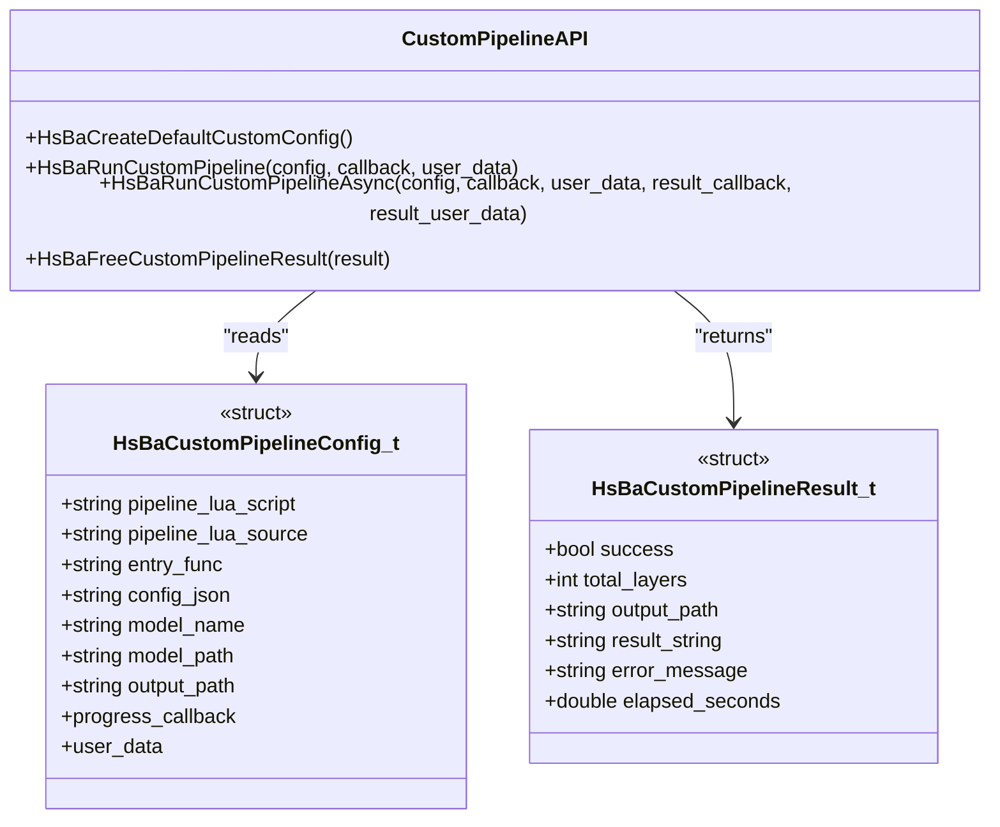
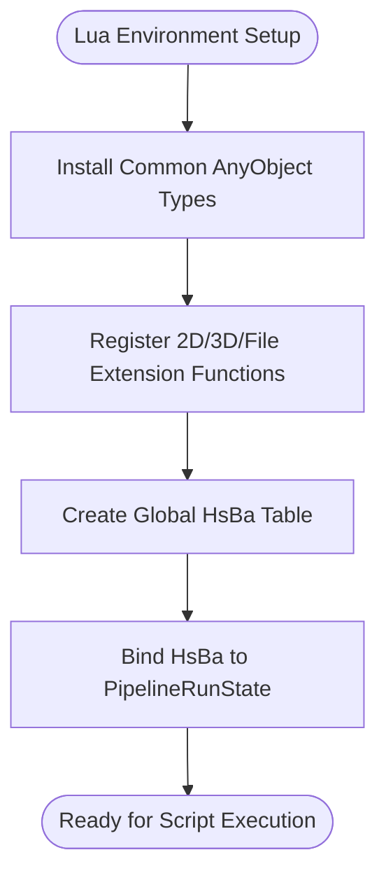
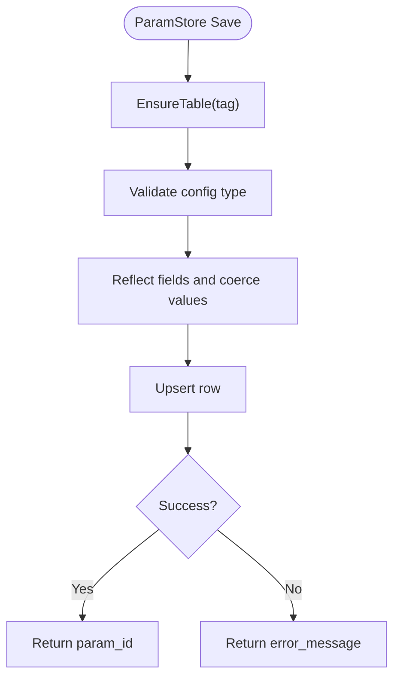
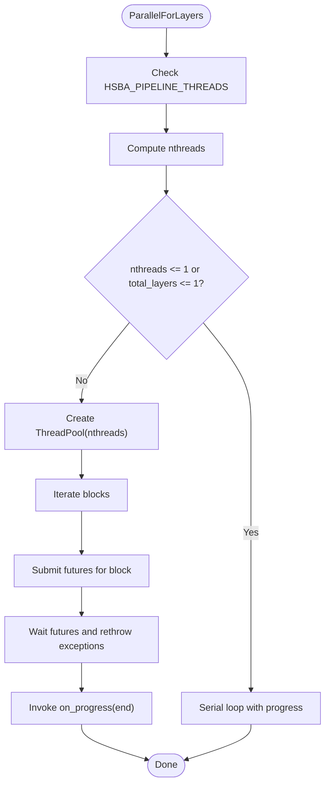
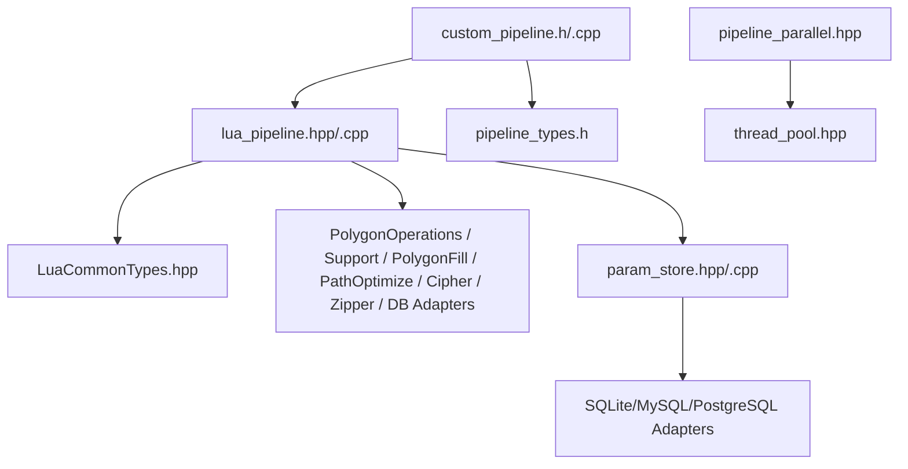

# Pipeline Customization and Orchestration

<cite>
**Referenced Files in This Document**   
- [lua_pipeline_api.md](file://docs/en/lua_pipeline_api.md)
- [custom_pipeline.h](file://DllHsBaSlicer/custom_pipeline.h)
- [custom_pipeline.cpp](file://DllHsBaSlicer/custom_pipeline.cpp)
- [lua_pipeline.hpp](file://LibHsBaSlicer/Extends/lua_pipeline.hpp)
- [lua_pipeline.cpp](file://LibHsBaSlicer/Extends/lua_pipeline.cpp)
- [my_fdm_pipeline.lua](file://samples/Custom/scripts/my_fdm_pipeline.lua)
- [my_sla_pipeline.lua](file://samples/Custom/scripts/my_sla_pipeline.lua)
- [lua_register.h](file://DllHsBaSlicer/lua_register.h)
- [LuaCommonTypes.hpp](file://LibHsBaSlicer/Extends/LuaCommonTypes.hpp)
- [pipeline_types.h](file://pipelinetypes/pipeline_types.h)
- [param_store_pipeline.h](file://DllHsBaSlicer\param_store_pipeline.h)
- [param_store_pipeline.cpp](file://DllHsBaSlicer\param_store_pipeline.cpp)
- [param_store.cpp](file://fileoperator\param_store.cpp)
- [param_store.hpp](file://fileoperator\param_store.hpp)
- [pipeline_parallel.hpp](file://DllHsBaSlicer\pipeline_parallel.hpp)
- [thread_pool.hpp](file://base\thread_pool.hpp)
</cite>

## Table of Contents
1. [Introduction](#introduction)
2. [Project Structure](#project-structure)
3. [Core Components](#core-components)
4. [Architecture Overview](#architecture-overview)
5. [Detailed Component Analysis](#detailed-component-analysis)
6. [Dependency Analysis](#dependency-analysis)
7. [Performance Considerations](#performance-considerations)
8. [Troubleshooting Guide](#troubleshooting-guide)
9. [Conclusion](#conclusion)

## Introduction
This document explains how to create complete, Lua-driven custom pipelines in HsBaSlicer. It covers:
- Defining stages and data flow from scratch using Lua scripts
- Inter-stage communication through the `HsBa` operation table and shared libraries
- Configuration injection, parameter validation, and dynamic stage selection
- Advanced orchestration patterns such as conditional processing, parallel execution, and error recovery
- Examples of complex multi-stage workflows and integration with external tools
- Performance tuning, resource management, and monitoring capabilities for custom pipelines

The system supports two environments:
- **Custom pipeline**: The Lua script fully controls the workflow order (load → slice → support → fill → path → write).
- **Built-in stage hooks**: Replace only one algorithm inside a built-in pipeline while C++ keeps the fixed stage order.

For users authoring Lua scripts, the authoritative API reference is collected in the Lua pipeline API documentation.

**Section sources**
- [lua_pipeline_api.md:19-28](file://docs/en/lua_pipeline_api.md#L19-L28)

## Project Structure
At a high level, the customization system spans several layers:
- A C ABI exposes synchronous and asynchronous entry points for running a fully Lua-driven custom pipeline.
- A C++ runtime builds a Lua environment, installs shared libraries, and executes the user’s entry function.
- The Lua side exposes model, slicing, support, fill, path, packaging, and file operations through a global `HsBa` table.
- Built-in pipelines can also load per-stage Lua scripts to override algorithms without changing the C++ stage order.
- Parameter persistence and schema validation are available through a reflection-based parameter store.
- Parallel layer execution and thread-pool utilities provide performance control for hot paths.

**Diagram sources**
- [custom_pipeline.h:17-62](file://DllHsBaSlicer/custom_pipeline.h#L17-L62)
- [custom_pipeline.cpp:116-157](file://DllHsBaSlicer/custom_pipeline.cpp#L116-L157)
- [lua_pipeline.hpp:19-83](file://LibHsBaSlicer/Extends/lua_pipeline.hpp#L19-L83)
- [lua_pipeline.cpp:45-53](file://LibHsBaSlicer/Extends/lua_pipeline.cpp#L45-L53)

**Section sources**
- [custom_pipeline.h:17-62](file://DllHsBaSlicer/custom_pipeline.h#L17-L62)
- [lua_pipeline.hpp:19-83](file://LibHsBaSlicer/Extends/lua_pipeline.hpp#L19-L83)

## Core Components
The core components for full Lua-driven pipeline customization are:

- **C ABI for custom pipelines**: Provides default configuration creation, synchronous run, asynchronous run, and result cleanup.
- **Lua pipeline context and output**: Encapsulates script source/file, entry function name, injected globals, progress callback, and collected results.
- **Lua environment setup**: Registers common types, 2D/3D/File extension functions, and the `HsBa` operation table.
- **Shared libraries**: Provide geometry, support, fill, path optimization, compression, database adapters, and parameter persistence.
- **Parameter store**: Reflection-based persistence and validation for pipeline configurations.
- **Parallel execution helpers**: Layer-parallel execution over a thread pool with controlled progress reporting.

Key responsibilities:
- The C ABI translates host calls into internal configuration and coroutine tasks.
- The runtime constructs a Lua state, injects context globals, and invokes the user’s entry function.
- The Lua script orchestrates all stages by calling `HsBa` operations and shared libraries.
- Results and errors are captured and returned to the host.

**Section sources**
- [custom_pipeline.h:17-62](file://DllHsBaSlicer/custom_pipeline.h#L17-L62)
- [lua_pipeline.hpp:19-83](file://LibHsBaSlicer/Extends/lua_pipeline.hpp#L19-L83)
- [lua_pipeline.cpp:45-53](file://LibHsBaSlicer/Extends/lua_pipeline.cpp#L45-L53)

## Architecture Overview
The end-to-end flow for a custom pipeline is:

**Diagram sources**
- [custom_pipeline.cpp:116-157](file://DllHsBaSlicer/custom_pipeline.cpp#L116-L157)
- [lua_pipeline.hpp:72-83](file://LibHsBaSlicer/Extends/lua_pipeline.hpp#L72-L83)
- [lua_pipeline.cpp:208-238](file://LibHsBaSlicer/Extends/lua_pipeline.cpp#L208-L238)

## Detailed Component Analysis

### Custom Pipeline C ABI
The C ABI defines:
- Default configuration creation
- Synchronous execution
- Asynchronous execution with completion callback
- Result memory cleanup

It maps host inputs into an internal configuration, starts a coroutine task, and converts internal results into a C-compatible result structure.

**Diagram sources**
- [custom_pipeline.h:17-62](file://DllHsBaSlicer/custom_pipeline.h#L17-L62)
- [custom_pipeline.cpp:85-114](file://DllHsBaSlicer/custom_pipeline.cpp#L85-L114)

**Section sources**
- [custom_pipeline.h:17-62](file://DllHsBaSlicer/custom_pipeline.h#L17-L62)
- [custom_pipeline.cpp:85-114](file://DllHsBaSlicer/custom_pipeline.cpp#L85-L114)
- [custom_pipeline.cpp:164-203](file://DllHsBaSlicer/custom_pipeline.cpp#L164-L203)

### Lua Pipeline Context and Output
The runtime uses:
- `LuaPipelineContext`: Holds inline script, script file path, entry function name, JSON config, default output path, model name/path, and progress callback.
- `LuaPipelineOutput`: Captures success flag, total layers, output path, result string, and error message.

This separation allows the C++ driver to remain independent from Lua internals while exposing a clean interface to the host application.

**Section sources**
- [lua_pipeline.hpp:19-51](file://LibHsBaSlicer/Extends/lua_pipeline.hpp#L19-L51)

### Lua Environment Setup and HsBa Operation Table
The Lua environment setup:
- Installs common AnyObject types
- Registers pooled 2D/3D/File extension functions
- Creates the global `HsBa` operation table bound to the current run state

The `HsBa` table provides:
- Control and file IO: progress reporting, layer count, output path, read/write files
- Model management: load, info, transform, remove, list names
- Slicing: layer count, Z calculation, safe and unsafe slice
- Coordinate conversion and fill: integer/double polygon conversion, fill with border or pure fill
- Support and floor: FDM/SLA support generation, SLA floor/raft
- Path and G-code: spiralize outer wall, generate G-code
- Packaging and export: SLS/WAAM/SLA packaging, image rendering

**Diagram sources**
- [lua_pipeline.cpp:45-53](file://LibHsBaSlicer/Extends/lua_pipeline.cpp#L45-L53)
- [lua_pipeline.cpp:785-800](file://LibHsBaSlicer/Extends/lua_pipeline.cpp#L785-L800)

**Section sources**
- [lua_pipeline.cpp:45-53](file://LibHsBaSlicer/Extends/lua_pipeline.cpp#L45-L53)
- [lua_pipeline.cpp:208-238](file://LibHsBaSlicer/Extends/lua_pipeline.cpp#L208-L238)
- [lua_pipeline.cpp:270-371](file://LibHsBaSlicer/Extends/lua_pipeline.cpp#L270-L371)
- [lua_pipeline.cpp:373-429](file://LibHsBaSlicer/Extends/lua_pipeline.cpp#L373-L429)
- [lua_pipeline.cpp:431-472](file://LibHsBaSlicer/Extends/lua_pipeline.cpp#L431-L472)
- [lua_pipeline.cpp:474-518](file://LibHsBaSlicer/Extends/lua_pipeline.cpp#L474-L518)
- [lua_pipeline.cpp:520-654](file://LibHsBaSlicer/Extends/lua_pipeline.cpp#L520-L654)
- [lua_pipeline.cpp:656-783](file://LibHsBaSlicer/Extends/lua_pipeline.cpp#L656-L783)

### Shared Libraries and External Tool Integration
Shared libraries available in both custom pipeline and built-in stage scripts include:
- PolygonOperations: Boolean operations, offset, hulls, primitives, text-to-polygons
- PolygonFill: Offset, line, zigzag, composite, hybrid fills
- PathOptimize: Region/polygon ordering optimization
- Support: Plane/tree/honeycomb/SLA generators and overhang detection
- Cipher: Base64/hex encoding
- Zipper/Bit7zZipper: Compression and packaging
- Database adapters: SQLite/MySQL/PostgreSQL
- ParamStore: Reflection-based parameter persistence

These libraries enable complex data transformation workflows and integration with external tools such as databases and compression utilities.

**Section sources**
- [lua_pipeline_api.md:136-213](file://docs/en/lua_pipeline_api.md#L136-L213)

### Built-in Stage Hooks
Built-in pipelines allow replacing specific algorithms without changing the C++ stage order:
- Support stage: Injected globals include current layer, previous layer, layer height, and config; entry function returns support polygons.
- Fill stage: Entry function receives current-layer polygons and returns fill polygons.
- Floor stage: Customize SLA bottom floor/raft generation.
- Export stage: Injected globals include config, images, and output path; entry function returns success and export path.

This mechanism enables targeted customization while preserving stable pipeline behavior.

**Section sources**
- [lua_pipeline_api.md:215-260](file://docs/en/lua_pipeline_api.md#L215-L260)

### Example Custom Pipelines
Two sample scripts demonstrate complete Lua-driven workflows:

- FDM pipeline: Loads model, computes layers, slices per layer, rotates fill angle dynamically, optionally generates support, assembles path layers, generates G-code, writes output, and reports progress.
- SLA pipeline: Loads model, slices per layer, generates SLA support, creates floor/raft, packages layer images and config into a zip, and reports progress.

These examples illustrate:
- Dynamic stage selection via parameters
- Inter-stage data flow through outlines, fills, supports, and z-heights
- Integration with packaging APIs and file I/O

**Section sources**
- [my_fdm_pipeline.lua:52-171](file://samples/Custom/scripts/my_fdm_pipeline.lua#L52-L171)
- [my_sla_pipeline.lua:27-104](file://samples/Custom/scripts/my_sla_pipeline.lua#L27-L104)

### Pipeline Configuration System and Parameter Validation
Configuration and validation are supported through:
- C ABI configs for each pipeline type, including custom pipeline config defaults
- Reflection-based parameter store that validates types, coerces fields, persists rows, and manages schemas
- Lua-accessible ParamStore with PascalCase methods for schema enforcement, save/load/list/update/delete

The parameter store ensures:
- Schema existence before operations
- Type safety via registered TypeInfo
- Transactional batch operations with rollback on failure
- Progress reporting during validation and coercion

**Diagram sources**
- [param_store.cpp:123-161](file://fileoperator\param_store.cpp#L123-L161)
- [param_store_pipeline.cpp:90-131](file://DllHsBaSlicer\param_store_pipeline.cpp#L90-L131)

**Section sources**
- [pipeline_types.h:56-113](file://pipelinetypes/pipeline_types.h#L56-L113)
- [param_store_pipeline.h:17-50](file://DllHsBaSlicer\param_store_pipeline.h#L17-L50)
- [param_store_pipeline.cpp:90-131](file://DllHsBaSlicer\param_store_pipeline.cpp#L90-L131)
- [param_store.cpp:123-161](file://fileoperator\param_store.cpp#L123-L161)
- [param_store.hpp:83-108](file://fileoperator\param_store.hpp#L83-L108)

### Dynamic Stage Selection and Conditional Processing
Dynamic stage selection is achieved by:
- Reading parameters from a preinjected `machine` table or fallback defaults
- Conditionally enabling support generation based on flags
- Rotating fill angles across layers to vary infill orientation
- Choosing between built-in algorithms and Lua overrides via script paths and function names

This pattern allows fully customizable processing strategies without modifying C++ code.

**Section sources**
- [my_fdm_pipeline.lua:24-30](file://samples/Custom/scripts/my_fdm_pipeline.lua#L24-L30)
- [my_fdm_pipeline.lua:85-124](file://samples/Custom/scripts/my_fdm_pipeline.lua#L85-L124)

### Parallel Execution and Resource Management
The system provides:
- Layer-parallel execution helper distributing independent layer work across a thread pool
- Controlled progress callbacks invoked serially after each block
- Environment variable override for worker count to compare serial vs parallel performance
- Thread pool with configurable worker threads, future-based task submission, and coroutine executor integration

Resource management considerations:
- Avoid excessive short tasks due to queue overhead
- Tune thread count based on CPU cores and task characteristics
- Use blocks to reduce progress callback frequency
- Ensure thread-safe per-layer writes to avoid race conditions

**Diagram sources**
- [pipeline_parallel.hpp:41-117](file://DllHsBaSlicer\pipeline_parallel.hpp#L41-L117)
- [thread_pool.hpp:29-49](file://base\thread_pool.hpp#L29-L49)

**Section sources**
- [pipeline_parallel.hpp:41-117](file://DllHsBaSlicer\pipeline_parallel.hpp#L41-L117)
- [thread_pool.hpp:29-49](file://base\thread_pool.hpp#L29-L49)

### Error Handling and Recovery Strategies
Error handling patterns include:
- Lua errors raised by `luaL_error` propagate through the coroutine task and are captured in the result’s error message
- File I/O failures return nil or raise Lua errors depending on operation
- Packaging functions validate required fields and return boolean success plus optional error details
- Parameter store operations wrap steps in guards, track last error, and throw structured exceptions
- Tests verify that invalid Lua scripts raise runtime errors and that batch transactions roll back on failure

Recovery strategies:
- Validate required inputs early (e.g., output path, script path)
- Return structured success/error tuples from packaging functions
- Use transactional saves to ensure consistency
- Log and report detailed error messages for debugging

**Section sources**
- [lua_pipeline.cpp:240-268](file://LibHsBaSlicer/Extends/lua_pipeline.cpp#L240-L268)
- [lua_pipeline.cpp:656-783](file://LibHsBaSlicer/Extends/lua_pipeline.cpp#L656-L783)
- [param_store.cpp:79-97](file://fileoperator\param_store.cpp#L79-L97)
- [param_store_pipeline.cpp:90-131](file://DllHsBaSlicer\param_store_pipeline.cpp#L90-L131)

### Monitoring Capabilities
Monitoring is provided through:
- Progress callbacks invoked from Lua via `HsBa.progress(percent, stage)`
- Total layer count reported via `HsBa.setLayers(n)`
- Output path reported via `HsBa.setOutputPath(path)`
- Elapsed time tracked in the C result structure
- Parameter store progress reporting during validation and coercion

These mechanisms enable real-time feedback and performance analysis for custom pipelines.

**Section sources**
- [lua_pipeline.cpp:212-238](file://LibHsBaSlicer/Extends/lua_pipeline.cpp#L212-L238)
- [custom_pipeline.cpp:116-157](file://DllHsBaSlicer/custom_pipeline.cpp#L116-L157)
- [param_store.cpp:93-97](file://fileoperator\param_store.cpp#L93-L97)

## Dependency Analysis
The dependency relationships among key components are:

**Diagram sources**
- [custom_pipeline.cpp:14-16](file://DllHsBaSlicer/custom_pipeline.cpp#L14-L16)
- [lua_pipeline.cpp:14-38](file://LibHsBaSlicer/Extends/lua_pipeline.cpp#L14-L38)
- [LuaCommonTypes.hpp:14-18](file://LibHsBaSlicer/Extends/LuaCommonTypes.hpp#L14-L18)
- [pipeline_parallel.hpp:17-17](file://DllHsBaSlicer\pipeline_parallel.hpp#L17-L17)
- [thread_pool.hpp:22-23](file://base\thread_pool.hpp#L22-L23)

**Section sources**
- [custom_pipeline.cpp:14-16](file://DllHsBaSlicer/custom_pipeline.cpp#L14-L16)
- [lua_pipeline.cpp:14-38](file://LibHsBaSlicer/Extends/lua_pipeline.cpp#L14-L38)
- [LuaCommonTypes.hpp:14-18](file://LibHsBaSlicer/Extends/LuaCommonTypes.hpp#L14-L18)
- [pipeline_parallel.hpp:17-17](file://DllHsBaSlicer\pipeline_parallel.hpp#L17-L17)
- [thread_pool.hpp:22-23](file://base\thread_pool.hpp#L22-L23)

## Performance Considerations
To optimize custom pipelines:
- Use layer-parallel execution for independent slicing and fill stages
- Tune thread count via environment variables or hardware concurrency
- Batch progress updates to reduce callback overhead
- Prefer vectorized operations where possible (e.g., bulk layer processing)
- Reuse models and avoid unnecessary reloads
- Monitor elapsed time and progress to identify bottlenecks
- Use efficient fill modes and spacing to balance quality and speed
- Leverage compression and packaging APIs judiciously to avoid I/O contention

[No sources needed since this section provides general guidance]

## Troubleshooting Guide
Common issues and resolutions:
- Missing script or source: Ensure either `pipeline_lua_script` or `pipeline_lua_source` is set
- Invalid model path: Verify model loading succeeds and model exists in the pool
- Incorrect layer height: Validate layer height > 0 and model height > 0
- Packaging failures: Confirm required fields like output and script are present
- Lua errors: Inspect error messages in the result object and fix script syntax or logic
- Parameter store errors: Check schema existence, type registration, and backend availability
- Progress not updating: Ensure `HsBa.progress` is called at meaningful checkpoints

Useful diagnostics:
- Print model info and layer counts early in the script
- Log intermediate outputs (e.g., outlines, fills, supports) when debugging
- Compare serial vs parallel execution using environment variables
- Validate configuration JSON and machine parameters before running

**Section sources**
- [custom_pipeline.cpp:124-130](file://DllHsBaSlicer/custom_pipeline.cpp#L124-L130)
- [lua_pipeline.cpp:375-393](file://LibHsBaSlicer/Extends/lua_pipeline.cpp#L375-L393)
- [lua_pipeline.cpp:656-783](file://LibHsBaSlicer/Extends/lua_pipeline.cpp#L656-L783)
- [param_store.cpp:123-161](file://fileoperator\param_store.cpp#L123-L161)

## Conclusion
HsBaSlicer’s Lua-driven pipeline system enables complete customization of slicing workflows through a rich API surface. Users can define arbitrary stage sequences, manage data flow between stages, and integrate external tools via shared libraries. The configuration system provides robust parameter validation and persistence, while parallel execution and monitoring capabilities support performance tuning and operational visibility. By combining these features, developers can build flexible, high-performance pipelines tailored to specific manufacturing processes and toolchains.

[No sources needed since this section summarizes without analyzing specific files]