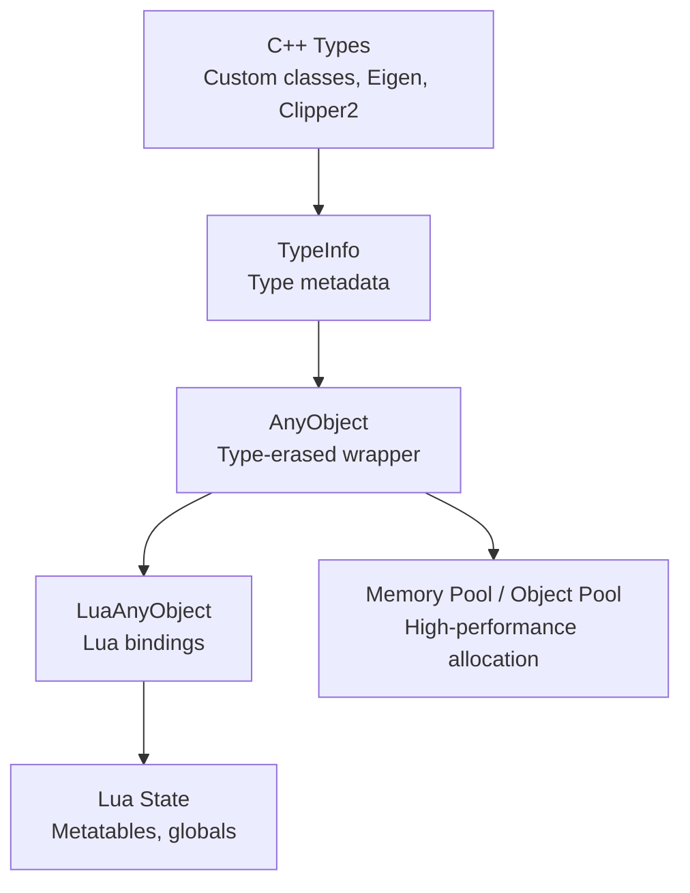
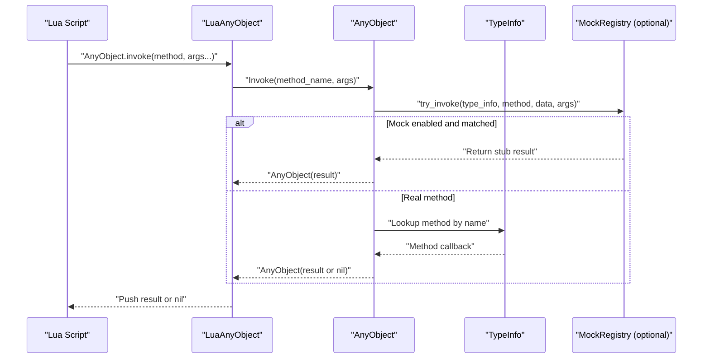
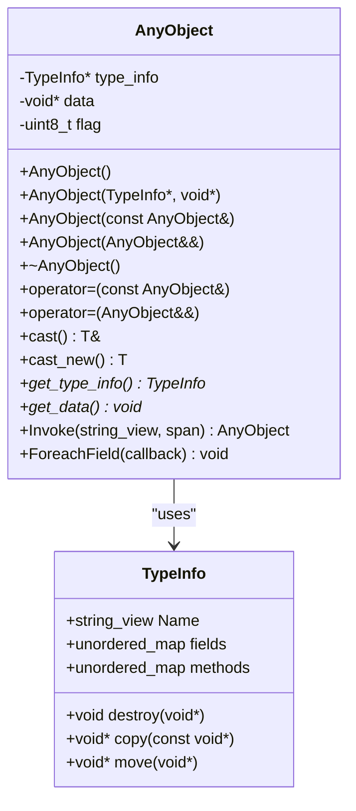
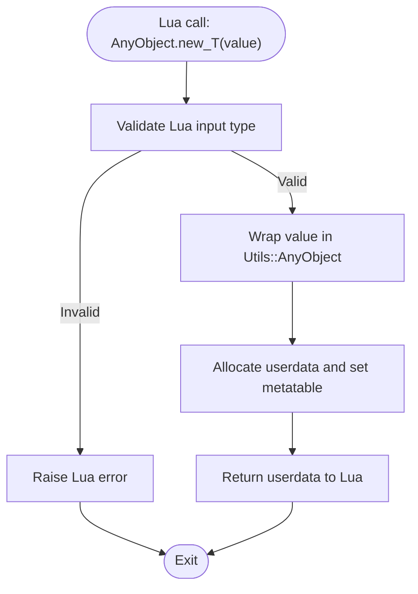
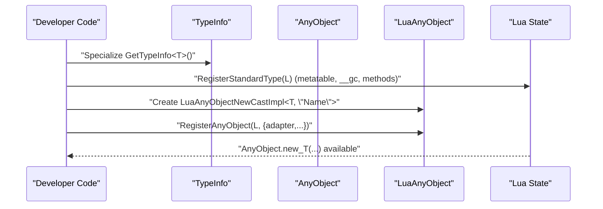
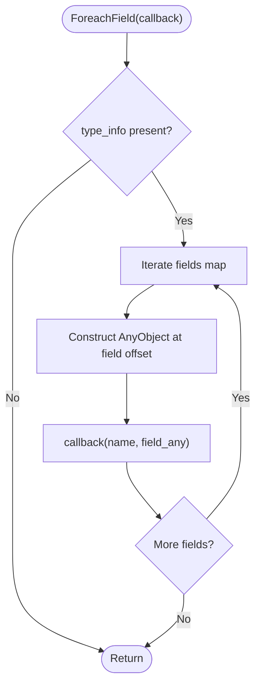
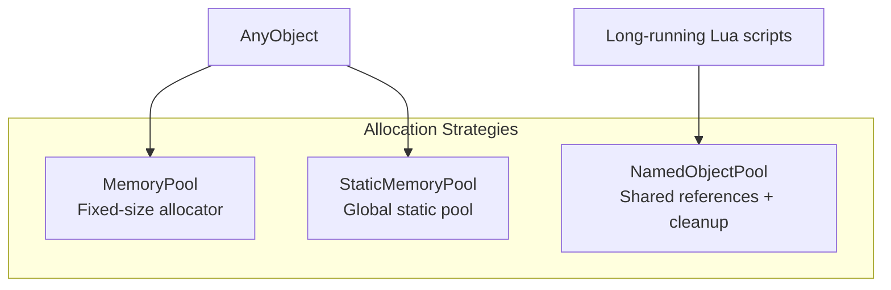
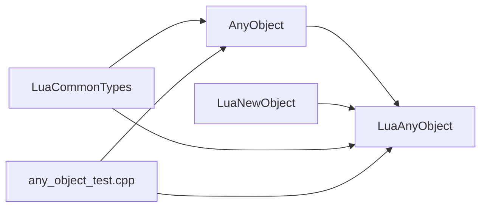

# Type Binding System

<cite>
**Referenced Files in This Document**
- [any_object.hpp](file://base/any_object.hpp)
- [any_object.cpp](file://base/any_object.cpp)
- [LuaAnyObject.hpp](file://utils/LuaAnyObject.hpp)
- [LuaAnyObject.cpp](file://utils/LuaAnyObject.cpp)
- [LuaNewObject.hpp](file://utils/LuaNewObject.hpp)
- [LuaCommonTypes.hpp](file://LibHsBaSlicer/Extends/LuaCommonTypes.hpp)
- [LuaCommonTypes.cpp](file://LibHsBaSlicer/Extends/LuaCommonTypes.cpp)
- [memory_pool.hpp](file://base/memory_pool.hpp)
- [object_pool.hpp](file://base/object_pool.hpp)
- [any_object_test.cpp](file://tests/AnyObject/any_object_test.cpp)
</cite>

## Table of Contents
1. [Introduction](#introduction)
2. [Project Structure](#project-structure)
3. [Core Components](#core-components)
4. [Architecture Overview](#architecture-overview)
5. [Detailed Component Analysis](#detailed-component-analysis)
6. [Dependency Analysis](#dependency-analysis)
7. [Performance Considerations](#performance-considerations)
8. [Troubleshooting Guide](#troubleshooting-guide)
9. [Conclusion](#conclusion)
10. [Appendices](#appendices)

## Introduction
This document explains the type binding system that connects C++ objects and data structures to Lua variables in HsBaSlicer. It focuses on:
- The `AnyObject` polymorphic container for type-erased values, reflection, and method dispatch.
- The `LuaAnyObject` wrapper layer that exposes `AnyObject` to Lua with automatic conversion, garbage collection, and metatable-driven access.
- Registration mechanisms for custom types, including `TypeInfo`, metatable setup, method binding, and property access.
- Memory pool integration and object pooling strategies for high-performance scenarios.
- Practical examples, debugging techniques, and best practices for maintaining a clean separation between C++ and Lua layers.

## Project Structure
The type binding system spans several modules:
- Core type-erased container and reflection: `base/any_object.*`
- Lua adapter and registration: `utils/LuaAnyObject.*`, `utils/LuaNewObject.hpp`
- Common custom type adapters (Eigen, Clipper2): `LibHsBaSlicer/Extends/LuaCommonTypes.*`
- High-performance memory and object pools: `base/memory_pool.hpp`, `base/object_pool.hpp`
- Tests demonstrating usage and edge cases: `tests/AnyObject/any_object_test.cpp`

**Diagram sources**
- [any_object.hpp:48-115](file://base/any_object.hpp#L48-L115)
- [LuaAnyObject.hpp:21-44](file://utils/LuaAnyObject.hpp#L21-L44)
- [LuaCommonTypes.hpp:20-45](file://LibHsBaSlicer/Extends/LuaCommonTypes.hpp#L20-L45)
- [memory_pool.hpp:35-75](file://base/memory_pool.hpp#L35-L75)
- [object_pool.hpp:18-46](file://base/object_pool.hpp#L18-L46)

**Section sources**
- [any_object.hpp:48-115](file://base/any_object.hpp#L48-L115)
- [LuaAnyObject.hpp:21-44](file://utils/LuaAnyObject.hpp#L21-L44)
- [LuaCommonTypes.hpp:20-45](file://LibHsBaSlicer/Extends/LuaCommonTypes.hpp#L20-L45)
- [memory_pool.hpp:35-75](file://base/memory_pool.hpp#L35-L75)
- [object_pool.hpp:18-46](file://base/object_pool.hpp#L18-L46)

## Core Components
- `AnyObject`: A type-erased wrapper backed by `TypeInfo`. It supports copy/move semantics, typed casts, field iteration, and method invocation via reflection.
- `TypeInfo`: Holds type name, destruction/copy/move callbacks, fields map, and methods map for reflection and dispatch.
- `LuaAnyObject`: Provides Lua-side wrappers, metatable setup, argument conversion, and global registration functions (`RegisterAnyObject`).
- `LuaNewObject`: Utilities to allocate C++ objects in Lua userdata and manage their lifetime through Lua’s garbage collector.
- `LuaCommonTypes`: Registers common custom types (Eigen vectors/matrices/quaternions, Clipper2 points/polygons) with both `TypeInfo` and Lua table adapters.
- Memory/Object Pools: Fixed-size allocators and named shared-object pools for performance-critical code paths.

Key responsibilities:
- Automatic type conversion between Lua primitives and C++ types.
- Safe object lifecycle management across the C++/Lua boundary.
- Reflection-based method invocation and field traversal.
- Extensible registration mechanism for new types.

**Section sources**
- [any_object.hpp:48-115](file://base/any_object.hpp#L48-L115)
- [any_object.cpp:9-111](file://base/any_object.cpp#L9-L111)
- [LuaAnyObject.hpp:21-44](file://utils/LuaAnyObject.hpp#L21-L44)
- [LuaAnyObject.cpp:11-178](file://utils/LuaAnyObject.cpp#L11-L178)
- [LuaNewObject.hpp:15-87](file://utils/LuaNewObject.hpp#L15-L87)
- [LuaCommonTypes.hpp:20-45](file://LibHsBaSlicer/Extends/LuaCommonTypes.hpp#L20-L45)
- [LuaCommonTypes.cpp:342-389](file://LibHsBaSlicer/Extends/LuaCommonTypes.cpp#L342-L389)

## Architecture Overview
The binding architecture consists of three layers:
- C++ reflection layer: `TypeInfo` and `AnyObject` provide type metadata and runtime dispatch.
- Lua adapter layer: `LuaAnyObject` bridges Lua values to `AnyObject`, sets up metatables, and handles GC.
- Common types layer: `LuaCommonTypes` registers built-in geometry and math types with both reflection and Lua table adapters.

**Diagram sources**
- [LuaAnyObject.cpp:17-87](file://utils/LuaAnyObject.cpp#L17-L87)
- [any_object.cpp:88-111](file://base/any_object.cpp#L88-L111)
- [any_object.hpp:261-564](file://base/any_object.hpp#L261-L564)

**Section sources**
- [LuaAnyObject.cpp:17-87](file://utils/LuaAnyObject.cpp#L17-L87)
- [any_object.cpp:88-111](file://base/any_object.cpp#L88-L111)
- [any_object.hpp:261-564](file://base/any_object.hpp#L261-L564)

## Detailed Component Analysis

### AnyObject and TypeInfo
`AnyObject` is a type-erased container that stores a pointer to a value and its associated `TypeInfo`. It provides:
- Copy/move constructors and assignment operators that respect ownership flags.
- Typed cast operations (`cast<T>()`, `cast_new<T>()`) with runtime type checks.
- Field iteration (`ForeachField`) using `TypeInfo::fields`.
- Method invocation (`Invoke`) using `TypeInfo::methods`.

`TypeInfo` contains:
- Stable type name.
- Destruction, copy, and move function pointers.
- Field descriptors mapping names to offsets and nested `TypeInfo*`.
- Method descriptors mapping names to callable wrappers.

**Diagram sources**
- [any_object.hpp:48-115](file://base/any_object.hpp#L48-L115)
- [any_object.cpp:9-111](file://base/any_object.cpp#L9-L111)

**Section sources**
- [any_object.hpp:48-115](file://base/any_object.hpp#L48-L115)
- [any_object.cpp:9-111](file://base/any_object.cpp#L9-L111)

### LuaAnyObject Wrapper and Lifecycle
`LuaAnyObject` exposes `AnyObject` to Lua:
- Metatable creation for `AnyObject` userdata.
- Global `AnyObject` table with `new`, `invoke`, `foreach_field`, and per-type `new_<T>` / `cast_<T>` functions.
- Argument conversion from Lua primitives to `AnyObject`.
- Garbage collection via `LuaGC` to ensure proper destruction.

**Diagram sources**
- [LuaAnyObject.cpp:11-15](file://utils/LuaAnyObject.cpp#L11-L15)
- [LuaAnyObject.cpp:130-178](file://utils/LuaAnyObject.cpp#L130-L178)
- [LuaNewObject.hpp:45-53](file://utils/LuaNewObject.hpp#L45-L53)

**Section sources**
- [LuaAnyObject.cpp:11-178](file://utils/LuaAnyObject.cpp#L11-L178)
- [LuaNewObject.hpp:45-87](file://utils/LuaNewObject.hpp#L45-L87)

### Custom Type Registration Mechanism
To bind a custom C++ class to Lua:
1. Register `TypeInfo` for the class (name, destroy/copy/move, fields, methods).
2. Provide Lua-side metatable and constructor/gc functions if you want direct Lua object creation.
3. Create a `LuaAnyObjectNewCastImpl<T, "Name">` adapter and pass it to `RegisterAnyObject`.

**Diagram sources**
- [LuaCommonTypes.hpp:84-108](file://LibHsBaSlicer/Extends/LuaCommonTypes.hpp#L84-L108)
- [LuaAnyObject.cpp:130-178](file://utils/LuaAnyObject.cpp#L130-L178)
- [any_object.hpp:721-730](file://base/any_object.hpp#L721-L730)

**Section sources**
- [LuaCommonTypes.hpp:84-108](file://LibHsBaSlicer/Extends/LuaCommonTypes.hpp#L84-L108)
- [LuaAnyObject.cpp:130-178](file://utils/LuaAnyObject.cpp#L130-L178)
- [any_object.hpp:721-730](file://base/any_object.hpp#L721-L730)

### Property Access Patterns
- Fields are exposed via `TypeInfo::fields`, each pairing a nested `TypeInfo*` and an offset within the stored object.
- `AnyObject::ForeachField` iterates fields and yields `(name, AnyObject)` pairs to a callback.
- For contiguous layouts (e.g., Eigen vectors), component fields like `x`, `y`, `z`, `w` are registered so scripts can traverse them generically.

**Diagram sources**
- [any_object.cpp:76-87](file://base/any_object.cpp#L76-L87)
- [LuaCommonTypes.hpp:84-108](file://LibHsBaSlicer/Extends/LuaCommonTypes.hpp#L84-L108)

**Section sources**
- [any_object.cpp:76-87](file://base/any_object.cpp#L76-L87)
- [LuaCommonTypes.hpp:84-108](file://LibHsBaSlicer/Extends/LuaCommonTypes.hpp#L84-L108)

### Memory Pool Integration and Object Pooling
- `MemoryPool` and `StaticMemoryPool` provide fixed-size allocators suitable for containers and hot paths where heap churn must be minimized.
- `NamedObjectPool` manages named `std::shared_ptr<T>` instances with cleanup of inactive objects, useful for long-running pipelines.

**Diagram sources**
- [memory_pool.hpp:35-75](file://base/memory_pool.hpp#L35-L75)
- [memory_pool.hpp:215-245](file://base/memory_pool.hpp#L215-L245)
- [object_pool.hpp:18-46](file://base/object_pool.hpp#L18-L46)

**Section sources**
- [memory_pool.hpp:35-75](file://base/memory_pool.hpp#L35-L75)
- [memory_pool.hpp:215-245](file://base/memory_pool.hpp#L215-L245)
- [object_pool.hpp:18-46](file://base/object_pool.hpp#L18-L46)

### Practical Examples
- Bind a custom C++ class to Lua:
  - Specialize `GetTypeInfo<T>()` to register fields and methods.
  - Provide Lua metatable and constructor/gc helpers.
  - Use `LuaAnyObjectNewCastImpl<T, "Name">` and call `RegisterAnyObject`.
- Handle complex data structures:
  - Use `LuaCommonTypes` adapters for Eigen vectors/matrices/quaternions and Clipper2 points/polygons.
  - Leverage `AnyObject::ForeachField` to iterate components.
- Optimize performance-critical sections:
  - Use `MemoryPool`/`StaticMemoryPool` for containers in tight loops.
  - Use `NamedObjectPool` for reusable objects across pipeline stages.

Example references:
- Custom type registration and Lua usage: [any_object_test.cpp:423-501](file://tests/AnyObject/any_object_test.cpp#L423-L501)
- Scalar new/validation tests: [any_object_test.cpp:708-751](file://tests/AnyObject/any_object_test.cpp#L708-L751)
- Cast mismatch and null handling: [any_object_test.cpp:753-774](file://tests/AnyObject/any_object_test.cpp#L753-L774)

**Section sources**
- [any_object_test.cpp:423-501](file://tests/AnyObject/any_object_test.cpp#L423-L501)
- [any_object_test.cpp:708-751](file://tests/AnyObject/any_object_test.cpp#L708-L751)
- [any_object_test.cpp:753-774](file://tests/AnyObject/any_object_test.cpp#L753-L774)

## Dependency Analysis
The binding system has clear dependency boundaries:
- `LuaAnyObject` depends on `AnyObject` and `LuaNewObject`.
- `LuaCommonTypes` depends on `AnyObject`, `LuaAnyObject`, and external libraries (Eigen, Clipper2).
- Tests depend on all above to validate behavior.

**Diagram sources**
- [LuaAnyObject.hpp:8-9](file://utils/LuaAnyObject.hpp#L8-L9)
- [LuaCommonTypes.hpp:14-18](file://LibHsBaSlicer/Extends/LuaCommonTypes.hpp#L14-L18)
- [any_object_test.cpp:423-501](file://tests/AnyObject/any_object_test.cpp#L423-L501)

**Section sources**
- [LuaAnyObject.hpp:8-9](file://utils/LuaAnyObject.hpp#L8-L9)
- [LuaCommonTypes.hpp:14-18](file://LibHsBaSlicer/Extends/LuaCommonTypes.hpp#L14-L18)
- [any_object_test.cpp:423-501](file://tests/AnyObject/any_object_test.cpp#L423-L501)

## Performance Considerations
- Prefer `cast_new<T>()` when extracting values from `AnyObject` to avoid double destruction during Lua GC.
- Use `MemoryPool`/`StaticMemoryPool` for high-frequency allocations in hot loops; avoid repeated heap allocations.
- Use `NamedObjectPool` for long-lived objects shared across pipeline stages; rely on its inactive cleanup to prevent leaks.
- Minimize reflection overhead by caching frequently used method names and avoiding excessive `Invoke` calls in tight loops.
- Keep Lua-side conversions minimal; batch data transformations in C++ where possible.

[No sources needed since this section provides general guidance]

## Troubleshooting Guide
Common issues and resolutions:
- Method not found: Ensure `TypeInfo::methods` includes the method name and that `RegisterAnyObject` was called with the correct adapters.
- Type mismatch errors: Verify that Lua arguments match expected types; use validation branches in adapters.
- Nil results from `Invoke`: If a method returns no meaningful value, `lua_any_object_invoke` pushes nil; handle accordingly in Lua.
- Double destruction: Always use `cast_new<T>()` when converting from `AnyObject` to native types in Lua adapters.
- Memory leaks in long-running scripts: Use `NamedObjectPool` to manage shared objects and invoke cleanup when necessary.

Relevant code paths:
- Invoke error propagation and nil handling: [LuaAnyObject.cpp:64-87](file://utils/LuaAnyObject.cpp#L64-L87)
- Cast and validation errors: [LuaAnyObject.cpp:130-178](file://utils/LuaAnyObject.cpp#L130-L178)
- Mock-driven testing for robustness: [any_object_test.cpp:554-619](file://tests/AnyObject/any_object_test.cpp#L554-L619)

**Section sources**
- [LuaAnyObject.cpp:64-87](file://utils/LuaAnyObject.cpp#L64-L87)
- [LuaAnyObject.cpp:130-178](file://utils/LuaAnyObject.cpp#L130-L178)
- [any_object_test.cpp:554-619](file://tests/AnyObject/any_object_test.cpp#L554-L619)

## Conclusion
HsBaSlicer’s type binding system combines a robust reflection layer (`AnyObject`/`TypeInfo`) with a flexible Lua adapter (`LuaAnyObject`) and comprehensive common type support (`LuaCommonTypes`). By following the registration patterns, leveraging memory pools, and adhering to lifecycle best practices, developers can create efficient, maintainable integrations between C++ and Lua while ensuring safe memory management and predictable performance.

[No sources needed since this section summarizes without analyzing specific files]

## Appendices
- Additional documentation links:
  - [LuaAnyObject docs](file://docs/en/utils/luaanyobject.md)
  - [AnyObject docs](file://docs/en/base/any_object.md)
  - [Memory Pool docs](file://docs/en/base/memory_pool.md)
  - [Object Pool docs](file://docs/en/base/object_pool.md)

[No sources needed since this section lists references without analyzing specific files]