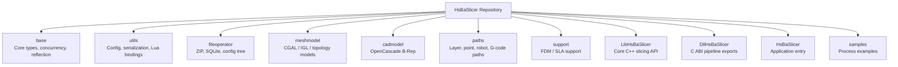
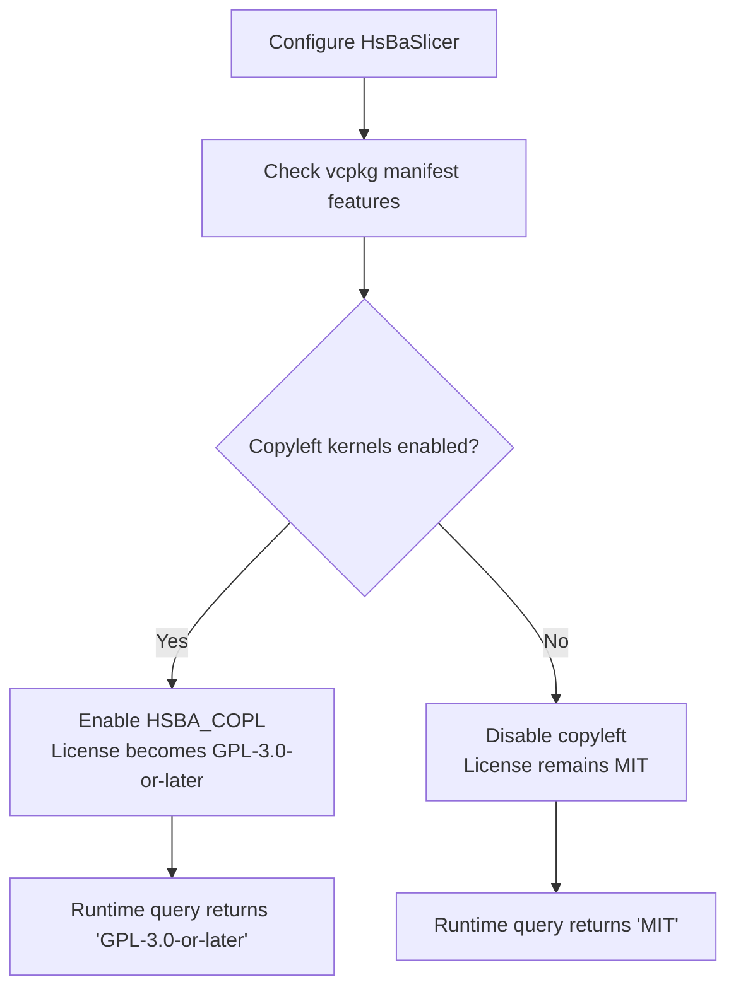

# Overview & Getting Started

<cite>
**Referenced Files in This Document**   
- [README.md](file://README.md)
- [CMakeLists.txt](file://CMakeLists.txt)
- [vcpkg.json](file://vcpkg.json)
- [LICENSE.txt](file://LICENSE.txt)
</cite>

## Table of Contents
1. [Introduction](#introduction)
2. [Project Structure](#project-structure)
3. [Build Requirements](#build-requirements)
4. [Installation and Setup](#installation-and-setup)
5. [Basic Usage](#basic-usage)
6. [Conditional Dual Licensing](#conditional-dual-licensing)
7. [Next Steps](#next-steps)

## Introduction
HsBaSlicer is a high-performance C++ framework for 3D-printing slicers. It is modular, cross-platform, and intended for research and production-level slicing pipelines. The project provides reusable core capabilities such as model preprocessing, mesh slicing, support generation, polygon filling, path generation, file operations, serialization, logging, and multiple process-specific pipeline interfaces.

At a high level, HsBaSlicer exposes:
- A C++ static library interface for full slicing workflows.
- A C ABI dynamic library interface for integration with other languages or runtimes.
- A layered module system covering base utilities, geometry models, slicing logic, output paths, and platform-specific integrations.

This page explains what HsBaSlicer is, how the repository is organized, how to install and build it on Windows, Linux, macOS, Android, and iOS, and how to start using it safely under its conditional dual license.

**Section sources**
- [README.md:7-9](file://README.md#L7-L9)
- [README.md:21-23](file://README.md#L21-L23)

## Project Structure
The repository is organized into feature-oriented modules rather than a single monolithic application. The most important top-level directories for getting started are:

| Directory | Purpose | Beginner-friendly description |
|---|---|---|
| `base` | Core types, templates, concurrency helpers, reflection, memory pools, delegates, coroutines, units, and basic interfaces | Foundation layer used by almost every other module |
| `utils` | Application configuration, structured JSON/YAML/XML serialization, Lua bindings, precompiled headers, logging configuration | Cross-cutting tools that make configuration, serialization, and scripting easier |
| `fileoperator` | ZIP/7z compression, SQLite access, property trees, parameter storage, Lua adapter, remote execution | File, archive, database, and configuration persistence |
| `meshmodel` | Mesh model backends such as CGAL, IGL, and topology-based models | Geometry representation and mesh processing |
| `cadmodel` | CAD model support based on OpenCascade, including B-Rep modeling and boolean operations | High-end CAD kernel (only when copyleft kernels are enabled) |
| `paths` | Layer paths, point paths, image paths, robot paths, G-code paths, weld robot paths | Output path abstractions for different manufacturing processes |
| `support` | FDM and SLA support generation, overhang detection, Lua-driven custom support | Support structure computation |
| `LibHsBaSlicer` | Static library exposing core slicing APIs: preprocess, slice, support, fill, path generation, parameter store, Lua extensions | Main C++ API surface for building slicing applications |
| `DllHsBaSlicer` | Dynamic library exporting C ABI pipeline interfaces for FDM, SLA, SLS, SLM, TDP, WAAM, LOM, file transfer, custom pipelines, and version info | Integration entry point for non-C++ consumers |
| `HsBaSlicer` | Top-level application wrapper | Final executable entry point |
| `samples` | Example projects for FDM, SLA, SLS, SLM, LOM, TDP, WAAM, custom pipelines, and LibHsBaSlicer usage | Ready-to-run examples |
| `tests`, `static_tests` | Unit tests and static checks | Validation and quality gates |
| `proto`, `convert`, `pipelinetypes` | Protobuf definitions, message conversion, and shared pipeline type definitions | Data contracts between components |
| `android`, `ios` | Platform-specific example or bridge code | Mobile integration scaffolding |



**Diagram sources**
- [README.md:29-38](file://README.md#L29-L38)
- [CMakeLists.txt:410-439](file://CMakeLists.txt#L410-L439)

**Section sources**
- [README.md:29-38](file://README.md#L29-L38)
- [CMakeLists.txt:410-439](file://CMakeLists.txt#L410-L439)

## Build Requirements
Before building HsBaSlicer, ensure your environment satisfies the following requirements:

| Requirement | Minimum Version or Condition | Notes |
|---|---:|---|
| CMake | >= 3.28 | The root CMake project sets `cmake_minimum_required(VERSION 3.28)` |
| C++ compiler | C++20 support required | The project enables `CMAKE_CXX_STANDARD 20` and requires modern C++ features such as concepts, ranges, source location, and template-template matching |
| vcpkg | Installed and available | Recommended dependency manager; many dependencies are declared in `vcpkg.json` |
| PowerShell | Available on Windows | Used by scripts and recommended for Windows development workflows |
| Platform toolchain | OS-specific | Visual Studio 2022+ on Windows; GCC/Clang + Ninja on Linux/macOS; Android SDK/NDK for Android; Xcode/iOS toolchain for iOS |

Important implementation details from the build system:
- The project enforces several C++20 features at configure time and fails fast if they are missing.
- Desktop platforms are detected automatically, and mobile/game-console builds can disable some optional features.
- Optional C++20 modules support is gated by compiler capability.
- Copyleft kernels such as CGAL and OpenCascade are conditionally enabled through the `copyleft` manifest feature.

**Section sources**
- [CMakeLists.txt:4-4](file://CMakeLists.txt#L4-L4)
- [CMakeLists.txt:17-38](file://CMakeLists.txt#L17-L38)
- [CMakeLists.txt:48-86](file://CMakeLists.txt#L48-L86)
- [CMakeLists.txt:116-127](file://CMakeLists.txt#L116-L127)
- [CMakeLists.txt:149-157](file://CMakeLists.txt#L149-L157)
- [README.md:43-48](file://README.md#L43-L48)

## Installation and Setup

### Windows
Recommended setup:
1. Install Visual Studio 2022 or later.
2. Select "Desktop development with C++".
3. Ensure CMake tools are installed.
4. Install Git.
5. Install vcpkg and add its path to your system environment so it can be found from IDEs and command-line tools.
6. Use the `windows-release` preset for release builds. Debug builds may have issues when CGAL-related submodules are involved.

Typical workflow:
1. Open a terminal where `cmake`, `git`, and `vcpkg` are available.
2. Clone the repository.
3. Configure with vcpkg, for example by pointing CMake to the vcpkg toolchain file.
4. Build the desired configuration.
5. Optionally install the package for downstream consumption.

Platform notes:
- Windows defaults favor dynamic libraries when a vcpkg triplet indicates Windows dynamic behavior.
- The dynamic library loader is enabled on desktop platforms.

**Section sources**
- [README.md:57-61](file://README.md#L57-L61)
- [CMakeLists.txt:370-390](file://CMakeLists.txt#L370-L390)
- [CMakeLists.txt:228-240](file://CMakeLists.txt#L228-L240)

### Linux
Example setup on Ubuntu/Debian:
1. Update package lists.
2. Install build tools, compilers, CMake, Python, Ninja, pkg-config, and common development libraries.
3. Install vcpkg by cloning the repository and bootstrapping it.
4. Configure and build HsBaSlicer.

You can either:
- Configure manually with `-DCMAKE_TOOLCHAIN_FILE=/path/to/vcpkg/scripts/buildsystems/vcpkg.cmake`.
- Use the provided CMake preset `linux-release`.

After configuration, build with `--config Release`.

**Section sources**
- [README.md:63-94](file://README.md#L63-L94)
- [CMakeLists.txt:206-206](file://CMakeLists.txt#L206-L206)

### macOS
macOS follows the same general approach as Linux:
1. Install CMake, a C++20-capable compiler, Ninja, and vcpkg.
2. Use the `linux-release` preset or configure manually with the vcpkg toolchain file.
3. Build in Release mode.

Note: The README states that iOS local builds on macOS have not been extensively tested, while CI has validated iOS builds.

**Section sources**
- [README.md:63-94](file://README.md#L63-L94)
- [README.md:96-98](file://README.md#L96-L98)

### Android
Android builds are typically performed on Linux and require:
- Android SDK
- Android NDK
- `ANDROID_NDK_HOME` set appropriately

Android-specific behavior:
- Dynamic library loading may be disabled due to NDK restrictions.
- Some desktop-only dependencies are omitted.
- Tests are disabled on Android.

**Section sources**
- [README.md:96-98](file://README.md#L96-L98)
- [CMakeLists.txt:232-239](file://CMakeLists.txt#L232-L239)
- [CMakeLists.txt:397-400](file://CMakeLists.txt#L397-L400)

### iOS
iOS builds are supported in CI but local macOS builds have not been widely tested. Typical considerations:
- iOS is treated as a mobile platform.
- Desktop-only features such as OpenCV, bit7z, and some SQL backends are disabled.
- Only SQLite3 is enabled for sqlpp11 on iOS.
- Tests are disabled on iOS.

**Section sources**
- [README.md:96-98](file://README.md#L96-L98)
- [CMakeLists.txt:277-280](file://CMakeLists.txt#L277-L280)
- [CMakeLists.txt:248-251](file://CMakeLists.txt#L248-L251)
- [CMakeLists.txt:330-336](file://CMakeLists.txt#L330-L336)
- [CMakeLists.txt:397-400](file://CMakeLists.txt#L397-L400)

### Installing and Exporting the Package
HsBaSlicer supports CMake installation and export. After building, you can install the package so downstream projects can use `find_package(HsBaSlicer)`.

Key points:
- The install command uses `<build_dir>`, `<install_prefix>`, and `--config Release`.
- Library targets are exported under the `HsBaSlicer::` namespace.
- Public headers include DllHsBaSlicer C API headers, LibHsBaSlicer C++ API headers, base headers, logger headers, version headers, and generated protobuf headers.
- CMake config files are installed under `<install_prefix>/lib/cmake/HsBaSlicer`.

Downstream CMake usage:
```cmake
find_package(HsBaSlicer CONFIG REQUIRED)
target_link_libraries(my_app PRIVATE HsBaSlicer::DllHsBaSlicer)
```

**Section sources**
- [README.md:100-124](file://README.md#L100-L124)
- [README.md:174-185](file://README.md#L174-L185)
- [CMakeLists.txt:456-665](file://CMakeLists.txt#L456-L665)

## Basic Usage
There are two primary ways to use HsBaSlicer after installation:

1. **Use the C ABI dynamic library**:
   - Target: `DllHsBaSlicer`
   - Purpose: Exports C ABI pipeline interfaces suitable for integration with Java, C#, Python, game engines, or other non-C++ environments.
   - Typical flow: Initialize the runtime, configure a pipeline, load a model, run slicing steps, and export outputs.

2. **Use the C++ static library**:
   - Target: `LibHsBaSlicer`
   - Purpose: Provides the core C++ slicing API, including preprocess, slice, support, fill, path generation, parameter store, and Lua extensions.
   - Typical flow: Create a pipeline configuration, load a model, call slice and support functions, generate paths, and write outputs.

For beginners:
- Start with the samples under `samples/FDM`, `samples/SLA`, `samples/SLS`, `samples/SLM`, `samples/LOM`, `samples/TDP`, `samples/WAAM`, `samples/Custom`, and `samples/LibHsBaSlicer`.
- Read the sample CMake configuration and main entry points to understand how pipelines are initialized and executed.
- For non-C++ integration, inspect the DllHsBaSlicer public headers and the corresponding pipeline implementations.

For experienced developers:
- Extend or replace stages through the Lua scripting system exposed by `LibHsBaSlicer` and `DllHsBaSlicer`.
- Use the `fileoperator` module for parameter persistence and the `utils` module for configuration and serialization.
- Replace or extend geometry backends through `meshmodel` and `cadmodel` when copyleft kernels are enabled.

**Section sources**
- [README.md:104-124](file://README.md#L104-L124)
- [CMakeLists.txt:442-454](file://CMakeLists.txt#L442-L454)

## Conditional Dual Licensing
HsBaSlicer uses a conditional dual licensing model. The effective license depends on whether the build links copyleft third-party kernels:

| Build scenario | License | Explanation |
|---|---|---|
| Build does **not** include GPL/LGPL components | MIT | Examples include iOS and game-console builds that do not link CGAL or OpenCascade |
| Build **does** include GPL/LGPL components | GPL-3.0-or-later | Examples include desktop and Android builds that link CGAL or OpenCascade |

How the license is determined:
- The `copyleft` manifest feature in `vcpkg.json` adds CGAL, libigl with CGAL, and OpenCascade.
- The root CMake script detects whether copyleft kernels are enabled via environment variables or by probing installed packages.
- When copyleft kernels are enabled, the project defines `HSBA_COPL` and reports that the license will be GPL-3.0-or-later.
- When copyleft kernels are disabled, the project reports that the license will be MIT.
- At runtime, the effective license can be queried through `GetVersionInfo()` or `HsBaGetVersionJson()` in the `license` field.



**Diagram sources**
- [vcpkg.json:3-9](file://vcpkg.json#L3-L9)
- [vcpkg.json:89-110](file://vcpkg.json#L89-L110)
- [CMakeLists.txt:170-204](file://CMakeLists.txt#L170-L204)
- [LICENSE.txt:1-22](file://LICENSE.txt#L1-L22)

**Section sources**
- [README.md:196-203](file://README.md#L196-L203)
- [README.md:205-210](file://README.md#L205-L210)
- [vcpkg.json:3-9](file://vcpkg.json#L3-L9)
- [vcpkg.json:89-110](file://vcpkg.json#L89-L110)
- [CMakeLists.txt:170-204](file://CMakeLists.txt#L170-L204)
- [LICENSE.txt:1-22](file://LICENSE.txt#L1-L22)

## Next Steps
After installing and building HsBaSlicer:
1. Run one of the sample executables to verify your environment.
2. Choose an integration path:
   - Use `DllHsBaSlicer` for C ABI integration.
   - Use `LibHsBaSlicer` for native C++ integration.
3. Explore the relevant documentation pages for your target platform and integration style.
4. If you need CAD or advanced mesh operations, enable the `copyleft` feature and rebuild with CGAL and OpenCascade.
5. Review the licensing implications before distributing binaries, especially if you plan to ship desktop or Android builds with copyleft kernels.

[No sources needed since this section summarizes without analyzing specific files]