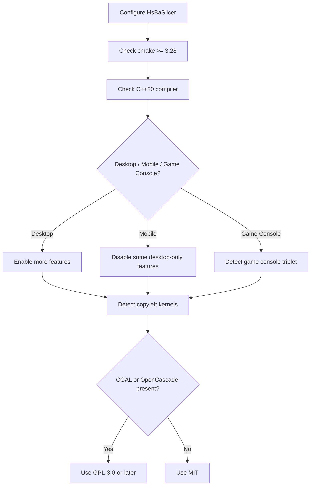
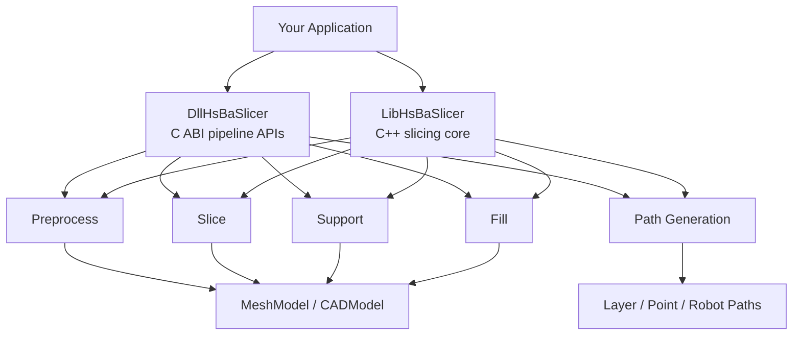
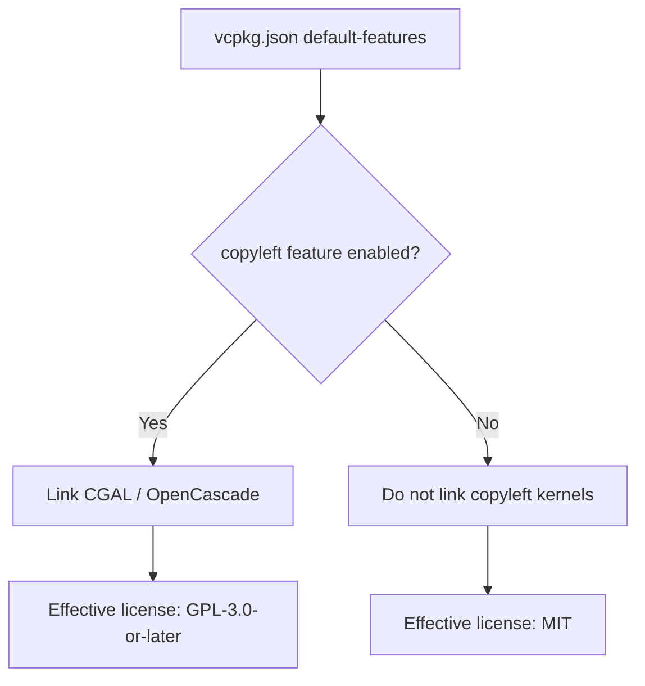
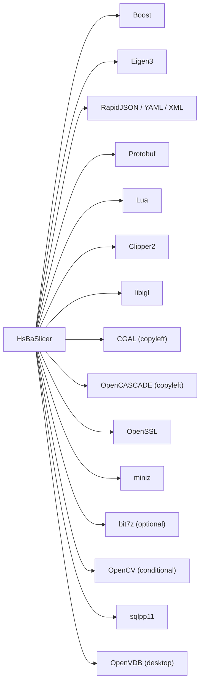

# Overview & Getting Started

<cite>
**Referenced Files in This Document**   
- [README.md](file://README.md)
- [CMakeLists.txt](file://CMakeLists.txt)
- [CMakePresets.json](file://CMakePresets.json)
- [vcpkg.json](file://vcpkg.json)
- [LICENSE.txt](file://LICENSE.txt)
- [docs/en/README.md](file://docs/en/README.md)
- [samples/FDM/main.cpp](file://samples/FDM/main.cpp)
- [samples/SLA/main.cpp](file://samples/SLA/main.cpp)
- [samples/SLS/main.cpp](file://samples/SLS/main.cpp)
- [samples/SLM/main.cpp](file://samples/SLM/main.cpp)
- [samples/TDP/main.cpp](file://samples/TDP/main.cpp)
- [samples/WAAM/main.cpp](file://samples/WAAM/main.cpp)
</cite>

## Table of Contents
1. [Introduction](#introduction)
2. [Project Structure](#project-structure)
3. [Core Components](#core-components)
4. [Architecture Overview](#architecture-overview)
5. [Detailed Component Analysis](#detailed-component-analysis)
6. [Dependency Analysis](#dependency-analysis)
7. [Performance Considerations](#performance-considerations)
8. [Troubleshooting Guide](#troubleshooting-guide)
9. [Conclusion](#conclusion)
10. [Appendices](#appendices)

## Introduction
HsBaSlicer is a high-performance C++ framework for 3D-printing slicers. It provides modular, cross-platform slicing core capabilities intended for both research and production-level additive manufacturing pipelines. The project supports multiple manufacturing processes, including Fused Deposition Modeling (FDM), Stereolithography (SLA), Selective Laser Sintering (SLS), Selective Laser Melting (SLM), Three-Dimensional Printing (TDP / binder jetting), and Wire Arc Additive Manufacturing (WAAM).

The repository includes:
- A modular C++ architecture with base utilities, geometry models, slicing cores, path generation, support generation, file operations, and process-specific pipeline exports.
- Cross-platform build configuration through CMake, vcpkg dependency management, and platform presets for Windows, Linux, macOS, Android, and iOS.
- Conditional dual licensing based on whether copyleft kernels such as CGAL or OpenCascade are included.

This document explains the project purpose, module structure, installation requirements, build instructions, license model, quick-start usage patterns, and common troubleshooting tips.

**Section sources**
- [README.md:21-39](file://README.md#L21-L39)
- [docs/en/README.md:10-49](file://docs/en/README.md#L10-L49)

## Project Structure
At a high level, HsBaSlicer organizes its code into foundation modules, geometry and CAD layers, slicing-core libraries, export pipelines, samples, tests, and platform-specific integration points.

```mermaid
graph TB
Root["HsBaSlicer Repository"] --> Base["base<br/>Core types, templates, pools, coroutines, reflection"]
Root --> Utils["utils<br/>Config, serialization, Lua bindings"]
Root --> FileOp["fileoperator<br/>ZIP, SQL, property tree, Lua adapter"]
Root --> Mesh["meshmodel<br/>CGAL / IGL / FullTopoModel"]
Root --> Cad["cadmodel<br/>OpenCascade B-Rep and boolean operations"]
Root --> Paths["paths<br/>Layer, point, image, robot paths"]
Root --> Support["support<br/>FDM/SLA support and overhang detection"]
Root --> Lib["LibHsBaSlicer<br/>Core C++ slicing interfaces"]
Root --> Dll["DllHsBaSlicer<br/>C ABI pipeline APIs"]
Root --> Samples["samples<br/>FDM / SLA / SLS / SLM / TDP / WAAM / Custom"]
Root --> Tests["tests<br/>Unit and static test suites"]
Root --> Android["android<br/>Android example project"]
```



**Diagram sources**
- [README.md:29-39](file://README.md#L29-L39)
- [docs/en/README.md:14-49](file://docs/en/README.md#L14-L49)

Key module responsibilities:
- `base`: Basic types, template helpers, singleton, thread pool, coroutine support, static reflection, memory/object pools, and utility headers.
- `utils`: Application configuration, structured JSON/YAML/XML conversion, Lua object helpers, precompiled header organization, and logging configuration.
- `fileoperator`: ZIP compression/decompression, optional bit7z-based multi-format archives, SQLite access, parameter schema/reflection, and Lua adapters.
- `meshmodel`: Mesh model abstractions with backends such as libigl and CGAL, plus full topological model support.
- `cadmodel`: OpenCascade-based CAD modeling and boolean operations; only enabled when copyleft kernels are available.
- `paths`: Output path representations for G-code, images, layer data, and robot programs.
- `support`: Overhang detection and support generation for FDM and SLA.
- `LibHsBaSlicer`: Core C++ library exposing preprocess, slice, support, fill, and path-generation interfaces.
- `DllHsBaSlicer`: Dynamic-library interface exporting C ABI functions for full-process pipelines like FDM, SLA, SLS, SLM, LOM, TDP, WAAM, file transfer, and custom Lua pipelines.

**Section sources**
- [README.md:29-39](file://README.md#L29-L39)
- [docs/en/README.md:14-49](file://docs/en/README.md#L14-L49)

## Core Components
HsBaSlicer’s core components can be grouped into three layers:

| Layer | Purpose | Examples |
|---|---|---|
| Foundation | Shared infrastructure used by all modules | `base`, `utils`, `logger` |
| Data & Geometry | Model loading, mesh/CAD representation, 2D polygons, preprocessing | `fileoperator`, `meshmodel`, `cadmodel`, `preprocess`, `2D` |
| Slicing Core | Slice, support, fill, path generation, and process-specific pipelines | `support`, `paths`, `LibHsBaSlicer`, `DllHsBaSlicer` |

The root CMake configuration also defines important build-time behavior:
- Minimum CMake version: 3.28.
- C++ standard: C++20.
- Optional C++20 modules wrapper via `HSBA_SLICER_MODULE`.
- Desktop/mobile/platform detection through `HSBA_DESKTOP` and `HSBA_MOBILE`.
- Copyleft kernel detection through `HSBA_COPL`, which controls whether CGAL and OpenCascade are linked and whether the effective license becomes GPL-3.0-or-later.



**Diagram sources**
- [CMakeLists.txt:4-4](file://CMakeLists.txt#L4-L4)
- [CMakeLists.txt:17-38](file://CMakeLists.txt#L17-L38)
- [CMakeLists.txt:117-127](file://CMakeLists.txt#L117-L127)
- [CMakeLists.txt:149-157](file://CMakeLists.txt#L149-L157)
- [CMakeLists.txt:170-204](file://CMakeLists.txt#L170-L204)

**Section sources**
- [CMakeLists.txt:4-4](file://CMakeLists.txt#L4-L4)
- [CMakeLists.txt:17-38](file://CMakeLists.txt#L17-L38)
- [CMakeLists.txt:117-127](file://CMakeLists.txt#L117-L127)
- [CMakeLists.txt:149-157](file://CMakeLists.txt#L149-L157)
- [CMakeLists.txt:170-204](file://CMakeLists.txt#L170-L204)

## Architecture Overview
HsBaSlicer exposes two main integration surfaces:

1. **LibHsBaSlicer**: A C++ library that encapsulates core slicing functionality such as preprocessing, mesh slicing, support generation, polygon filling, and path generation.
2. **DllHsBaSlicer**: A dynamic library that exports C ABI functions for complete process pipelines, including FDM, SLA, SLS, SLM, LOM, TDP, WAAM, file transfer, and custom Lua-driven pipelines.



**Diagram sources**
- [docs/en/README.md:36-42](file://docs/en/README.md#L36-L42)
- [README.md:104-124](file://README.md#L104-L124)

The architecture emphasizes modularity:
- Process-specific pipelines live under `DllHsBaSlicer`.
- Reusable slicing primitives live under `LibHsBaSlicer`.
- Geometry and CAD backends are separated from slicing logic.
- Export formats vary by process: G-code for FDM, zip archives for SLA/SLS/SLM/TDP, and robot program text for WAAM.

**Section sources**
- [docs/en/README.md:36-42](file://docs/en/README.md#L36-L42)
- [README.md:104-124](file://README.md#L104-L124)

## Detailed Component Analysis

### Installation Requirements
Before building HsBaSlicer, ensure the following tools are available:

| Requirement | Notes |
|---|---|
| `cmake` | Version 3.28 or newer is required by the root CMake configuration. |
| C++ compiler | Must support C++20 concepts, ranges, source location, and related modern C++ features. |
| `vcpkg` | Recommended dependency manager; the project uses it to resolve Boost, Clipper2, libigl, protobuf, OpenSSL, Lua, and other dependencies. |
| PowerShell | On Windows, PowerShell 7 is recommended, though Windows PowerShell 5.1 is acceptable. |
| Platform SDKs | Android NDK for Android builds; Xcode toolchain for iOS builds; desktop compilers for Windows/Linux/macOS. |

The README lists `cmake >= 3.28` and C++20 support as required, while also mentioning `cmake >= 3.12` in an older English section. The authoritative requirement comes from the root CMake configuration, which enforces `cmake_minimum_required(VERSION 3.28)` and sets `CMAKE_CXX_STANDARD 20`.

**Section sources**
- [README.md:43-55](file://README.md#L43-L55)
- [CMakeLists.txt:4-4](file://CMakeLists.txt#L4-L4)
- [CMakeLists.txt:17-38](file://CMakeLists.txt#L17-L38)

### Platform-Specific Setup

#### Windows
Recommended setup:
- Install Visual Studio 2022 or later with "Desktop development with C++", CMake tools, and Git.
- Install vcpkg and add its path to system environment variables so IDEs and command-line builds can find it.
- Use the `windows-release` preset for release builds; debug builds may have issues when CGAL submodules are involved.

Windows presets define Ninja generators, MSVC compilers, binary/install directories, and vcpkg toolchain integration.

#### Linux / macOS
Example Ubuntu/Debian dependencies include build tools, Python, Make, Ninja, pkg-config, Mesa/GLU/X11-related packages, and other utilities needed by third-party libraries.

After installing dependencies:
1. Clone vcpkg and bootstrap it.
2. Configure the project using the vcpkg toolchain file.
3. Build with Release configuration.
4. Alternatively, use CMake presets such as `linux-debug`, `linux-release`, `macos-debug`, or `macos-release`.

#### Android
Android builds typically run on Linux and require:
- Android SDK/NDK installed.
- `ANDROID_NDK_HOME` set.
- The `android-release` preset configured with `VCPKG_TARGET_TRIPLET=arm64-android`, `ANDROID_ABI=arm64-v8a`, and Android platform settings.

#### iOS
iOS builds are validated in CI and use the `ios-release` preset with Xcode generator, `arm64` architecture, iPhoneOS sysroot, and deployment target settings. Local macOS builds are not broadly tested according to the README.

**Section sources**
- [README.md:57-98](file://README.md#L57-L98)
- [CMakePresets.json:5-20](file://CMakePresets.json#L5-L20)
- [CMakePresets.json:43-83](file://CMakePresets.json#L43-L83)
- [CMakePresets.json:114-139](file://CMakePresets.json#L114-L139)
- [CMakePresets.json:142-208](file://CMakePresets.json#L142-L208)

### Build Instructions

#### Manual CMake Commands
A typical manual build flow is:

1. Create a build directory.
2. Configure with the vcpkg toolchain file.
3. Build with Release configuration.

Example:
```bash
mkdir -p build && cd build
cmake .. -DCMAKE_TOOLCHAIN_FILE=/path/to/vcpkg/scripts/buildsystems/vcpkg.cmake
cmake --build . --config Release
```

#### CMake Presets
The repository ships with `CMakePresets.json`, which provides named configure, build, and test presets.

Common presets:
- `windows-base`, `x64-debug`, `x64-release`
- `linux-debug`, `linux-release`, `linux-coverage`
- `android-release`
- `macos-debug`, `macos-release`
- `ios-release`

Example preset workflow:
```bash
cmake . --preset linux-release
cd out/build/linux-release
cmake --build . --config Release
```

Coverage presets enable gcov instrumentation and coverage gating thresholds for core and other modules.

**Section sources**
- [README.md:80-94](file://README.md#L80-L94)
- [CMakePresets.json:1-239](file://CMakePresets.json#L1-L239)

### License Information
HsBaSlicer uses a conditional dual license:

| Build Condition | Effective License |
|---|---:|
| Does not include any GPL/LGPL component (for example, iOS or game-console builds without CGAL/OpenCascade) | MIT |
| Includes a GPL/LGPL component (for example, desktop or Android builds with CGAL or OpenCascade) | GPL-3.0-or-later |

The effective license is determined at configure time from `vcpkg.json` manifest features and can be queried at runtime through version information functions. The root `LICENSE.txt` contains both the MIT license text and the GNU General Public License version 3.0 or later.



**Diagram sources**
- [vcpkg.json:3-9](file://vcpkg.json#L3-L9)
- [vcpkg.json:89-110](file://vcpkg.json#L89-L110)
- [CMakeLists.txt:170-204](file://CMakeLists.txt#L170-L204)
- [LICENSE.txt:1-22](file://LICENSE.txt#L1-L22)

**Section sources**
- [README.md:196-210](file://README.md#L196-L210)
- [vcpkg.json:3-9](file://vcpkg.json#L3-L9)
- [vcpkg.json:89-110](file://vcpkg.json#L89-L110)
- [CMakeLists.txt:170-204](file://CMakeLists.txt#L170-L204)
- [LICENSE.txt:1-22](file://LICENSE.txt#L1-L22)

### Quick Start Examples
Each process sample demonstrates a consistent pattern:
1. Create a default pipeline configuration.
2. Set the model name and model path.
3. Adjust process-specific parameters.
4. Run the pipeline synchronously or asynchronously.
5. Inspect the result for success, layer count, elapsed time, and output path.
6. Free the pipeline result memory.

#### FDM (Fused Deposition Modeling)
FDM generates G-code. The sample shows:
- Basic pipeline with default configuration.
- Custom layer height, wall count, infill density, support, and print speed.
- Lua-based custom support and infill scripts.
- Asynchronous execution with a completion callback.
- Spiral/vase mode that merges outer walls into a continuous rising path.

Typical API pattern:
- Default config: `HsBaCreateDefaultConfig()`
- Sync run: `HsBaRunFdmPipeline(...)`
- Async run: `HsBaRunFdmPipelineAsync(...)`
- Result free: `HsBaFreePipelineResult(...)`

**Section sources**
- [samples/FDM/main.cpp:50-96](file://samples/FDM/main.cpp#L50-L96)
- [samples/FDM/main.cpp:98-165](file://samples/FDM/main.cpp#L98-L165)
- [samples/FDM/main.cpp:167-220](file://samples/FDM/main.cpp#L167-L220)
- [samples/FDM/main.cpp:222-269](file://samples/FDM/main.cpp#L222-L269)
- [samples/FDM/main.cpp:271-318](file://samples/FDM/main.cpp#L271-L318)

#### SLA (Stereolithography)
SLA exports a zip archive containing configuration and layer contour SVGs. The sample shows:
- Basic SLA pipeline.
- Custom layer height, exposure/lift/retract parameters, floor/raft settings, and support parameters.
- Lua-based custom floor, support, and export hooks.
- Asynchronous execution.

Typical API pattern:
- Default config: `HsBaCreateDefaultSlaConfig()`
- Sync run: `HsBaRunSlaPipeline(...)`
- Async run: `HsBaRunSlaPipelineAsync(...)`
- Result free: `HsBaFreeSlaPipelineResult(...)`

**Section sources**
- [samples/SLA/main.cpp:49-84](file://samples/SLA/main.cpp#L49-L84)
- [samples/SLA/main.cpp:86-144](file://samples/SLA/main.cpp#L86-L144)
- [samples/SLA/main.cpp:146-191](file://samples/SLA/main.cpp#L146-L191)
- [samples/SLA/main.cpp:193-239](file://samples/SLA/main.cpp#L193-L239)

#### SLS (Selective Laser Sintering)
SLS is a powder-bed process that does not require floor/raft or support structures. Its output format is controlled by a Lua export script. The sample shows:
- Minimal configuration with Lua export script.
- Custom laser power, scan speed, hatch spacing, hatch rotation, and bed temperature.
- Asynchronous execution.

Typical API pattern:
- Default config: `HsBaCreateDefaultSlsConfig()`
- Sync run: `HsBaRunSlsPipeline(...)`
- Async run: `HsBaRunSlsPipelineAsync(...)`
- Result free: `HsBaFreeSlsPipelineResult(...)`

**Section sources**
- [samples/SLS/main.cpp:53-92](file://samples/SLS/main.cpp#L53-L92)
- [samples/SLS/main.cpp:94-140](file://samples/SLS/main.cpp#L94-L140)
- [samples/SLS/main.cpp:142-190](file://samples/SLS/main.cpp#L142-L190)

#### SLM (Selective Laser Melting)
SLM mirrors SLS but adds metal-specific parameters such as material, light source, and shielding gas. The sample shows:
- Basic configuration with titanium/laser/argon defaults.
- Custom laser power, scan speed, hatch spacing, hatch rotation, bed temperature, material, light source, and protect gas.
- Asynchronous execution.

Typical API pattern:
- Default config: `HsBaCreateDefaultSlmConfig()`
- Sync run: `HsBaRunSlmPipeline(...)`
- Async run: `HsBaRunSlmPipelineAsync(...)`
- Result free: `HsBaFreeSlmPipelineResult(...)`

**Section sources**
- [samples/SLM/main.cpp:53-84](file://samples/SLM/main.cpp#L53-L84)
- [samples/SLM/main.cpp:86-132](file://samples/SLM/main.cpp#L86-L132)
- [samples/SLM/main.cpp:134-177](file://samples/SLM/main.cpp#L134-L177)

#### TDP (Three-Dimensional Printing / Binder Jetting)
TDP jets liquid binder onto a powder bed. The sample shows:
- Minimal configuration with Lua export script.
- Custom head count, drop spacing, binder saturation, curing time, bed temperature, and binder mode.
- Asynchronous execution.
- Spiral mode that exposes a continuous rising spiralized outer-wall path to the export script.

Typical API pattern:
- Default config: `HsBaCreateDefaultTdpConfig()`
- Sync run: `HsBaRunTdpPipeline(...)`
- Async run: `HsBaRunTdpPipelineAsync(...)`
- Result free: `HsBaFreeTdpPipelineResult(...)`

**Section sources**
- [samples/TDP/main.cpp:53-82](file://samples/TDP/main.cpp#L53-L82)
- [samples/TDP/main.cpp:84-125](file://samples/TDP/main.cpp#L84-L125)
- [samples/TDP/main.cpp:127-170](file://samples/TDP/main.cpp#L127-L170)
- [samples/TDP/main.cpp:172-205](file://samples/TDP/main.cpp#L172-L205)

#### WAAM (Wire Arc Additive Manufacturing)
WAAM deposits metal bead-by-bead along per-layer contours and outputs robot language programs rather than zip archives. The sample shows:
- Built-in ABB robot program generation.
- Custom welding parameters and KUKA robot code generation.
- Asynchronous execution with a custom Lua path generator.
- Spiral mode that merges outer walls into one continuous rising weld bead.

Typical API pattern:
- Default config: `HsBaCreateDefaultWaamConfig()`
- Sync run: `HsBaRunWaamPipeline(...)`
- Async run: `HsBaRunWaamPipelineAsync(...)`
- Result free: `HsBaFreeWaamPipelineResult(...)`

**Section sources**
- [samples/WAAM/main.cpp:52-81](file://samples/WAAM/main.cpp#L52-L81)
- [samples/WAAM/main.cpp:83-131](file://samples/WAAM/main.cpp#L83-L131)
- [samples/WAAM/main.cpp:133-178](file://samples/WAAM/main.cpp#L133-L178)
- [samples/WAAM/main.cpp:180-217](file://samples/WAAM/main.cpp#L180-L217)

## Dependency Analysis
HsBaSlicer depends on many third-party libraries managed through vcpkg. The root CMake configuration finds and configures these dependencies conditionally based on platform and copyleft status.

| Category | Dependencies | Notes |
|---|---|---|
| Core C++ ecosystem | Boost, Eigen3, RapidJSON, tinyxml2, yaml-cpp, magic_enum | Used across base, utils, fileoperator, and pipeline types. |
| Geometry & mesh | libigl, CGAL (optional/copyleft) | libigl is always enabled; CGAL is enabled when copyleft kernels are available. |
| CAD | OpenCASCADE (optional/copyleft) | Enabled only when copyleft kernels are available and not on Android/iOS/game consoles. |
| 2D processing | Clipper2 | Required for 2D polygon operations. |
| Compression | miniz, optional bit7z | bit7z is disabled on non-desktop platforms. |
| Serialization & messages | Protobuf, Lua | Used for pipeline configuration, message conversion, and scripting. |
| Security & crypto | OpenSSL | Used for encryption/hash-related functionality. |
| Image processing | OpenCV (disabled on iOS/game consoles) | Used where image-to-polygon or image-based workflows are relevant. |
| Database | sqlpp11 with SQLite3/MySQL/PostgreSQL (desktop) or SQLite3 only (mobile) | Controls SQL adapter availability. |
| Point cloud | OpenVDB (desktop) | Disabled on Android/iOS/game consoles. |



**Diagram sources**
- [CMakeLists.txt:206-349](file://CMakeLists.txt#L206-L349)
- [vcpkg.json:10-87](file://vcpkg.json#L10-L87)

**Section sources**
- [CMakeLists.txt:206-349](file://CMakeLists.txt#L206-L349)
- [vcpkg.json:10-87](file://vcpkg.json#L10-L87)

## Performance Considerations
Several build options influence performance and resource usage:

- Boolean operations may be slow and consume significant memory in Debug builds; they are explicitly disabled in Debug configuration.
- Model pool size is larger when copyleft kernels are available, allowing multiple models to be held during boolean operations.
- Position-independent code is enabled globally because static libraries linked into shared libraries require `-fPIC`.
- Coroutine support can be enabled in the thread pool through `HSBA_ENABLE_THREAD_POOL_COROUTINE`.
- Coverage builds instrument all targets and enforce coverage thresholds for core and other modules.

Recommendations:
- Use Release builds for production slicing workloads.
- Avoid Debug builds if you need fast boolean operations or lower memory usage.
- Disable samples and documentation when running coverage or CI builds to reduce build time.
- On mobile platforms, expect reduced feature sets due to missing desktop-only dependencies.

**Section sources**
- [CMakeLists.txt:6-7](file://CMakeLists.txt#L6-L7)
- [CMakeLists.txt:258-262](file://CMakeLists.txt#L258-L262)
- [CMakeLists.txt:294-306](file://CMakeLists.txt#L294-L306)
- [CMakePresets.json:86-113](file://CMakePresets.json#L86-L113)

## Troubleshooting Guide

### Common Build Issues

| Problem | Likely Cause | Resolution |
|---|---|---|
| CMake version too old | Root CMake requires 3.28 | Upgrade CMake to 3.28 or newer. |
| Compiler errors about concepts/ranges/source location | C++20 features missing | Use a compiler with full C++20 support. |
| Missing vcpkg dependencies | vcpkg not bootstrapped or toolchain not passed | Bootstrap vcpkg and pass `-DCMAKE_TOOLCHAIN_FILE=.../vcpkg.cmake`. |
| CGAL/OpenCascade not found | Copyleft feature not enabled or not installed | Enable the `copyleft` feature in vcpkg or install the packages manually. |
| Android build fails | `ANDROID_NDK_HOME` not set or wrong triplet | Set `ANDROID_NDK_HOME` and use the `android-release` preset. |
| iOS build fails | Xcode toolchain or sysroot mismatch | Use the `ios-release` preset on macOS with Xcode installed. |
| Debug build is very slow or uses too much memory | Boolean operations enabled in Debug | Use Release builds or accept that Debug disables boolean operations. |
| Non-desktop platforms lack features | Desktop-only dependencies disabled | Accept reduced feature set or build on desktop for full functionality. |

### Dependency Resolution Tips
- Prefer using vcpkg with the provided `vcpkg.json`.
- If you want the copyleft-enabled build, ensure the `copyleft` feature is active so CGAL, libigl with CGAL, and OpenCascade are resolved.
- On mobile platforms, sqlpp11 is limited to SQLite3; MySQL and PostgreSQL are not expected.
- bit7z is disabled on non-desktop platforms; ZIP handling falls back to miniz-based implementations.
- OpenCV is disabled on iOS and game-console builds.

**Section sources**
- [README.md:43-98](file://README.md#L43-L98)
- [CMakeLists.txt:170-204](file://CMakeLists.txt#L170-L204)
- [CMakeLists.txt:228-256](file://CMakeLists.txt#L228-L256)
- [CMakeLists.txt:276-280](file://CMakeLists.txt#L276-L280)
- [CMakeLists.txt:329-336](file://CMakeLists.txt#L329-L336)
- [CMakePresets.json:114-139](file://CMakePresets.json#L114-L139)
- [CMakePresets.json:184-208](file://CMakePresets.json#L184-L208)

## Conclusion
HsBaSlicer is a modular, cross-platform C++ framework designed for high-performance 3D-printing slicing pipelines. Its architecture separates foundational utilities, geometry/CAD models, slicing core logic, and process-specific export pipelines. With CMake and vcpkg, it supports Windows, Linux, macOS, Android, and iOS, while offering both synchronous and asynchronous pipeline execution.

For most users:
- Start with the appropriate CMake preset for your platform.
- Choose between MIT and GPL-3.0-or-later depending on whether copyleft kernels are enabled.
- Use the FDM, SLA, SLS, SLM, TDP, or WAAM samples as templates for your own application.
- Extend behavior through Lua scripts where supported, especially for custom support, infill, export, and robot-code generation.

**Section sources**
- [README.md:21-39](file://README.md#L21-L39)
- [docs/en/README.md:10-49](file://docs/en/README.md#L10-L49)
- [LICENSE.txt:1-22](file://LICENSE.txt#L1-L22)

## Appendices

### Appendix A: Main Module Summary
| Module | Primary Role | Typical Output or Interface |
|---|---|---|
| `base` | Core types, templates, concurrency, reflection | Shared C++ utilities |
| `utils` | Configuration, serialization, Lua helpers | App config, JSON/YAML/XML converters |
| `fileoperator` | File, archive, SQL, parameter storage | ZIP, bit7z, SQLite, param store |
| `meshmodel` | Mesh representation and processing | CGAL/IGL-backed meshes |
| `cadmodel` | CAD modeling and boolean operations | OpenCascade B-Rep (copyleft) |
| `paths` | Path data structures | Layer, point, image, robot paths |
| `support` | Support generation | FDM/SLA support and overhang detection |
| `LibHsBaSlicer` | Core slicing API | Preprocess, slice, support, fill, path |
| `DllHsBaSlicer` | Process pipeline API | FDM/SLA/SLS/SLM/TDP/WAAM C ABI |

**Section sources**
- [README.md:29-39](file://README.md#L29-L39)
- [docs/en/README.md:14-49](file://docs/en/README.md#L14-L49)