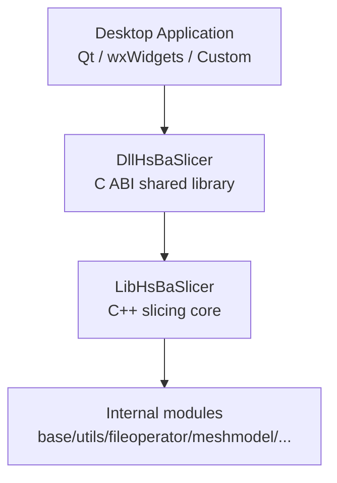
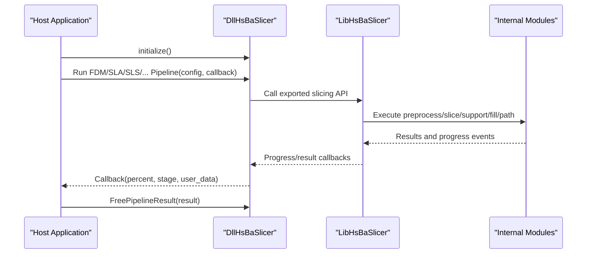
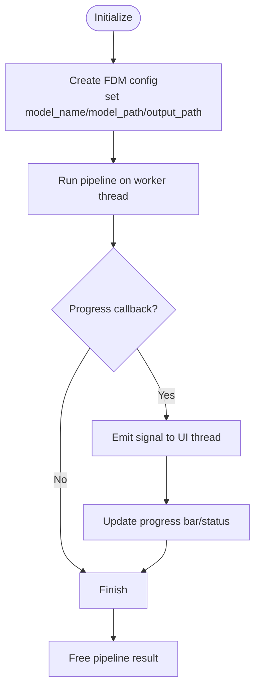
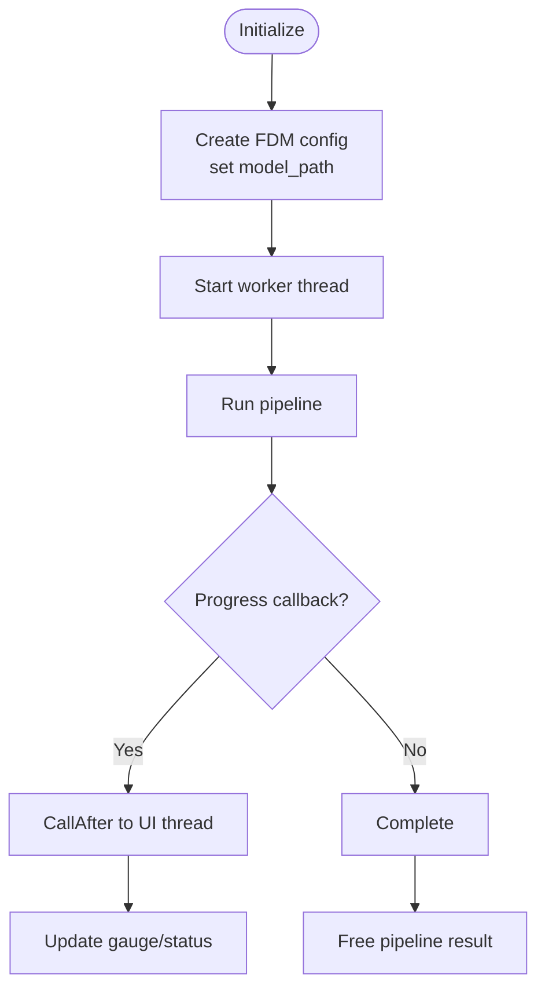
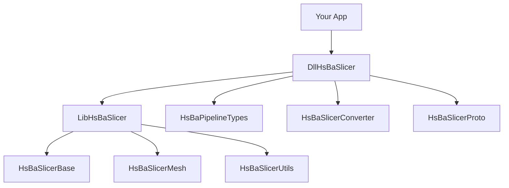

# Desktop Platform Integration

<cite>
**Referenced Files in This Document**
- [README.md](file://README.md)
- [CMakeLists.txt](file://CMakeLists.txt)
- [DllHsBaSlicer/CMakeLists.txt](file://DllHsBaSlicer/CMakeLists.txt)
- [LibHsBaSlicer/CMakeLists.txt](file://LibHsBaSlicer/CMakeLists.txt)
- [DllHsBaSlicer/dllexport.h](file://DllHsBaSlicer/dllexport.h)
- [DllHsBaSlicer/initialize.h](file://DllHsBaSlicer/initialize.h)
- [LibHsBaSlicer/export.h](file://LibHsBaSlicer/export.h)
- [docs/en/DllHsBaSlicer/README.md](file://docs/en/DllHsBaSlicer/README.md)
- [docs/en/DllHsBaSlicer/qt_wxwidgets_integration.md](file://docs/en/DllHsBaSlicer/qt_wxwidgets_integration.md)
- [pointcloud/UserCustomPointCloudModel.cpp](file://pointcloud/UserCustomPointCloudModel.cpp)
- [cadmodel/UserCustomCADModel.cpp](file://cadmodel/UserCustomCADModel.cpp)
- [utils/LuaDllLoader.cpp](file://utils/LuaDllLoader.cpp)
- [tests/DllLoader/dll_loader_test.cpp](file://tests/DllLoader/dll_loader_test.cpp)
- [tests/CMakeLists.txt](file://tests/CMakeLists.txt)
- [vcpkg.json](file://vcpkg.json)
</cite>

## Table of Contents
1. [Introduction](#introduction)
2. [Project Structure](#project-structure)
3. [Core Components](#core-components)
4. [Architecture Overview](#architecture-overview)
5. [Detailed Component Analysis](#detailed-component-analysis)
6. [Dependency Analysis](#dependency-analysis)
7. [Performance Considerations](#performance-considerations)
8. [Troubleshooting Guide](#troubleshooting-guide)
9. [Conclusion](#conclusion)

## Introduction
This document explains how to integrate HsBaSlicer into desktop applications on Windows, Linux, and macOS. It covers:
- Windows integration with DLL loading, memory management, and Visual Studio project setup.
- Linux integration with dynamic library linking, dependency resolution, and package management via vcpkg.
- macOS integration including framework bundling considerations, code signing, and distribution.
- GUI framework integration for Qt and wxWidgets, including thread safety and event marshalling.
- Build system configuration, compiler-specific options, and debugging setup.
- Concrete integration examples showing initialization, pipeline execution, and result handling.

## Project Structure
HsBaSlicer exposes two primary integration surfaces:
- `DllHsBaSlicer`: a C ABI shared library (or static library on iOS) that wraps the slicing core and is suitable for cross-language host applications.
- `LibHsBaSlicer`: a C++ API library providing full slicing capabilities; it can be linked statically or dynamically depending on build settings.

**Diagram sources**
- [README.md:104-124](file://README.md#L104-L124)
- [docs/en/DllHsBaSlicer/README.md:1-19](file://docs/en/DllHsBaSlicer/README.md#L1-L19)

**Section sources**
- [README.md:104-124](file://README.md#L104-L124)
- [docs/en/DllHsBaSlicer/README.md:1-19](file://docs/en/DllHsBaSlicer/README.md#L1-L19)

## Core Components
- `DllHsBaSlicer` provides a stable C ABI for external languages and frameworks. It exports functions such as `initialize()` and pipeline entry points (FDM, SLA, SLS, SLM, LOM, TDP, WAAM, File Transfer, Param Store, Custom Lua).
- `LibHsBaSlicer` encapsulates the complete slicing workflow (preprocess, slice, support, fill, path generation) and is consumed by `DllHsBaSlicer`.
- Export/import macros control symbol visibility across platforms:
  - `HSBA_SLICER_API` for the C ABI layer (`DllHsBaSlicer`).
  - `HSBA_SLICER_LIB_API` for the C++ API layer (`LibHsBaSlicer`).

Key headers:
- `DllHsBaSlicer/dllexport.h` defines `HSBA_SLICER_API`.
- `DllHsBaSlicer/initialize.h` declares `initialize()`, which must be called once at process startup.
- `LibHsBaSlicer/export.h` defines `HSBA_SLICER_LIB_API`.

Memory management rules are documented in the DllHsBaSlicer documentation:
- Config structs returned by default constructors do not need freeing; string fields’ lifetimes are caller-owned.
- Result struct strings are allocated by the library and must be freed using the matching `HsBaFree*PipelineResult()` functions.
- Version strings require `HsBaFreeVersionString()`.
- Model handles require `HsBaReleaseModelHandle()`.
- Proto deserialization allocates strings via `malloc`; free them with the corresponding `HsBaFree*ConfigStrings()` or `HsBaFreeCustomPipelineResult()`.

**Section sources**
- [DllHsBaSlicer/dllexport.h:1-23](file://DllHsBaSlicer/dllexport.h#L1-L23)
- [DllHsBaSlicer/initialize.h:1-22](file://DllHsBaSlicer/initialize.h#L1-L22)
- [LibHsBaSlicer/export.h:1-22](file://LibHsBaSlicer/export.h#L1-L22)
- [docs/en/DllHsBaSlicer/README.md:696-703](file://docs/en/DllHsBaSlicer/README.md#L696-L703)

## Architecture Overview
The recommended integration pattern is:
- Host application initializes the slicer via `initialize()`.
- Host calls pipeline APIs (sync or async) from worker threads.
- Progress/result callbacks fire on library threads; marshal UI updates back to the GUI thread.
- Free results using the provided deallocation functions.

**Diagram sources**
- [docs/en/DllHsBaSlicer/README.md:56-62](file://docs/en/DllHsBaSlicer/README.md#L56-L62)
- [docs/en/DllHsBaSlicer/README.md:684-703](file://docs/en/DllHsBaSlicer/README.md#L684-L703)

## Detailed Component Analysis

### Windows Integration
- Artifact: `DllHsBaSlicer.dll` plus import library `.lib` output to `bin/<CONFIG>/`.
- Linking: Use the generated import library when building your app against `DllHsBaSlicer`.
- Runtime: Ensure `DllHsBaSlicer.dll` is discoverable next to the executable or in PATH.
- Memory: Follow the documented memory management rules; use `HsBaFree*PipelineResult()` and related functions.
- Visual Studio setup:
  - Add include directories for installed headers or point directly at source tree headers.
  - Link against `DllHsBaSlicer.lib` and copy `DllHsBaSlicer.dll` post-build.
  - Set UTF-8 source encoding via `/utf-8` (already applied globally in top-level CMake).

Example integration steps:
- Initialize once at startup: call `initialize()`.
- Create config via `HsBaCreateDefaultConfig()` (FDM example), set model name/path and output path.
- Run pipeline synchronously or asynchronously.
- Handle progress callbacks on worker threads; marshal UI updates to main thread.
- Free results with `HsBaFreePipelineResult()`.

**Section sources**
- [docs/en/DllHsBaSlicer/README.md:21-31](file://docs/en/DllHsBaSlicer/README.md#L21-L31)
- [docs/en/DllHsBaSlicer/README.md:705-730](file://docs/en/DllHsBaSlicer/README.md#L705-L730)
- [CMakeLists.txt:11-15](file://CMakeLists.txt#L11-L15)

### Linux Integration
- Artifact: `libDllHsBaSlicer.so`.
- Dependency resolution: Managed via vcpkg; ensure toolchain file is passed to CMake.
- Package management: Install dependencies through vcpkg manifests; optional copyleft kernels (CGAL/OpenCASCADE) controlled by feature flags.
- Linking: Link your app against `libDllHsBaSlicer.so` and ensure runtime loader can find it (e.g., via `LD_LIBRARY_PATH` or rpath).

Build guidance:
- Configure with `-DCMAKE_TOOLCHAIN_FILE=/path/to/vcpkg/scripts/buildsystems/vcpkg.cmake`.
- Use presets like `linux-release` if configured.
- Optional features: enable copyleft kernels via manifest features; otherwise build remains MIT-licensed.

**Section sources**
- [README.md:63-94](file://README.md#L63-L94)
- [CMakeLists.txt:170-204](file://CMakeLists.txt#L170-L204)
- [vcpkg.json:89-112](file://vcpkg.json#L89-L112)

### macOS Integration
- Artifact: `libDllHsBaSlicer.dylib`.
- Framework bundling: If distributing as an app bundle, place the dylib within the bundle’s `Frameworks` directory and configure rpath accordingly so the app can locate it at runtime.
- Code signing: Sign the dylib and the app bundle; ensure code signature validity for all embedded libraries.
- Distribution: Include required system dependencies (e.g., OpenSSL, Boost) either bundled or ensured present on target systems.

Note: The repository does not provide platform-specific packaging scripts for macOS; follow standard macOS deployment practices for dylibs and app bundles.

**Section sources**
- [docs/en/DllHsBaSlicer/README.md:21-31](file://docs/en/DllHsBaSlicer/README.md#L21-L31)

### GUI Framework Integration Patterns

#### Qt Integration
- Project setup:
  - Use `find_package(HsBaSlicer CONFIG REQUIRED)` and link against `HsBaSlicer::DllHsBaSlicer`.
  - Alternatively, point directly at build artifacts for quick validation.
- Worker thread:
  - Run sync APIs on a worker thread (e.g., `QThread` or `QtConcurrent::run`).
  - Emit signals from callbacks; slots run on the UI thread automatically.
- String handling:
  - Keep UTF-8 paths alive during callbacks.
  - Copy result strings before calling `HsBaFreePipelineResult()`.

**Diagram sources**
- [docs/en/DllHsBaSlicer/qt_wxwidgets_integration.md:16-45](file://docs/en/DllHsBaSlicer/qt_wxwidgets_integration.md#L16-L45)
- [docs/en/DllHsBaSlicer/qt_wxwidgets_integration.md:47-167](file://docs/en/DllHsBaSlicer/qt_wxwidgets_integration.md#L47-L167)

**Section sources**
- [docs/en/DllHsBaSlicer/qt_wxwidgets_integration.md:16-167](file://docs/en/DllHsBaSlicer/qt_wxwidgets_integration.md#L16-L167)

#### wxWidgets Integration
- Project setup:
  - Find wxWidgets components and link against `DllHsBaSlicer.lib` (Windows) or the appropriate shared library on other platforms.
- Event marshalling:
  - Use `CallAfter` to marshal worker-thread data back to the UI thread.
  - In production, prefer `wxThread` or a thread pool and ensure pending work is awaited in panel destructor.

**Diagram sources**
- [docs/en/DllHsBaSlicer/qt_wxwidgets_integration.md:171-264](file://docs/en/DllHsBaSlicer/qt_wxwidgets_integration.md#L171-L264)

**Section sources**
- [docs/en/DllHsBaSlicer/qt_wxwidgets_integration.md:171-264](file://docs/en/DllHsBaSlicer/qt_wxwidgets_integration.md#L171-L264)

### Build System Configuration
Top-level CMake configuration:
- Enforces C++20 and sets UTF-8 encoding for MSVC.
- Enables position-independent code for static libraries linked into shared libraries.
- Detects desktop vs mobile vs game console targets and toggles features accordingly.
- Controls copyleft kernel linkage (CGAL/OpenCASCADE) based on environment variables or presence detection.
- Sets output directories for binaries and libraries uniformly across platforms.

Library targets:
- `DllHsBaSlicer`: Shared library on desktop; static library on iOS.
- `LibHsBaSlicer`: Static or shared depending on `BUILD_SHARED_LIBS`; export macro defined for Windows when shared.

Compiler-specific optimizations:
- Debug builds disable boolean operations to avoid high memory usage and slowness.
- Optional coroutine support in thread pool can be enabled via option.

**Section sources**
- [CMakeLists.txt:1-44](file://CMakeLists.txt#L1-L44)
- [CMakeLists.txt:149-168](file://CMakeLists.txt#L149-L168)
- [CMakeLists.txt:170-204](file://CMakeLists.txt#L170-L204)
- [CMakeLists.txt:294-299](file://CMakeLists.txt#L294-L299)
- [DllHsBaSlicer/CMakeLists.txt:1-100](file://DllHsBaSlicer/CMakeLists.txt#L1-L100)
- [LibHsBaSlicer/CMakeLists.txt:1-115](file://LibHsBaSlicer/CMakeLists.txt#L1-L115)

### Debugging Setup
- Enable tests and run them after build via CTest.
- For dynamic loader testing, ensure mock DLLs are built and located via absolute paths injected by CMake.
- On Windows, verify DLL discovery and symbol resolution using debugger tools.

**Section sources**
- [tests/CMakeLists.txt:1481-1508](file://tests/CMakeLists.txt#L1481-L1508)
- [tests/DllLoader/dll_loader_test.cpp:1-51](file://tests/DllLoader/dll_loader_test.cpp#L1-L51)

## Dependency Analysis
External dependencies are managed via vcpkg:
- Core dependencies include Boost, Clipper2, miniz/bit7z, Protobuf, RapidJSON, Eigen3, OpenSSL, OpenCV (desktop), libigl, CGAL (optional), OpenCASCADE (optional), OpenVDB (desktop), sqlpp11 (SQLite3/MySQL/PostgreSQL), Lua, tinyxml2, yaml-cpp, magic_enum.
- Copyleft kernels (CGAL/OpenCASCADE) are gated by manifest features and affect licensing.

**Diagram sources**
- [DllHsBaSlicer/CMakeLists.txt:84-100](file://DllHsBaSlicer/CMakeLists.txt#L84-L100)
- [LibHsBaSlicer/CMakeLists.txt:85-100](file://LibHsBaSlicer/CMakeLists.txt#L85-L100)

**Section sources**
- [CMakeLists.txt:206-349](file://CMakeLists.txt#L206-L349)
- [vcpkg.json:56-112](file://vcpkg.json#L56-L112)

## Performance Considerations
- Avoid running synchronous pipeline APIs on the UI thread; use worker threads to keep the interface responsive.
- In Debug builds, boolean operations are disabled to reduce memory pressure and improve performance.
- Prefer asynchronous pipelines where possible to decouple long-running tasks from UI updates.
- Reuse models and pipeline configurations where feasible to minimize allocation overhead.

[No sources needed since this section provides general guidance]

## Troubleshooting Guide
Common issues and resolutions:
- “DllHsBaSlicer.dll not found” on Windows: Ensure the DLL is copied next to the executable or added to PATH.
- UI freezes: Sync API running on UI thread; move to worker thread.
- Crashes updating widgets inside callbacks: Callbacks run on library threads; marshal to UI thread via signals/slots or `CallAfter`.
- Non-ASCII path failures: Pass UTF-8 encoded paths.
- Garbled result strings or crashes: Free results too early; copy first, then free.

Additional notes:
- Dynamic loader availability is disabled on non-desktop platforms; plugin loading may be limited on Android/iOS.
- When using custom plugins (CAD/Point Cloud), ensure the correct function names exist in the loaded DLL and handle errors gracefully.

**Section sources**
- [docs/en/DllHsBaSlicer/qt_wxwidgets_integration.md:340-349](file://docs/en/DllHsBaSlicer/qt_wxwidgets_integration.md#L340-L349)
- [CMakeLists.txt:228-240](file://CMakeLists.txt#L228-L240)
- [pointcloud/UserCustomPointCloudModel.cpp:175-208](file://pointcloud/UserCustomPointCloudModel.cpp#L175-L208)
- [cadmodel/UserCustomCADModel.cpp:134-173](file://cadmodel/UserCustomCADModel.cpp#L134-L173)

## Conclusion
HsBaSlicer provides robust desktop integration through a clean C ABI layer (`DllHsBaSlicer`) and a comprehensive C++ API (`LibHsBaSlicer`). By following the platform-specific guidelines for Windows, Linux, and macOS, integrating with Qt or wxWidgets, and adhering to the documented memory management and threading rules, you can reliably embed slicing pipelines into desktop applications. The build system supports modern C++ standards, flexible dependency management via vcpkg, and clear installation/export mechanisms for downstream projects.

[No sources needed since this section summarizes without analyzing specific files]