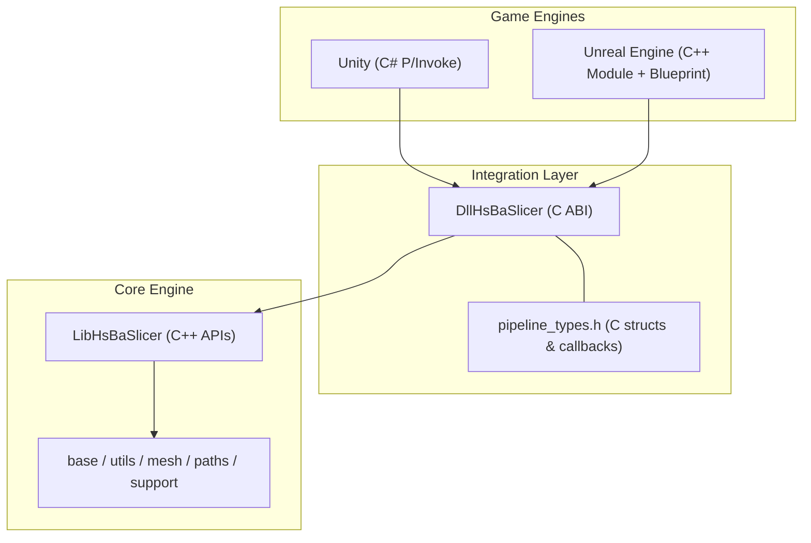
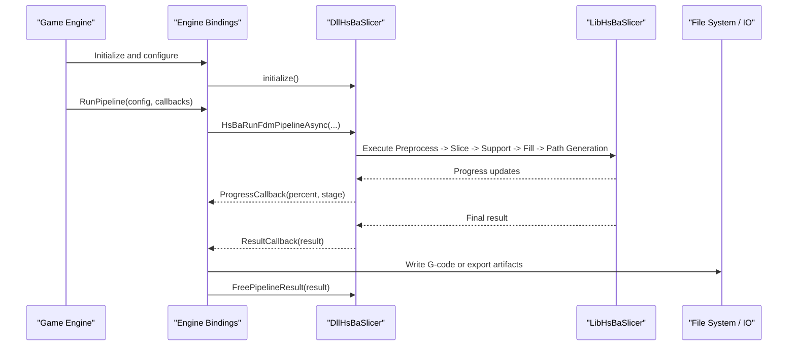
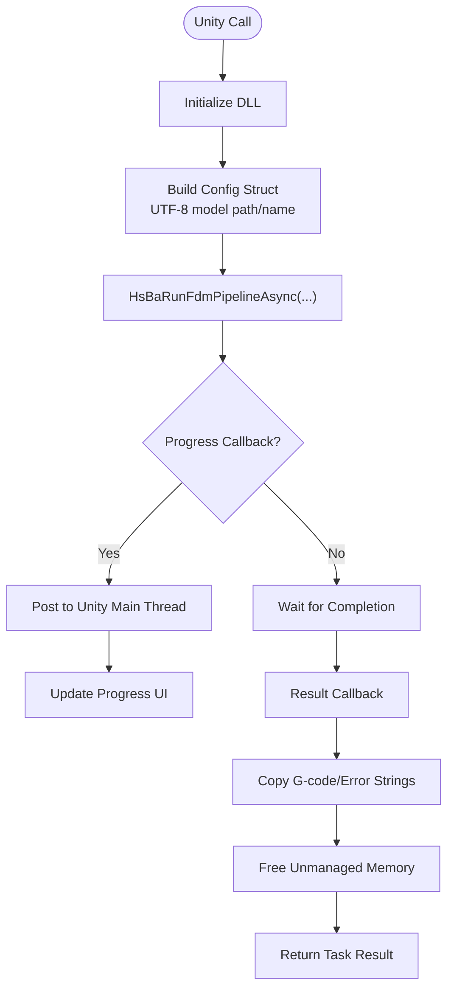
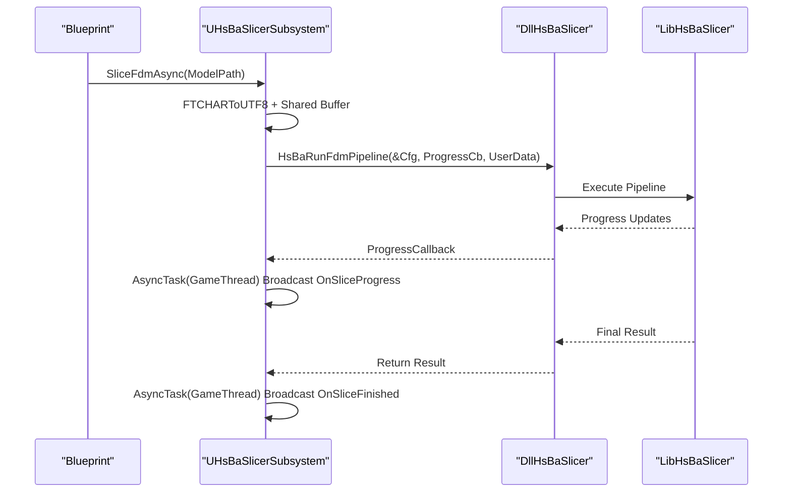
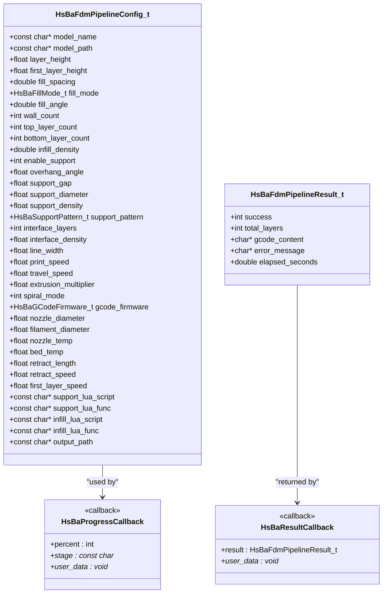
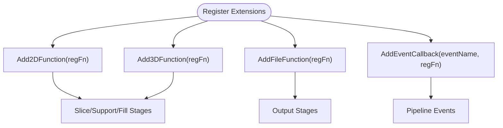
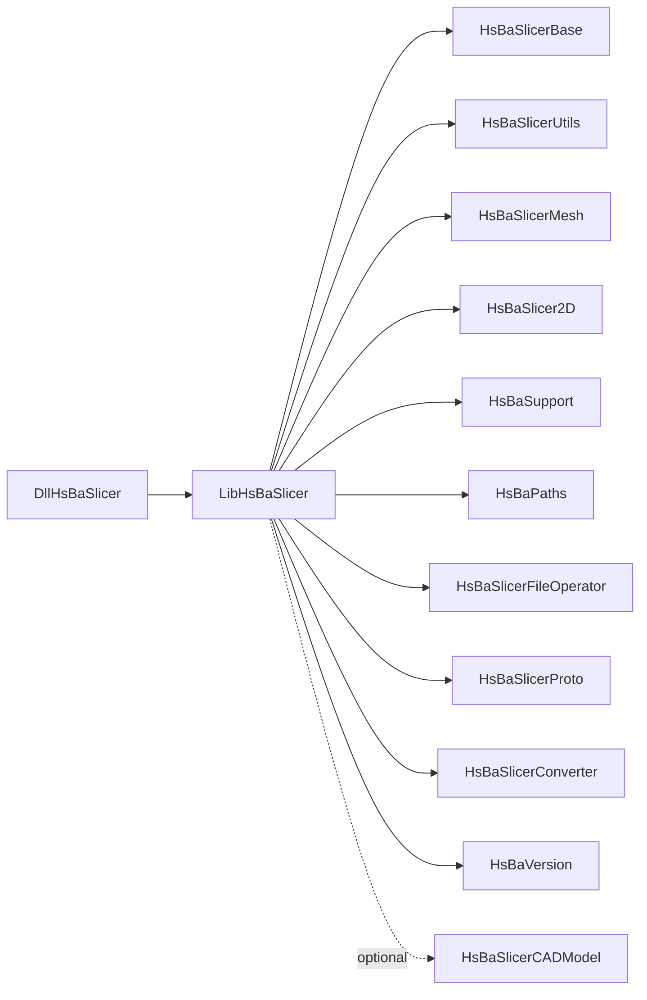

# Game Engine Integration

<cite>
**Referenced Files in This Document**
- [README.md](file://README.md)
- [game_engine_integration.md](file://docs/en/DllHsBaSlicer/game_engine_integration.md)
- [dllexport.h](file://DllHsBaSlicer/dllexport.h)
- [initialize.h](file://DllHsBaSlicer/initialize.h)
- [fdm_pipeline.h](file://DllHsBaSlicer/fdm_pipeline.h)
- [pipeline_types.h](file://pipelinetypes/pipeline_types.h)
- [CMakeLists.txt (DllHsBaSlicer)](file://DllHsBaSlicer/CMakeLists.txt)
- [CMakeLists.txt (LibHsBaSlicer)](file://LibHsBaSlicer/CMakeLists.txt)
</cite>

## Table of Contents
1. [Introduction](#introduction)
2. [Project Structure](#project-structure)
3. [Core Components](#core-components)
4. [Architecture Overview](#architecture-overview)
5. [Detailed Component Analysis](#detailed-component-analysis)
6. [Dependency Analysis](#dependency-analysis)
7. [Performance Considerations](#performance-considerations)
8. [Troubleshooting Guide](#troubleshooting-guide)
9. [Conclusion](#conclusion)

## Introduction
This document explains how to integrate HsBaSlicer into game engines for real-time 3D printing workflows. It focuses on:
- Unity integration via C# P/Invoke and plugin architecture
- Unreal Engine integration via a C++ module, Blueprint exposure, and streaming considerations
- General engine patterns such as asset pipeline integration, real-time slicing, and memory management
- Performance optimization techniques including async processing, level-of-detail support, and resource pooling
- Practical examples for interactive experiences and production constraints

HsBaSlicer exposes a stable C ABI through the DllHsBaSlicer shared library, with configuration and result types defined in a standalone header so that external integrations can remain decoupled from the shared library implementation.

**Section sources**
- [README.md:100-124](file://README.md#L100-L124)
- [README.md:126-179](file://README.md#L126-L179)

## Project Structure
At a high level, the integration surface is provided by:
- DllHsBaSlicer: C ABI entry points for pipelines (FDM, SLA, SLS, etc.)
- LibHsBaSlicer: Core C++ slicing capabilities used internally by the DLL
- pipelinetypes: Standalone C-compatible type definitions for configs/results/callbacks

**Diagram sources**
- [CMakeLists.txt (DllHsBaSlicer):1-100](file://DllHsBaSlicer/CMakeLists.txt#L1-L100)
- [CMakeLists.txt (LibHsBaSlicer):1-115](file://LibHsBaSlicer/CMakeLists.txt#L1-L115)
- [pipeline_types.h:1-12](file://pipelinetypes/pipeline_types.h#L1-L12)

**Section sources**
- [CMakeLists.txt (DllHsBaSlicer):1-100](file://DllHsBaSlicer/CMakeLists.txt#L1-L100)
- [CMakeLists.txt (LibHsBaSlicer):1-115](file://LibHsBaSlicer/CMakeLists.txt#L1-L115)
- [pipeline_types.h:1-12](file://pipelinetypes/pipeline_types.h#L1-L12)

## Core Components
The primary integration components are:
- initialize(): One-time DLL initialization and registration
- FDM pipeline API: Create default config, run sync/async, free results
- Pipeline types: Structs and callback typedefs for all supported processes

Key responsibilities:
- initialize() sets up Lua functions, pipelines, and one-time runtime setup
- FDM pipeline provides synchronous and asynchronous execution using coroutines
- pipeline_types.h defines portable C-compatible enums, structs, and callbacks

Memory ownership:
- Result strings (e.g., gcode_content, error_message) are allocated by the library and must be freed via the corresponding free function after use

**Section sources**
- [initialize.h:1-22](file://DllHsBaSlicer/initialize.h#L1-L22)
- [fdm_pipeline.h:1-68](file://DllHsBaSlicer/fdm_pipeline.h#L1-L68)
- [pipeline_types.h:19-140](file://pipelinetypes/pipeline_types.h#L19-L140)

## Architecture Overview
The integration follows a layered approach:
- Game engine code calls into DllHsBaSlicer via platform-specific bindings
- The DLL wraps LibHsBaSlicer and orchestrates the slicing pipeline
- pipeline_types.h ensures ABI stability across languages and platforms

**Diagram sources**
- [fdm_pipeline.h:23-51](file://DllHsBaSlicer/fdm_pipeline.h#L23-L51)
- [pipeline_types.h:115-140](file://pipelinetypes/pipeline_types.h#L115-L140)

## Detailed Component Analysis

### Unity Integration (C# P/Invoke)
Unity integration uses P/Invoke to call the C ABI exported by DllHsBaSlicer. The recommended pattern includes:
- Binding declarations for pipeline config/result structs and callbacks
- A high-level wrapper that marshals UTF-8 strings, keeps delegates alive, and posts callbacks to the Unity main thread
- Usage in MonoBehaviour to slice models asynchronously and update UI

Key practices:
- Keep delegate references alive to avoid GC collection during native callbacks
- Marshal UTF-8 strings carefully; free unmanaged memory after copying
- Post progress and completion events to the Unity main thread to safely update UI

**Diagram sources**
- [game_engine_integration.md:21-124](file://docs/en/DllHsBaSlicer/game_engine_integration.md#L21-L124)
- [game_engine_integration.md:128-184](file://docs/en/DllHsBaSlicer/game_engine_integration.md#L128-L184)

**Section sources**
- [game_engine_integration.md:21-124](file://docs/en/DllHsBaSlicer/game_engine_integration.md#L21-L124)
- [game_engine_integration.md:128-213](file://docs/en/DllHsBaSlicer/game_engine_integration.md#L128-L213)

### Unreal Engine Integration (C++ Module + Blueprint)
Unreal Engine integration uses a C++ module that wraps DllHsBaSlicer and exposes Blueprint-callable subsystems. The recommended pattern includes:
- ThirdParty module layout for headers and platform binaries
- Build.cs configuration linking the static/import libraries and registering runtime dependencies
- A GameInstanceSubsystem that initializes the DLL once and runs slicing asynchronously
- Blueprint delegates for progress and completion events

Key practices:
- Convert FString to UTF-8 bytes and keep them alive during the slicing run
- Dispatch callbacks to the GameThread using AsyncTask
- Package the DLL with RuntimeDependencies and handle delay loading if needed

**Diagram sources**
- [game_engine_integration.md:216-349](file://docs/en/DllHsBaSlicer/game_engine_integration.md#L216-L349)

**Section sources**
- [game_engine_integration.md:216-349](file://docs/en/DllHsBaSlicer/game_engine_integration.md#L216-L349)

### Pipeline Types and Memory Ownership
All pipeline configurations and results are defined in a standalone C-compatible header. This enables safe interop without requiring consumers to link against the shared library.

Important notes:
- All string fields in configs are UTF-8 const char* pointers owned by the caller
- Result strings (gcode_content, error_message, export_path) are allocated by the library and must be freed via the corresponding free function
- Callbacks receive percent, stage, and user_data pointers; ensure userData lifetime matches the pipeline execution

**Diagram sources**
- [pipeline_types.h:53-140](file://pipelinetypes/pipeline_types.h#L53-L140)

**Section sources**
- [pipeline_types.h:53-140](file://pipelinetypes/pipeline_types.h#L53-L140)

### Lua Extension Function Registration
Both Unity and Unreal can register custom Lua functions before running pipelines. These functions are injected when each stage creates its Lua environment.

Recommended usage:
- Register 2D/3D/file functions per stage
- Register event callbacks for pipeline events
- Prefer writing custom Lua functions in native C/C++ for better performance and safety

**Diagram sources**
- [game_engine_integration.md:380-452](file://docs/en/DllHsBaSlicer/game_engine_integration.md#L380-L452)

**Section sources**
- [game_engine_integration.md:380-452](file://docs/en/DllHsBaSlicer/game_engine_integration.md#L380-L452)

## Dependency Analysis
The build system defines clear boundaries between the integration layer and core engine:
- DllHsBaSlicer links against LibHsBaSlicer and multiple supporting modules
- LibHsBaSlicer depends on base utilities, mesh processing, 2D polygon operations, support generation, and path output
- Optional CAD kernel (OpenCascade) is conditionally linked based on platform and license settings

**Diagram sources**
- [CMakeLists.txt (DllHsBaSlicer):82-100](file://DllHsBaSlicer/CMakeLists.txt#L82-L100)
- [CMakeLists.txt (LibHsBaSlicer):85-115](file://LibHsBaSlicer/CMakeLists.txt#L85-L115)

**Section sources**
- [CMakeLists.txt (DllHsBaSlicer):82-100](file://DllHsBaSlicer/CMakeLists.txt#L82-L100)
- [CMakeLists.txt (LibHsBaSlicer):85-115](file://LibHsBaSlicer/CMakeLists.txt#L85-L115)

## Performance Considerations
For real-time applications, consider the following strategies:
- Asynchronous processing: Use async pipeline APIs to avoid blocking the game loop
- Level-of-detail support: Adjust layer height, fill density, and support complexity based on distance or importance
- Resource pooling: Reuse configuration objects and buffers where possible to reduce allocations
- Threading discipline: Ensure callbacks are dispatched to the correct thread (Unity main thread or UE GameThread)
- Memory management: Always free result strings via the provided free functions; avoid holding large G-code strings longer than necessary
- Asset pipeline integration: Preload models and cache frequently used assets to minimize I/O stalls
- Streaming considerations: For large geometry, stream slices incrementally and update UI progressively

[No sources needed since this section provides general guidance]

## Troubleshooting Guide
Common issues and resolutions:
- Unity DllNotFoundException: Verify plugin placement and platform selection in the Inspector
- Unity crash after callback: Ensure delegate references are kept alive to prevent GC collection
- UE packaged build cannot find DLL: Add RuntimeDependencies and verify Binaries directory contents
- iOS link failure: Use static library and DllImport("__Internal")
- Struct field misalignment: Match field order and types exactly with pipeline_types.h

**Section sources**
- [game_engine_integration.md:453-462](file://docs/en/DllHsBaSlicer/game_engine_integration.md#L453-L462)

## Conclusion
HsBaSlicer provides a robust, cross-platform slicing core accessible through a stable C ABI. By integrating via DllHsBaSlicer, game engines can leverage real-time slicing capabilities while maintaining clean separation between engine code and the slicing pipeline. Following the recommended patterns for Unity and Unreal—especially around async processing, memory management, and thread discipline—ensures reliable and performant integration suitable for production deployments.

[No sources needed since this section summarizes without analyzing specific files]