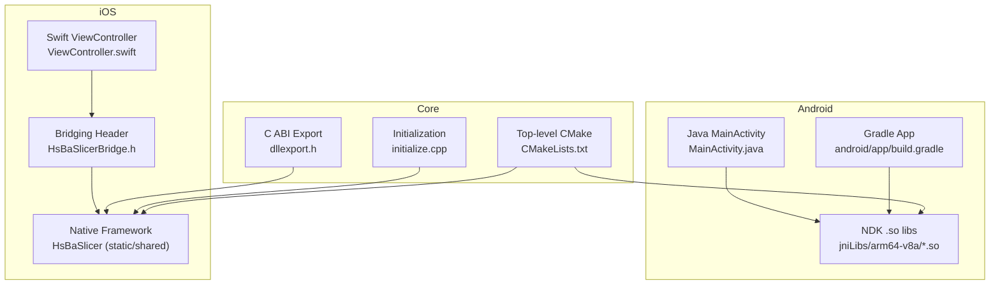
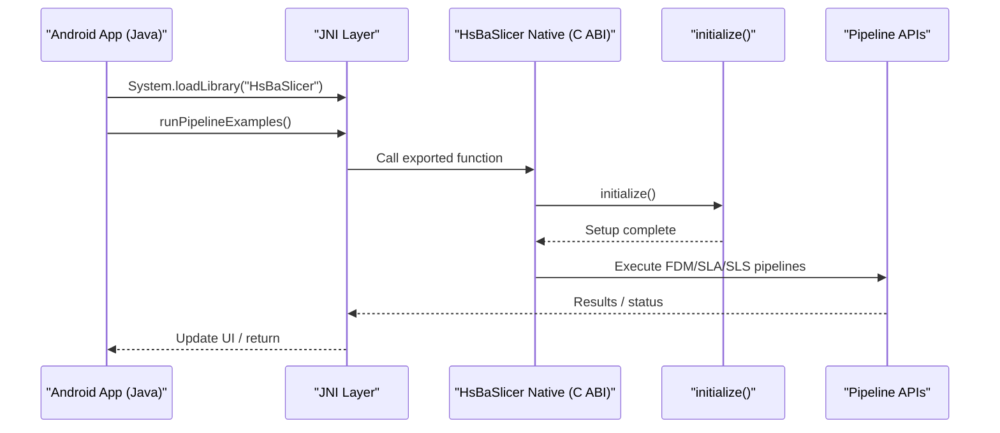
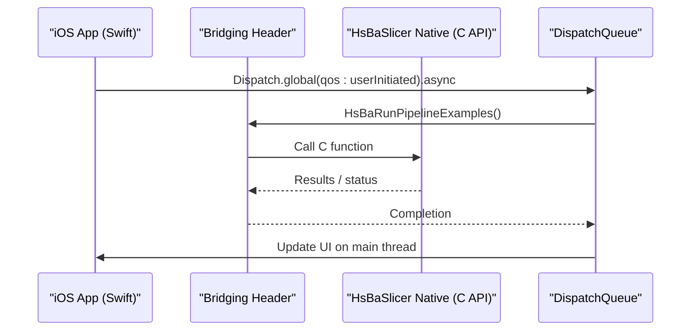
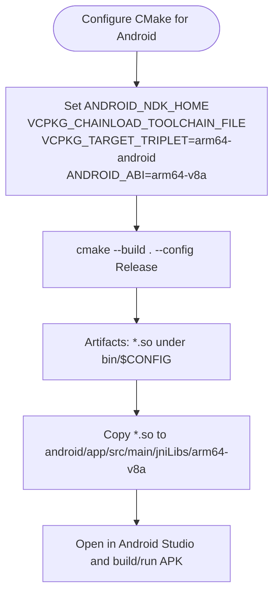
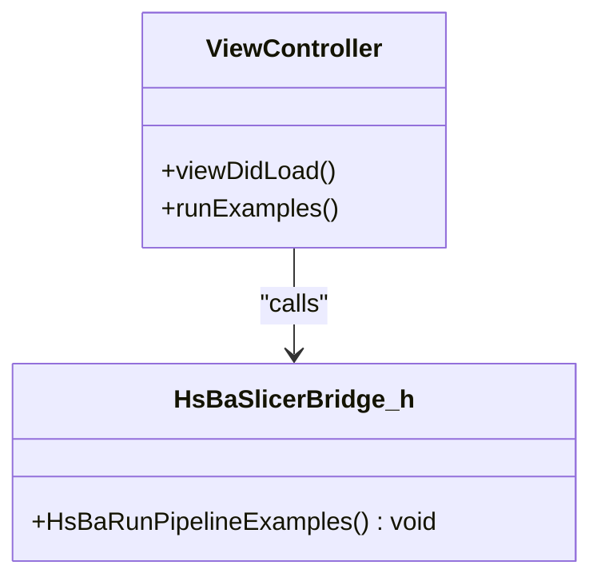
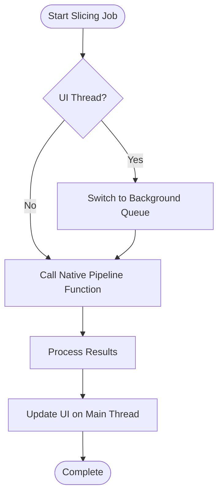
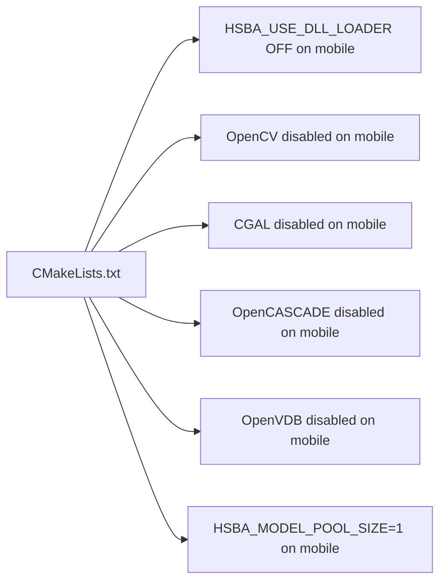

# Mobile Platform Integration

<cite>
**Referenced Files in This Document**
- [README.md](file://README.md)
- [CMakeLists.txt](file://CMakeLists.txt)
- [android/README.md](file://android/README.md)
- [android/app/build.gradle](file://android/app/build.gradle)
- [android/app/src/main/java/com/hsmbanlance/hsbaslicer/example/MainActivity.java](file://android/app/src/main/java/com/hsmbanlance/hsbaslicer/example/MainActivity.java)
- [ios/HsBaSlicerExample/ViewController.swift](file://ios/HsBaSlicerExample/ViewController.swift)
- [ios/HsBaSlicerExample/HsBaSlicerBridge.h](file://ios/HsBaSlicerExample/HsBaSlicerBridge.h)
- [DllHsBaSlicer/dllexport.h](file://DllHsBaSlicer/dllexport.h)
- [DllHsBaSlicer/initialize.cpp](file://DllHsBaSlicer/initialize.cpp)
- [base/thread_pool.hpp](file://base/thread_pool.hpp)
- [base/memory_pool.hpp](file://base/memory_pool.hpp)
</cite>

## Table of Contents
1. [Introduction](#introduction)
2. [Project Structure](#project-structure)
3. [Core Components](#core-components)
4. [Architecture Overview](#architecture-overview)
5. [Detailed Component Analysis](#detailed-component-analysis)
6. [Dependency Analysis](#dependency-analysis)
7. [Performance Considerations](#performance-considerations)
8. [Troubleshooting Guide](#troubleshooting-guide)
9. [Conclusion](#conclusion)
10. [Appendices](#appendices)

## Introduction
This document provides a complete mobile platform integration guide for HsBaSlicer, focusing on Android and iOS. It covers:
- Android: JNI setup, NDK compilation via CMake, Java/Kotlin bindings, and Gradle configuration.
- iOS: Swift/Objective-C bridging, Xcode project setup, and framework deployment.
- Mobile-specific optimizations: memory constraints, threading models, and performance tuning.
- Packaging and distribution: APK/IPA packaging, app store requirements, and platform permissions.
- Practical examples: integrating slicing functionality, asynchronous operations, and managing large model files.
- Common challenges: background processing, battery optimization, and device compatibility.

HsBaSlicer is a modular, cross-platform C++ framework for 3D-printing slicers with both a static library (LibHsBaSlicer) and a shared library exposing a C ABI (DllHsBaSlicer). On mobile platforms, the dynamic library loader is disabled by default, and several heavy dependencies are conditionally excluded to reduce footprint and improve performance.

**Section sources**
- [README.md:21-39](file://README.md#L21-L39)
- [README.md:96-99](file://README.md#L96-L99)
- [README.md:104-124](file://README.md#L104-L124)
- [README.md:187-191](file://README.md#L187-L191)

## Project Structure
The repository includes minimal mobile skeletons:
- Android skeleton under android/, including a sample Gradle app that loads native libraries from jniLibs.
- iOS example under ios/HsBaSlicerExample/, demonstrating Swift calling into a C function exposed by the bridge header.

**Diagram sources**
- [android/app/build.gradle:1-37](file://android/app/build.gradle#L1-L37)
- [android/app/src/main/java/com/hsmbanlance/hsbaslicer/example/MainActivity.java:1-46](file://android/app/src/main/java/com/hsmbanlance/hsbaslicer/example/MainActivity.java#L1-L46)
- [ios/HsBaSlicerExample/ViewController.swift:1-86](file://ios/HsBaSlicerExample/ViewController.swift#L1-L86)
- [ios/HsBaSlicerExample/HsBaSlicerBridge.h:1-32](file://ios/HsBaSlicerExample/HsBaSlicerBridge.h#L1-L32)
- [CMakeLists.txt:1-695](file://CMakeLists.txt#L1-L695)
- [DllHsBaSlicer/dllexport.h:1-23](file://DllHsBaSlicer/dllexport.h#L1-L23)
- [DllHsBaSlicer/initialize.cpp:1-10](file://DllHsBaSlicer/initialize.cpp#L1-L10)

**Section sources**
- [android/README.md:1-22](file://android/README.md#L1-L22)
- [android/app/build.gradle:1-37](file://android/app/build.gradle#L1-L37)
- [android/app/src/main/java/com/hsmbanlance/hsbaslicer/example/MainActivity.java:1-46](file://android/app/src/main/java/com/hsmbanlance/hsbaslicer/example/MainActivity.java#L1-L46)
- [ios/HsBaSlicerExample/ViewController.swift:1-86](file://ios/HsBaSlicerExample/ViewController.swift#L1-L86)
- [ios/HsBaSlicerExample/HsBaSlicerBridge.h:1-32](file://ios/HsBaSlicerExample/HsBaSlicerBridge.h#L1-L32)

## Core Components
- DllHsBaSlicer (shared library): Exposes a stable C ABI for external languages (Java/C#/Python/Swift/Objective-C). The export macro is defined centrally.
- LibHsBaSlicer (static/shared library): Encapsulates the full slicing pipeline in C++.
- Initialization: A one-time initialization entry point is provided for runtime setup.
- Threading and Memory: ThreadPool and MemoryPool utilities support efficient concurrency and memory management.

Key responsibilities:
- C ABI boundary and symbol visibility across platforms.
- One-time initialization hook for Lua/pipeline registration and runtime setup.
- Concurrency primitives for offloading heavy work.
- Memory allocators for predictable allocation patterns.

**Section sources**
- [README.md:104-124](file://README.md#L104-L124)
- [DllHsBaSlicer/dllexport.h:1-23](file://DllHsBaSlicer/dllexport.h#L1-L23)
- [DllHsBaSlicer/initialize.cpp:1-10](file://DllHsBaSlicer/initialize.cpp#L1-L10)
- [base/thread_pool.hpp:1-214](file://base/thread_pool.hpp#L1-L214)
- [base/memory_pool.hpp:1-375](file://base/memory_pool.hpp#L1-L375)

## Architecture Overview
At runtime on mobile:
- Android: Java/Kotlin code loads the native shared library via JNI and calls exported functions.
- iOS: Swift code calls C functions through a bridging header; the underlying native code can be linked as a static or shared framework.

**Diagram sources**
- [android/app/src/main/java/com/hsmbanlance/hsbaslicer/example/MainActivity.java:17-44](file://android/app/src/main/java/com/hsmbanlance/hsbaslicer/example/MainActivity.java#L17-L44)
- [DllHsBaSlicer/initialize.cpp:7-9](file://DllHsBaSlicer/initialize.cpp#L7-L9)

**Diagram sources**
- [ios/HsBaSlicerExample/ViewController.swift:43-55](file://ios/HsBaSlicerExample/ViewController.swift#L43-L55)
- [ios/HsBaSlicerExample/HsBaSlicerBridge.h:19-25](file://ios/HsBaSlicerExample/HsBaSlicerBridge.h#L19-L25)

## Detailed Component Analysis

### Android Integration

#### NDK Compilation and Build Configuration
- Use CMake with the Android toolchain to build native libraries for arm64-v8a.
- Copy built .so files into the app’s jniLibs directory.
- The Android skeleton README documents the typical CMake invocation and artifact placement.

**Diagram sources**
- [android/README.md:7-17](file://android/README.md#L7-L17)

**Section sources**
- [android/README.md:1-22](file://android/README.md#L1-L22)
- [CMakeLists.txt:370-390](file://CMakeLists.txt#L370-L390)

#### Gradle Configuration
- The sample app sets namespace, compileSdk, minSdk/targetSdk, version info, and ProGuard rules.
- It configures jniLibs source set and restricts ABIs to arm64-v8a.

Key points:
- jniLibs.srcDirs points to src/main/jniLibs.
- abiFilters limits artifacts to arm64-v8a.
- release build disables minification by default but includes ProGuard rules.

**Section sources**
- [android/app/build.gradle:1-37](file://android/app/build.gradle#L1-L37)

#### Java/Kotlin Bindings and JNI Usage
- The sample Activity loads the native library using System.loadLibrary("HsBaSlicer").
- It declares a native method runPipelineExamples() and invokes it from onCreate.
- The comment indicates this is an example/test entry point; production should use background threads.

Best practices:
- Always call heavy native methods off the UI thread.
- Handle exceptions and update UI accordingly.
- For Kotlin, declare the same native function and call it from a coroutine or background executor.

**Section sources**
- [android/app/src/main/java/com/hsmbanlance/hsbaslicer/example/MainActivity.java:17-44](file://android/app/src/main/java/com/hsmbanlance/hsbaslicer/example/MainActivity.java#L17-L44)

### iOS Integration

#### Swift/Objective-C Bridging
- The bridging header exposes a C function HsBaRunPipelineExamples() for Swift to call directly.
- The Swift example runs the pipeline on a global background queue and updates the UI on the main queue.

**Diagram sources**
- [ios/HsBaSlicerExample/ViewController.swift:14-55](file://ios/HsBaSlicerExample/ViewController.swift#L14-L55)
- [ios/HsBaSlicerExample/HsBaSlicerBridge.h:19-25](file://ios/HsBaSlicerExample/HsBaSlicerBridge.h#L19-L25)

**Section sources**
- [ios/HsBaSlicerExample/HsBaSlicerBridge.h:1-32](file://ios/HsBaSlicerExample/HsBaSlicerBridge.h#L1-L32)
- [ios/HsBaSlicerExample/ViewController.swift:1-86](file://ios/HsBaSlicerExample/ViewController.swift#L1-L86)

#### Xcode Project Setup and Framework Deployment
- Add the bridging header to your Xcode project and link the HsBaSlicer framework (static or shared).
- Ensure the target architecture matches your device/simulator (arm64 for devices; x86_64/arm64 for simulators).
- If using a static framework, ensure all required symbols are included; if using a shared framework, verify runtime loading paths.

[No sources needed since this section provides general guidance]

### Mobile-Specific Optimizations

#### Memory Constraints
- Custom memory pools provide predictable allocation behavior and reduced fragmentation.
- StaticMemoryPool offers a process-wide pool suitable for short-lived allocations.
- MemoryPoolState tracks usage and enforces bounds.

Recommendations:
- Use memory pools for high-frequency small allocations during slicing.
- Avoid excessive temporary objects in hot loops.
- Monitor used_count and adjust pool sizes based on device memory profiles.

**Section sources**
- [base/memory_pool.hpp:21-34](file://base/memory_pool.hpp#L21-L34)
- [base/memory_pool.hpp:111-142](file://base/memory_pool.hpp#L111-L142)
- [base/memory_pool.hpp:266-296](file://base/memory_pool.hpp#L266-L296)
- [base/memory_pool.hpp:358-371](file://base/memory_pool.hpp#L358-L371)

#### Threading Models
- ThreadPool manages worker threads, task submission, and completion synchronization.
- ThreadPoolExecutor integrates with coroutines when enabled.

Recommendations:
- Offload slicing tasks to ThreadPool or DispatchQueue.global.
- Avoid blocking the UI thread; use futures or callbacks to propagate results.
- Tune thread count based on hardware_concurrency and device thermal constraints.

**Section sources**
- [base/thread_pool.hpp:29-162](file://base/thread_pool.hpp#L29-L162)
- [base/thread_pool.hpp:164-210](file://base/thread_pool.hpp#L164-L210)

#### Performance Tuning
- Disable dynamic library loader on non-desktop platforms to avoid runtime overhead.
- Exclude heavy dependencies (e.g., OpenCV, CGAL, OpenCASCADE, OpenVDB) on mobile builds.
- Reduce model pool size on mobile to limit peak memory usage.

Platform toggles:
- HSBA_USE_DLL_LOADER disabled on Android/iOS.
- OpenCV, CGAL, OpenCASCADE, OpenVDB disabled on mobile.
- HSBA_MODEL_POOL_SIZE set to 1 on mobile vs. higher on desktop.

**Section sources**
- [CMakeLists.txt:228-240](file://CMakeLists.txt#L228-L240)
- [CMakeLists.txt:276-280](file://CMakeLists.txt#L276-L280)
- [CMakeLists.txt:284-292](file://CMakeLists.txt#L284-L292)
- [CMakeLists.txt:308-318](file://CMakeLists.txt#L308-L318)
- [CMakeLists.txt:320-327](file://CMakeLists.txt#L320-L327)
- [CMakeLists.txt:300-306](file://CMakeLists.txt#L300-L306)

### APK/IPA Packaging and App Store Requirements

#### Android (APK/AAB)
- Ensure ABI filters match your distribution strategy (arm64-v8a recommended).
- Configure signing keys and upload to Google Play (APK or App Bundle).
- Verify ProGuard/R8 rules do not strip native symbols.

Permissions:
- No special system permissions are required merely to load native libraries.
- If reading/writing files or accessing storage, add appropriate permissions and runtime requests.

**Section sources**
- [android/app/build.gradle:17-22](file://android/app/build.gradle#L17-L22)
- [android/app/build.gradle:31-33](file://android/app/build.gradle#L31-L33)

#### iOS (IPA)
- Sign the app with an Apple Developer certificate and provisioning profile.
- Validate architectures and bitcode settings per current App Store guidelines.
- Ensure the bridging header is correctly referenced and the framework is embedded.

Permissions:
- No special entitlements are required just to call native functions.
- If accessing files, camera, or network, configure Info.plist entries and request runtime authorization.

[No sources needed since this section provides general guidance]

### Practical Examples

#### Integrating Slicing Functionality
- Android: Load the native library and invoke the exported pipeline function from a background thread.
- iOS: Call HsBaRunPipelineExamples() on a background queue and update UI on the main queue.

[No sources needed since this diagram shows conceptual workflow, not actual code structure]

#### Managing Large Model Files
- Stream or chunk large models where possible.
- Use memory pools to reduce fragmentation during parsing and slicing.
- Consider compressing assets and decompressing on demand.

[No sources needed since this section provides general guidance]

## Dependency Analysis
Mobile builds disable several desktop-only features and dependencies to reduce footprint and improve startup time.

**Diagram sources**
- [CMakeLists.txt:228-240](file://CMakeLists.txt#L228-L240)
- [CMakeLists.txt:276-280](file://CMakeLists.txt#L276-L280)
- [CMakeLists.txt:284-292](file://CMakeLists.txt#L284-L292)
- [CMakeLists.txt:308-318](file://CMakeLists.txt#L308-L318)
- [CMakeLists.txt:320-327](file://CMakeLists.txt#L320-L327)
- [CMakeLists.txt:300-306](file://CMakeLists.txt#L300-L306)

**Section sources**
- [CMakeLists.txt:228-240](file://CMakeLists.txt#L228-L240)
- [CMakeLists.txt:276-280](file://CMakeLists.txt#L276-L280)
- [CMakeLists.txt:284-292](file://CMakeLists.txt#L284-L292)
- [CMakeLists.txt:300-306](file://CMakeLists.txt#L300-L306)
- [CMakeLists.txt:308-318](file://CMakeLists.txt#L308-L318)
- [CMakeLists.txt:320-327](file://CMakeLists.txt#L320-L327)

## Performance Considerations
- Prefer background execution for long-running slicing tasks to keep the UI responsive.
- Use ThreadPool or platform-native queues to parallelize independent workloads.
- Leverage memory pools to minimize GC pressure and fragmentation.
- Keep native calls minimal at the boundary; batch data transfers where possible.
- Profile memory and CPU usage on real devices; adjust pool sizes and thread counts accordingly.

[No sources needed since this section provides general guidance]

## Troubleshooting Guide
Common issues and resolutions:
- Native library not found on Android:
  - Ensure .so files are placed under jniLibs with correct ABI folders.
  - Verify abiFilters matches the device architecture.
- Symbol not found on iOS:
  - Confirm the bridging header is added and the framework is linked/embedded.
  - Check that the exported C function is present in the final binary.
- UI freezes during slicing:
  - Move heavy work off the main thread.
  - Use background queues and dispatch results back to the main thread.
- High memory usage or crashes:
  - Use memory pools for frequent allocations.
  - Reduce model pool size and avoid unnecessary copies.

**Section sources**
- [android/app/build.gradle:24-33](file://android/app/build.gradle#L24-L33)
- [ios/HsBaSlicerExample/ViewController.swift:43-55](file://ios/HsBaSlicerExample/ViewController.swift#L43-L55)
- [base/memory_pool.hpp:111-142](file://base/memory_pool.hpp#L111-L142)
- [base/thread_pool.hpp:62-90](file://base/thread_pool.hpp#L62-L90)

## Conclusion
HsBaSlicer provides robust mobile integration through a well-defined C ABI, minimal Android and iOS skeletons, and strong internal utilities for concurrency and memory management. By following the guidance here—using background execution, leveraging memory pools, and respecting platform-specific build configurations—you can integrate slicing functionality efficiently and reliably on Android and iOS.

[No sources needed since this section summarizes without analyzing specific files]

## Appendices

### Android Quickstart Checklist
- Install Android SDK/NDK and set ANDROID_NDK_HOME.
- Build native libs with CMake using the Android toolchain and VCPKG chainload.
- Copy .so artifacts into android/app/src/main/jniLibs/arm64-v8a.
- Open android/ in Android Studio and build/run the APK.

**Section sources**
- [android/README.md:7-17](file://android/README.md#L7-L17)

### iOS Quickstart Checklist
- Add HsBaSlicerBridge.h to your Xcode project.
- Link the HsBaSlicer framework (static or shared).
- Call HsBaRunPipelineExamples() on a background queue and update UI on the main queue.

**Section sources**
- [ios/HsBaSlicerExample/HsBaSlicerBridge.h:19-25](file://ios/HsBaSlicerExample/HsBaSlicerBridge.h#L19-L25)
- [ios/HsBaSlicerExample/ViewController.swift:43-55](file://ios/HsBaSlicerExample/ViewController.swift#L43-L55)