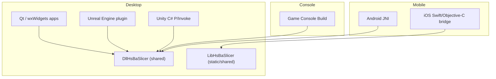
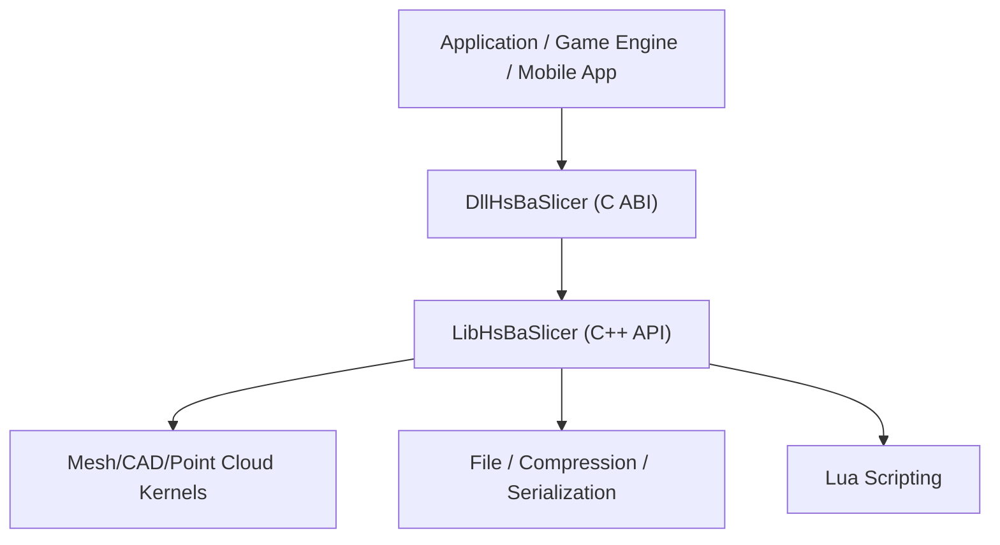
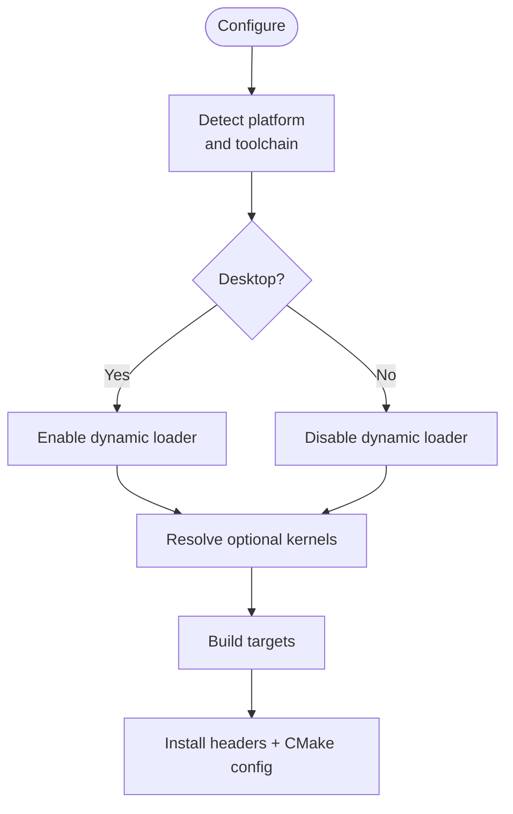
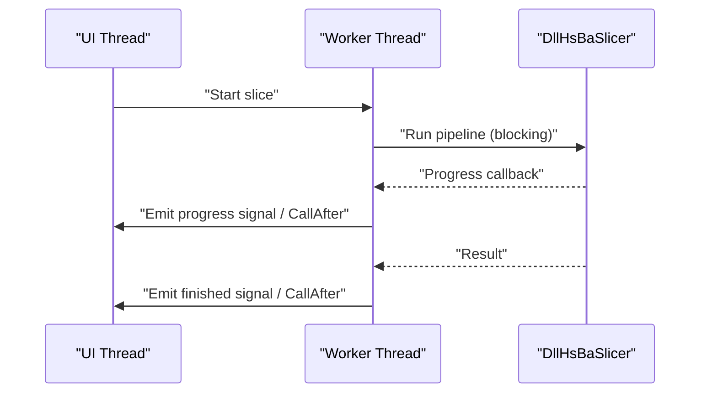
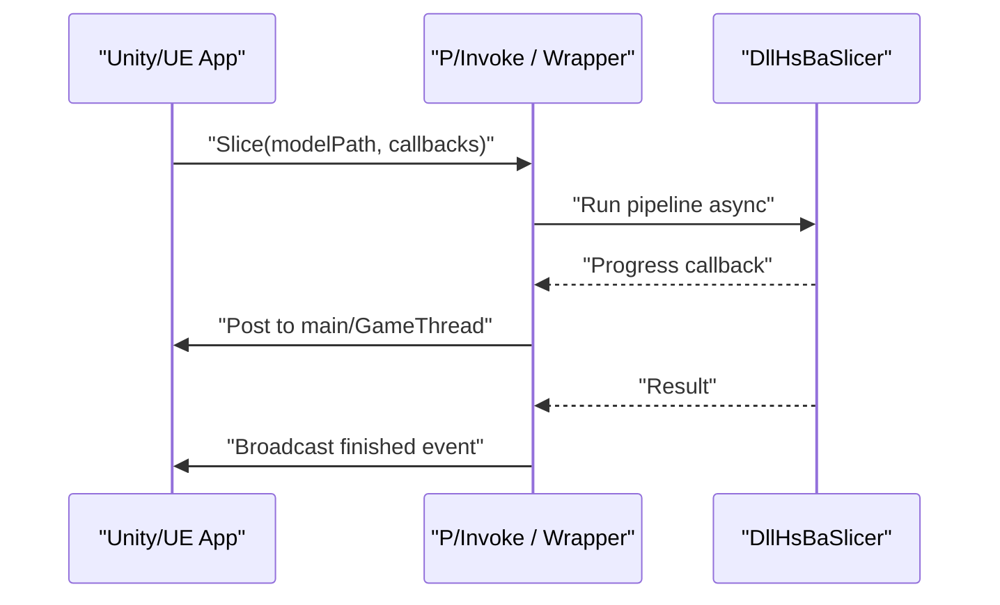
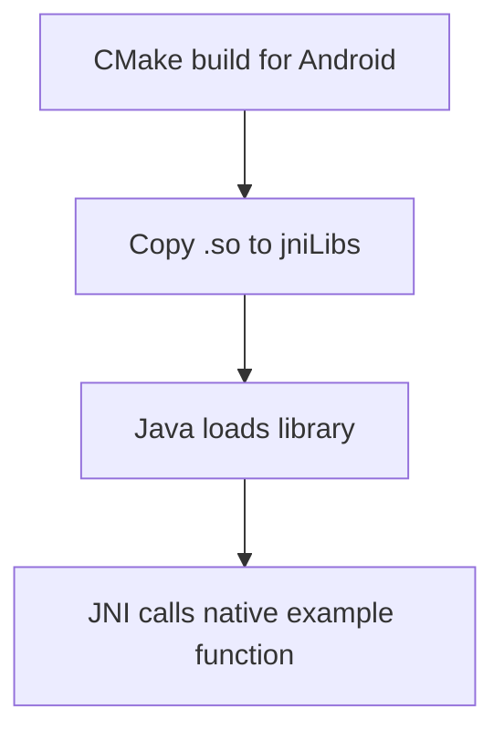
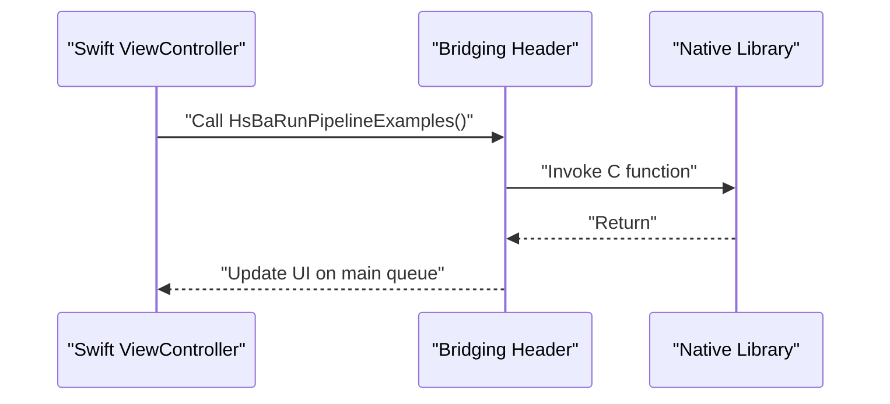
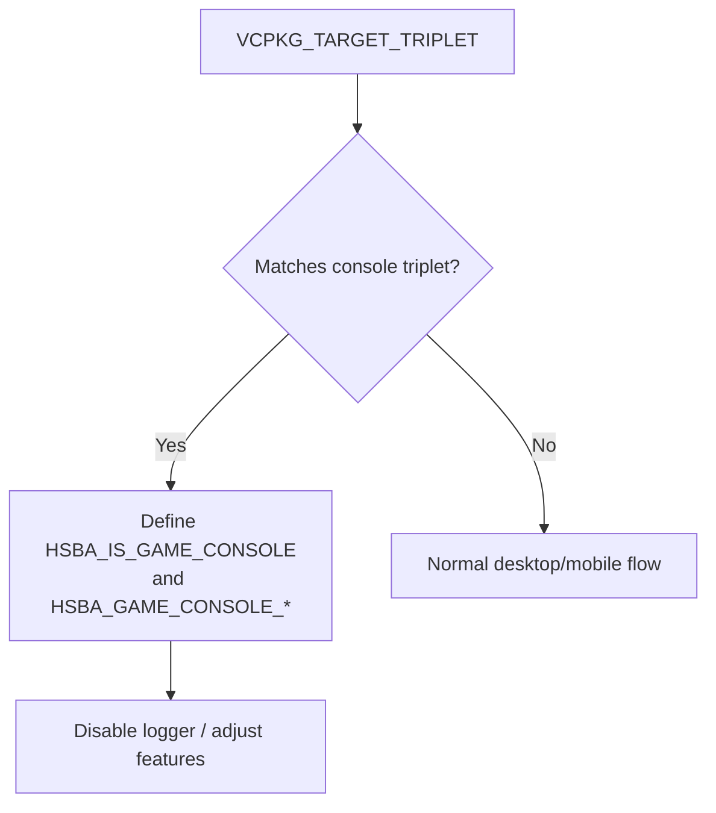
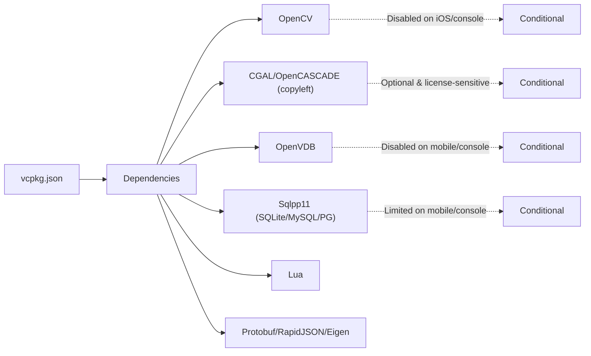

# Platform Integration

<cite>
**Referenced Files in This Document**
- [README.md](file://README.md)
- [CMakeLists.txt](file://CMakeLists.txt)
- [CMakePresets.json](file://CMakePresets.json)
- [vcpkg.json](file://vcpkg.json)
- [android/README.md](file://android/README.md)
- [android/app/src/main/java/com/hsmbanlance/hsbaslicer/example/MainActivity.java](file://android/app/src/main/java/com/hsmbanlance/hsbaslicer/example/MainActivity.java)
- [ios/HsBaSlicerExample/HsBaSlicerBridge.h](file://ios/HsBaSlicerExample/HsBaSlicerBridge.h)
- [ios/HsBaSlicerExample/ViewController.swift](file://ios/HsBaSlicerExample/ViewController.swift)
- [DllHsBaSlicer/dllexport.h](file://DllHsBaSlicer/dllexport.h)
- [LibHsBaSlicer/export.h](file://LibHsBaSlicer/export.h)
- [docs/en/DllHsBaSlicer/game_engine_integration.md](file://docs/en/DllHsBaSlicer/game_engine_integration.md)
- [docs/en/DllHsBaSlicer/qt_wxwidgets_integration.md](file://docs/en/DllHsBaSlicer/qt_wxwidgets_integration.md)
</cite>

## Table of Contents
1. [Introduction](#introduction)
2. [Project Structure](#project-structure)
3. [Core Components](#core-components)
4. [Architecture Overview](#architecture-overview)
5. [Detailed Component Analysis](#detailed-component-analysis)
6. [Dependency Analysis](#dependency-analysis)
7. [Performance Considerations](#performance-considerations)
8. [Troubleshooting Guide](#troubleshooting-guide)
9. [Conclusion](#conclusion)

## Introduction
This document provides platform-specific integration guidance for HsBaSlicer across desktop, mobile, console, and third-party software ecosystems. It explains how to build, link, deploy, and troubleshoot the C ABI shared library (`DllHsBaSlicer`) and the C++ static/shared library (`LibHsBaSlicer`) on Windows, Linux, macOS, Android, iOS, and game consoles, and how to integrate with Qt, wxWidgets, Unity, Unreal Engine, and language bindings via Protobuf-generated sources.

## Project Structure
HsBaSlicer is a modular C++ framework with:
- A C ABI shared library for external integrations (`DllHsBaSlicer`).
- A C++ API static/shared library for internal or downstream C++ applications (`LibHsBaSlicer`).
- Desktop, mobile, and console build configuration through CMake and vcpkg.
- Example Android app skeleton and iOS bridging header for Swift/Objective-C.

**Diagram sources**
- [CMakeLists.txt:129-157](file://CMakeLists.txt#L129-L157)
- [CMakeLists.txt:434-439](file://CMakeLists.txt#L434-L439)
- [README.md:104-124](file://README.md#L104-L124)

**Section sources**
- [README.md:21-39](file://README.md#L21-L39)
- [README.md:104-124](file://README.md#L104-L124)
- [CMakeLists.txt:129-157](file://CMakeLists.txt#L129-L157)

## Core Components
- `DllHsBaSlicer`: Exposes a stable C ABI for pipeline calls from any language/runtime.
- `LibHsBaSlicer`: Provides C++ APIs for slicing workflows.
- Export macros define symbol visibility on Windows and default visibility elsewhere.

Key responsibilities:
- Initialization and lifecycle management.
- Pipeline execution (FDM/SLA/SLS/etc.).
- Result memory management and error reporting.

**Section sources**
- [README.md:104-124](file://README.md#L104-L124)
- [DllHsBaSlicer/dllexport.h:1-23](file://DllHsBaSlicer/dllexport.h#L1-L23)
- [LibHsBaSlicer/export.h:1-22](file://LibHsBaSlicer/export.h#L1-L22)

## Architecture Overview
The integration architecture centers on the C ABI layer for cross-language use and a C++ layer for native consumers.

**Diagram sources**
- [CMakeLists.txt:434-439](file://CMakeLists.txt#L434-L439)
- [README.md:104-124](file://README.md#L104-L124)

## Detailed Component Analysis

### Desktop Platforms: Windows, Linux, macOS
- Build system: CMake with presets for Windows/Linux/macOS; vcpkg for dependencies.
- Shared vs static libraries: Controlled by `BUILD_SHARED_LIBS`, influenced by VCPKG_TARGET_TRIPLET.
- Dynamic loader: Enabled on desktop; disabled on non-desktop platforms.
- Optional kernels: CGAL/OpenCascade are optional and affect licensing and install targets.

Build and deployment notes:
- Use provided CMake presets for quick setup.
- Install artifacts with `cmake --install` and consume via `find_package(HsBaSlicer)`.
- On Windows, ensure the DLL is next to the executable at runtime.

**Diagram sources**
- [CMakeLists.txt:129-157](file://CMakeLists.txt#L129-L157)
- [CMakeLists.txt:228-240](file://CMakeLists.txt#L228-L240)
- [CMakeLists.txt:456-665](file://CMakeLists.txt#L456-L665)

**Section sources**
- [README.md:57-94](file://README.md#L57-L94)
- [CMakeLists.txt:129-157](file://CMakeLists.txt#L129-L157)
- [CMakeLists.txt:228-240](file://CMakeLists.txt#L228-L240)
- [CMakeLists.txt:456-665](file://CMakeLists.txt#L456-L665)

### GUI Framework Integration: Qt and wxWidgets
- Call `initialize()` once before any pipeline call.
- Never run synchronous pipeline APIs on the UI thread.
- Marshal callbacks back to the UI thread before touching widgets.
- Keep UTF-8 strings alive during pipeline execution; free results using the provided free functions after copying.

Patterns:
- Qt: worker thread with signals/slots or QtConcurrent.
- wxWidgets: background thread with `CallAfter` for UI updates.

**Diagram sources**
- [docs/en/DllHsBaSlicer/qt_wxwidgets_integration.md:1-13](file://docs/en/DllHsBaSlicer/qt_wxwidgets_integration.md#L1-L13)
- [docs/en/DllHsBaSlicer/qt_wxwidgets_integration.md:47-106](file://docs/en/DllHsBaSlicer/qt_wxwidgets_integration.md#L47-L106)
- [docs/en/DllHsBaSlicer/qt_wxwidgets_integration.md:187-264](file://docs/en/DllHsBaSlicer/qt_wxwidgets_integration.md#L187-L264)

**Section sources**
- [docs/en/DllHsBaSlicer/qt_wxwidgets_integration.md:1-13](file://docs/en/DllHsBaSlicer/qt_wxwidgets_integration.md#L1-L13)
- [docs/en/DllHsBaSlicer/qt_wxwidgets_integration.md:47-106](file://docs/en/DllHsBaSlicer/qt_wxwidgets_integration.md#L47-L106)
- [docs/en/DllHsBaSlicer/qt_wxwidgets_integration.md:187-264](file://docs/en/DllHsBaSlicer/qt_wxwidgets_integration.md#L187-L264)

### Game Engine Integration: Unity and Unreal Engine
- Unity (C# P/Invoke):
  - Place per-platform binaries under Unity plugin directories.
  - On iOS, link against a static library and use `"__Internal"` in `DllImport`.
  - Keep delegate references alive; marshal callbacks to the Unity main thread.
- Unreal Engine (C++ plugin):
  - Add ThirdParty module referencing prebuilt binaries.
  - Convert strings to UTF-8 before crossing the boundary; marshal events to GameThread.

**Diagram sources**
- [docs/en/DllHsBaSlicer/game_engine_integration.md:7-18](file://docs/en/DllHsBaSlicer/game_engine_integration.md#L7-L18)
- [docs/en/DllHsBaSlicer/game_engine_integration.md:21-123](file://docs/en/DllHsBaSlicer/game_engine_integration.md#L21-L123)
- [docs/en/DllHsBaSlicer/game_engine_integration.md:216-362](file://docs/en/DllHsBaSlicer/game_engine_integration.md#L216-L362)

**Section sources**
- [docs/en/DllHsBaSlicer/game_engine_integration.md:7-18](file://docs/en/DllHsBaSlicer/game_engine_integration.md#L7-L18)
- [docs/en/DllHsBaSlicer/game_engine_integration.md:21-123](file://docs/en/DllHsBaSlicer/game_engine_integration.md#L21-L123)
- [docs/en/DllHsBaSlicer/game_engine_integration.md:216-362](file://docs/en/DllHsBaSlicer/game_engine_integration.md#L216-L362)

### Mobile Platforms: Android and iOS

#### Android JNI Setup
- Build native libraries for Android using CMake with NDK toolchain.
- Copy `.so` files into `android/app/src/main/jniLibs/<abi>/`.
- Load the library via Java (`System.loadLibrary("HsBaSlicer")`) and call the JNI entry point.

**Diagram sources**
- [android/README.md:1-22](file://android/README.md#L1-L22)
- [android/app/src/main/java/com/hsmbanlance/hsbaslicer/example/MainActivity.java:17-27](file://android/app/src/main/java/com/hsmbanlance/hsbaslicer/example/MainActivity.java#L17-L27)

**Section sources**
- [android/README.md:1-22](file://android/README.md#L1-L22)
- [android/app/src/main/java/com/hsmbanlance/hsbaslicer/example/MainActivity.java:17-27](file://android/app/src/main/java/com/hsmbanlance/hsbaslicer/example/MainActivity.java#L17-L27)

#### iOS Swift/Objective-C Bridging
- Use a bridging header to expose a C function to Swift.
- The example shows running pipeline examples off the main thread and updating UI on the main queue.

**Diagram sources**
- [ios/HsBaSlicerExample/HsBaSlicerBridge.h:1-32](file://ios/HsBaSlicerExample/HsBaSlicerBridge.h#L1-L32)
- [ios/HsBaSlicerExample/ViewController.swift:43-55](file://ios/HsBaSlicerExample/ViewController.swift#L43-L55)

**Section sources**
- [ios/HsBaSlicerExample/HsBaSlicerBridge.h:1-32](file://ios/HsBaSlicerExample/HsBaSlicerBridge.h#L1-L32)
- [ios/HsBaSlicerExample/ViewController.swift:43-55](file://ios/HsBaSlicerExample/ViewController.swift#L43-L55)

### Console Platforms: PlayStation, Xbox, Nintendo Switch
- Detection: When `VCPKG_TARGET_TRIPLET` matches console triplets, the build defines console flags and sets `HSBA_GAME_CONSOLE`.
- Feature toggles: Logger is not supported on game consoles; some features may be disabled or replaced.
- Dependency behavior: Certain heavy dependencies (e.g., OpenCV, OpenVDB, SQL backends) are conditionally excluded.

**Diagram sources**
- [CMakeLists.txt:132-147](file://CMakeLists.txt#L132-L147)
- [CMakeLists.txt:415-419](file://CMakeLists.txt#L415-L419)

**Section sources**
- [CMakeLists.txt:132-147](file://CMakeLists.txt#L132-L147)
- [CMakeLists.txt:415-419](file://CMakeLists.txt#L415-L419)

### Third-Party Software Integration Patterns

#### CAD Software Plugins
- Use the C ABI (`DllHsBaSlicer`) to integrate slicing pipelines into CAD tools.
- Ensure proper initialization and result cleanup.
- For advanced geometry operations, consider enabling copyleft kernels where appropriate and licensed.

[No sources needed since this section provides general guidance]

#### Web Application Backends
- Run slicing jobs server-side using the C++ API or C ABI.
- Serialize inputs/outputs via Protobuf or JSON.
- Offload long-running tasks to worker threads/processes.

[No sources needed since this section provides general guidance]

#### Language Bindings: Python, Java, C#
- Protobuf multi-language outputs can be installed alongside the package when enabled.
- C# integrates via P/Invoke to `DllHsBaSlicer`; Java via JNI; Python via generated protobuf bindings or custom wrappers.

**Section sources**
- [README.md:153-163](file://README.md#L153-L163)
- [CMakeLists.txt:609-639](file://CMakeLists.txt#L609-L639)

## Dependency Analysis
Platform-dependent dependency resolution and feature toggles:

**Diagram sources**
- [vcpkg.json:1-62](file://vcpkg.json#L1-L62)
- [CMakeLists.txt:273-336](file://CMakeLists.txt#L273-L336)

**Section sources**
- [vcpkg.json:1-62](file://vcpkg.json#L1-L62)
- [CMakeLists.txt:273-336](file://CMakeLists.txt#L273-L336)

## Performance Considerations
- Avoid blocking the UI thread; always run pipelines asynchronously.
- Reuse configuration objects and avoid excessive allocations.
- Prefer Release builds for production; Debug mode may disable or slow certain operations.
- On mobile and consoles, minimize heavy dependencies and reduce model pool sizes where applicable.

[No sources needed since this section provides general guidance]

## Troubleshooting Guide

### Desktop (Windows/Linux/macOS)
- Missing DLL at runtime (Windows): place the DLL next to the executable or configure post-build copy.
- UI freezes: sync API called on UI thread; move to worker thread.
- Callback crashes: update UI from callbacks without marshalling; marshal via signals/slots or `CallAfter`.
- Non-ASCII paths: pass UTF-8 encoded paths.

**Section sources**
- [docs/en/DllHsBaSlicer/qt_wxwidgets_integration.md:340-349](file://docs/en/DllHsBaSlicer/qt_wxwidgets_integration.md#L340-L349)

### Unity
- `DllNotFoundException`: wrong plugin folder or platform not selected.
- Crash after callback: delegate GC-collected; keep strong reference.
- Struct misalignment: field order/types must match C ABI definitions.

**Section sources**
- [docs/en/DllHsBaSlicer/game_engine_integration.md:453-462](file://docs/en/DllHsBaSlicer/game_engine_integration.md#L453-L462)

### Unreal Engine
- Packaged build cannot find DLL: missing `RuntimeDependencies`; check Binaries directory.
- String encoding issues: convert TCHAR to UTF-8 before calling C API.
- Threading violations: broadcast delegates on GameThread.

**Section sources**
- [docs/en/DllHsBaSlicer/game_engine_integration.md:357-362](file://docs/en/DllHsBaSlicer/game_engine_integration.md#L357-L362)

### Android
- Native library not found: ensure `.so` is copied to `jniLibs/<abi>/`.
- Loading library: verify `System.loadLibrary("HsBaSlicer")` is present.

**Section sources**
- [android/README.md:1-22](file://android/README.md#L1-L22)
- [android/app/src/main/java/com/hsmbanlance/hsbaslicer/example/MainActivity.java:17-27](file://android/app/src/main/java/com/hsmbanlance/hsbaslicer/example/MainActivity.java#L17-L27)

### iOS
- Link failure: iOS requires static library and `DllImport("__Internal")` in Unity; ensure correct linkage in your project.

**Section sources**
- [docs/en/DllHsBaSlicer/game_engine_integration.md:453-462](file://docs/en/DllHsBaSlicer/game_engine_integration.md#L453-L462)

### Console Builds
- Logger unavailable: expected on game consoles; use alternative logging or disable logs.
- Features disabled: confirm conditional compilation flags for console targets.

**Section sources**
- [CMakeLists.txt:415-419](file://CMakeLists.txt#L415-L419)

## Conclusion
HsBaSlicer provides a robust, cross-platform slicing core with clear integration points:
- Use `DllHsBaSlicer` for cross-language and engine integration.
- Use `LibHsBaSlicer` for native C++ applications.
- Follow platform-specific build and deployment instructions for desktop, mobile, and console targets.
- Apply the provided patterns for GUI frameworks and game engines to ensure safe threading, correct string handling, and reliable resource management.

[No sources needed since this section summarizes without analyzing specific files]