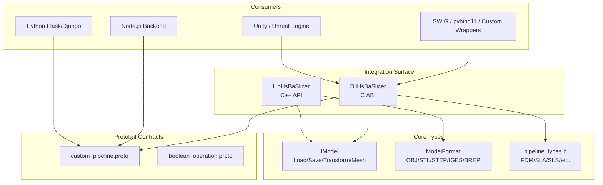
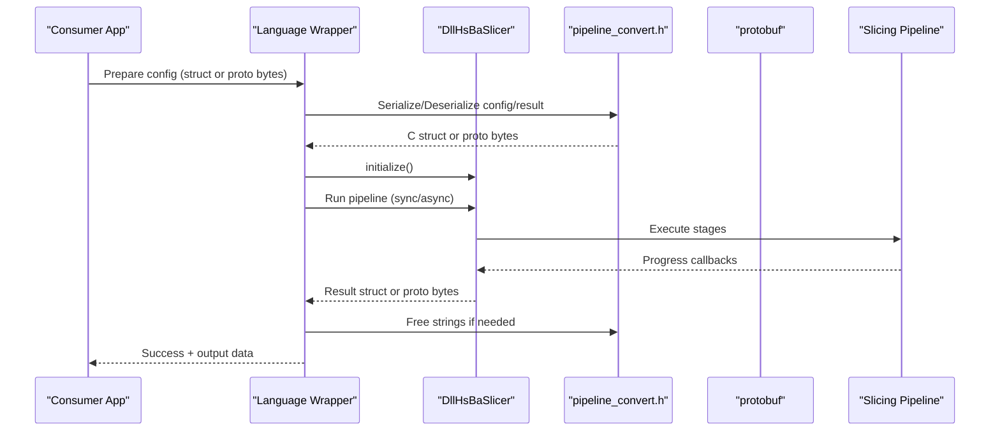
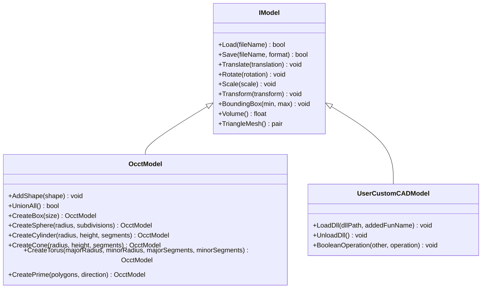
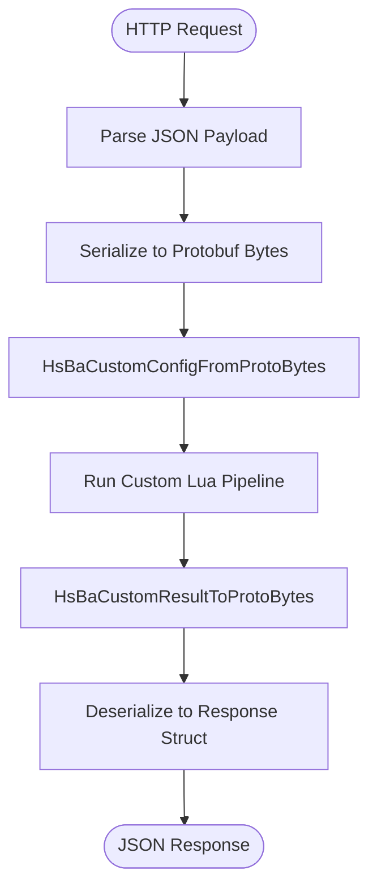
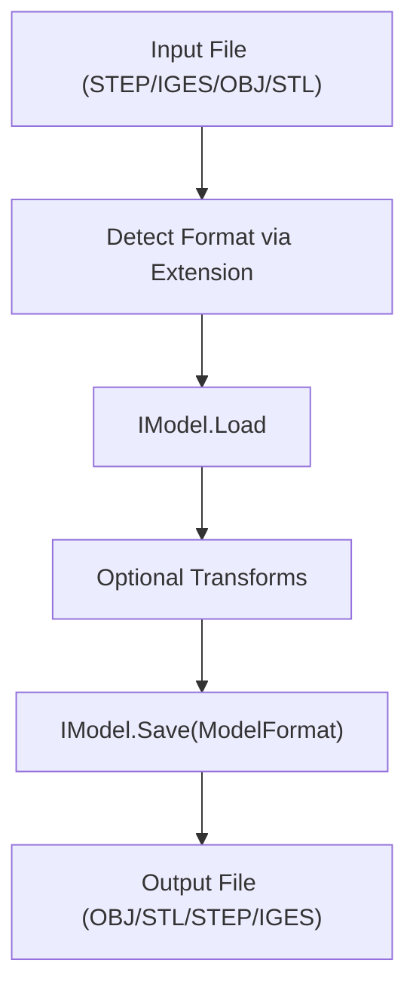
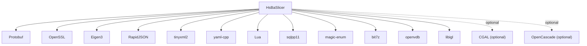

# Third-Party Software Integration

<cite>
**Referenced Files in This Document**
- [README.md](file://README.md)
- [initialize.h](file://DllHsBaSlicer/initialize.h)
- [dllexport.h](file://DllHsBaSlicer/dllexport.h)
- [export.h](file://LibHsBaSlicer/export.h)
- [IModel.hpp](file://base/IModel.hpp)
- [ModelFormat.hpp](file://base/ModelFormat.hpp)
- [OcctModel.hpp](file://cadmodel/OcctModel.hpp)
- [UserCustomCADModel.hpp](file://cadmodel/UserCustomCADModel.hpp)
- [pipeline_types.h](file://pipelinetypes/pipeline_types.h)
- [pipeline_convert.h](file://DllHsBaSlicer/pipeline_convert.h)
- [custom_pipeline.proto](file://proto/custom_pipeline.proto)
- [boolean_operation.proto](file://proto/boolean_operation.proto)
- [game_engine_integration.md](file://docs/en/DllHsBaSlicer/game_engine_integration.md)
- [vcpkg.json](file://vcpkg.json)
- [CMakeLists.txt](file://CMakeLists.txt)
- [error.hpp](file://base/error.hpp)
</cite>

## Table of Contents
1. [Introduction](#introduction)
2. [Project Structure](#project-structure)
3. [Core Components](#core-components)
4. [Architecture Overview](#architecture-overview)
5. [Detailed Component Analysis](#detailed-component-analysis)
6. [Dependency Analysis](#dependency-analysis)
7. [Performance Considerations](#performance-considerations)
8. [Troubleshooting Guide](#troubleshooting-guide)
9. [Conclusion](#conclusion)

## Introduction
This document explains how to integrate HsBaSlicer with third-party software and languages. It focuses on:
- CAD plugin development patterns for SolidWorks, Fusion 360, and Blender using the provided C ABI and model interfaces.
- Web application backend integration via Node.js and Python (Flask/Django) using Protobuf-based RPC or HTTP endpoints.
- Language bindings for Python, Java, C#, and JavaScript through SWIG/pybind11 or custom wrappers around the C ABI.
- Data format conversion between HsBaSlicer formats and external formats including STEP, IGES, OBJ, and STL.
- Practical examples for creating plugins, implementing converters, and establishing communication protocols.
- Security considerations, error handling patterns, and performance optimization for cross-language scenarios.

## Project Structure
HsBaSlicer exposes two primary integration surfaces:
- A C ABI shared library (DllHsBaSlicer) for cross-language calls.
- A C++ static/shared library (LibHsBaSlicer) for embedding slicing pipelines directly in C++.

The installation layout includes headers, generated protobuf files for multiple languages, and CMake config targets. The repository also provides Unity/Unreal integration documentation as a reference for P/Invoke and async callback patterns.

**Diagram sources**
- [README.md:100-179](file://README.md#L100-L179)
- [initialize.h:1-22](file://DllHsBaSlicer/initialize.h#L1-L22)
- [dllexport.h:1-23](file://DllHsBaSlicer/dllexport.h#L1-L23)
- [export.h:1-22](file://LibHsBaSlicer/export.h#L1-L22)
- [IModel.hpp:1-151](file://base/IModel.hpp#L1-L151)
- [ModelFormat.hpp:1-116](file://base/ModelFormat.hpp#L1-L116)
- [pipeline_types.h:1-800](file://pipelinetypes/pipeline_types.h#L1-L800)
- [custom_pipeline.proto:1-31](file://proto/custom_pipeline.proto#L1-L31)
- [boolean_operation.proto:1-12](file://proto/boolean_operation.proto#L1-L12)

**Section sources**
- [README.md:100-179](file://README.md#L100-L179)

## Core Components
- DllHsBaSlicer C ABI:
  - Entry point initialization function for one-time setup and registration.
  - Export macros for platform-specific symbol visibility.
- LibHsBaSlicer C++ API:
  - Export macro for C++ symbols.
  - Full slicing pipeline encapsulation.
- IModel interface:
  - Defines Load/Save, transformations, bounding box, volume, and triangle mesh extraction.
  - Declares C-compatible vector/matrix types used across boundaries.
- ModelFormat enumeration:
  - Enumerates supported formats: OBJ, STL (ASCII/Binary), PLY variants, VRML, STEP, IGES, BREP, SLDPRT, CATPART, XYZ, VDB.
- Pipeline types:
  - C-compatible structs for FDM, SLA, SLS, SLM, LOM, 3DP, WAAM, file transfer, and custom Lua-driven pipelines.
- Protobuf contracts:
  - custom_pipeline.proto defines configuration and result messages for fully Lua-driven pipelines.
  - boolean_operation.proto defines operation enums for CSG operations.

**Section sources**
- [initialize.h:1-22](file://DllHsBaSlicer/initialize.h#L1-L22)
- [dllexport.h:1-23](file://DllHsBaSlicer/dllexport.h#L1-L23)
- [export.h:1-22](file://LibHsBaSlicer/export.h#L1-L22)
- [IModel.hpp:1-151](file://base/IModel.hpp#L1-L151)
- [ModelFormat.hpp:1-116](file://base/ModelFormat.hpp#L1-L116)
- [pipeline_types.h:1-800](file://pipelinetypes/pipeline_types.h#L1-L800)
- [custom_pipeline.proto:1-31](file://proto/custom_pipeline.proto#L1-L31)
- [boolean_operation.proto:1-12](file://proto/boolean_operation.proto#L1-L12)

## Architecture Overview
The integration architecture centers on a stable C ABI boundary that isolates C++ internals from external consumers. Consumers can call into the DLL synchronously or asynchronously, receive progress callbacks, and free results via provided helpers. For cross-process or multi-language RPC, Protobuf wire formats are used.

**Diagram sources**
- [initialize.h:1-22](file://DllHsBaSlicer/initialize.h#L1-L22)
- [pipeline_convert.h:1-397](file://DllHsBaSlicer/pipeline_convert.h#L1-L397)
- [custom_pipeline.proto:1-31](file://proto/custom_pipeline.proto#L1-L31)

## Detailed Component Analysis

### CAD Plugin Development Patterns (SolidWorks, Fusion 360, Blender)
HsBaSlicer provides an extensible CAD abstraction via IModel and OcctModel, plus a mechanism to load user-supplied CAD libraries dynamically.

- IModel:
  - Standardizes Load/Save, transforms, bounding box, volume, and triangulation.
  - Exposes C-compatible vector/matrix types for cross-boundary usage.
- OcctModel:
  - Implements IModel using OpenCascade.
  - Supports loading/saving STEP, IGES, VRML, BRep; provides primitives and boolean operations.
- UserCustomCADModel:
  - Loads an external DLL/SO at runtime and delegates model creation, boolean operations, thickness, and extrusion factories.
  - Uses C ABI-friendly structures (e.g., HsBaPoly2D_t, HsBaVector3f_t).

**Diagram sources**
- [IModel.hpp:1-151](file://base/IModel.hpp#L1-L151)
- [OcctModel.hpp:1-132](file://cadmodel/OcctModel.hpp#L1-L132)
- [UserCustomCADModel.hpp:1-126](file://cadmodel/UserCustomCADModel.hpp#L1-L126)

Practical guidance for CAD integrations:
- SolidWorks/Fusion 360:
  - Use their native APIs to export models to STEP/IGES, then use HsBaSlicer’s IModel.Load/Save to convert to internal representations or other formats like OBJ/STL.
  - Alternatively, implement IUserCustomCAD in a custom DLL exposing factory functions for primitives and boolean operations, then load it via UserCustomCADModel.
- Blender:
  - Export meshes to OBJ/STL and import via IModel; or write a small bridge that uses the C ABI to run slicing pipelines and return G-code or layer images.

**Section sources**
- [IModel.hpp:1-151](file://base/IModel.hpp#L1-L151)
- [OcctModel.hpp:1-132](file://cadmodel/OcctModel.hpp#L1-L132)
- [UserCustomCADModel.hpp:1-126](file://cadmodel/UserCustomCADModel.hpp#L1-L126)

### Web Application Backend Integration (Node.js, Python Flask/Django)
For web backends, prefer Protobuf-based RPC or HTTP endpoints that serialize requests/responses using the provided schema.

- Use custom_pipeline.proto to define request/response payloads.
- On the server side, deserialize proto bytes to C structs via pipeline_convert.h, execute the pipeline, and serialize results back to proto bytes.
- Expose REST endpoints that accept JSON and translate to/from proto bytes.

**Diagram sources**
- [custom_pipeline.proto:1-31](file://proto/custom_pipeline.proto#L1-L31)
- [pipeline_convert.h:196-234](file://DllHsBaSlicer/pipeline_convert.h#L196-L234)

Example patterns:
- Node.js:
  - Use a Protobuf library to encode/decode custom_pipe_config and custom_pipe_result.
  - Call into the DLL via ffi-napi or similar, passing serialized bytes and receiving results.
- Python (Flask/Django):
  - Use google.protobuf to generate Python classes from custom_pipeline.proto.
  - Wrap DLL calls in a service layer; expose REST endpoints that handle serialization and error mapping.

**Section sources**
- [custom_pipeline.proto:1-31](file://proto/custom_pipeline.proto#L1-L31)
- [pipeline_convert.h:196-234](file://DllHsBaSlicer/pipeline_convert.h#L196-L234)

### Language Binding Creation (Python, Java, C#, JavaScript)
HsBaSlicer provides a stable C ABI suitable for binding generation:

- C# (Unity/Unreal):
  - Follow the documented P/Invoke pattern with sequential struct layouts and cdecl calling conventions.
  - Keep delegate references alive to avoid GC crashes during native callbacks.
- Python:
  - Use pybind11 to wrap C++ APIs where possible, or SWIG to bind the C ABI.
  - For Protobuf workflows, leverage google.protobuf generated modules.
- Java:
  - Use JNI or SWIG to map C structs to Java objects; ensure field order and types match pipeline_types.h.
- JavaScript:
  - Use Node-API or Emscripten to compile the C ABI into WASM for browser environments.

Reference implementation:
- Unity/Unreal integration guide demonstrates correct struct marshalling, async callbacks, and memory management.

**Section sources**
- [game_engine_integration.md:1-462](file://docs/en/DllHsBaSlicer/game_engine_integration.md#L1-L462)
- [pipeline_types.h:1-800](file://pipelinetypes/pipeline_types.h#L1-L800)

### Data Format Conversion (STEP, IGES, OBJ, STL)
HsBaSlicer supports multiple model formats via IModel and ModelFormat:

- Supported formats include OBJ, STL (ASCII/Binary), PLY variants, VRML, STEP, IGES, BREP, SLDPRT, CATPART, XYZ, VDB.
- OcctModel implements reading/writing for STEP, IGES, VRML, BRep.
- Utility functions determine format by extension and classify formats (mesh, BRep, CSG, point cloud).

Conversion workflow:
- Import CAD files (STEP/IGES) into HsBaSlicer via IModel.Load.
- Export to mesh formats (OBJ/STL) using IModel.Save with appropriate ModelFormat.
- For custom CAD libraries, implement IUserCustomCAD to extend supported formats.

**Diagram sources**
- [IModel.hpp:1-151](file://base/IModel.hpp#L1-L151)
- [ModelFormat.hpp:1-116](file://base/ModelFormat.hpp#L1-L116)
- [OcctModel.hpp:1-132](file://cadmodel/OcctModel.hpp#L1-L132)

**Section sources**
- [IModel.hpp:1-151](file://base/IModel.hpp#L1-L151)
- [ModelFormat.hpp:1-116](file://base/ModelFormat.hpp#L1-L116)
- [OcctModel.hpp:1-132](file://cadmodel/OcctModel.hpp#L1-L132)

## Dependency Analysis
Key dependencies and build options relevant to integration:

- Protobuf is required for message serialization.
- OpenSSL is included for security-related features.
- libigl is used as the mesh kernel; CGAL may be enabled optionally for advanced boolean operations.
- vcpkg manages third-party packages; copyleft feature toggles GPL/LGPL components.

**Diagram sources**
- [vcpkg.json:56-112](file://vcpkg.json#L56-L112)
- [CMakeLists.txt:264-299](file://CMakeLists.txt#L264-L299)

**Section sources**
- [vcpkg.json:56-112](file://vcpkg.json#L56-L112)
- [CMakeLists.txt:264-299](file://CMakeLists.txt#L264-L299)

## Performance Considerations
- Prefer async pipeline execution to avoid blocking UI threads in game engines or web servers.
- Reuse connection pools for file transfer and remote services.
- Minimize data copying across language boundaries by using zero-copy buffers where possible and ensuring consistent memory ownership.
- Avoid heavy boolean operations in debug builds; they are disabled by default due to performance and memory concerns.

[No sources needed since this section provides general guidance]

## Troubleshooting Guide
Common issues and resolutions:

- Callback crashes in Unity/Unreal:
  - Ensure delegates passed to native code are kept alive (static/member fields).
  - Marshal callbacks to main thread before touching engine objects.
- Struct misalignment:
  - Verify P/Invoke struct field order and types match pipeline_types.h exactly.
- Missing DLLs:
  - Ensure platform-specific artifacts are placed correctly and packaged with the app.
- iOS linking failures:
  - Use static library and "__Internal" for DllImport on iOS.

Error handling patterns:
- Use the provided error classes (RuntimeError, OutOfRangeError, InvalidArgumentError, etc.) in C++ code.
- Map native errors to HTTP status codes and structured error messages in web backends.

**Section sources**
- [game_engine_integration.md:453-462](file://docs/en/DllHsBaSlicer/game_engine_integration.md#L453-L462)
- [error.hpp:1-147](file://base/error.hpp#L1-L147)

## Conclusion
HsBaSlicer offers robust integration points for CAD plugins, web backends, and multi-language bindings. By leveraging the C ABI, Protobuf contracts, and well-defined model interfaces, developers can create reliable, high-performance integrations across platforms. Adhering to the recommended patterns for memory management, threading, and error handling ensures stability and scalability in production environments.

[No sources needed since this section summarizes without analyzing specific files]