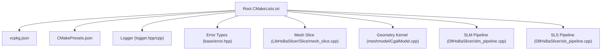
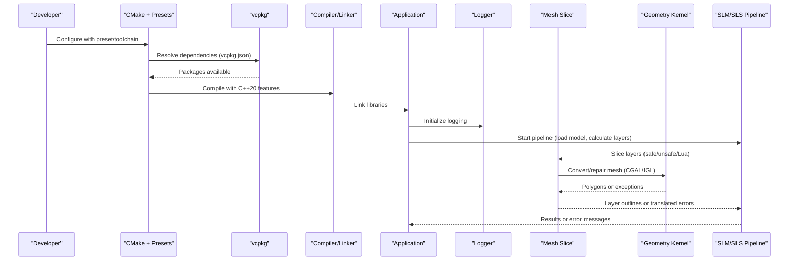
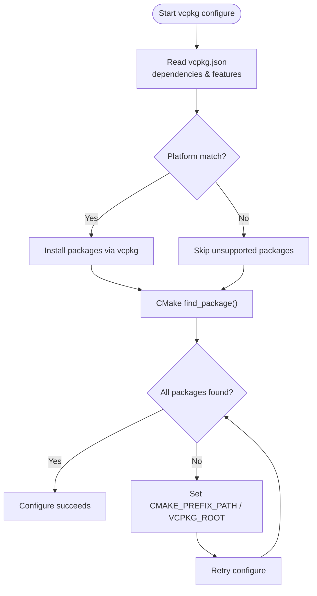
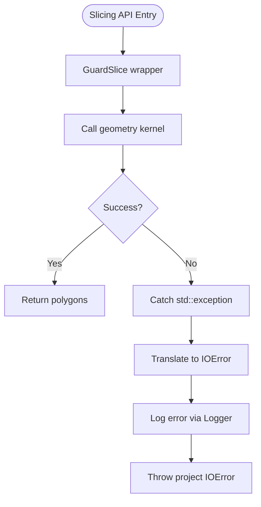
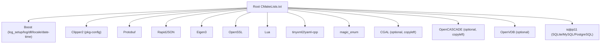

# Build and Runtime Issues

<cite>
**Referenced Files in This Document**
- [README.md](file://README.md)
- [CMakeLists.txt](file://CMakeLists.txt)
- [vcpkg.json](file://vcpkg.json)
- [vcpkg-configuration.json](file://vcpkg-configuration.json)
- [CMakePresets.json](file://CMakePresets.json)
- [logger.hpp](file://logger/logger.hpp)
- [logger.cpp](file://logger/logger.cpp)
- [error.hpp](file://base/error.hpp)
- [mesh_slice.cpp](file://LibHsBaSlicer/Slice/mesh_slice.cpp)
- [CgalModel.cpp](file://meshmodel/CgalModel.cpp)
- [slm_pipeline.cpp](file://DllHsBaSlicer/slm_pipeline.cpp)
- [sls_pipeline.cpp](file://DllHsBaSlicer/sls_pipeline.cpp)
</cite>

## Table of Contents
1. [Introduction](#introduction)
2. [Project Structure](#project-structure)
3. [Core Components](#core-components)
4. [Architecture Overview](#architecture-overview)
5. [Detailed Component Analysis](#detailed-component-analysis)
6. [Dependency Analysis](#dependency-analysis)
7. [Performance Considerations](#performance-considerations)
8. [Troubleshooting Guide](#troubleshooting-guide)
9. [Conclusion](#conclusion)

## Introduction
This document provides a comprehensive guide to diagnosing and resolving common build and runtime issues in HsBaSlicer. It focuses on:
- Dependency resolution with vcpkg (missing packages, version conflicts, platform-specific dependencies)
- Compiler compatibility across MSVC, GCC, and Clang
- CMake configuration, toolchain setup, and cross-compilation pitfalls
- Runtime error diagnosis, memory leak detection, geometric algorithm failures, and slicing engine crashes
- Step-by-step debugging for mesh processing, path generation, and support structure creation
- Logging strategies using the built-in logger system, error code interpretation, and stack trace analysis
- Integration errors when linking with external applications

## Project Structure
HsBaSlicer is a modular, cross-platform C++ framework for 3D-printing slicers. The repository includes core libraries, pipeline implementations, logging, geometry kernels, and platform-specific configurations. Key areas relevant to build/runtime issues include:
- Top-level CMake configuration and presets
- vcpkg manifest and configuration
- Logger subsystem
- Error types and exception translation at API boundaries
- Geometry kernel integration (CGAL/IGL/OpenCASCADE)
- Pipeline entry points for SLM/SLS workflows

**Diagram sources**
- [CMakeLists.txt:1-695](file://CMakeLists.txt#L1-L695)
- [vcpkg.json:1-113](file://vcpkg.json#L1-L113)
- [CMakePresets.json:1-236](file://CMakePresets.json#L1-L236)
- [logger.hpp:76-195](file://logger/logger.hpp#L76-L195)
- [logger.cpp:1-213](file://logger/logger.cpp#L1-L213)
- [error.hpp:1-147](file://base/error.hpp#L1-L147)
- [mesh_slice.cpp:1-80](file://LibHsBaSlicer/Slice/mesh_slice.cpp#L1-L80)
- [CgalModel.cpp:45-123](file://meshmodel/CgalModel.cpp#L45-L123)
- [slm_pipeline.cpp:254-284](file://DllHsBaSlicer/slm_pipeline.cpp#L254-L284)
- [sls_pipeline.cpp:201-231](file://DllHsBaSlicer/sls_pipeline.cpp#L201-L231)

**Section sources**
- [README.md:21-39](file://README.md#L21-L39)
- [README.md:41-98](file://README.md#L41-L98)

## Core Components
- CMake and Presets: Centralize compiler requirements, feature checks, dependency discovery, and platform toggles.
- vcpkg Manifest and Configuration: Define dependencies, features (copyleft), registries, overlays, and triplets.
- Logger: Cross-platform singleton with Boost.Log on desktop, Android log, and iOS os_log.
- Error Types: Custom exceptions derived from std::runtime_error for consistent error handling.
- Mesh Slicing: Safe/unsafe slice APIs that translate foreign exceptions into project error types.
- Geometry Kernel: CGAL-based mesh conversion and repair logic.
- Pipelines: SLM/SLS pipelines orchestrate model loading, layer calculation, and parallel slicing.

**Section sources**
- [CMakeLists.txt:17-104](file://CMakeLists.txt#L17-L104)
- [vcpkg.json:1-113](file://vcpkg.json#L1-L113)
- [logger.hpp:76-195](file://logger/logger.hpp#L76-L195)
- [error.hpp:1-147](file://base/error.hpp#L1-L147)
- [mesh_slice.cpp:1-80](file://LibHsBaSlicer/Slice/mesh_slice.cpp#L1-L80)
- [CgalModel.cpp:45-123](file://meshmodel/CgalModel.cpp#L45-L123)
- [slm_pipeline.cpp:254-284](file://DllHsBaSlicer/slm_pipeline.cpp#L254-L284)
- [sls_pipeline.cpp:201-231](file://DllHsBaSlicer/sls_pipeline.cpp#L201-L231)

## Architecture Overview
The build and runtime architecture integrates CMake-driven configuration, vcpkg-managed dependencies, and layered components:
- Configure-time: Feature checks, copyleft kernel detection, dependency discovery, and platform flags.
- Build-time: Static/shared library assembly, optional modules (e.g., C++20 modules), and install/export targets.
- Runtime: Logger initialization, slicing pipelines, geometry kernels, and error translation at API boundaries.

**Diagram sources**
- [CMakeLists.txt:17-104](file://CMakeLists.txt#L17-L104)
- [vcpkg.json:1-113](file://vcpkg.json#L1-L113)
- [CMakePresets.json:1-236](file://CMakePresets.json#L1-L236)
- [logger.hpp:76-195](file://logger/logger.hpp#L76-L195)
- [mesh_slice.cpp:1-80](file://LibHsBaSlicer/Slice/mesh_slice.cpp#L1-L80)
- [CgalModel.cpp:45-123](file://meshmodel/CgalModel.cpp#L45-L123)
- [slm_pipeline.cpp:254-284](file://DllHsBaSlicer/slm_pipeline.cpp#L254-L284)
- [sls_pipeline.cpp:201-231](file://DllHsBaSlicer/sls_pipeline.cpp#L201-L231)

## Detailed Component Analysis

### Dependency Resolution with vcpkg
Common issues:
- Missing packages: Ensure all required packages are listed in vcpkg.json and installed via vcpkg.
- Version conflicts: Use vcpkg-configuration.json to pin baseline and registries; consider overlay ports/triplets for custom builds.
- Platform-specific dependencies: Some packages are conditionally included based on platform (Windows/Linux/macOS/Android/iOS).

Key references:
- Dependencies and features are declared in vcpkg.json, including copyleft feature enabling CGAL, libigl, and OpenCASCADE.
- vcpkg-configuration.json defines registry baseline and overlay locations.
- CMake uses find_package for many dependencies and sets compile definitions accordingly.

**Diagram sources**
- [vcpkg.json:1-113](file://vcpkg.json#L1-L113)
- [vcpkg-configuration.json:1-21](file://vcpkg-configuration.json#L1-L21)
- [CMakeLists.txt:206-349](file://CMakeLists.txt#L206-L349)

**Section sources**
- [vcpkg.json:1-113](file://vcpkg.json#L1-L113)
- [vcpkg-configuration.json:1-21](file://vcpkg-configuration.json#L1-L21)
- [CMakeLists.txt:206-349](file://CMakeLists.txt#L206-L349)

### Compiler Compatibility Problems (MSVC, GCC, Clang)
Requirements and checks:
- C++20 standard is enforced; several C++20 features are checked at configure time (concepts, ranges, source_location, NTTP class, template-template matching).
- C standard selection depends on compiler version and ID (GNU/Clang/MSVC).
- Windows UTF-8 encoding is forced for MSVC.

Typical errors and solutions:
- Missing concepts/ranges/source_location: Upgrade compiler or adjust toolchain.
- Template-template parameter mismatch: Ensure compiler supports P0522R0.
- C standard fallback warnings: Update compiler to meet C23 thresholds where applicable.

**Section sources**
- [CMakeLists.txt:17-38](file://CMakeLists.txt#L17-L38)
- [CMakeLists.txt:48-86](file://CMakeLists.txt#L48-L86)
- [CMakeLists.txt:11-15](file://CMakeLists.txt#L11-L15)

### CMake Configuration Errors and Toolchain Setup
Common issues:
- Incorrect toolchain file path for vcpkg.
- Missing environment variables (VCPKG_ROOT, ANDROID_NDK_HOME).
- Cross-compilation misconfiguration (triplet, chainload toolchain).

Presets provide validated configurations for Windows, Linux, macOS, Android, and iOS. Ensure:
- VCPKG_ROOT is set and accessible.
- For Android, VCPKG_CHAINLOAD_TOOLCHAIN_FILE points to NDK’s cmake toolchain.
- For iOS, Xcode generator and sysroot/deployment target are correct.

**Section sources**
- [CMakePresets.json:1-236](file://CMakePresets.json#L1-L236)
- [CMakeLists.txt:131-157](file://CMakeLists.txt#L131-L157)

### Runtime Error Diagnosis Techniques
- Exception translation: Slicing APIs wrap geometry kernel calls and translate foreign exceptions into project error types (IOError).
- Error hierarchy: Custom exceptions (RuntimeError, IOError, OutOfMemoryError, etc.) provide clear categorization.
- Logging: Use the built-in logger to capture debug/info/warning/error messages with timestamps and severity levels.

**Diagram sources**
- [mesh_slice.cpp:1-80](file://LibHsBaSlicer/Slice/mesh_slice.cpp#L1-L80)
- [logger.hpp:76-195](file://logger/logger.hpp#L76-L195)
- [error.hpp:1-147](file://base/error.hpp#L1-L147)

**Section sources**
- [mesh_slice.cpp:1-80](file://LibHsBaSlicer/Slice/mesh_slice.cpp#L1-L80)
- [error.hpp:1-147](file://base/error.hpp#L1-L147)
- [logger.hpp:76-195](file://logger/logger.hpp#L76-L195)

### Memory Leak Detection
- Tests may disable CRT memory leak checks when third-party libraries use custom memory management (e.g., OpenVDB).
- Use AddressSanitizer via CMake options or sanitizers guidance to detect leaks and invalid accesses during development.

Recommendations:
- Enable sanitizers in Debug builds for early detection.
- Isolate third-party components and suppress false positives where documented.

**Section sources**
- [tests\Models\openvdb_model_test.cpp:1-42](file://tests/Models/openvdb_model_test.cpp#L1-L42)

### Geometric Algorithm Failures
- CGAL conversion and repair paths handle invalid meshes by attempting orientation fixes and polygon soup reconstruction.
- Failures result in RuntimeError with descriptive messages.

Debugging steps:
- Validate input mesh integrity before slicing.
- Inspect CGAL operations and repair outcomes.
- Reduce tolerance or simplify mesh if necessary.

**Section sources**
- [CgalModel.cpp:45-123](file://meshmodel/CgalModel.cpp#L45-L123)

### Slicing Engine Crashes
- SLM/SLS pipelines compute layer counts and perform parallel slicing; invalid model height leads to early failure with error messages.
- Parallel slicing relies on shared topology; ensure thread safety and sufficient resources.

Mitigation:
- Validate model bounding box and layer count before slicing.
- Monitor progress reports and logs for stage transitions.
- Limit parallelism if memory pressure occurs.

**Section sources**
- [slm_pipeline.cpp:254-284](file://DllHsBaSlicer/slm_pipeline.cpp#L254-L284)
- [sls_pipeline.cpp:201-231](file://DllHsBaSlicer/sls_pipeline.cpp#L201-L231)

### Logging Strategies Using the Built-in Logger System
- Logger supports file and console output on desktop platforms, Android kernel log, and iOS os_log.
- Configure log level, datetime format, and rotation size.
- Use fluent literals for debug/info/warning/error messages.

Best practices:
- Set appropriate log levels per environment (Debug vs Release).
- Rotate logs to avoid large files.
- Capture source location for precise diagnostics.

**Section sources**
- [logger.hpp:76-195](file://logger/logger.hpp#L76-L195)
- [logger.cpp:1-213](file://logger/logger.cpp#L1-L213)

### Error Code Interpretation and Stack Trace Analysis
- Custom exceptions provide categorized error types; catch specific types to handle distinct failure modes.
- Use stack traces from your debugger (gdb/lldb/Visual Studio) combined with logger output to pinpoint failures.
- In slicing APIs, foreign exceptions are translated to IOError; inspect underlying std::exception.what() for details.

**Section sources**
- [error.hpp:1-147](file://base/error.hpp#L1-L147)
- [mesh_slice.cpp:1-80](file://LibHsBaSlicer/Slice/mesh_slice.cpp#L1-L80)

### Common Integration Errors When Linking with External Applications
- Ensure downstream projects use find_package(HsBaSlicer CONFIG REQUIRED) and link against exported targets (e.g., HsBaSlicer::DllHsBaSlicer).
- Verify install prefix and CMake config files are present after installation.
- On non-desktop platforms, dynamic loader may be disabled; adjust expectations accordingly.

**Section sources**
- [README.md:100-124](file://README.md#L100-L124)
- [README.md:174-179](file://README.md#L174-L179)
- [CMakeLists.txt:456-665](file://CMakeLists.txt#L456-L665)

## Dependency Analysis
The top-level CMake orchestrates dependency discovery and feature toggles. Key relationships:
- Boost (log_setup/log/dll/locale/date-time) used across modules.
- Clipper2 via pkg-config.
- Protobuf, RapidJSON, Eigen3, OpenSSL, Lua, tinyxml2, yaml-cpp, magic_enum.
- Optional kernels: CGAL/OpenCASCADE (copyleft), OpenVDB, sqlpp11 (SQLite/MySQL/PostgreSQL).

**Diagram sources**
- [CMakeLists.txt:206-349](file://CMakeLists.txt#L206-L349)

**Section sources**
- [CMakeLists.txt:206-349](file://CMakeLists.txt#L206-L349)

## Performance Considerations
- Boolean operations may be slow and consume high memory in Debug builds; they are disabled in Debug configuration.
- Model pool size is adjusted based on availability of copyleft kernels to accommodate multiple models during boolean operations.
- Parallel slicing improves throughput but requires adequate memory and thread safety.

Recommendations:
- Use Release builds for performance-sensitive workloads.
- Tune parallelism and layer batch sizes based on available resources.
- Monitor memory usage and consider simplifying meshes if needed.

**Section sources**
- [CMakeLists.txt:294-306](file://CMakeLists.txt#L294-L306)

## Troubleshooting Guide
Step-by-step procedures:
1. Validate environment:
   - Ensure CMake >= 3.28, C++20-capable compiler, vcpkg bootstrapped, PowerShell available.
   - Confirm VCPKG_ROOT and ANDROID_NDK_HOME are set for cross-compilation.
2. Configure with presets:
   - Use CMakePresets.json for validated configurations per platform.
   - Verify toolchain file paths and triplet settings.
3. Resolve dependencies:
   - Check vcpkg.json for missing or platform-specific packages.
   - Use vcpkg-configuration.json to pin baselines and registries.
4. Build and test:
   - Run tests post-build; disable execution during cross-compilation.
   - Enable coverage on Linux for CI gating if needed.
5. Diagnose runtime issues:
   - Enable detailed logging; rotate logs and set appropriate levels.
   - Catch and interpret custom exceptions; inspect stack traces.
6. Integrate externally:
   - Use find_package and link against exported targets.
   - Verify install layout and header locations.

Common symptoms and resolutions:
- “Could not find package”: Install dev packages or set CMAKE_PREFIX_PATH/VCPKG_ROOT.
- “No C++ compiler”: Install g++/clang++/MSVC toolchain and update PATH.
- “Dynamic library loader disabled”: Adjust expectations on non-desktop platforms.
- “Invalid model height”: Validate model bounding box and layer parameters.
- “Slicing failed”: Inspect geometry kernel exceptions and mesh validity.

**Section sources**
- [README.md:41-98](file://README.md#L41-L98)
- [CMakePresets.json:1-236](file://CMakePresets.json#L1-L236)
- [vcpkg.json:1-113](file://vcpkg.json#L1-L113)
- [logger.hpp:76-195](file://logger/logger.hpp#L76-L195)
- [error.hpp:1-147](file://base/error.hpp#L1-L147)
- [slm_pipeline.cpp:254-284](file://DllHsBaSlicer/slm_pipeline.cpp#L254-L284)
- [sls_pipeline.cpp:201-231](file://DllHsBaSlicer/sls_pipeline.cpp#L201-L231)

## Conclusion
HsBaSlicer’s build and runtime systems rely on robust CMake configuration, vcpkg-managed dependencies, and well-defined error handling. By following the troubleshooting procedures, leveraging the built-in logger, and understanding the geometry kernel interactions, developers can effectively diagnose and resolve common issues across platforms and compilers. Proper integration practices ensure smooth linkage with external applications while maintaining performance and reliability.