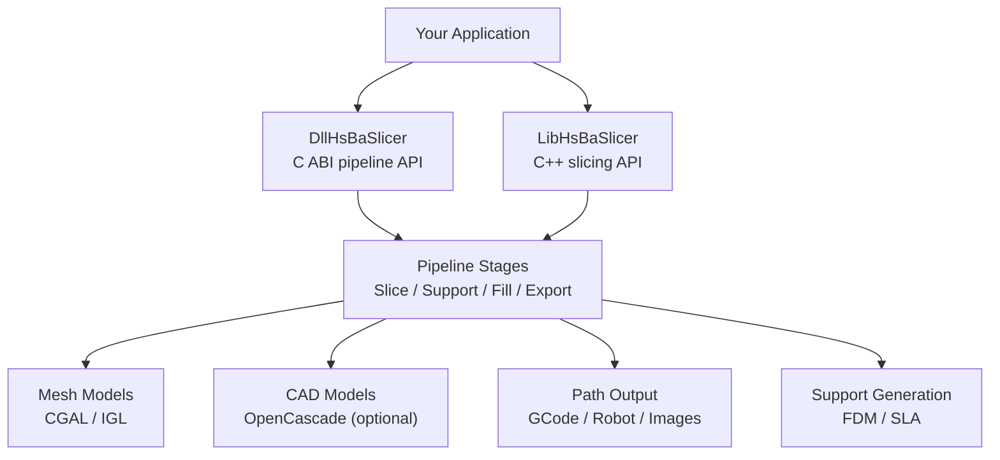
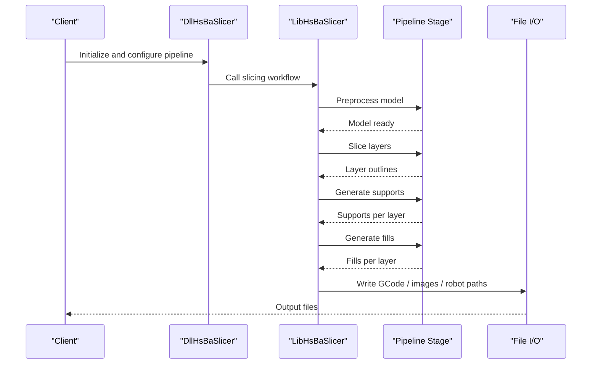
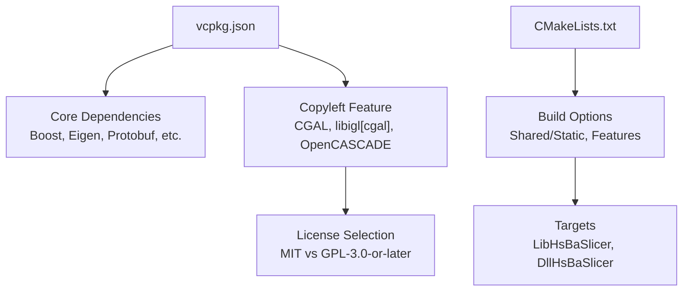

# Frequently Asked Questions

<cite>
**Referenced Files in This Document**
- [LICENSE.txt](file://LICENSE.txt)
- [README.md](file://README.md)
- [CMakeLists.txt](file://CMakeLists.txt)
- [vcpkg.json](file://vcpkg.json)
- [version.hpp](file://version/version.hpp)
- [version.cpp.in](file://version/version.cpp.in)
- [base_config.proto](file://proto/base_config.proto)
- [slm_pipeline.proto](file://proto/slm_pipeline.proto)
- [ModelFormat.hpp](file://base/ModelFormat.hpp)
- [ModelFormat.cpp](file://base/ModelFormat.cpp)
- [IglModel.cpp](file://meshmodel/IglModel.cpp)
- [CgalModel.cpp](file://meshmodel/CgalModel.cpp)
- [OcctModel.cpp](file://cadmodel/OcctModel.cpp)
- [fdm_support.hpp](file://LibHsBaSlicer/Support/fdm_support.hpp)
- [fdm_support.cpp](file://LibHsBaSlicer/Support/fdm_support.cpp)
- [gcodepath.hpp](file://paths/gcodepath.hpp)
- [gcodepath.cpp](file://paths/gcodepath.cpp)
- [pipeline_parallel.hpp](file://DllHsBaSlicer/pipeline_parallel.hpp)
- [thread_pool.hpp](file://base/thread_pool.hpp)
- [lua_pipeline_api.md](file://docs/en/lua_pipeline_api.md)
- [qt_wxwidgets_integration.md](file://docs/en/DllHsBaSlicer/qt_wxwidgets_integration.md)
- [game_engine_integration.md](file://docs/en/DllHsBaSlicer/game_engine_integration.md)
- [test-coverage.yml](file://.github/workflows/test-coverage.yml)
</cite>

## Table of Contents
1. [Introduction](#introduction)
2. [Project Structure](#project-structure)
3. [Core Components](#core-components)
4. [Architecture Overview](#architecture-overview)
5. [Detailed Component Analysis](#detailed-component-analysis)
6. [Dependency Analysis](#dependency-analysis)
7. [Performance Considerations](#performance-considerations)
8. [Troubleshooting Guide](#troubleshooting-guide)
9. [Conclusion](#conclusion)
10. [Appendices](#appendices)

## Introduction
This FAQ answers common questions about HsBaSlicer, a high-performance C++ framework for 3D-printing slicers. It covers licensing and commercial use, supported printing technologies and file formats, platform compatibility, migration and versioning, customization through Lua scripting, deployment strategies, performance expectations, and community support channels.

## Project Structure
HsBaSlicer is organized into modular libraries:
- Core slicing APIs are exposed via `LibHsBaSlicer`.
- A C ABI runtime pipeline API is exported by `DllHsBaSlicer`.
- Geometry, CAD, path generation, support, preprocessing, and utilities live in dedicated modules such as `meshmodel`, `cadmodel`, `paths`, `support`, `preprocess`, `base`, and `utils`.
- Samples demonstrate FDM, SLA, SLS, SLM, LOM, TDP, WAAM, and fully Lua-defined pipelines.

**Diagram sources**
- [README.md:29-38](file://README.md#L29-L38)
- [CMakeLists.txt:410-439](file://CMakeLists.txt#L410-L439)

**Section sources**
- [README.md:29-38](file://README.md#L29-L38)
- [CMakeLists.txt:410-439](file://CMakeLists.txt#L410-L439)

## Core Components
- Licensing: Conditional dual license based on whether copyleft kernels are linked.
- Printing technologies: FDM/FFF, SLA, SLS, SLM, LOM, TDP, WAAM.
- File formats: STL, PLY, OBJ, OFF, STEP, IGES, VRML, BREP, XYZ.
- Platforms: Windows, Linux, macOS, Android, iOS; game consoles via vcpkg triplets.
- Customization: Lua scripting for supports, fills, optimization, and export hooks.
- Deployment: Static or shared libraries, installable CMake package, multi-language protobuf exports.

**Section sources**
- [LICENSE.txt:1-23](file://LICENSE.txt#L1-L23)
- [base_config.proto:5-15](file://proto/base_config.proto#L5-L15)
- [ModelFormat.hpp:42-56](file://base/ModelFormat.hpp#L42-L56)
- [CMakeLists.txt:149-157](file://CMakeLists.txt#L149-L157)
- [lua_pipeline_api.md:1-18](file://docs/en/lua_pipeline_api.md#L1-L18)
- [README.md:100-124](file://README.md#L100-L124)

## Architecture Overview
The system exposes two primary integration points:
- `DllHsBaSlicer`: C ABI for external languages (Java, C#, Python, etc.).
- `LibHsBaSlicer`: C++ API for full slicing workflows.

Both drive the same pipeline stages: preprocess, slice, support, fill, path generation, and export.

**Diagram sources**
- [README.md:100-124](file://README.md#L100-L124)
- [fdm_support.cpp:14-31](file://LibHsBaSlicer/Support/fdm_support.cpp#L14-L31)
- [gcodepath.cpp:47-56](file://paths/gcodepath.cpp#L47-L56)

## Detailed Component Analysis

### Licensing and Commercial Use
- The project uses a conditional dual license:
  - MIT when no GPL/LGPL components are linked.
  - GPL-3.0-or-later when CGAL or OpenCascade are linked.
- The effective license is determined at configure time from vcpkg configuration and can be queried at runtime via version info.
- Redistribution rights follow the applicable license:
  - MIT allows broad redistribution and commercial use with attribution.
  - GPL-3.0-or-later requires source availability and compliance with copyleft terms.

Common questions:
- Can I use HsBaSlicer commercially? Yes, under either MIT or GPL-3.0-or-later depending on your build.
- Can I redistribute binaries? Yes, subject to the license governing your specific build.
- How do I know which license applies? Query runtime version info or inspect the build configuration.

**Section sources**
- [LICENSE.txt:1-23](file://LICENSE.txt#L1-L23)
- [README.md:196-210](file://README.md#L196-L210)
- [version.hpp:29-43](file://version/version.hpp#L29-L43)
- [version.cpp.in:13-18](file://version/version.cpp.in#L13-L18)

### Supported 3D Printing Technologies
HsBaSlicer includes built-in pipelines and samples for:
- FDM/FFF
- SLA
- SLS
- SLM
- LOM
- TDP
- WAAM

These are represented in protocol definitions and sample projects.

**Section sources**
- [base_config.proto:5-15](file://proto/base_config.proto#L5-L15)
- [slm_pipeline.proto:5-15](file://proto/slm_pipeline.proto#L5-L15)
- [README.md:443-454](file://CMakeLists.txt#L443-L454)

### File Format Support
Input/output formats include:
- Mesh formats: STL (binary/ASCII), PLY (binary/ASCII), OBJ, OFF, XYZ
- CAD/BRep formats: STEP, IGES, VRML, BREP

Supported by mesh and CAD backends:
- IGL handles mesh formats.
- CGAL provides additional mesh operations and writes.
- OpenCascade enables CAD/BRep read/write.

**Section sources**
- [ModelFormat.hpp:42-56](file://base/ModelFormat.hpp#L42-L56)
- [ModelFormat.cpp:62-117](file://base/ModelFormat.cpp#L62-L117)
- [IglModel.cpp:87-98](file://meshmodel/IglModel.cpp#L87-L98)
- [CgalModel.cpp:133-156](file://meshmodel/CgalModel.cpp#L133-L156)
- [OcctModel.cpp:239-270](file://cadmodel/OcctModel.cpp#L239-L270)

### Platform Compatibility Matrix
- Desktop platforms: Windows, Linux, macOS — all library targets installed.
- Mobile platforms: Android, iOS — some features disabled (e.g., CAD model not installed).
- Game consoles: Detected via vcpkg triplets; certain features disabled.

Key dependencies vary by platform:
- CGAL/OpenCascade available on desktop and Android (CGAL only).
- OpenCV excluded on iOS and game consoles.
- Bit7z disabled on non-desktop platforms.

**Section sources**
- [README.md:187-191](file://README.md#L187-L191)
- [CMakeLists.txt:149-157](file://CMakeLists.txt#L149-L157)
- [CMakeLists.txt:277-280](file://CMakeLists.txt#L277-L280)
- [CMakeLists.txt:248-256](file://CMakeLists.txt#L248-L256)
- [vcpkg.json:90-110](file://vcpkg.json#L90-L110)

### Migration Between Versions
- Version information is generated at configure time and includes product name, license, version string, build type, platform, configure timestamp, and vcpkg triplet.
- Runtime queries expose this metadata via `GetVersionInfo()` and JSON accessors.
- CMake package config uses `SameMajorVersion` compatibility, indicating major-version stability expectations.

Upgrade guidance:
- Check runtime version info to confirm build characteristics.
- Review breaking changes in major versions; minor updates should preserve API where possible.
- Rebuild against the target version’s headers and libraries.

**Section sources**
- [version.hpp:29-43](file://version/version.hpp#L29-L43)
- [version.cpp.in:13-18](file://version/version.cpp.in#L13-L18)
- [CMakeLists.txt:655-659](file://CMakeLists.txt#L655-L659)

### Customization Capabilities and Lua Scripting
Customization options:
- Inline Lua scripts for support generation, infill, and path optimization.
- External Lua script files referenced by pipeline configurations.
- Registration of custom Lua functions from native code per pipeline stage.

Limitations and extension points:
- Two Lua environments exist: one for custom-pipeline operations and another for shared libraries.
- Built-in pipeline stage hooks allow injecting functionality at specific phases.
- Function registration is scoped to stages (slice, support, fill, output).

Best practices:
- Prefer writing custom Lua functions in native C/C++ plugins for performance and safety.
- Keep registration function pointers valid for the process lifetime.

**Section sources**
- [fdm_support.hpp:52-67](file://LibHsBaSlicer/Support/fdm_support.hpp#L52-L67)
- [lua_pipeline_api.md:1-18](file://docs/en/lua_pipeline_api.md#L1-L18)
- [qt_wxwidgets_integration.md:293-339](file://docs/en/DllHsBaSlicer/qt_wxwidgets_integration.md#L293-L339)
- [game_engine_integration.md:375-411](file://docs/en/DllHsBaSlicer/game_engine_integration.md#L375-L411)

### Deployment Strategies
- Static vs dynamic linking:
  - `BUILD_SHARED_LIBS` controls shared/static builds.
  - Default behavior depends on vcpkg triplet (Windows often dynamic; Linux/Android often static).
- Dependency management:
  - Managed via vcpkg; optional features like `copyleft` toggle CGAL/OpenCascade.
  - Optional dynamic loader disabled on non-desktop platforms.
- Distribution:
  - Installable CMake package with targets and headers.
  - Multi-language protobuf exports available if enabled.

Distribution recommendations:
- For mobile/console, disable copyleft and heavy dependencies to reduce size and complexity.
- Bundle required runtime DLLs on Windows when using shared libraries.
- Use install prefix and CMake config files for downstream consumers.

**Section sources**
- [CMakeLists.txt:367-390](file://CMakeLists.txt#L367-L390)
- [CMakeLists.txt:228-240](file://CMakeLists.txt#L228-L240)
- [README.md:100-124](file://README.md#L100-L124)
- [vcpkg.json:90-110](file://vcpkg.json#L90-L110)

### Performance Expectations and Scalability
- Parallel processing:
  - Pipeline parallelism across layers with configurable worker count.
  - Environment variable `HSBA_PIPELINE_THREADS` overrides thread count for testing and tuning.
- Threading primitives:
  - ThreadPool manages concurrent task execution with coroutine executor support.
- Memory efficiency:
  - Memory pools and object pools reduce allocation overhead.
- Hardware requirements:
  - CPU-bound tasks benefit from multiple cores; adjust thread counts accordingly.
  - Large models may require significant RAM, especially with boolean operations.

Scalability considerations:
- Avoid submitting too many short tasks to the thread pool.
- Tune block sizes and worker counts based on workload characteristics.
- Disable expensive features (e.g., boolean operations) in Debug builds.

**Section sources**
- [pipeline_parallel.hpp:41-117](file://DllHsBaSlicer/pipeline_parallel.hpp#L41-L117)
- [thread_pool.hpp:29-37](file://base/thread_pool.hpp#L29-L37)
- [CMakeLists.txt:294-298](file://CMakeLists.txt#L294-L298)

### Community Support and Contribution Guidelines
- Community support:
  - Issues and pull requests are welcome.
  - CI includes coverage reporting and test automation.
- Contribution guidelines:
  - Refer to top-level CMakeLists and proto CMakeLists for dependency and build options.
  - Follow coding standards and static checks included in the repository.

Commercial support:
- Not explicitly defined in the repository; contact maintainers via issue tracker or project channels for enterprise inquiries.

**Section sources**
- [README.md:192-194](file://README.md#L192-L194)
- [test-coverage.yml:120-135](file://.github/workflows/test-coverage.yml#L120-L135)

### Common Misconceptions
- “HsBaSlicer is only for FDM.” False: it supports multiple technologies including SLA, SLS, SLM, LOM, TDP, and WAAM.
- “Lua scripting replaces all C++ logic.” False: Lua extends specific stages; core algorithms remain in C++.
- “All platforms support every feature.” False: CAD/BRep and some dependencies are disabled on mobile/console.
- “MIT license always applies.” False: linking copyleft kernels switches the build to GPL-3.0-or-later.

[No sources needed since this section summarizes without analyzing specific files]

## Dependency Analysis
HsBaSlicer’s dependency graph is driven by vcpkg and CMake options:
- Core dependencies: Boost, Clipper2, miniz, Protobuf, RapidJSON, Eigen3, OpenSSL, tinyxml2, yaml-cpp, Lua, magic_enum.
- Optional copyleft kernels: CGAL, libigl[cgal], OpenCascade.
- Platform-specific exclusions: OpenCV on iOS/game consoles; bit7z off non-desktop; SQL backends reduced on mobile.

**Diagram sources**
- [vcpkg.json:90-110](file://vcpkg.json#L90-L110)
- [CMakeLists.txt:170-204](file://CMakeLists.txt#L170-L204)
- [CMakeLists.txt:367-390](file://CMakeLists.txt#L367-L390)

**Section sources**
- [vcpkg.json:1-113](file://vcpkg.json#L1-L113)
- [CMakeLists.txt:206-352](file://CMakeLists.txt#L206-L352)

## Performance Considerations
- Use Release builds for optimal performance; Debug disables boolean operations due to cost.
- Tune `HSBA_PIPELINE_THREADS` to match hardware concurrency and workload.
- Prefer memory pools for frequent allocations; avoid excessive small tasks in thread pools.
- On mobile/console, disable heavy features to reduce memory footprint and improve responsiveness.

[No sources needed since this section provides general guidance]

## Troubleshooting Guide
- Build failures on Android/iOS:
  - Some dependencies are intentionally excluded; ensure correct vcpkg triplet and features.
- Missing dynamic loader:
  - Dynamic loader is disabled on non-desktop platforms; verify HSBA_USE_DLL_LOADER settings.
- Coverage and tests:
  - CI runs tests and generates coverage reports; local builds can enable coverage via CMake option.

**Section sources**
- [CMakeLists.txt:228-240](file://CMakeLists.txt#L228-L240)
- [test-coverage.yml:120-135](file://.github/workflows/test-coverage.yml#L120-L135)

## Conclusion
HsBaSlicer provides a flexible, high-performance slicing framework with strong extensibility through Lua scripting and robust cross-platform support. Licensing adapts to your build configuration, enabling both open-source and commercial use cases. By understanding its architecture, dependencies, and customization points, you can integrate it effectively into research and production pipelines.

[No sources needed since this section summarizes without analyzing specific files]

## Appendices

### Appendix A: Licensing Quick Reference
- MIT: No copyleft kernels linked; permissive redistribution and commercial use.
- GPL-3.0-or-later: Copyleft kernels linked; source distribution obligations apply.

**Section sources**
- [LICENSE.txt:1-23](file://LICENSE.txt#L1-L23)
- [README.md:196-210](file://README.md#L196-L210)

### Appendix B: Platform-Supported Features Summary
- Desktop: Full feature set including CAD/BRep and OpenCV.
- Android: CGAL available; some Boost components excluded.
- iOS: Limited features; OpenCV and CAD disabled.
- Game Consoles: Minimal feature set; logging and heavy dependencies disabled.

**Section sources**
- [README.md:187-191](file://README.md#L187-L191)
- [CMakeLists.txt:277-280](file://CMakeLists.txt#L277-L280)
- [CMakeLists.txt:248-256](file://CMakeLists.txt#L248-L256)