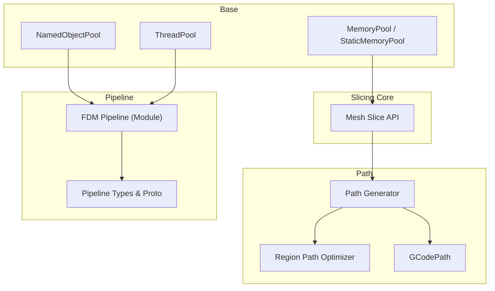
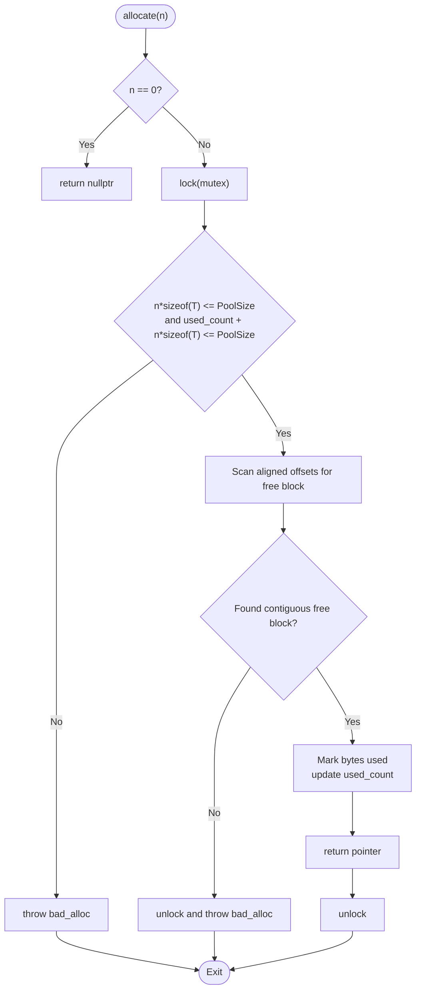
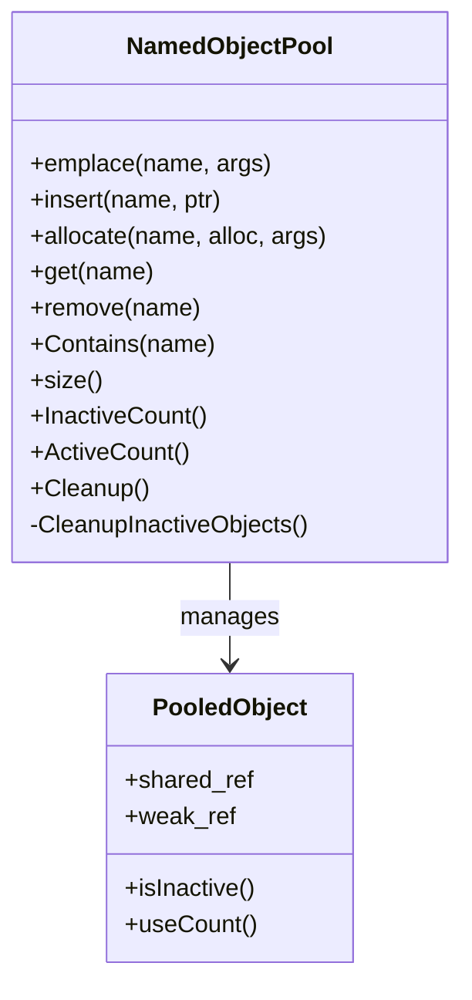
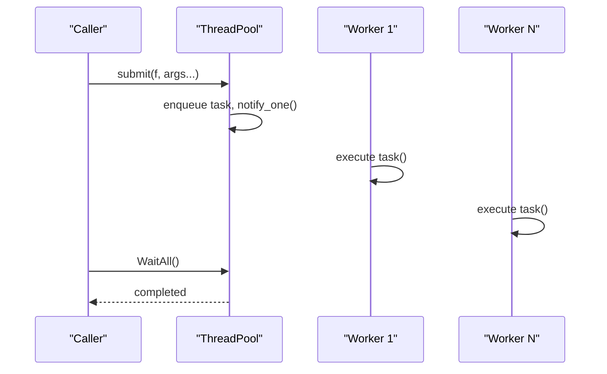
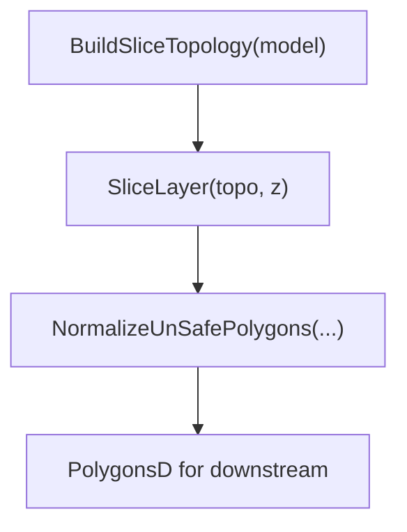
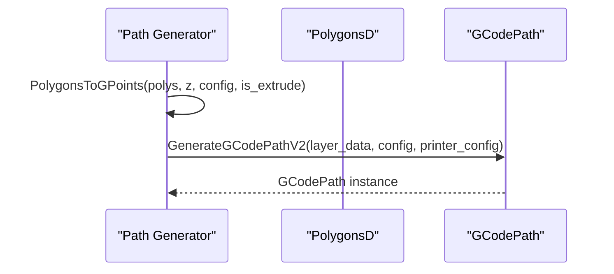
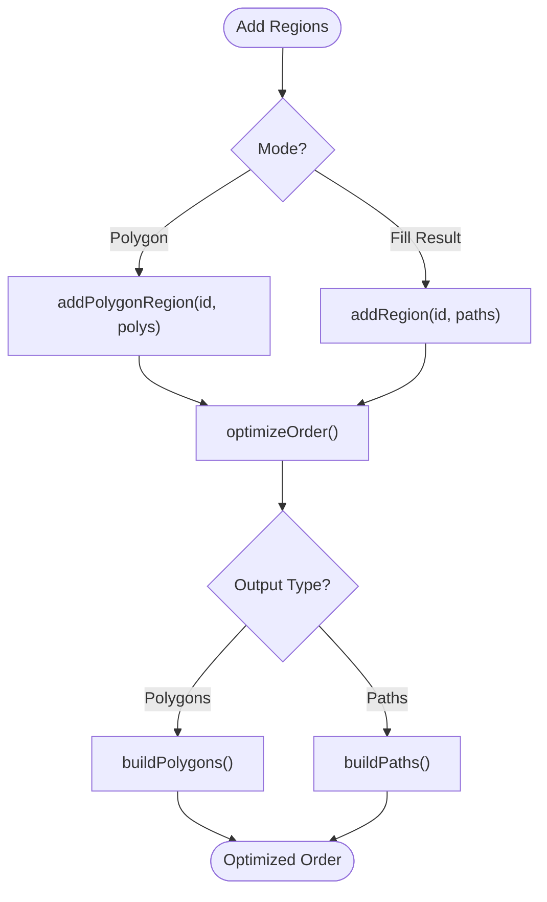
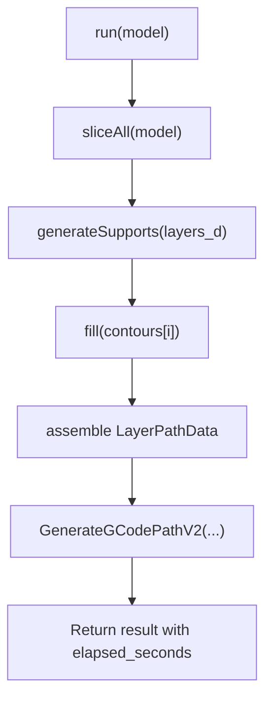
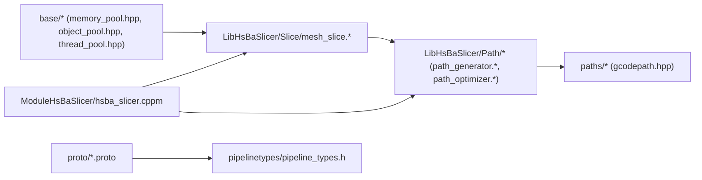

# Performance Tuning and Optimization

<cite>
**Referenced Files in This Document**
- [README.md](file://README.md)
- [memory_pool.hpp](file://base/memory_pool.hpp)
- [object_pool.hpp](file://base/object_pool.hpp)
- [thread_pool.hpp](file://base/thread_pool.hpp)
- [mesh_slice.hpp](file://LibHsBaSlicer/Slice/mesh_slice.hpp)
- [mesh_slice.cpp](file://LibHsBaSlicer/Slice/mesh_slice.cpp)
- [path_generator.hpp](file://LibHsBaSlicer/Path/path_generator.hpp)
- [path_generator.cpp](file://LibHsBaSlicer/Path/path_generator.cpp)
- [path_optimizer.hpp](file://LibHsBaSlicer/Path/path_optimizer.hpp)
- [path_optimizer.cpp](file://LibHsBaSlicer/Path/path_optimizer.cpp)
- [gcodepath.hpp](file://paths/gcodepath.hpp)
- [pipeline_types.h](file://pipelinetypes/pipeline_types.h)
- [lom_pipeline.proto](file://proto/lom_pipeline.proto)
- [hsba_slicer.cppm](file://ModuleHsBaSlicer/hsba_slicer.cppm)
</cite>

## Table of Contents
1. [Introduction](#introduction)
2. [Project Structure](#project-structure)
3. [Core Components](#core-components)
4. [Architecture Overview](#architecture-overview)
5. [Detailed Component Analysis](#detailed-component-analysis)
6. [Dependency Analysis](#dependency-analysis)
7. [Performance Considerations](#performance-considerations)
8. [Troubleshooting Guide](#troubleshooting-guide)
9. [Conclusion](#conclusion)
10. [Appendices](#appendices)

## Introduction
This document provides a comprehensive performance tuning and optimization guide for HsBaSlicer, focusing on bottleneck identification, memory optimization, parallel processing, geometry processing, slicing algorithm efficiency, path generation performance, CPU utilization, cache-friendly data structures, memory bandwidth optimization, benchmarking methodologies, regression testing, and production KPI monitoring. It maps these topics to concrete components in the codebase: memory pools, object pools, thread pool, mesh slicing, path generation, and path optimization.

## Project Structure
HsBaSlicer is a modular, cross-platform C++ framework for 3D-printing slicers with clearly separated layers: base utilities (memory pools, thread pool), core slicing APIs, path generation and optimization, and pipeline orchestration. The project’s README outlines library targets and module responsibilities that are relevant to performance tuning.



**Diagram sources**
- [memory_pool.hpp:1-375](file://base/memory_pool.hpp#L1-L375)
- [object_pool.hpp:1-286](file://base/object_pool.hpp#L1-L286)
- [thread_pool.hpp:1-214](file://base/thread_pool.hpp#L1-L214)
- [mesh_slice.hpp:1-108](file://LibHsBaSlicer/Slice/mesh_slice.hpp#L1-L108)
- [path_generator.hpp:1-96](file://LibHsBaSlicer/Path/path_generator.hpp#L1-L96)
- [path_optimizer.hpp:39-69](file://LibHsBaSlicer/Path/path_optimizer.hpp#L39-L69)
- [gcodepath.hpp:42-73](file://paths/gcodepath.hpp#L42-L73)
- [hsba_slicer.cppm:695-734](file://ModuleHsBaSlicer/hsba_slicer.cppm#L695-L734)
- [pipeline_types.h:425-451](file://pipelinetypes/pipeline_types.h#L425-L451)
- [lom_pipeline.proto:1-45](file://proto/lom_pipeline.proto#L1-L45)

**Section sources**
- [README.md:21-39](file://README.md#L21-L39)

## Core Components
This section highlights the core performance-critical components and their roles:

- Memory Pool and Static Memory Pool: Fixed-size allocators to reduce heap churn and improve locality.
- Named Object Pool: Shared-object lifecycle management with lazy cleanup to avoid frequent reclamation overhead.
- Thread Pool: Worker-thread execution with futures and optional coroutine executor integration.
- Mesh Slicing API: Safe/unsafe slicing and reusable topology construction to amortize expensive geometry operations across layers.
- Path Generation: Converts polygons to G-code points and supports spiralized walls.
- Region Path Optimizer: Pre-output region ordering via AreaGraph and genetic TSP to minimize travel moves.
- Pipeline Orchestration: FDM pipeline assembling slice, support, fill, and path generation; includes elapsed time reporting.

**Section sources**
- [memory_pool.hpp:1-375](file://base/memory_pool.hpp#L1-L375)
- [object_pool.hpp:1-286](file://base/object_pool.hpp#L1-L286)
- [thread_pool.hpp:1-214](file://base/thread_pool.hpp#L1-L214)
- [mesh_slice.hpp:20-103](file://LibHsBaSlicer/Slice/mesh_slice.hpp#L20-L103)
- [path_generator.hpp:20-91](file://LibHsBaSlicer/Path/path_generator.hpp#L20-L91)
- [path_optimizer.hpp:39-69](file://LibHsBaSlicer/Path/path_optimizer.hpp#L39-L69)
- [hsba_slicer.cppm:704-734](file://ModuleHsBaSlicer/hsba_slicer.cppm#L704-L734)
- [pipeline_types.h:425-451](file://pipelinetypes/pipeline_types.h#L425-L451)

## Architecture Overview
The slicing pipeline composes several stages: model slicing, support generation, polygon filling, path optimization, and G-code emission. Reusable topologies and pre-path optimization are key levers for reducing per-layer costs.

```mermaid
sequenceDiagram
participant App as "Caller"
participant Pipe as "FDM Pipeline"
participant Slice as "Mesh Slice API"
participant Fill as "Polygon Fill"
participant Opt as "Region Path Optimizer"
participant Gen as "Path Generator"
participant Out as "GCodePath"
App->>Pipe : run(model)
Pipe->>Slice : BuildSliceTopology(model)
Slice-->>Pipe : topo
loop For each layer
Pipe->>Slice : SliceLayer(topo, z)
Slice-->>Pipe : PolygonsD
Pipe->>Fill : fill(contours)
Fill-->>Pipe : fills
Pipe->>Opt : optimizeOrder()/buildPaths()
Opt-->>Pipe : optimized paths
Pipe->>Gen : GenerateGCodePathV2(layer_data, config, printer_config)
Gen-->>Out : GCodePath
end
Pipe-->>App : result (with elapsed_seconds)
```

**Diagram sources**
- [hsba_slicer.cppm:704-734](file://ModuleHsBaSlicer/hsba_slicer.cppm#L704-L734)
- [mesh_slice.hpp:80-103](file://LibHsBaSlicer/Slice/mesh_slice.hpp#L80-L103)
- [path_generator.hpp:50-80](file://LibHsBaSlicer/Path/path_generator.hpp#L50-L80)
- [path_optimizer.hpp:39-69](file://LibHsBaSlicer/Path/path_optimizer.hpp#L39-L69)

## Detailed Component Analysis

### Memory Pool and Static Memory Pool
Purpose: Provide fixed-capacity allocators to eliminate dynamic allocation overhead and improve spatial locality.

Key behaviors:
- Thread-safe allocate/deallocate with mutex protection.
- Alignment-aware scanning to find contiguous free blocks.
- Static variant shares a single buffer across instances.

Optimization guidance:
- Use MemoryPool for short-lived objects created in tight loops (e.g., per-vertex/temporary structures).
- Prefer StaticMemoryPool for global or process-wide caches where a single buffer suffices.
- Size pools conservatively to avoid frequent reallocation; monitor used_count to tune capacity.



**Diagram sources**
- [memory_pool.hpp:111-142](file://base/memory_pool.hpp#L111-L142)
- [memory_pool.hpp:266-296](file://base/memory_pool.hpp#L266-L296)

**Section sources**
- [memory_pool.hpp:1-375](file://base/memory_pool.hpp#L1-L375)

### Named Object Pool
Purpose: Manage shared objects by name with reference counting and lazy cleanup to reduce contention and unnecessary reclamation.

Key behaviors:
- Lazy cleanup triggered only when adding new objects at max capacity.
- Read-heavy access uses shared_mutex for concurrent reads.
- Supports custom allocator injection via allocate_shared.

Optimization guidance:
- Keep MaxSize tuned to expected active set size to minimize cleanup frequency.
- Avoid excessive churn of names; reuse identifiers to leverage existing pooled objects.
- Monitor InactiveCount and ActiveCount to detect leaks or underutilization.



**Diagram sources**
- [object_pool.hpp:22-46](file://base/object_pool.hpp#L22-L46)
- [object_pool.hpp:60-156](file://base/object_pool.hpp#L60-L156)
- [object_pool.hpp:238-279](file://base/object_pool.hpp#L238-L279)

**Section sources**
- [object_pool.hpp:1-286](file://base/object_pool.hpp#L1-L286)

### ThreadPool
Purpose: Execute tasks concurrently with a bounded number of worker threads, exposing futures and optional coroutine executor integration.

Key behaviors:
- submit returns std::future for results.
- WaitAll blocks until all tasks complete.
- ThreadPoolExecutor integrates with coroutines if enabled.

Optimization guidance:
- Set num_threads to hardware_concurrency for CPU-bound workloads.
- Batch small tasks to reduce queue overhead.
- Use ThreadPoolExecutor for coroutine-based pipelines to avoid extra task wrapping.



**Diagram sources**
- [thread_pool.hpp:37-90](file://base/thread_pool.hpp#L37-L90)
- [thread_pool.hpp:107-111](file://base/thread_pool.hpp#L107-L111)
- [thread_pool.hpp:118-154](file://base/thread_pool.hpp#L118-L154)

**Section sources**
- [thread_pool.hpp:1-214](file://base/thread_pool.hpp#L1-L214)

### Mesh Slicing API
Purpose: Provide safe/unsafe planar slicing and reusable topology construction to amortize expensive geometry operations across layers.

Key behaviors:
- Slice and UnSafeSlice return closed/open contours.
- NormalizeUnSafePolygons cleans and converts to double precision.
- BuildSliceTopology constructs a reusable topology; SliceLayer slices from it.

Optimization guidance:
- Always use BuildSliceTopology + SliceLayer for multi-layer workflows to avoid rebuilding topology per layer.
- Tune tolerance to balance geometric fidelity and kernel performance.
- Guard exceptions to ensure stable pipeline boundaries.



**Diagram sources**
- [mesh_slice.hpp:80-103](file://LibHsBaSlicer/Slice/mesh_slice.hpp#L80-L103)
- [mesh_slice.cpp:18-42](file://LibHsBaSlicer/Slice/mesh_slice.cpp#L18-L42)

**Section sources**
- [mesh_slice.hpp:1-108](file://LibHsBaSlicer/Slice/mesh_slice.hpp#L1-L108)
- [mesh_slice.cpp:1-44](file://LibHsBaSlicer/Slice/mesh_slice.cpp#L1-L44)

### Path Generation
Purpose: Convert polygons into G-code points and generate multi-firmware G-code paths, including spiralized walls.

Key behaviors:
- PolygonsToGPoints emits travel and extrude segments based on configuration.
- GenerateGCodePathV2 produces GCodePath with firmware-specific output.
- GenerateGCodePathSpiral merges outer walls into a continuous helical path.

Optimization guidance:
- Reserve output vectors to reduce reallocations.
- Choose print/travel speeds appropriately to match machine dynamics.
- Use spiral mode for uniform-cross-section models to eliminate per-layer travel.



**Diagram sources**
- [path_generator.cpp:14-41](file://LibHsBaSlicer/Path/path_generator.cpp#L14-L41)
- [path_generator.hpp:50-80](file://LibHsBaSlicer/Path/path_generator.hpp#L50-L80)
- [gcodepath.hpp:42-73](file://paths/gcodepath.hpp#L42-L73)

**Section sources**
- [path_generator.hpp:1-96](file://LibHsBaSlicer/Path/path_generator.hpp#L1-L96)
- [path_generator.cpp:1-41](file://LibHsBaSlicer/Path/path_generator.cpp#L1-L41)
- [gcodepath.hpp:42-73](file://paths/gcodepath.hpp#L42-L73)

### Region Path Optimizer
Purpose: Minimize travel moves by optimizing the order of independent polygon regions using AreaGraph and genetic TSP.

Key behaviors:
- Two modes: polygon-mode (pre-fill) and fill-result mode (post-fill).
- addPolygonRegion/addRegion configure inputs; optimizeOrder solves inter-region order; buildPaths/buildPolygons produce outputs.
- Manual routes can override inter-region costs.

Optimization guidance:
- Use polygon-mode when you want to reorder outlines before filling to reduce intra-region jumps.
- Use fill-result mode to optimize complete fill polylines, supporting multi-point paths.
- Tune route costs to reflect actual machine kinematics.



**Diagram sources**
- [path_optimizer.cpp:42-61](file://LibHsBaSlicer/Path/path_optimizer.cpp#L42-L61)
- [path_optimizer.hpp:39-69](file://LibHsBaSlicer/Path/path_optimizer.hpp#L39-L69)

**Section sources**
- [path_optimizer.hpp:39-69](file://LibHsBaSlicer/Path/path_optimizer.hpp#L39-L69)
- [path_optimizer.cpp:486-560](file://LibHsBaSlicer/Path/path_optimizer.cpp#L486-L560)

### Pipeline Orchestration and Timing
Purpose: Assemble slicing, support, fill, and path generation steps; report elapsed time for performance tracking.

Key behaviors:
- FDM pipeline builds contours, converts to doubles, generates supports, fills, and assembles LayerPathData.
- Generates G-code via V2 API with printer configuration.
- Pipeline result includes elapsed_seconds for KPI monitoring.

Optimization guidance:
- Profile each stage (slice, support, fill, path gen) to identify bottlenecks.
- Use elapsed_seconds to track regressions over builds.



**Diagram sources**
- [hsba_slicer.cppm:704-734](file://ModuleHsBaSlicer/hsba_slicer.cppm#L704-L734)
- [pipeline_types.h:425-451](file://pipelinetypes/pipeline_types.h#L425-L451)
- [lom_pipeline.proto:38-45](file://proto/lom_pipeline.proto#L38-L45)

**Section sources**
- [hsba_slicer.cppm:695-734](file://ModuleHsBaSlicer/hsba_slicer.cppm#L695-L734)
- [pipeline_types.h:425-451](file://pipelinetypes/pipeline_types.h#L425-L451)
- [lom_pipeline.proto:1-45](file://proto/lom_pipeline.proto#L1-L45)

## Dependency Analysis
The following diagram shows how core modules depend on each other and external interfaces:



**Diagram sources**
- [memory_pool.hpp:1-375](file://base/memory_pool.hpp#L1-L375)
- [object_pool.hpp:1-286](file://base/object_pool.hpp#L1-L286)
- [thread_pool.hpp:1-214](file://base/thread_pool.hpp#L1-L214)
- [mesh_slice.hpp:1-108](file://LibHsBaSlicer/Slice/mesh_slice.hpp#L1-L108)
- [path_generator.hpp:1-96](file://LibHsBaSlicer/Path/path_generator.hpp#L1-L96)
- [path_optimizer.hpp:39-69](file://LibHsBaSlicer/Path/path_optimizer.hpp#L39-L69)
- [gcodepath.hpp:42-73](file://paths/gcodepath.hpp#L42-L73)
- [hsba_slicer.cppm:695-734](file://ModuleHsBaSlicer/hsba_slicer.cppm#L695-L734)
- [pipeline_types.h:425-451](file://pipelinetypes/pipeline_types.h#L425-L451)
- [lom_pipeline.proto:1-45](file://proto/lom_pipeline.proto#L1-L45)

**Section sources**
- [README.md:104-124](file://README.md#L104-L124)

## Performance Considerations
- Bottleneck Identification
  - Use Valgrind (Callgrind/Cachegrind) to profile call graphs and cache misses.
  - Use Intel VTune Profiler for CPU hotspots, memory bandwidth, and vectorization analysis.
  - On Windows, consider Visual Studio Profiler; on Linux/macOS, perf and Instruments.
  - Instrument pipeline stages with timing hooks; rely on elapsed_seconds in pipeline results for coarse-grained metrics.

- Memory Optimization
  - Replace frequent new/delete with MemoryPool/StaticMemoryPool for small, short-lived objects.
  - Use NamedObjectPool for long-lived shared objects with lazy cleanup to reduce lock contention.
  - Prefer contiguous containers and reserve capacities to minimize reallocations.

- Parallel Processing
  - Configure ThreadPool with hardware_concurrency for CPU-bound tasks; batch small tasks to reduce queue overhead.
  - Use ThreadPoolExecutor for coroutine-based pipelines to avoid extra task wrapping.
  - Ensure thread safety around shared data; prefer read-only topologies (BuildSliceTopology) for concurrent layer slicing.

- Geometry Processing
  - Use BuildSliceTopology + SliceLayer to amortize topology rebuilds across layers.
  - Tune coordinate tolerance to balance accuracy and kernel performance.
  - For boolean operations and complex meshes, profile CGAL/OpenCascade backends separately.

- Slicing Algorithm Optimization
  - Reuse topologies; avoid per-layer full rebuilds.
  - Normalize unsafe polygons once and reuse cleaned outputs.
  - Parallelize independent layers where possible, ensuring write isolation.

- Path Generation Optimization
  - Use PolygonsToGPoints with appropriate print/travel speeds.
  - Apply Region Path Optimizer to minimize travel moves; choose polygon-mode vs fill-result mode based on workflow.
  - Use GenerateGCodePathSpiral for uniform-cross-section models to eliminate per-layer travel.

- CPU Utilization and Cache-Friendly Structures
  - Align data layouts to maximize SIMD/vectorization opportunities.
  - Process data in cache-line-friendly orders; avoid random accesses in tight loops.
  - Reduce branching in inner loops; prefer branchless algorithms where feasible.

- Memory Bandwidth Optimization
  - Stream large datasets through pools to avoid paging.
  - Coalesce memory writes; avoid scattered updates.
  - Use SIMD intrinsics or compiler auto-vectorization hints where applicable.

[No sources needed since this section provides general guidance]

## Troubleshooting Guide
- Slicing Exceptions
  - Foreign exceptions from geometry kernels are wrapped into IOError to maintain stable pipeline boundaries.
  - Inspect error messages to determine whether failures originate from CGAL or OpenCascade.

- Thread Pool Issues
  - Submitting to a stopped pool throws RuntimeError; ensure proper lifecycle management.
  - Excessive short tasks increase queue overhead; batch tasks or adjust pool size.

- Memory Pool Exhaustion
  - bad_alloc indicates insufficient pool capacity; increase PoolSize or tune usage patterns.
  - InvalidArgumentError on deallocate suggests out-of-bounds pointers; validate lifetimes.

- Object Pool Full
  - RuntimeError when pool is full and no inactive objects available; trigger Cleanup or increase MaxSize.
  - Monitor InactiveCount to detect stale references.

- Path Generation Degradation
  - High travel moves indicate suboptimal region ordering; apply Region Path Optimizer.
  - Spiral mode may not be suitable for non-prismatic models; verify geometry characteristics.

**Section sources**
- [mesh_slice.cpp:18-42](file://LibHsBaSlicer/Slice/mesh_slice.cpp#L18-L42)
- [thread_pool.hpp:37-90](file://base/thread_pool.hpp#L37-L90)
- [memory_pool.hpp:111-142](file://base/memory_pool.hpp#L111-L142)
- [memory_pool.hpp:156-175](file://base/memory_pool.hpp#L156-L175)
- [object_pool.hpp:71-85](file://base/object_pool.hpp#L71-L85)
- [object_pool.hpp:106-115](file://base/object_pool.hpp#L106-L115)

## Conclusion
HsBaSlicer provides robust building blocks for high-performance slicing: memory pools, object pools, thread pool, reusable slicing topologies, and path optimization. By profiling with industry-standard tools, applying memory and parallelism strategies, optimizing geometry processing and slicing algorithms, and leveraging path generation optimizations, teams can achieve significant performance gains and maintain stability in production deployments.

[No sources needed since this section summarizes without analyzing specific files]

## Appendices
- Benchmarking Methodologies
  - Define representative test models and parameter sets.
  - Measure elapsed_seconds per pipeline run; track per-stage timings.
  - Run repeated trials to account for jitter; compute mean and variance.

- Regression Testing
  - Integrate benchmarks into CI; fail builds on performance regressions beyond thresholds.
  - Compare against baseline profiles (Valgrind/VTune) to detect hotspot shifts.

- Production KPI Monitoring
  - Track elapsed_seconds, layer count, memory usage (pool used_count), thread pool active/pending tasks.
  - Alert on anomalies in error rates or unexpected spikes in allocation counts.

[No sources needed since this section provides general guidance]