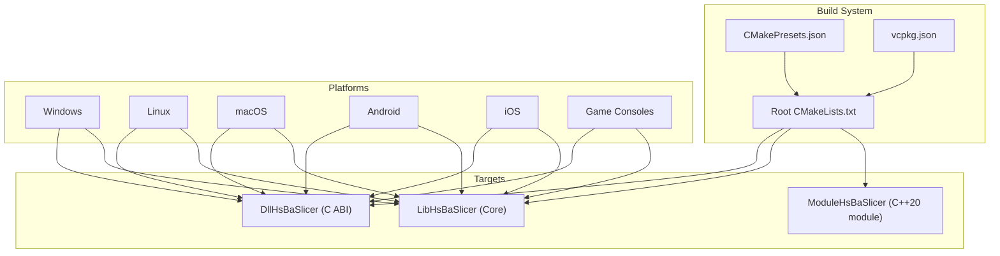
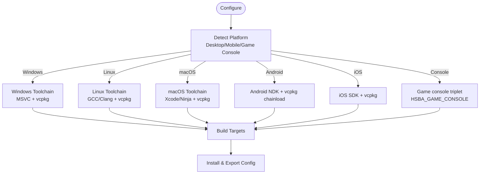
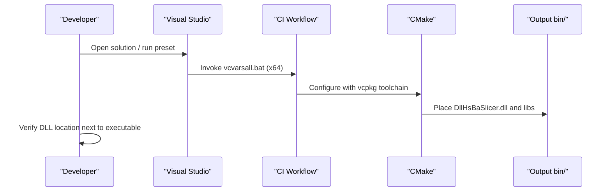
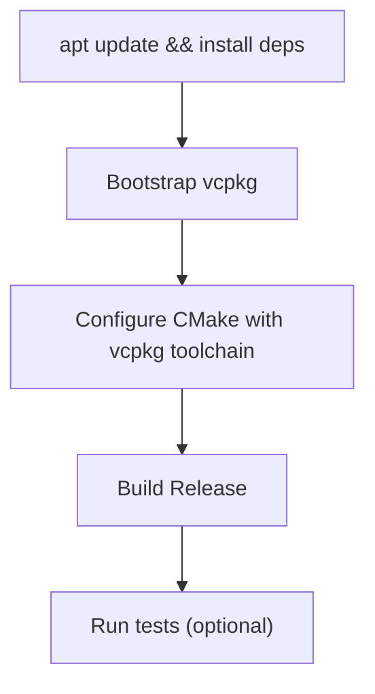
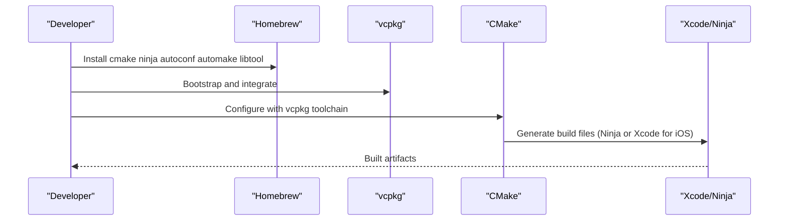
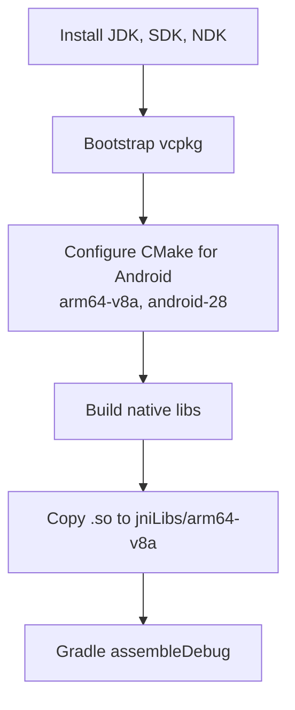
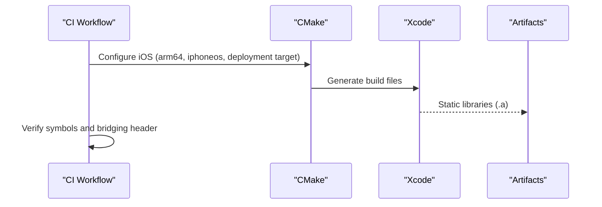
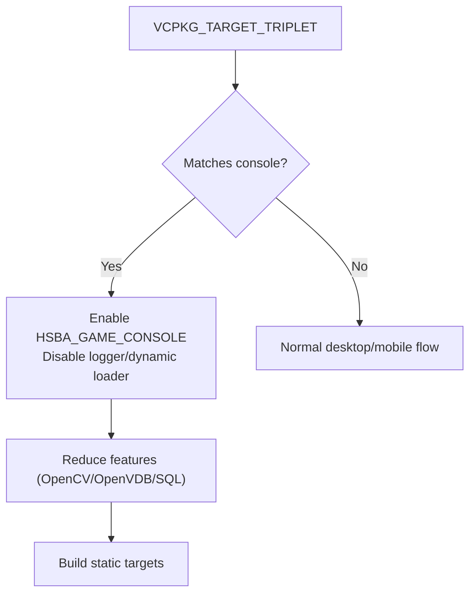
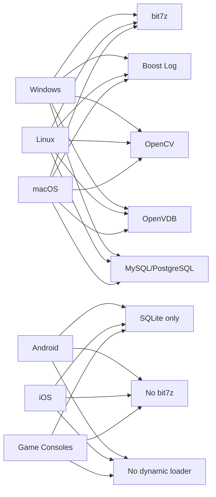

# Platform-Specific Issues

<cite>
**Referenced Files in This Document**
- [README.md](file://README.md)
- [CMakeLists.txt](file://CMakeLists.txt)
- [CMakePresets.json](file://CMakePresets.json)
- [vcpkg.json](file://vcpkg.json)
- [build-windows.yml](file://.github/workflows/build-windows.yml)
- [build-linux.yml](file://.github/workflows/build-linux.yml)
- [build-macos.yml](file://.github/workflows/build-macos.yml)
- [build-android.yml](file://.github/workflows/build-android.yml)
- [build-ios.yml](file://.github/workflows/build-ios.yml)
- [android/README.md](file://android/README.md)
- [ModuleHsBaSlicer/CMakeLists.txt](file://ModuleHsBaSlicer/CMakeLists.txt)
- [LibHsBaSlicer/CMakeLists.txt](file://LibHsBaSlicer/CMakeLists.txt)
- [qt_wxwidgets_integration.md](file://docs/en/DllHsBaSlicer/qt_wxwidgets_integration.md)
- [game_engine_integration.md](file://docs/en/DllHsBaSlicer/game_engine_integration.md)
</cite>

## Table of Contents
1. [Introduction](#introduction)
2. [Project Structure](#project-structure)
3. [Core Components](#core-components)
4. [Architecture Overview](#architecture-overview)
5. [Detailed Component Analysis](#detailed-component-analysis)
6. [Dependency Analysis](#dependency-analysis)
7. [Performance Considerations](#performance-considerations)
8. [Troubleshooting Guide](#troubleshooting-guide)
9. [Conclusion](#conclusion)

## Introduction
This document provides platform-specific troubleshooting and optimization guidance for HsBaSlicer deployment and development across Windows, Linux, macOS, Android, iOS, and game consoles. It focuses on build system behavior, dependency resolution, runtime loading constraints, and platform-specific pitfalls observed in the repository’s CMake configuration, presets, CI workflows, and integration documentation.

## Project Structure
HsBaSlicer is a modular C++ framework with:
- Core slicing libraries (LibHsBaSlicer)
- A C ABI dynamic/static layer (DllHsBaSlicer)
- Desktop/mobile/console feature toggles via CMake
- Preset-driven builds for Windows/Linux/macOS/Android/iOS
- CI workflows that bootstrap vcpkg and platform toolchains

**Diagram sources**
- [CMakeLists.txt:129-157](file://CMakeLists.txt#L129-L157)
- [CMakePresets.json:5-205](file://CMakePresets.json#L5-L205)
- [vcpkg.json:1-113](file://vcpkg.json#L1-L113)

**Section sources**
- [README.md:21-39](file://README.md#L21-L39)
- [CMakeLists.txt:129-157](file://CMakeLists.txt#L129-L157)
- [CMakePresets.json:5-205](file://CMakePresets.json#L5-L205)

## Core Components
- DllHsBaSlicer: Exposes a C ABI for external languages; built as shared on Windows/Xbox by default, static on mobile/consoles where applicable.
- LibHsBaSlicer: Core slicing algorithms; can be static or shared depending on target and triplet.
- ModuleHsBaSlicer: Optional C++20 module wrapper with MSVC-specific flags to avoid ABI mismatches from upstream dependencies.

Key behaviors:
- Dynamic loader disabled on non-desktop platforms.
- Copyleft kernels (CGAL/OpenCASCADE) are optional and affect licensing and install targets.
- Feature sets differ per platform (OpenCV, OpenVDB, SQL backends).

**Section sources**
- [CMakeLists.txt:228-240](file://CMakeLists.txt#L228-L240)
- [CMakeLists.txt:277-336](file://CMakeLists.txt#L277-L336)
- [CMakeLists.txt:367-390](file://CMakeLists.txt#L367-L390)
- [ModuleHsBaSlicer/CMakeLists.txt:36-45](file://ModuleHsBaSlicer/CMakeLists.txt#L36-L45)
- [LibHsBaSlicer/CMakeLists.txt:1-50](file://LibHsBaSlicer/CMakeLists.txt#L1-L50)

## Architecture Overview
The build system detects platform and adjusts features, linking mode, and installable components. CI pipelines demonstrate how each platform is bootstrapped and configured.

**Diagram sources**
- [CMakeLists.txt:129-157](file://CMakeLists.txt#L129-L157)
- [CMakeLists.txt:367-390](file://CMakeLists.txt#L367-L390)
- [CMakePresets.json:5-205](file://CMakePresets.json#L5-L205)

## Detailed Component Analysis

### Windows Troubleshooting
Common issues:
- DLL not found at runtime when integrating with Qt/WXWidgets or game engines.
- Visual Studio environment setup required for correct compiler/toolchain selection.
- UTF-8 source encoding and MSVC-specific compile options.

Guidance:
- Ensure the DLL is placed next to the executable or configure post-build copy steps.
- Use the provided CI workflow to bootstrap vcpkg and set up Visual Studio environment variables before configuring and building.
- The project forces UTF-8 compilation on MSVC and sets unified output directories for binaries and libraries.

**Diagram sources**
- [build-windows.yml:34-48](file://.github/workflows/build-windows.yml#L34-L48)
- [CMakeLists.txt:11-15](file://CMakeLists.txt#L11-L15)
- [CMakeLists.txt:355-365](file://CMakeLists.txt#L355-L365)

**Section sources**
- [build-windows.yml:13-48](file://.github/workflows/build-windows.yml#L13-L48)
- [CMakeLists.txt:11-15](file://CMakeLists.txt#L11-L15)
- [CMakeLists.txt:355-365](file://CMakeLists.txt#L355-L365)
- [qt_wxwidgets_integration.md:340-349](file://docs/en/DllHsBaSlicer/qt_wxwidgets_integration.md#L340-L349)
- [game_engine_integration.md:453-462](file://docs/en/DllHsBaSlicer/game_engine_integration.md#L453-L462)

### Linux Troubleshooting
Common issues:
- Missing system packages for GUI, font, and OpenGL dependencies.
- Package manager conflicts between system libraries and vcpkg-provided ones.
- Library path resolution at runtime.

Guidance:
- Follow the CI workflow to install required Ubuntu packages and PowerShell for version generation.
- Use vcpkg consistently to avoid mixing system and vendored libraries.
- On desktop, dynamic loader is enabled; ensure runtime library paths are correct.

**Diagram sources**
- [build-linux.yml:27-40](file://.github/workflows/build-linux.yml#L27-L40)
- [build-linux.yml:43-74](file://.github/workflows/build-linux.yml#L43-L74)

**Section sources**
- [build-linux.yml:27-82](file://.github/workflows/build-linux.yml#L27-L82)
- [CMakeLists.txt:228-240](file://CMakeLists.txt#L228-L240)
- [CMakeLists.txt:355-365](file://CMakeLists.txt#L355-L365)

### macOS Troubleshooting
Common issues:
- Xcode command-line tools and Ninja generator compatibility.
- Framework linking and deployment target settings.
- Homebrew dependency versions conflicting with vcpkg.

Guidance:
- Use the macOS CI workflow to install prerequisites via Homebrew and bootstrap vcpkg.
- For iOS builds, the preset configures Xcode generator and iOS sysroot/deployment target.
- Keep consistent toolchain versions across local and CI environments.

**Diagram sources**
- [build-macos.yml:13-29](file://.github/workflows/build-macos.yml#L13-L29)
- [CMakePresets.json:140-205](file://CMakePresets.json#L140-L205)

**Section sources**
- [build-macos.yml:13-60](file://.github/workflows/build-macos.yml#L13-L60)
- [CMakePresets.json:140-205](file://CMakePresets.json#L140-L205)

### Android Troubleshooting
Common issues:
- NDK path and chainloading misconfiguration.
- ABI mismatch between native .so and app jniLibs.
- Gradle wrapper and signing configurations missing in minimal skeleton.

Guidance:
- Use the Android CI workflow to install JDK, Android SDK/NDK, and bootstrap vcpkg with the Android toolchain.
- Copy produced .so into android/app/src/main/jniLibs/arm64-v8a as shown in the Android README.
- Add Gradle wrapper and signing configs for production APKs.

**Diagram sources**
- [build-android.yml:12-95](file://.github/workflows/build-android.yml#L12-L95)
- [build-android.yml:97-144](file://.github/workflows/build-android.yml#L97-L144)
- [android/README.md:1-22](file://android/README.md#L1-L22)

**Section sources**
- [build-android.yml:12-144](file://.github/workflows/build-android.yml#L12-L144)
- [android/README.md:1-22](file://android/README.md#L1-L22)
- [CMakePresets.json:112-138](file://CMakePresets.json#L112-L138)

### iOS Troubleshooting
Common issues:
- Linking failures due to requiring static libraries only.
- Swift/Objective-C bridging header missing or incomplete.
- App Store deployment requires proper code signing and entitlements.

Guidance:
- The iOS CI verifies static library outputs and checks exported symbols.
- Ensure the bridging header declares expected functions for Swift access.
- Use the iOS preset which sets Xcode generator, arm64 architecture, iphoneos sysroot, and deployment target.

**Diagram sources**
- [build-ios.yml:42-57](file://.github/workflows/build-ios.yml#L42-L57)
- [build-ios.yml:59-139](file://.github/workflows/build-ios.yml#L59-L139)
- [CMakePresets.json:181-205](file://CMakePresets.json#L181-L205)

**Section sources**
- [build-ios.yml:42-139](file://.github/workflows/build-ios.yml#L42-L139)
- [CMakePresets.json:181-205](file://CMakePresets.json#L181-L205)

### Game Console Troubleshooting
Common issues:
- Missing copyleft kernels and reduced feature set.
- Logger disabled or replaced by platform-specific logging.
- Dynamic loader disabled; static linking preferred.

Guidance:
- Set VCPKG_TARGET_TRIPLET to match console triplets (e.g., xbox, switch, playstation) to enable HSBA_GAME_CONSOLE and related definitions.
- Expect reduced dependencies (no OpenCV, no OpenVDB, limited SQL backends).
- Tests are disabled on consoles due to output limitations.

**Diagram sources**
- [CMakeLists.txt:131-147](file://CMakeLists.txt#L131-L147)
- [CMakeLists.txt:210-240](file://CMakeLists.txt#L210-L240)
- [CMakeLists.txt:277-336](file://CMakeLists.txt#L277-L336)
- [CMakeLists.txt:397-407](file://CMakeLists.txt#L397-L407)

**Section sources**
- [CMakeLists.txt:131-147](file://CMakeLists.txt#L131-L147)
- [CMakeLists.txt:210-240](file://CMakeLists.txt#L210-L240)
- [CMakeLists.txt:277-336](file://CMakeLists.txt#L277-L336)
- [CMakeLists.txt:397-407](file://CMakeLists.txt#L397-L407)

## Dependency Analysis
Platform-dependent dependencies and features:
- Windows/Linux/macOS: bit7z, Boost log, OpenCV, OpenVDB, full SQL backends.
- Android/iOS: SQLite-only sqlpp11, no bit7z, dynamic loader disabled.
- Game consoles: Similar to mobile but with additional feature reductions and static linking defaults.

**Diagram sources**
- [vcpkg.json:1-113](file://vcpkg.json#L1-L113)
- [CMakeLists.txt:228-240](file://CMakeLists.txt#L228-L240)
- [CMakeLists.txt:277-336](file://CMakeLists.txt#L277-L336)

**Section sources**
- [vcpkg.json:1-113](file://vcpkg.json#L1-L113)
- [CMakeLists.txt:228-240](file://CMakeLists.txt#L228-L240)
- [CMakeLists.txt:277-336](file://CMakeLists.txt#L277-L336)

## Performance Considerations
- Boolean operations may be slow and memory-intensive in Debug builds; consider Release builds for performance-sensitive workloads.
- Model pool size is tuned based on availability of copyleft kernels; smaller pools on constrained platforms reduce memory pressure.
- Thread pool coroutine support can be enabled/disabled via CMake option.
- Coverage instrumentation adds overhead; use dedicated coverage presets for analysis rather than normal builds.

Recommendations:
- Prefer Release builds for production and profiling.
- Disable unnecessary features on constrained platforms (already handled by CMake).
- Monitor memory usage when enabling CGAL boolean operations.

**Section sources**
- [CMakeLists.txt:294-306](file://CMakeLists.txt#L294-L306)
- [CMakeLists.txt:258-262](file://CMakeLists.txt#L258-L262)
- [CMakePresets.json:83-111](file://CMakePresets.json#L83-L111)

## Troubleshooting Guide

### Windows
- Symptom: “DllHsBaSlicer.dll not found” at startup.
  - Cause: DLL not next to executable.
  - Fix: Place DLL beside the binary or add a post-build copy step.
- Symptom: UI freezes during slicing.
  - Cause: Synchronous API running on UI thread.
  - Fix: Move slicing to a worker thread.
- Symptom: Callback crashes updating widgets.
  - Cause: Callbacks run on library threads.
  - Fix: Marshal updates to UI thread via signals/slots or equivalent mechanisms.
- Symptom: Non-ASCII path failures.
  - Cause: Path encoding mismatch.
  - Fix: Pass UTF-8 encoded paths to the C API.

**Section sources**
- [qt_wxwidgets_integration.md:340-349](file://docs/en/DllHsBaSlicer/qt_wxwidgets_integration.md#L340-L349)

### Linux
- Symptom: Missing libraries at runtime.
  - Cause: System vs vcpkg library mismatch.
  - Fix: Use vcpkg consistently and ensure LD_LIBRARY_PATH includes library directories if needed.
- Symptom: Build fails due to missing headers.
  - Cause: Incomplete system dependencies.
  - Fix: Install required packages as per CI workflow.

**Section sources**
- [build-linux.yml:27-40](file://.github/workflows/build-linux.yml#L27-L40)
- [CMakeLists.txt:355-365](file://CMakeLists.txt#L355-L365)

### macOS
- Symptom: Xcode/Ninja generator errors.
  - Cause: Toolchain or generator mismatch.
  - Fix: Use the provided presets and ensure Xcode command-line tools are installed.
- Symptom: iOS link failures.
  - Cause: Attempting to load dylibs instead of using static libraries.
  - Fix: Use static .a libraries and appropriate bridging headers.

**Section sources**
- [build-macos.yml:13-29](file://.github/workflows/build-macos.yml#L13-L29)
- [build-ios.yml:59-139](file://.github/workflows/build-ios.yml#L59-L139)

### Android
- Symptom: Native library not found in app.
  - Cause: .so not copied to jniLibs or ABI mismatch.
  - Fix: Copy the correct ABI .so into android/app/src/main/jniLibs/arm64-v8a.
- Symptom: Gradle wrapper missing.
  - Cause: Minimal skeleton does not include Gradle wrapper.
  - Fix: Generate Gradle wrapper and add signing configs for release builds.

**Section sources**
- [android/README.md:1-22](file://android/README.md#L1-L22)
- [build-android.yml:97-144](file://.github/workflows/build-android.yml#L97-L144)

### iOS
- Symptom: Bridging header missing or incomplete.
  - Cause: Swift cannot see C API.
  - Fix: Ensure bridging header declares expected functions.
- Symptom: App Store deployment issues.
  - Cause: Missing code signing or entitlements.
  - Fix: Configure signing profiles and entitlements per Apple guidelines.

**Section sources**
- [build-ios.yml:113-139](file://.github/workflows/build-ios.yml#L113-L139)

### Game Consoles
- Symptom: Features unavailable or build fails.
  - Cause: Copyleft kernels disabled and reduced feature set.
  - Fix: Adjust feature flags and rely on static linking; disable logger if unsupported.
- Symptom: Tests not running.
  - Cause: Tests disabled on consoles.
  - Fix: Run tests on desktop or CI environments that support them.

**Section sources**
- [CMakeLists.txt:131-147](file://CMakeLists.txt#L131-L147)
- [CMakeLists.txt:397-407](file://CMakeLists.txt#L397-L407)

## Conclusion
HsBaSlicer’s cross-platform build system uses CMake, vcpkg, and CI workflows to manage platform-specific dependencies and features. Successful deployment hinges on:
- Correct toolchain and environment setup per platform.
- Consistent use of vcpkg to avoid dependency conflicts.
- Understanding platform constraints (dynamic loader, static linking, feature availability).
- Following integration guidance for UI frameworks and game engines.

By aligning local development with the provided presets and CI workflows, most platform-specific issues can be avoided or resolved quickly.