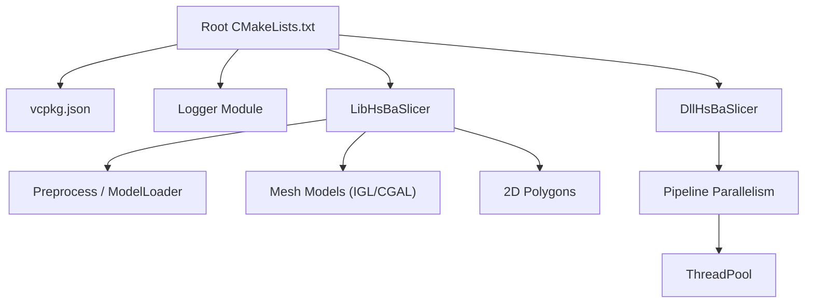
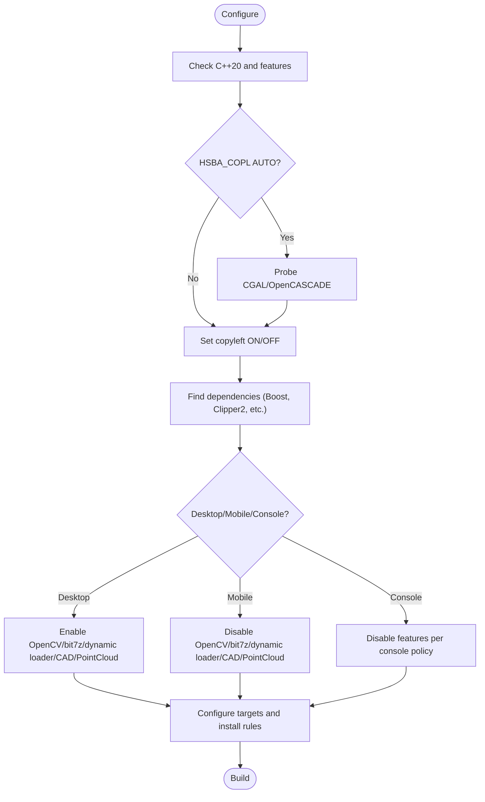
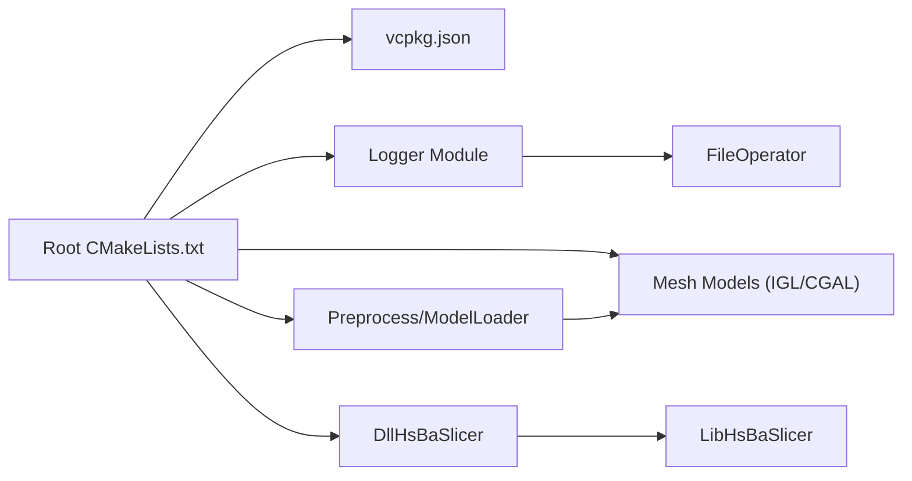

# Troubleshooting and FAQ

<cite>
**Referenced Files in This Document**
- [README.md](file://README.md)
- [CMakeLists.txt](file://CMakeLists.txt)
- [vcpkg.json](file://vcpkg.json)
- [CMakePresets.json](file://CMakePresets.json)
- [error.hpp](file://base/error.hpp)
- [logger.cpp](file://logger/logger.cpp)
- [logger/CMakeLists.txt](file://logger/CMakeLists.txt)
- [pipeline_parallel.hpp](file://DllHsBaSlicer/pipeline_parallel.hpp)
- [thread_pool.hpp](file://base/thread_pool.hpp)
- [memory_pool.hpp](file://base/memory_pool.hpp)
- [object_pool.hpp](file://base/object_pool.hpp)
- [model_preprocess.cpp](file://DllHsBaSlicer/model_preprocess.cpp)
- [ModelLoader.cpp](file://preprocess/ModelLoader.cpp)
- [IglModel.cpp](file://meshmodel/IglModel.cpp)
- [FloatPolygons.cpp](file://2D/FloatPolygons.cpp)
- [ImageToPolygons.cpp](file://2D/ImageToPolygons.cpp)
- [DllHsBaSlicer README.md](file://docs/en/DllHsBaSlicer/README.md)
</cite>

## Table of Contents
1. [Introduction](#introduction)
2. [Project Structure](#project-structure)
3. [Core Components](#core-components)
4. [Architecture Overview](#architecture-overview)
5. [Detailed Component Analysis](#detailed-component-analysis)
6. [Dependency Analysis](#dependency-analysis)
7. [Performance Considerations](#performance-considerations)
8. [Troubleshooting Guide](#troubleshooting-guide)
9. [Conclusion](#conclusion)
10. [Appendices](#appendices)

## Introduction
This document is a comprehensive troubleshooting guide and FAQ for HsBaSlicer. It focuses on:
- Build-time issues (dependencies, compiler compatibility, platform-specific failures)
- Runtime errors and debugging techniques for geometric algorithms
- Memory issues and performance bottlenecks
- Platform-specific guidance (Windows, Linux, macOS, Android, iOS, console)
- Logging strategies, error diagnosis, and tooling
- Integration, configuration, and deployment challenges
- Licensing, compatibility, and migration FAQs

The content maps directly to the repository’s build system, core libraries, and runtime components.

## Project Structure
HsBaSlicer is a modular C++ framework with clear separation between core slicing logic, platform abstractions, and pipeline orchestration. Key areas relevant to troubleshooting include:
- Build configuration and dependency resolution via CMake and vcpkg
- Cross-platform logging and error handling
- Parallel execution helpers for slicing/fill hot paths
- Model preprocessing and geometry kernels (CGAL/IGL/OpenCASCADE/OpenVDB)
- 2D polygon operations and Lua integration points



**Diagram sources**
- [CMakeLists.txt:17-104](file://CMakeLists.txt#L17-L104)
- [vcpkg.json:1-113](file://vcpkg.json#L1-L113)
- [logger/CMakeLists.txt:1-44](file://logger/CMakeLists.txt#L1-L44)
- [pipeline_parallel.hpp:1-121](file://DllHsBaSlicer/pipeline_parallel.hpp#L1-L121)
- [thread_pool.hpp:1-39](file://base/thread_pool.hpp#L1-L39)

**Section sources**
- [README.md:41-99](file://README.md#L41-L99)
- [CMakeLists.txt:17-104](file://CMakeLists.txt#L17-L104)
- [vcpkg.json:1-113](file://vcpkg.json#L1-L113)

## Core Components
- Error types: A set of custom exceptions derived from std::runtime_error used across modules for consistent diagnostics.
- Logger: Cross-platform singleton logger using Boost.Log on desktop, Android logcat on Android, and os_log on iOS.
- Parallel pipeline helper: Layer-parallel executor that batches work and serializes progress callbacks.
- Thread pool: Worker thread management with optional coroutine integration.
- Memory pools: Static and named object pools to reduce allocations and improve performance.

**Section sources**
- [error.hpp:17-144](file://base/error.hpp#L17-L144)
- [logger.cpp:136-222](file://logger/logger.cpp#L136-L222)
- [pipeline_parallel.hpp:22-117](file://DllHsBaSlicer/pipeline_parallel.hpp#L22-L117)
- [thread_pool.hpp:27-39](file://base/thread_pool.hpp#L27-L39)
- [memory_pool.hpp:21-372](file://base/memory_pool.hpp#L21-L372)
- [object_pool.hpp:18-42](file://base/object_pool.hpp#L18-L42)

## Architecture Overview
At runtime, pipelines (FDM/SLA/SLS/etc.) call into LibHsBaSlicer, which orchestrates preprocessing, mesh slicing, support generation, path generation, and export. The DllHsBaSlicer exposes a C ABI for external integrations. Parallelization occurs at layer granularity to maximize throughput while keeping progress reporting deterministic.

```mermaid
sequenceDiagram
participant App as "Caller"
participant DLL as "DllHsBaSlicer"
participant LIB as "LibHsBaSlicer"
participant PRE as "Preprocess/ModelLoader"
participant MESH as "Mesh Models (IGL/CGAL)"
participant PAR as "Pipeline Parallel"
participant TP as "ThreadPool"
App->>DLL : Call pipeline function
DLL->>LIB : Convert config & invoke pipeline
LIB->>PRE : Load model(s)
PRE-->>LIB : Model handles
LIB->>PAR : For each layer, schedule work()
PAR->>TP : Submit tasks
TP-->>PAR : Execute work()
PAR-->>LIB : Progress callback (serial)
LIB-->>DLL : Pipeline result
DLL-->>App : Return result + managed buffers
```

**Diagram sources**
- [DllHsBaSlicer README.md:696-703](file://docs/en/DllHsBaSlicer/README.md#L696-L703)
- [ModelLoader.cpp:16-325](file://preprocess/ModelLoader.cpp#L16-L325)
- [IglModel.cpp:24-195](file://meshmodel/IglModel.cpp#L24-L195)
- [pipeline_parallel.hpp:22-117](file://DllHsBaSlicer/pipeline_parallel.hpp#L22-L117)
- [thread_pool.hpp:27-39](file://base/thread_pool.hpp#L27-L39)

## Detailed Component Analysis

### Build System and Dependency Resolution
Common issues:
- Missing or incompatible dependencies (Boost, Clipper2, miniz, bit7z, Protobuf, RapidJSON, Eigen3, OpenSSL, OpenCV, libigl, CGAL, OpenCASCADE, OpenVDB, sqlpp11, Lua, tinyxml2, yaml-cpp, magic_enum).
- Copyleft kernel selection affecting license and available features.
- Platform-specific feature toggles (OpenCV, bit7z, dynamic loader, CAD/point cloud).

Key behaviors:
- C++20 required; C standard auto-detected based on compiler version.
- Feature checks enforce concepts, ranges, source_location, template-template matching.
- HSBA_COPL controls CGAL/OpenCascade inclusion and switches license to GPL-3.0-or-later when enabled.
- Desktop-only features: OpenCV, bit7z, dynamic loader, CAD/point cloud.
- Mobile/console: Disable certain features and adjust logging.



**Diagram sources**
- [CMakeLists.txt:17-104](file://CMakeLists.txt#L17-L104)
- [CMakeLists.txt:170-204](file://CMakeLists.txt#L170-L204)
- [CMakeLists.txt:206-350](file://CMakeLists.txt#L206-L350)
- [CMakeLists.txt:367-440](file://CMakeLists.txt#L367-L440)

**Section sources**
- [CMakeLists.txt:17-104](file://CMakeLists.txt#L17-L104)
- [CMakeLists.txt:170-204](file://CMakeLists.txt#L170-L204)
- [CMakeLists.txt:206-350](file://CMakeLists.txt#L206-L350)
- [CMakeLists.txt:367-440](file://CMakeLists.txt#L367-L440)
- [vcpkg.json:1-113](file://vcpkg.json#L1-L113)

### Compiler Compatibility Problems
Symptoms:
- Fatal errors about missing C++ concepts, ranges, source_location, or template-template parameter matching.
- Warnings about non-type template parameters or _Generic fallbacks.

Resolution:
- Use a compiler supporting C++20 and the required features.
- On older compilers, some features are disabled with compile definitions; ensure your toolchain meets minimum requirements.

**Section sources**
- [CMakeLists.txt:17-104](file://CMakeLists.txt#L17-L104)

### Platform-Specific Build Failures
- Windows: Prefer Visual Studio 2022+ with CMake tools and vcpkg; use windows-release preset. Debug builds may fail with CGAL in submodules.
- Linux/macOS: Install system packages, bootstrap vcpkg, configure with vcpkg toolchain, then build Release.
- Android/iOS: Android typically built on Linux with NDK; iOS validated in CI; local macOS builds not extensively tested.
- Game consoles: Certain features disabled; logger not supported.

Mitigations:
- Use provided CMake presets for target platforms.
- Ensure ANDROID_NDK_HOME is set for Android.
- Avoid copyleft kernels on constrained platforms if unsupported.

**Section sources**
- [README.md:57-99](file://README.md#L57-L99)
- [CMakePresets.json:1-236](file://CMakePresets.json#L1-L236)
- [CMakeLists.txt:131-157](file://CMakeLists.txt#L131-L157)

### Runtime Errors and Debugging Techniques
Error taxonomy:
- RuntimeError and specialized variants (OutOfRangeError, InvalidArgumentError, IOError, NotImplementedError, NullValueError, NotSupportedError, NotFoundError, AlreadyExistsError, PermissionDeniedError, TimeoutError, InterruptedError, CancelledError, OutOfMemoryError).

Debugging tips:
- Catch and inspect exception messages; they carry context from failing operations.
- Use structured logging to correlate events with stack locations.
- For Lua-driven pipelines, capture Lua errors and map them to RuntimeError instances.

**Section sources**
- [error.hpp:17-144](file://base/error.hpp#L17-L144)
- [ImageToPolygons.cpp:422-532](file://2D/ImageToPolygons.cpp#L422-L532)

### Geometric Algorithms Issues
Typical problems:
- FreeType initialization or font loading failures in 2D text-to-polygon conversion.
- OpenCV exceptions during image processing.
- CGAL-enabled code paths conditionally compiled; boolean operations disabled in Debug builds due to performance/memory concerns.

Diagnosis:
- Verify FreeType availability and font file paths.
- Validate OpenCV presence and input image formats.
- Check whether USE_CGAL is defined and consider switching to Release builds for heavy boolean operations.

**Section sources**
- [FloatPolygons.cpp:351-361](file://2D/FloatPolygons.cpp#L351-L361)
- [ImageToPolygons.cpp:58-78](file://2D/ImageToPolygons.cpp#L58-L78)
- [CMakeLists.txt:284-298](file://CMakeLists.txt#L284-L298)
- [model_preprocess.cpp:208-285](file://DllHsBaSlicer/model_preprocess.cpp#L208-L285)
- [IglModel.cpp:24-195](file://meshmodel/IglModel.cpp#L24-L195)

### Memory Issues
Symptoms:
- High memory usage during boolean operations or large models.
- Frequent allocations causing fragmentation.

Techniques:
- Use static memory pools and named object pools to reduce heap churn.
- Tune model pool size based on copyleft kernel availability.
- Monitor UsedCount for static pools and track allocation patterns.

**Section sources**
- [memory_pool.hpp:21-372](file://base/memory_pool.hpp#L21-L372)
- [object_pool.hpp:18-42](file://base/object_pool.hpp#L18-L42)
- [CMakeLists.txt:300-306](file://CMakeLists.txt#L300-L306)

### Performance Bottlenecks
Hot paths:
- Slicing and fill stages iterate layers independently; parallelize per-layer work.
- ThreadPool manages worker threads; batching improves progress callback frequency.

Optimization strategies:
- Adjust nthreads to match hardware concurrency.
- Tune block sizes to balance overhead and progress updates.
- Avoid Debug builds for CGAL/IGL boolean operations.

**Section sources**
- [pipeline_parallel.hpp:22-117](file://DllHsBaSlicer/pipeline_parallel.hpp#L22-L117)
- [thread_pool.hpp:27-39](file://base/thread_pool.hpp#L27-L39)
- [CMakeLists.txt:294-298](file://CMakeLists.txt#L294-L298)

### Logging Strategies and Tools
- Desktop: Boost.Log with file rotation and console output; configurable via logcfg.ini.
- Android: Kernel log (logcat); logs always considered “in use”.
- iOS: os_log; logs always considered “in use”.
- Source location metadata included in log lines for precise diagnostics.

Configuration:
- log.log_level_debug/log.log_level
- log.use_log_file, log.log_file, log_format.log_datatime_format

**Section sources**
- [logger.cpp:136-222](file://logger/logger.cpp#L136-L222)
- [logger.cpp:242-343](file://logger/logger.cpp#L242-L343)
- [logger/CMakeLists.txt:1-44](file://logger/CMakeLists.txt#L1-L44)

### Integration and Deployment Challenges
- DllHsBaSlicer provides a C ABI; follow memory management rules for result strings and model handles.
- Proto deserialization allocates string fields; free with matching functions; ToProtoBytes buffers must be freed by caller.
- Install targets exported under HsBaSlicer:: namespace; downstream projects use find_package(HsBaSlicer CONFIG REQUIRED).

**Section sources**
- [DllHsBaSlicer README.md:696-703](file://docs/en/DllHsBaSlicer/README.md#L696-L703)
- [README.md:100-185](file://README.md#L100-L185)

## Dependency Analysis
High-level dependency relationships:
- Root CMake orchestrates feature detection, dependency discovery, and target installation.
- vcpkg.json declares platform-scoped dependencies and the copyleft feature.
- Logger depends on platform logging backends and file operator utilities.
- Preprocessing and mesh modules conditionally depend on CGAL/OpenCASCADE/OpenVDB.



**Diagram sources**
- [CMakeLists.txt:17-104](file://CMakeLists.txt#L17-L104)
- [vcpkg.json:1-113](file://vcpkg.json#L1-L113)
- [logger/CMakeLists.txt:1-44](file://logger/CMakeLists.txt#L1-L44)
- [ModelLoader.cpp:16-325](file://preprocess/ModelLoader.cpp#L16-L325)
- [IglModel.cpp:24-195](file://meshmodel/IglModel.cpp#L24-L195)

**Section sources**
- [CMakeLists.txt:17-104](file://CMakeLists.txt#L17-L104)
- [vcpkg.json:1-113](file://vcpkg.json#L1-L113)

## Performance Considerations
- Prefer Release builds for geometry-heavy operations; Debug disables boolean operations to avoid high memory/time costs.
- Use layer-parallel execution for slicing/fill; tune thread count and block sizes.
- Employ memory pools and object pools to minimize allocations.
- Keep progress callbacks serial and batched to reduce synchronization overhead.

[No sources needed since this section provides general guidance]

## Troubleshooting Guide

### Build-Time Issues

- Missing dependencies
  - Symptom: CMake cannot find Boost, Clipper2, miniz, bit7z, Protobuf, RapidJSON, Eigen3, OpenSSL, OpenCV, libigl, CGAL, OpenCASCADE, OpenVDB, sqlpp11, Lua, tinyxml2, yaml-cpp, magic_enum.
  - Action: Install via vcpkg; verify toolchain file and triplets; ensure platform constraints in vcpkg.json are satisfied.

- Compiler not meeting C++20 requirements
  - Symptom: Fatal errors about concepts/ranges/source_location/template-template matching.
  - Action: Upgrade compiler; use recommended toolchains per platform.

- Copyleft kernel selection
  - Symptom: License switch to GPL-3.0-or-later or missing CAD/boolean features.
  - Action: Set HSBA_COPL explicitly or rely on AUTO detection; ensure CGAL/OpenCASCADE installed if enabling copyleft.

- Platform-specific features disabled
  - Symptom: OpenCV/bit7z/dynamic loader/CAD/PointCloud unavailable on mobile/console.
  - Action: Accept feature gating or adjust build for desktop if those features are required.

**Section sources**
- [CMakeLists.txt:17-104](file://CMakeLists.txt#L17-L104)
- [CMakeLists.txt:170-204](file://CMakeLists.txt#L170-L204)
- [CMakeLists.txt:206-350](file://CMakeLists.txt#L206-L350)
- [vcpkg.json:1-113](file://vcpkg.json#L1-L113)

### Runtime Errors

- Lua-related errors
  - Symptom: Failed to create Lua state, load script, or call function; invalid table shapes.
  - Action: Validate Lua scripts and data structures; inspect error messages thrown as RuntimeError.

- Image processing exceptions
  - Symptom: OpenCV exceptions during image-to-polygon conversion.
  - Action: Validate input images and OpenCV availability; handle cv::Exception paths.

- Font rendering failures
  - Symptom: FreeType initialization or font loading errors.
  - Action: Ensure FreeType is available and font files exist and are readable.

**Section sources**
- [ImageToPolygons.cpp:422-532](file://2D/ImageToPolygons.cpp#L422-L532)
- [ImageToPolygons.cpp:58-78](file://2D/ImageToPolygons.cpp#L58-L78)
- [FloatPolygons.cpp:351-361](file://2D/FloatPolygons.cpp#L351-L361)

### Memory and Performance

- High memory usage
  - Symptom: OOM or slow boolean operations.
  - Action: Switch to Release builds; enable copyleft kernels only if necessary; use pools to reduce allocations.

- Slow slicing/fill
  - Symptom: Long runtimes on multi-layer models.
  - Action: Use pipeline parallelism; tune ThreadPool size; batch progress updates.

**Section sources**
- [CMakeLists.txt:294-298](file://CMakeLists.txt#L294-L298)
- [pipeline_parallel.hpp:22-117](file://DllHsBaSlicer/pipeline_parallel.hpp#L22-L117)
- [memory_pool.hpp:21-372](file://base/memory_pool.hpp#L21-L372)

### Platform-Specific Issues

- Windows
  - Symptom: Debug builds with CGAL fail.
  - Action: Use windows-release preset; ensure VS 2022+ and vcpkg configured.

- Linux/macOS
  - Symptom: Missing system headers/libraries.
  - Action: Install required packages; bootstrap vcpkg; configure with toolchain file.

- Android/iOS
  - Symptom: Dynamic loader disabled; logging uses platform backends.
  - Action: Set ANDROID_NDK_HOME; accept feature gating; use platform logs.

- Console
  - Symptom: Logger not supported; features disabled.
  - Action: Follow console build policies; avoid logger-dependent code paths.

**Section sources**
- [README.md:57-99](file://README.md#L57-L99)
- [CMakePresets.json:1-236](file://CMakePresets.json#L1-L236)
- [logger.cpp:136-222](file://logger/logger.cpp#L136-L222)

### Logging and Diagnostics

- No logs produced
  - Symptom: Log file not created or no console output.
  - Action: Verify logcfg.ini exists and is readable; check default paths and levels; confirm platform backend initialization.

- Incorrect log level
  - Symptom: Too verbose or too quiet logs.
  - Action: Adjust log.log_level_debug/log.log_level; confirm _DEBUG vs release behavior.

**Section sources**
- [logger.cpp:136-222](file://logger/logger.cpp#L136-L222)
- [logger.cpp:242-343](file://logger/logger.cpp#L242-L343)

### Integration and Deployment

- C ABI memory leaks
  - Symptom: Leaked gcode_content/export_path/error_message/version strings or model handles.
  - Action: Follow documented memory management rules; free results and handles with matching functions.

- Proto buffer memory issues
  - Symptom: Leaked strings after FromProtoBytes or out_data not freed.
  - Action: Use HsBaFree*ConfigStrings() and free *ToProtoBytes buffers.

**Section sources**
- [DllHsBaSlicer README.md:696-703](file://docs/en/DllHsBaSlicer/README.md#L696-L703)

## Conclusion
Use the build presets and vcpkg manifests to stabilize dependency resolution. Prefer Release builds for geometry-heavy workflows. Leverage the cross-platform logger and structured error types for robust diagnostics. Apply parallel execution and memory pools to optimize performance. Follow the C ABI memory management rules to prevent leaks in integrations.

[No sources needed since this section summarizes without analyzing specific files]

## Appendices

### Frequently Asked Questions

- What compiler versions are supported?
  - C++20 is required; C standard is auto-detected based on compiler capabilities.

- How do I control copyleft kernels and licensing?
  - HSBA_COPL can be AUTO/ON/OFF; enabling it includes CGAL/OpenCASCADE and switches the project license to GPL-3.0-or-later.

- Why are some features disabled on mobile/console?
  - Features like OpenCV, bit7z, dynamic loader, CAD, and point cloud are gated for platform constraints.

- How do I debug Lua-driven pipelines?
  - Inspect RuntimeError messages from Lua adapters; validate scripts and data structures; use structured logging.

- How do I avoid memory leaks when using the C API?
  - Follow the documented memory management rules for result structs, version strings, model handles, and proto buffers.

- How do I tune performance?
  - Use Release builds, enable layer-parallel execution, tune ThreadPool size, and employ memory pools.

**Section sources**
- [CMakeLists.txt:17-104](file://CMakeLists.txt#L17-L104)
- [CMakeLists.txt:170-204](file://CMakeLists.txt#L170-L204)
- [CMakeLists.txt:206-350](file://CMakeLists.txt#L206-L350)
- [DllHsBaSlicer README.md:696-703](file://docs/en/DllHsBaSlicer/README.md#L696-L703)
- [pipeline_parallel.hpp:22-117](file://DllHsBaSlicer/pipeline_parallel.hpp#L22-L117)
- [memory_pool.hpp:21-372](file://base/memory_pool.hpp#L21-L372)