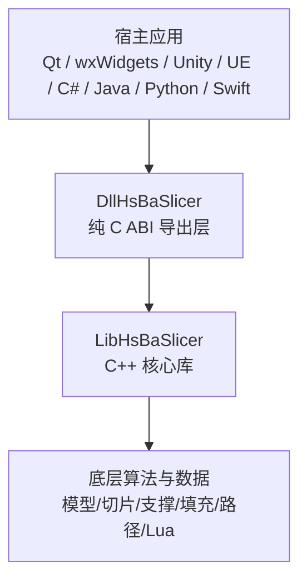
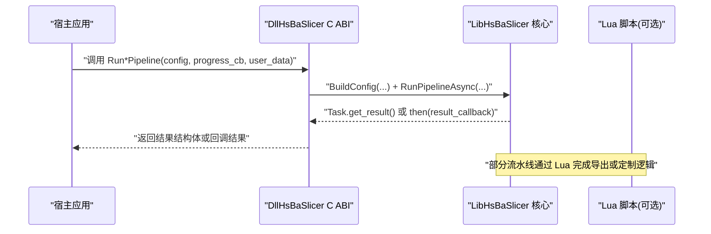
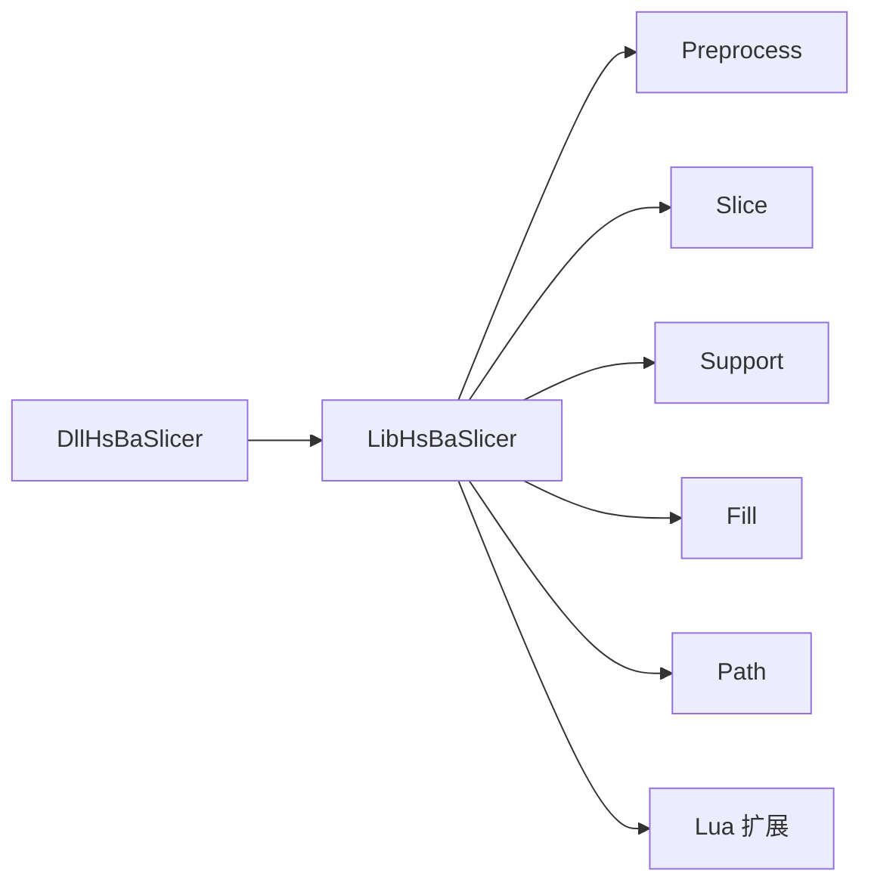

# API 参考文档

<cite>
**本文引用的文件**   
- [dllexport.h](file://DllHsBaSlicer/dllexport.h)
- [export.h](file://LibHsBaSlicer/export.h)
- [pipeline_types.h](file://pipelinetypes/pipeline_types.h)
- [fdm_pipeline.cpp](file://DllHsBaSlicer/fdm_pipeline.cpp)
- [sla_pipeline.cpp](file://DllHsBaSlicer/sla_pipeline.cpp)
- [sls_pipeline.cpp](file://DllHsBaSlicer/sls_pipeline.cpp)
- [slm_pipeline.cpp](file://DllHsBaSlicer/slm_pipeline.cpp)
- [lom_pipeline.cpp](file://DllHsBaSlicer/lom_pipeline.cpp)
- [tdp_pipeline.cpp](file://DllHsBaSlicer/tdp_pipeline.cpp)
- [waam_pipeline.cpp](file://DllHsBaSlicer/waam_pipeline.cpp)
- [file_transfer_pipeline.cpp](file://DllHsBaSlicer/file_transfer_pipeline.cpp)
- [custom_pipeline.cpp](file://DllHsBaSlicer/custom_pipeline.cpp)
- [model_preprocess.cpp](file://DllHsBaSlicer/model_preprocess.cpp)
- [lua_register.cpp](file://DllHsBaSlicer/lua_register.cpp)
- [initialize.cpp](file://DllHsBaSlicer/initialize.cpp)
</cite>

## 目录
1. [引言](#引言)
2. [项目结构](#项目结构)
3. [核心组件](#核心组件)
4. [架构总览](#架构总览)
5. [详细组件分析](#详细组件分析)
6. [依赖关系分析](#依赖关系分析)
7. [性能与并发特性](#性能与并发特性)
8. [错误码与异常处理](#错误码与异常处理)
9. [跨语言绑定注意事项](#跨语言绑定注意事项)
10. [故障排除指南](#故障排除指南)
11. [结论](#结论)
12. [附录：完整 C ABI 函数清单](#附录完整-c-abi-函数清单)

## 引言
本文件是 HsBaSlicer 的完整 API 参考文档，聚焦三类对外接口：
- C ABI 导出层（DllHsBaSlicer）：面向任意宿主语言的纯 C 接口。
- C++ 核心库（LibHsBaSlicer）：C++ 静态库与模块封装，提供切片、支撑、填充、路径生成等能力。
- 流水线配置类型（pipelinetypes/pipeline_types.h）：所有流水线配置与结果结构的稳定 C 兼容定义。

文档目标：
- 为每个公共接口提供签名、参数说明、返回值描述和使用示例。
- 详细说明数据结构、枚举和常量。
- 解释错误码、异常处理和内存所有权。
- 给出跨语言绑定的最佳实践与常见问题排查。

## 项目结构
HsBaSlicer 在对外暴露层面分为三层：
- DllHsBaSlicer：纯 C ABI 导出层，仅调用 LibHsBaSlicer 的导出接口，保证 ABI 边界清晰。
- LibHsBaSlicer：C++ 核心库，包含预处理、切片、支撑、填充、路径生成、SLA 地板/打包、SLS 导出、文件传输与 Lua 扩展。
- ModuleHsBaSlicer：C++20 模块封装，提供类式 API，内部转发到 LibHsBaSlicer 自由函数。

图示来源
- [README.md:100-124](file://README.md#L100-L124)
- [cpp_cmake_usage.md:1-28](file://docs/en/cpp_cmake_usage.md#L1-L28)

章节来源
- [README.md:100-124](file://README.md#L100-L124)
- [cpp_cmake_usage.md:1-28](file://docs/en/cpp_cmake_usage.md#L1-L28)

## 核心组件
本节梳理三类关键入口：
- C ABI 宏定义：HSBA_SLICER_API（DllHsBaSlicer）与 HSBA_SLICER_LIB_API（LibHsBaSlicer）。
- 流水线配置类型：FDM、SLA、SLS、SLM、LOM、3DP、WAAM、文件传输、自定义 Lua 流水线。
- 公共 C ABI 函数：初始化、模型管理、各流水线同步/异步运行与结果释放。

章节来源
- [dllexport.h:1-23](file://DllHsBaSlicer/dllexport.h#L1-L23)
- [export.h:1-22](file://LibHsBaSlicer/export.h#L1-L22)
- [pipeline_types.h:1-1050](file://pipelinetypes/pipeline_types.h#L1-L1050)

## 架构总览
下图展示从宿主应用到 C ABI 再到 C++ 核心的调用链，以及协程驱动的异步流水线执行流程。

图示来源
- [fdm_pipeline.cpp:455-497](file://DllHsBaSlicer/fdm_pipeline.cpp#L455-L497)
- [sla_pipeline.cpp:244-260](file://DllHsBaSlicer/sla_pipeline.cpp#L244-L260)
- [sls_pipeline.cpp:181-260](file://DllHsBaSlicer/sls_pipeline.cpp#L181-L260)
- [slm_pipeline.cpp:235-260](file://DllHsBaSlicer/slm_pipeline.cpp#L235-L260)
- [lom_pipeline.cpp:313-354](file://DllHsBaSlicer/lom_pipeline.cpp#L313-L354)
- [tdp_pipeline.cpp:202-260](file://DllHsBaSlicer/tdp_pipeline.cpp#L202-L260)
- [waam_pipeline.cpp:173-260](file://DllHsBaSlicer/waam_pipeline.cpp#L173-L260)
- [file_transfer_pipeline.cpp:157-198](file://DllHsBaSlicer/file_transfer_pipeline.cpp#L157-L198)

## 详细组件分析

### C ABI 导出宏与平台兼容性
- HSBA_SLICER_API：用于 DllHsBaSlicer 共享库符号导出/导入。Windows 下根据 HSBA_SLICER_EXPORTS 决定 dllexport 或 dllimport；非 Windows 为空。
- HSBA_SLICER_LIB_API：用于 LibHsBaSlicer C++ 库符号导出/导入，语义与前者一致。

使用建议：
- 构建 DllHsBaSlicer 时定义 HSBA_SLICER_EXPORTS。
- 消费方链接 DllHsBaSlicer 时无需定义该宏。
- 对 LibHsBaSlicer 同理。

章节来源
- [dllexport.h:1-23](file://DllHsBaSlicer/dllexport.h#L1-L23)
- [export.h:1-22](file://LibHsBaSlicer/export.h#L1-L22)

### 流水线配置类型与默认值
所有流水线配置均为 C 兼容结构体，字段含义与默认值由 pipeline_types.h 中的静态 inline 初始化器统一维护。

- FDM：HsBaFdmPipelineConfig_t，默认层厚 0.2mm，首层 0.25mm，填充模式 HSBA_FILL_ZIGZAG，固件 HSBA_GCODE_MARLIN，喷嘴直径 0.4mm，耗材直径 1.75mm，温度 200/60，回抽长度 1.0mm，速度 50/100，螺旋外壁关闭。
- SLA：HsBaSlaPipelineConfig_t，默认层厚 0.05mm，首层 0.1mm，底曝光 60s，正常曝光 2.5s，提升距离 5/3mm，提升速度 60mm/s，回抽速度 150mm/s，底板偏移 2mm，边框宽 1mm，填充间距 0.5mm，角度 0°，边框环数 2，凸包关闭，支撑开启，过悬角 45°，支撑间隙 0.5mm，柱径 2mm，密度 0.3，图案 HSBA_SLA_SUPPORT_SACRIFICIAL，图像格式 PNG，宽高自动。
- SLS：HsBaSlsPipelineConfig_t，默认层厚 0.1mm，首层 0.15mm，激光功率 30W，扫描速度 2000mm/s，栅格间距 0.15mm，旋转 90°，床温 180°C，需要 export_lua_script。
- SLM：HsBaSlmPipelineConfig_t，默认层厚 0.06mm，首层 0.08mm，功率 200W，扫描速度 1000mm/s，栅格间距 0.1mm，旋转 67°，床温 100°C，材料钛合金，光源激光，保护气氩，需要 export_lua_script。
- LOM：HsBaLomPipelineConfig_t，默认层厚 0.2mm，首层 0.2mm，切割速度 300mm/s，轮廓偏移 0.5mm，切割功率 0.8，粘合温度 150°C，压力 1MPa，时间 5s，封边开启，切割模式轮廓，需要 export_lua_script。
- 3DP：HsBaTdpPipelineConfig_t，默认层厚 0.1mm，首层 0.12mm，喷头数 128，滴距 0.05mm，饱和 0.6，固化 1s，床温 40°C，模式单通道，需要 export_lua_script，螺旋外壁关闭。
- WAAM：HsBaWaamPipelineConfig_t，默认层厚 0.8mm，首层 1.0mm，焊道宽 1.2mm，行走速度 8mm/s，送丝速度 5m/min，电流 180A，电压 22V，气体流量 15L/min，材料钢，工艺电弧，保护气屏蔽气，保护气氩，层间温度 100°C，机器人 ABB，path_lua_script/path_lua_func 可选，螺旋外壁关闭。
- 文件传输：HsBaFileTransferPipelineConfig_t，host/port 必填，pool_size 默认 4，file_paths 数组必填，file_count 指定数量。
- 自定义 Lua：HsBaCustomPipelineConfig_t，pipeline_lua_script 或 pipeline_lua_source 二选一，entry_func 默认 run_pipeline，config_json 可传 JSON，model_name/model_path/output_path 可选。

所有结构体均提供对应默认初始化函数，例如 HsBaFdmConfigDefault、HsBaSlaConfigDefault、HsBaSlsConfigDefault、HsBaSlmConfigDefault、HsBaLomConfigDefault、HsBaTdpConfigDefault、HsBaWaamConfigDefault、HsBaFileTransferConfigDefault、HsBaCustomConfigDefault。

章节来源
- [pipeline_types.h:23-113](file://pipelinetypes/pipeline_types.h#L23-L113)
- [pipeline_types.h:146-232](file://pipelinetypes/pipeline_types.h#L146-L232)
- [pipeline_types.h:251-310](file://pipelinetypes/pipeline_types.h#L251-L310)
- [pipeline_types.h:320-401](file://pipelinetypes/pipeline_types.h#L320-L401)
- [pipeline_types.h:407-461](file://pipelinetypes/pipeline_types.h#L407-L461)
- [pipeline_types.h:467-521](file://pipelinetypes/pipeline_types.h#L467-L521)
- [pipeline_types.h:530-625](file://pipelinetypes/pipeline_types.h#L530-L625)
- [pipeline_types.h:631-674](file://pipelinetypes/pipeline_types.h#L631-L674)
- [pipeline_types.h:680-732](file://pipelinetypes/pipeline_types.h#L680-L732)
- [pipeline_types.h:738-983](file://pipelinetypes/pipeline_types.h#L738-L983)

### FDM 流水线 C ABI
- 创建默认配置：HsBaCreateDefaultConfig。
- 同步运行：HsBaRunFdmPipeline(config, callback, user_data)。
- 异步运行：HsBaRunFdmPipelineAsync(config, callback, user_data, result_callback, result_user_data)。
- 释放结果：HsBaFreePipelineResult(result)。

行为说明：
- 同步调用内部构造 InternalConfig，启动协程任务并等待 get_result，再转换为 C 结果结构体。
- 异步调用将配置包装为 shared_ptr，避免协程生命周期问题，并在任务完成后通过 result_callback 返回结果。
- 结果结构体中的 gcode_content 与 error_message 由库分配，调用方必须通过 HsBaFreePipelineResult 释放。

使用示例（步骤）：
1. 调用 HsBaCreateDefaultConfig 获取默认配置。
2. 设置 model_name、model_path、output_path 等必要字段。
3. 调用 HsBaRunFdmPipeline 或 HsBaRunFdmPipelineAsync。
4. 若同步调用，检查 result.success 与 result.gcode_content；若异步调用，在 result_callback 中处理结果。
5. 调用 HsBaFreePipelineResult 释放字符串字段。

章节来源
- [fdm_pipeline.cpp:455-497](file://DllHsBaSlicer/fdm_pipeline.cpp#L455-L497)

### SLA 流水线 C ABI
- 创建默认配置：HsBaCreateDefaultSlaConfig（由 pipeline_types.h 提供）。
- 同步运行：HsBaRunSlaPipeline。
- 异步运行：HsBaRunSlaPipelineAsync。
- 释放结果：HsBaFreeSlaPipelineResult。

行为说明：
- 计算层数基于模型高度与首层/常规层厚。
- 构建 JSON 配置，包含 slice/exposure/lift/floor/support/image/layers。
- 输出为 zip 文件路径，image_type 支持 PNG/JPG/SVG。

使用示例（步骤）：
1. 使用 HsBaSlaConfigDefault 初始化配置。
2. 设置 model_name、model_path、output_path、image_type。
3. 调用 HsBaRunSlaPipeline 或 HsBaRunSlaPipelineAsync。
4. 检查 result.success 与 result.export_path。
5. 调用 HsBaFreeSlaPipelineResult 释放字符串字段。

章节来源
- [sla_pipeline.cpp:244-260](file://DllHsBaSlicer/sla_pipeline.cpp#L244-L260)
- [pipeline_types.h:146-232](file://pipelinetypes/pipeline_types.h#L146-L232)
- [pipeline_types.h:785-825](file://pipelinetypes/pipeline_types.h#L785-L825)

### SLS 流水线 C ABI
- 创建默认配置：HsBaCreateDefaultSlsConfig（由 pipeline_types.h 提供）。
- 同步运行：HsBaRunSlsPipeline。
- 异步运行：HsBaRunSlsPipelineAsync。
- 释放结果：HsBaFreeSlsPipelineResult。

行为说明：
- 无标准输出格式，必须由 export_lua_script 指定导出脚本。
- 构建 JSON 配置，包含 process/slice/laser/bed_temperature。
- 若未提供 export_lua_script，返回错误。

使用示例（步骤）：
1. 使用 HsBaSlsConfigDefault 初始化配置。
2. 设置 model_name、model_path、export_lua_script、export_lua_func、output_path。
3. 调用 HsBaRunSlsPipeline 或 HsBaRunSlsPipelineAsync。
4. 检查 result.success 与 result.export_path。
5. 调用 HsBaFreeSlsPipelineResult 释放字符串字段。

章节来源
- [sls_pipeline.cpp:181-260](file://DllHsBaSlicer/sls_pipeline.cpp#L181-L260)
- [pipeline_types.h:251-310](file://pipelinetypes/pipeline_types.h#L251-L310)
- [pipeline_types.h:827-847](file://pipelinetypes/pipeline_types.h#L827-L847)

### SLM 流水线 C ABI
- 创建默认配置：HsBaCreateDefaultSlmConfig（由 pipeline_types.h 提供）。
- 同步运行：HsBaRunSlmPipeline。
- 异步运行：HsBaRunSlmPipelineAsync。
- 释放结果：HsBaFreeSlmPipelineResult。

行为说明：
- 与 SLS 类似，但包含金属粉末材料、光源类型与保护气体。
- 构建 JSON 配置，包含 process/slice/laser/bed_temperature/material/light_source/protect_gas。
- 需要 export_lua_script。

使用示例（步骤）：
1. 使用 HsBaSlmConfigDefault 初始化配置。
2. 设置 material、light_source、protect_gas、export_lua_script、output_path。
3. 调用 HsBaRunSlmPipeline 或 HsBaRunSlmPipelineAsync。
4. 检查 result.success 与 result.export_path。
5. 调用 HsBaFreeSlmPipelineResult 释放字符串字段。

章节来源
- [slm_pipeline.cpp:235-260](file://DllHsBaSlicer/slm_pipeline.cpp#L235-L260)
- [pipeline_types.h:320-401](file://pipelinetypes/pipeline_types.h#L320-L401)
- [pipeline_types.h:849-872](file://pipelinetypes/pipeline_types.h#L849-L872)

### LOM 流水线 C ABI
- 创建默认配置：HsBaCreateDefaultLomConfig（由 pipeline_types.h 提供）。
- 同步运行：HsBaRunLomPipeline。
- 异步运行：HsBaRunLomPipelineAsync。
- 释放结果：HsBaFreeLomPipelineResult。

行为说明：
- 层片粘合+切割工艺，需要 export_lua_script。
- 配置包含 cut_speed/cut_margin/cut_power/bond_temperature/bond_pressure/bond_time/seal_contour/cut_mode。

使用示例（步骤）：
1. 使用 HsBaLomConfigDefault 初始化配置。
2. 设置 model_name、model_path、cut_*、bond_*、seal_contour、cut_mode、export_lua_script、output_path。
3. 调用 HsBaRunLomPipeline 或 HsBaRunLomPipelineAsync。
4. 检查 result.success 与 result.export_path。
5. 调用 HsBaFreeLomPipelineResult 释放字符串字段。

章节来源
- [lom_pipeline.cpp:313-354](file://DllHsBaSlicer/lom_pipeline.cpp#L313-L354)
- [pipeline_types.h:407-461](file://pipelinetypes/pipeline_types.h#L407-L461)
- [pipeline_types.h:874-897](file://pipelinetypes/pipeline_types.h#L874-L897)

### 3DP 流水线 C ABI
- 创建默认配置：HsBaCreateDefaultTdpConfig（由 pipeline_types.h 提供）。
- 同步运行：HsBaRunTdpPipeline。
- 异步运行：HsBaRunTdpPipelineAsync。
- 释放结果：HsBaFreeTdpPipelineResult。

行为说明：
- 粘结剂喷射工艺，需要 export_lua_script。
- 配置包含 head_count/drop_spacing/binder_saturation/ink_curing_time/bed_temperature/binder_mode/spiral_mode。

使用示例（步骤）：
1. 使用 HsBaTdpConfigDefault 初始化配置。
2. 设置 model_name、model_path、binder_*、spiral_mode、export_lua_script、output_path。
3. 调用 HsBaRunTdpPipeline 或 HsBaRunTdpPipelineAsync。
4. 检查 result.success 与 result.export_path。
5. 调用 HsBaFreeTdpPipelineResult 释放字符串字段。

章节来源
- [tdp_pipeline.cpp:202-260](file://DllHsBaSlicer/tdp_pipeline.cpp#L202-L260)
- [pipeline_types.h:467-521](file://pipelinetypes/pipeline_types.h#L467-L521)
- [pipeline_types.h:899-921](file://pipelinetypes/pipeline_types.h#L899-L921)

### WAAM 流水线 C ABI
- 创建默认配置：HsBaCreateDefaultWaamConfig（由 pipeline_types.h 提供）。
- 同步运行：HsBaRunWaamPipeline。
- 异步运行：HsBaRunWaamPipelineAsync。
- 释放结果：HsBaFreeWaamPipelineResult。

行为说明：
- 输出为机器人程序而非层图 zip。
- 配置包含焊接参数、保护方式、机器人类型、可选 path_lua_script/path_lua_func、spiral_mode。
- 内置支持 ABB/KUKA/FANUC，未知机器人类型需 Lua 路径脚本。

使用示例（步骤）：
1. 使用 HsBaWaamConfigDefault 初始化配置。
2. 设置 material、welding_process、protection、protect_gas、robot_type、path_lua_script/path_lua_func、spiral_mode、output_path。
3. 调用 HsBaRunWaamPipeline 或 HsBaRunWaamPipelineAsync。
4. 检查 result.success 与 result.output_path。
5. 调用 HsBaFreeWaamPipelineResult 释放字符串字段。

章节来源
- [waam_pipeline.cpp:173-260](file://DllHsBaSlicer/waam_pipeline.cpp#L173-L260)
- [pipeline_types.h:530-625](file://pipelinetypes/pipeline_types.h#L530-L625)
- [pipeline_types.h:923-951](file://pipelinetypes/pipeline_types.h#L923-L951)

### 文件传输流水线 C ABI
- 创建默认配置：HsBaCreateDefaultFileTransferConfig。
- 同步运行：HsBaRunFileTransferPipeline(config, callback, user_data)。
- 异步运行：HsBaRunFileTransferPipelineAsync(config, callback, user_data, result_callback, result_user_data)。
- 释放结果：HsBaFreeFileTransferPipelineResult。

行为说明：
- 使用 RemoteExecutorConnectionPool 进行远程服务文件传输。
- host/port 必填，pool_size 范围 [1,16]，默认 4。
- file_paths 数组与 file_count 必填。

使用示例（步骤）：
1. 使用 HsBaFileTransferConfigDefault 初始化配置。
2. 设置 host、port、pool_size、file_paths、file_count。
3. 调用 HsBaRunFileTransferPipeline 或 HsBaRunFileTransferPipelineAsync。
4. 检查 result.success、files_transferred、total_files。
5. 调用 HsBaFreeFileTransferPipelineResult 释放 error_message。

章节来源
- [file_transfer_pipeline.cpp:157-198](file://DllHsBaSlicer/file_transfer_pipeline.cpp#L157-L198)
- [pipeline_types.h:631-674](file://pipelinetypes/pipeline_types.h#L631-L674)
- [pipeline_types.h:953-966](file://pipelinetypes/pipeline_types.h#L953-L966)

### 自定义 Lua 流水线 C ABI
- 创建默认配置：HsBaCreateDefaultCustomConfig（由 pipeline_types.h 提供）。
- 同步运行：HsBaRunCustomPipeline(config, callback, user_data)。
- 异步运行：HsBaRunCustomPipelineAsync(config, callback, user_data, result_callback, result_user_data)。
- 释放结果：HsBaFreeCustomPipelineResult。

行为说明：
- 整个工作流由 Lua 入口函数定义，C++ 侧仅提供流水线构建块（模型加载、切片、支撑、填充、地板、G-code 路径输出、SLA/SLS 打包）。
- entry_func 默认 run_pipeline，config_json 作为 pipeline_config 传入 Lua。
- output_path 可由 Lua 脚本返回。

使用示例（步骤）：
1. 使用 HsBaCustomConfigDefault 初始化配置。
2. 设置 pipeline_lua_script 或 pipeline_lua_source、entry_func、config_json、model_name、model_path、output_path。
3. 调用 HsBaRunCustomPipeline 或 HsBaRunCustomPipelineAsync。
4. 检查 result.success、result.output_path、result.result_string。
5. 调用 HsBaFreeCustomPipelineResult 释放字符串字段。

章节来源
- [custom_pipeline.cpp:171-203](file://DllHsBaSlicer/custom_pipeline.cpp#L171-L203)
- [pipeline_types.h:680-732](file://pipelinetypes/pipeline_types.h#L680-L732)
- [pipeline_types.h:968-983](file://pipelinetypes/pipeline_types.h#L968-L983)

### 模型管理与 Lua 注册
- 模型管理：HsBaLoadModel(name, file_path)、HsBaGetModel(name)、HsBaRemoveModel(name)、HsBaContainsModel(name)。
- Lua 注册：HsBaAdd2DFunction(func)、HsBaAdd3DFunction(func)、HsBaAddFileFunction(func)、HsBaAddEventCallback(event_name, func)。
- 初始化：initialize()。

使用示例（步骤）：
1. 调用 initialize() 初始化环境。
2. 使用 HsBaLoadModel 加载模型。
3. 通过 HsBaGetModel/HsBaContainsModel 查询模型。
4. 使用 HsBaRemoveModel 清理模型。
5. 根据需要注册 2D/3D/文件操作 Lua 函数与事件回调。

章节来源
- [model_preprocess.cpp:31-81](file://DllHsBaSlicer/model_preprocess.cpp#L31-L81)
- [lua_register.cpp:11-35](file://DllHsBaSlicer/lua_register.cpp#L11-L35)
- [initialize.cpp:7-7](file://DllHsBaSlicer/initialize.cpp#L7-L7)

## 依赖关系分析
- DllHsBaSlicer 仅依赖 LibHsBaSlicer 的导出接口，不直接访问更底层模块，确保 ABI 边界清晰。
- 流水线实现普遍依赖：
  - 模型预处理：LoadModel/GetModel/GetModelInfo。
  - 切片：BuildSliceTopology/SliceLayer。
  - 并行：ParallelForLayers。
  - Lua：InstallCommonAnyObjectTypes 与各流水线的 Lua 导出脚本。
  - 协程：Utils::Task 与 co_return。

图示来源
- [README.md:100-124](file://README.md#L100-L124)
- [cpp_cmake_usage.md:1-28](file://docs/en/cpp_cmake_usage.md#L1-L28)

章节来源
- [README.md:100-124](file://README.md#L100-L124)
- [cpp_cmake_usage.md:1-28](file://docs/en/cpp_cmake_usage.md#L1-L28)

## 性能与并发特性
- 协程驱动：各流水线使用 Utils::Task 与 co_return，支持同步 get_result 与异步 then 回调。
- 并行切片：ParallelForLayers 对每层独立切片进行并行化，提升吞吐。
- 进度回调：progress_cb 在各阶段报告百分比与阶段描述，便于 UI 更新。
- 内存管理：OwnedCString 封装 char* 分配与释放，避免泄漏。

优化建议：
- 合理设置 pool_size 以平衡连接数与资源占用。
- 对大模型优先使用异步接口，避免阻塞主线程。
- 复用模型缓存（HsBaGetModel）减少重复加载。

章节来源
- [fdm_pipeline.cpp:455-497](file://DllHsBaSlicer/fdm_pipeline.cpp#L455-L497)
- [sla_pipeline.cpp:244-260](file://DllHsBaSlicer/sla_pipeline.cpp#L244-L260)
- [sls_pipeline.cpp:181-260](file://DllHsBaSlicer/sls_pipeline.cpp#L181-L260)
- [slm_pipeline.cpp:235-260](file://DllHsBaSlicer/slm_pipeline.cpp#L235-L260)
- [lom_pipeline.cpp:313-354](file://DllHsBaSlicer/lom_pipeline.cpp#L313-L354)
- [tdp_pipeline.cpp:202-260](file://DllHsBaSlicer/tdp_pipeline.cpp#L202-L260)
- [waam_pipeline.cpp:173-260](file://DllHsBaSlicer/waam_pipeline.cpp#L173-L260)
- [file_transfer_pipeline.cpp:157-198](file://DllHsBaSlicer/file_transfer_pipeline.cpp#L157-L198)

## 错误码与异常处理
- 成功标志：各结果结构体的 success 字段（0=false，1=true）。
- 错误消息：error_message 字段为 UTF-8 字符串，由库分配，调用方必须通过对应 Free*PipelineResult 释放。
- 常见错误：
  - 模型加载失败：返回错误信息包含模型路径。
  - 无效模型高度：total_layers <= 0。
  - SLS/SLM/LOM/3DP 缺少 export_lua_script：返回错误提示。
- 异常转换：第三方几何异常被转换为 RuntimeError 家族，并通过 error_message 返回。

章节来源
- [sls_pipeline.cpp:181-260](file://DllHsBaSlicer/sls_pipeline.cpp#L181-L260)
- [slm_pipeline.cpp:235-260](file://DllHsBaSlicer/slm_pipeline.cpp#L235-L260)
- [tdp_pipeline.cpp:202-260](file://DllHsBaSlicer/tdp_pipeline.cpp#L202-L260)
- [waam_pipeline.cpp:173-260](file://DllHsBaSlicer/waam_pipeline.cpp#L173-L260)

## 跨语言绑定注意事项
- 字符串编码：所有 char* 字符串为 UTF-8，宿主语言需按 UTF-8 处理。
- 内存所有权：
  - 结果结构体中的 gcode_content/export_path/output_path/error_message 由库分配，调用方必须调用对应的 HsBaFree*PipelineResult。
  - 回调中的结果同样遵循此规则。
- 回调线程安全：
  - 进度回调与结果回调可能在线程池中触发，宿主语言需保证回调函数的线程安全。
- 枚举与结构体布局：
  - 所有配置与结果为 POD 类型，跨语言绑定需保持字段顺序与大小一致。
- 初始化：
  - 首次使用前调用 initialize()，确保 Lua 环境与全局类型注册正确。

最佳实践：
- 使用默认初始化函数（如 HsBaFdmConfigDefault）避免未初始化字段。
- 在异步回调中尽快复制所需数据，避免持有原始指针过久。
- 对文件传输，合理设置 pool_size，避免连接池过大导致资源耗尽。

章节来源
- [pipeline_types.h:1-1050](file://pipelinetypes/pipeline_types.h#L1-L1050)
- [fdm_pipeline.cpp:455-497](file://DllHsBaSlicer/fdm_pipeline.cpp#L455-L497)
- [file_transfer_pipeline.cpp:157-198](file://DllHsBaSlicer/file_transfer_pipeline.cpp#L157-L198)
- [initialize.cpp:7-7](file://DllHsBaSlicer/initialize.cpp#L7-L7)

## 故障排除指南
- 模型加载失败：
  - 检查 model_path 是否存在且格式受支持。
  - 确认已调用 HsBaLoadModel 或提供有效 model_name。
- 层数为零：
  - 检查 layer_height 与 first_layer_height 是否合理。
  - 确认模型高度大于零。
- 缺少 Lua 导出脚本：
  - SLS/SLM/LOM/3DP 必须提供 export_lua_script。
  - 自定义流水线需提供 pipeline_lua_script 或 pipeline_lua_source。
- 内存泄漏：
  - 确保调用 HsBaFree*PipelineResult 释放结果字符串。
  - 避免在回调中延迟释放原始指针。

章节来源
- [sls_pipeline.cpp:181-260](file://DllHsBaSlicer/sls_pipeline.cpp#L181-L260)
- [slm_pipeline.cpp:235-260](file://DllHsBaSlicer/slm_pipeline.cpp#L235-L260)
- [tdp_pipeline.cpp:202-260](file://DllHsBaSlicer/tdp_pipeline.cpp#L202-L260)
- [waam_pipeline.cpp:173-260](file://DllHsBaSlicer/waam_pipeline.cpp#L173-L260)
- [custom_pipeline.cpp:171-203](file://DllHsBaSlicer/custom_pipeline.cpp#L171-L203)

## 结论
HsBaSlicer 通过清晰的三层架构与稳定的 C ABI，为多语言宿主提供了统一的切片流水线接口。所有流水线均支持同步与异步调用，提供进度回调与结构化结果，便于集成到各类应用中。正确使用默认配置、注意内存所有权与线程安全，可获得稳定高效的切片体验。

## 附录：完整 C ABI 函数清单
- 初始化与模型管理：
  - initialize()
  - HsBaLoadModel(name, file_path)
  - HsBaGetModel(name)
  - HsBaRemoveModel(name)
  - HsBaContainsModel(name)
- FDM：
  - HsBaCreateDefaultConfig()
  - HsBaRunFdmPipeline(config, callback, user_data)
  - HsBaRunFdmPipelineAsync(config, callback, user_data, result_callback, result_user_data)
  - HsBaFreePipelineResult(result)
- SLA：
  - HsBaCreateDefaultSlaConfig()
  - HsBaRunSlaPipeline(config, callback, user_data)
  - HsBaRunSlaPipelineAsync(config, callback, user_data, result_callback, result_user_data)
  - HsBaFreeSlaPipelineResult(result)
- SLS：
  - HsBaCreateDefaultSlsConfig()
  - HsBaRunSlsPipeline(config, callback, user_data)
  - HsBaRunSlsPipelineAsync(config, callback, user_data, result_callback, result_user_data)
  - HsBaFreeSlsPipelineResult(result)
- SLM：
  - HsBaCreateDefaultSlmConfig()
  - HsBaRunSlmPipeline(config, callback, user_data)
  - HsBaRunSlmPipelineAsync(config, callback, user_data, result_callback, result_user_data)
  - HsBaFreeSlmPipelineResult(result)
- LOM：
  - HsBaCreateDefaultLomConfig()
  - HsBaRunLomPipeline(config, callback, user_data)
  - HsBaRunLomPipelineAsync(config, callback, user_data, result_callback, result_user_data)
  - HsBaFreeLomPipelineResult(result)
- 3DP：
  - HsBaCreateDefaultTdpConfig()
  - HsBaRunTdpPipeline(config, callback, user_data)
  - HsBaRunTdpPipelineAsync(config, callback, user_data, result_callback, result_user_data)
  - HsBaFreeTdpPipelineResult(result)
- WAAM：
  - HsBaCreateDefaultWaamConfig()
  - HsBaRunWaamPipeline(config, callback, user_data)
  - HsBaRunWaamPipelineAsync(config, callback, user_data, result_callback, result_user_data)
  - HsBaFreeWaamPipelineResult(result)
- 文件传输：
  - HsBaCreateDefaultFileTransferConfig()
  - HsBaRunFileTransferPipeline(config, callback, user_data)
  - HsBaRunFileTransferPipelineAsync(config, callback, user_data, result_callback, result_user_data)
  - HsBaFreeFileTransferPipelineResult(result)
- 自定义 Lua：
  - HsBaCreateDefaultCustomConfig()
  - HsBaRunCustomPipeline(config, callback, user_data)
  - HsBaRunCustomPipelineAsync(config, callback, user_data, result_callback, result_user_data)
  - HsBaFreeCustomPipelineResult(result)
- Lua 注册：
  - HsBaAdd2DFunction(func)
  - HsBaAdd3DFunction(func)
  - HsBaAddFileFunction(func)
  - HsBaAddEventCallback(event_name, func)

章节来源
- [initialize.cpp:7-7](file://DllHsBaSlicer/initialize.cpp#L7-L7)
- [model_preprocess.cpp:31-81](file://DllHsBaSlicer/model_preprocess.cpp#L31-L81)
- [fdm_pipeline.cpp:455-497](file://DllHsBaSlicer/fdm_pipeline.cpp#L455-L497)
- [sla_pipeline.cpp:244-260](file://DllHsBaSlicer/sla_pipeline.cpp#L244-L260)
- [sls_pipeline.cpp:181-260](file://DllHsBaSlicer/sls_pipeline.cpp#L181-L260)
- [slm_pipeline.cpp:235-260](file://DllHsBaSlicer/slm_pipeline.cpp#L235-L260)
- [lom_pipeline.cpp:313-354](file://DllHsBaSlicer/lom_pipeline.cpp#L313-L354)
- [tdp_pipeline.cpp:202-260](file://DllHsBaSlicer/tdp_pipeline.cpp#L202-L260)
- [waam_pipeline.cpp:173-260](file://DllHsBaSlicer/waam_pipeline.cpp#L173-L260)
- [file_transfer_pipeline.cpp:157-198](file://DllHsBaSlicer/file_transfer_pipeline.cpp#L157-L198)
- [custom_pipeline.cpp:171-203](file://DllHsBaSlicer/custom_pipeline.cpp#L171-L203)
- [lua_register.cpp:11-35](file://DllHsBaSlicer/lua_register.cpp#L11-L35)