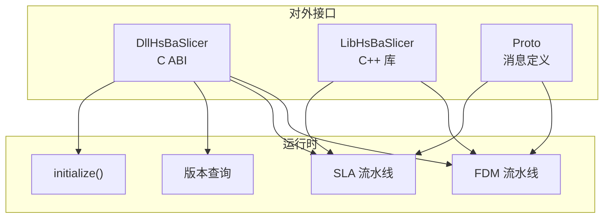
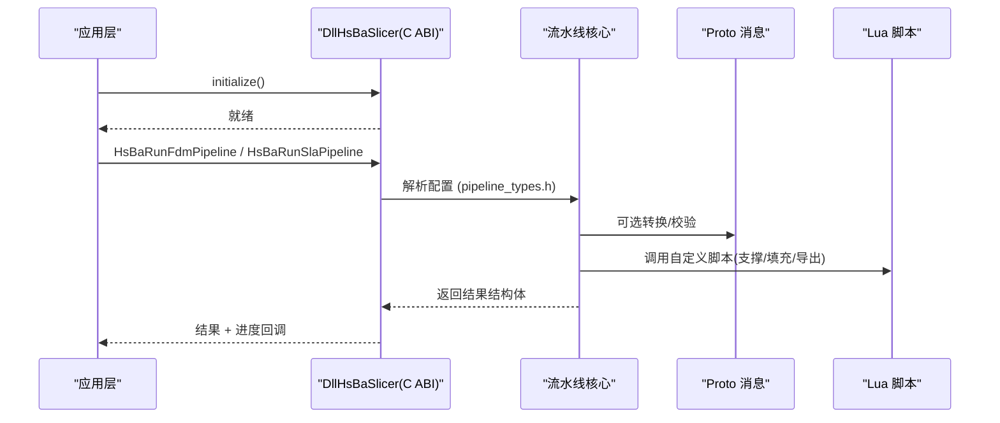
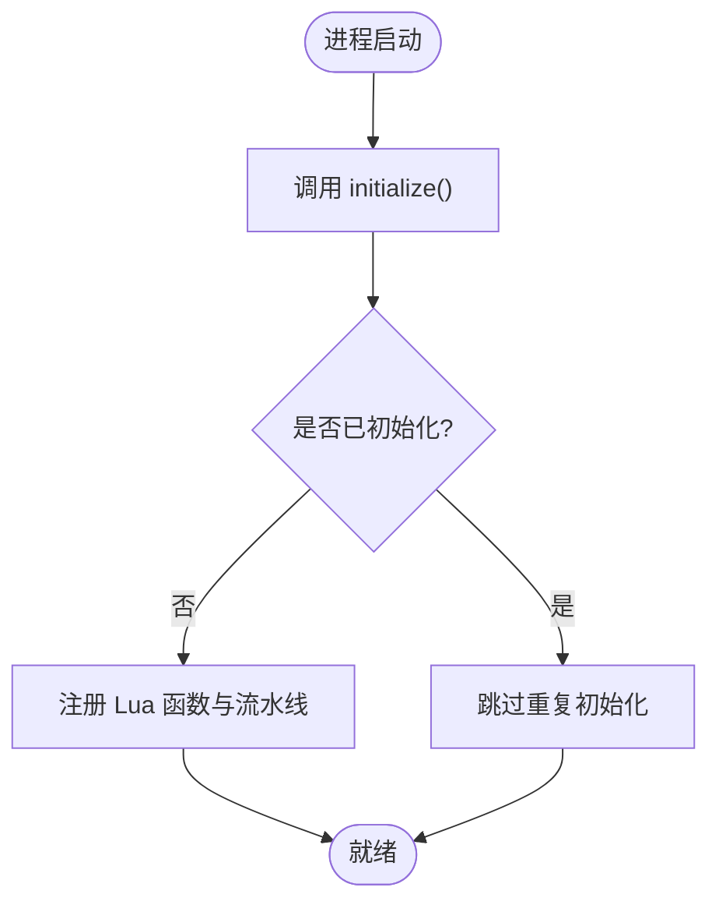
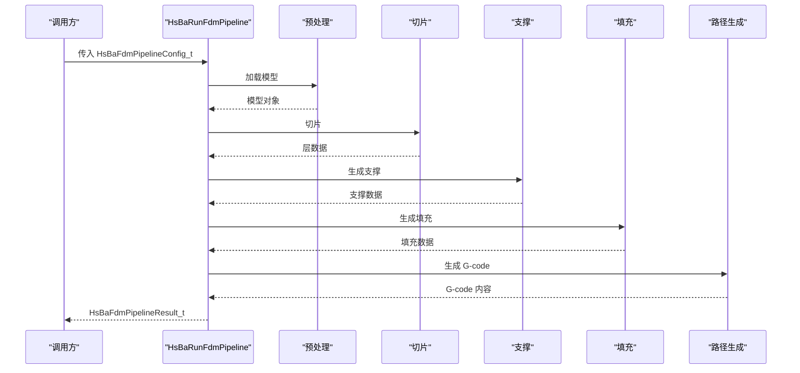
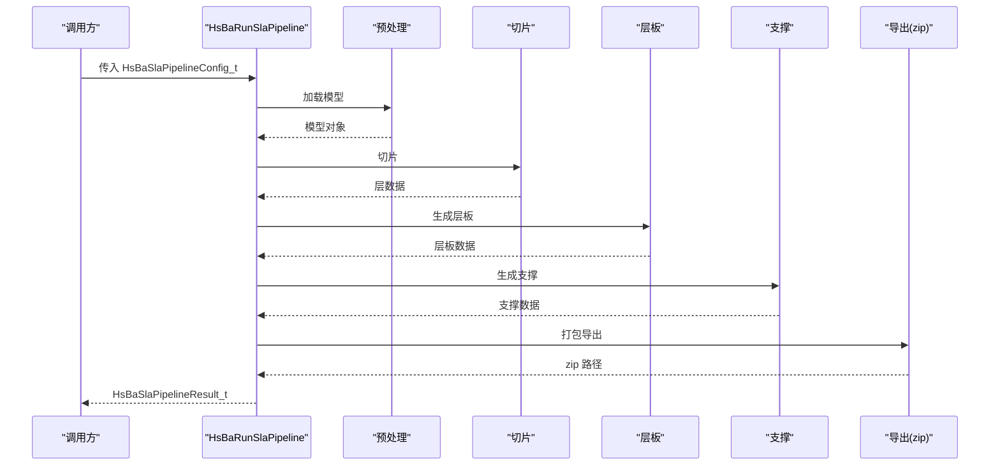
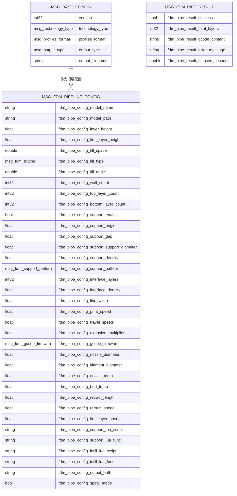
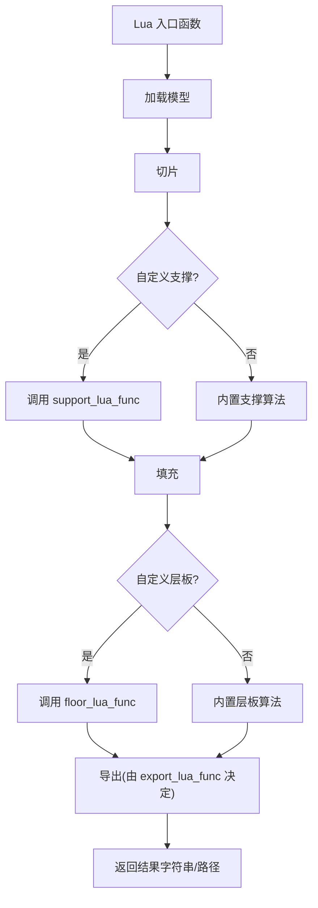
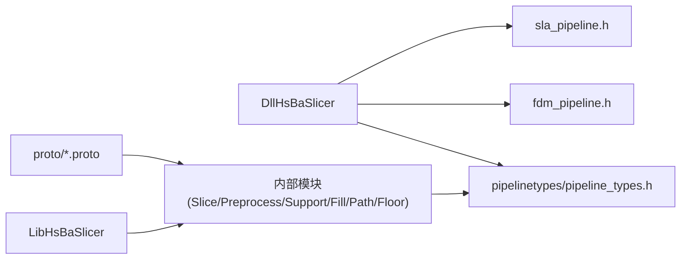

# API 参考文档

<cite>
**本文引用的文件**   
- [README.md](file://README.md)
- [dllexport.h](file://DllHsBaSlicer/dllexport.h)
- [export.h](file://LibHsBaSlicer/export.h)
- [initialize.h](file://DllHsBaSlicer/initialize.h)
- [version_info.h](file://DllHsBaSlicer/version_info.h)
- [fdm_pipeline.h](file://DllHsBaSlicer/fdm_pipeline.h)
- [sla_pipeline.h](file://DllHsBaSlicer/sla_pipeline.h)
- [pipeline_types.h](file://pipelinetypes/pipeline_types.h)
- [base_config.proto](file://proto/base_config.proto)
- [fdm_pipeline.proto](file://proto/fdm_pipeline.proto)
</cite>

## 目录
1. [简介](#简介)
2. [项目结构](#项目结构)
3. [核心组件](#核心组件)
4. [架构总览](#架构总览)
5. [详细组件分析](#详细组件分析)
6. [依赖关系分析](#依赖关系分析)
7. [性能与线程安全](#性能与线程安全)
8. [故障排除指南](#故障排除指南)
9. [结论](#结论)
10. [附录：API 速查表](#附录api-速查表)

## 简介
本 API 参考文档面向集成开发者，覆盖 HsBaSlicer 的 C ABI、C++ 库导出宏、Protobuf 消息定义以及 Lua 脚本扩展点。文档按功能模块组织，包含函数签名、参数说明、返回值、错误处理、线程安全性、性能特征与版本兼容性信息，并提供可操作的代码示例路径与最佳实践。

- 动态库 DllHsBaSlicer 提供 C ABI，供外部语言（Java/C#/Python 等）调用。
- 静态库 LibHsBaSlicer 暴露 C++ 全流程切片能力封装。
- Protobuf 定义位于 proto 目录，用于跨语言配置与结果序列化。
- Lua 脚本系统通过全局 HsBa 表暴露流水线构建块，支持自定义填充、支撑、层板与导出逻辑。

**章节来源**
- [README.md:100-150](file://README.md#L100-L150)

## 项目结构
HsBaSlicer 采用模块化设计，主要对外接口集中在以下位置：
- DllHsBaSlicer：C ABI 导出头与实现，包括初始化、版本查询、FDM/SLA 流水线入口。
- pipelinetypes：纯 C 兼容的结构体与枚举，描述所有流水线配置与结果。
- proto：Protobuf 消息定义，对应各技术栈的配置与结果。
- LibHsBaSlicer：C++ 库导出宏与内部模块头（如 Slice、Preprocess、Support、Fill、Path、Floor）。



**图表来源**
- [initialize.h:14-19](file://DllHsBaSlicer/initialize.h#L14-L19)
- [fdm_pipeline.h:17-61](file://DllHsBaSlicer/fdm_pipeline.h#L17-L61)
- [sla_pipeline.h:17-56](file://DllHsBaSlicer/sla_pipeline.h#L17-L56)
- [version_info.h:16-41](file://DllHsBaSlicer/version_info.h#L16-L41)

**章节来源**
- [README.md:100-150](file://README.md#L100-L150)

## 核心组件
本节概述对外 API 的核心组成：
- C ABI 导出宏：HSBA_SLICER_API（DLL）、HSBA_SLICER_LIB_API（LIB）。
- 初始化与版本查询：initialize、HsBaGetVersionJson/XML、HsBaFreeVersionString。
- 流水线类型定义：FDM/SLA/SLS/SLM/LOM/TDP/WAAM/FileTransfer/Custom 的配置与结果结构体。
- 流水线入口：FDM/SLA 同步与异步运行函数，以及结果释放函数。

```mermaid
classDiagram
class HSBA_SLICER_API {
<<macro>>
"Windows 导出/导入标记"
}
class HSBA_SLICER_LIB_API {
<<macro>>
"C++ 库导出/导入标记"
}
class Initialize {
+initialize() void
}
class VersionInfo {
+HsBaGetVersionJson() char*
+HsBaGetVersionXml() char*
+HsBaFreeVersionString(str) void
}
class PipelineTypes {
<<structs/enums>>
"FDM/SLA/SLS/SLM/LOM/TDP/WAAM/FileTransfer/Custom"
}
class FDM_API {
+HsBaCreateDefaultConfig() HsBaFdmPipelineConfig_t
+HsBaRunFdmPipeline(config, callback, user_data) HsBaFdmPipelineResult_t
+HsBaRunFdmPipelineAsync(...)
+HsBaFreePipelineResult(result) void
}
class SLA_API {
+HsBaCreateDefaultSlaConfig() HsBaSlaPipelineConfig_t
+HsBaRunSlaPipeline(config, callback, user_data) HsBaSlaPipelineResult_t
+HsBaRunSlaPipelineAsync(...)
+HsBaFreeSlaPipelineResult(result) void
}
HSBA_SLICER_API <.. FDM_API : "导出"
HSBA_SLICER_API <.. SLA_API : "导出"
HSBA_SLICER_LIB_API <.. PipelineTypes : "C++ 使用"
Initialize --> FDM_API : "初始化后调用"
VersionInfo --> FDM_API : "版本检查"
```

**图表来源**
- [dllexport.h:9-20](file://DllHsBaSlicer/dllexport.h#L9-L20)
- [export.h:9-20](file://LibHsBaSlicer/export.h#L9-L20)
- [initialize.h:14-19](file://DllHsBaSlicer/initialize.h#L14-L19)
- [version_info.h:16-41](file://DllHsBaSlicer/version_info.h#L16-L41)
- [fdm_pipeline.h:17-61](file://DllHsBaSlicer/fdm_pipeline.h#L17-L61)
- [sla_pipeline.h:17-56](file://DllHsBaSlicer/sla_pipeline.h#L17-L56)
- [pipeline_types.h:23-127](file://pipelinetypes/pipeline_types.h#L23-L127)

**章节来源**
- [dllexport.h:1-23](file://DllHsBaSlicer/dllexport.h#L1-L23)
- [export.h:1-22](file://LibHsBaSlicer/export.h#L1-L22)
- [initialize.h:1-22](file://DllHsBaSlicer/initialize.h#L1-L22)
- [version_info.h:1-48](file://DllHsBaSlicer/version_info.h#L1-L48)
- [fdm_pipeline.h:1-68](file://DllHsBaSlicer/fdm_pipeline.h#L1-L68)
- [sla_pipeline.h:1-63](file://DllHsBaSlicer/sla_pipeline.h#L1-L63)
- [pipeline_types.h:1-127](file://pipelinetypes/pipeline_types.h#L1-L127)

## 架构总览
HsBaSlicer 的对外架构由三层构成：
- 应用层：调用方（C/C++/Lua/其他语言）通过 C ABI 或 C++ 库接口发起请求。
- 流水线层：根据技术类型（FDM/SLA/SLS/SLM/LOM/TDP/WAAM）执行预处理、切片、支撑、填充、路径生成与导出。
- 数据层：模型加载、网格/CAD 模型、路径输出、文件传输、参数存储等。



**图表来源**
- [initialize.h:14-19](file://DllHsBaSlicer/initialize.h#L14-L19)
- [fdm_pipeline.h:23-51](file://DllHsBaSlicer/fdm_pipeline.h#L23-L51)
- [sla_pipeline.h:23-47](file://DllHsBaSlicer/sla_pipeline.h#L23-L47)
- [pipeline_types.h:53-127](file://pipelinetypes/pipeline_types.h#L53-L127)

## 详细组件分析

### C ABI 初始化与版本查询
- initialize：一次性初始化 DLL，注册 Lua 函数与流水线；重复调用无副作用。
- HsBaGetVersionJson/HsBaGetVersionXml：返回 UTF-8 JSON/XML 字符串，需调用 HsBaFreeVersionString 释放。
- 线程安全性：初始化应在单线程启动阶段完成；版本查询为只读操作，可并发访问。



**图表来源**
- [initialize.h:14-19](file://DllHsBaSlicer/initialize.h#L14-L19)

**章节来源**
- [initialize.h:1-22](file://DllHsBaSlicer/initialize.h#L1-L22)
- [version_info.h:1-48](file://DllHsBaSlicer/version_info.h#L1-L48)

### FDM 流水线 C ABI
- HsBaCreateDefaultConfig：创建默认 FDM 配置。
- HsBaRunFdmPipeline：同步执行，内部使用协程阻塞直到结果就绪；流水线顺序：预处理 -> 切片 -> 支撑 -> 填充 -> 路径生成。
- HsBaRunFdmPipelineAsync：异步执行，通过回调返回结果。
- HsBaFreePipelineResult：释放 gcode_content 与 error_message 内存。



**图表来源**
- [fdm_pipeline.h:23-61](file://DllHsBaSlicer/fdm_pipeline.h#L23-L61)
- [pipeline_types.h:53-127](file://pipelinetypes/pipeline_types.h#L53-L127)

**章节来源**
- [fdm_pipeline.h:1-68](file://DllHsBaSlicer/fdm_pipeline.h#L1-L68)
- [pipeline_types.h:23-127](file://pipelinetypes/pipeline_types.h#L23-L127)

### SLA 流水线 C ABI
- HsBaCreateDefaultSlaConfig：创建默认 SLA 配置。
- HsBaRunSlaPipeline：同步执行；流水线顺序：预处理 -> 切片 -> 层板 -> 支撑 -> 导出（zip）。
- HsBaRunSlaPipelineAsync：异步执行，通过回调返回结果。
- HsBaFreeSlaPipelineResult：释放 export_path 与 error_message 内存。



**图表来源**
- [sla_pipeline.h:23-56](file://DllHsBaSlicer/sla_pipeline.h#L23-L56)
- [pipeline_types.h:165-232](file://pipelinetypes/pipeline_types.h#L165-L232)

**章节来源**
- [sla_pipeline.h:1-63](file://DllHsBaSlicer/sla_pipeline.h#L1-L63)
- [pipeline_types.h:145-232](file://pipelinetypes/pipeline_types.h#L145-L232)

### Protobuf 消息定义
- base_config.proto：通用基础配置，包含技术类型、配置文件格式、输出类型与文件名。
- fdm_pipeline.proto：FDM 流水线配置与结果消息，字段与 pipeline_types.h 中的 C 结构体一一对应。



**图表来源**
- [base_config.proto:1-132](file://proto/base_config.proto#L1-L132)
- [fdm_pipeline.proto:1-81](file://proto/fdm_pipeline.proto#L1-L81)

**章节来源**
- [base_config.proto:1-132](file://proto/base_config.proto#L1-L132)
- [fdm_pipeline.proto:1-81](file://proto/fdm_pipeline.proto#L1-L81)

### Lua 脚本扩展点
- 自定义流水线：HsBaCustomPipelineConfig_t 允许完全由 Lua 驱动整个流程，C++ 侧仅暴露构建块（模型加载、切片、支撑、填充、层板、G-code 路径输出、SLA/SLS 打包）。
- 内置脚本钩子：FDM/SLA 等流水线支持通过 support_lua_script/support_lua_func、infill_lua_script/infill_lua_func、floor_lua_script/floor_lua_func、export_lua_script/export_lua_func 指定自定义脚本与函数名。
- 线程安全性：Lua 脚本在流水线内部执行，应避免长时间阻塞主线程；建议使用异步流水线并在回调中处理结果。



**图表来源**
- [pipeline_types.h:676-732](file://pipelinetypes/pipeline_types.h#L676-L732)
- [pipeline_types.h:53-127](file://pipelinetypes/pipeline_types.h#L53-L127)
- [pipeline_types.h:165-232](file://pipelinetypes/pipeline_types.h#L165-L232)

**章节来源**
- [pipeline_types.h:676-732](file://pipelinetypes/pipeline_types.h#L676-L732)
- [pipeline_types.h:53-127](file://pipelinetypes/pipeline_types.h#L53-L127)
- [pipeline_types.h:165-232](file://pipelinetypes/pipeline_types.h#L165-L232)

## 依赖关系分析
- DllHsBaSlicer 依赖 pipelinetypes 提供的 C 兼容结构体与枚举。
- LibHsBaSlicer 通过 HSBA_SLICER_LIB_API 导出 C++ 接口，内部模块（Slice、Preprocess、Support、Fill、Path、Floor）被流水线调用。
- Proto 定义与 C 结构体保持语义一致，便于跨语言转换。



**图表来源**
- [fdm_pipeline.h:9-10](file://DllHsBaSlicer/fdm_pipeline.h#L9-L10)
- [sla_pipeline.h:9-10](file://DllHsBaSlicer/sla_pipeline.h#L9-L10)
- [pipeline_types.h:1-12](file://pipelinetypes/pipeline_types.h#L1-L12)

**章节来源**
- [fdm_pipeline.h:1-68](file://DllHsBaSlicer/fdm_pipeline.h#L1-L68)
- [sla_pipeline.h:1-63](file://DllHsBaSlicer/sla_pipeline.h#L1-L63)
- [pipeline_types.h:1-12](file://pipelinetypes/pipeline_types.h#L1-L12)

## 性能与线程安全
- 同步流水线：HsBaRunFdmPipeline/HsBaRunSlaPipeline 内部使用协程阻塞直到结果就绪，适合简单调用场景。
- 异步流水线：HsBaRunFdmPipelineAsync/HsBaRunSlaPipelineAsync 非阻塞，通过回调返回结果，适合 UI 或高并发场景。
- 进度回调：所有流水线均支持进度回调，便于更新 UI 或记录日志。
- 线程安全：
  - initialize 应在单线程启动阶段调用一次。
  - 流水线函数本身可多线程调用，但需注意共享资源（如 Lua 状态、文件 I/O）的并发访问控制。
  - 结果结构体中的字符串指针必须由调用方在适当时机释放。

[本节为一般性指导，不直接分析具体文件]

## 故障排除指南
- 常见错误：
  - 未调用 initialize：导致 Lua 函数未注册，自定义脚本无法加载。
  - 忘记释放结果：gcode_content、error_message、export_path 等字符串需调用对应释放函数。
  - 配置字段为空：model_path、output_path、host/port 等必填字段为空将导致失败。
- 调试建议：
  - 使用 HsBaGetVersionJson/XML 检查版本与许可证信息。
  - 启用进度回调，观察流水线阶段耗时与错误阶段。
  - 对 Lua 脚本进行单元测试，确保函数名与脚本路径正确。

**章节来源**
- [version_info.h:16-41](file://DllHsBaSlicer/version_info.h#L16-L41)
- [fdm_pipeline.h:53-61](file://DllHsBaSlicer/fdm_pipeline.h#L53-L61)
- [sla_pipeline.h:49-56](file://DllHsBaSlicer/sla_pipeline.h#L49-L56)

## 结论
HsBaSlicer 提供了完整的 C ABI、C++ 库与 Protobuf 定义，支持多技术栈的切片流水线。通过 Lua 脚本扩展点，开发者可以灵活定制支撑、填充、层板与导出逻辑。建议在集成时优先使用异步流水线与进度回调，并严格遵循内存释放与初始化规范，以确保稳定与高性能。

[本节为总结性内容，不直接分析具体文件]

## 附录：API 速查表

### C ABI 函数速查
- 初始化与版本
  - initialize：初始化 DLL，注册 Lua 与流水线。
  - HsBaGetVersionJson/HsBaGetVersionXml：获取版本信息（JSON/XML），需 HsBaFreeVersionString 释放。
- FDM 流水线
  - HsBaCreateDefaultConfig：创建默认配置。
  - HsBaRunFdmPipeline：同步执行。
  - HsBaRunFdmPipelineAsync：异步执行。
  - HsBaFreePipelineResult：释放结果内存。
- SLA 流水线
  - HsBaCreateDefaultSlaConfig：创建默认配置。
  - HsBaRunSlaPipeline：同步执行。
  - HsBaRunSlaPipelineAsync：异步执行。
  - HsBaFreeSlaPipelineResult：释放结果内存。

**章节来源**
- [initialize.h:14-19](file://DllHsBaSlicer/initialize.h#L14-L19)
- [version_info.h:16-41](file://DllHsBaSlicer/version_info.h#L16-L41)
- [fdm_pipeline.h:17-61](file://DllHsBaSlicer/fdm_pipeline.h#L17-L61)
- [sla_pipeline.h:17-56](file://DllHsBaSlicer/sla_pipeline.h#L17-L56)

### 配置与结果结构体速查
- FDM：HsBaFdmPipelineConfig_t、HsBaFdmPipelineResult_t
- SLA：HsBaSlaPipelineConfig_t、HsBaSlaPipelineResult_t
- SLS：HsBaSlsPipelineConfig_t、HsBaSlsPipelineResult_t
- SLM：HsBaSlmPipelineConfig_t、HsBaSlmPipelineResult_t
- LOM：HsBaLomPipelineConfig_t、HsBaLomPipelineResult_t
- TDP：HsBaTdpPipelineConfig_t、HsBaTdpPipelineResult_t
- WAAM：HsBaWaamPipelineConfig_t、HsBaWaamPipelineResult_t
- FileTransfer：HsBaFileTransferPipelineConfig_t、HsBaFileTransferPipelineResult_t
- Custom：HsBaCustomPipelineConfig_t、HsBaCustomPipelineResult_t

**章节来源**
- [pipeline_types.h:53-127](file://pipelinetypes/pipeline_types.h#L53-L127)
- [pipeline_types.h:165-232](file://pipelinetypes/pipeline_types.h#L165-L232)
- [pipeline_types.h:247-310](file://pipelinetypes/pipeline_types.h#L247-L310)
- [pipeline_types.h:312-401](file://pipelinetypes/pipeline_types.h#L312-L401)
- [pipeline_types.h:403-461](file://pipelinetypes/pipeline_types.h#L403-L461)
- [pipeline_types.h:463-521](file://pipelinetypes/pipeline_types.h#L463-L521)
- [pipeline_types.h:523-625](file://pipelinetypes/pipeline_types.h#L523-L625)
- [pipeline_types.h:627-674](file://pipelinetypes/pipeline_types.h#L627-L674)
- [pipeline_types.h:676-732](file://pipelinetypes/pipeline_types.h#L676-L732)

### Protobuf 消息速查
- base_config.proto：msg_base_config（版本、技术类型、配置文件格式、输出类型、输出文件名）
- fdm_pipeline.proto：msg_fdm_pipeline_config、msg_fdm_pipe_result

**章节来源**
- [base_config.proto:125-132](file://proto/base_config.proto#L125-L132)
- [fdm_pipeline.proto:26-81](file://proto/fdm_pipeline.proto#L26-L81)