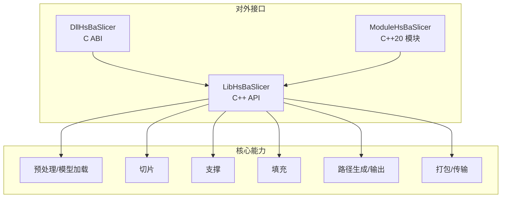
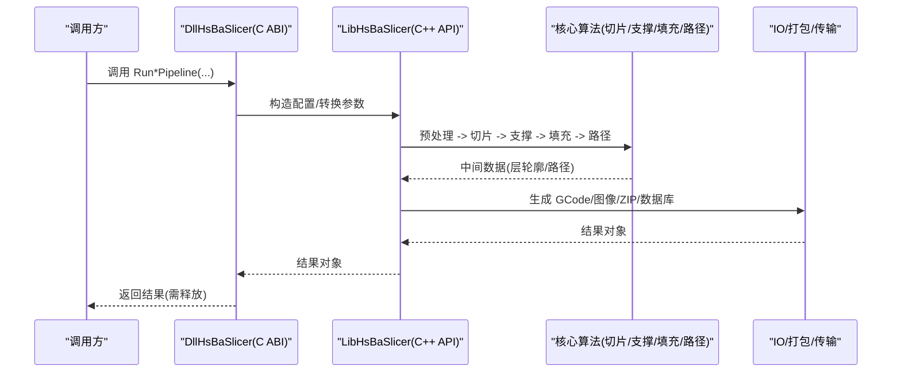
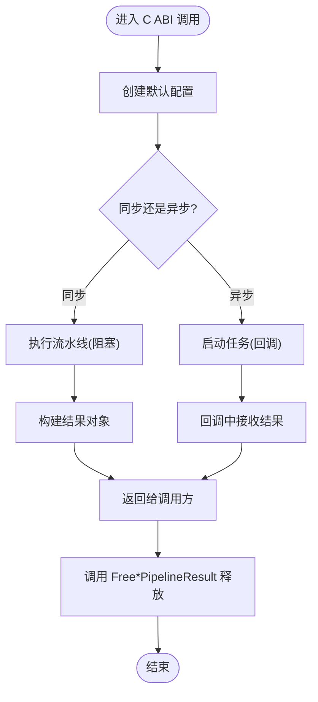
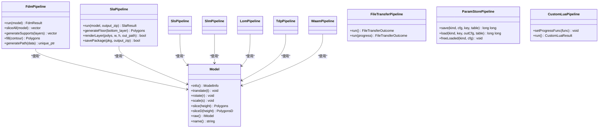
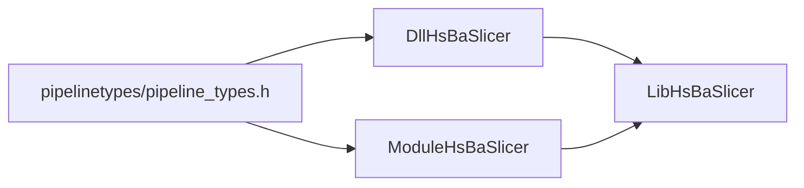

# API 参考文档

<cite>
**本文引用的文件**   
- [README.md](file://README.md)
- [dllexport.h](file://DllHsBaSlicer/dllexport.h)
- [initialize.h](file://DllHsBaSlicer/initialize.h)
- [version_info.h](file://DllHsBaSlicer/version_info.h)
- [fdm_pipeline.h](file://DllHsBaSlicer/fdm_pipeline.h)
- [sla_pipeline.h](file://DllHsBaSlicer/sla_pipeline.h)
- [sls_pipeline.h](file://DllHsBaSlicer/sls_pipeline.h)
- [slm_pipeline.h](file://DllHsBaSlicer/slm_pipeline.h)
- [lom_pipeline.h](file://DllHsBaSlicer/lom_pipeline.h)
- [tdp_pipeline.h](file://DllHsBaSlicer/tdp_pipeline.h)
- [export.h](file://LibHsBaSlicer/export.h)
- [version_info.hpp](file://LibHsBaSlicer/version_info.hpp)
- [hsba_slicer.cppm](file://ModuleHsBaSlicer/hsba_slicer.cppm)
</cite>

## 目录
1. [简介](#简介)
2. [项目结构](#项目结构)
3. [核心组件](#核心组件)
4. [架构总览](#架构总览)
5. [详细组件分析](#详细组件分析)
6. [依赖关系分析](#依赖关系分析)
7. [性能与线程安全](#性能与线程安全)
8. [故障排查指南](#故障排查指南)
9. [结论](#结论)
10. [附录：迁移与集成指南](#附录迁移与集成指南)

## 简介
本文件为 HsBaSlicer 的完整 API 参考，覆盖三类接口：
- C ABI 接口（动态库 DllHsBaSlicer）：面向外部语言（Java/C#/Python 等）的稳定 ABI。
- C++ API（静态/共享库 LibHsBaSlicer）：面向 C++ 开发者的全流程切片能力封装。
- C++20 模块接口（ModuleHsBaSlicer）：基于 hsba.slicer 模块的现代 C++ 类式 API。

目标读者包括后端开发者、跨语言集成工程师以及需要高性能切片能力的研究者与生产环境用户。

## 项目结构
HsBaSlicer 提供三种对外暴露方式：
- DllHsBaSlicer：导出 C ABI，包含初始化、版本查询与各工艺流水线（FDM/SLA/SLS/SLM/LOM/TDP/WAAM 等）。
- LibHsBaSlicer：C++ 全流程封装，提供模型加载、切片、支撑、填充、路径生成、打包等函数。
- ModuleHsBaSlicer：C++20 module，以类式 API 包装 LibHsBaSlicer，提供更易用的现代 C++ 体验。

图表来源
- [README.md:104-124](file://README.md#L104-L124)
- [dll.h:1-23](file://DllHsBaSlicer/dllexport.h#L1-L23)
- [export.h:1-22](file://LibHsBaSlicer/export.h#L1-L22)
- [hsba_slicer.cppm:1-65](file://ModuleHsBaSlicer/hsba_slicer.cppm#L1-L65)

章节来源
- [README.md:104-124](file://README.md#L104-L124)

## 核心组件
本节概述三类接口的职责与适用场景：
- C ABI（DllHsBaSlicer）
  - 适用场景：跨语言调用、脚本语言绑定、Android/iOS 原生桥接、游戏引擎集成。
  - 特点：ABI 稳定、同步/异步执行、回调进度、结果需显式释放。
- C++ API（LibHsBaSlicer）
  - 适用场景：C++ 应用直接链接、二次封装、内部工具链。
  - 特点：函数式 API、返回 std::string 等类型、无需手动释放字符串。
- C++20 模块（ModuleHsBaSlicer）
  - 适用场景：现代 C++ 工程、希望使用 RAII 与类式 API。
  - 特点：类封装（Model/FdmPipeline/SlaPipeline 等）、异常 SlicerError、默认配置工厂函数。

章节来源
- [README.md:104-124](file://README.md#L104-L124)
- [hsba_slicer.cppm:65-146](file://ModuleHsBaSlicer/hsba_slicer.cppm#L65-L146)

## 架构总览
下图展示从入口到各阶段的数据流与控制流。

图表来源
- [fdm_pipeline.h:17-61](file://DllHsBaSlicer/fdm_pipeline.h#L17-L61)
- [sla_pipeline.h:17-56](file://DllHsBaSlicer/sla_pipeline.h#L17-L56)
- [hsba_slicer.cppm:617-751](file://ModuleHsBaSlicer/hsba_slicer.cppm#L617-L751)

## 详细组件分析

### C ABI 接口（DllHsBaSlicer）
- 公共头文件与宏
  - dllexport.h：定义 HSBA_SLICER_API 导出宏，Windows 下区分 dllimport/dllexport，非 Windows 无装饰。
  - initialize.h：提供 initialize()，用于一次性注册 Lua 函数、流水线与运行时设置；可重复调用且幂等。
  - version_info.h：提供 HsBaGetVersionJson/HsBaGetVersionXml/HsBaFreeVersionString，返回 UTF-8 字符串，必须由调用方释放。

- FDM 流水线（fdm_pipeline.h）
  - HsBaCreateDefaultConfig：创建默认配置。
  - HsBaRunFdmPipeline：同步运行，内部使用协程阻塞等待结果；流水线顺序：预处理 -> 切片 -> 支撑 -> 填充 -> 路径生成。
  - HsBaRunFdmPipelineAsync：异步运行，通过回调返回结果。
  - HsBaFreePipelineResult：释放 gcode_content 与 error_message 等内部分配内存。

- SLA 流水线（sla_pipeline.h）
  - HsBaCreateDefaultSlaConfig：创建默认配置。
  - HsBaRunSlaPipeline：同步运行；流水线顺序：预处理 -> 切片 -> 底板 -> 支撑 -> 导出(zip)。
  - HsBaRunSlaPipelineAsync：异步运行。
  - HsBaFreeSlaPipelineResult：释放结果内存。

- SLS/SLM/LOM/TDP 流水线（sls_pipeline.h / slm_pipeline.h / lom_pipeline.h / tdp_pipeline.h）
  - 统一模式：CreateDefault*Config + Run*Pipeline(同步/异步) + Free*PipelineResult。
  - 共同点：导出阶段由 Lua 脚本驱动（zip + 数据库），config.export_lua_script 不可为空。
  - 差异点：工艺参数与语义不同（如 SLM 金属粉末床、LOM 层压制造、TDP 粘结剂喷射）。

- 版本信息（version_info.h）
  - HsBaGetVersionJson/HsBaGetVersionXml：返回 JSON/XML 字符串。
  - HsBaFreeVersionString：释放上述函数分配的字符串。

图表来源
- [fdm_pipeline.h:17-61](file://DllHsBaSlicer/fdm_pipeline.h#L17-L61)
- [sla_pipeline.h:17-56](file://DllHsBaSlicer/sla_pipeline.h#L17-L56)
- [sls_pipeline.h:17-56](file://DllHsBaSlicer/sls_pipeline.h#L17-L56)
- [slm_pipeline.h:17-56](file://DllHsBaSlicer/slm_pipeline.h#L17-L56)
- [lom_pipeline.h:17-56](file://DllHsBaSlicer/lom_pipeline.h#L17-L56)
- [tdp_pipeline.h:17-56](file://DllHsBaSlicer/tdp_pipeline.h#L17-L56)

章节来源
- [dllexport.h:1-23](file://DllHsBaSlicer/dllexport.h#L1-L23)
- [initialize.h:1-22](file://DllHsBaSlicer/initialize.h#L1-L22)
- [version_info.h:1-48](file://DllHsBaSlicer/version_info.h#L1-L48)
- [fdm_pipeline.h:1-68](file://DllHsBaSlicer/fdm_pipeline.h#L1-L68)
- [sla_pipeline.h:1-63](file://DllHsBaSlicer/sla_pipeline.h#L1-L63)
- [sls_pipeline.h:1-63](file://DllHsBaSlicer/sls_pipeline.h#L1-L63)
- [slm_pipeline.h:1-63](file://DllHsBaSlicer/slm_pipeline.h#L1-L63)
- [lom_pipeline.h:1-63](file://DllHsBaSlicer/lom_pipeline.h#L1-L63)
- [tdp_pipeline.h:1-63](file://DllHsBaSlicer/tdp_pipeline.h#L1-L63)

### C++ API（LibHsBaSlicer）
- 导出宏
  - export.h：定义 HSBA_SLICER_LIB_API，Windows 下区分 dllimport/dllexport，非 Windows 无装饰。

- 版本信息
  - version_info.hpp：命名空间 HsBa::Slicer 下提供 GetVersionJson()/GetVersionXml()，返回 std::string。

- 典型能力（在模块层有类式封装，底层对应 Lib 层自由函数）
  - 模型加载/变换/切片：LoadModel/RemoveModel/TranslateModel/RotateModel/ScaleModel/Slice 等。
  - 支撑/填充/路径：GenerateAllFdmSupport/LuaCustomSupport/FillWithBorder/GenerateGCodePathV2 等。
  - 打包/传输：SaveSlaPackage/RenderPolygonsToImage/FileTransfer 相关函数。

说明：LibHsBaSlicer 的具体函数签名较多，模块层已将其封装为类与便捷函数。建议优先使用模块层 API；若需更细粒度控制，可直接链接 LibHsBaSlicer 并调用其自由函数。

章节来源
- [export.h:1-22](file://LibHsBaSlicer/export.h#L1-L22)
- [version_info.hpp:1-30](file://LibHsBaSlicer/version_info.hpp#L1-L30)
- [hsba_slicer.cppm:37-62](file://ModuleHsBaSlicer/hsba_slicer.cppm#L37-L62)

### C++20 模块接口（ModuleHsBaSlicer）
- 模块声明
  - hsba_slicer.cppm：module; 全局片段引入标准库与第三方库，随后 export module hsba.slicer; 暴露命名空间 HsBa::Slicer。

- 类型与异常
  - SlicerError：继承 std::runtime_error，作为所有切片错误的基类。
  - 重导出常用类型：Point2/Polygon/Polygons、Point2D/PolygonD/PolygonsD、各 PipelineConfig/Result、SupportConfig 等。

- 默认配置工厂
  - defaultFdmConfig/defaultSlaConfig/defaultSlsConfig/defaultFileTransferConfig/defaultCustomConfig/defaultSlmConfig/defaultLomConfig/defaultTdpConfig/defaultWaamConfig。

- 模型 RAII 包装
  - Model：构造时加载模型，析构时移除；提供 info/translate/rotate/scale/slice/sliceD/raw/name 等方法。

- 流水线类
  - FdmPipeline：run(sliceAll/generateSupports/fill/generatePath)，最终生成 GCode。
  - SlaPipeline：run(generateFloor/renderLayer/savePackage)，最终输出 zip。
  - SlsPipeline/SlmPipeline/LomPipeline/TdpPipeline/WaamPipeline：run(model) 由 Lua 脚本驱动导出。
  - FileTransferPipeline：run()/run(progress) 支持进度回调。
  - ParamStorePipeline：save/load/freeLoaded，持久化/恢复流程参数。
  - CustomLuaPipeline：setProgressFunc/run，完全由 Lua 编排。

- 扩展与事件
  - add2DFunction/add3DFunction/addFileFunction：注册外部 Lua 函数。
  - addEventCallback/addZipperEventCallback/addDBEventCallback：注册事件回调。

- 工具函数
  - toDouble/toInt：整数/双精度多边形互转。
  - versionJson/versionXml：获取版本信息。

图表来源
- [hsba_slicer.cppm:129-146](file://ModuleHsBaSlicer/hsba_slicer.cppm#L129-L146)
- [hsba_slicer.cppm:152-191](file://ModuleHsBaSlicer/hsba_slicer.cppm#L152-L191)
- [hsba_slicer.cppm:197-225](file://ModuleHsBaSlicer/hsba_slicer.cppm#L197-L225)
- [hsba_slicer.cppm:231-258](file://ModuleHsBaSlicer/hsba_slicer.cppm#L231-L258)
- [hsba_slicer.cppm:264-348](file://ModuleHsBaSlicer/hsba_slicer.cppm#L264-L348)
- [hsba_slicer.cppm:354-445](file://ModuleHsBaSlicer/hsba_slicer.cppm#L354-L445)
- [hsba_slicer.cppm:451-479](file://ModuleHsBaSlicer/hsba_slicer.cppm#L451-L479)

章节来源
- [hsba_slicer.cppm:1-65](file://ModuleHsBaSlicer/hsba_slicer.cppm#L1-L65)
- [hsba_slicer.cppm:67-146](file://ModuleHsBaSlicer/hsba_slicer.cppm#L67-L146)
- [hsba_slicer.cppm:152-191](file://ModuleHsBaSlicer/hsba_slicer.cppm#L152-L191)
- [hsba_slicer.cppm:197-225](file://ModuleHsBaSlicer/hsba_slicer.cppm#L197-L225)
- [hsba_slicer.cppm:231-258](file://ModuleHsBaSlicer/hsba_slicer.cppm#L231-L258)
- [hsba_slicer.cppm:264-348](file://ModuleHsBaSlicer/hsba_slicer.cppm#L264-L348)
- [hsba_slicer.cppm:354-445](file://ModuleHsBaSlicer/hsba_slicer.cppm#L354-L445)
- [hsba_slicer.cppm:451-479](file://ModuleHsBaSlicer/hsba_slicer.cppm#L451-L479)

## 依赖关系分析
- DllHsBaSlicer 依赖 LibHsBaSlicer 的核心能力，并通过 C ABI 暴露给外部语言。
- ModuleHsBaSlicer 依赖 LibHsBaSlicer，并以类式 API 包装自由函数。
- 公共类型（pipeline_types.h）在各层复用，保证 ABI 与 C++ 侧一致性。

图表来源
- [README.md:104-124](file://README.md#L104-L124)
- [hsba_slicer.cppm:37-62](file://ModuleHsBaSlicer/hsba_slicer.cppm#L37-L62)

章节来源
- [README.md:104-124](file://README.md#L104-L124)

## 性能与线程安全
- 性能特性
  - 内部大量使用 C++20 协程进行异步流水线调度，避免阻塞主线程。
  - 模块化设计允许按需启用功能（如仅 FDM 或仅 SLA），减少编译与运行开销。
  - 多边形处理与几何计算集中在 2D/meshmodel 等子模块，利于优化与缓存局部性。

- 线程安全
  - C ABI 的 initialize() 是幂等的，适合在进程加载时调用一次。
  - 流水线函数本身不持有全局可变状态（配置由调用方传入），可在多线程中并发调用不同实例。
  - 回调函数（进度/结果）的执行上下文取决于实现，应避免在回调中进行耗时操作；必要时将任务投递到工作线程。

- 优化建议
  - 批量处理：对多个模型采用批处理策略，复用配置与资源。
  - 预取与缓存：对频繁使用的配置与脚本进行缓存。
  - 合理选择精度：整数多边形（Clipper2 Path64）性能优于双精度（PathD），仅在必要处转换。
  - 避免不必要的序列化：仅在最终输出时生成 GCode/ZIP，中间过程尽量保持二进制结构。

[本节为通用指导，不直接分析具体文件]

## 故障排查指南
- 常见问题
  - 未调用 initialize()：可能导致 Lua 函数或流水线未注册。应在进程启动时调用一次。
  - 忘记释放结果：C ABI 返回的字符串与结果对象必须调用对应的 Free 函数释放，否则会导致内存泄漏。
  - Lua 脚本路径错误：SLS/SLM/LOM/TDP 等导出阶段依赖 Lua 脚本，请确保 export_lua_script 指向有效路径。
  - 配置字段缺失或不合法：检查 config 中的必填字段（如 layer_height、line_width、nozzle_diameter 等）。

- 诊断手段
  - 使用 HsBaGetVersionJson/HsBaGetVersionXml 确认当前库版本与许可证信息。
  - 在回调中记录进度与错误消息，便于定位失败阶段。
  - 对于 C++ 模块 API，捕获 SlicerError 并打印异常信息。

章节来源
- [initialize.h:1-22](file://DllHsBaSlicer/initialize.h#L1-L22)
- [version_info.h:16-41](file://DllHsBaSlicer/version_info.h#L16-L41)
- [fdm_pipeline.h:53-61](file://DllHsBaSlicer/fdm_pipeline.h#L53-L61)
- [hsba_slicer.cppm:74-79](file://ModuleHsBaSlicer/hsba_slicer.cppm#L74-L79)

## 结论
HsBaSlicer 提供了三层接口以满足不同集成需求：
- C ABI（DllHsBaSlicer）适合跨语言与平台集成，具备稳定的 ABI 与完善的异步/回调机制。
- C++ API（LibHsBaSlicer）适合 C++ 应用直接链接，提供丰富的自由函数。
- C++20 模块（ModuleHsBaSlicer）提供现代、安全的类式 API，推荐在新工程中优先使用。

根据业务场景选择合适的接口，并结合性能与线程安全建议进行集成与优化。

[本节为总结性内容，不直接分析具体文件]

## 附录：迁移与集成指南

### 从 C ABI 迁移到 C++20 模块
- 替换入口：不再需要 initialize() 与显式 Free 系列函数（模块层自动管理资源）。
- 使用类式 API：用 Model/FdmPipeline/SlaPipeline 等替代 Run*Pipeline 函数。
- 异常处理：使用 try/catch 捕获 SlicerError。
- 配置对象：使用 default*Config 工厂函数创建配置，再修改字段。

示例步骤（概念性）：
- 旧：调用 HsBaCreateDefaultConfig -> HsBaRunFdmPipeline -> HsBaFreePipelineResult。
- 新：defaultFdmConfig() -> FdmPipeline(cfg).run(Model(...))。

[本节为概念性指导，不直接分析具体文件]

### 跨语言集成要点（Java/C#/Python 等）
- 加载动态库后首先调用 initialize()。
- 使用 HsBaGetVersionJson/HsBaGetVersionXml 验证版本。
- 调用 Run*Pipeline 同步或异步执行，注意在回调中处理结果。
- 务必调用对应的 Free*PipelineResult 与 HsBaFreeVersionString 释放内存。

章节来源
- [initialize.h:1-22](file://DllHsBaSlicer/initialize.h#L1-L22)
- [version_info.h:16-41](file://DllHsBaSlicer/version_info.h#L16-L41)
- [fdm_pipeline.h:17-61](file://DllHsBaSlicer/fdm_pipeline.h#L17-L61)
- [sla_pipeline.h:17-56](file://DllHsBaSlicer/sla_pipeline.h#L17-L56)