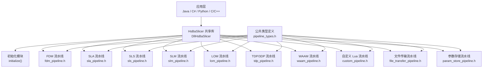
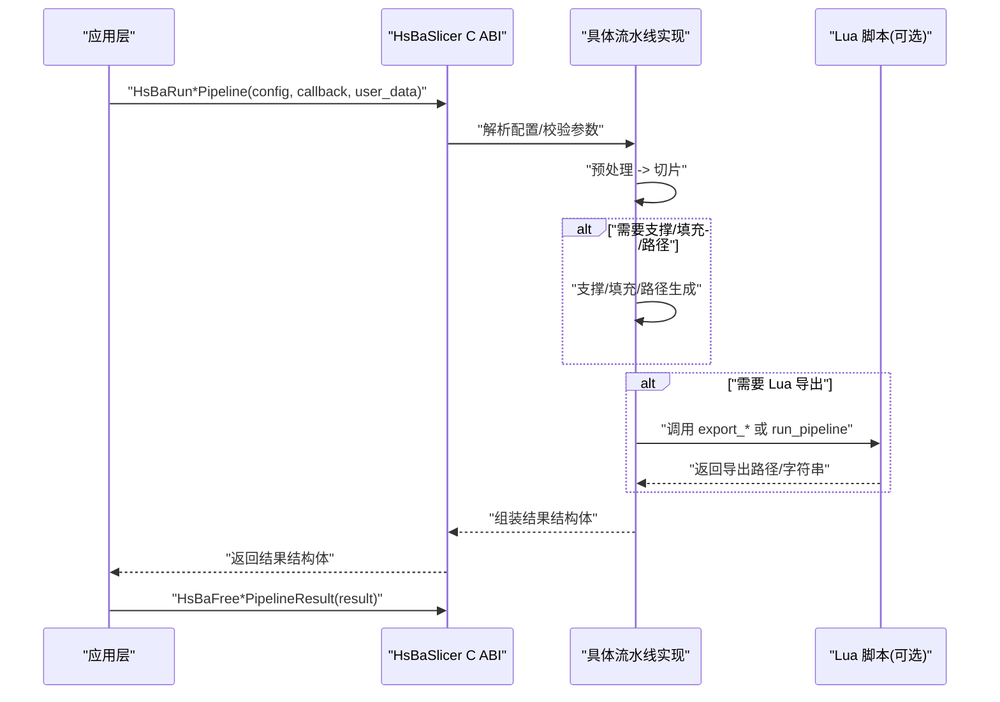
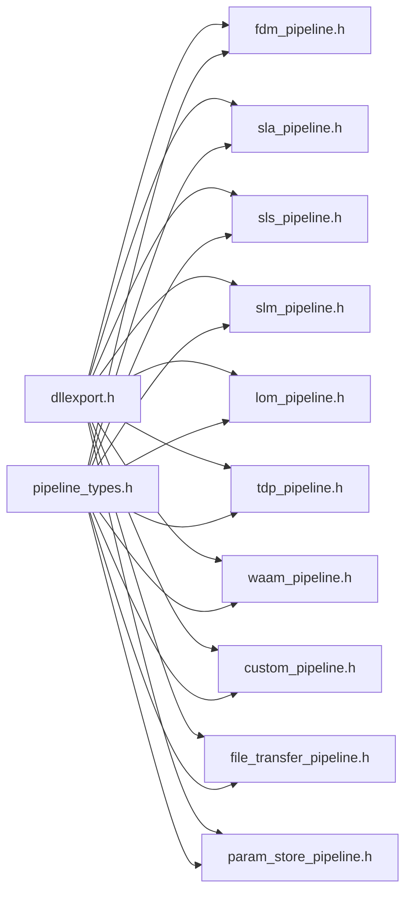

# C ABI 接口参考

<cite>
**本文引用的文件**   
- [dllexport.h](file://DllHsBaSlicer/dllexport.h)
- [initialize.h](file://DllHsBaSlicer/initialize.h)
- [initialize.cpp](file://DllHsBaSlicer/initialize.cpp)
- [pipeline_types.h](file://pipelinetypes/pipeline_types.h)
- [fdm_pipeline.h](file://DllHsBaSlicer/fdm_pipeline.h)
- [sla_pipeline.h](file://DllHsBaSlicer/sla_pipeline.h)
- [sls_pipeline.h](file://DllHsBaSlicer/sls_pipeline.h)
- [slm_pipeline.h](file://DllHsBaSlicer/slm_pipeline.h)
- [lom_pipeline.h](file://DllHsBaSlicer/lom_pipeline.h)
- [tdp_pipeline.h](file://DllHsBaSlicer/tdp_pipeline.h)
- [waam_pipeline.h](file://DllHsBaSlicer/waam_pipeline.h)
- [file_transfer_pipeline.h](file://DllHsBaSlicer/file_transfer_pipeline.h)
- [param_store_pipeline.h](file://DllHsBaSlicer/param_store_pipeline.h)
- [custom_pipeline.h](file://DllHsBaSlicer/custom_pipeline.h)
</cite>

## 目录
1. [简介](#简介)
2. [项目结构](#项目结构)
3. [核心组件](#核心组件)
4. [架构总览](#架构总览)
5. [详细组件分析](#详细组件分析)
6. [依赖关系分析](#依赖关系分析)
7. [性能与并发特性](#性能与并发特性)
8. [跨语言调用注意事项](#跨语言调用注意事项)
9. [故障排除指南](#故障排除指南)
10. [结论](#结论)
11. [附录：API 速查表](#附录api-速查表)

## 简介
本文件是 HsBaSlicer 的 C ABI 接口参考文档，聚焦 DllHsBaSlicer 导出的公共函数、配置与结果类型、回调约定、初始化生命周期以及跨语言调用要点。它覆盖 FDM、SLA、SLS、SLM、LOM、TDP（3DP）、WAAM、自定义 Lua 流水线、文件传输和参数存储等全部技术栈的 C 入口。

## 项目结构
C ABI 接口主要分布在以下位置：
- 导出宏定义：DllHsBaSlicer/dllexport.h
- 初始化入口：DllHsBaSlicer/initialize.{h,cpp}
- 公共类型定义：pipelinetypes/pipeline_types.h
- 各技术栈 C ABI 头文件：DllHsBaSlicer/*_pipeline.h

图表来源
- [initialize.h:1-22](file://DllHsBaSlicer/initialize.h#L1-L22)
- [fdm_pipeline.h:1-68](file://DllHsBaSlicer/fdm_pipeline.h#L1-L68)
- [sla_pipeline.h:1-63](file://DllHsBaSlicer/sla_pipeline.h#L1-L63)
- [sls_pipeline.h:1-63](file://DllHsBaSlicer/sls_pipeline.h#L1-L63)
- [slm_pipeline.h:1-63](file://DllHsBaSlicer/slm_pipeline.h#L1-L63)
- [lom_pipeline.h:1-63](file://DllHsBaSlicer/lom_pipeline.h#L1-L63)
- [tdp_pipeline.h:1-63](file://DllHsBaSlicer/tdp_pipeline.h#L1-L63)
- [waam_pipeline.h:1-64](file://DllHsBaSlicer/waam_pipeline.h#L1-L64)
- [custom_pipeline.h:1-69](file://DllHsBaSlicer/custom_pipeline.h#L1-L69)
- [file_transfer_pipeline.h:1-67](file://DllHsBaSlicer/file_transfer_pipeline.h#L1-L67)
- [param_store_pipeline.h:1-76](file://DllHsBaSlicer/param_store_pipeline.h#L1-L76)
- [pipeline_types.h:1-1050](file://pipelinetypes/pipeline_types.h#L1-L1050)

章节来源
- [initialize.h:1-22](file://DllHsBaSlicer/initialize.h#L1-L22)
- [pipeline_types.h:1-1050](file://pipelinetypes/pipeline_types.h#L1-L1050)

## 核心组件
本节汇总所有通过 C ABI 暴露的公共函数族，并说明其职责、输入输出与内存所有权。

- 初始化
  - initialize(): 一次性初始化 DLL（Lua 注册、流水线注册、运行时一次性设置）。可安全重复调用，重复调用无额外效果。
- 公共类型
  - 所有流水线配置与结果结构体在 pipeline_types.h 中定义，使用 extern "C" 暴露给 C ABI。
- 通用回调
  - 进度回调：void(*)(int percent, const char* stage, void* user_data)
  - 结果回调：void(*)(Result_t result, void* user_data)
- 通用释放
  - 每个流水线提供对应的 HsBaFree*PipelineResult(result) 释放内部分配的字符串字段。
- 默认配置构造器
  - 每种流水线提供 HsBaCreateDefault*Config() 或 pipeline_types.h 中的 HsBa*ConfigDefault() 内联函数。

章节来源
- [initialize.h:14-19](file://DllHsBaSlicer/initialize.h#L14-L19)
- [pipeline_types.h:130-140](file://pipelinetypes/pipeline_types.h#L130-L140)
- [pipeline_types.h:235-245](file://pipelinetypes/pipeline_types.h#L235-L245)
- [pipeline_types.h:300-310](file://pipelinetypes/pipeline_types.h#L300-L310)
- [pipeline_types.h:391-401](file://pipelinetypes/pipeline_types.h#L391-L401)
- [pipeline_types.h:451-461](file://pipelinetypes/pipeline_types.h#L451-L461)
- [pipeline_types.h:511-521](file://pipelinetypes/pipeline_types.h#L511-L521)
- [pipeline_types.h:615-625](file://pipelinetypes/pipeline_types.h#L615-L625)
- [pipeline_types.h:664-674](file://pipelinetypes/pipeline_types.h#L664-L674)
- [pipeline_types.h:722-732](file://pipelinetypes/pipeline_types.h#L722-L732)

## 架构总览
下图展示典型同步调用流程：应用层传入配置与可选进度回调，库内部执行预处理、切片、支撑/填充/路径生成或导出，最终返回结果结构体；应用层负责释放结果。

图表来源
- [fdm_pipeline.h:23-35](file://DllHsBaSlicer/fdm_pipeline.h#L23-L35)
- [sla_pipeline.h:23-34](file://DllHsBaSlicer/sla_pipeline.h#L23-L34)
- [sls_pipeline.h:23-34](file://DllHsBaSlicer/sls_pipeline.h#L23-L34)
- [slm_pipeline.h:23-37](file://DllHsBaSlicer/slm_pipeline.h#L23-L37)
- [lom_pipeline.h:23-37](file://DllHsBaSlicer/lom_pipeline.h#L23-L37)
- [tdp_pipeline.h:23-37](file://DllHsBaSlicer/tdp_pipeline.h#L23-L37)
- [waam_pipeline.h:23-38](file://DllHsBaSlicer/waam_pipeline.h#L23-L38)
- [custom_pipeline.h:23-40](file://DllHsBaSlicer/custom_pipeline.h#L23-L40)

## 详细组件分析

### 导出宏 HSBA_SLICER_API 行为
- Windows
  - 构建 DLL 时（HSBA_SLICER_EXPORTS 已定义）：__declspec(dllexport)
  - 消费 DLL 时：__declspec(dllimport)
- 非 Windows（Linux/macOS）
  - 空宏，使用默认可见性，无需注解。

章节来源
- [dllexport.h:9-20](file://DllHsBaSlicer/dllexport.h#L9-L20)

### 初始化 initialize()
- 用途：DLL 加载后一次性初始化 Lua 环境、流水线注册与运行时设置。
- 调用时机：建议在进程启动、首次使用前调用一次；可重复调用且幂等。
- 返回值：无。
- 线程安全：文档声明“可在加载时调用一次”，未明确声明多线程安全；建议单点初始化。

章节来源
- [initialize.h:14-19](file://DllHsBaSlicer/initialize.h#L14-L19)
- [initialize.cpp:7-9](file://DllHsBaSlicer/initialize.cpp#L7-L9)

### FDM 流水线
- 配置结构：HsBaFdmPipelineConfig_t
- 结果结构：HsBaFdmPipelineResult_t
- 关键函数
  - HsBaCreateDefaultConfig(): 创建默认 FDM 配置
  - HsBaRunFdmPipeline(): 同步运行
  - HsBaRunFdmPipelineAsync(): 异步运行
  - HsBaFreePipelineResult(): 释放结果内存
- 流水线阶段：预处理 -> 切片 -> 支撑 -> 填充 -> 路径生成
- 输出：gcode_content（UTF-8），由调用方释放

章节来源
- [fdm_pipeline.h:17-61](file://DllHsBaSlicer/fdm_pipeline.h#L17-L61)
- [pipeline_types.h:23-140](file://pipelinetypes/pipeline_types.h#L23-L140)

### SLA 流水线
- 配置结构：HsBaSlaPipelineConfig_t
- 结果结构：HsBaSlaPipelineResult_t
- 关键函数
  - HsBaCreateDefaultSlaConfig()
  - HsBaRunSlaPipeline()
  - HsBaRunSlaPipelineAsync()
  - HsBaFreeSlaPipelineResult()
- 流水线阶段：预处理 -> 切片 -> 底板/垫板 -> 支撑 -> 导出（zip）
- 输出：export_path（UTF-8），由调用方释放

章节来源
- [sla_pipeline.h:17-56](file://DllHsBaSlicer/sla_pipeline.h#L17-L56)
- [pipeline_types.h:146-245](file://pipelinetypes/pipeline_types.h#L146-L245)

### SLS 流水线
- 配置结构：HsBaSlsPipelineConfig_t
- 结果结构：HsBaSlsPipelineResult_t
- 关键函数
  - HsBaCreateDefaultSlsConfig()
  - HsBaRunSlsPipeline()
  - HsBaRunSlsPipelineAsync()
  - HsBaFreeSlsPipelineResult()
- 流水线阶段：预处理 -> 切片 -> 导出（Lua 脚本：zip + 数据库）
- 注意：export_lua_script 必须非空

章节来源
- [sls_pipeline.h:17-56](file://DllHsBaSlicer/sls_pipeline.h#L17-L56)
- [pipeline_types.h:247-310](file://pipelinetypes/pipeline_types.h#L247-L310)

### SLM 流水线
- 配置结构：HsBaSlmPipelineConfig_t
- 结果结构：HsBaSlmPipelineResult_t
- 关键函数
  - HsBaCreateDefaultSlmConfig()
  - HsBaRunSlmPipeline()
  - HsBaRunSlmPipelineAsync()
  - HsBaFreeSlmPipelineResult()
- 流水线阶段：预处理 -> 切片 -> 导出（Lua 脚本：zip + 数据库）
- 金属相关参数：material、light_source、protect_gas

章节来源
- [slm_pipeline.h:17-56](file://DllHsBaSlicer/slm_pipeline.h#L17-L56)
- [pipeline_types.h:312-401](file://pipelinetypes/pipeline_types.h#L312-L401)

### LOM 流水线
- 配置结构：HsBaLomPipelineConfig_t
- 结果结构：HsBaLomPipelineResult_t
- 关键函数
  - HsBaCreateDefaultLomConfig()
  - HsBaRunLomPipeline()
  - HsBaRunLomPipelineAsync()
  - HsBaFreeLomPipelineResult()
- 流水线阶段：预处理 -> 切片 -> 导出（Lua 脚本：zip + 数据库）
- 注意：export_lua_script 必须非空

章节来源
- [lom_pipeline.h:17-56](file://DllHsBaSlicer/lom_pipeline.h#L17-L56)
- [pipeline_types.h:403-461](file://pipelinetypes/pipeline_types.h#L403-L461)

### TDP（3DP）流水线
- 配置结构：HsBaTdpPipelineConfig_t
- 结果结构：HsBaTdpPipelineResult_t
- 关键函数
  - HsBaCreateDefaultTdpConfig()
  - HsBaRunTdpPipeline()
  - HsBaRunTdpPipelineAsync()
  - HsBaFreeTdpPipelineResult()
- 流水线阶段：预处理 -> 切片 -> 导出（Lua 脚本：zip + 数据库）
- 注意：export_lua_script 必须非空

章节来源
- [tdp_pipeline.h:17-56](file://DllHsBaSlicer/tdp_pipeline.h#L17-L56)
- [pipeline_types.h:463-521](file://pipelinetypes/pipeline_types.h#L463-L521)

### WAAM 流水线
- 配置结构：HsBaWaamPipelineConfig_t
- 结果结构：HsBaWaamPipelineResult_t
- 关键函数
  - HsBaCreateDefaultWaamConfig()
  - HsBaRunWaamPipeline()
  - HsBaRunWaamPipelineAsync()
  - HsBaFreeWaamPipelineResult()
- 流水线阶段：预处理 -> 切片 -> 机器人路径导出
- 输出：output_path（机器人程序路径），由调用方释放

章节来源
- [waam_pipeline.h:17-57](file://DllHsBaSlicer/waam_pipeline.h#L17-L57)
- [pipeline_types.h:523-625](file://pipelinetypes/pipeline_types.h#L523-L625)

### 自定义 Lua 流水线
- 配置结构：HsBaCustomPipelineConfig_t
- 结果结构：HsBaCustomPipelineResult_t
- 关键函数
  - HsBaCreateDefaultCustomConfig()
  - HsBaRunCustomPipeline()
  - HsBaRunCustomPipelineAsync()
  - HsBaFreeCustomPipelineResult()
- 说明：整个工作流由 Lua 入口函数（默认 run_pipeline）定义；C++ 侧暴露流水线构建块供 Lua 使用。

章节来源
- [custom_pipeline.h:17-62](file://DllHsBaSlicer/custom_pipeline.h#L17-L62)
- [pipeline_types.h:676-732](file://pipelinetypes/pipeline_types.h#L676-L732)

### 文件传输流水线
- 配置结构：HsBaFileTransferPipelineConfig_t
- 结果结构：HsBaFileTransferPipelineResult_t
- 关键函数
  - HsBaCreateDefaultFileTransferConfig()
  - HsBaRunFileTransferPipeline()
  - HsBaRunFileTransferPipelineAsync()
  - HsBaFreeFileTransferPipelineResult()
- 流水线阶段：校验 -> 连接 -> 传输文件

章节来源
- [file_transfer_pipeline.h:17-60](file://DllHsBaSlicer/file_transfer_pipeline.h#L17-L60)
- [pipeline_types.h:627-674](file://pipelinetypes/pipeline_types.h#L627-L674)

### 参数存储流水线
- 功能：保存/加载流水线配置到后端数据库（SQLite/MySQL/PostgreSQL）
- 关键函数
  - HsBaSavePipelineParams(conn, kind, table, key, config)
  - HsBaLoadPipelineParams(conn, kind, table, key, out_config)
  - HsBaFreeLoadedPipelineConfig(kind, config)
  - HsBaFreeParamStoreResult(result)
- 注意：加载得到的 const char* 字段由库分配，需按 kind 调用 HsBaFreeLoadedPipelineConfig 释放。

章节来源
- [param_store_pipeline.h:17-69](file://DllHsBaSlicer/param_store_pipeline.h#L17-L69)
- [pipeline_types.h:985-1043](file://pipelinetypes/pipeline_types.h#L985-L1043)

## 依赖关系分析
- 所有 *_pipeline.h 均包含 dllexport.h 与 pipelinetypes/pipeline_types.h，保证导出宏与公共类型一致。
- 初始化模块独立于具体流水线，仅负责一次性初始化。
- 公共类型定义位于独立头文件，避免下游模块依赖共享库即可使用结构体定义。

图表来源
- [fdm_pipeline.h:9-10](file://DllHsBaSlicer/fdm_pipeline.h#L9-L10)
- [sla_pipeline.h:9-10](file://DllHsBaSlicer/sla_pipeline.h#L9-L10)
- [sls_pipeline.h:9-10](file://DllHsBaSlicer/sls_pipeline.h#L9-L10)
- [slm_pipeline.h:9-10](file://DllHsBaSlicer/slm_pipeline.h#L9-L10)
- [lom_pipeline.h:9-10](file://DllHsBaSlicer/lom_pipeline.h#L9-L10)
- [tdp_pipeline.h:9-10](file://DllHsBaSlicer/tdp_pipeline.h#L9-L10)
- [waam_pipeline.h:9-10](file://DllHsBaSlicer/waam_pipeline.h#L9-L10)
- [custom_pipeline.h:9-10](file://DllHsBaSlicer/custom_pipeline.h#L9-L10)
- [file_transfer_pipeline.h:9-10](file://DllHsBaSlicer/file_transfer_pipeline.h#L9-L10)
- [param_store_pipeline.h:9-10](file://DllHsBaSlicer/param_store_pipeline.h#L9-L10)
- [dllexport.h:1-23](file://DllHsBaSlicer/dllexport.h#L1-L23)
- [pipeline_types.h:1-12](file://pipelinetypes/pipeline_types.h#L1-L12)

## 性能与并发特性
- 异步 API：所有 Run*PipelineAsync 使用 C++20 协程进行异步执行，并通过结果回调返回结果。
- 进度回调：支持进度百分比与阶段描述，便于 UI 更新与日志记录。
- 并行处理：部分实现引用 pipeline_parallel.hpp，表明内部可能采用并行策略优化耗时阶段。
- 时间统计：结果结构体包含 elapsed_seconds，可用于性能评估。

章节来源
- [fdm_pipeline.h:37-51](file://DllHsBaSlicer/fdm_pipeline.h#L37-L51)
- [sla_pipeline.h:36-47](file://DllHsBaSlicer/sla_pipeline.h#L36-L47)
- [sls_pipeline.h:36-47](file://DllHsBaSlicer/sls_pipeline.h#L36-L47)
- [slm_pipeline.h:39-50](file://DllHsBaSlicer/slm_pipeline.h#L39-L50)
- [lom_pipeline.h:39-50](file://DllHsBaSlicer/lom_pipeline.h#L39-L50)
- [tdp_pipeline.h:39-50](file://DllHsBaSlicer/tdp_pipeline.h#L39-L50)
- [waam_pipeline.h:40-51](file://DllHsBaSlicer/waam_pipeline.h#L40-L51)
- [custom_pipeline.h:42-55](file://DllHsBaSlicer/custom_pipeline.h#L42-L55)
- [file_transfer_pipeline.h:37-51](file://DllHsBaSlicer/file_transfer_pipeline.h#L37-L51)

## 跨语言调用注意事项

### 内存管理
- 结果结构体中的 char* 字段（如 gcode_content、error_message、export_path、output_path）由库分配，必须由对应 HsBaFree*PipelineResult 释放。
- 参数存储加载的配置中 const char* 字段由库分配，需按 kind 调用 HsBaFreeLoadedPipelineConfig 释放。
- 回调中的 stage 指针为 UTF-8 字符串，不可修改；user_data 由调用方维护。

### 字符串编码
- 所有对外输出的文本均为 UTF-8。
- 路径与文件名在不同平台上的编码差异需由调用方正确处理（Windows 建议使用宽字符 API 转换后再传给 C ABI）。

### 异常安全
- C ABI 不抛出 C++ 异常；错误通过结果结构的 success 标志与 error_message 传递。
- 异步回调中应避免抛异常；如需错误处理，应检查 result.success 并读取 error_message。

### Java 调用要点
- 使用 JNI 加载共享库，声明 native 方法映射到 HsBaRun*Pipeline 与 HsBaFree*PipelineResult。
- 将 Java String 转为 UTF-8 字节数组，再转换为 jstring/jbyteArray 传入。
- 在 finally 块中调用释放函数，防止内存泄漏。

### C# 调用要点
- 使用 P/Invoke 声明 [DllImport]，指定 CallingConvention.Cdecl（若库使用 Cdecl）。
- 使用 Marshal.StringToHGlobalAnsi 将托管字符串转为 UTF-8 非托管内存。
- 调用完成后立即 Marshal.FreeHGlobal 释放临时缓冲区，并调用 HsBaFree*PipelineResult。

### Python 调用要点
- 使用 ctypes 加载 .so/.dll，设置 argtypes/restype。
- 使用 ctypes.create_string_buffer 或 bytes 传入 UTF-8 字符串。
- 在 finally 中调用释放函数，确保内存正确回收。

[本节为通用指导，不直接分析具体源码文件]

## 故障排除指南
- 常见问题
  - 忘记释放结果：导致内存增长；务必调用对应 HsBaFree*PipelineResult。
  - 未设置 export_lua_script（SLS/SLM/LOM/TDP）：导出失败；请确保该字段非空。
  - 路径编码问题：Windows 上路径含非 ASCII 字符时需正确转码。
  - 回调未触发：异步调用时未提供有效的 result_callback。
- 诊断建议
  - 检查 result.success 与 error_message。
  - 使用 elapsed_seconds 定位耗时阶段。
  - 对 Lua 导出脚本，确认入口函数名与返回值格式符合约定。

章节来源
- [pipeline_types.h:118-127](file://pipelinetypes/pipeline_types.h#L118-L127)
- [pipeline_types.h:220-232](file://pipelinetypes/pipeline_types.h#L220-L232)
- [pipeline_types.h:285-297](file://pipelinetypes/pipeline_types.h#L285-L297)
- [pipeline_types.h:378-388](file://pipelinetypes/pipeline_types.h#L378-L388)
- [pipeline_types.h:438-448](file://pipelinetypes/pipeline_types.h#L438-L448)
- [pipeline_types.h:498-508](file://pipelinetypes/pipeline_types.h#L498-L508)
- [pipeline_types.h:602-612](file://pipelinetypes/pipeline_types.h#L602-L612)
- [param_store_pipeline.h:34-50](file://DllHsBaSlicer/param_store_pipeline.h#L34-L50)

## 结论
HsBaSlicer 的 C ABI 提供了统一、可扩展的流水线接口，覆盖主流增材制造技术栈。通过一致的回调与释放约定，跨语言集成变得简单可靠。建议在生产环境中：
- 始终调用 initialize() 完成一次性初始化。
- 使用默认配置构造器减少遗漏字段的风险。
- 严格遵循结果释放与字符串编码规范。
- 利用异步 API 与进度回调提升用户体验与系统吞吐。

[本节为总结性内容，不直接分析具体源码文件]

## 附录：API 速查表

### 初始化
- initialize(): 初始化 DLL（Lua/流水线注册与一次性设置）

章节来源
- [initialize.h:14-19](file://DllHsBaSlicer/initialize.h#L14-L19)

### FDM
- HsBaCreateDefaultConfig()
- HsBaRunFdmPipeline()
- HsBaRunFdmPipelineAsync()
- HsBaFreePipelineResult()

章节来源
- [fdm_pipeline.h:17-61](file://DllHsBaSlicer/fdm_pipeline.h#L17-L61)

### SLA
- HsBaCreateDefaultSlaConfig()
- HsBaRunSlaPipeline()
- HsBaRunSlaPipelineAsync()
- HsBaFreeSlaPipelineResult()

章节来源
- [sla_pipeline.h:17-56](file://DllHsBaSlicer/sla_pipeline.h#L17-L56)

### SLS
- HsBaCreateDefaultSlsConfig()
- HsBaRunSlsPipeline()
- HsBaRunSlsPipelineAsync()
- HsBaFreeSlsPipelineResult()

章节来源
- [sls_pipeline.h:17-56](file://DllHsBaSlicer/sls_pipeline.h#L17-L56)

### SLM
- HsBaCreateDefaultSlmConfig()
- HsBaRunSlmPipeline()
- HsBaRunSlmPipelineAsync()
- HsBaFreeSlmPipelineResult()

章节来源
- [slm_pipeline.h:17-56](file://DllHsBaSlicer/slm_pipeline.h#L17-L56)

### LOM
- HsBaCreateDefaultLomConfig()
- HsBaRunLomPipeline()
- HsBaRunLomPipelineAsync()
- HsBaFreeLomPipelineResult()

章节来源
- [lom_pipeline.h:17-56](file://DllHsBaSlicer/lom_pipeline.h#L17-L56)

### TDP（3DP）
- HsBaCreateDefaultTdpConfig()
- HsBaRunTdpPipeline()
- HsBaRunTdpPipelineAsync()
- HsBaFreeTdpPipelineResult()

章节来源
- [tdp_pipeline.h:17-56](file://DllHsBaSlicer/tdp_pipeline.h#L17-L56)

### WAAM
- HsBaCreateDefaultWaamConfig()
- HsBaRunWaamPipeline()
- HsBaRunWaamPipelineAsync()
- HsBaFreeWaamPipelineResult()

章节来源
- [waam_pipeline.h:17-57](file://DllHsBaSlicer/waam_pipeline.h#L17-L57)

### 自定义 Lua 流水线
- HsBaCreateDefaultCustomConfig()
- HsBaRunCustomPipeline()
- HsBaRunCustomPipelineAsync()
- HsBaFreeCustomPipelineResult()

章节来源
- [custom_pipeline.h:17-62](file://DllHsBaSlicer/custom_pipeline.h#L17-L62)

### 文件传输
- HsBaCreateDefaultFileTransferConfig()
- HsBaRunFileTransferPipeline()
- HsBaRunFileTransferPipelineAsync()
- HsBaFreeFileTransferPipelineResult()

章节来源
- [file_transfer_pipeline.h:17-60](file://DllHsBaSlicer/file_transfer_pipeline.h#L17-L60)

### 参数存储
- HsBaSavePipelineParams()
- HsBaLoadPipelineParams()
- HsBaFreeLoadedPipelineConfig()
- HsBaFreeParamStoreResult()

章节来源
- [param_store_pipeline.h:17-69](file://DllHsBaSlicer/param_store_pipeline.h#L17-L69)