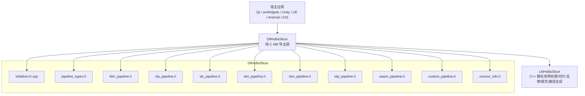
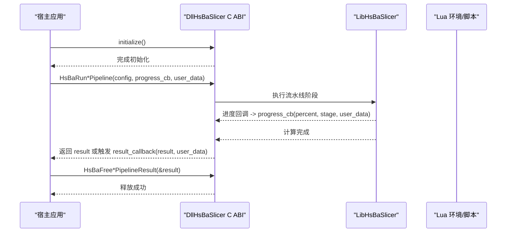
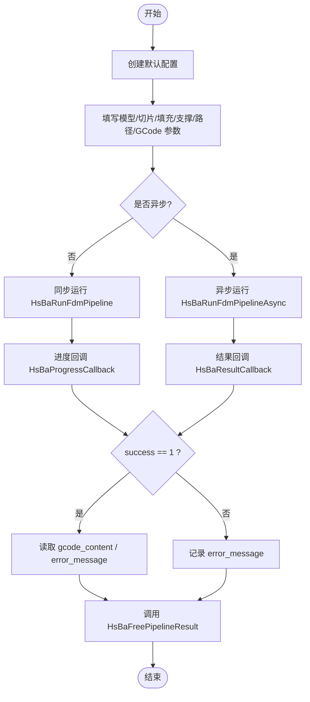
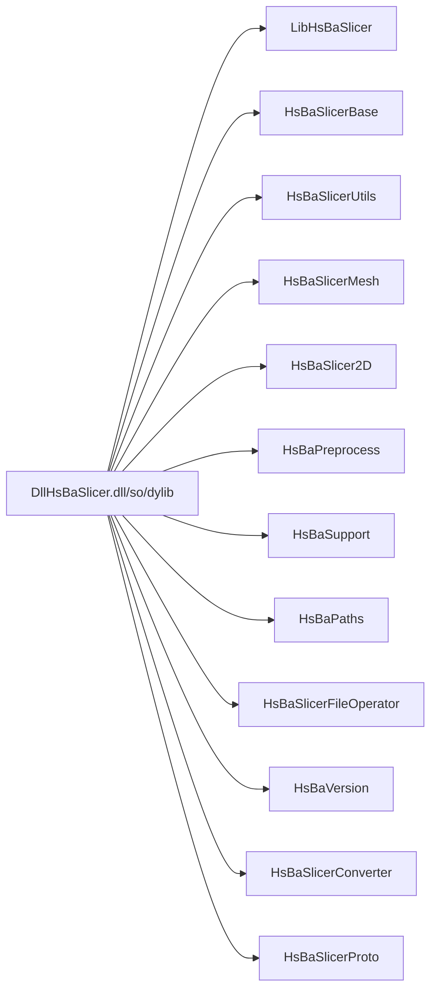

# C ABI 接口 (DllHsBaSlicer)

<cite>
**本文引用的文件**   
- [dllexport.h](file://DllHsBaSlicer/dllexport.h)
- [initialize.h](file://DllHsBaSlicer/initialize.h)
- [initialize.cpp](file://DllHsBaSlicer/initialize.cpp)
- [fdm_pipeline.h](file://DllHsBaSlicer/fdm_pipeline.h)
- [sla_pipeline.h](file://DllHsBaSlicer/sla_pipeline.h)
- [sls_pipeline.h](file://DllHsBaSlicer/sls_pipeline.h)
- [slm_pipeline.h](file://DllHsBaSlicer/slm_pipeline.h)
- [lom_pipeline.h](file://DllHsBaSlicer/lom_pipeline.h)
- [tdp_pipeline.h](file://DllHsBaSlicer/tdp_pipeline.h)
- [waam_pipeline.h](file://DllHsBaSlicer/waam_pipeline.h)
- [custom_pipeline.h](file://DllHsBaSlicer/custom_pipeline.h)
- [version_info.h](file://DllHsBaSlicer/version_info.h)
- [pipeline_types.h](file://pipelinetypes/pipeline_types.h)
- [CMakeLists.txt](file://DllHsBaSlicer/CMakeLists.txt)
- [README.md](file://docs/zh/DllHsBaSlicer/README.md)
</cite>

## 目录
1. [简介](#简介)
2. [项目结构](#项目结构)
3. [核心组件](#核心组件)
4. [架构总览](#架构总览)
5. [详细组件分析](#详细组件分析)
6. [依赖关系分析](#依赖关系分析)
7. [性能与线程安全](#性能与线程安全)
8. [多语言集成指南](#多语言集成指南)
9. [错误处理与调试](#错误处理与调试)
10. [结论](#结论)
11. [附录：API 参考速查](#附录api-参考速查)

## 简介
本文件为 HsBaSlicer 的 DllHsBaSlicer 模块提供完整的 C ABI 接口文档，覆盖 DLL 初始化、生命周期管理、错误处理机制，以及 FDM、SLA、SLS、SLM、LOM、TDP、WAAM 等切片流水线的全部对外函数。同时给出内存管理约定、线程安全注意事项、性能优化建议，并说明如何在 Java、C#、Python 等宿主语言中调用这些接口。

DllHsBaSlicer 是面向上层宿主应用的纯 C ABI 导出层，内部基于 C++20 协程实现流水线调度，并提供同步与异步两套调用方式；其职责是仅调用 LibHsBaSlicer 的导出接口，保持 ABI 边界清晰。

## 项目结构
DllHsBaSlicer 模块以“每个流水线一个头文件 + 对应实现”的方式组织，所有对外类型集中在 `pipelinetypes/pipeline_types.h`，并通过 `HSBA_SLICER_API` 宏统一控制符号导出。

图示来源
- [README.md:7-19](file://docs/zh/DllHsBaSlicer/README.md#L7-L19)
- [CMakeLists.txt:82-100](file://DllHsBaSlicer/CMakeLists.txt#L82-L100)

章节来源
- [README.md:1-31](file://docs/zh/DllHsBaSlicer/README.md#L1-L31)
- [CMakeLists.txt:52-100](file://DllHsBaSlicer/CMakeLists.txt#L52-L100)

## 核心组件
- 导出宏与 ABI 边界
  - `HSBA_SLICER_API` 用于 Windows 的 dllexport/dllimport 与非 Windows 平台的默认可见性。
- 全局初始化
  - `initialize()` 在进程启动后调用一次，负责 Lua、流水线注册与一次性运行时设置；重复调用无副作用。
- 版本信息
  - `HsBaGetVersionJson()`、`HsBaGetVersionXml()` 返回动态分配的 UTF-8 字符串，需通过 `HsBaFreeVersionString()` 释放。
- 流水线配置与结果类型
  - 所有配置结构体、结果结构体、枚举、回调类型均定义在 `pipeline_types.h`，该头文件不依赖 DLL 导出宏，便于跨模块使用。

章节来源
- [dllexport.h:1-22](file://DllHsBaSlicer/dllexport.h#L1-L22)
- [initialize.h:1-22](file://DllHsBaSlicer/initialize.h#L1-L22)
- [initialize.cpp:1-10](file://DllHsBaSlicer/initialize.cpp#L1-L10)
- [version_info.h:1-48](file://DllHsBaSlicer/version_info.h#L1-L48)
- [pipeline_types.h:1-17](file://pipelinetypes/pipeline_types.h#L1-L17)

## 架构总览
DllHsBaSlicer 作为 C ABI 层，将 LibHsBaSlicer 的 C++ 能力暴露给任意宿主语言。各流水线提供统一的三件套：创建默认配置、运行同步/异步流水线、释放结果。

图示来源
- [fdm_pipeline.h:17-61](file://DllHsBaSlicer/fdm_pipeline.h#L17-L61)
- [sla_pipeline.h:17-56](file://DllHsBaSlicer/sla_pipeline.h#L17-L56)
- [sls_pipeline.h:17-56](file://DllHsBaSlicer/sls_pipeline.h#L17-L56)
- [slm_pipeline.h:17-56](file://DllHsBaSlicer/slm_pipeline.h#L17-L56)
- [lom_pipeline.h:17-56](file://DllHsBaSlicer/lom_pipeline.h#L17-L56)
- [tdp_pipeline.h:17-56](file://DllHsBaSlicer/tdp_pipeline.h#L17-L56)
- [waam_pipeline.h:17-57](file://DllHsBaSlicer/waam_pipeline.h#L17-L57)
- [custom_pipeline.h:17-62](file://DllHsBaSlicer/custom_pipeline.h#L17-L62)

## 详细组件分析

### 初始化与生命周期
- 入口函数
  - `void initialize(void);`
  - 应在加载 DLL 后、任何流水线调用前执行一次；可重复调用但无额外效果。
- 生命周期要点
  - 模型句柄由池管理，需显式释放引用。
  - 所有结果结构体中的字符串字段由库分配，必须调用对应的 Free 函数释放。
  - 版本字符串必须用 `HsBaFreeVersionString()` 释放。

章节来源
- [initialize.h:11-19](file://DllHsBaSlicer/initialize.h#L11-L19)
- [initialize.cpp:7-9](file://DllHsBaSlicer/initialize.cpp#L7-L9)
- [version_info.h:16-41](file://DllHsBaSlicer/version_info.h#L16-L41)

### FDM 流水线
- 主要函数
  - `HsBaCreateDefaultConfig()`
  - `HsBaRunFdmPipeline(const HsBaFdmPipelineConfig_t*, HsBaProgressCallback, void*)`
  - `HsBaRunFdmPipelineAsync(...)`
  - `HsBaFreePipelineResult(HsBaFdmPipelineResult_t*)`
- 配置要点
  - 包含模型、切片、填充、支撑、路径、GCode 固件、输出路径等字段。
  - GCode 固件支持 Marlin、RepRap、Klipper。
- 结果要点
  - `gcode_content` 为 UTF-8 G-code 文本，需释放。
  - `error_message` 为 UTF-8 错误信息，需释放。
  - `success`、`total_layers`、`elapsed_seconds` 描述执行状态与耗时。

图示来源
- [fdm_pipeline.h:17-61](file://DllHsBaSlicer/fdm_pipeline.h#L17-L61)
- [pipeline_types.h:23-140](file://pipelinetypes/pipeline_types.h#L23-L140)

章节来源
- [fdm_pipeline.h:1-68](file://DllHsBaSlicer/fdm_pipeline.h#L1-L68)
- [pipeline_types.h:23-140](file://pipelinetypes/pipeline_types.h#L23-L140)

### SLA 流水线
- 主要函数
  - `HsBaCreateDefaultSlaConfig()`
  - `HsBaRunSlaPipeline(...)`
  - `HsBaRunSlaPipelineAsync(...)`
  - `HsBaFreeSlaPipelineResult(...)`
- 配置要点
  - 包含模型、切片、曝光、地板/筏、支撑、图像格式、输出路径等。
  - 支持 PNG/JPG/SVG 层图输出。
- 结果要点
  - `export_path` 指向导出的 zip 文件路径，需释放。
  - `error_message` 需释放。

章节来源
- [sla_pipeline.h:1-63](file://DllHsBaSlicer/sla_pipeline.h#L1-L63)
- [pipeline_types.h:146-245](file://pipelinetypes/pipeline_types.h#L146-L245)

### SLS 流水线
- 主要函数
  - `HsBaCreateDefaultSlsConfig()`
  - `HsBaRunSlsPipeline(...)`
  - `HsBaRunSlsPipelineAsync(...)`
  - `HsBaFreeSlsPipelineResult(...)`
- 配置要点
  - 粉末床工艺，无需地板/支撑；输出完全由 `export_lua_script` 决定。
  - `export_lua_script` 不可为 NULL。
- 结果要点
  - `export_path` 指向导出结果路径，需释放。

章节来源
- [sls_pipeline.h:1-63](file://DllHsBaSlicer/sls_pipeline.h#L1-L63)
- [pipeline_types.h:247-310](file://pipelinetypes/pipeline_types.h#L247-L310)

### SLM 流水线
- 主要函数
  - `HsBaCreateDefaultSlmConfig()`
  - `HsBaRunSlmPipeline(...)`
  - `HsBaRunSlmPipelineAsync(...)`
  - `HsBaFreeSlmPipelineResult(...)`
- 配置要点
  - 金属粉末床熔融（激光/电子束），流程与 SLS 一致。
  - 携带材料、能量源、保护气等金属专属参数。
  - `export_lua_script` 不可为 NULL。
- 结果要点
  - `export_path` 指向导出结果路径，需释放。

章节来源
- [slm_pipeline.h:1-63](file://DllHsBaSlicer/slm_pipeline.h#L1-L63)
- [pipeline_types.h:312-401](file://pipelinetypes/pipeline_types.h#L312-L401)

### LOM 流水线
- 主要函数
  - `HsBaCreateDefaultLomConfig()`
  - `HsBaRunLomPipeline(...)`
  - `HsBaRunLomPipelineAsync(...)`
  - `HsBaFreeLomPipelineResult(...)`
- 配置要点
  - 叠层实体制造，按片厚逐层切片，轮廓及切割/粘结参数交给 Lua 导出脚本。
  - `export_lua_script` 不可为 NULL。
- 结果要点
  - `export_path` 指向导出结果路径，需释放。

章节来源
- [lom_pipeline.h:1-63](file://DllHsBaSlicer/lom_pipeline.h#L1-L63)
- [pipeline_types.h:403-461](file://pipelinetypes/pipeline_types.h#L403-L461)

### TDP 流水线
- 主要函数
  - `HsBaCreateDefaultTdpConfig()`
  - `HsBaRunTdpPipeline(...)`
  - `HsBaRunTdpPipelineAsync(...)`
  - `HsBaFreeTdpPipelineResult(...)`
- 配置要点
  - 粘结剂喷射，逐层切片，喷头点阵轮廓及固化参数交给 Lua 导出脚本。
  - `export_lua_script` 不可为 NULL。
- 结果要点
  - `export_path` 指向导出结果路径，需释放。

章节来源
- [tdp_pipeline.h:1-63](file://DllHsBaSlicer/tdp_pipeline.h#L1-L63)
- [pipeline_types.h:463-521](file://pipelinetypes/pipeline_types.h#L463-L521)

### WAAM 流水线
- 主要函数
  - `HsBaCreateDefaultWaamConfig()`
  - `HsBaRunWaamPipeline(...)`
  - `HsBaRunWaamPipelineAsync(...)`
  - `HsBaFreeWaamPipelineResult(...)`
- 配置要点
  - 电弧增材制造，输出为机器人语言程序（ABB/KUKA/FANUC）。
  - 可选择内置机器人控制器或自定义 `path_lua_script`。
- 结果要点
  - 输出字段为 `output_path`（机器人程序路径），需释放。

章节来源
- [waam_pipeline.h:1-64](file://DllHsBaSlicer/waam_pipeline.h#L1-L64)
- [pipeline_types.h:523-625](file://pipelinetypes/pipeline_types.h#L523-L625)

### 自定义 Lua 流水线
- 主要函数
  - `HsBaCreateDefaultCustomConfig()`
  - `HsBaRunCustomPipeline(...)`
  - `HsBaRunCustomPipelineAsync(...)`
  - `HsBaFreeCustomPipelineResult(...)`
- 配置要点
  - 整条工作流由 Lua 脚本决定；C++ 侧仅提供算子表 `HsBa` 和基础环境。
  - 至少提供 `pipeline_lua_script` 或 `pipeline_lua_source`。
- 结果要点
  - `output_path`、`result_string`、`error_message` 均需释放。

章节来源
- [custom_pipeline.h:1-69](file://DllHsBaSlicer/custom_pipeline.h#L1-L69)
- [pipeline_types.h:676-732](file://pipelinetypes/pipeline_types.h#L676-L732)

## 依赖关系分析
DllHsBaSlicer 构建目标链接 LibHsBaSlicer 及其下游静态库，并通过 `HSBA_SLICER_EXPORTS` 定义启用导出符号。

图示来源
- [CMakeLists.txt:82-100](file://DllHsBaSlicer/CMakeLists.txt#L82-L100)

章节来源
- [CMakeLists.txt:82-100](file://DllHsBaSlicer/CMakeLists.txt#L82-L100)

## 性能与线程安全
- 线程模型
  - 进度与结果回调在库内部工作线程触发，不会在宿主 UI 线程执行；宿主应自行调度回 UI/游戏线程更新界面。
  - 异步接口的 `config` 指针仅在调用期间被读取，返回后即可释放或复用。
- 并行与协程
  - 流水线调度基于 C++20 协程；具体并行度由内部实现决定，宿主应避免对同一流水线实例并发调用。
- 内存与 I/O
  - 避免频繁创建/销毁大对象；尽量复用配置结构体。
  - 对大量小文件传输场景，合理设置连接池大小与批处理策略。
- 优化建议
  - 使用异步接口避免阻塞主线程。
  - 对大型模型，优先进行预处理（变换、布尔运算）后再进入切片。
  - 选择合适的 GCode 固件与打印参数以减少后处理成本。

章节来源
- [README.md:684-694](file://docs/zh/DllHsBaSlicer/README.md#L684-L694)

## 多语言集成指南

### C/C++
- 典型流程
  - 调用 `initialize()`。
  - 创建默认配置并填写必要字段。
  - 调用同步或异步流水线函数。
  - 使用结果后调用对应的 `HsBaFree*PipelineResult()`。
- 最小示例路径
  - [README.md:705-730](file://docs/zh/DllHsBaSlicer/README.md#L705-L730)

### C#
- 使用 P/Invoke 声明 extern “C” 函数。
- 注意字符串编码为 UTF-8，回调函数签名需匹配 C ABI。
- 结果结构体中的字符串指针需在托管侧释放（通过导入的 Free 函数）。

### Java
- 通过 JNI 封装 C ABI 函数。
- 在 JNI 层处理 UTF-8 字符串与回调，避免在回调中直接操作 Java 对象，必要时切换到主线程。

### Python
- 使用 ctypes 加载共享库并声明函数原型。
- 回调函数使用 CFUNCTYPE 定义，注意线程安全与 GIL 管理。

## 错误处理与调试
- 错误码与状态
  - 各流水线结果结构体包含 `success` 标志位；失败时 `error_message` 提供 UTF-8 错误信息。
- 常见错误
  - 未调用 `initialize()`。
  - 未释放结果结构体中的字符串字段。
  - 传入空指针（如 SLS/SLM/LOM/TDP 的 `export_lua_script` 为 NULL）。
  - 模型路径不存在或模型损坏。
- 调试技巧
  - 启用日志系统（若已集成）。
  - 在进度回调中记录 `stage` 与 `percent`，定位卡滞阶段。
  - 对 Lua 自定义流水线，检查脚本路径、入口函数名与 `pipeline_config` JSON。
  - 使用版本信息接口确认当前库版本。

章节来源
- [pipeline_types.h:120-127](file://pipelinetypes/pipeline_types.h#L120-L127)
- [pipeline_types.h:225-232](file://pipelinetypes/pipeline_types.h#L225-L232)
- [pipeline_types.h:290-297](file://pipelinetypes/pipeline_types.h#L290-L297)
- [pipeline_types.h:381-388](file://pipelinetypes/pipeline_types.h#L381-L388)
- [pipeline_types.h:441-448](file://pipelinetypes/pipeline_types.h#L441-L448)
- [pipeline_types.h:501-508](file://pipelinetypes/pipeline_types.h#L501-L508)
- [pipeline_types.h:605-612](file://pipelinetypes/pipeline_types.h#L605-L612)
- [version_info.h:16-41](file://DllHsBaSlicer/version_info.h#L16-L41)

## 结论
DllHsBaSlicer 提供了稳定、清晰的 C ABI，使任意宿主语言都能跨平台调用 HsBaSlicer 的切片能力。通过统一的配置/结果结构体、同步/异步接口与完善的内存管理约定，开发者可以专注于业务逻辑与参数调优。建议在集成时严格遵循生命周期与线程模型，合理使用异步回调与结果释放函数，以获得稳定且高性能的切片体验。

## 附录：API 参考速查

### 初始化与版本
- `void initialize(void);`
- `char* HsBaGetVersionJson(void);`
- `char* HsBaGetVersionXml(void);`
- `void HsBaFreeVersionString(char* str);`

章节来源
- [initialize.h:11-19](file://DllHsBaSlicer/initialize.h#L11-L19)
- [version_info.h:16-41](file://DllHsBaSlicer/version_info.h#L16-L41)

### FDM
- `HsBaFdmPipelineConfig_t HsBaCreateDefaultConfig(void);`
- `HsBaFdmPipelineResult_t HsBaRunFdmPipeline(const HsBaFdmPipelineConfig_t*, HsBaProgressCallback, void*);`
- `void HsBaRunFdmPipelineAsync(const HsBaFdmPipelineConfig_t*, HsBaProgressCallback, void*, HsBaResultCallback, void*);`
- `void HsBaFreePipelineResult(HsBaFdmPipelineResult_t*);`

章节来源
- [fdm_pipeline.h:17-61](file://DllHsBaSlicer/fdm_pipeline.h#L17-L61)
- [pipeline_types.h:23-140](file://pipelinetypes/pipeline_types.h#L23-L140)

### SLA
- `HsBaSlaPipelineConfig_t HsBaCreateDefaultSlaConfig(void);`
- `HsBaSlaPipelineResult_t HsBaRunSlaPipeline(const HsBaSlaPipelineConfig_t*, HsBaSlaProgressCallback, void*);`
- `void HsBaRunSlaPipelineAsync(const HsBaSlaPipelineConfig_t*, HsBaSlaProgressCallback, void*, HsBaSlaResultCallback, void*);`
- `void HsBaFreeSlaPipelineResult(HsBaSlaPipelineResult_t*);`

章节来源
- [sla_pipeline.h:17-56](file://DllHsBaSlicer/sla_pipeline.h#L17-L56)
- [pipeline_types.h:146-245](file://pipelinetypes/pipeline_types.h#L146-L245)

### SLS
- `HsBaSlsPipelineConfig_t HsBaCreateDefaultSlsConfig(void);`
- `HsBaSlsPipelineResult_t HsBaRunSlsPipeline(const HsBaSlsPipelineConfig_t*, HsBaSlsProgressCallback, void*);`
- `void HsBaRunSlsPipelineAsync(const HsBaSlsPipelineConfig_t*, HsBaSlsProgressCallback, void*, HsBaSlsResultCallback, void*);`
- `void HsBaFreeSlsPipelineResult(HsBaSlsPipelineResult_t*);`

章节来源
- [sls_pipeline.h:17-56](file://DllHsBaSlicer/sls_pipeline.h#L17-L56)
- [pipeline_types.h:247-310](file://pipelinetypes/pipeline_types.h#L247-L310)

### SLM
- `HsBaSlmPipelineConfig_t HsBaCreateDefaultSlmConfig(void);`
- `HsBaSlmPipelineResult_t HsBaRunSlmPipeline(const HsBaSlmPipelineConfig_t*, HsBaSlmProgressCallback, void*);`
- `void HsBaRunSlmPipelineAsync(const HsBaSlmPipelineConfig_t*, HsBaSlmProgressCallback, void*, HsBaSlmResultCallback, void*);`
- `void HsBaFreeSlmPipelineResult(HsBaSlmPipelineResult_t*);`

章节来源
- [slm_pipeline.h:17-56](file://DllHsBaSlicer/slm_pipeline.h#L17-L56)
- [pipeline_types.h:312-401](file://pipelinetypes/pipeline_types.h#L312-L401)

### LOM
- `HsBaLomPipelineConfig_t HsBaCreateDefaultLomConfig(void);`
- `HsBaLomPipelineResult_t HsBaRunLomPipeline(const HsBaLomPipelineConfig_t*, HsBaLomProgressCallback, void*);`
- `void HsBaRunLomPipelineAsync(const HsBaLomPipelineConfig_t*, HsBaLomProgressCallback, void*, HsBaLomResultCallback, void*);`
- `void HsBaFreeLomPipelineResult(HsBaLomPipelineResult_t*);`

章节来源
- [lom_pipeline.h:17-56](file://DllHsBaSlicer/lom_pipeline.h#L17-L56)
- [pipeline_types.h:403-461](file://pipelinetypes/pipeline_types.h#L403-L461)

### TDP
- `HsBaTdpPipelineConfig_t HsBaCreateDefaultTdpConfig(void);`
- `HsBaTdpPipelineResult_t HsBaRunTdpPipeline(const HsBaTdpPipelineConfig_t*, HsBaTdpProgressCallback, void*);`
- `void HsBaRunTdpPipelineAsync(const HsBaTdpPipelineConfig_t*, HsBaTdpProgressCallback, void*, HsBaTdpResultCallback, void*);`
- `void HsBaFreeTdpPipelineResult(HsBaTdpPipelineResult_t*);`

章节来源
- [tdp_pipeline.h:17-56](file://DllHsBaSlicer/tdp_pipeline.h#L17-L56)
- [pipeline_types.h:463-521](file://pipelinetypes/pipeline_types.h#L463-L521)

### WAAM
- `HsBaWaamPipelineConfig_t HsBaCreateDefaultWaamConfig(void);`
- `HsBaWaamPipelineResult_t HsBaRunWaamPipeline(const HsBaWaamPipelineConfig_t*, HsBaWaamProgressCallback, void*);`
- `void HsBaRunWaamPipelineAsync(const HsBaWaamPipelineConfig_t*, HsBaWaamProgressCallback, void*, HsBaWaamResultCallback, void*);`
- `void HsBaFreeWaamPipelineResult(HsBaWaamPipelineResult_t*);`

章节来源
- [waam_pipeline.h:17-57](file://DllHsBaSlicer/waam_pipeline.h#L17-L57)
- [pipeline_types.h:523-625](file://pipelinetypes/pipeline_types.h#L523-L625)

### 自定义 Lua 流水线
- `HsBaCustomPipelineConfig_t HsBaCreateDefaultCustomConfig(void);`
- `HsBaCustomPipelineResult_t HsBaRunCustomPipeline(const HsBaCustomPipelineConfig_t*, HsBaCustomProgressCallback, void*);`
- `void HsBaRunCustomPipelineAsync(const HsBaCustomPipelineConfig_t*, HsBaCustomProgressCallback, void*, HsBaCustomResultCallback, void*);`
- `void HsBaFreeCustomPipelineResult(HsBaCustomPipelineResult_t*);`

章节来源
- [custom_pipeline.h:17-62](file://DllHsBaSlicer/custom_pipeline.h#L17-L62)
- [pipeline_types.h:676-732](file://pipelinetypes/pipeline_types.h#L676-L732)