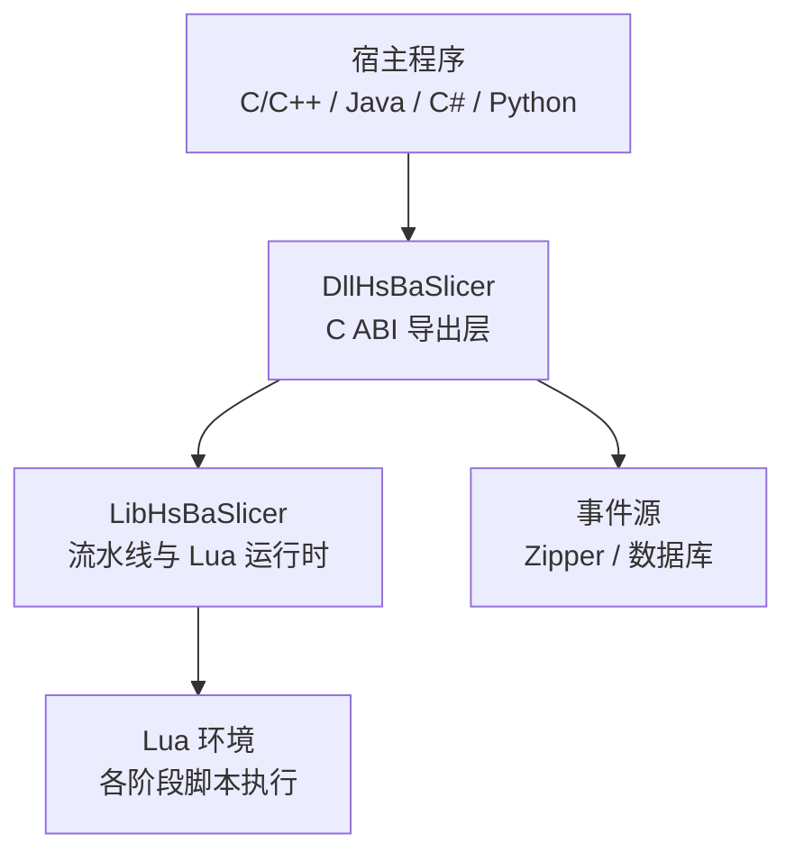
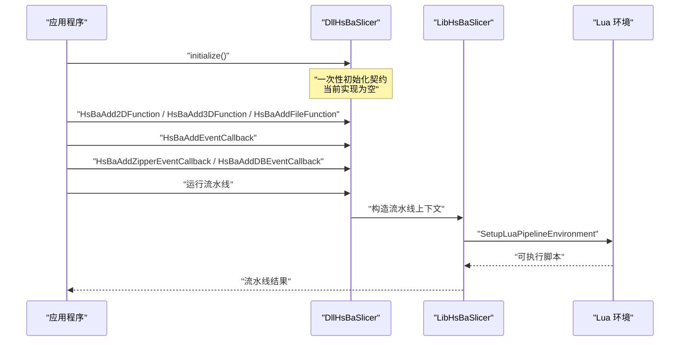
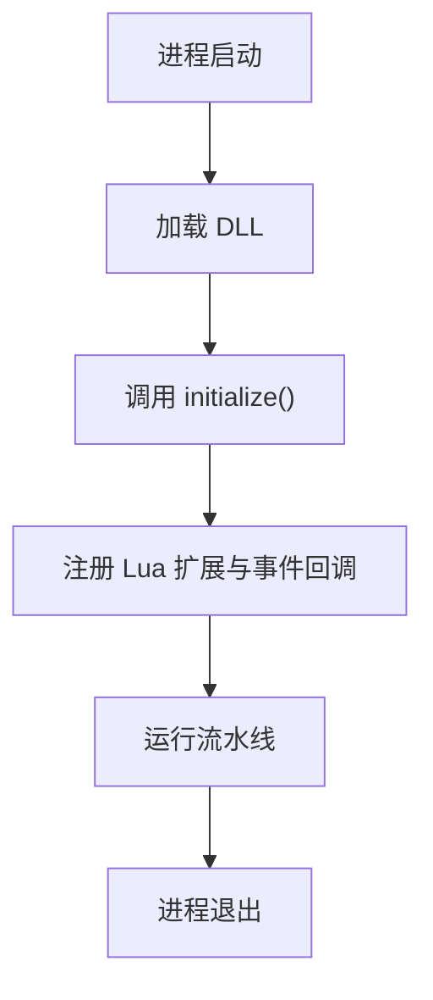
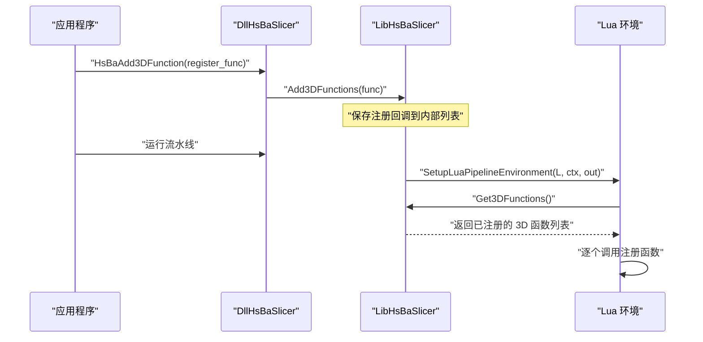
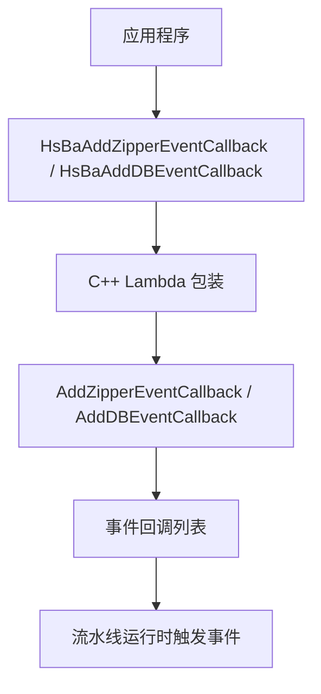
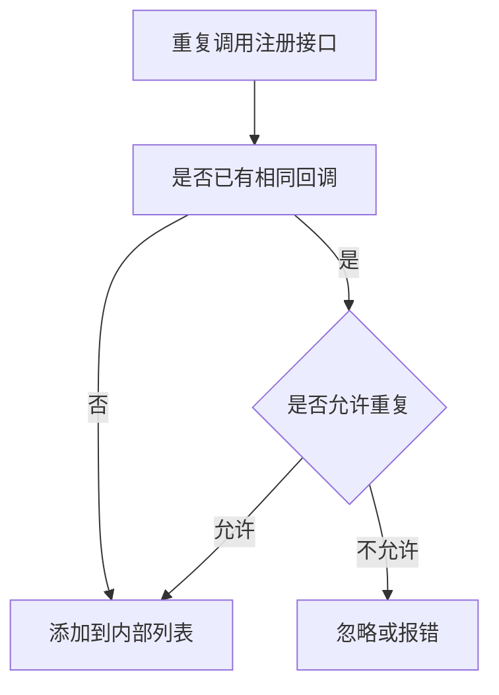
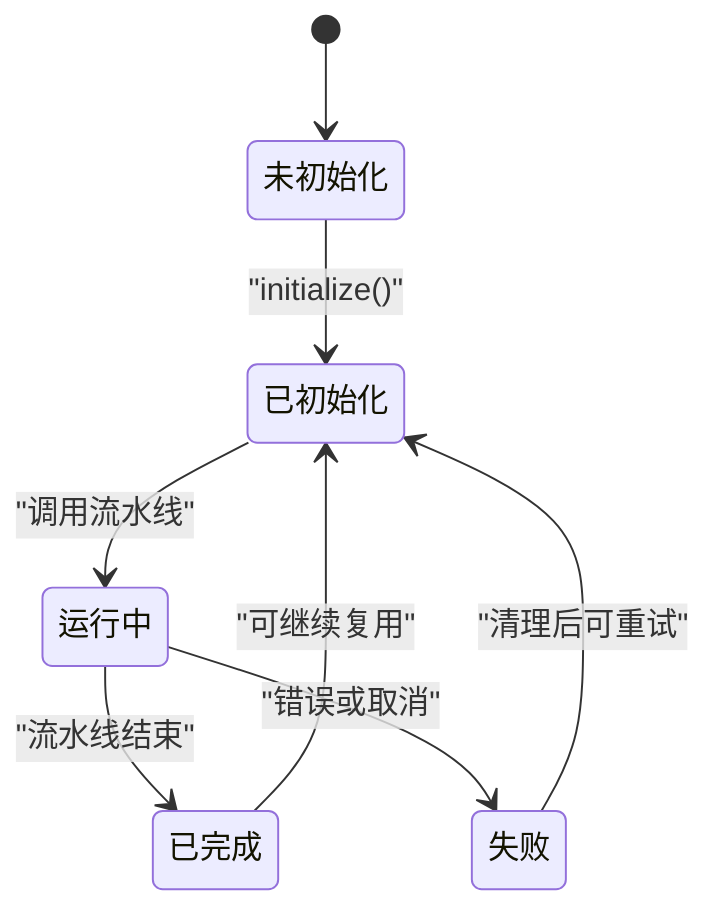
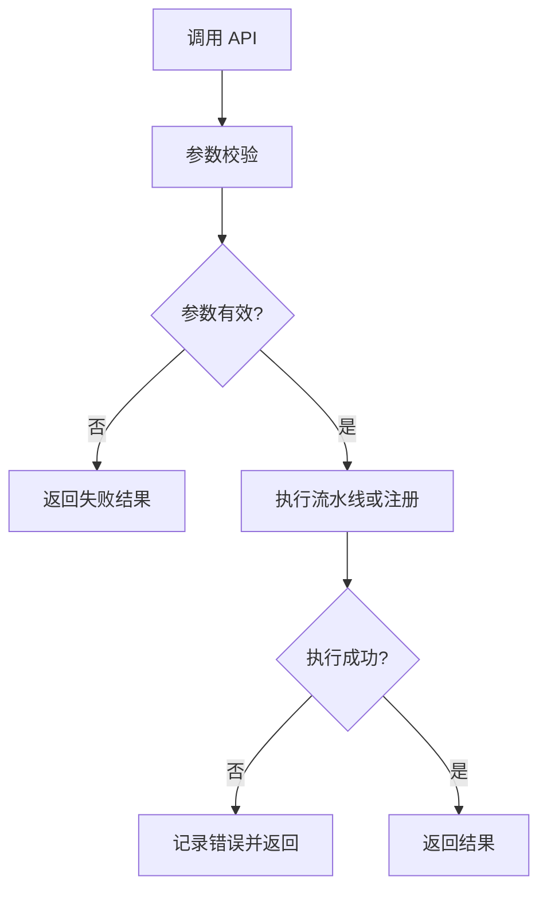
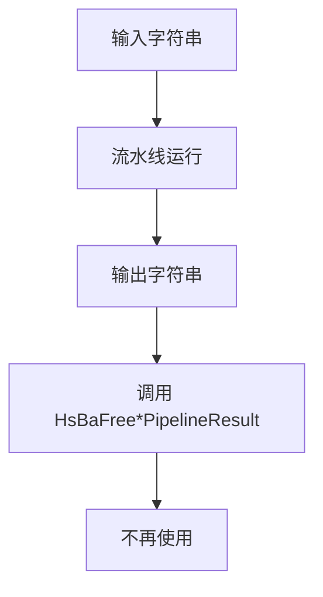
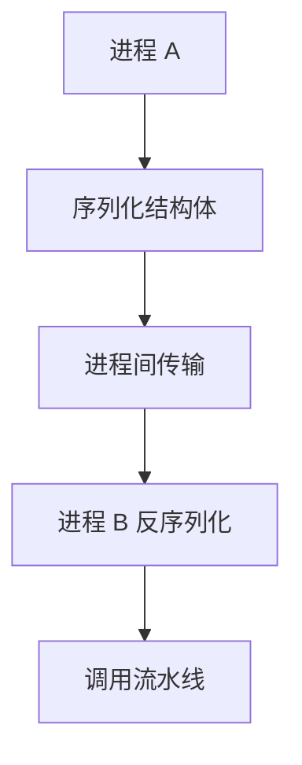

# DLL 初始化与生命周期管理

<cite>
**本文引用的文件**   
- [initialize.h](file://DllHsBaSlicer/initialize.h)
- [initialize.cpp](file://DllHsBaSlicer/initialize.cpp)
- [lua_register.h](file://DllHsBaSlicer/lua_register.h)
- [lua_register.cpp](file://DllHsBaSlicer/lua_register.cpp)
- [event_source_register.h](file://DllHsBaSlicer/event_source_register.h)
- [event_source_register.cpp](file://DllHsBaSlicer/event_source_register.cpp)
- [CMakeLists.txt](file://DllHsBaSlicer/CMakeLists.txt)
- [LuaAddFunction.hpp](file://LibHsBaSlicer/Extends/LuaAddFunction.hpp)
- [EventSourceFunction.hpp](file://LibHsBaSlicer/Extends/EventSourceFunction.hpp)
- [lua_pipeline.hpp](file://LibHsBaSlicer/Extends/lua_pipeline.hpp)
- [lua_pipeline.cpp](file://LibHsBaSlicer/Extends/lua_pipeline.cpp)
- [README.md（英文）](file://docs/en/DllHsBaSlicer/README.md)
- [README.md（中文）](file://docs/zh/DllHsBaSlicer/README.md)
- [qt_wxwidgets_integration.md](file://docs/en/DllHsBaSlicer/qt_wxwidgets_integration.md)
- [HsBaSlicer.cpp](file://HsBaSlicer/HsBaSlicer.cpp)
- [MainActivity.java](file://android/app/src/main/java/com/hsmbanlance/hsbaslicer/example/MainActivity.java)
</cite>

## 目录

1. [引言](#引言)
2. [项目结构与定位](#项目结构与定位)
3. [核心组件总览](#核心组件总览)
4. [架构总览：DLL 初始化与生命周期](#架构总览dll-初始化与生命周期)
5. [initialize() 函数详解](#initialize-函数详解)
6. [Lua 函数注册机制](#lua-函数注册机制)
7. [事件源与回调注册机制](#事件源与回调注册机制)
8. [重复调用行为与安全保证](#重复调用行为与安全保证)
9. [线程模型与并发注意事项](#线程模型与并发注意事项)
10. [跨语言集成示例](#跨语言集成示例)
11. [错误处理策略](#错误处理策略)
12. [资源清理与内存管理约定](#资源清理与内存管理约定)
13. [跨进程通信注意事项](#跨进程通信注意事项)
14. [性能考虑](#性能考虑)
15. [故障排查指南](#故障排查指南)
16. [结论](#结论)

## 引言

本文面向需要集成 HsBaSlicer 的 C/C++、Java JNI、C# P/Invoke、Python ctypes 等宿主程序，重点说明 DllHsBaSlicer 的初始化入口、生命周期边界、Lua 扩展注册、事件回调注册、重复调用语义、线程安全约束以及资源清理最佳实践。

从仓库结构看，`DllHsBaSlicer` 是面向外部语言的 C ABI 导出层；`LibHsBaSlicer` 提供实际的流水线逻辑、Lua 环境构建和事件系统；文档位于 `docs/en` 与 `docs/zh`，其中明确把 `initialize()` 描述为“必须最先调用的全局初始化”。

当前源码中 `initialize()` 的实现体为空，但头文件和文档已经给出明确的契约：它是 DLL 的全局初始化入口，用于 Lua 函数注册、流水线注册和一次性运行时设置，并且声明“在加载时调用一次是安全的，重复调用不会产生额外效果”。

**章节来源**
- [initialize.h:1-21](file://DllHsBaSlicer/initialize.h#L1-L21)
- [initialize.cpp:1-10](file://DllHsBaSlicer/initialize.cpp#L1-L10)
- [README.md（英文）:33-62](file://docs/en/DllHsBaSlicer/README.md#L33-L62)
- [README.md（中文）:33-66](file://docs/zh/DllHsBaSlicer/README.md#L33-L66)

## 项目结构与定位

`DllHsBaSlicer` 是一个共享库（动态库），在 iOS 上被构建为静态库，因为 iOS 应用不能随意加载动态库；在其他平台上则作为动态库供 C#/Java/Python 等语言通过平台加载机制使用。

关键文件职责如下：

| 文件 | 职责 |
|---|---|
| `initialize.h` / `initialize.cpp` | 定义并实现 `initialize()`，作为 DLL 全局初始化入口 |
| `lua_register.h` / `lua_register.cpp` | 暴露 C ABI，用于向流水线运行时注册 2D、3D、File 类 Lua 函数及事件回调 |
| `event_source_register.h` / `event_source_register.cpp` | 暴露 Zipper 进度和数据库事件回调的 C ABI |
| `CMakeLists.txt` | 控制 DllHsBaSlicer 作为 SHARED 或 STATIC 构建，并链接 LibHsBaSlicer 及相关模块 |
| `LuaAddFunction.hpp` | Lib 侧维护 2D/3D/File Lua 注册函数列表和事件回调列表 |
| `EventSourceFunction.hpp` | Lib 侧维护 Zipper 和 DB 事件回调列表 |
| `lua_pipeline.hpp` / `lua_pipeline.cpp` | 创建 Lua 环境、注入内置扩展、遍历已注册的扩展函数 |

**图表来源**
- [CMakeLists.txt:1-100](file://DllHsBaSlicer/CMakeLists.txt#L1-L100)
- [lua_pipeline.cpp:857-894](file://LibHsBaSlicer/Extends/lua_pipeline.cpp#L857-L894)

**章节来源**
- [CMakeLists.txt:1-100](file://DllHsBaSlicer/CMakeLists.txt#L1-L100)
- [README.md（英文）:33-54](file://docs/en/DllHsBaSlicer/README.md#L33-L54)
- [README.md（中文）:33-54](file://docs/zh/DllHsBaSlicer/README.md#L33-L54)

## 核心组件总览

### initialize()

- 暴露为 C ABI 的 `void initialize(void)`。
- 文档说明其作用是：注册 Lua 函数、注册流水线、执行一次性运行时设置。
- 文档说明其调用时机：进程启动后调用一次。
- 当前实现为空，但契约要求它应作为所有其他 API 之前的初始化点。

### Lua 注册接口

- `HsBaAdd2DFunction`：注册 2D Lua 函数，适用于 Support、Fill、SLA Output。
- `HsBaAdd3DFunction`：注册 3D Lua 函数，适用于 Slice、Support。
- `HsBaAddFileFunction`：注册 File Lua 函数，适用于 SLS Output、SLA Output。
- `HsBaAddEventCallback`：按事件名注册 Lua 事件回调，例如 `"zipper.on_add"`、`"db.on_query"`。

### 事件源注册接口

- `HsBaAddZipperEventCallback`：注册 Zipper 压缩进度回调，参数为进度百分比和阶段描述。
- `HsBaAddDBEventCallback`：注册数据库事件回调，参数为查询键和结果值。

**章节来源**
- [initialize.h:11-19](file://DllHsBaSlicer/initialize.h#L11-L19)
- [lua_register.h:11-31](file://DllHsBaSlicer/lua_register.h#L11-L31)
- [lua_register.cpp:9-33](file://DllHsBaSlicer/lua_register.cpp#L9-L33)
- [event_source_register.h:11-17](file://DllHsBaSlicer/event_source_register.h#L11-L17)
- [event_source_register.cpp:9-30](file://DllHsBaSlicer/event_source_register.cpp#L9-L30)

## 架构总览：DLL 初始化与生命周期

从调用方视角，典型生命周期如下：

1. 进程启动。
2. 加载 HsBaSlicer 相关动态库。
3. 调用 `initialize()`。
4. 根据需要调用 Lua 扩展注册接口和事件源注册接口。
5. 调用具体流水线接口，如 FDM、SLA、SLS、自定义 Lua 流水线等。
6. 进程退出前释放由库返回的动态字符串等资源。

**图表来源**
- [initialize.h:14-19](file://DllHsBaSlicer/initialize.h#L14-L19)
- [lua_register.cpp:9-33](file://DllHsBaSlicer/lua_register.cpp#L9-L33)
- [event_source_register.cpp:9-30](file://DllHsBaSlicer/event_source_register.cpp#L9-L30)
- [lua_pipeline.cpp:857-894](file://LibHsBaSlicer/Extends/lua_pipeline.cpp#L857-L894)

**章节来源**
- [README.md（英文）:56-62](file://docs/en/DllHsBaSlicer/README.md#L56-L62)
- [README.md（中文）:56-62](file://docs/zh/DllHsBaSlicer/README.md#L56-L62)

## initialize() 函数详解

### 作用

根据头文件注释，`initialize()` 的职责包括：

- 注册 Lua 函数。
- 注册流水线。
- 执行一次性运行时设置。

这意味着它不是普通业务 API，而是整个 DLL 的启动钩子。

### 调用时机

文档明确指出：

- 必须在进程启动后调用一次。
- 在所有其他 DLL API 之前调用。
- Qt/wxWidgets 集成文档也强调：先调用 `initialize()`，再运行流水线。

因此，推荐调用顺序是：

1. 加载 DLL。
2. 调用 `initialize()`。
3. 注册扩展 Lua 函数。
4. 注册事件回调。
5. 调用流水线 API。

### 线程安全性

头文件注释明确说明：

> Safe to call once at load time; repeated calls have no additional effect.

这表明：

- `initialize()` 设计为幂等。
- 可以在 DLL 加载时调用。
- 多次调用不应产生副作用。
- 当前实现为空，天然满足幂等。

但需要注意：空实现不代表未来不会加入全局状态初始化。如果后续实现中加入全局单例、日志系统、Lua 虚拟机、线程池等，则调用方仍应遵循“进程启动后只调用一次”的约定。

**图表来源**
- [initialize.h:14-19](file://DllHsBaSlicer/initialize.h#L14-L19)
- [qt_wxwidgets_integration.md:7-12](file://docs/en/DllHsBaSlicer/qt_wxwidgets_integration.md#L7-L12)

**章节来源**
- [initialize.h:14-19](file://DllHsBaSlicer/initialize.h#L14-L19)
- [initialize.cpp:7-9](file://DllHsBaSlicer/initialize.cpp#L7-L9)
- [qt_wxwidgets_integration.md:7-12](file://docs/en/DllHsBaSlicer/qt_wxwidgets_integration.md#L7-L12)

## Lua 函数注册机制

### 注册分类

Lua 扩展函数按流水线维度分为三类：

| 类别 | 适用阶段 | 用途 |
|---|---|---|
| 2D | Support、Fill、SLA Output | 二维几何、填充、SLA 输出相关 Lua 函数 |
| 3D | Slice、Support | 三维切片、支撑相关 Lua 函数 |
| File | SLS Output、SLA Output | 文件输出相关 Lua 函数 |

此外，还有按事件名注册的通用事件回调，例如 `"zipper.on_add"`、`"db.on_query"`。

### 注册流程

**图表来源**
- [lua_register.cpp:17-21](file://DllHsBaSlicer/lua_register.cpp#L17-L21)
- [LuaAddFunction.hpp:24-34](file://LibHsBaSlicer/Extends/LuaAddFunction.hpp#L24-L34)
- [lua_pipeline.cpp:857-870](file://LibHsBaSlicer/Extends/lua_pipeline.cpp#L857-L870)

### 实际注入时机

Lua 环境不是在 `initialize()` 中创建的，而是在每个流水线阶段创建 Lua 状态时注入。`SetupLuaPipelineEnvironment` 会：

1. 打开 Lua 标准库。
2. 安装公共 AnyObject 类型。
3. 遍历 2D、3D、File 注册函数列表并调用。
4. 注册多边形操作、支撑、填充、路径优化、Zipper、加密、SQLite、参数存储等扩展。
5. 绑定运行状态到 Lua registry。

这说明：**注册发生在流水线运行前，而不是 DLL 加载时**。

**章节来源**
- [lua_register.h:21-31](file://DllHsBaSlicer/lua_register.h#L21-L31)
- [lua_register.cpp:9-33](file://DllHsBaSlicer/lua_register.cpp#L9-L33)
- [LuaAddFunction.hpp:24-74](file://LibHsBaSlicer/Extends/LuaAddFunction.hpp#L24-L74)
- [lua_pipeline.cpp:857-894](file://LibHsBaSlicer/Extends/lua_pipeline.cpp#L857-L894)

## 事件源与回调注册机制

### Zipper 事件

`HsBaAddZipperEventCallback` 接收一个 C 风格回调，签名大致为 `(double progress, const char* message)`。内部将其包装为 C++ lambda，并转发给 Lib 侧的 Zipper 事件回调列表。

### 数据库事件

`HsBaAddDBEventCallback` 接收一个 C 风格回调，签名大致为 `(const char* query, const char* result)`。内部同样包装为 C++ lambda，并转发给 Lib 侧的数据库事件回调列表。

**图表来源**
- [event_source_register.cpp:9-30](file://DllHsBaSlicer/event_source_register.cpp#L9-L30)
- [EventSourceFunction.hpp:18-41](file://LibHsBaSlicer/Extends/EventSourceFunction.hpp#L18-L41)

**章节来源**
- [event_source_register.h:11-17](file://DllHsBaSlicer/event_source_register.h#L11-L17)
- [event_source_register.cpp:9-30](file://DllHsBaSlicer/event_source_register.cpp#L9-L30)
- [EventSourceFunction.hpp:18-41](file://LibHsBaSlicer/Extends/EventSourceFunction.hpp#L18-L41)

## 重复调用行为与安全保证

### initialize()

- 头文件明确说明重复调用无额外效果。
- 当前实现为空，天然幂等。
- 建议始终遵循“进程启动后调用一次”的约定，不要依赖实现细节。

### Lua 注册函数

- `HsBaAdd2DFunction`、`HsBaAdd3DFunction`、`HsBaAddFileFunction` 内部调用 Lib 侧的 `Add*Functions`。
- Lib 侧维护的是 `std::vector<LuaRegFunc>`。
- 如果同一注册函数被多次添加，会在每次创建 Lua 环境时被多次调用。
- 因此，重复注册可能导致 Lua 函数被重复覆盖或重复安装，取决于具体注册函数的实现。

### 事件回调

- Zipper 和 DB 事件回调也是追加到向量中。
- 重复注册会导致同一个底层回调被多次触发。
- 这通常不是问题，但如果回调有副作用，需要调用方自行去重。

**图表来源**
- [LuaAddFunction.hpp:42-74](file://LibHsBaSlicer/Extends/LuaAddFunction.hpp#L42-L74)
- [EventSourceFunction.hpp:32-41](file://LibHsBaSlicer/Extends/EventSourceFunction.hpp#L32-L41)

**章节来源**
- [initialize.h:14-19](file://DllHsBaSlicer/initialize.h#L14-L19)
- [lua_register.cpp:9-33](file://DllHsBaSlicer/lua_register.cpp#L9-L33)
- [LuaAddFunction.hpp:42-74](file://LibHsBaSlicer/Extends/LuaAddFunction.hpp#L42-L74)
- [EventSourceFunction.hpp:32-41](file://LibHsBaSlicer/Extends/EventSourceFunction.hpp#L32-L41)

## 线程模型与并发注意事项

### 初始化线程

- `initialize()` 应在主线程或至少是 DLL 首次使用的线程调用。
- 由于它被声明为“加载时调用一次”，通常放在进程入口或静态初始化逻辑中。

### 流水线执行线程

- Qt/wxWidgets 集成文档明确指出：同步流水线 API 会阻塞直到切片完成，不应在 UI 线程执行。
- 进度回调和结果回调通常在库内部线程触发，调用方需要 marshal 回 UI 线程。

### Lua 环境线程

- `SetupLuaPipelineEnvironment` 接收 `lua_State*`，并绑定运行状态。
- 文档说明：`run_state` 必须由调用方保证生命周期长于 Lua 状态；当为空时使用静态 fallback，适合单线程嵌入式场景。
- 这意味着多线程环境下，应避免多个线程共享同一个 Lua 状态，除非上层有明确同步机制。

**图表来源**
- [qt_wxwidgets_integration.md:7-12](file://docs/en/DllHsBaSlicer/qt_wxwidgets_integration.md#L7-L12)
- [lua_pipeline.hpp:59-70](file://LibHsBaSlicer/Extends/lua_pipeline.hpp#L59-L70)

**章节来源**
- [qt_wxwidgets_integration.md:7-12](file://docs/en/DllHsBaSlicer/qt_wxwidgets_integration.md#L7-L12)
- [lua_pipeline.hpp:59-70](file://LibHsBaSlicer/Extends/lua_pipeline.hpp#L59-L70)

## 跨语言集成示例

以下示例仅说明调用顺序和注意事项，不直接粘贴代码内容。

### C/C++

典型流程：

1. 包含 `initialize.h`。
2. 进程启动后调用 `initialize()`。
3. 如需扩展 Lua，调用 `HsBaAdd3DFunction` 等注册接口。
4. 调用 FDM、SLA、SLS 或其他流水线接口。
5. 使用完成后释放库返回的动态字符串。

参考示例入口：

- [HsBaSlicer.cpp](file://HsBaSlicer/HsBaSlicer.cpp) 展示了如何包含 `initialize.h` 并调用流水线。

**章节来源**
- [HsBaSlicer.cpp:18-22](file://HsBaSlicer/HsBaSlicer.cpp#L18-L22)
- [README.md（中文）:612-647](file://docs/zh/DllHsBaSlicer/README.md#L612-L647)

### Java JNI

Android 示例中：

1. 通过 `System.loadLibrary("HsBaSlicer")` 加载本地库。
2. 在 Java 层调用 native 方法。
3. native 层应确保先调用 `initialize()`，再运行流水线。
4. 注意 Android 示例是测试入口，生产环境应避免在 UI 线程执行阻塞流水线。

**章节来源**
- [MainActivity.java:17-44](file://android/app/src/main/java/com/hsmbanlance/hsbaslicer/example/MainActivity.java#L17-L44)

### C# P/Invoke

建议步骤：

1. 使用 `DllImport` 导入 `initialize`。
2. 在应用启动时调用一次。
3. 如需扩展 Lua，导入 `HsBaAdd3DFunction` 等函数。
4. 注意 C# 字符串与 C `const char*` 的编码转换。
5. 避免在 UI 线程调用阻塞流水线。

### Python ctypes

建议步骤：

1. 使用 `ctypes.CDLL` 加载 DLL。
2. 调用 `initialize()`。
3. 如需扩展 Lua，注册对应回调。
4. 注意 Python GIL 与 C++ 线程交互。
5. 对库返回的 C 字符串进行解码和释放。

**章节来源**
- [qt_wxwidgets_integration.md:7-12](file://docs/en/DllHsBaSlicer/qt_wxwidgets_integration.md#L7-L12)

## 错误处理策略

### 初始化阶段

- `initialize()` 当前不返回值，也不抛出异常。
- 如果未来实现中加入全局资源初始化，应确保失败路径能给出明确错误信息。
- 调用方应假设初始化成功，但仍建议在关键路径增加日志。

### Lua 注册阶段

- `HsBaAdd2DFunction`、`HsBaAdd3DFunction`、`HsBaAddFileFunction` 内部会对传入函数指针做非空检查。
- 如果传入空指针，不会调用 Lib 侧注册函数。
- 如果注册函数本身崩溃，属于调用方实现问题。

### 事件回调阶段

- `HsBaAddZipperEventCallback` 和 `HsBaAddDBEventCallback` 内部会检查事件名和回调函数。
- 回调中的异常应由调用方捕获，避免影响库内部事件分发。

### 流水线阶段

- 流水线 API 通常返回结构化结果，包含错误消息和执行时间。
- 调用方应根据结果判断成功或失败，并记录错误消息。

**图表来源**
- [lua_register.cpp:11-33](file://DllHsBaSlicer/lua_register.cpp#L11-L33)
- [event_source_register.cpp:9-30](file://DllHsBaSlicer/event_source_register.cpp#L9-L30)

**章节来源**
- [lua_register.cpp:11-33](file://DllHsBaSlicer/lua_register.cpp#L11-L33)
- [event_source_register.cpp:9-30](file://DllHsBaSlicer/event_source_register.cpp#L9-L30)

## 资源清理与内存管理约定

### 动态字符串

Qt/wxWidgets 集成文档指出：

- 配置结构体中的 `const char*` 字段在流水线运行期间必须保持有效。
- 结果结构体中的动态字符串由 `HsBaFree*PipelineResult` 释放。

这意味着：

- 输入字符串的生命周期由调用方负责。
- 输出字符串的生命周期由库管理，调用方必须显式释放。
- 不要在释放后继续使用这些字符串。

### Lua 状态

- `SetupLuaPipelineEnvironment` 要求 `run_state` 的生命周期长于 Lua 状态。
- 如果传入空指针，库会使用静态 fallback，适合单线程嵌入式场景。
- 多线程场景下应避免共享 Lua 状态。

### 事件回调

- 事件回调中的 `const char*` 数据来自库内部，调用方不应长期持有。
- 如果需要持久化，应复制数据。

**图表来源**
- [qt_wxwidgets_integration.md:7-12](file://docs/en/DllHsBaSlicer/qt_wxwidgets_integration.md#L7-L12)
- [lua_pipeline.hpp:59-70](file://LibHsBaSlicer/Extends/lua_pipeline.hpp#L59-L70)

**章节来源**
- [qt_wxwidgets_integration.md:7-12](file://docs/en/DllHsBaSlicer/qt_wxwidgets_integration.md#L7-L12)
- [lua_pipeline.hpp:59-70](file://LibHsBaSlicer/Extends/lua_pipeline.hpp#L59-L70)

## 跨进程通信注意事项

当前仓库主要展示进程内 DLL 调用模式，没有直接展示跨进程序列化协议。但可以从现有结构推断注意事项：

1. **DLL 边界**：`DllHsBaSlicer` 是 C ABI 层，适合跨语言调用，但不适合直接跨进程传递 C++ 对象。
2. **数据结构**：配置和结果结构体通过 `pipeline_types.h` 暴露，文档说明该头文件无 DLL 依赖，可独立包含。
3. **序列化**：`pipeline_convert.h` 提供 proto 序列化字节与 C 结构体之间的转换，适合跨进程传输。
4. **字符串编码**：跨语言调用时应统一使用 UTF-8 或平台约定的编码。
5. **线程边界**：跨进程时不存在共享线程，回调必须由宿主进程自己调度。

**图表来源**
- [README.md（英文）:47-54](file://docs/en/DllHsBaSlicer/README.md#L47-L54)
- [README.md（中文）:47-54](file://docs/zh/DllHsBaSlicer/README.md#L47-L54)

**章节来源**
- [README.md（英文）:47-54](file://docs/en/DllHsBaSlicer/README.md#L47-L54)
- [README.md（中文）:47-54](file://docs/zh/DllHsBaSlicer/README.md#L47-L54)

## 性能考虑

- `initialize()` 当前为空，开销极小。
- Lua 扩展注册只在流水线创建 Lua 环境时执行，不是每次调用都重新注册。
- 事件回调是追加到向量，频繁触发时需注意回调数量增长。
- 同步流水线 API 会阻塞，应放在后台线程执行。
- 大量并行流水线可能同时创建多个 Lua 状态，需评估内存和 CPU 占用。

[本节为一般性指导，不直接分析具体文件]

## 故障排查指南

### 常见问题

| 现象 | 可能原因 | 处理建议 |
|---|---|---|
| 调用流水线前崩溃 | 未调用 `initialize()` | 在进程启动后首先调用 `initialize()` |
| Lua 函数不可用 | 未注册或注册时机错误 | 在运行流水线前调用 `HsBaAdd*Function` |
| 事件回调未触发 | 未注册或回调参数无效 | 检查 `HsBaAddZipperEventCallback` 和 `HsHaAddDBEventCallback` |
| 重复注册导致多次回调 | 同一回调被多次添加 | 调用方自行去重或只注册一次 |
| UI 卡顿 | 在 UI 线程调用阻塞流水线 | 将流水线放到工作线程 |
| 内存泄漏 | 未释放库返回的动态字符串 | 调用对应的 `HsBaFree*PipelineResult` |

**章节来源**
- [qt_wxwidgets_integration.md:7-12](file://docs/en/DllHsBaSlicer/qt_wxwidgets_integration.md#L7-L12)
- [lua_register.cpp:11-33](file://DllHsBaSlicer/lua_register.cpp#L11-L33)
- [event_source_register.cpp:9-30](file://DllHsBaSlicer/event_source_register.cpp#L9-L30)

## 结论

HsBaSlicer 的 DLL 初始化契约清晰：`initialize()` 是全局初始化入口，应在进程启动后调用一次，并在所有其他 API 之前调用。虽然当前实现为空，但其头文件和文档已经确立了生命周期边界。

Lua 扩展函数和事件回调采用“注册 + 延迟注入”的模式：注册发生在调用方主动调用接口时，实际注入发生在流水线创建 Lua 环境时。这种设计避免了 DLL 加载时的重型初始化，但也要求调用方正确安排注册时机。

对于跨语言集成，最重要的是：

1. 先调用 `initialize()`。
2. 按需注册 Lua 扩展和事件回调。
3. 不在 UI 线程执行阻塞流水线。
4. 正确处理字符串生命周期。
5. 对重复注册和回调副作用保持谨慎。
6. 在跨进程场景中优先使用序列化后的结构体，而非 C++ 对象。