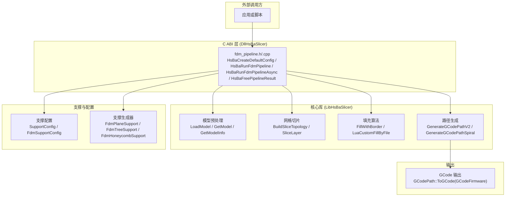
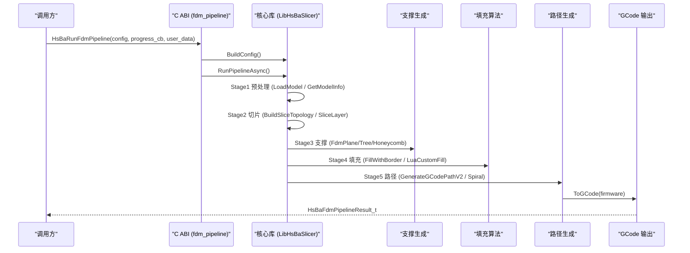
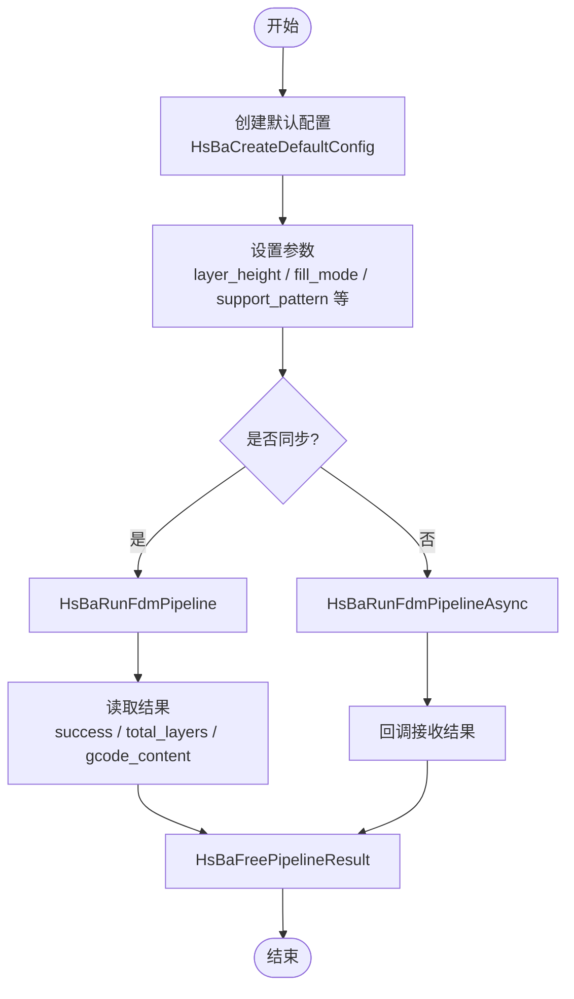
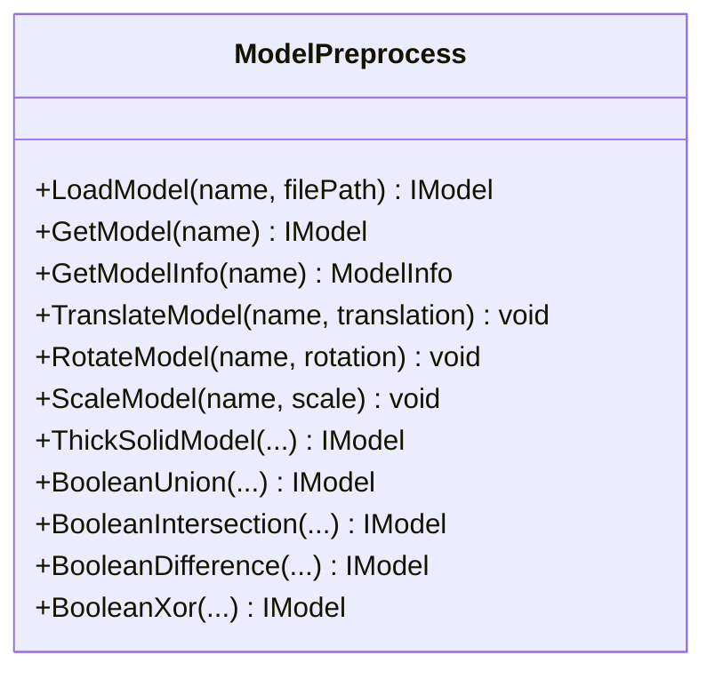
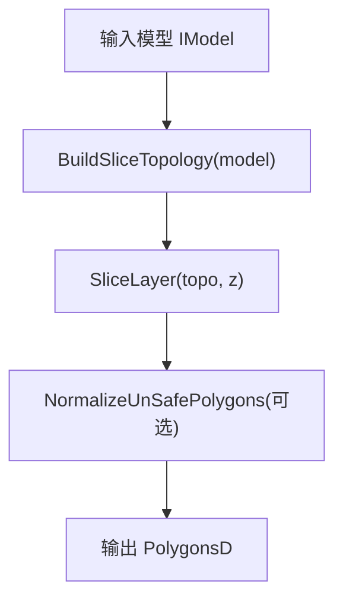
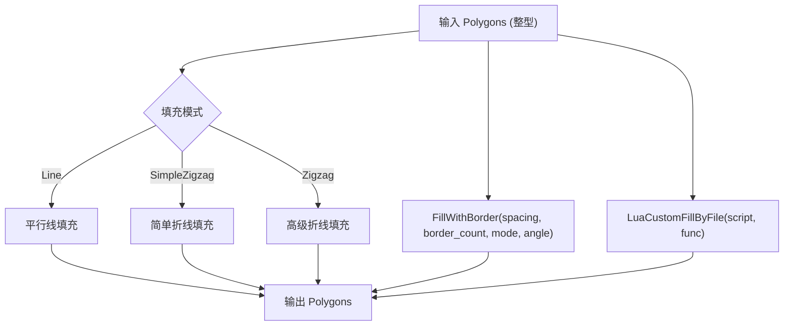
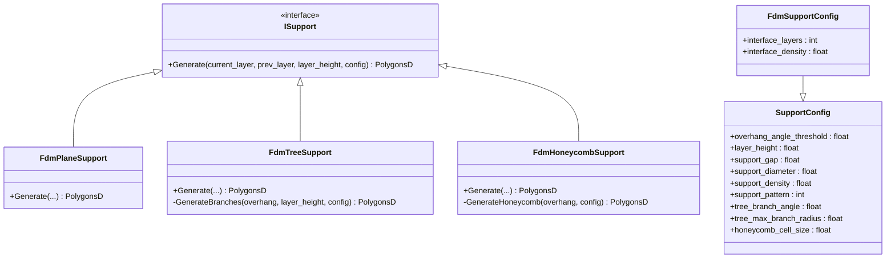
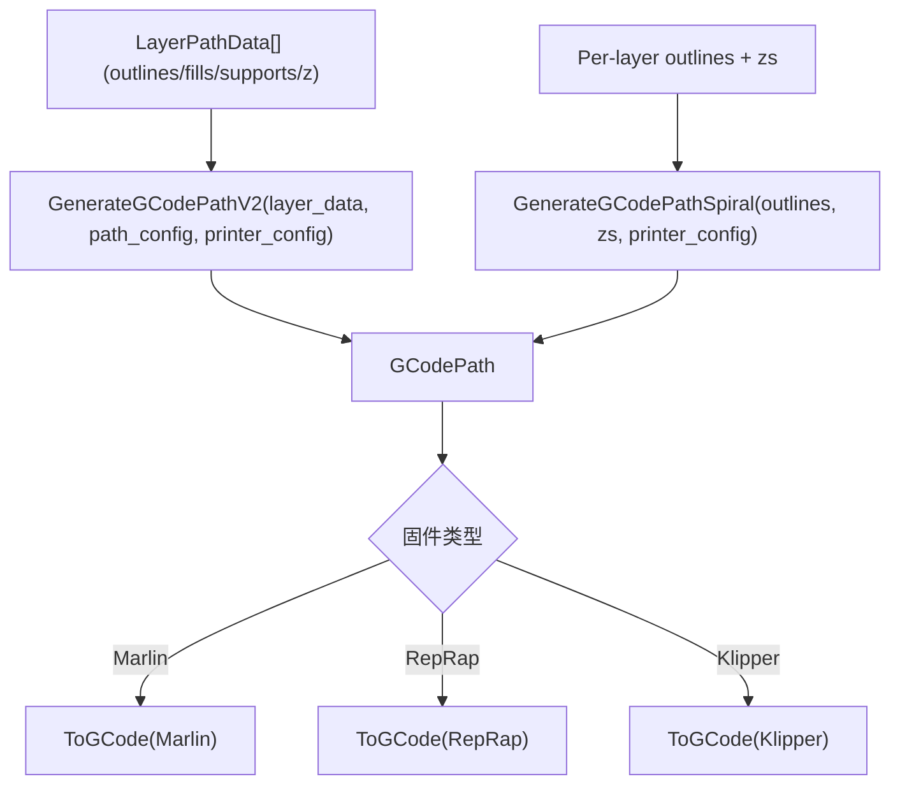
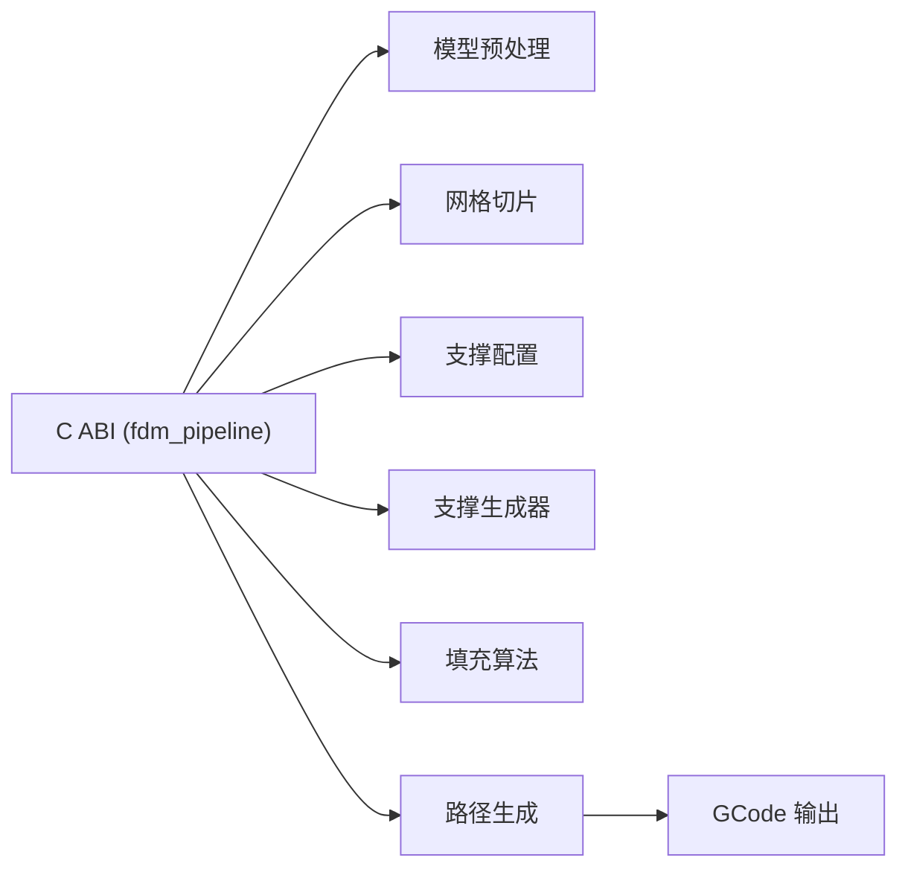

# FDM 切片流水线 API

<cite>
**本文引用的文件**   
- [fdm_pipeline.h](file://DllHsBaSlicer/fdm_pipeline.h)
- [fdm_pipeline.cpp](file://DllHsBaSlicer/fdm_pipeline.cpp)
- [pipeline_types.h](file://pipelinetypes/pipeline_types.h)
- [model_preprocess.hpp](file://LibHsBaSlicer/Preprocess/model_preprocess.hpp)
- [mesh_slice.hpp](file://LibHsBaSlicer/Slice/mesh_slice.hpp)
- [polygon_fill.hpp](file://LibHsBaSlicer/Fill/polygon_fill.hpp)
- [path_generator.hpp](file://LibHsBaSlicer/Path/path_generator.hpp)
- [FdmSupport.hpp](file://support/FdmSupport.hpp)
- [SupportConfig.hpp](file://support/SupportConfig.hpp)
- [gcodepath.hpp](file://paths/gcodepath.hpp)
- [README.md](file://README.md)
</cite>

## 目录
1. [简介](#简介)
2. [项目结构](#项目结构)
3. [核心组件](#核心组件)
4. [架构总览](#架构总览)
5. [详细组件分析](#详细组件分析)
6. [依赖关系分析](#依赖关系分析)
7. [性能考虑](#性能考虑)
8. [故障排查指南](#故障排查指南)
9. [结论](#结论)
10. [附录](#附录)

## 简介
本文件为 HsBaSlicer 的 FDM（熔融沉积成型）切片流水线的完整 C API 文档。内容覆盖模型预处理、网格切片、填充算法、支撑生成与路径规划，并提供 GCode 输出格式支持与多固件兼容性说明。文档面向不同技术背景的读者，提供从高层架构到代码级实现的逐步解析，并附带流程图、时序图与类图帮助理解。

## 项目结构
HsBaSlicer 将 FDM 切片能力拆分为多个模块：
- DllHsBaSlicer：导出 C ABI 的运行时流水线接口，对外暴露 FDM 配置、同步/异步执行与结果释放函数。
- LibHsBaSlicer：封装 C++ 全流程切片能力，包括模型预处理、网格切片、填充、路径生成等。
- support：支撑生成器（平面、树形、蜂窝）与通用支撑配置。
- paths：GCode 路径输出与多固件支持。
- pipelinetypes：C 兼容的类型定义与默认配置初始化器。

图表来源
- [fdm_pipeline.h:17-61](file://DllHsBaSlicer/fdm_pipeline.h#L17-L61)
- [fdm_pipeline.cpp:137-191](file://DllHsBaSlicer/fdm_pipeline.cpp#L137-L191)
- [model_preprocess.hpp:32-82](file://LibHsBaSlicer/Preprocess/model_preprocess.hpp#L32-L82)
- [mesh_slice.hpp:79-103](file://LibHsBaSlicer/Slice/mesh_slice.hpp#L79-L103)
- [polygon_fill.hpp:24-53](file://LibHsBaSlicer/Fill/polygon_fill.hpp#L24-L53)
- [path_generator.hpp:44-80](file://LibHsBaSlicer/Path/path_generator.hpp#L44-L80)
- [FdmSupport.hpp:13-63](file://support/FdmSupport.hpp#L13-L63)
- [SupportConfig.hpp:14-34](file://support/SupportConfig.hpp#L14-L34)
- [gcodepath.hpp:24-49](file://paths/gcodepath.hpp#L24-L49)

章节来源
- [README.md:104-124](file://README.md#L104-L124)

## 核心组件
本节聚焦 FDM 流水线的 C API 与关键数据结构，涵盖参数类型、枚举、回调与默认配置。

- C ABI 入口
  - HsBaCreateDefaultConfig：创建默认 FDM 流水线配置。
  - HsBaRunFdmPipeline：同步运行 FDM 全流水线（预处理→切片→支撑→填充→路径生成）。
  - HsBaRunFdmPipelineAsync：异步运行 FDM 全流水线，通过回调返回结果。
  - HsBaFreePipelineResult：释放流水线结果中分配的内存。

- 配置结构体 HsBaFdmPipelineConfig_t
  - 模型配置：model_name、model_path
  - 切片配置：layer_height、first_layer_height
  - 填充配置：fill_spacing、fill_mode、fill_angle、wall_count、top_layer_count、bottom_layer_count、infill_density
  - 支撑配置：enable_support、overhang_angle、support_gap、support_diameter、support_density、support_pattern、interface_layers、interface_density
  - 路径配置：line_width、print_speed、travel_speed、extrusion_multiplier、spiral_mode
  - GCode 输出配置：gcode_firmware、nozzle_diameter、filament_diameter、nozzle_temp、bed_temp、retract_length、retract_speed、first_layer_speed
  - Lua 自定义：support_lua_script、support_lua_func、infill_lua_script、infill_lua_func
  - 输出路径：output_path

- 结果结构体 HsBaFdmPipelineResult_t
  - success：成功标志
  - total_layers：总层数
  - gcode_content：GCode 内容（UTF-8，调用方负责释放）
  - error_message：错误信息（UTF-8，调用方负责释放）
  - elapsed_seconds：耗时（秒）

- 回调类型
  - HsBaProgressCallback：进度回调（percent、stage、user_data）
  - HsBaResultCallback：异步结果回调（result、user_data）

- 枚举
  - HsBaFillMode_t：HSBA_FILL_LINE、HSBA_FILL_SIMPLE_ZIGZAG、HSBA_FILL_ZIGZAG
  - HsBaSupportPattern_t：HSBA_SUPPORT_PLANE、HSBA_SUPPORT_TREE、HSBA_SUPPORT_HONEYCOMB
  - HsBaGCodeFirmware_t：HSBA_GCODE_MARLIN、HSBA_GCODE_REPRAP、HSBA_GCODE_KLIPPER

章节来源
- [fdm_pipeline.h:17-61](file://DllHsBaSlicer/fdm_pipeline.h#L17-L61)
- [pipeline_types.h:23-140](file://pipelinetypes/pipeline_types.h#L23-L140)
- [pipeline_types.h:742-783](file://pipelinetypes/pipeline_types.h#L742-L783)

## 架构总览
FDM 流水线在 C ABI 层内部使用协程驱动各阶段，并通过并行化提升性能。整体流程如下：

图表来源
- [fdm_pipeline.cpp:214-434](file://DllHsBaSlicer/fdm_pipeline.cpp#L214-L434)
- [mesh_slice.hpp:79-103](file://LibHsBaSlicer/Slice/mesh_slice.hpp#L79-L103)
- [FdmSupport.hpp:13-63](file://support/FdmSupport.hpp#L13-L63)
- [polygon_fill.hpp:24-53](file://LibHsBaSlicer/Fill/polygon_fill.hpp#L24-L53)
- [path_generator.hpp:44-80](file://LibHsBaSlicer/Path/path_generator.hpp#L44-L80)
- [gcodepath.hpp:74-82](file://paths/gcodepath.hpp#L74-L82)

## 详细组件分析

### C ABI 接口与生命周期管理
- HsBaCreateDefaultConfig：返回默认配置，所有字符串字段为空指针，数值字段采用合理默认值。
- HsBaRunFdmPipeline：阻塞式执行，内部使用协程；适合简单调用场景。
- HsBaRunFdmPipelineAsync：非阻塞执行，通过 result_callback 返回结果；适合 UI 或后台任务。
- HsBaFreePipelineResult：必须调用以释放 gcode_content 与 error_message。

图表来源
- [fdm_pipeline.h:17-61](file://DllHsBaSlicer/fdm_pipeline.h#L17-L61)
- [fdm_pipeline.cpp:440-479](file://DllHsBaSlicer/fdm_pipeline.cpp#L440-L479)

章节来源
- [fdm_pipeline.h:17-61](file://DllHsBaSlicer/fdm_pipeline.h#L17-L61)
- [fdm_pipeline.cpp:440-479](file://DllHsBaSlicer/fdm_pipeline.cpp#L440-L479)

### 模型预处理
- LoadModel：加载模型文件（STL/OBJ/STEP/IGES 等），存入内部池。
- GetModel：按名称获取已加载模型。
- GetModelInfo：获取包围盒与体积，用于计算层数与 Z 偏移。
- TranslateModel / RotateModel / ScaleModel：几何变换。
- ThickSolidModel / BooleanUnion / BooleanIntersection / BooleanDifference / BooleanXor：高级布尔与实体操作（需 CGAL）。

图表来源
- [model_preprocess.hpp:32-186](file://LibHsBaSlicer/Preprocess/model_preprocess.hpp#L32-L186)

章节来源
- [model_preprocess.hpp:32-186](file://LibHsBaSlicer/Preprocess/model_preprocess.hpp#L32-L186)

### 网格切片
- BuildSliceTopology：构建可复用的切片拓扑，避免每层重复重建。
- SliceLayer：基于预建拓扑切片单层，返回 PolygonsD。
- NormalizeUnSafePolygons：清理开放轮廓与非简单多边形，转换为双精度坐标。

图表来源
- [mesh_slice.hpp:79-103](file://LibHsBaSlicer/Slice/mesh_slice.hpp#L79-L103)

章节来源
- [mesh_slice.hpp:79-103](file://LibHsBaSlicer/Slice/mesh_slice.hpp#L79-L103)

### 填充算法
- FillPolygon：基础填充（线型/简单折线/折线模式）。
- FillWithBorder：带边框偏移的填充，结合 wall_count 控制外壁数量。
- LuaCustomFillByFile：通过 Lua 脚本自定义填充图案。

图表来源
- [polygon_fill.hpp:24-53](file://LibHsBaSlicer/Fill/polygon_fill.hpp#L24-L53)

章节来源
- [polygon_fill.hpp:24-53](file://LibHsBaSlicer/Fill/polygon_fill.hpp#L24-L53)

### 支撑生成
- FdmPlaneSupport：柱状支撑，基于悬垂区域膨胀生成圆柱支撑柱。
- FdmTreeSupport：树形分支支撑，自底板向上生长并在相交处合并。
- FdmHoneycombSupport：蜂窝填充支撑，轻量且刚性强。
- SupportConfig / FdmSupportConfig：通用与 FDM 专用支撑配置（悬垂角度阈值、层高、间隙、直径、密度、图案、界面层等）。

图表来源
- [FdmSupport.hpp:13-63](file://support/FdmSupport.hpp#L13-L63)
- [SupportConfig.hpp:14-34](file://support/SupportConfig.hpp#L14-L34)

章节来源
- [FdmSupport.hpp:13-63](file://support/FdmSupport.hpp#L13-L63)
- [SupportConfig.hpp:14-34](file://support/SupportConfig.hpp#L14-L34)

### 路径规划与 GCode 输出
- GenerateGCodePath：生成点路径（PointsPath）。
- GenerateGCodePathV2：生成多固件 GCode 路径（GCodePath），支持 Marlin/RepRap/Klipper。
- GenerateGCodePathSpiral：花瓶模式（螺旋连续外壁），无填充与支撑。
- GCodePath::ToGCode：按固件类型输出标准 GCode 字符串。
- GCodePrinterConfig：喷嘴直径、耗材直径、温度、回抽、速度、层高、线宽、挤出倍率等。

图表来源
- [path_generator.hpp:44-80](file://LibHsBaSlicer/Path/path_generator.hpp#L44-L80)
- [gcodepath.hpp:24-49](file://paths/gcodepath.hpp#L24-L49)
- [gcodepath.hpp:74-82](file://paths/gcodepath.hpp#L74-L82)

章节来源
- [path_generator.hpp:44-80](file://LibHsBaSlicer/Path/path_generator.hpp#L44-L80)
- [gcodepath.hpp:24-49](file://paths/gcodepath.hpp#L24-L49)
- [gcodepath.hpp:74-82](file://paths/gcodepath.hpp#L74-L82)

## 依赖关系分析
FDM 流水线对核心库与支撑/路径模块存在明确依赖：
- C ABI 层依赖 LibHsBaSlicer 的模型、切片、填充、路径生成。
- 支撑生成器依赖通用支撑配置。
- 路径生成依赖 GCode 输出与打印机配置。

图表来源
- [fdm_pipeline.cpp:17-26](file://DllHsBaSlicer/fdm_pipeline.cpp#L17-L26)
- [model_preprocess.hpp:32-82](file://LibHsBaSlicer/Preprocess/model_preprocess.hpp#L32-L82)
- [mesh_slice.hpp:79-103](file://LibHsBaSlicer/Slice/mesh_slice.hpp#L79-L103)
- [polygon_fill.hpp:24-53](file://LibHsBaSlicer/Fill/polygon_fill.hpp#L24-L53)
- [path_generator.hpp:44-80](file://LibHsBaSlicer/Path/path_generator.hpp#L44-L80)
- [gcodepath.hpp:24-49](file://paths/gcodepath.hpp#L24-L49)

章节来源
- [fdm_pipeline.cpp:17-26](file://DllHsBaSlicer/fdm_pipeline.cpp#L17-L26)

## 性能考虑
- 并行切片：BuildSliceTopology 仅构建一次，SliceLayer 并发调用，提升多层切片效率。
- 并行填充：FillWithBorder 为纯逐层计算，可安全并行；Lua 填充因解释器状态共享需串行。
- 进度回调：各阶段通过 ReportProgress 上报进度，便于 UI 更新与性能监控。
- 花瓶模式：跳过填充与支撑，直接生成连续螺旋外壁，减少计算量。
- 固件选择：根据目标固件（Marlin/RepRap/Klipper）优化 GCode 输出，减少后处理开销。

[本节为通用性能指导，不直接分析具体文件]

## 故障排查指南
- 模型加载失败：检查 model_path 是否存在、文件格式是否受支持；确认模型高度有效（>0）。
- 层数为零：当模型高度无效或 first_layer_height 大于模型高度时，层数可能为零；调整层高与首层层高。
- 支撑未生成：检查 enable_support 与 overhang_angle；确认支撑图案与密度配置合理。
- 填充异常：若使用 Lua 自定义填充，确保脚本路径与函数名正确；注意 Lua 填充为串行执行。
- GCode 输出失败：检查 printer_config 与 path_config 参数；确认固件类型与输出路径有效。
- 内存泄漏：务必调用 HsBaFreePipelineResult 释放结果中的 gcode_content 与 error_message。

章节来源
- [fdm_pipeline.cpp:224-248](file://DllHsBaSlicer/fdm_pipeline.cpp#L224-L248)
- [fdm_pipeline.cpp:274-302](file://DllHsBaSlicer/fdm_pipeline.cpp#L274-L302)
- [fdm_pipeline.cpp:304-372](file://DllHsBaSlicer/fdm_pipeline.cpp#L304-L372)
- [fdm_pipeline.cpp:374-420](file://DllHsBaSlicer/fdm_pipeline.cpp#L374-L420)
- [fdm_pipeline.cpp:473-479](file://DllHsBaSlicer/fdm_pipeline.cpp#L473-L479)

## 结论
HsBaSlicer 的 FDM 切片流水线通过模块化设计与 C ABI 暴露，提供了从模型预处理到 GCode 输出的完整能力。其支持多种填充与支撑策略，具备并行优化与多固件兼容性，适用于研发与生产环境。通过合理的参数配置与 Lua 扩展，用户可灵活定制切片行为以满足不同打印需求。

[本节为总结性内容，不直接分析具体文件]

## 附录

### FDM 参数配置速查表
- 层高与首层层高：layer_height、first_layer_height
- 填充：fill_spacing、fill_mode、fill_angle、wall_count、top_layer_count、bottom_layer_count、infill_density
- 支撑：enable_support、overhang_angle、support_gap、support_diameter、support_density、support_pattern、interface_layers、interface_density
- 路径：line_width、print_speed、travel_speed、extrusion_multiplier、spiral_mode
- GCode 输出：gcode_firmware、nozzle_diameter、filament_diameter、nozzle_temp、bed_temp、retract_length、retract_speed、first_layer_speed
- Lua 自定义：support_lua_script、support_lua_func、infill_lua_script、infill_lua_func
- 输出路径：output_path

章节来源
- [pipeline_types.h:56-113](file://pipelinetypes/pipeline_types.h#L56-L113)
- [pipeline_types.h:742-783](file://pipelinetypes/pipeline_types.h#L742-L783)

### 实际使用示例（步骤说明）
- 初始化：调用 HsBaCreateDefaultConfig 获取默认配置。
- 配置参数：设置模型路径、层高、填充模式、支撑图案、固件类型等。
- 执行流水线：
  - 同步：HsBaRunFdmPipeline，等待结果。
  - 异步：HsBaRunFdmPipelineAsync，通过回调接收结果。
- 使用结果：检查 success 与 total_layers，读取 gcode_content。
- 释放资源：调用 HsBaFreePipelineResult。

章节来源
- [fdm_pipeline.h:17-61](file://DllHsBaSlicer/fdm_pipeline.h#L17-L61)
- [fdm_pipeline.cpp:440-479](file://DllHsBaSlicer/fdm_pipeline.cpp#L440-L479)