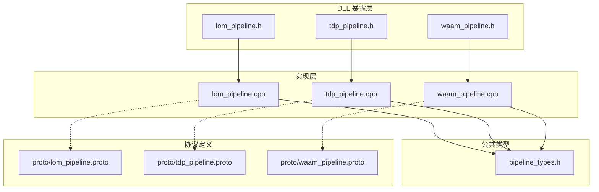
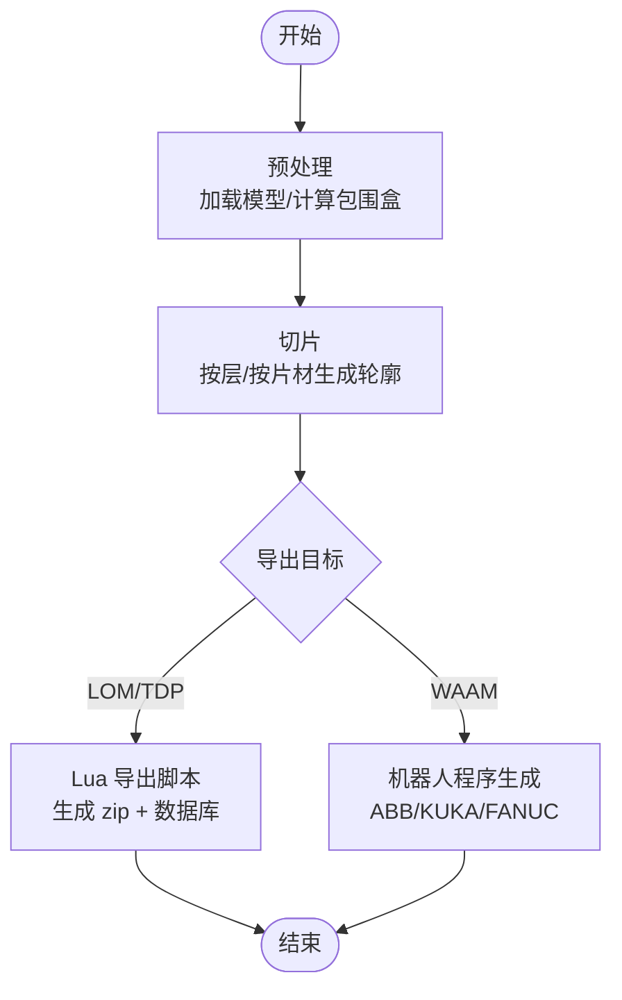
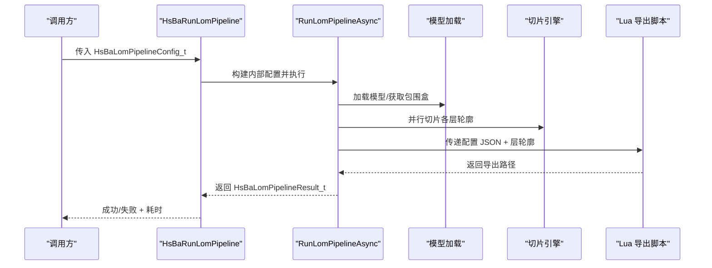
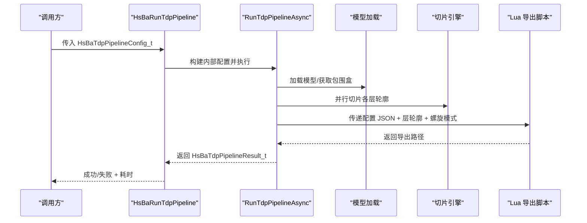
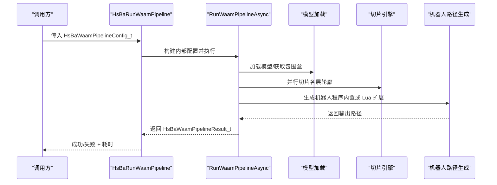
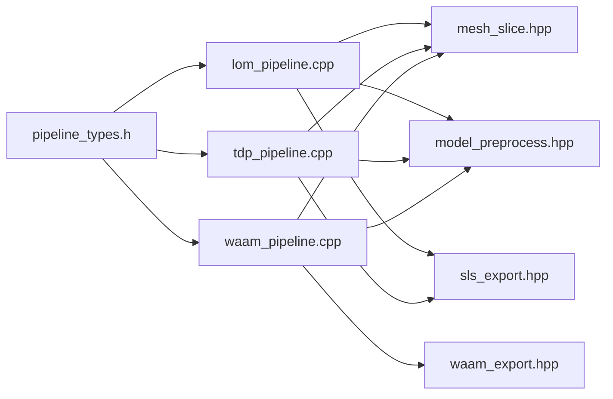
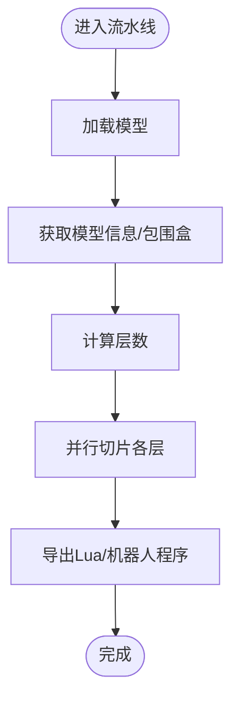

# LOM/TDP/WAAM 切片流水线 API

<cite>
**本文引用的文件**   
- [lom_pipeline.h](file://DllHsBaSlicer/lom_pipeline.h)
- [lom_pipeline.cpp](file://DllHsBaSlicer/lom_pipeline.cpp)
- [tdp_pipeline.h](file://DllHsBaSlicer/tdp_pipeline.h)
- [tdp_pipeline.cpp](file://DllHsBaSlicer/tdp_pipeline.cpp)
- [waam_pipeline.h](file://DllHsBaSlicer/waam_pipeline.h)
- [waam_pipeline.cpp](file://DllHsBaSlicer/waam_pipeline.cpp)
- [pipeline_types.h](file://pipelinetypes/pipeline_types.h)
- [lom_pipeline.proto](file://proto/lom_pipeline.proto)
- [tdp_pipeline.proto](file://proto/tdp_pipeline.proto)
- [waam_pipeline.proto](file://proto/waam_pipeline.proto)
</cite>

## 目录
1. [引言](#引言)
2. [项目结构](#项目结构)
3. [核心组件](#核心组件)
4. [架构总览](#架构总览)
5. [详细组件分析](#详细组件分析)
6. [依赖关系分析](#依赖关系分析)
7. [性能与并行特性](#性能与并行特性)
8. [故障排查指南](#故障排查指南)
9. [结论](#结论)
10. [附录：API 参考与使用示例](#附录api-参考与使用示例)

## 引言
本文件面向需要集成 LOM（分层实体制造）、TDP（三维打印/粘结剂喷射）和 WAAM（电弧增材制造）切片流水线的 C/C++ 开发者。文档聚焦于这三个特殊制造工艺的专用处理流程、C ABI 接口、参数配置、数据交换格式以及与传统制造系统的集成方式。

- LOM：按片材厚度切片，输出每层轮廓，并通过 Lua 导出脚本生成“压缩包 + 数据库”形式的工艺包。
- TDP：按层切片，将粘结剂喷射轮廓与喷头/固化参数交给 Lua 导出脚本，同样以压缩包形式输出。
- WAAM：按层切片后直接生成机器人语言程序（ABB/KUKA/FANUC），而非层压缩包；可选自定义路径 Lua 脚本。

## 项目结构
三个流水线均位于 DllHsBaSlicer 模块中，提供统一的 C ABI；类型定义集中在 pipelinetypes/pipeline_types.h；协议定义在 proto 目录下，便于跨语言或远程调用。

**图表来源**
- [lom_pipeline.h:1-63](file://DllHsBaSlicer/lom_pipeline.h#L1-L63)
- [tdp_pipeline.h:1-63](file://DllHsBaSlicer/tdp_pipeline.h#L1-L63)
- [waam_pipeline.h:1-64](file://DllHsBaSlicer/waam_pipeline.h#L1-L64)
- [pipeline_types.h:403-625](file://pipelinetypes/pipeline_types.h#L403-L625)
- [lom_pipeline.proto:1-46](file://proto/lom_pipeline.proto#L1-L46)
- [tdp_pipeline.proto:1-47](file://proto/tdp_pipeline.proto#L1-L47)
- [waam_pipeline.proto:1-89](file://proto/waam_pipeline.proto#L1-L89)

**章节来源**
- [lom_pipeline.h:1-63](file://DllHsBaSlicer/lom_pipeline.h#L1-L63)
- [tdp_pipeline.h:1-63](file://DllHsBaSlicer/tdp_pipeline.h#L1-L63)
- [waam_pipeline.h:1-64](file://DllHsBaSlicer/waam_pipeline.h#L1-L64)
- [pipeline_types.h:403-625](file://pipelinetypes/pipeline_types.h#L403-L625)

## 核心组件
每个流水线对外暴露一致的 C ABI：
- 创建默认配置函数
- 同步运行完整流水线
- 异步运行完整流水线
- 释放结果内存

公共类型与回调：
- 配置结构体：HsBaLomPipelineConfig_t / HsBaTdpPipelineConfig_t / HsBaWaamPipelineConfig_t
- 结果结构体：HsBaLomPipelineResult_t / HsBaTdpPipelineResult_t / HsBaWaamPipelineResult_t
- 进度回调：HsBaLomProgressCallback / HsBaTdpProgressCallback / HsBaWaamProgressCallback
- 结果回调：HsBaLomResultCallback / HsBaTdpResultCallback / HsBaWaamResultCallback

**章节来源**
- [pipeline_types.h:403-625](file://pipelinetypes/pipeline_types.h#L403-L625)
- [lom_pipeline.h:17-56](file://DllHsBaSlicer/lom_pipeline.h#L17-L56)
- [tdp_pipeline.h:17-56](file://DllHsBaSlicer/tdp_pipeline.h#L17-L56)
- [waam_pipeline.h:17-57](file://DllHsBaSlicer/waam_pipeline.h#L17-L57)

## 架构总览
三个流水线共享通用阶段：预处理 -> 切片 -> 导出。差异在于导出目标与设备约束。

**图表来源**
- [lom_pipeline.cpp:187-299](file://DllHsBaSlicer/lom_pipeline.cpp#L187-L299)
- [tdp_pipeline.cpp:197-310](file://DllHsBaSlicer/tdp_pipeline.cpp#L197-L310)
- [waam_pipeline.cpp:168-277](file://DllHsBaSlicer/waam_pipeline.cpp#L168-L277)

**章节来源**
- [lom_pipeline.cpp:187-299](file://DllHsBaSlicer/lom_pipeline.cpp#L187-L299)
- [tdp_pipeline.cpp:197-310](file://DllHsBaSlicer/tdp_pipeline.cpp#L197-L310)
- [waam_pipeline.cpp:168-277](file://DllHsBaSlicer/waam_pipeline.cpp#L168-L277)

## 详细组件分析

### LOM（分层实体制造）流水线
- 工艺特点：按片材厚度切片，逐层切割轮廓并压合；支持封边与半色调填充切割模式。
- 导出目标：通过 Lua 导出脚本输出压缩包（zip）+ 数据库，供后续 CAM/激光切割设备使用。
- 关键参数：
  - 切片：layer_height, first_layer_height
  - 切割：cut_speed, cut_margin, cut_power, seal_contour, cut_mode
  - 压合：bond_temperature, bond_pressure, bond_time
  - 导出：export_lua_script, export_lua_func, output_path

**图表来源**
- [lom_pipeline.cpp:187-299](file://DllHsBaSlicer/lom_pipeline.cpp#L187-L299)
- [lom_pipeline.h:23-56](file://DllHsBaSlicer/lom_pipeline.h#L23-L56)

**章节来源**
- [lom_pipeline.h:17-56](file://DllHsBaSlicer/lom_pipeline.h#L17-L56)
- [lom_pipeline.cpp:187-299](file://DllHsBaSlicer/lom_pipeline.cpp#L187-L299)
- [pipeline_types.h:403-461](file://pipelinetypes/pipeline_types.h#L403-L461)
- [lom_pipeline.proto:13-45](file://proto/lom_pipeline.proto#L13-L45)

### TDP（三维打印/粘结剂喷射）流水线
- 工艺特点：粉末床 + 液体粘结剂；支持全彩、单通道、烧结辅助模式；可开启螺旋连续沉积路径。
- 导出目标：通过 Lua 导出脚本输出压缩包（zip）+ 数据库，包含粘结剂喷射轮廓与喷头/固化参数。
- 关键参数：
  - 切片：layer_height, first_layer_height
  - 喷头：head_count, drop_spacing, binder_saturation, ink_curing_time
  - 环境：bed_temperature
  - 模式：binder_mode, spiral_mode
  - 导出：export_lua_script, export_lua_func, output_path

**图表来源**
- [tdp_pipeline.cpp:197-310](file://DllHsBaSlicer/tdp_pipeline.cpp#L197-L310)
- [tdp_pipeline.h:23-56](file://DllHsBaSlicer/tdp_pipeline.h#L23-L56)

**章节来源**
- [tdp_pipeline.h:17-56](file://DllHsBaSlicer/tdp_pipeline.h#L17-L56)
- [tdp_pipeline.cpp:197-310](file://DllHsBaSlicer/tdp_pipeline.cpp#L197-L310)
- [pipeline_types.h:463-521](file://pipelinetypes/pipeline_types.h#L463-L521)
- [tdp_pipeline.proto:15-46](file://proto/tdp_pipeline.proto#L15-L46)

### WAAM（电弧增材制造）流水线
- 工艺特点：金属丝电弧焊接逐层沉积；输出为机器人语言程序（ABB/KUKA/FANUC），非层压缩包。
- 导出目标：内置 ABB/KUKA/FANUC 路径生成器；也可通过 path_lua_script/path_lua_func 自定义路径生成逻辑。
- 关键参数：
  - 切片：layer_height, first_layer_height
  - 焊道：bead_width, travel_speed
  - 焊接：wire_feed_speed, arc_current, arc_voltage, gas_flow_rate
  - 材料/工艺：material, welding_process, protection, protect_gas, interpass_temperature
  - 机器人：robot_type, path_lua_script, path_lua_func, spiral_mode
  - 输出：output_path

**图表来源**
- [waam_pipeline.cpp:168-277](file://DllHsBaSlicer/waam_pipeline.cpp#L168-L277)
- [waam_pipeline.h:23-57](file://DllHsBaSlicer/waam_pipeline.h#L23-L57)

**章节来源**
- [waam_pipeline.h:17-57](file://DllHsBaSlicer/waam_pipeline.h#L17-L57)
- [waam_pipeline.cpp:168-277](file://DllHsBaSlicer/waam_pipeline.cpp#L168-L277)
- [pipeline_types.h:523-625](file://pipelinetypes/pipeline_types.h#L523-L625)
- [waam_pipeline.proto:49-88](file://proto/waam_pipeline.proto#L49-L88)

## 依赖关系分析
- 公共类型定义：所有配置/结果/回调均在 pipeline_types.h 中声明，确保 DLL 下游模块无需依赖共享库即可编译。
- 流水线实现：
  - LOM/TDP：复用 SLS 打包机制（SaveSlsPackageLua），将层轮廓与配置 JSON 传给 Lua 导出脚本。
  - WAAM：使用 SaveWaamRobotPath 生成机器人程序，支持内置三种机器人控制器语言或自定义 Lua 路径脚本。
- 外部依赖：
  - 模型预处理与切片：LibHsBaSlicer/Preprocess/model_preprocess.hpp、LibHsBaSlicer/Slice/mesh_slice.hpp
  - 协程与错误：base/coroutine.hpp、base/error.hpp
  - 并行切片：pipeline_parallel.hpp

**图表来源**
- [pipeline_types.h:403-625](file://pipelinetypes/pipeline_types.h#L403-L625)
- [lom_pipeline.cpp:17-23](file://DllHsBaSlicer/lom_pipeline.cpp#L17-L23)
- [tdp_pipeline.cpp:17-23](file://DllHsBaSlicer/tdp_pipeline.cpp#L17-L23)
- [waam_pipeline.cpp:16-21](file://DllHsBaSlicer/waam_pipeline.cpp#L16-L21)

**章节来源**
- [pipeline_types.h:403-625](file://pipelinetypes/pipeline_types.h#L403-L625)
- [lom_pipeline.cpp:17-23](file://DllHsBaSlicer/lom_pipeline.cpp#L17-L23)
- [tdp_pipeline.cpp:17-23](file://DllHsBaSlicer/tdp_pipeline.cpp#L17-L23)
- [waam_pipeline.cpp:16-21](file://DllHsBaSlicer/waam_pipeline.cpp#L16-L21)

## 性能与并行特性
- 切片阶段采用并行策略：对每一层独立调用 SliceLayer，提升多核利用率。
- 进度回调在各阶段均匀上报，便于 UI 展示与任务监控。
- 异常统一捕获为 RuntimeError，避免第三方几何库异常传播到 C ABI 层。

**图表来源**
- [lom_pipeline.cpp:223-245](file://DllHsBaSlicer/lom_pipeline.cpp#L223-L245)
- [tdp_pipeline.cpp:233-255](file://DllHsBaSlicer/tdp_pipeline.cpp#L233-L255)
- [waam_pipeline.cpp:202-224](file://DllHsBaSlicer/waam_pipeline.cpp#L202-L224)

**章节来源**
- [lom_pipeline.cpp:223-245](file://DllHsBaSlicer/lom_pipeline.cpp#L223-L245)
- [tdp_pipeline.cpp:233-255](file://DllHsBaSlicer/tdp_pipeline.cpp#L233-L255)
- [waam_pipeline.cpp:202-224](file://DllHsBaSlicer/waam_pipeline.cpp#L202-L224)

## 故障排查指南
- 模型加载失败：检查 model_name 与 model_path 是否正确；若未注册模型则需先加载。
- 层数为零或负：模型高度无效或层厚设置不合理；调整 layer_height/first_layer_height。
- LOM/TDP 导出失败：确认 export_lua_script 已设置且脚本存在；检查 Lua 函数名 export_lua_func。
- WAAM 导出失败：确认 robot_type 与 path_lua_script/path_lua_func 匹配；如使用内置生成器，确保 robot_type 为 ABB/KUKA/FANUC。
- 资源释放：务必调用对应的 HsBaFree*PipelineResult 释放结果中的字符串字段。

**章节来源**
- [lom_pipeline.cpp:289-293](file://DllHsBaSlicer/lom_pipeline.cpp#L289-L293)
- [tdp_pipeline.cpp:300-304](file://DllHsBaSlicer/tdp_pipeline.cpp#L300-L304)
- [waam_pipeline.cpp:267-271](file://DllHsBaSlicer/waam_pipeline.cpp#L267-L271)
- [lom_pipeline.cpp:337-343](file://DllHsBaSlicer/lom_pipeline.cpp#L337-L343)
- [tdp_pipeline.cpp:348-354](file://DllHsBaSlicer/tdp_pipeline.cpp#L348-L354)
- [waam_pipeline.cpp:315-321](file://DllHsBaSlicer/waam_pipeline.cpp#L315-L321)

## 结论
LOM/TDP/WAAM 流水线提供了统一的 C ABI，简化了不同增材制造工艺的集成。LOM/TDP 通过 Lua 导出脚本输出压缩包，适合传统 CAM/激光切割系统；WAAM 直接生成机器人程序，适配工业机械臂。三者均采用并行切片与进度回调，具备良好的可扩展性与性能表现。

## 附录：API 参考与使用示例

### LOM API 参考
- 创建默认配置：HsBaCreateDefaultLomConfig
- 同步运行：HsBaRunLomPipeline(config, callback, user_data)
- 异步运行：HsBaRunLomPipelineAsync(config, callback, user_data, result_callback, result_user_data)
- 释放结果：HsBaFreeLomPipelineResult(result)

典型用法步骤：
1. 调用 HsBaCreateDefaultLomConfig 初始化配置。
2. 设置 model_name/model_path、layer_height/first_layer_height、cut_*、bond_*、export_lua_script/export_lua_func、output_path。
3. 调用 HsBaRunLomPipeline 或 HsBaRunLomPipelineAsync。
4. 检查 result.success、result.total_layers、result.export_path、result.elapsed_seconds。
5. 调用 HsBaFreeLomPipelineResult 释放内存。

**章节来源**
- [lom_pipeline.h:17-56](file://DllHsBaSlicer/lom_pipeline.h#L17-L56)
- [pipeline_types.h:403-461](file://pipelinetypes/pipeline_types.h#L403-L461)
- [lom_pipeline.cpp:305-343](file://DllHsBaSlicer/lom_pipeline.cpp#L305-L343)

### TDP API 参考
- 创建默认配置：HsBaCreateDefaultTdpConfig
- 同步运行：HsBaRunTdpPipeline(config, callback, user_data)
- 异步运行：HsBaRunTdpPipelineAsync(config, callback, user_data, result_callback, result_user_data)
- 释放结果：HsBaFreeTdpPipelineResult(result)

典型用法步骤：
1. 调用 HsBaCreateDefaultTdpConfig 初始化配置。
2. 设置 model_name/model_path、layer_height/first_layer_height、head_count/drop_spacing/binder_saturation/ink_curing_time/bed_temperature、binder_mode、spiral_mode、export_lua_script/export_lua_func、output_path。
3. 调用 HsBaRunTdpPipeline 或 HsBaRunTdpPipelineAsync。
4. 检查 result.success、result.total_layers、result.export_path、result.elapsed_seconds。
5. 调用 HsBaFreeTdpPipelineResult 释放内存。

**章节来源**
- [tdp_pipeline.h:17-56](file://DllHsBaSlicer/tdp_pipeline.h#L17-L56)
- [pipeline_types.h:463-521](file://pipelinetypes/pipeline_types.h#L463-L521)
- [tdp_pipeline.cpp:316-354](file://DllHsBaSlicer/tdp_pipeline.cpp#L316-L354)

### WAAM API 参考
- 创建默认配置：HsBaCreateDefaultWaamConfig
- 同步运行：HsBaRunWaamPipeline(config, callback, user_data)
- 异步运行：HsBaRunWaamPipelineAsync(config, callback, user_data, result_callback, result_user_data)
- 释放结果：HsBaFreeWaamPipelineResult(result)

典型用法步骤：
1. 调用 HsBaCreateDefaultWaamConfig 初始化配置。
2. 设置 model_name/model_path、layer_height/first_layer_height、bead_width/travel_speed、wire_feed_speed/arc_current/arc_voltage/gas_flow_rate、material/welding_process/protection/protect_gas/interpass_temperature、robot_type、path_lua_script/path_lua_func、spiral_mode、output_path。
3. 调用 HsBaRunWaamPipeline 或 HsBaRunWaamPipelineAsync。
4. 检查 result.success、result.total_layers、result.output_path、result.elapsed_seconds。
5. 调用 HsBaFreeWaamPipelineResult 释放内存。

**章节来源**
- [waam_pipeline.h:17-57](file://DllHsBaSlicer/waam_pipeline.h#L17-L57)
- [pipeline_types.h:523-625](file://pipelinetypes/pipeline_types.h#L523-L625)
- [waam_pipeline.cpp:283-321](file://DllHsBaSlicer/waam_pipeline.cpp#L283-L321)

### 数据交换格式与集成方式
- LOM/TDP：导出为 zip + 数据库，Lua 导出脚本接收配置 JSON 与层轮廓；适用于传统 CAM/激光切割系统。
- WAAM：输出机器人语言程序（ABB/KUKA/FANUC），可直接导入机器人控制器；可选自定义路径 Lua 脚本扩展。
- 协议定义：proto 文件中定义了每种流水线的配置与结果结构，便于跨语言或远程服务调用。

**章节来源**
- [lom_pipeline.proto:13-45](file://proto/lom_pipeline.proto#L13-L45)
- [tdp_pipeline.proto:15-46](file://proto/tdp_pipeline.proto#L15-L46)
- [waam_pipeline.proto:49-88](file://proto/waam_pipeline.proto#L49-L88)