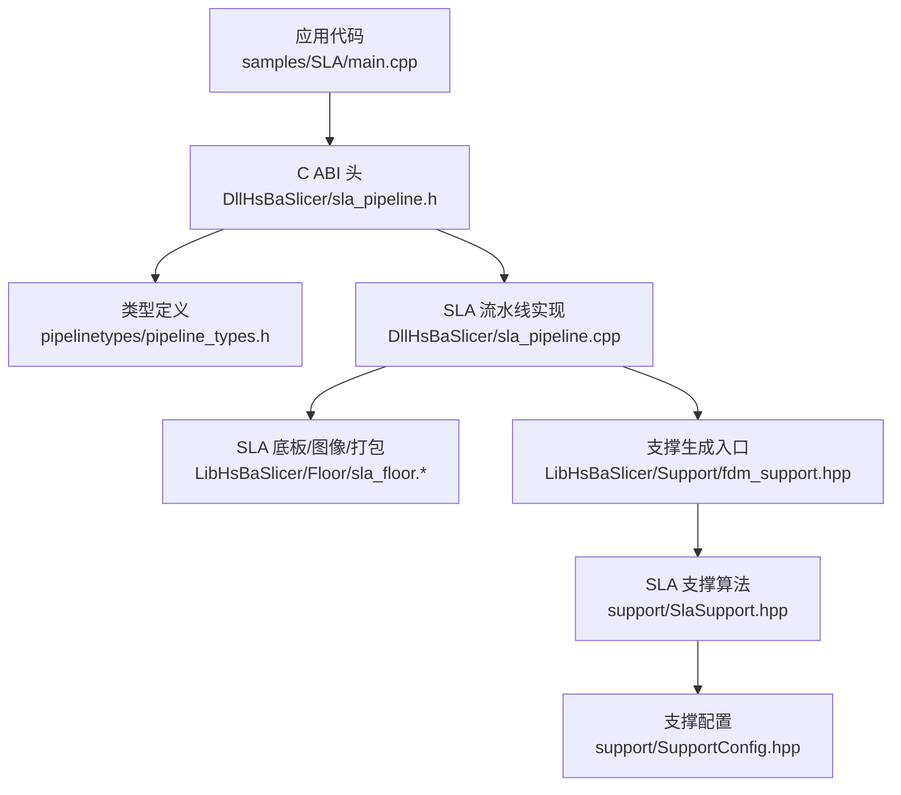
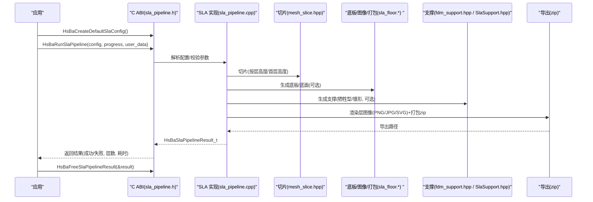
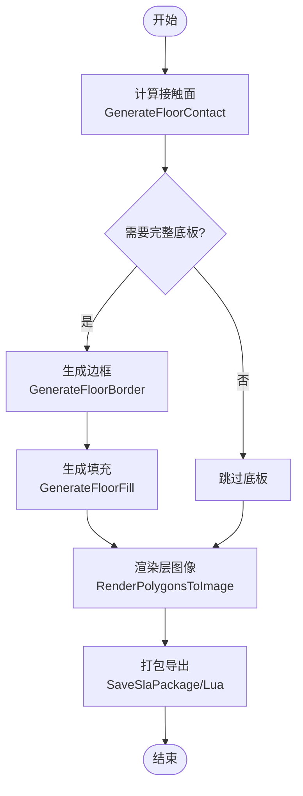
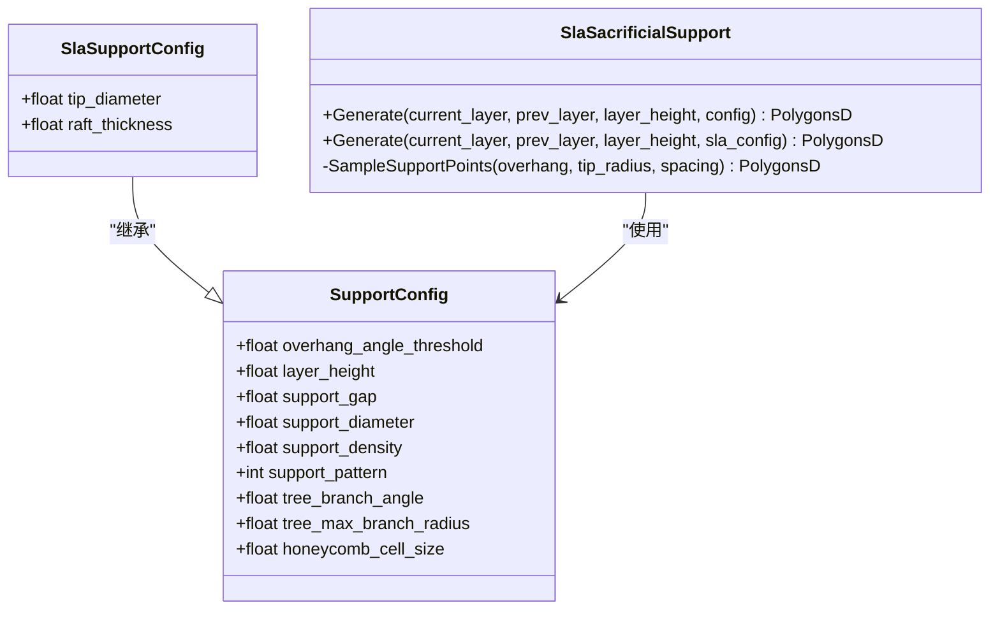
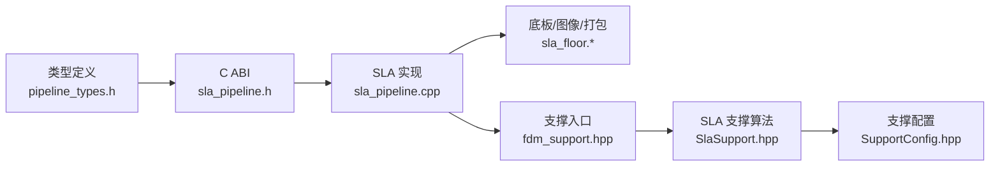

# SLA 切片流水线 API

<cite>
**本文引用的文件**   
- [sla_pipeline.h](file://DllHsBaSlicer/sla_pipeline.h)
- [pipeline_types.h](file://pipelinetypes/pipeline_types.h)
- [sla_floor.hpp](file://LibHsBaSlicer/Floor/sla_floor.hpp)
- [sla_floor.cpp](file://LibHsBaSlicer/Floor/sla_floor.cpp)
- [fdm_support.hpp](file://LibHsBaSlicer/Support/fdm_support.hpp)
- [SupportConfig.hpp](file://support/SupportConfig.hpp)
- [SlaSupport.hpp](file://support/SlaSupport.hpp)
- [sla_pipeline.cpp](file://DllHsBaSlicer/sla_pipeline.cpp)
- [main.cpp（SLA 示例）](file://samples/SLA/main.cpp)
</cite>

## 目录
1. [简介](#简介)
2. [项目结构](#项目结构)
3. [核心组件](#核心组件)
4. [架构总览](#架构总览)
5. [详细组件分析](#详细组件分析)
6. [依赖关系分析](#依赖关系分析)
7. [性能与精度建议](#性能与精度建议)
8. [故障排查指南](#故障排查指南)
9. [结论](#结论)
10. [附录：从模型到 SLA 文件的完整流程示例](#附录从模型到-sla-文件的完整流程示例)

## 简介
本文件为 HsBaSlicer 的 SLA（立体光固化）切片流水线的 C API 文档。内容覆盖树脂模型处理、层厚控制、曝光参数、支撑结构生成、底板/底面（floor/raft）生成、图像渲染与打包输出，以及通过 Lua 脚本扩展导出逻辑。读者可据此在 C/C++ 应用中调用 SLA 切片管线，完成从 3D 模型到打印机可用切片图像的端到端流程。

## 项目结构
SLA 相关能力由以下模块组成：
- DllHsBaSlicer/sla_pipeline.*：对外暴露的 C ABI，提供默认配置、同步/异步运行与结果释放接口。
- pipelinetypes/pipeline_types.h：C 兼容的结构体与枚举定义（SLA 配置、结果、回调等）。
- LibHsBaSlicer/Floor/sla_floor.*：SLA 底板/底面（raft）生成、图像渲染与打包导出。
- LibHsBaSlicer/Support/fdm_support.hpp：通用支撑生成入口（包含 SLA 支撑生成函数）。
- support/*：支撑算法与配置（SlaSupport、SupportConfig）。
- samples/SLA/main.cpp：SLA 使用示例（基础、自定义参数、Lua 定制、异步）。

图表来源
- [sla_pipeline.h:1-63](file://DllHsBaSlicer/sla_pipeline.h#L1-L63)
- [pipeline_types.h:140-245](file://pipelinetypes/pipeline_types.h#L140-L245)
- [sla_floor.hpp:1-184](file://LibHsBaSlicer/Floor/sla_floor.hpp#L1-L184)
- [fdm_support.hpp:37-67](file://LibHsBaSlicer/Support/fdm_support.hpp#L37-L67)
- [SlaSupport.hpp:1-46](file://support/SlaSupport.hpp#L1-L46)
- [SupportConfig.hpp:1-47](file://support/SupportConfig.hpp#L1-L47)

章节来源
- [sla_pipeline.h:1-63](file://DllHsBaSlicer/sla_pipeline.h#L1-L63)
- [pipeline_types.h:140-245](file://pipelinetypes/pipeline_types.h#L140-L245)

## 核心组件
本节概述面向 C 用户的 SLA 流水线关键接口与数据结构。

- 创建默认配置
  - 函数：HsBaCreateDefaultSlaConfig
  - 作用：返回带默认值的 SLA 流水线配置结构体。
  - 返回值：HsBaSlaPipelineConfig_t（含模型、切片、曝光、底板、支撑、Lua 扩展、输出等字段）。

- 同步运行流水线
  - 函数：HsBaRunSlaPipeline
  - 作用：执行“预处理 -> 切片 -> 底板 -> 支撑 -> 导出”全流程。
  - 参数：配置指针、进度回调（可为空）、用户数据（可为空）。
  - 返回值：HsBaSlaPipelineResult_t（需调用释放函数）。

- 异步运行流水线
  - 函数：HsBaRunSlaPipelineAsync
  - 作用：非阻塞执行，完成后通过结果回调返回。
  - 参数：配置指针、进度回调（可为空）、用户数据（可为空）、结果回调（不可为空）、结果回调用户数据（可为空）。

- 释放结果内存
  - 函数：HsBaFreeSlaPipelineResult
  - 作用：释放 HsBaSlaPipelineResult_t 内部动态分配内存。

- 类型与回调
  - 枚举：HsBaSlaSupportPattern_t（牺牲型/锥形支撑）、HsBaSlaImageType_t（PNG/JPG/SVG）。
  - 结构体：HsBaSlaPipelineConfig_t（详见“配置字段说明”）、HsBaSlaPipelineResult_t（成功标志、层数、导出路径、错误信息、耗时）。
  - 回调：HsBaSlaProgressCallback（百分比、阶段描述、用户数据）、HsBaSlaResultCallback（结果、用户数据）。

章节来源
- [sla_pipeline.h:17-56](file://DllHsBaSlicer/sla_pipeline.h#L17-L56)
- [pipeline_types.h:146-245](file://pipelinetypes/pipeline_types.h#L146-L245)

## 架构总览
下图展示从应用调用到最终输出的整体流程，包括内置与 Lua 扩展点。

图表来源
- [sla_pipeline.h:23-56](file://DllHsBaSlicer/sla_pipeline.h#L23-L56)
- [sla_pipeline.cpp:27-57](file://DllHsBaSlicer/sla_pipeline.cpp#L27-L57)
- [sla_floor.hpp:118-179](file://LibHsBaSlicer/Floor/sla_floor.hpp#L118-L179)
- [fdm_support.hpp:37-67](file://LibHsBaSlicer/Support/fdm_support.hpp#L37-L67)

## 详细组件分析

### C ABI 接口（SLA 流水线）
- HsBaCreateDefaultSlaConfig
  - 用途：初始化默认 SLA 配置。
  - 典型用法：先获取默认值，再按需覆写 model_name/model_path/output_path 等字段。
- HsBaRunSlaPipeline
  - 用途：同步执行完整流水线。
  - 关键点：支持进度回调；失败时 error_message 非空；成功后 export_path 指向 zip 路径。
- HsBaRunSlaPipelineAsync
  - 用途：异步执行，适合 UI 线程不阻塞场景。
  - 关键点：必须提供结果回调；回调中需释放结果对象。
- HsBaFreeSlaPipelineResult
  - 用途：释放结果对象中的动态内存（export_path、error_message）。

章节来源
- [sla_pipeline.h:17-56](file://DllHsBaSlicer/sla_pipeline.h#L17-L56)

### 配置与结果结构（HsBaSlaPipelineConfig_t / HsBaSlaPipelineResult_t）
- 模型配置
  - model_name：模型名称（用于日志/标识）。
  - model_path：模型文件路径（STL/OBJ 等）。
- 切片配置
  - layer_height：层厚（mm），默认 0.05。
  - first_layer_height：首层层厚（mm），默认 0.1。
- 曝光与抬升（SLA 特有）
  - bottom_exposure_time：底层曝光时间（秒），默认 60.0。
  - normal_exposure_time：普通层曝光时间（秒），默认 2.5。
  - bottom_lift_distance：底层抬升距离（mm），默认 5.0。
  - lift_distance：普通层抬升距离（mm），默认 3.0。
  - lift_speed：抬升速度（mm/s），默认 60.0。
  - retract_speed：回缩速度（mm/s），默认 150.0。
- 底板/底面（floor/raft）
  - floor_raft_offset：底板外扩偏移（mm），默认 2.0。
  - floor_border_width：边框宽度（mm），默认 1.0。
  - floor_fill_spacing：填充间距（mm），默认 0.5。
  - floor_fill_angle：填充角度（度），默认 0.0。
  - floor_border_count：边框圈数，默认 2。
  - floor_use_convex_hull：是否使用凸包作为接触面，默认 0。
- 支撑结构
  - enable_support：是否启用支撑，默认 1。
  - overhang_angle：悬垂角度阈值（度），默认 45.0。
  - support_gap：支撑与模型间隙（mm），默认 0.5。
  - support_diameter：支撑柱直径（mm），默认 2.0。
  - support_density：支撑填充密度 [0,1]，默认 0.3。
  - support_pattern：支撑模式（牺牲型/锥形）。
- Lua 扩展
  - support_lua_script / support_lua_func：自定义支撑脚本与函数名。
  - floor_lua_script / floor_lua_func：自定义底板脚本与函数名。
  - export_lua_script / export_lua_func：自定义导出脚本与函数名。
- 输出
  - output_path：输出 zip 路径（可为空）。
  - image_type：层图像格式（PNG/JPG/SVG）。
  - image_width / image_height：图像宽高（像素，0=自动）。

- HsBaSlaPipelineResult_t
  - success：成功标志。
  - total_layers：总层数。
  - export_path：导出 zip 路径（UTF-8，调用方负责释放）。
  - error_message：错误消息（UTF-8，调用方负责释放）。
  - elapsed_seconds：耗时（秒）。

章节来源
- [pipeline_types.h:146-245](file://pipelinetypes/pipeline_types.h#L146-L245)

### 底板/底面（Floor/Raft）API
- GenerateFloorContact
  - 输入：底层轮廓多边形 + 底板配置。
  - 输出：构建平台接触区域多边形（可选凸包/凹包简化）。
- GenerateFloorRaft
  - 输入：底层轮廓多边形 + 底板配置。
  - 输出：完整底板（边框+填充）。
- GenerateFloorBorder / GenerateFloorFill
  - 分别仅生成边框或内部填充。
- LuaCustomFloorByFile / LuaCustomFloorByString
  - 通过 Lua 脚本自定义底板生成，传入底部层多边形与配置表，返回底板多边形。
- RenderPolygonsToImage
  - 将多边形渲染为 PNG/JPG/SVG 图像文件。
- SaveSlaPackage / SaveSlaPackageLua
  - 将层轮廓、支撑、底板、配置 JSON 打包为 zip；支持 Lua 自定义导出逻辑。

图表来源
- [sla_floor.hpp:24-78](file://LibHsBaSlicer/Floor/sla_floor.hpp#L24-L78)
- [sla_floor.hpp:118-179](file://LibHsBaSlicer/Floor/sla_floor.hpp#L118-L179)

章节来源
- [sla_floor.hpp:24-179](file://LibHsBaSlicer/Floor/sla_floor.hpp#L24-L179)
- [sla_floor.cpp:25-46](file://LibHsBaSlicer/Floor/sla_floor.cpp#L25-L46)

### 支撑结构（Support）API
- 通用支撑入口
  - GenerateAllSlaSupport(layers, config)
    - 输入：所有层轮廓（自下而上）+ SLA 支撑配置。
    - 输出：每层支撑多边形集合。
- SLA 专用支撑类
  - SlaSacrificialSupport::Generate(...)
    - 基于悬垂区域采样支撑点，生成逐层圆形截面支撑柱（锥度从基座到尖端）。
- 支撑配置
  - SupportConfig：通用参数（悬垂角、层厚、间隙、直径、密度、图案等）。
  - SlaSupportConfig：SLA 专属（tip_diameter、raft_thickness）。

图表来源
- [SupportConfig.hpp:11-43](file://support/SupportConfig.hpp#L11-L43)
- [SlaSupport.hpp:13-42](file://support/SlaSupport.hpp#L13-L42)
- [fdm_support.hpp:37-67](file://LibHsBaSlicer/Support/fdm_support.hpp#L37-L67)

章节来源
- [fdm_support.hpp:37-67](file://LibHsBaSlicer/Support/fdm_support.hpp#L37-L67)
- [SupportConfig.hpp:11-43](file://support/SupportConfig.hpp#L11-L43)
- [SlaSupport.hpp:13-42](file://support/SlaSupport.hpp#L13-L42)

### 导出与文件格式
- 层图像格式
  - PNG（无损，默认）、JPEG（有损，体积更小）、SVG（矢量，可缩放）。
- 打包输出
  - zip 压缩包包含：config.json、层图像（PNG/JPG/SVG）、底板图像（可选）、支撑图像（可选）。
- Lua 自定义导出
  - 通过 export_lua_script/export_lua_func 指定自定义导出逻辑，完全掌控输出结构与内容。

章节来源
- [pipeline_types.h:155-163](file://pipelinetypes/pipeline_types.h#L155-L163)
- [sla_floor.hpp:141-179](file://LibHsBaSlicer/Floor/sla_floor.hpp#L141-L179)

## 依赖关系分析
- 耦合关系
  - C ABI（sla_pipeline.h）对类型定义（pipeline_types.h）强依赖。
  - 流水线实现（sla_pipeline.cpp）组合切片、底板、支撑与导出模块。
  - 底板模块（sla_floor.*）依赖 2D 几何与图像库，并封装打包逻辑。
  - 支撑模块（fdm_support.hpp / SlaSupport.hpp）共享通用支撑配置（SupportConfig.hpp）。
- 外部依赖
  - Lua 脚本扩展（底板/支撑/导出）。
  - 图像编码（PNG/JPG/SVG）。
  - Zip 打包（ImagesPath/Zipper）。

图表来源
- [pipeline_types.h:140-245](file://pipelinetypes/pipeline_types.h#L140-L245)
- [sla_pipeline.h:1-63](file://DllHsBaSlicer/sla_pipeline.h#L1-L63)
- [sla_pipeline.cpp:27-57](file://DllHsBaSlicer/sla_pipeline.cpp#L27-L57)
- [sla_floor.hpp:1-184](file://LibHsBaSlicer/Floor/sla_floor.hpp#L1-L184)
- [fdm_support.hpp:37-67](file://LibHsBaSlicer/Support/fdm_support.hpp#L37-L67)
- [SlaSupport.hpp:1-46](file://support/SlaSupport.hpp#L1-L46)
- [SupportConfig.hpp:1-47](file://support/SupportConfig.hpp#L1-L47)

章节来源
- [pipeline_types.h:140-245](file://pipelinetypes/pipeline_types.h#L140-L245)
- [sla_pipeline.h:1-63](file://DllHsBaSlicer/sla_pipeline.h#L1-L63)

## 性能与精度建议
- 层厚与表面质量
  - 降低 layer_height 可提升 Z 轴分辨率与表面质量，但会增加层数与处理时间。
  - 合理设置 first_layer_height 以增强首层附着力，避免翘边。
- 曝光与分离
  - bottom_exposure_time 与 normal_exposure_time 需根据树脂特性校准；过大导致过曝，过小导致层间结合不良。
  - lift_distance/lift_speed/retract_speed 影响打印稳定性与成功率；建议逐步调优以避免拉断或分层。
- 底板与支撑
  - floor_raft_offset 与 border_count 影响附着面积与材料消耗；适当增大可提高附着力。
  - support_gap 与 support_diameter 平衡移除难度与强度；tip_diameter 越小越易去除但可能强度不足。
- 图像与导出
  - 选择 SVG 可获得矢量精度，但文件体积较大；PNG 兼顾无损与体积；JPEG 体积最小但有损。
  - 自定义 Lua 导出可按打印机需求优化文件名、层级组织与元数据。

[本节为通用指导，无需特定文件引用]

## 故障排查指南
- 常见错误
  - 模型路径无效或格式不支持：检查 model_path 与模型格式。
  - 输出目录无写入权限：确认 output_path 所在目录存在且可写。
  - 曝光参数不合理：出现层间剥离或过度固化，调整 exposure 与 lift 参数。
  - 支撑不足导致塌陷：提高 support_density、减小 support_gap 或更换支撑模式。
- 调试手段
  - 启用进度回调观察各阶段耗时与状态。
  - 导出 zip 后检查 config.json 与实际生成的层图像是否一致。
  - 使用 Lua 自定义导出打印中间数据定位问题。

章节来源
- [sla_pipeline.h:23-56](file://DllHsBaSlicer/sla_pipeline.h#L23-L56)
- [pipeline_types.h:220-245](file://pipelinetypes/pipeline_types.h#L220-L245)

## 结论
HsBaSlicer 的 SLA 流水线提供了完整的 C API，涵盖从模型预处理、切片、底板生成、支撑生成到图像渲染与打包导出的全链路能力。通过丰富的配置项与 Lua 扩展点，用户可灵活适配不同树脂、打印机与工艺需求。建议在真实设备上进行参数标定，并结合进度回调与导出产物进行闭环优化。

[本节为总结性内容，无需特定文件引用]

## 附录：从模型到 SLA 文件的完整流程示例
以下为基于 samples/SLA/main.cpp 的典型使用步骤（概念性流程，不直接粘贴代码）：
- 步骤 1：获取默认配置并设置模型与输出路径。
- 步骤 2：根据需要调整层厚、首层层厚、曝光时间与抬升参数。
- 步骤 3：配置底板（偏移、边框、填充、凸包）与支撑（开关、角度、间隙、直径、密度、模式）。
- 步骤 4：选择图像格式（PNG/JPG/SVG）与尺寸（自动或指定）。
- 步骤 5：可选地通过 Lua 脚本自定义底板、支撑或导出逻辑。
- 步骤 6：调用同步或异步接口运行流水线，并在回调中处理进度与结果。
- 步骤 7：检查导出 zip 内容（config.json、层图像、底板/支撑图像），必要时用 Lua 导出器进一步定制。

章节来源
- [main.cpp（SLA 示例）:52-84](file://samples/SLA/main.cpp#L52-L84)
- [main.cpp（SLA 示例）:89-144](file://samples/SLA/main.cpp#L89-L144)
- [main.cpp（SLA 示例）:149-191](file://samples/SLA/main.cpp#L149-L191)
- [main.cpp（SLA 示例）:217-239](file://samples/SLA/main.cpp#L217-L239)