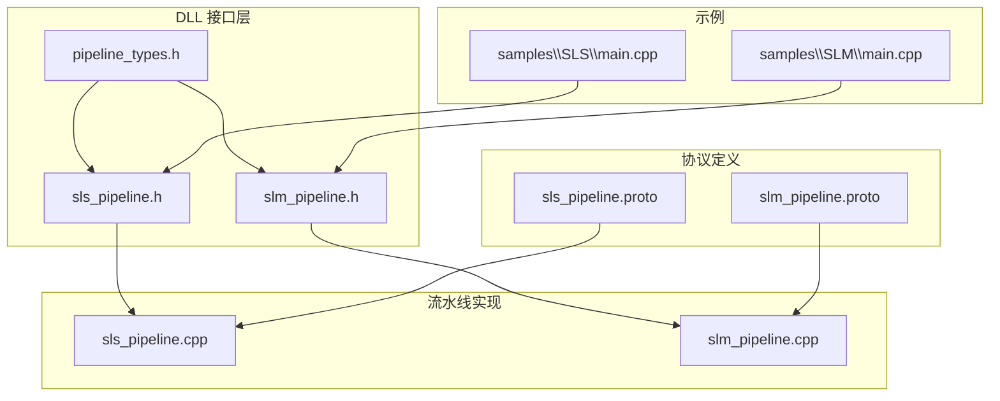
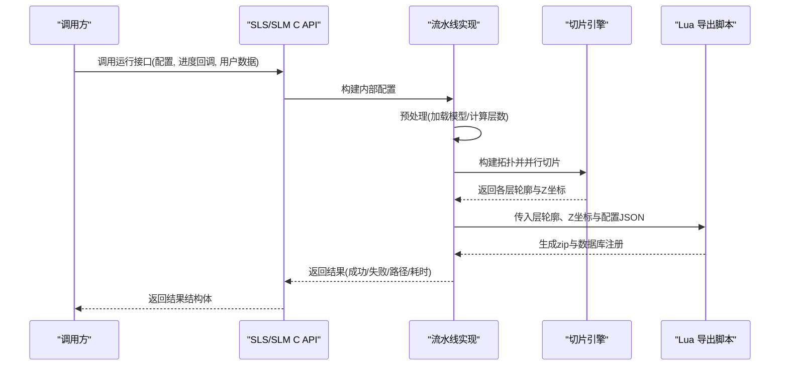
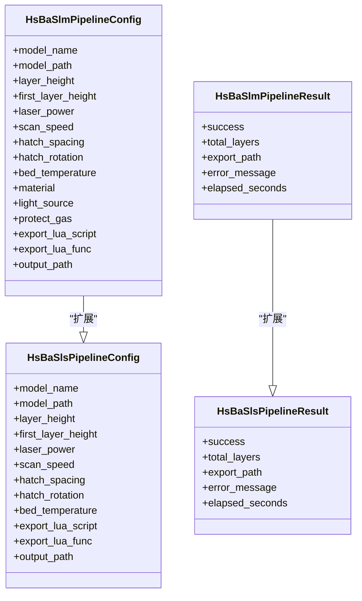
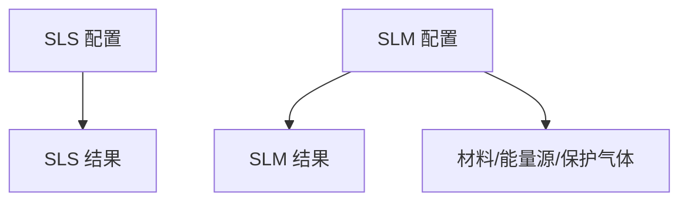
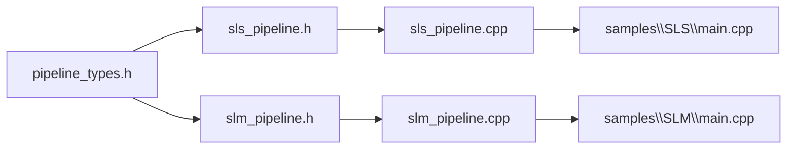
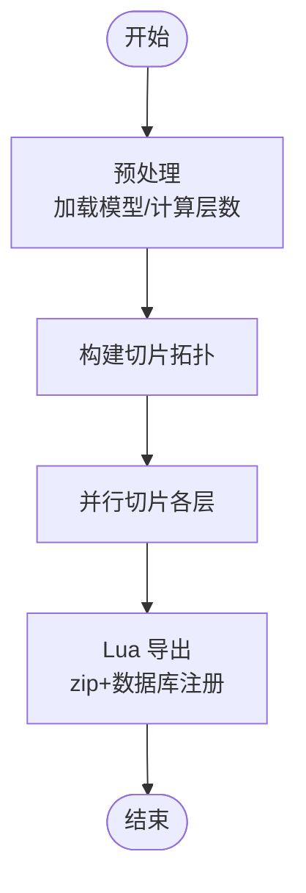
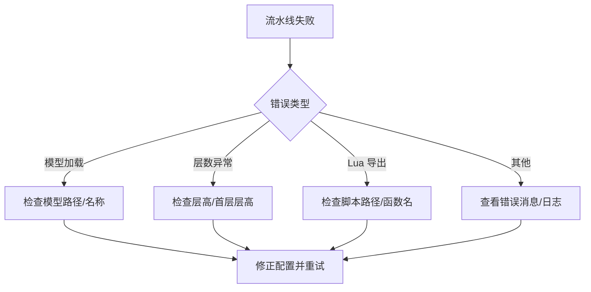

# SLS/SLM 切片流水线 API

<cite>
**本文引用的文件**   
- [sls_pipeline.h](file://DllHsBaSlicer/sls_pipeline.h)
- [slm_pipeline.h](file://DllHsBaSlicer/slm_pipeline.h)
- [pipeline_types.h](file://pipelinetypes/pipeline_types.h)
- [sls_pipeline.cpp](file://DllHsBaSlicer/sls_pipeline.cpp)
- [slm_pipeline.cpp](file://DllHsBaSlicer/slm_pipeline.cpp)
- [sls_pipeline.proto](file://proto/sls_pipeline.proto)
- [slm_pipeline.proto](file://proto/slm_pipeline.proto)
- [samples\SLS\main.cpp](file://samples/SLS/main.cpp)
- [samples\SLM\main.cpp](file://samples/SLM/main.cpp)
</cite>

## 目录
1. [引言](#引言)
2. [项目结构](#项目结构)
3. [核心组件](#核心组件)
4. [架构总览](#架构总览)
5. [详细组件分析](#详细组件分析)
6. [依赖关系分析](#依赖关系分析)
7. [性能与并发特性](#性能与并发特性)
8. [质量控制与缺陷检测](#质量控制与缺陷检测)
9. [故障排查指南](#故障排查指南)
10. [结论](#结论)
11. [附录：API 参考](#附录api-参考)

## 引言
本文件面向工业级应用，提供 SLS（选择性激光烧结）与 SLM（选择性激光熔化）切片流水线的完整 C API 文档。两者均属于粉末床熔融技术族：SLS 通常用于聚合物粉末，SLM 用于金属粉末；在 HsBaSlicer 中，二者共享“预处理 -> 切片 -> Lua 导出”的流水线骨架，区别在于工艺参数与材料语义。

需要特别说明的是：当前仓库中的 SLS/SLM 流水线实现聚焦于几何切片与基于 Lua 的打包导出，并未内置热力学、热应力或变形预测模块。因此，关于“粉末层铺展模拟、热应力分析和变形预测”的内容在本仓库中不存在直接实现；如需扩展，可在 Lua 导出阶段或外部后处理流程中集成第三方仿真结果。

## 项目结构
与 SLS/SLM 相关的代码主要分布在以下位置：
- DllHsBaSlicer：C ABI 头文件与实现，暴露同步/异步流水线接口
- pipelinetypes：C 兼容的结构体与枚举定义
- proto：序列化协议定义（含 SLS/SLM 配置与结果）
- samples：SLS/SLM 使用示例，演示同步、异步与自定义工艺参数

**图表来源**
- [sls_pipeline.h:1-63](file://DllHsBaSlicer/sls_pipeline.h#L1-L63)
- [slm_pipeline.h:1-63](file://DllHsBaSlicer/slm_pipeline.h#L1-L63)
- [pipeline_types.h:247-401](file://pipelinetypes/pipeline_types.h#L247-L401)
- [sls_pipeline.cpp:1-334](file://DllHsBaSlicer/sls_pipeline.cpp#L1-L334)
- [slm_pipeline.cpp:1-387](file://DllHsBaSlicer/slm_pipeline.cpp#L1-L387)
- [sls_pipeline.proto:1-33](file://proto/sls_pipeline.proto#L1-L33)
- [slm_pipeline.proto:1-65](file://proto/slm_pipeline.proto#L1-L65)
- [samples\SLS\main.cpp:1-209](file://samples/SLS/main.cpp#L1-L209)
- [samples\SLM\main.cpp:1-196](file://samples/SLM/main.cpp#L1-L196)

**章节来源**
- [sls_pipeline.h:1-63](file://DllHsBaSlicer/sls_pipeline.h#L1-L63)
- [slm_pipeline.h:1-63](file://DllHsBaSlicer/slm_pipeline.h#L1-L63)
- [pipeline_types.h:247-401](file://pipelinetypes/pipeline_types.h#L247-L401)

## 核心组件
- SLS 流水线 C ABI：提供默认配置创建、同步运行、异步运行与结果释放接口
- SLM 流水线 C ABI：在 SLS 基础上增加金属材料、能量源与保护气体等金属特有参数
- 公共类型定义：包含 SLS/SLM 的配置结构体、结果结构体与回调函数类型
- 协议定义：以 protobuf 描述 SLS/SLM 的配置与结果字段，便于跨语言与持久化

关键要点：
- SLS/SLM 输出格式完全由 Lua 导出脚本决定，通常为 zip 归档与数据库注册
- 层数计算基于模型包围盒高度、首层层高与普通层高
- 切片阶段对每层轮廓并行计算，提升吞吐

**章节来源**
- [sls_pipeline.h:17-56](file://DllHsBaSlicer/sls_pipeline.h#L17-L56)
- [slm_pipeline.h:17-56](file://DllHsBaSlicer/slm_pipeline.h#L17-L56)
- [pipeline_types.h:247-401](file://pipelinetypes/pipeline_types.h#L247-L401)

## 架构总览
SLS/SLM 流水线统一遵循三阶段流程：
1. 预处理：加载模型并获取几何信息（包围盒、体积等）
2. 切片：构建拓扑并并行计算各层轮廓
3. 导出：通过 Lua 脚本将层轮廓与配置 JSON 打包为 zip 并注册到数据库

**图表来源**
- [sls_pipeline.cpp:176-289](file://DllHsBaSlicer/sls_pipeline.cpp#L176-L289)
- [slm_pipeline.cpp:230-342](file://DllHsBaSlicer/slm_pipeline.cpp#L230-L342)

## 详细组件分析

### SLS 流水线 C API
- 默认配置创建：返回带默认值的 SLS 配置结构体
- 同步运行：阻塞式执行全流程，返回结果结构体
- 异步运行：非阻塞执行，完成后通过回调返回结果
- 结果释放：释放结果结构体中动态分配的字符串

典型用法参见示例程序，包括基本流程、自定义激光参数与异步模式。

**章节来源**
- [sls_pipeline.h:17-56](file://DllHsBaSlicer/sls_pipeline.h#L17-L56)
- [sls_pipeline.cpp:295-333](file://DllHsBaSlicer/sls_pipeline.cpp#L295-L333)
- [samples\SLS\main.cpp:56-92](file://samples/SLS/main.cpp#L56-L92)
- [samples\SLS\main.cpp:97-140](file://samples/SLS/main.cpp#L97-L140)
- [samples\SLS\main.cpp:166-190](file://samples/SLS/main.cpp#L166-L190)

### SLM 流水线 C API
- 默认配置创建：返回带默认值的 SLM 配置结构体（钛合金、激光、氩气）
- 同步运行：阻塞式执行全流程，返回结果结构体
- 异步运行：非阻塞执行，完成后通过回调返回结果
- 结果释放：释放结果结构体中动态分配的字符串

SLM 在 SLS 基础上增加了：
- 金属材料：铁基、铝基、钛基、未知
- 能量源：激光、电子束、未知
- 保护气体：氩气、氦气、氮气、二氧化碳、未知

这些参数会写入配置 JSON，供 Lua 导出脚本使用。

**章节来源**
- [slm_pipeline.h:17-56](file://DllHsBaSlicer/slm_pipeline.h#L17-L56)
- [slm_pipeline.cpp:348-386](file://DllHsBaSlicer/slm_pipeline.cpp#L348-L386)
- [samples\SLM\main.cpp:56-84](file://samples/SLM/main.cpp#L56-L84)
- [samples\SLM\main.cpp:89-132](file://samples/SLM/main.cpp#L89-L132)
- [samples\SLM\main.cpp:156-177](file://samples/SLM/main.cpp#L156-L177)

### 配置与结果数据结构
- SLS 配置结构体包含模型名称/路径、层高/首层层高、激光功率/扫描速度/搭接间距/搭接旋转角度/粉床温度、Lua 导出脚本/函数名、输出路径
- SLM 配置结构体在 SLS 基础上增加材料、能量源、保护气体
- 结果结构体包含成功标志、总层数、导出路径、错误消息、耗时

**图表来源**
- [pipeline_types.h:259-283](file://pipelinetypes/pipeline_types.h#L259-L283)
- [pipeline_types.h:359-376](file://pipelinetypes/pipeline_types.h#L359-L376)
- [pipeline_types.h:290-297](file://pipelinetypes/pipeline_types.h#L290-L297)
- [pipeline_types.h:381-388](file://pipelinetypes/pipeline_types.h#L381-L388)

**章节来源**
- [pipeline_types.h:247-401](file://pipelinetypes/pipeline_types.h#L247-L401)

### 协议定义
- SLS 协议包含模型名称/路径、层高/首层层高、激光功率/扫描速度/搭接间距/搭接旋转角度/粉床温度、Lua 导出脚本/函数名、输出路径，以及结果字段（成功、总层数、导出路径、错误消息、耗时）
- SLM 协议在此基础上增加材料、能量源、保护气体枚举

**图表来源**
- [sls_pipeline.proto:5-23](file://proto/sls_pipeline.proto#L5-L23)
- [sls_pipeline.proto:25-32](file://proto/sls_pipeline.proto#L25-L32)
- [slm_pipeline.proto:9-31](file://proto/slm_pipeline.proto#L9-L31)
- [slm_pipeline.proto:33-55](file://proto/slm_pipeline.proto#L33-L55)
- [slm_pipeline.proto:57-64](file://proto/slm_pipeline.proto#L57-L64)

**章节来源**
- [sls_pipeline.proto:1-33](file://proto/sls_pipeline.proto#L1-L33)
- [slm_pipeline.proto:1-65](file://proto/slm_pipeline.proto#L1-L65)

## 依赖关系分析
- DLL 接口层依赖公共类型定义（pipeline_types.h），确保 C ABI 稳定
- 流水线实现依赖模型预处理、切片引擎与 Lua 导出封装
- 示例程序依赖对应头文件，演示标准与高级用法

**图表来源**
- [pipeline_types.h:247-401](file://pipelinetypes/pipeline_types.h#L247-L401)
- [sls_pipeline.h:1-63](file://DllHsBaSlicer/sls_pipeline.h#L1-L63)
- [slm_pipeline.h:1-63](file://DllHsBaSlicer/slm_pipeline.h#L1-L63)
- [sls_pipeline.cpp:1-334](file://DllHsBaSlicer/sls_pipeline.cpp#L1-L334)
- [slm_pipeline.cpp:1-387](file://DllHsBaSlicer/slm_pipeline.cpp#L1-L387)
- [samples\SLS\main.cpp:1-209](file://samples/SLS/main.cpp#L1-L209)
- [samples\SLM\main.cpp:1-196](file://samples/SLM/main.cpp#L1-L196)

**章节来源**
- [pipeline_types.h:247-401](file://pipelinetypes/pipeline_types.h#L247-L401)
- [sls_pipeline.cpp:1-334](file://DllHsBaSlicer/sls_pipeline.cpp#L1-L334)
- [slm_pipeline.cpp:1-387](file://DllHsBaSlicer/slm_pipeline.cpp#L1-L387)

## 性能与并发特性
- 层切片采用并行策略：先构建一次切片拓扑，再对每层独立调用切片函数，利用线程池提高吞吐
- 进度回调贯穿预处理、切片与导出阶段，便于 UI 或监控系统展示实时状态
- 异步接口通过协程与任务链实现非阻塞执行，适合多线程或事件驱动环境

**图表来源**
- [sls_pipeline.cpp:176-289](file://DllHsBaSlicer/sls_pipeline.cpp#L176-L289)
- [slm_pipeline.cpp:230-342](file://DllHsBaSlicer/slm_pipeline.cpp#L230-L342)

**章节来源**
- [sls_pipeline.cpp:219-235](file://DllHsBaSlicer/sls_pipeline.cpp#L219-L235)
- [slm_pipeline.cpp:272-288](file://DllHsBaSlicer/slm_pipeline.cpp#L272-L288)

## 质量控制与缺陷检测
在当前仓库中，SLS/SLM 流水线未包含热力学、热应力或变形预测模块，也未内置专门的缺陷检测算法。质量控制建议如下：
- 几何质量：通过层轮廓与 Z 坐标检查模型完整性；可结合外部工具进行孔隙率、致密度估算
- 工艺一致性：记录并校验激光功率、扫描速度、搭接间距、搭接旋转角度、粉床温度等参数
- 材料一致性：SLM 需记录材料、能量源与保护气体，确保批次一致
- 导出产物：Lua 导出脚本应生成结构化日志与元数据，便于追溯与分析

若需引入热分析与变形预测，建议在 Lua 导出阶段读取外部仿真结果（如温度场、应力场、位移场），并在 zip 中附加分析报告。

[本节为通用指导，不直接分析具体文件]

## 故障排查指南
常见问题与定位方法：
- 模型加载失败：检查模型名称与路径是否正确；确认模型文件格式受支持
- 层数为零或负值：检查层高与首层层高设置是否合理；模型高度是否为正
- Lua 导出失败：确认 export_lua_script 与 export_lua_func 正确；检查脚本路径与权限
- 资源泄漏：务必调用结果释放接口，避免内存泄漏

**图表来源**
- [sls_pipeline.cpp:186-211](file://DllHsBaSlicer/sls_pipeline.cpp#L186-L211)
- [slm_pipeline.cpp:239-264](file://DllHsBaSlicer/slm_pipeline.cpp#L239-L264)
- [sls_pipeline.cpp:237-275](file://DllHsBaSlicer/sls_pipeline.cpp#L237-L275)
- [slm_pipeline.cpp:290-328](file://DllHsBaSlicer/slm_pipeline.cpp#L290-L328)

**章节来源**
- [sls_pipeline.cpp:186-211](file://DllHsBaSlicer/sls_pipeline.cpp#L186-L211)
- [slm_pipeline.cpp:239-264](file://DllHsBaSlicer/slm_pipeline.cpp#L239-L264)
- [sls_pipeline.cpp:237-275](file://DllHsBaSlicer/sls_pipeline.cpp#L237-L275)
- [slm_pipeline.cpp:290-328](file://DllHsBaSlicer/slm_pipeline.cpp#L290-L328)

## 结论
HsBaSlicer 的 SLS/SLM 流水线提供了稳定的 C API，覆盖从模型预处理、并行切片到 Lua 导出的完整流程。SLS 适用于聚合物粉末，SLM 在 SLS 基础上扩展了金属材料、能量源与保护气体等参数。当前实现未包含热力学与变形预测模块，但可通过 Lua 导出阶段集成外部仿真结果。对于工业应用，建议结合工艺参数记录、导出产物结构与外部质量检测工具，形成闭环的质量控制体系。

[本节为总结性内容，不直接分析具体文件]

## 附录：API 参考

### SLS 流水线 API
- 默认配置创建：返回带默认值的 SLS 配置结构体
- 同步运行：阻塞式执行全流程，返回结果结构体
- 异步运行：非阻塞执行，完成后通过回调返回结果
- 结果释放：释放结果结构体中动态分配的字符串

参数说明（SLS 配置结构体关键字段）：
- model_name：模型名称
- model_path：模型文件路径
- layer_height：层高（mm）
- first_layer_height：首层层高（mm）
- laser_power：激光功率（W）
- scan_speed：扫描速度（mm/s）
- hatch_spacing：搭接间距（mm）
- hatch_rotation：搭接旋转角度（度）
- bed_temperature：粉床温度（°C）
- export_lua_script：Lua 导出脚本路径（必填）
- export_lua_func：Lua 导出函数名（可选，默认值见实现）
- output_path：输出路径（可选）

返回值（SLS 结果结构体关键字段）：
- success：成功标志
- total_layers：总层数
- export_path：导出路径（UTF-8，调用方负责释放）
- error_message：错误消息（UTF-8，调用方负责释放）
- elapsed_seconds：耗时（秒）

实际应用示例：
- 基本流程：设置模型与 Lua 导出脚本，同步运行并检查结果
- 自定义参数：调整层高、激光功率、扫描速度、搭接间距、搭接旋转角度与粉床温度
- 异步模式：启动异步流水线，等待完成回调并释放结果

**章节来源**
- [sls_pipeline.h:17-56](file://DllHsBaSlicer/sls_pipeline.h#L17-L56)
- [pipeline_types.h:259-310](file://pipelinetypes/pipeline_types.h#L259-L310)
- [samples\SLS\main.cpp:56-92](file://samples/SLS/main.cpp#L56-L92)
- [samples\SLS\main.cpp:97-140](file://samples/SLS/main.cpp#L97-L140)
- [samples\SLS\main.cpp:166-190](file://samples/SLS/main.cpp#L166-L190)

### SLM 流水线 API
- 默认配置创建：返回带默认值的 SLM 配置结构体（钛合金、激光、氩气）
- 同步运行：阻塞式执行全流程，返回结果结构体
- 异步运行：非阻塞执行，完成后通过回调返回结果
- 结果释放：释放结果结构体中动态分配的字符串

参数说明（SLM 配置结构体关键字段）：
- 继承 SLS 所有字段
- material：金属材料（铁基、铝基、钛基、未知）
- light_source：能量源（激光、电子束、未知）
- protect_gas：保护气体（氩气、氦气、氮气、二氧化碳、未知）

返回值（SLM 结果结构体关键字段）：
- 与 SLS 结果结构体一致

实际应用示例：
- 基本流程：设置模型与 Lua 导出脚本，同步运行并检查结果
- 自定义金属参数：调整层高、激光功率、扫描速度、搭接间距、搭接旋转角度、粉床温度，并选择材料与气体
- 异步模式：启动异步流水线，等待完成回调并释放结果

**章节来源**
- [slm_pipeline.h:17-56](file://DllHsBaSlicer/slm_pipeline.h#L17-L56)
- [pipeline_types.h:320-401](file://pipelinetypes/pipeline_types.h#L320-L401)
- [samples\SLM\main.cpp:56-84](file://samples/SLM/main.cpp#L56-L84)
- [samples\SLM\main.cpp:89-132](file://samples/SLM/main.cpp#L89-L132)
- [samples\SLM\main.cpp:156-177](file://samples/SLM/main.cpp#L156-L177)