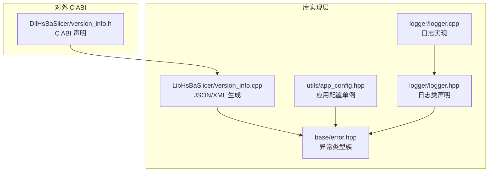
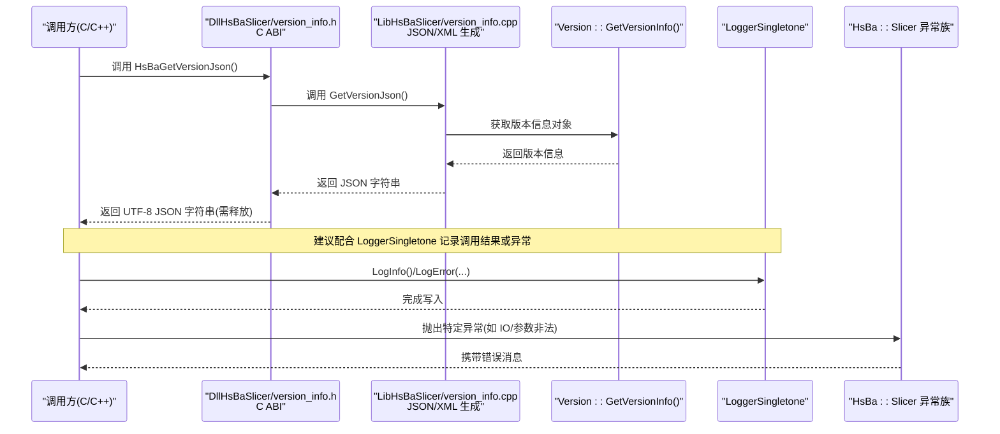
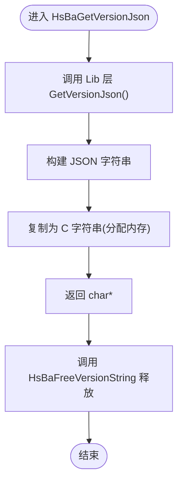
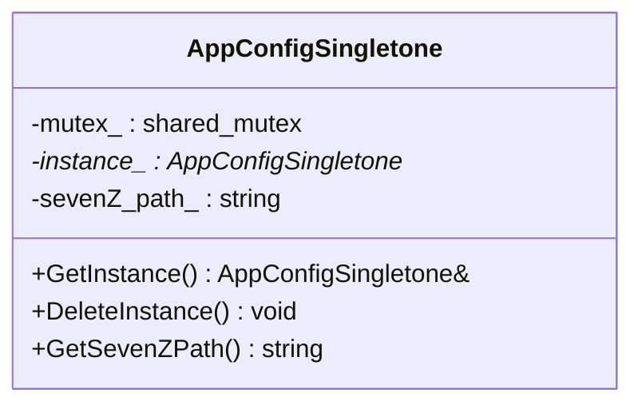
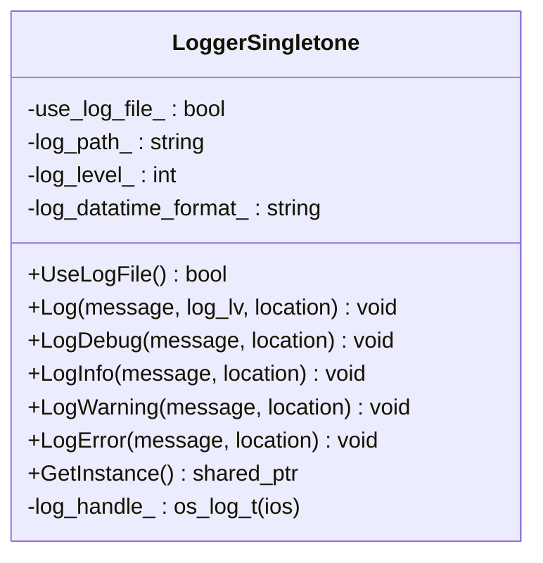
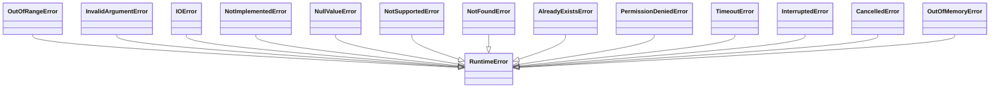
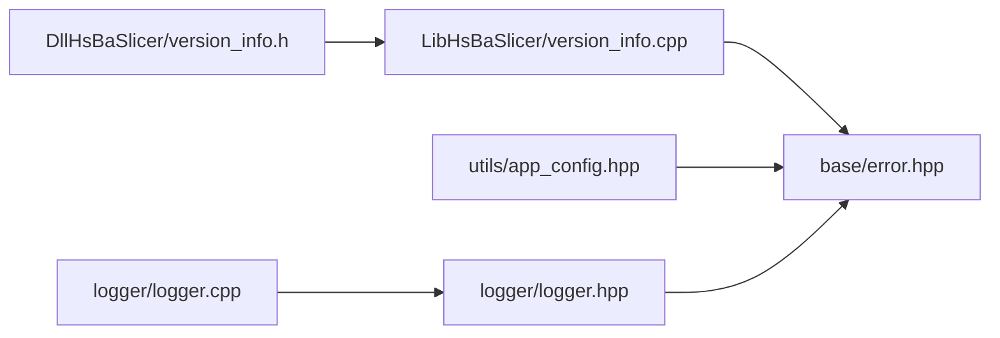

# 通用工具函数 API

<cite>
**本文引用的文件**   
- [HsBaSlicer.h](file://HsBaSlicer/HsBaSlicer.h)
- [version_info.h](file://DllHsBaSlicer/version_info.h)
- [version_info.cpp（DLL ABI）](file://DllHsBaSlicer/version_info.cpp)
- [version_info.cpp（Lib 实现）](file://LibHsBaSlicer/version_info.cpp)
- [error.hpp](file://base/error.hpp)
- [app_config.hpp](file://utils/app_config.hpp)
- [app_config.cpp](file://utils/app_config.cpp)
- [logger.hpp](file://logger/logger.hpp)
- [logger.cpp](file://logger/logger.cpp)
</cite>

## 目录
1. [简介](#简介)
2. [项目结构](#项目结构)
3. [核心组件](#核心组件)
4. [架构总览](#架构总览)
5. [详细组件分析](#详细组件分析)
6. [依赖关系分析](#依赖关系分析)
7. [性能考虑](#性能考虑)
8. [故障排查指南](#故障排查指南)
9. [结论](#结论)
10. [附录](#附录)

## 简介
本文件面向 HsBaSlicer 的“通用工具函数”C API，聚焦跨流水线类型的公共能力：版本信息查询、系统/应用配置访问、日志记录与错误类型体系。文档提供每个工具的参数说明、返回值定义、使用示例、错误码与异常处理机制、跨平台兼容性说明，以及与其它模块的集成方式与扩展点。

## 项目结构
围绕通用工具函数的关键代码分布如下：
- DllHsBaSlicer/version_info.{h,cpp}：对外暴露 C ABI 的版本信息接口（JSON/XML），并负责内存释放。
- LibHsBaSlicer/version_info.cpp：内部 C++ 实现，基于版本元数据生成 JSON/XML。
- base/error.hpp：统一的自定义异常类型族，便于上层统一捕获与诊断。
- utils/app_config.{hpp,cpp}：线程安全的单例应用配置，提供外部工具路径等共享设置。
- logger/{logger.hpp,logger.cpp}：跨平台线程安全日志单例，支持多级别输出与文件/控制台/系统日志。

图表来源
- [version_info.h:1-48](file://DllHsBaSlicer/version_info.h#L1-L48)
- [version_info.cpp（Lib 实现）:1-26](file://LibHsBaSlicer/version_info.cpp#L1-L26)
- [error.hpp:1-147](file://base/error.hpp#L1-L147)
- [app_config.hpp:1-50](file://utils/app_config.hpp#L1-L50)
- [logger.hpp:1-196](file://logger/logger.hpp#L1-L196)
- [logger.cpp:1-422](file://logger/logger.cpp#L1-L422)

章节来源
- [HsBaSlicer.h:1-9](file://HsBaSlicer/HsBaSlicer.h#L1-L9)

## 核心组件
本节概述通用工具函数的主要能力与职责边界：
- 版本信息查询：通过 C ABI 获取 JSON/XML 格式的版本信息字符串，并提供统一释放接口。
- 应用配置：线程安全的单例，提供如 7-Zip 可执行文件路径等共享设置。
- 日志记录：跨平台（Windows/macOS/Linux/iOS/Android）线程安全日志，支持多级输出与文件/控制台/系统日志。
- 错误类型：统一的异常类型族，覆盖运行时、IO、参数非法、未实现、内存不足等常见场景。

章节来源
- [version_info.h:16-41](file://DllHsBaSlicer/version_info.h#L16-L41)
- [app_config.hpp:14-46](file://utils/app_config.hpp#L14-L46)
- [logger.hpp:27-122](file://logger/logger.hpp#L27-L122)
- [error.hpp:17-144](file://base/error.hpp#L17-L144)

## 架构总览
下图展示从调用方到具体实现的调用链与职责划分。

图表来源
- [version_info.h:16-41](file://DllHsBaSlicer/version_info.h#L16-L41)
- [version_info.cpp（DLL ABI）:27-42](file://DllHsBaSlicer/version_info.cpp#L27-L42)
- [version_info.cpp（Lib 实现）:13-23](file://LibHsBaSlicer/version_info.cpp#L13-L23)
- [logger.hpp:44-89](file://logger/logger.hpp#L44-L89)
- [error.hpp:17-144](file://base/error.hpp#L17-L144)

## 详细组件分析

### 版本信息查询（C ABI）
- 接口
  - HsBaGetVersionJson：返回 UTF-8 编码的 JSON 字符串，调用方必须使用 HsBaFreeVersionString 释放。
  - HsBaGetVersionXml：返回 UTF-8 编码的 XML 字符串，调用方必须使用 HsBaFreeVersionString 释放。
  - HsBaFreeVersionString：释放由上述两个函数分配的字符串内存。
- 参数与返回值
  - HsBaGetVersionJson：无参；返回 char*（UTF-8 JSON）。
  - HsBaGetVersionXml：无参；返回 char*（UTF-8 XML）。
  - HsBaFreeVersionString：输入 char*；无返回值。
- 使用示例
  - 在 C/C++ 中调用 HsBaGetVersionJson，解析 JSON 后调用 HsBaFreeVersionString 释放。
  - 在脚本语言（Lua/Python）中通过 FFI 调用，注意生命周期管理。
- 错误处理
  - 若底层生成失败，可能抛出异常；建议在调用侧捕获并转换为错误码或日志告警。
- 跨平台
  - 该 ABI 为纯 C 接口，适用于任意语言绑定。

图表来源
- [version_info.cpp（DLL ABI）:27-42](file://DllHsBaSlicer/version_info.cpp#L27-L42)
- [version_info.cpp（Lib 实现）:13-23](file://LibHsBaSlicer/version_info.cpp#L13-L23)

章节来源
- [version_info.h:16-41](file://DllHsBaSlicer/version_info.h#L16-L41)
- [version_info.cpp（DLL ABI）:27-42](file://DllHsBaSlicer/version_info.cpp#L27-L42)
- [version_info.cpp（Lib 实现）:13-23](file://LibHsBaSlicer/version_info.cpp#L13-L23)

### 应用配置（AppConfigSingletone）
- 功能
  - 提供线程安全的单例访问，用于读取共享的应用级配置，例如外部工具路径（如 7-Zip）。
- 主要方法
  - GetInstance：获取单例实例。
  - DeleteInstance：销毁单例实例。
  - GetSevenZPath：获取配置的 7-Zip 可执行文件路径。
- 线程安全
  - 使用互斥量保护实例创建与属性读取。
- 使用示例
  - 初始化阶段调用 GetInstance 获取配置，随后读取 GetSevenZPath 以定位外部工具。
- 错误处理
  - 若配置缺失或未设置，返回空字符串或默认值（取决于实现），调用方可据此进行校验与提示。

图表来源
- [app_config.hpp:14-46](file://utils/app_config.hpp#L14-L46)
- [app_config.cpp:9-42](file://utils/app_config.cpp#L9-L42)

章节来源
- [app_config.hpp:14-46](file://utils/app_config.hpp#L14-L46)
- [app_config.cpp:9-42](file://utils/app_config.cpp#L9-L42)

### 日志记录（LoggerSingletone）
- 功能
  - 跨平台线程安全日志单例，支持调试/信息/警告/错误等多级别输出，支持文件、控制台与系统日志。
- 主要方法
  - UseLogFile：是否启用文件日志。
  - Log / LogDebug / LogInfo / LogWarning / LogError：按级别输出日志。
  - GetInstance：获取日志单例。
- 配置
  - 启动时尝试读取 logcfg.ini，若不存在则使用默认配置。
  - 支持时间戳格式、日志级别阈值、是否写文件等选项。
- 跨平台
  - Windows/macOS/Linux：Boost.Log 控制台与文件输出。
  - iOS：os_log 系统日志。
  - Android：__android_log_print 内核日志。
- 使用示例
  - 在关键流程前后调用 LogInfo/LogError 记录状态与异常。
  - 结合异常类型族，将错误分类记录以便后续分析。

图表来源
- [logger.hpp:27-122](file://logger/logger.hpp#L27-L122)
- [logger.cpp:136-222](file://logger/logger.cpp#L136-L222)
- [logger.cpp:242-379](file://logger/logger.cpp#L242-L379)

章节来源
- [logger.hpp:27-122](file://logger/logger.hpp#L27-L122)
- [logger.cpp:136-222](file://logger/logger.cpp#L136-L222)
- [logger.cpp:242-379](file://logger/logger.cpp#L242-L379)

### 错误类型族（HsBa::Slicer 异常）
- 类型概览
  - RuntimeError：基础运行时异常。
  - OutOfRangeError：越界错误。
  - InvalidArgumentError：参数非法。
  - IOError：I/O 错误。
  - NotImplementedError：未实现。
  - NullValueError：空值错误。
  - NotSupportedError：不支持。
  - NotFoundError：未找到。
  - AlreadyExistsError：已存在。
  - PermissionDeniedError：权限拒绝。
  - TimeoutError：超时。
  - InterruptedError：中断。
  - CancelledError：取消。
  - OutOfMemoryError：内存不足。
- 使用建议
  - 在各模块中抛出对应异常，并在顶层统一捕获并记录日志。
  - 对 C ABI 层，将异常转换为错误码或错误字符串返回给调用方。

图表来源
- [error.hpp:17-144](file://base/error.hpp#L17-L144)

章节来源
- [error.hpp:17-144](file://base/error.hpp#L17-L144)

## 依赖关系分析
- 版本查询 ABI 依赖 Lib 层的 JSON/XML 生成逻辑。
- 日志与配置均依赖统一的异常类型族进行错误表达。
- 日志实现依赖平台相关头文件与第三方库（Boost.Log、os_log、android log）。

图表来源
- [version_info.h:1-48](file://DllHsBaSlicer/version_info.h#L1-L48)
- [version_info.cpp（Lib 实现）:1-26](file://LibHsBaSlicer/version_info.cpp#L1-L26)
- [error.hpp:1-147](file://base/error.hpp#L1-L147)
- [app_config.hpp:1-50](file://utils/app_config.hpp#L1-L50)
- [logger.hpp:1-196](file://logger/logger.hpp#L1-L196)
- [logger.cpp:1-422](file://logger/logger.cpp#L1-L422)

章节来源
- [version_info.h:1-48](file://DllHsBaSlicer/version_info.h#L1-L48)
- [version_info.cpp（Lib 实现）:1-26](file://LibHsBaSlicer/version_info.cpp#L1-L26)
- [error.hpp:1-147](file://base/error.hpp#L1-L147)
- [app_config.hpp:1-50](file://utils/app_config.hpp#L1-L50)
- [logger.hpp:1-196](file://logger/logger.hpp#L1-L196)
- [logger.cpp:1-422](file://logger/logger.cpp#L1-L422)

## 性能考虑
- 版本查询
  - JSON/XML 生成涉及序列化开销，建议在启动阶段缓存结果，避免频繁调用。
  - 注意 C ABI 返回的字符串需要显式释放，避免内存泄漏。
- 日志记录
  - 高频日志会显著影响性能，生产环境建议提高日志级别阈值，减少 DEBUG/TRACE 输出。
  - 文件日志开启时，注意日志轮转大小与频率，避免磁盘 I/O 成为瓶颈。
- 配置访问
  - 单例读取为轻量操作，但应避免在热路径上重复构造或频繁切换配置。

[本节为通用指导，不直接分析具体文件]

## 故障排查指南
- 版本查询返回空或异常
  - 检查底层版本元数据是否正确生成。
  - 确认调用方正确释放返回的字符串。
- 日志未输出或输出位置异常
  - 检查 logcfg.ini 是否存在且字段有效。
  - 确认当前平台分支（iOS/Android/桌面）的日志后端是否可用。
- 配置路径为空
  - 检查配置文件是否加载成功，以及外部工具路径是否已设置。
- 异常未捕获导致崩溃
  - 在顶层统一捕获 HsBa::Slicer 异常族，并记录详细上下文。

章节来源
- [logger.cpp:147-183](file://logger/logger.cpp#L147-L183)
- [logger.cpp:242-379](file://logger/logger.cpp#L242-L379)
- [app_config.cpp:14-42](file://utils/app_config.cpp#L14-L42)
- [error.hpp:17-144](file://base/error.hpp#L17-L144)

## 结论
HsBaSlicer 的通用工具函数提供了稳定的 C ABI 版本查询、线程安全的配置与日志能力，并以统一的异常类型族规范错误表达。这些组件为跨流水线类型提供了坚实的基础设施，便于上层业务模块专注于切片与路径生成等核心逻辑。

[本节为总结性内容，不直接分析具体文件]

## 附录
- 与其他模块的集成方式
  - 在流水线各阶段使用 LoggerSingletone 记录关键步骤与异常。
  - 通过 AppConfigSingletone 获取外部工具路径，驱动压缩/解压等任务。
  - 在 C 绑定层封装 HsBaGetVersionJson/Xml，供脚本语言调用。
- 扩展点
  - 新增配置项：在 AppConfigSingletone 中添加属性与读写方法。
  - 新增日志级别或后端：在 LoggerSingletone 中扩展级别映射与输出目标。
  - 扩展版本信息：在 Lib 层 Version 元数据中增加字段，自动反映到 JSON/XML。

[本节为概念性内容，不直接分析具体文件]